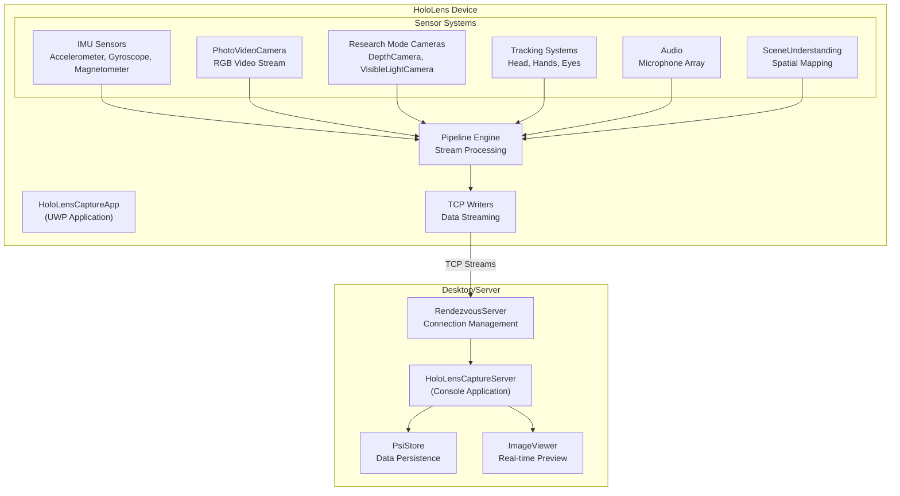
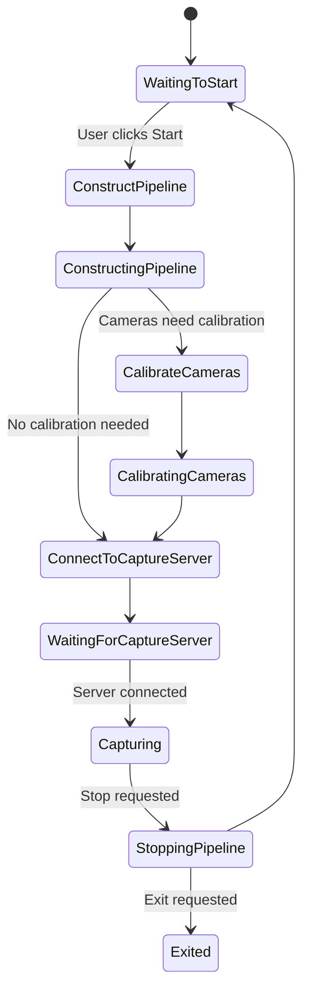
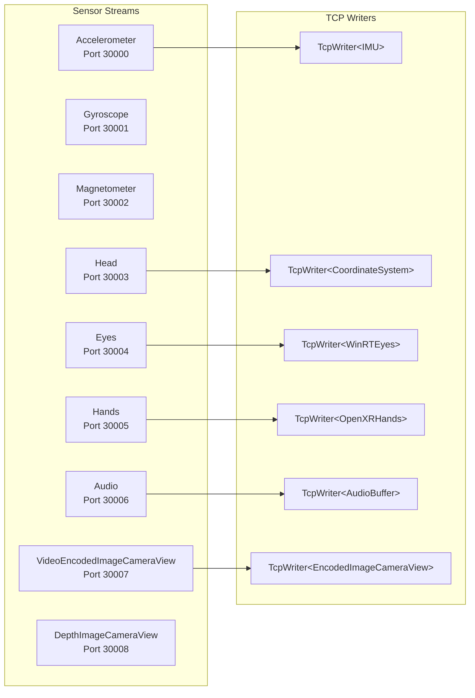
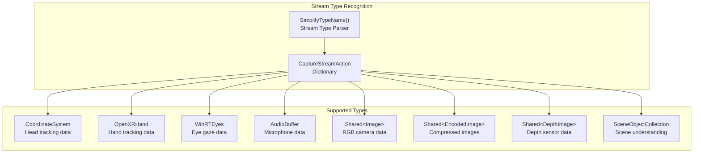
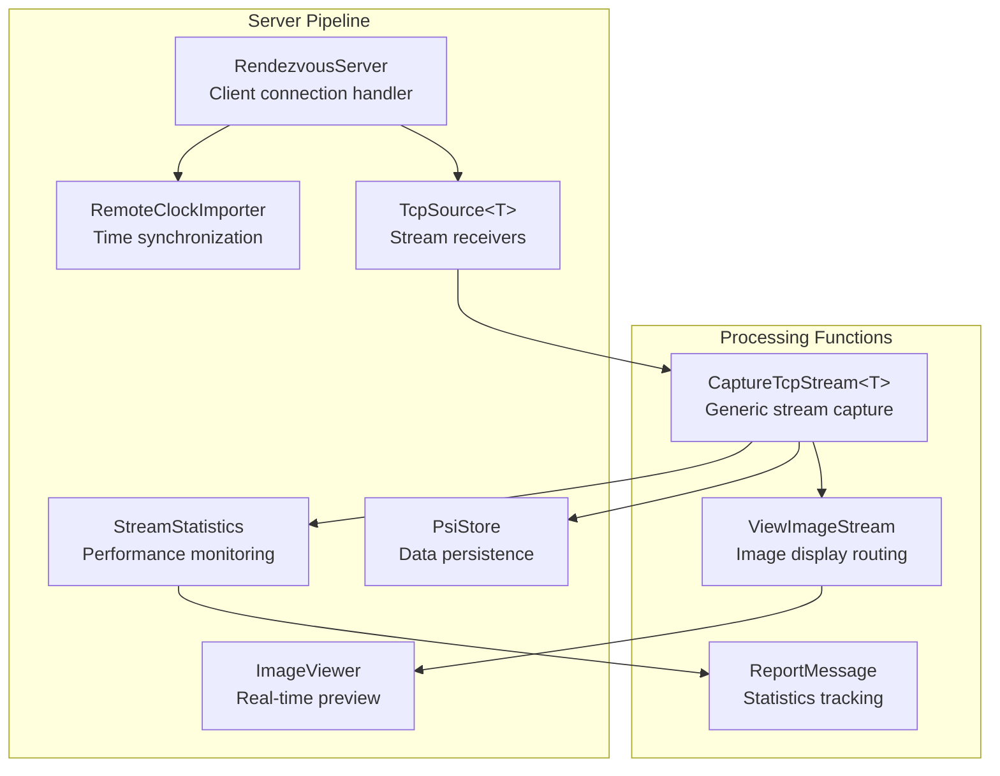
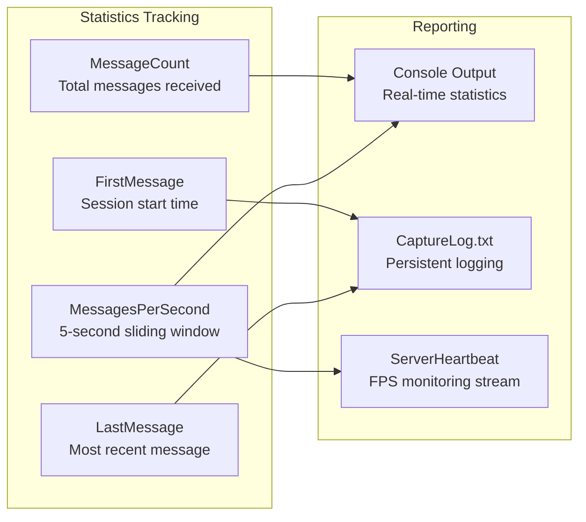

<!-- source: DeepWiki mcp.deepwiki.com · repo microsoft/psi · page 3 Mixed Reality and HoloLens · fetched 2026-10-26 -->

# Mixed Reality and HoloLens

Relevant source files

The following files were used as context for generating this wiki page:

- [Sources/MixedReality/HoloLensCapture/HoloLensCaptureApp/Assets/Logo/SplashScreen.scale-100.png](Sources/MixedReality/HoloLensCapture/HoloLensCaptureApp/Assets/Logo/SplashScreen.scale-100.png)
- [Sources/MixedReality/HoloLensCapture/HoloLensCaptureApp/Assets/Logo/Square150x150Logo.scale-100.png](Sources/MixedReality/HoloLensCapture/HoloLensCaptureApp/Assets/Logo/Square150x150Logo.scale-100.png)
- [Sources/MixedReality/HoloLensCapture/HoloLensCaptureApp/Assets/Logo/Wide310x150Logo.scale-100.png](Sources/MixedReality/HoloLensCapture/HoloLensCaptureApp/Assets/Logo/Wide310x150Logo.scale-100.png)
- [Sources/MixedReality/HoloLensCapture/HoloLensCaptureApp/HoloLensCaptureApp.cs](Sources/MixedReality/HoloLensCapture/HoloLensCaptureApp/HoloLensCaptureApp.cs)
- [Sources/MixedReality/HoloLensCapture/HoloLensCaptureApp/HoloLensCaptureApp.csproj](Sources/MixedReality/HoloLensCapture/HoloLensCaptureApp/HoloLensCaptureApp.csproj)
- [Sources/MixedReality/HoloLensCapture/HoloLensCaptureServer/HoloLensCaptureServer.cs](Sources/MixedReality/HoloLensCapture/HoloLensCaptureServer/HoloLensCaptureServer.cs)
- [Sources/MixedReality/HoloLensCapture/HoloLensCaptureServer/HoloLensCaptureServer.csproj](Sources/MixedReality/HoloLensCapture/HoloLensCaptureServer/HoloLensCaptureServer.csproj)
- [Sources/MixedReality/HoloLensCapture/HoloLensCaptureServer/ImageViewer.cs](Sources/MixedReality/HoloLensCapture/HoloLensCaptureServer/ImageViewer.cs)

The Mixed Reality and HoloLens subsystem provides comprehensive capabilities for capturing, streaming, and processing multi-modal sensor data from Microsoft HoloLens devices within the Psi framework. This system enables real-time collection of spatial computing data including head tracking, hand tracking, eye gaze, audio, RGB video, depth imaging, and scene understanding for research and application development.

For information about general mixed reality framework components, see [Mixed Reality Framework Components](#3.4). For data export and analysis tools, see [Data Export and Format Conversion](#3.2). For the Sigma task assistance application, see [Sigma Task Assistance Application](#3.3).

## System Architecture

The HoloLens integration follows a client-server architecture where a UWP application running on the HoloLens device captures sensor data and streams it over TCP to a desktop server application for persistence and analysis.

Sources: [Sources/MixedReality/HoloLensCapture/HoloLensCaptureApp/HoloLensCaptureApp.cs:1-750](), [Sources/MixedReality/HoloLensCapture/HoloLensCaptureServer/HoloLensCaptureServer.cs:1-569]()

## HoloLens Capture Application

The `HoloLensCaptureApp` class implements the client-side data collection system that runs on HoloLens devices. It constructs a comprehensive sensor pipeline and streams data to a connected server.

### Sensor Configuration

The application provides configurable access to all major HoloLens sensor systems:

| Sensor Type | Configuration Class | Key Parameters |
|-------------|-------------------|----------------|
| IMU | `Accelerometer`, `Gyroscope`, `Magnetometer` | Always enabled when `IncludeImu = true` |
| RGB Video | `PhotoVideoCamera` | Resolution: 896x504, Frame rate: 30fps |
| Depth | `DepthCamera` | Long-throw and AHAT modes available |
| Gray Cameras | `VisibleLightCamera` | Front and side cameras, JPEG/GZip encoding |
| Head Tracking | `StereoKitHeadSensor` | 20ms interval |
| Eye Tracking | `WinRTGazeSensor` | 45Hz update rate |
| Hand Tracking | `OpenXRHandsSensor` | 45Hz update rate |
| Audio | `Microphone` | 16384 sample frames |
| Scene Understanding | `SceneUnderstanding` | 60-second intervals |

Sources: [Sources/MixedReality/HoloLensCapture/HoloLensCaptureApp/HoloLensCaptureApp.cs:58-110](), [Sources/MixedReality/HoloLensCapture/HoloLensCaptureApp/HoloLensCaptureApp.cs:249-387]()

### Pipeline Construction and State Management

The application uses a state machine to manage the capture lifecycle:

Sources: [Sources/MixedReality/HoloLensCapture/HoloLensCaptureApp/HoloLensCaptureApp.cs:124-136](), [Sources/MixedReality/HoloLensCapture/HoloLensCaptureApp/HoloLensCaptureApp.cs:214-397]()

### TCP Streaming Protocol

Data streams are transmitted using the Rendezvous protocol with `TcpWriter` components. Each sensor stream is assigned a dedicated TCP port starting from 30000:

Sources: [Sources/MixedReality/HoloLensCapture/HoloLensCaptureApp/HoloLensCaptureApp.cs:504-509](), [Sources/MixedReality/HoloLensCapture/HoloLensCaptureApp/HoloLensCaptureApp.cs:513-647]()

## HoloLens Capture Server

The `HoloLensCaptureServer` class implements the server-side component that receives streams from HoloLens devices and persists them to `PsiStore` for analysis.

### Stream Type Mapping

The server maintains a dictionary mapping stream types to capture actions:

Sources: [Sources/MixedReality/HoloLensCapture/HoloLensCaptureServer/HoloLensCaptureServer.cs:37-143]()

### Data Processing Pipeline

The server creates a processing pipeline for each connected HoloLens device:

Sources: [Sources/MixedReality/HoloLensCapture/HoloLensCaptureServer/HoloLensCaptureServer.cs:223-353](), [Sources/MixedReality/HoloLensCapture/HoloLensCaptureServer/HoloLensCaptureServer.cs:355-379]()

## Configuration and Deployment

### Build Configuration

The HoloLens capture system requires specific build configurations for Universal Windows Platform (UWP) deployment:

| Component | Target Framework | Platform |
|-----------|------------------|----------|
| HoloLensCaptureApp | UWP 10.0.22621.0 | ARM |
| HoloLensCaptureServer | .NET Framework 4.7.2 | AnyCPU |

Sources: [Sources/MixedReality/HoloLensCapture/HoloLensCaptureApp/HoloLensCaptureApp.csproj:14-16](), [Sources/MixedReality/HoloLensCapture/HoloLensCaptureServer/HoloLensCaptureServer.csproj:5]()

### Dependencies

The system relies on several key dependencies:

- **HoloLens2ResearchMode**: Native C++ component for accessing research mode cameras
- **Microsoft.Psi.MixedReality**: Core mixed reality components and sensor interfaces  
- **Microsoft.Psi.Interop**: Cross-process communication and serialization
- **StereoKit**: Mixed reality toolkit for spatial interaction
- **MathNet.Spatial**: Spatial mathematics and coordinate transformations

Sources: [Sources/MixedReality/HoloLensCapture/HoloLensCaptureApp/HoloLensCaptureApp.csproj:92-131](), [Sources/MixedReality/HoloLensCapture/HoloLensCaptureServer/HoloLensCaptureServer.csproj:36-43]()

## Performance Monitoring

The server provides comprehensive performance monitoring through the `StreamStatistics` class:

Sources: [Sources/MixedReality/HoloLensCapture/HoloLensCaptureServer/HoloLensCaptureServer.cs:511-566](), [Sources/MixedReality/HoloLensCapture/HoloLensCaptureServer/HoloLensCaptureServer.cs:285-346]()

---

