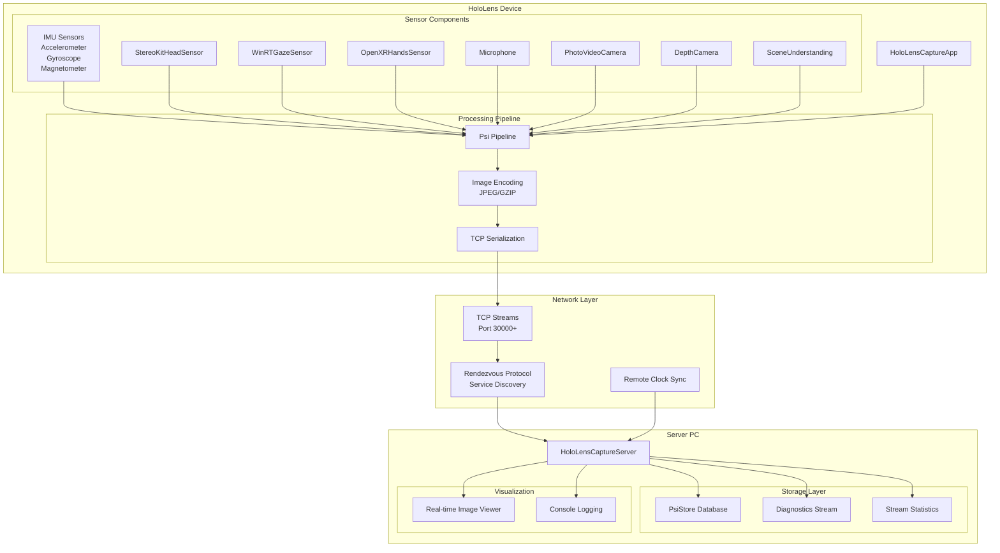
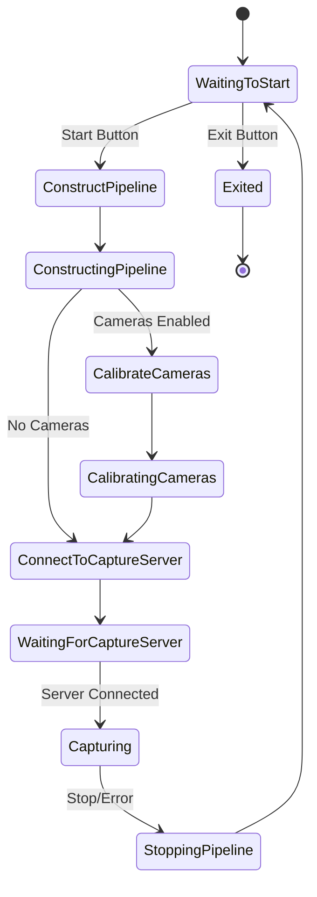
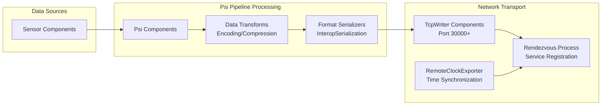
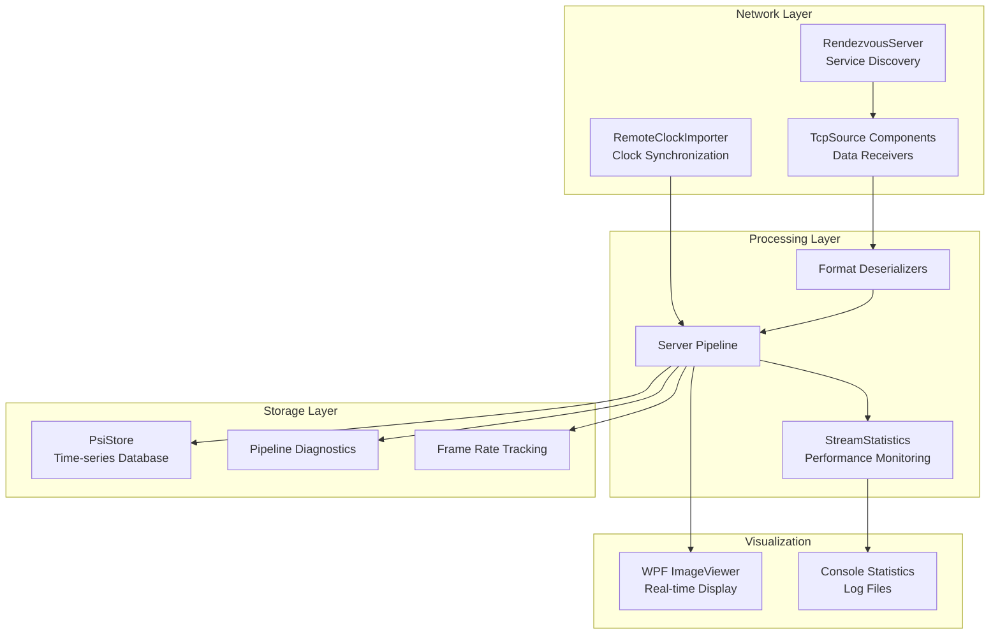
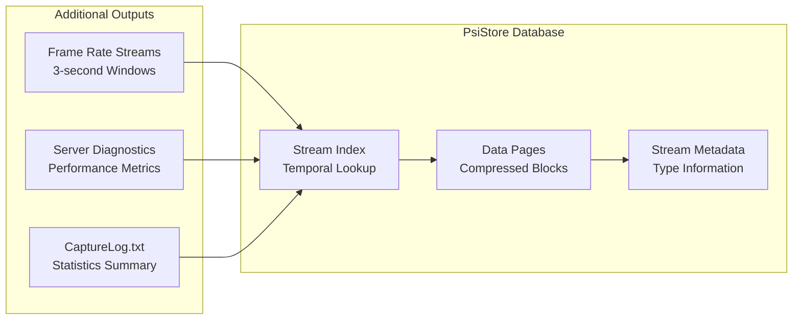
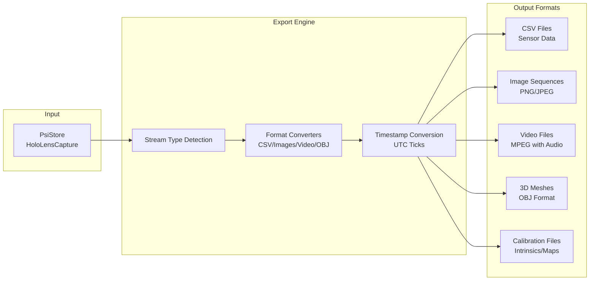

<!-- source: DeepWiki mcp.deepwiki.com · repo microsoft/psi · page 3.1 HoloLens Data Capture · fetched 2026-10-26 -->

# HoloLens Data Capture

Relevant source files

The following files were used as context for generating this wiki page:

- [Sources/Audio/Microsoft.Psi.Audio/Reframe.cs](Sources/Audio/Microsoft.Psi.Audio/Reframe.cs)
- [Sources/MixedReality/HoloLensCapture/HoloLensCaptureApp/Assets/Logo/SplashScreen.scale-100.png](Sources/MixedReality/HoloLensCapture/HoloLensCaptureApp/Assets/Logo/SplashScreen.scale-100.png)
- [Sources/MixedReality/HoloLensCapture/HoloLensCaptureApp/Assets/Logo/Square150x150Logo.scale-100.png](Sources/MixedReality/HoloLensCapture/HoloLensCaptureApp/Assets/Logo/Square150x150Logo.scale-100.png)
- [Sources/MixedReality/HoloLensCapture/HoloLensCaptureApp/Assets/Logo/Wide310x150Logo.scale-100.png](Sources/MixedReality/HoloLensCapture/HoloLensCaptureApp/Assets/Logo/Wide310x150Logo.scale-100.png)
- [Sources/MixedReality/HoloLensCapture/HoloLensCaptureApp/HoloLensCaptureApp.cs](Sources/MixedReality/HoloLensCapture/HoloLensCaptureApp/HoloLensCaptureApp.cs)
- [Sources/MixedReality/HoloLensCapture/HoloLensCaptureApp/HoloLensCaptureApp.csproj](Sources/MixedReality/HoloLensCapture/HoloLensCaptureApp/HoloLensCaptureApp.csproj)
- [Sources/MixedReality/HoloLensCapture/HoloLensCaptureExporter/Readme.md](Sources/MixedReality/HoloLensCapture/HoloLensCaptureExporter/Readme.md)
- [Sources/MixedReality/HoloLensCapture/HoloLensCaptureServer/HoloLensCaptureServer.cs](Sources/MixedReality/HoloLensCapture/HoloLensCaptureServer/HoloLensCaptureServer.cs)
- [Sources/MixedReality/HoloLensCapture/HoloLensCaptureServer/HoloLensCaptureServer.csproj](Sources/MixedReality/HoloLensCapture/HoloLensCaptureServer/HoloLensCaptureServer.csproj)
- [Sources/MixedReality/HoloLensCapture/HoloLensCaptureServer/ImageViewer.cs](Sources/MixedReality/HoloLensCapture/HoloLensCaptureServer/ImageViewer.cs)
- [Sources/MixedReality/Microsoft.Psi.MixedReality.UniversalWindows/SceneUnderstanding.cs](Sources/MixedReality/Microsoft.Psi.MixedReality.UniversalWindows/SceneUnderstanding.cs)

## Purpose and Scope

The HoloLens Data Capture system provides a comprehensive solution for collecting, streaming, and storing multi-modal sensor data from Microsoft HoloLens 2 devices. This system consists of three main components: a HoloLens capture application, a capture server for data aggregation and storage, and an exporter for converting captured data to various analysis formats.

This document covers the data capture pipeline from sensor acquisition through network streaming to persistent storage. For information about exported data formats and analysis workflows, see [Data Export and Format Conversion](#3.2). For details about the underlying mixed reality framework components, see [Mixed Reality Framework Components](#3.4).

## System Architecture

The HoloLens Data Capture system follows a distributed architecture where sensor data is captured on the HoloLens device and streamed over TCP to a server for storage and processing.

Sources: [Sources/MixedReality/HoloLensCapture/HoloLensCaptureApp/HoloLensCaptureApp.cs:1-849](), [Sources/MixedReality/HoloLensCapture/HoloLensCaptureServer/HoloLensCaptureServer.cs:1-569]()

## HoloLens Capture Application

The `HoloLensCaptureApp` is a Universal Windows Platform (UWP) application that runs on HoloLens 2 devices and orchestrates the collection of sensor data.

### Application States

The capture application operates through a state machine that manages the capture lifecycle:

Sources: [Sources/MixedReality/HoloLensCapture/HoloLensCaptureApp/HoloLensCaptureApp.cs:124-136]()

### Sensor Configuration

The application provides extensive configuration options for each sensor type:

| Sensor Type | Configuration Class | Key Parameters |
|-------------|-------------------|----------------|
| IMU | `Accelerometer`, `Gyroscope`, `Magnetometer` | Sample rate (hardware dependent) |
| Head Tracking | `StereoKitHeadSensor` | `HeadInterval` (20ms default) |
| Eye Tracking | `WinRTGazeSensor` | `EyesInterval` (45Hz default) |
| Hand Tracking | `OpenXRHandsSensor` | `HandsInterval` (45Hz default) |
| Audio | `Microphone` | 16384 byte frames, 48kHz |
| Video | `PhotoVideoCamera` | 896x504@30fps, JPEG encoding |
| Depth | `DepthCamera` | Long-throw and AHAT modes |
| Scene | `SceneUnderstanding` | 60 second intervals |

Sources: [Sources/MixedReality/HoloLensCapture/HoloLensCaptureApp/HoloLensCaptureApp.cs:89-109]()

### Data Streaming Pipeline

The application uses Psi's TCP transport mechanism to stream data to the server:

The streaming process creates individual TCP writers for each data type, starting from port 30000 and incrementing for each stream. Each writer is registered with the rendezvous service for automatic discovery by the server.

Sources: [Sources/MixedReality/HoloLensCapture/HoloLensCaptureApp/HoloLensCaptureApp.cs:504-509](), [Sources/MixedReality/HoloLensCapture/HoloLensCaptureApp/HoloLensCaptureApp.cs:513-600]()

## Capture Server

The `HoloLensCaptureServer` is a .NET Framework console application that receives streamed data and persists it to storage.

### Server Components

Sources: [Sources/MixedReality/HoloLensCapture/HoloLensCaptureServer/HoloLensCaptureServer.cs:145-150](), [Sources/MixedReality/HoloLensCapture/HoloLensCaptureServer/HoloLensCaptureServer.cs:223-353]()

### Stream Type Mapping

The server uses a dictionary-based dispatch system to handle different data types:

| Stream Type | Handler Function | Serializer Format |
|-------------|------------------|-------------------|
| `CoordinateSystem` | `CaptureTcpStream<CoordinateSystem>` | `CoordinateSystemFormat()` |
| `WinRTEyes` | `CaptureTcpStream<WinRTEyes>` | `WinRTEyesFormat()` |
| `OpenXRHand` | `CaptureTcpStream<OpenXRHand>` | `OpenXRHandFormat()` |
| `AudioBuffer` | `CaptureTcpStream<AudioBuffer>` | `AudioBufferFormat()` |
| `Shared<EncodedImage>` | `ViewImageStream + Decode` | `SharedEncodedImageFormat()` |
| `DepthImageCameraView` | `CaptureTcpStream<DepthImageCameraView>` | `DepthImageCameraViewFormat()` |
| `SceneObjectCollection` | `CaptureTcpStream<SceneObjectCollection>` | `SceneObjectCollectionFormat()` |

Sources: [Sources/MixedReality/HoloLensCapture/HoloLensCaptureServer/HoloLensCaptureServer.cs:37-143]()

### Data Storage Schema

The server stores data using the PsiStore format with automatic stream indexing and compression:

Sources: [Sources/MixedReality/HoloLensCapture/HoloLensCaptureServer/HoloLensCaptureServer.cs:242-243](), [Sources/MixedReality/HoloLensCapture/HoloLensCaptureServer/HoloLensCaptureServer.cs:370-376]()

## Data Export System

The export system converts captured PsiStore data into analysis-ready formats. For detailed information about export formats and usage, see the [HoloLens Capture Exporter documentation](#3.2).

### Export Process Flow

Sources: [Sources/MixedReality/HoloLensCapture/HoloLensCaptureExporter/Readme.md:1-304]()

## Configuration and Deployment

### Build Configuration

The HoloLens capture application targets the Universal Windows Platform with specific requirements:

- **Target Platform**: `UAP` (Universal Windows Platform)
- **Minimum Version**: `10.0.17763.0` (Windows 10 v1809)
- **Target Version**: `10.0.22621.0` (Windows 11 22H2)
- **Architecture**: `ARM` for HoloLens 2 deployment

Sources: [Sources/MixedReality/HoloLensCapture/HoloLensCaptureApp/HoloLensCaptureApp.csproj:13-16]()

### Required Capabilities

The application requires specific UWP capabilities for sensor access:
- Spatial Perception (for scene understanding)
- Microphone access
- Camera access
- Network connectivity

### Server Configuration

The capture server uses app.config settings for customization:

| Setting | Default | Purpose |
|---------|---------|---------|
| `storeName` | "HoloLensCapture" | PsiStore database name |
| `storePath` | User-specified | Storage directory path |
| `diagnosticsIntervalSeconds` | 5.0 | Performance monitoring interval |

Sources: [Sources/MixedReality/HoloLensCapture/HoloLensCaptureServer/HoloLensCaptureServer.cs:225-229]()

The server listens on the default rendezvous port and automatically discovers HoloLens devices on the network. Clock synchronization ensures accurate temporal alignment between captured sensor streams.

---

