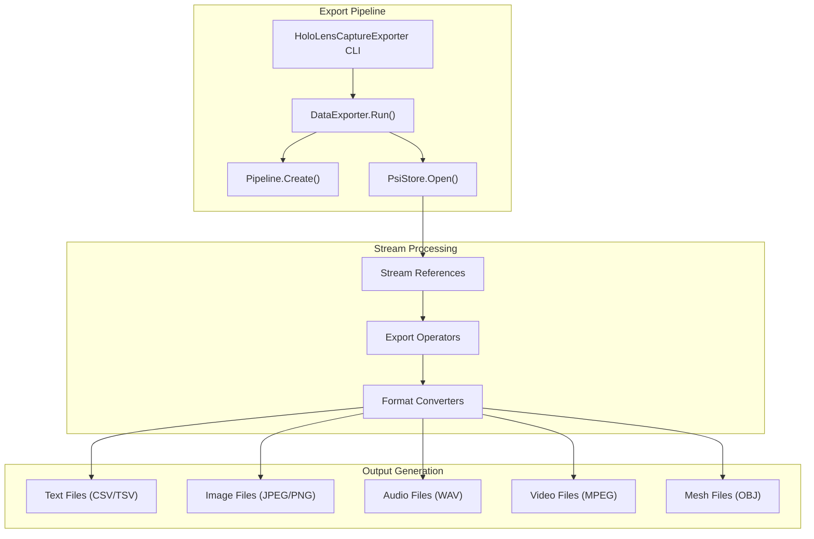
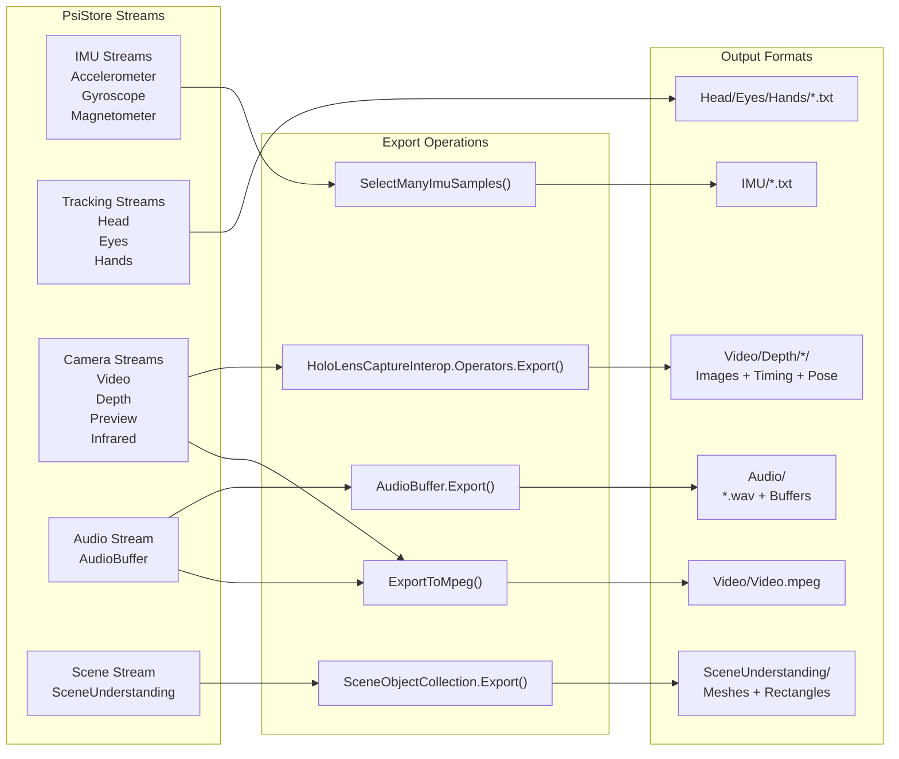
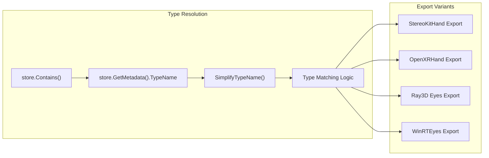
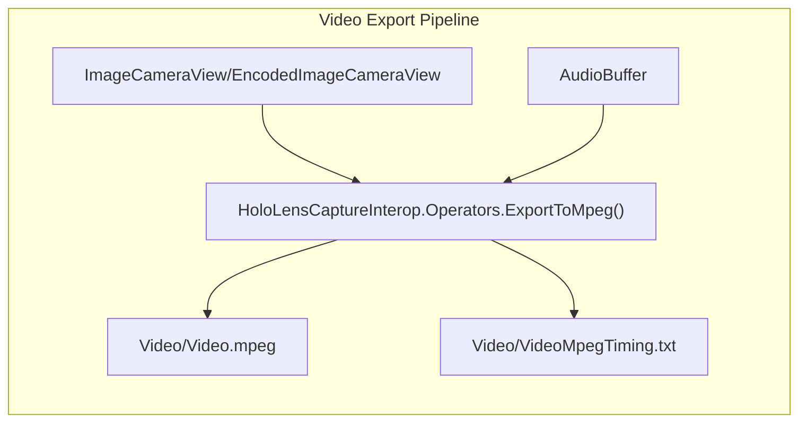

<!-- source: DeepWiki mcp.deepwiki.com · repo microsoft/psi · page 3.2 Data Export and Format Conversion · fetched 2026-10-26 -->

# Data Export and Format Conversion

<details>
<summary>Relevant source files</summary>

The following files were used as context for generating this wiki page:

- [Sources/Audio/Microsoft.Psi.Audio/Reframe.cs](Sources/Audio/Microsoft.Psi.Audio/Reframe.cs)
- [Sources/MixedReality/HoloLensCapture/HoloLensCapture.sln](Sources/MixedReality/HoloLensCapture/HoloLensCapture.sln)
- [Sources/MixedReality/HoloLensCapture/HoloLensCaptureExporter/DataExporter.cs](Sources/MixedReality/HoloLensCapture/HoloLensCaptureExporter/DataExporter.cs)
- [Sources/MixedReality/HoloLensCapture/HoloLensCaptureExporter/HoloLensCaptureExporter.csproj](Sources/MixedReality/HoloLensCapture/HoloLensCaptureExporter/HoloLensCaptureExporter.csproj)
- [Sources/MixedReality/HoloLensCapture/HoloLensCaptureExporter/Readme.md](Sources/MixedReality/HoloLensCapture/HoloLensCaptureExporter/Readme.md)
- [Sources/MixedReality/Microsoft.Psi.MixedReality.UniversalWindows/SceneUnderstanding.cs](Sources/MixedReality/Microsoft.Psi.MixedReality.UniversalWindows/SceneUnderstanding.cs)

</details>


This document covers the data export and format conversion capabilities for HoloLens sensor data collected within Microsoft Psi. The system converts time-series data stored in PsiStore format to various external formats suitable for analysis, research, and interoperability with other tools.

For information about collecting HoloLens data, see [HoloLens Data Capture](#3.1). For details on the core data persistence system, see [Data Persistence and Storage](#2.2).

## Overview

The data export system enables conversion of multimodal HoloLens sensor data from Psi's native storage format to standard formats including CSV, image files, audio files, video, and 3D meshes. The primary tool is the `HoloLensCaptureExporter` command-line application, which processes PsiStore files and outputs structured directories containing the converted data.

## Export System Architecture

The export system is built around the `DataExporter` class and a collection of specialized export operators that handle different data types and output formats.

### Core Export Architecture



**Sources:** [Sources/MixedReality/HoloLensCapture/HoloLensCaptureExporter/DataExporter.cs:20-273]()

### Data Flow and Stream Handling



**Sources:** [Sources/MixedReality/HoloLensCapture/HoloLensCaptureExporter/DataExporter.cs:60-198]()

## Supported Data Types and Export Formats

The export system handles the following HoloLens sensor data types:

### IMU Data Streams

| Stream Type | Export Format | Output Location |
|-------------|---------------|-----------------|
| Accelerometer | Tab-separated text | `IMU/Accelerometer/Accelerometer.txt` |
| Gyroscope | Tab-separated text | `IMU/Gyroscope/Gyroscope.txt` |
| Magnetometer | Tab-separated text | `IMU/Magnetometer/Magnetometer.txt` |

Each IMU file contains timestamp and X/Y/Z values with appropriate units (m/s², rad/s, μT).

**Sources:** [Sources/MixedReality/HoloLensCapture/HoloLensCaptureExporter/DataExporter.cs:139-141](), [Sources/MixedReality/HoloLensCapture/HoloLensCaptureExporter/Readme.md:58-96]()

### Camera and Image Streams

The system exports multiple camera streams including:

- **Video**: Front-facing color camera (`VideoImageCameraView`/`VideoEncodedImageCameraView`)
- **Preview**: Mixed reality preview with holograms  
- **Depth**: Far-depth camera (`DepthImageCameraView`)
- **Infrared**: Infrared depth camera views
- **Grayscale cameras**: `LeftFront`, `RightFront`, `LeftLeft`, `RightRight`

Each camera stream exports:
- Individual frame images (JPEG for encoded streams, PNG for unencoded)
- Timing information (`Timing.txt`)
- Camera pose data (`Pose.txt`)
- Camera intrinsics (`Intrinsics.txt`)
- Calibration maps when available (`CalibrationMap.txt`)

**Sources:** [Sources/MixedReality/HoloLensCapture/HoloLensCaptureExporter/DataExporter.cs:117-136](), [Sources/MixedReality/HoloLensCapture/HoloLensCaptureExporter/Readme.md:178-258]()

### Tracking Data

| Data Type | Format | Output Location |
|-----------|--------|-----------------|
| Head pose | 4×4 transformation matrix | `Head/Head.txt` |
| Eye gaze | 3D ray (origin + direction) | `Eyes/Eyes.txt` |
| Hand poses | Joint matrices + validity flags | `Hands/Left.txt`, `Hands/Right.txt` |

Hand tracking exports 26 joints per hand with pose matrices, validity states, and tracking states.

**Sources:** [Sources/MixedReality/HoloLensCapture/HoloLensCaptureExporter/DataExporter.cs:144-179](), [Sources/MixedReality/HoloLensCapture/HoloLensCaptureExporter/Readme.md:98-163]()

### Audio Data

Audio streams export to multiple formats:
- **WAV file**: `Audio/Audio.wav` (IEEE float, 48KHz, mono)
- **Buffer files**: Individual audio buffers as `.bin` files in `Audio/Buffers/`
- **Timing data**: Buffer timing information in `Audio/Buffers/Timing.txt`

**Sources:** [Sources/MixedReality/HoloLensCapture/HoloLensCaptureExporter/DataExporter.cs:182](), [Sources/MixedReality/HoloLensCapture/HoloLensCaptureExporter/Readme.md:164-177]()

### Scene Understanding Data

Scene understanding streams export spatial environment data:
- **Rectangles**: Flat surface definitions (`Rectangles.txt`)
- **Meshes**: 3D mesh data as OBJ files in `Meshes/` and `ColliderMeshes/` subdirectories
- **Mesh counts**: Number of meshes per timestamp (`Meshes.txt`)

Data is categorized by scene object types: World, Inferred, Background, Wall, Floor, Ceiling, Platform, Unknown.

**Sources:** [Sources/MixedReality/HoloLensCapture/HoloLensCaptureExporter/DataExporter.cs:185](), [Sources/MixedReality/HoloLensCapture/HoloLensCaptureExporter/Readme.md:262-296]()

## Export Process Implementation

### Command Line Interface

The export process is initiated through the `HoloLensCaptureExporter` command-line tool:

```bash
HoloLensCaptureExporter -p <store_path> -o <output_path> [-n <store_name>]
```

**Sources:** [Sources/MixedReality/HoloLensCapture/HoloLensCaptureExporter/Readme.md:3-19]()

### Core Export Logic


**Sources:** [Sources/MixedReality/HoloLensCapture/HoloLensCaptureExporter/DataExporter.cs:45-213]()

### Type-Specific Export Handling

The system uses dynamic type checking to handle different versions of data structures:



**Sources:** [Sources/MixedReality/HoloLensCapture/HoloLensCaptureExporter/DataExporter.cs:146-179](), [Sources/MixedReality/HoloLensCapture/HoloLensCaptureExporter/DataExporter.cs:225-271]()

## Data Format Specifications

### Timestamp Format

All timestamps use Coordinated Universal Time (UTC) as 64-bit integers counting 100-nanosecond ticks since January 1, 0001 CE.

### Pose Data Format

Poses are represented as 4×4 transformation matrices in row-major order with tab-separated values:

```
M₀₀  M₀₁  M₀₂  M₀₃  M₁₀  M₁₁  M₁₂  M₁₃  M₂₀  M₂₁  M₂₂  M₂₃  M₃₀  M₃₁  M₃₂  M₃₃
```

### Camera Intrinsics Format

Camera intrinsics files contain tab-separated fields for the intrinsics matrix, distortion parameters, focal lengths, and principal point information.

**Sources:** [Sources/MixedReality/HoloLensCapture/HoloLensCaptureExporter/Readme.md:27-245]()

## Video Export Integration

The system includes specialized video export functionality that combines video and audio streams into MPEG format:



The video export handles audio resampling from 32-bit IEEE Float to 16-bit PCM and synchronizes video frames with audio buffers.

**Sources:** [Sources/MixedReality/HoloLensCapture/HoloLensCaptureExporter/DataExporter.cs:187-197](), [Sources/MixedReality/HoloLensCapture/HoloLensCaptureExporter/Readme.md:256-261]()

---

