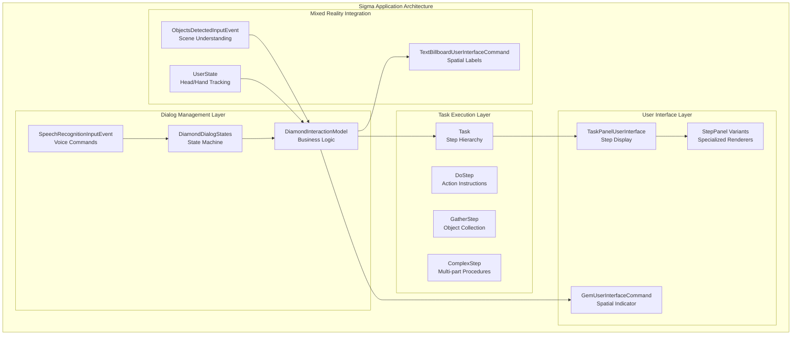
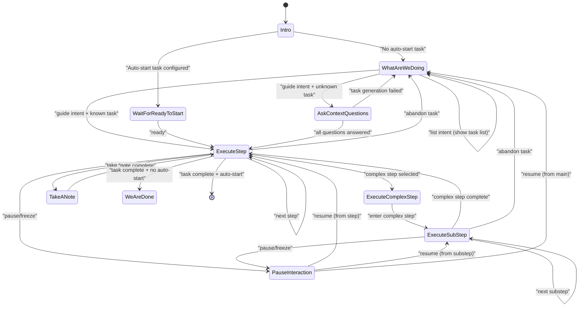
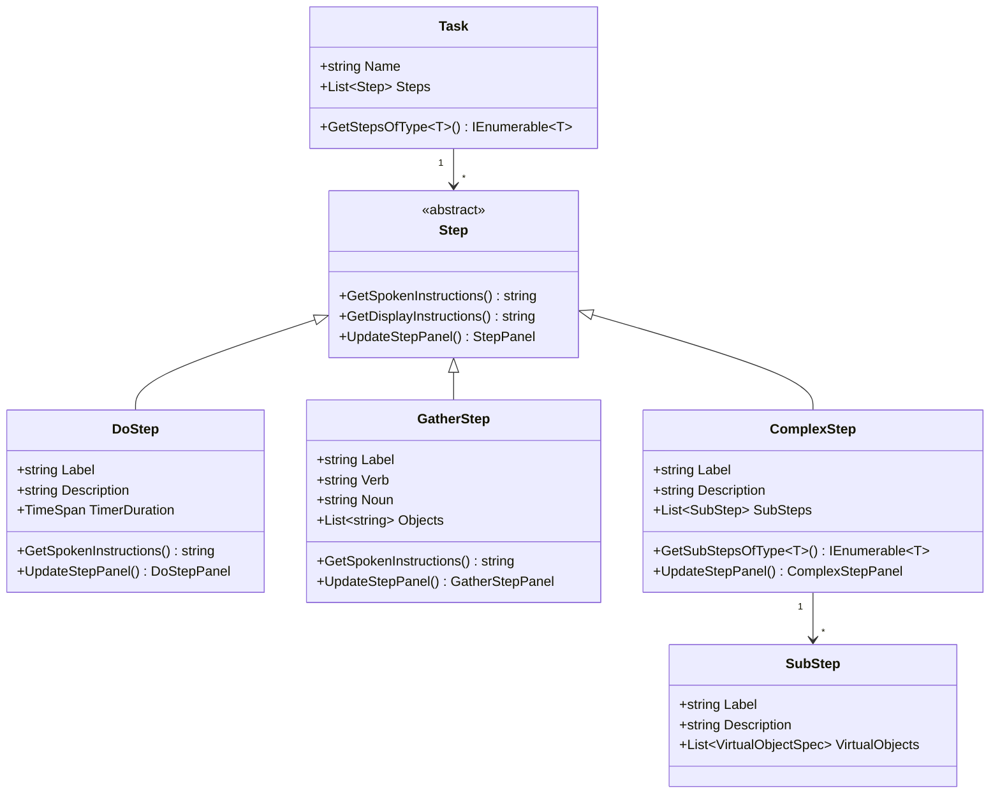
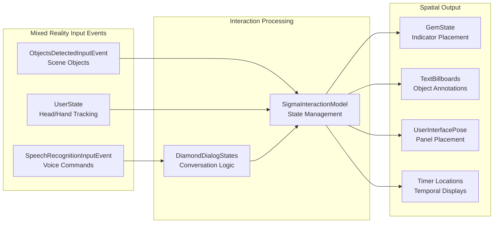

<!-- source: DeepWiki mcp.deepwiki.com · repo microsoft/psi · page 3.3 Sigma Task Assistance Application · fetched 2026-10-26 -->

# Sigma Task Assistance Application

<details>
<summary>Relevant source files</summary>

The following files were used as context for generating this wiki page:

- [Applications/Sigma/Sigma/InteractionModels/Diamond/DiamondDialogStates.cs](Applications/Sigma/Sigma/InteractionModels/Diamond/DiamondDialogStates.cs)
- [Applications/Sigma/Sigma/InteractionModels/Diamond/DiamondInteractionModel.cs](Applications/Sigma/Sigma/InteractionModels/Diamond/DiamondInteractionModel.cs)
- [Applications/Sigma/Sigma/SigmaInteractionModel.cs](Applications/Sigma/Sigma/SigmaInteractionModel.cs)
- [Applications/Sigma/Sigma/Task/ComplexStep.cs](Applications/Sigma/Sigma/Task/ComplexStep.cs)
- [Applications/Sigma/Sigma/Task/DoStep.cs](Applications/Sigma/Sigma/Task/DoStep.cs)
- [Applications/Sigma/Sigma/Task/GatherStep.cs](Applications/Sigma/Sigma/Task/GatherStep.cs)
- [Applications/Sigma/Sigma/Task/Step.cs](Applications/Sigma/Sigma/Task/Step.cs)
- [Applications/Sigma/Sigma/UserInterface/ComplexStepPanel.cs](Applications/Sigma/Sigma/UserInterface/ComplexStepPanel.cs)
- [Applications/Sigma/Sigma/UserInterface/TaskPanelUserInterface.cs](Applications/Sigma/Sigma/UserInterface/TaskPanelUserInterface.cs)
- [Applications/Sigma/Sigma/UserInterface/TaskPanelUserInterfaceConfiguration.cs](Applications/Sigma/Sigma/UserInterface/TaskPanelUserInterfaceConfiguration.cs)
- [Sources/MixedReality/HoloLensCapture/HoloLensCaptureApp/Properties/AssemblyInfo.cs](Sources/MixedReality/HoloLensCapture/HoloLensCaptureApp/Properties/AssemblyInfo.cs)

</details>


## Purpose and Scope

The Sigma Task Assistance Application is a mixed reality system that provides interactive, step-by-step guidance for completing real-world tasks through natural language dialog and visual interfaces. Built on the Microsoft Psi framework, Sigma runs on HoloLens devices and combines speech recognition, object detection, and spatial computing to create an intelligent task assistant.

This document covers the core application architecture, dialog management, task modeling, and user interface systems. For information about the underlying HoloLens data capture capabilities, see [HoloLens Data Capture](#3.1). For broader mixed reality framework components, see [Mixed Reality Framework Components](#3.4).

## System Overview

Sigma implements a conversational task assistance system that guides users through complex procedures using natural language interaction and mixed reality visualization. The system operates through three main architectural layers: dialog management, task execution, and user interface rendering.



**Sources**: [Applications/Sigma/Sigma/InteractionModels/Diamond/DiamondDialogStates.cs:1-856](), [Applications/Sigma/Sigma/InteractionModels/Diamond/DiamondInteractionModel.cs:1-157](), [Applications/Sigma/Sigma/SigmaInteractionModel.cs:1-568]()

## Dialog Management System

The dialog system implements a finite state machine pattern through the `DiamondDialogStates` class, managing conversational flow from introduction through task completion. Each dialog state handles specific user intents and transitions to appropriate next states based on speech recognition results.



**Sources**: [Applications/Sigma/Sigma/InteractionModels/Diamond/DiamondDialogStates.cs:12-856]()

### Key Dialog States

The system implements several specialized dialog states that handle different interaction scenarios:

| State Class | Purpose | Key Transitions |
|------------|---------|----------------|
| `Intro` | Initial greeting and task setup | → `WhatAreWeDoing` or `WaitForReadyToStart` |
| `WaitForReadyToStart` | Confirmation before beginning | → `ExecuteStep` |
| `WhatAreWeDoing` | Intent recognition and task selection | → `ExecuteStep`, `AskContextQuestions` |
| `ExecuteStep` | Primary step execution | → `ExecuteComplexStep`, `PauseInteraction` |
| `ExecuteComplexStep` | Complex step introduction | → `ExecuteSubStep` |
| `ExecuteSubStep` | Sub-step execution | → `ExecuteSubStep`, `ExecuteStep` |
| `AskContextQuestions` | Context gathering for task generation | → `ExecuteStep` |
| `PauseInteraction` | Temporary pause handling | → Previous state |

**Sources**: [Applications/Sigma/Sigma/InteractionModels/Diamond/DiamondDialogStates.cs:20-856]()

## Task System

Sigma models tasks as hierarchical structures composed of different step types. The task system supports three primary step varieties, each with specialized rendering and interaction behaviors.



**Sources**: [Applications/Sigma/Sigma/Task/Step.cs:1-60](), [Applications/Sigma/Sigma/Task/DoStep.cs:1-100](), [Applications/Sigma/Sigma/Task/GatherStep.cs:1-104](), [Applications/Sigma/Sigma/Task/ComplexStep.cs:1-122]()

### Step Type Behaviors

Each step type implements specific interaction patterns:

- **DoStep**: Represents action-oriented instructions with optional timer support. Users advance by saying "next step" or requesting timer functionality.

- **GatherStep**: Manages object collection tasks. The system tracks found objects through speech recognition ("I have the...") and object detection events, automatically advancing when all required objects are located.

- **ComplexStep**: Contains multiple sub-steps with optional 3D model visualization. Supports both object checklist mode and sub-step navigation mode.

**Sources**: [Applications/Sigma/Sigma/Task/DoStep.cs:13-100](), [Applications/Sigma/Sigma/Task/GatherStep.cs:13-104](), [Applications/Sigma/Sigma/Task/ComplexStep.cs:13-122]()

## User Interface System

The Sigma UI system renders task information through specialized panel components that adapt to different step types and interaction modes. The system uses StereoKit for 3D rendering within the mixed reality environment.

```mermaid
graph TB
    subgraph "UI Component Hierarchy"
        TaskPanelUI["TaskPanelUserInterface&lt;TTask&gt;<br/>Main Panel Container"]
        
        subgraph "Step Panel Types"
            StepPanel["StepPanel<br/>Base Class"]
            DoStepPanel["DoStepPanel<br/>Action Step Renderer"]
            GatherStepPanel["GatherStepPanel<br/>Object Collection Renderer"]
            ComplexStepPanel["ComplexStepPanel<br/>Multi-step Renderer"]
        end
        
        subgraph "UI Commands"
            TaskPanelCommand["TaskPanelUserInterfaceCommand<br/>Display State"]
            GemCommand["GemUserInterfaceCommand<br/>Spatial Indicator"]
            TimerCommand["TimerUserInterfaceCommand<br/>Timer Display"]
            TextBillboard["TextBillboardUserInterfaceCommand<br/>Object Labels"]
        end
        
        subgraph "Configuration"
            UIConfig["TaskPanelUserInterfaceConfiguration<br/>Styling/Layout"]
        end
    end
    
    TaskPanelUI --> StepPanel
    StepPanel <|-- DoStepPanel
    StepPanel <|-- GatherStepPanel  
    StepPanel <|-- ComplexStepPanel
    
    TaskPanelCommand --> TaskPanelUI
    GemCommand --> TaskPanelUI
    TimerCommand --> TaskPanelUI
    TextBillboard --> TaskPanelUI
    
    UIConfig --> TaskPanelUI
    UIConfig --> DoStepPanel
    UIConfig --> GatherStepPanel
    UIConfig --> ComplexStepPanel
```

**Sources**: [Applications/Sigma/Sigma/UserInterface/TaskPanelUserInterface.cs:1-346](), [Applications/Sigma/Sigma/UserInterface/ComplexStepPanel.cs:1-284](), [Applications/Sigma/Sigma/UserInterface/TaskPanelUserInterfaceConfiguration.cs:1-89]()

### UI Rendering Pipeline

The UI system operates through a command-driven architecture where the `SigmaInteractionModel` generates UI commands that are consumed by rendering components:

1. **Command Generation**: `ComputeUserInterfaceCommands()` creates UI command structures based on current interaction state
2. **Panel Updates**: `TaskPanelUserInterface.Update()` processes commands and updates internal panel state
3. **Rendering**: `Render()` methods traverse the panel hierarchy and emit 3D geometry

**Sources**: [Applications/Sigma/Sigma/SigmaInteractionModel.cs:40-199](), [Applications/Sigma/Sigma/UserInterface/TaskPanelUserInterface.cs:89-163]()

### Task Panel Modes

The system supports three distinct display modes controlled by `TaskPanelMode`:

| Mode | Purpose | Display Content |
|------|---------|----------------|
| `None` | Hidden state | No panel rendering |
| `Task` | Active task execution | Current task steps with selection highlighting |
| `TaskList` | Task browsing | Available tasks from task library |

**Sources**: [Applications/Sigma/Sigma/UserInterface/TaskPanelUserInterface.cs:17-33]()

## Mixed Reality Integration

Sigma integrates deeply with mixed reality capabilities through spatial tracking, object detection, and 3D visualization systems. The application maintains spatial awareness through `UserState` tracking and responds to environmental changes via object detection events.



**Sources**: [Applications/Sigma/Sigma/SigmaInteractionModel.cs:36-199](), [Applications/Sigma/Sigma/InteractionModels/Diamond/DiamondDialogStates.cs:364-434]()

### Spatial Behaviors

The system implements several spatial interaction patterns:

- **Glanceable Positioning**: Automatically moves UI to peripheral vision during task execution via `MoveToGlanceablePosition()`
- **Object Highlighting**: Places text billboards at detected object locations during gather steps
- **Gem Indicator**: Provides spatial reference through a moveable 3D indicator that points to objects or stays with the UI
- **Timer Placement**: Positions countdown timers in user-specified 3D locations

**Sources**: [Applications/Sigma/Sigma/SigmaInteractionModel.cs:404-413](), [Applications/Sigma/Sigma/SigmaInteractionModel.cs:288-299](), [Applications/Sigma/Sigma/SigmaInteractionModel.cs:274-285]()

## Integration with Microsoft Psi

Sigma extends the Microsoft Psi framework's interaction model architecture through the `SigmaInteractionModel<>` generic base class, enabling integration with Psi's streaming data pipeline and mixed reality components.

The application operates within Psi's component model, receiving sensor streams (speech, objects, tracking) and producing user interface commands that drive the mixed reality rendering system. This integration allows Sigma to leverage Psi's temporal data processing capabilities while maintaining real-time interaction responsiveness.

**Sources**: [Applications/Sigma/Sigma/SigmaInteractionModel.cs:24-32]()

---

