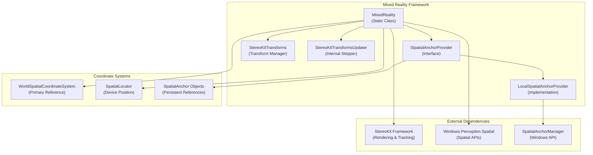
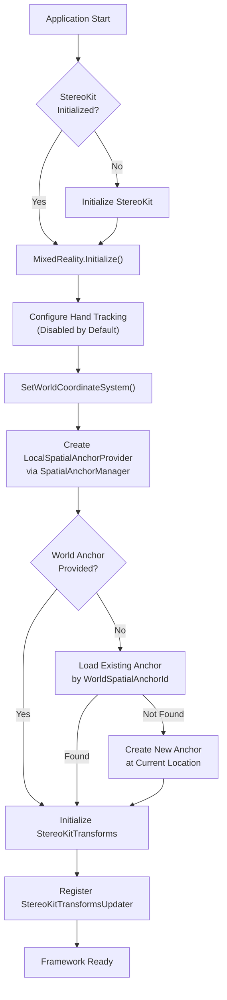
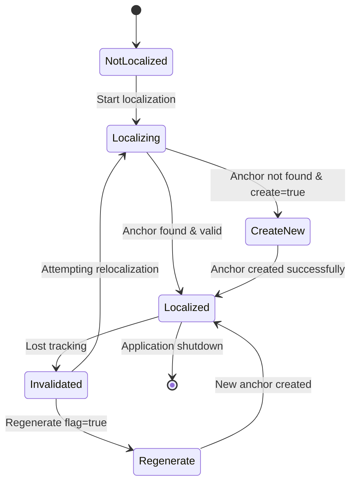
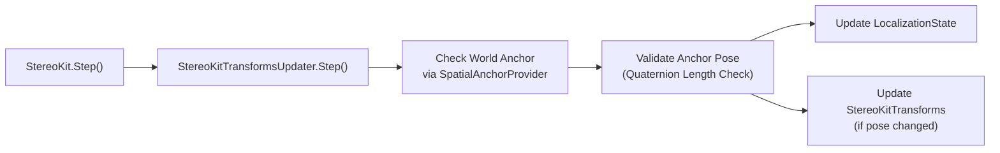

<!-- source: DeepWiki mcp.deepwiki.com · repo microsoft/psi · page 3.4 Mixed Reality Framework Components · fetched 2026-10-26 -->

# Mixed Reality Framework Components

<details>
<summary>Relevant source files</summary>

The following files were used as context for generating this wiki page:

- [Sources/MixedReality/Microsoft.Psi.MixedReality.UniversalWindows/MixedReality.cs](Sources/MixedReality/Microsoft.Psi.MixedReality.UniversalWindows/MixedReality.cs)

</details>


This document covers the core mixed reality framework components that provide foundational spatial computing capabilities for the Microsoft Psi platform. These components enable applications to establish and maintain persistent spatial coordinate systems, manage spatial anchors, and integrate with mixed reality rendering frameworks like StereoKit.

For information about HoloLens sensor data capture, see [HoloLens Data Capture](#3.1). For details about the Sigma task assistance application that uses these components, see [Sigma Task Assistance Application](#3.3).

## Framework Architecture

The mixed reality framework is built around a centralized `MixedReality` static class that coordinates spatial tracking, anchor management, and coordinate system transformations. The framework integrates with Windows Perception Spatial APIs and StereoKit to provide a unified spatial computing foundation.



**Sources:** [Sources/MixedReality/Microsoft.Psi.MixedReality.UniversalWindows/MixedReality.cs:1-284]()

## Core MixedReality Class

The `MixedReality` class serves as the primary entry point for mixed reality functionality, providing static properties and methods to manage the world coordinate system and spatial anchors.

### Key Properties

| Property | Type | Description |
|----------|------|-------------|
| `WorldSpatialCoordinateSystem` | `SpatialCoordinateSystem` | The primary world coordinate system reference |
| `WorldSpatialAnchorId` | `string` | Identifier for the world spatial anchor |
| `SpatialAnchorProvider` | `ISpatialAnchorProvider` | Interface for spatial anchor operations |
| `LocalizationState` | `LocalizationState` | Current localization status |

### Initialization Process

The framework initialization follows a specific sequence to establish the world coordinate system:



**Sources:** [Sources/MixedReality/Microsoft.Psi.MixedReality.UniversalWindows/MixedReality.cs:54-179]()

## Spatial Anchor Management

The framework uses spatial anchors to maintain persistent world coordinate systems across application sessions. The `ISpatialAnchorProvider` interface abstracts spatial anchor operations, with `LocalSpatialAnchorProvider` providing local storage functionality.

### Anchor Lifecycle



### Anchor Provider Interface

The spatial anchor provider handles persistence and retrieval of spatial anchors:

- `TryGetSpatialAnchor(string id)` - Retrieves an existing spatial anchor
- `TryCreateSpatialAnchor(string id, SpatialCoordinateSystem coordinateSystem)` - Creates and persists a new spatial anchor
- `RemoveSpatialAnchor(string id)` - Removes a stored spatial anchor

**Sources:** [Sources/MixedReality/Microsoft.Psi.MixedReality.UniversalWindows/MixedReality.cs:95-179]()

## Localization State Management

The framework tracks the current localization state through the `LocalizationState` enumeration, which indicates whether the system can properly locate itself relative to the world coordinate system.

### State Transitions

| State | Description | Typical Causes |
|-------|-------------|----------------|
| `NotLocalized` | Initial state before localization attempt | Application startup |
| `Localizing` | Actively attempting to establish localization | Searching for spatial anchors |
| `Localized` | Successfully localized to world coordinate system | Anchor found and validated |
| `Invalidated` | Previously localized but lost tracking | Environment changes, tracking loss |

### Continuous State Monitoring

The `StereoKitTransformsUpdater` class implements the `IStepper` interface to continuously monitor localization state:



**Sources:** [Sources/MixedReality/Microsoft.Psi.MixedReality.UniversalWindows/MixedReality.cs:185-282]()

## StereoKit Integration

The framework integrates with StereoKit for mixed reality rendering and tracking. Key integration points include:

### Hand Tracking Configuration

The framework disables hand rendering and physics interaction by default:
- `Input.HandVisible(Handed.Max, false)` - Hides hand visualization
- `Input.HandSolid(Handed.Max, false)` - Disables hand physics collision

### Transform Synchronization

The `StereoKitTransforms` class manages coordinate transformations between the Windows Perception Spatial coordinate system and StereoKit's coordinate system. The framework:

1. Converts spatial anchors to StereoKit poses using `World.FromPerceptionAnchor()`
2. Initializes transforms with `StereoKitTransforms.Initialize(worldAnchorPose)`
3. Continuously updates transforms when the world anchor pose changes

### Pose Validation

The framework validates spatial anchor poses to ensure tracking quality:

```csharp
// Quaternion length should be approximately 1.0 for valid orientation
var quaternionLength = worldAnchorPose.orientation.q.Length();
var validWorldAnchorPose = !PosesEqual(worldAnchorPose, Pose.Identity, 0) && 
                          quaternionLength >= 0.9f && quaternionLength <= 1.1f;
```

**Sources:** [Sources/MixedReality/Microsoft.Psi.MixedReality.UniversalWindows/MixedReality.cs:62-63](), [Sources/MixedReality/Microsoft.Psi.MixedReality.UniversalWindows/MixedReality.cs:213-230](), [Sources/MixedReality/Microsoft.Psi.MixedReality.UniversalWindows/MixedReality.cs:266-280]()

## Configuration Options

The framework provides several configuration options during initialization:

### World Coordinate System Setup

| Parameter | Type | Default | Description |
|-----------|------|---------|-------------|
| `worldSpatialAnchor` | `SpatialAnchor` | `null` | Pre-existing anchor to use as world origin |
| `regenerateDefaultWorldSpatialAnchorIfNeeded` | `bool` | `false` | Whether to recreate anchor if localization fails |
| `createWorldSpatialAnchorIfNeeded` | `bool` | `true` | Whether to create new anchor if none exists |
| `worldSpatialAnchorId` | `string` | `"_world"` | Identifier for the world spatial anchor |

### Usage Patterns

```csharp
// Basic initialization with default settings
MixedReality.Initialize();

// Initialize with custom spatial anchor
MixedReality.Initialize(existingSpatialAnchor, regenerateIfNeeded: true);

// Custom coordinate system setup
MixedReality.SetWorldCoordinateSystem(
    spatialAnchorProvider: customProvider,
    worldSpatialAnchorId: "custom_world_anchor",
    createWorldSpatialAnchorIfNeeded: true,
    regenerateWorldSpatialAnchorIfNeeded: false);
```

**Sources:** [Sources/MixedReality/Microsoft.Psi.MixedReality.UniversalWindows/MixedReality.cs:54-72](), [Sources/MixedReality/Microsoft.Psi.MixedReality.UniversalWindows/MixedReality.cs:95-101]()

---

