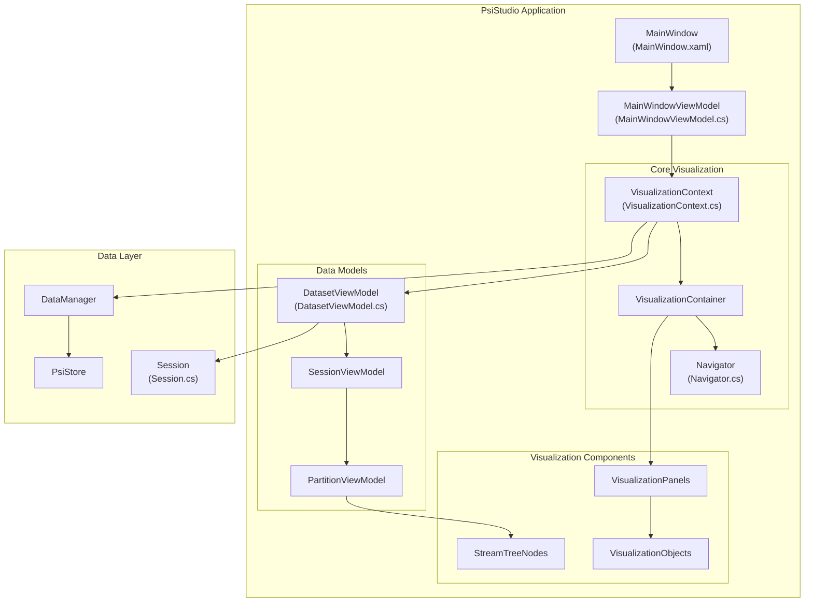
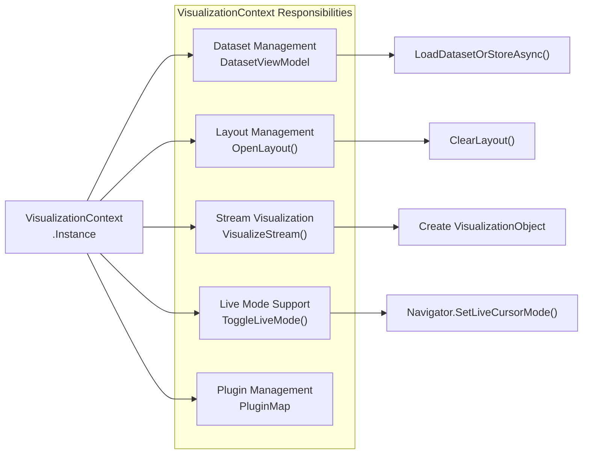
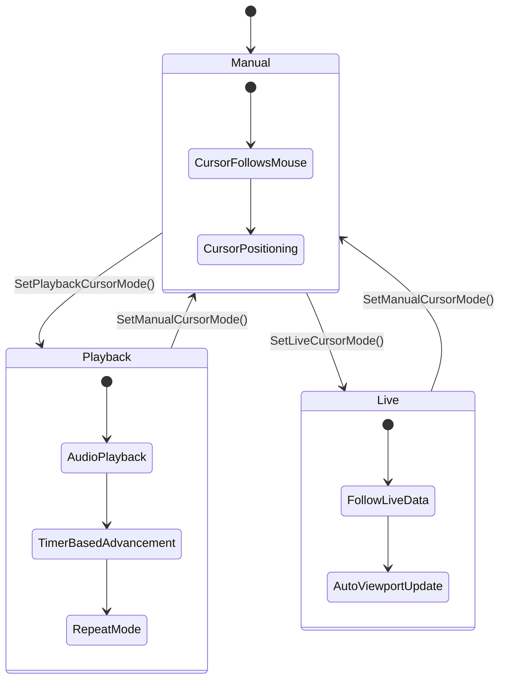
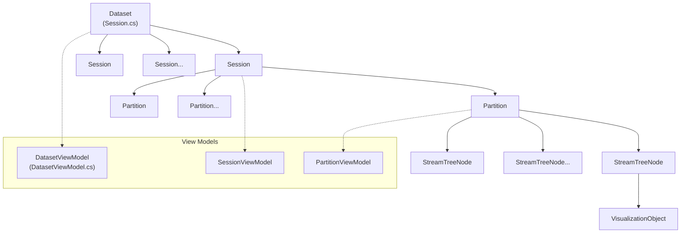
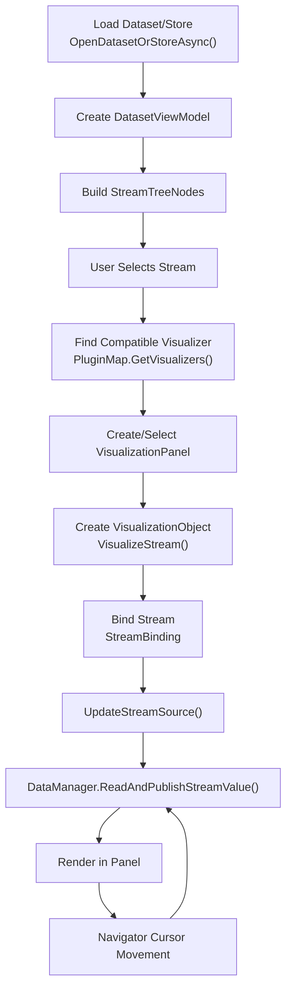
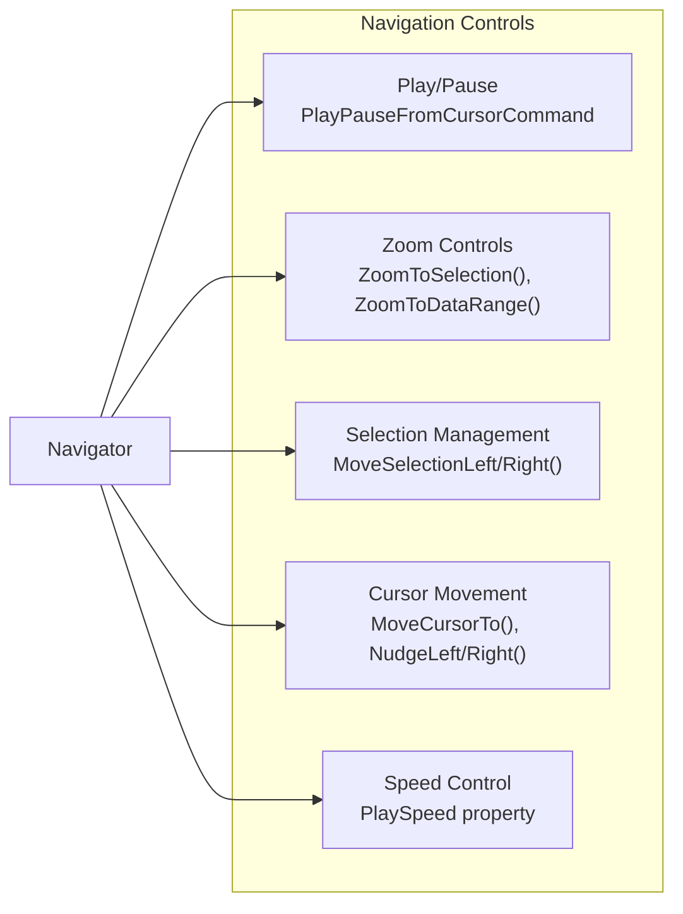
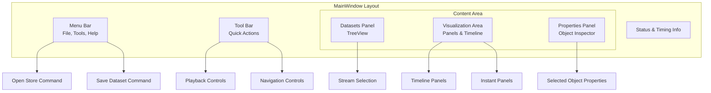
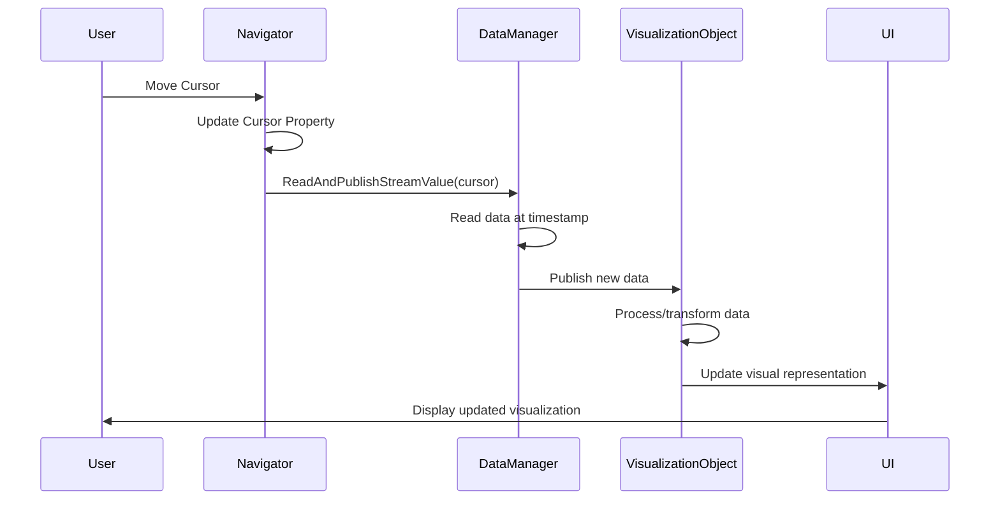

<!-- source: DeepWiki mcp.deepwiki.com · repo microsoft/psi · page 4 Visualization and Analysis · fetched 2026-10-26 -->

# Visualization and Analysis

Relevant source files

The following files were used as context for generating this wiki page:

- [Sources/Data/Microsoft.Psi.Data/Session.cs](Sources/Data/Microsoft.Psi.Data/Session.cs)
- [Sources/Tools/PsiStudio/Microsoft.Psi.PsiStudio/MainWindow.xaml](Sources/Tools/PsiStudio/Microsoft.Psi.PsiStudio/MainWindow.xaml)
- [Sources/Tools/PsiStudio/Microsoft.Psi.PsiStudio/MainWindowViewModel.cs](Sources/Tools/PsiStudio/Microsoft.Psi.PsiStudio/MainWindowViewModel.cs)
- [Sources/Visualization/Microsoft.Psi.Visualization.Windows/Navigation/Navigator.cs](Sources/Visualization/Microsoft.Psi.Visualization.Windows/Navigation/Navigator.cs)
- [Sources/Visualization/Microsoft.Psi.Visualization.Windows/ViewModels/DatasetViewModel.cs](Sources/Visualization/Microsoft.Psi.Visualization.Windows/ViewModels/DatasetViewModel.cs)
- [Sources/Visualization/Microsoft.Psi.Visualization.Windows/Views/VisualizationPanelView.cs](Sources/Visualization/Microsoft.Psi.Visualization.Windows/Views/VisualizationPanelView.cs)
- [Sources/Visualization/Microsoft.Psi.Visualization.Windows/VisualizationContext.cs](Sources/Visualization/Microsoft.Psi.Visualization.Windows/VisualizationContext.cs)

This document covers the visualization and analysis capabilities of the Microsoft Psi framework, primarily implemented through PsiStudio - an interactive application for exploring, visualizing, and analyzing multimodal time-series data. The visualization system provides timeline-based navigation, real-time data exploration, and flexible visualization panels for examining Psi data stores and live streams.

For information about data persistence and storage formats, see [Data Persistence and Storage](#2.2). For details about the core pipeline processing that generates the data being visualized, see [Pipeline and Message Processing](#2.1).

## System Overview

The visualization and analysis system centers around PsiStudio, a Windows-based application that provides interactive exploration of Psi datasets. The architecture consists of several key layers: data management, visualization objects, timeline navigation, and user interface components.

Sources: [Sources/Tools/PsiStudio/Microsoft.Psi.PsiStudio/MainWindow.xaml](), [Sources/Tools/PsiStudio/Microsoft.Psi.PsiStudio/MainWindowViewModel.cs](), [Sources/Visualization/Microsoft.Psi.Visualization.Windows/VisualizationContext.cs](), [Sources/Visualization/Microsoft.Psi.Visualization.Windows/Navigation/Navigator.cs]()

## Core Components

### VisualizationContext

The `VisualizationContext` serves as the central coordination point for the entire visualization system. It maintains the singleton pattern and coordinates between data loading, visualization container management, and user interactions.

Sources: [Sources/Visualization/Microsoft.Psi.Visualization.Windows/VisualizationContext.cs:26-561]()

### Navigator

The `Navigator` class manages timeline navigation, cursor positioning, and playback controls. It provides three cursor modes: Manual, Playback, and Live, each with specific behaviors for data exploration.

| Property | Type | Purpose |
|----------|------|---------|
| `CursorMode` | `CursorMode` | Current navigation mode (Manual/Playback/Live) |
| `Cursor` | `DateTime` | Current cursor position in timeline |
| `DataRange` | `NavigatorRange` | Overall time range of loaded data |
| `ViewRange` | `NavigatorRange` | Currently visible time range |
| `SelectionRange` | `NavigatorRange` | User-selected time interval |
| `PlaySpeed` | `double` | Playback speed multiplier |

Sources: [Sources/Visualization/Microsoft.Psi.Visualization.Windows/Navigation/Navigator.cs:25-1465]()

### Data Model Hierarchy

The visualization system organizes data through a hierarchical model that mirrors the structure of Psi datasets:

Sources: [Sources/Data/Microsoft.Psi.Data/Session.cs:19-507](), [Sources/Visualization/Microsoft.Psi.Visualization.Windows/ViewModels/DatasetViewModel.cs:307-1182]()

## Visualization Pipeline

The process of visualizing data follows a well-defined pipeline from data loading to visual presentation:

Sources: [Sources/Visualization/Microsoft.Psi.Visualization.Windows/VisualizationContext.cs:236-307](), [Sources/Visualization/Microsoft.Psi.Visualization.Windows/VisualizationContext.cs:472-529]()

## Timeline Navigation Features

The Navigator provides comprehensive timeline control capabilities:

### Cursor Modes and Navigation

| Mode | Behavior | Use Case |
|------|----------|----------|
| **Manual** | User-controlled cursor positioning | Interactive data exploration |
| **Playback** | Automated cursor advancement with audio sync | Data replay and presentation |
| **Live** | Follows live data streams | Real-time monitoring |

### Timing Display Options

The system supports multiple timing reference frames accessible through toolbar toggles:

- **Absolute Timing**: Wall-clock timestamps
- **Relative to Session Start**: Elapsed time from session beginning  
- **Relative to Selection Start**: Elapsed time from selection start

Sources: [Sources/Visualization/Microsoft.Psi.Visualization.Windows/Navigation/Navigator.cs:193-211](), [Sources/Tools/PsiStudio/Microsoft.Psi.PsiStudio/MainWindowViewModel.cs:254-600]()

## User Interface Structure

PsiStudio organizes its interface into distinct functional areas:

### Main Window Layout

Sources: [Sources/Tools/PsiStudio/Microsoft.Psi.PsiStudio/MainWindow.xaml:54-534]()

### Command Structure

The application uses the MVVM pattern with RelayCommands for user interactions:

| Command Category | Key Commands | Purpose |
|------------------|--------------|---------|
| **File Operations** | `OpenStoreCommand`, `OpenDatasetCommand`, `SaveDatasetAsCommand` | Data loading and saving |
| **Navigation** | `PlayPauseFromCursorCommand`, `ZoomToSelectionCommand`, `GoToTimeCommand` | Timeline control |
| **Layout Management** | `InsertTimelinePanelCommand`, `SaveLayoutCommand`, `ClearLayoutCommand` | Visualization setup |
| **Selection Control** | `MoveSelectionLeftCommand`, `ClearSelectionCommand` | Time interval selection |

Sources: [Sources/Tools/PsiStudio/Microsoft.Psi.PsiStudio/MainWindowViewModel.cs:254-643]()

## Data Flow and Updates

The visualization system maintains data currency through event-driven updates:

Sources: [Sources/Visualization/Microsoft.Psi.Visualization.Windows/Navigation/Navigator.cs:165-170]()

This visualization and analysis system provides a comprehensive platform for exploring Psi data, supporting both offline analysis of recorded sessions and real-time monitoring of live data streams. The modular architecture allows for extensible visualization types while maintaining consistent navigation and timing semantics across all visualization modes.

---

