<!-- source: DeepWiki mcp.deepwiki.com · repo microsoft/psi · page 4.1 PsiStudio and Timeline Navigation · fetched 2026-10-26 -->

# PsiStudio and Timeline Navigation

<details>
<summary>Relevant source files</summary>

The following files were used as context for generating this wiki page:

- [Sources/Data/Microsoft.Psi.Data/Session.cs](Sources/Data/Microsoft.Psi.Data/Session.cs)
- [Sources/Tools/PsiStudio/Microsoft.Psi.PsiStudio/MainWindow.xaml](Sources/Tools/PsiStudio/Microsoft.Psi.PsiStudio/MainWindow.xaml)
- [Sources/Tools/PsiStudio/Microsoft.Psi.PsiStudio/MainWindowViewModel.cs](Sources/Tools/PsiStudio/Microsoft.Psi.PsiStudio/MainWindowViewModel.cs)
- [Sources/Visualization/Microsoft.Psi.Visualization.Windows/Navigation/Navigator.cs](Sources/Visualization/Microsoft.Psi.Visualization.Windows/Navigation/Navigator.cs)
- [Sources/Visualization/Microsoft.Psi.Visualization.Windows/ViewModels/DatasetViewModel.cs](Sources/Visualization/Microsoft.Psi.Visualization.Windows/ViewModels/DatasetViewModel.cs)
- [Sources/Visualization/Microsoft.Psi.Visualization.Windows/Views/VisualizationPanelView.cs](Sources/Visualization/Microsoft.Psi.Visualization.Windows/Views/VisualizationPanelView.cs)
- [Sources/Visualization/Microsoft.Psi.Visualization.Windows/VisualizationContext.cs](Sources/Visualization/Microsoft.Psi.Visualization.Windows/VisualizationContext.cs)

</details>


PsiStudio is the primary visualization and analysis application for the Microsoft Psi framework. This document covers the main application interface and the timeline navigation system that enables users to explore temporal data interactively. For information about visualization components and panels, see [Visualization Components and UI](#4.2). For details about data models and stream organization, see [Data Models and Stream Tree](#4.3).

## Overview

PsiStudio provides an integrated environment for loading, visualizing, and analyzing time-series data from Psi stores and datasets. The application centers around a timeline-based navigation system that allows users to scrub through data, make selections, control playback, and zoom to different temporal extents.

The main components include:
- **Navigator**: Core timeline navigation and cursor management
- **MainWindow**: Primary application interface with toolbars and panels  
- **VisualizationContainer**: Manages visualization panels and objects
- **DatasetViewModel**: Handles dataset and session management

## Application Architecture

The PsiStudio application follows an MVVM architecture with the main window coordinating between data models, visualization components, and navigation controls.

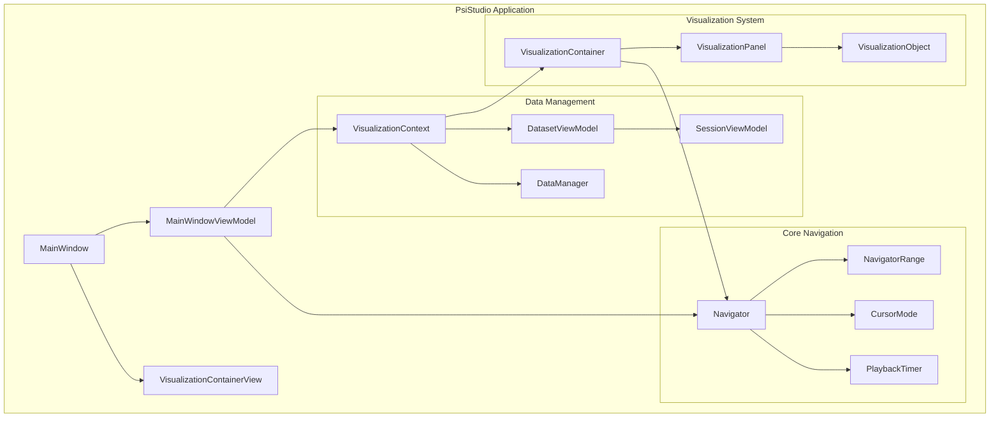

**Core Navigation System**
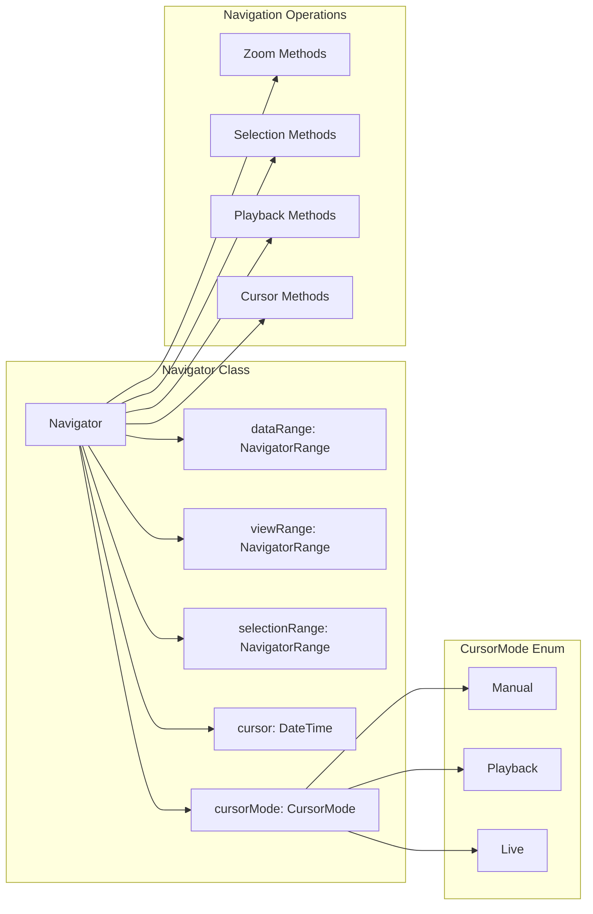

Sources: [Sources/Visualization/Microsoft.Psi.Visualization.Windows/Navigation/Navigator.cs:1-147](), [Sources/Tools/PsiStudio/Microsoft.Psi.PsiStudio/MainWindowViewModel.cs:1-50](), [Sources/Visualization/Microsoft.Psi.Visualization.Windows/VisualizationContext.cs:1-50]()

## Navigator Class and Timeline Control

The `Navigator` class is the central component for timeline navigation, managing temporal positioning, ranges, and playback modes. It maintains three key time ranges and provides methods for navigation and playback control.

### Time Range Management

The Navigator manages three distinct time ranges:

| Range Type | Purpose | Property |
|------------|---------|----------|
| **Data Range** | Total extent of available data | `dataRange: NavigatorRange` |
| **View Range** | Currently visible time window | `viewRange: NavigatorRange` |  
| **Selection Range** | User-selected time interval | `selectionRange: NavigatorRange` |

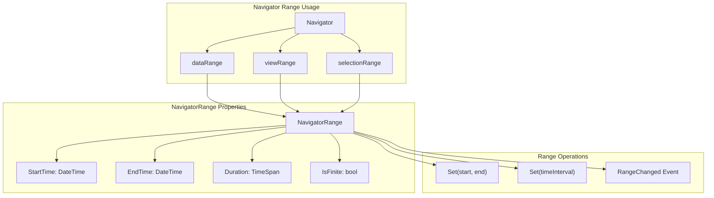

Sources: [Sources/Visualization/Microsoft.Psi.Visualization.Windows/Navigation/Navigator.cs:33-36](), [Sources/Visualization/Microsoft.Psi.Visualization.Windows/Navigation/Navigator.cs:244-318]()

### Cursor Modes and Navigation

The Navigator supports three distinct cursor modes that determine how timeline navigation behaves:

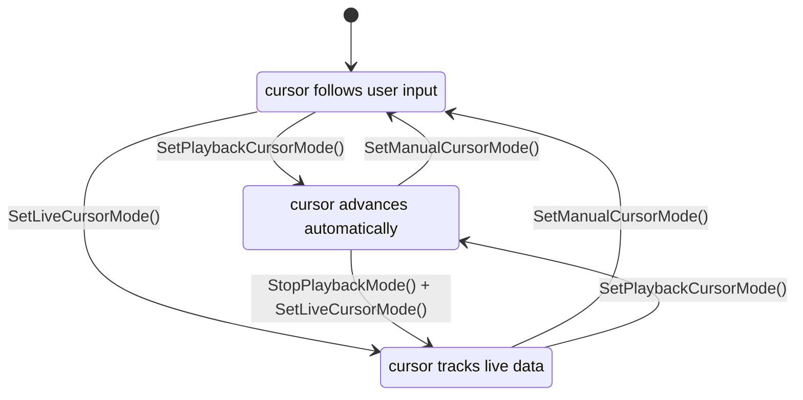

**Cursor Movement Methods**
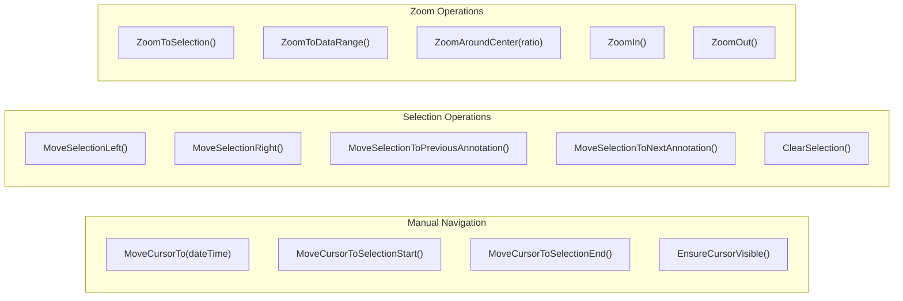

Sources: [Sources/Visualization/Microsoft.Psi.Visualization.Windows/Navigation/Navigator.cs:120-147](), [Sources/Visualization/Microsoft.Psi.Visualization.Windows/Navigation/Navigator.cs:410-448](), [Sources/Visualization/Microsoft.Psi.Visualization.Windows/Navigation/Navigator.cs:554-633]()

## Playback System

The Navigator includes a sophisticated playback system that supports both temporal scrubbing and audio playback synchronization.

### Playback Pipeline and Audio

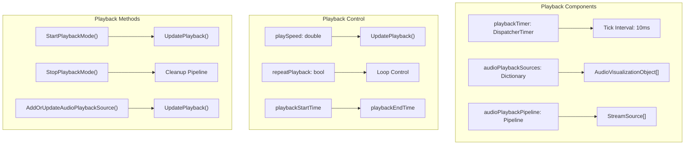

The playback system coordinates multiple components:
- `playbackTimer` fires every 10ms to advance the cursor position
- `audioPlaybackSources` manages audio streams for synchronized playback  
- `audioPlaybackPipeline` handles real-time audio rendering at 1x speed
- Playback automatically stops when reaching `playbackEndTime` or switches to repeat mode

Sources: [Sources/Visualization/Microsoft.Psi.Visualization.Windows/Navigation/Navigator.cs:41-76](), [Sources/Visualization/Microsoft.Psi.Visualization.Windows/Navigation/Navigator.cs:800-916]()

## Live Mode Navigation

Live mode enables real-time tracking of streaming data sources, automatically updating the view range and cursor position as new data arrives.

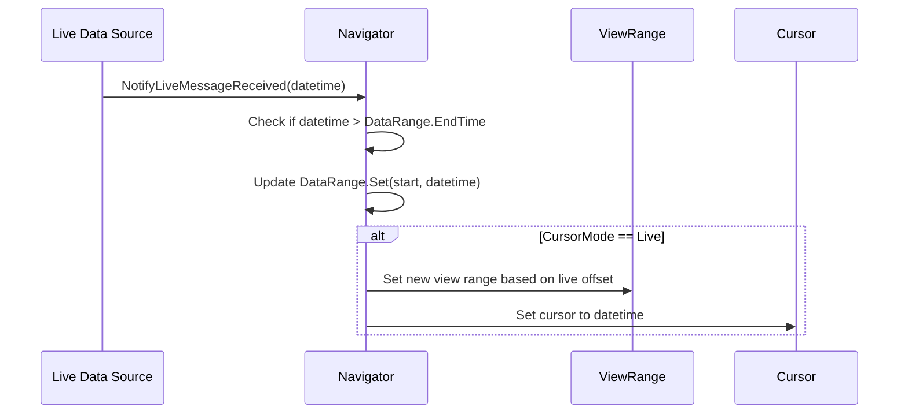

**Live Mode Properties**
- `liveCursorViewportPosition`: Position of cursor in viewport (default: 80%)
- `liveCursorOffsetFromViewRangeStart`: Time offset from view range start
- `DefaultLiveModeViewportWidthSeconds`: Default viewport width (30 seconds)

Sources: [Sources/Visualization/Microsoft.Psi.Visualization.Windows/Navigation/Navigator.cs:27-54](), [Sources/Visualization/Microsoft.Psi.Visualization.Windows/Navigation/Navigator.cs:527-547]()

## Main Window Interface

The PsiStudio main window provides a comprehensive interface organized into several key areas:

### Toolbar and Menu System

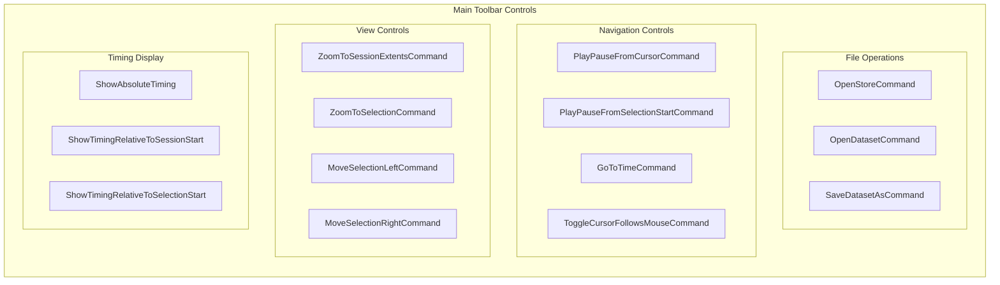

### Panel Layout Structure  

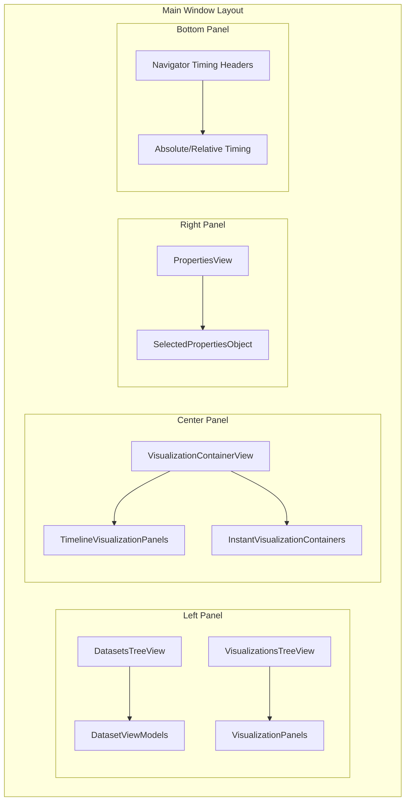

Sources: [Sources/Tools/PsiStudio/Microsoft.Psi.PsiStudio/MainWindow.xaml:65-260](), [Sources/Tools/PsiStudio/Microsoft.Psi.PsiStudio/MainWindowViewModel.cs:250-325]()

## Navigation Commands and Keyboard Shortcuts

PsiStudio provides extensive keyboard shortcuts for efficient timeline navigation:

| Operation | Keyboard Shortcut | Command |
|-----------|------------------|---------|
| Play/Pause from cursor | `Space` | `PlayPauseFromCursorCommand` |
| Play/Pause from selection | `Ctrl+Space` | `PlayPauseFromSelectionStartCommand` |
| Go to time | `Ctrl+G` | `GoToTimeCommand` |
| Zoom to session extents | `Ctrl+A` | `ZoomToSessionExtentsCommand` |
| Zoom to selection | `Ctrl+S` | `ZoomToSelectionCommand` |
| Toggle cursor follows mouse | `Alt+F` | `ToggleCursorFollowsMouseCommand` |
| Move to selection start | `Alt+S` | `MoveCursorToSelectionStartCommand` |
| Move to selection end | `Alt+E` | `MoveCursorToSelectionEndCommand` |
| Move selection left | `Alt+Left` | `MoveSelectionLeftCommand` |
| Move selection right | `Alt+Right` | `MoveSelectionRightCommand` |
| Clear selection | `Alt+C` | `ClearSelectionCommand` |
| Nudge cursor right | `Ctrl+.` | `NudgeRightCommand` |
| Nudge cursor left | `Ctrl+,` | `NudgeLeftCommand` |

**Navigation Time Constants**
- `nudgeTimeSpan`: 1/30 second (33.33ms) for fine cursor movement
- `jumpTimeSpan`: 1/6 second (166.67ms) for larger cursor jumps

Sources: [Sources/Tools/PsiStudio/Microsoft.Psi.PsiStudio/MainWindow.xaml:25-43](), [Sources/Tools/PsiStudio/Microsoft.Psi.PsiStudio/MainWindowViewModel.cs:77-78](), [Sources/Tools/PsiStudio/Microsoft.Psi.PsiStudio/MainWindowViewModel.cs:286-324]()

## Data Binding and Session Management

The navigation system integrates closely with dataset and session management through the `VisualizationContext` and `DatasetViewModel` classes.

### Session Visualization Flow

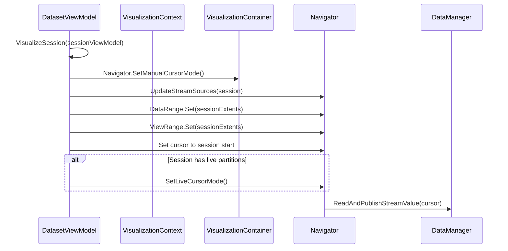

### Live Partition Monitoring

The system includes automatic live partition detection and monitoring:

```mermaid
graph TB
    subgraph "Live Mode Management"
        LST["liveStatusTimer: DispatcherTimer"] --> "10 second interval"
        LST --> ULP["UpdateLivePartitionStatuses()"]
        ULP --> CLP["Check for live partitions"]
        
        CLP --> SLM["Set Live Mode"] 
        CLP --> ELM["Exit Live Mode"]
        
        SLM --> NAV4["Navigator.SetLiveCursorMode()"]
        ELM --> NAV5["Navigator.SetManualCursorMode()"]
    end
```

Sources: [Sources/Visualization/Microsoft.Psi.Visualization.Windows/ViewModels/DatasetViewModel.cs:615-652](), [Sources/Visualization/Microsoft.Psi.Visualization.Windows/VisualizationContext.cs:28-44](), [Sources/Visualization/Microsoft.Psi.Visualization.Windows/VisualizationContext.cs:547-560]()

## Timeline Display and Timing Headers

The Navigator supports multiple timing display modes to assist with temporal analysis:

### Timing Header Configuration

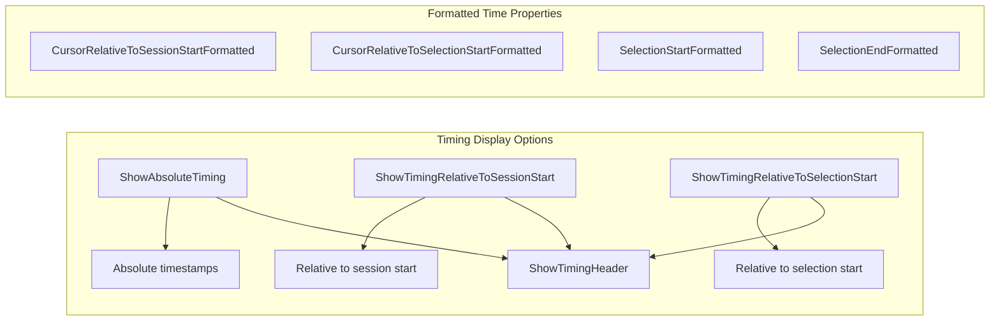

The timing system provides formatted string properties for display in the UI:
- **Absolute timing**: `DateTimeHelper.FormatDateTime()` for full timestamps
- **Relative timing**: `FormatTimespan()` for duration-based display
- **Multiple reference points**: Session start, selection start, or absolute time

Sources: [Sources/Visualization/Microsoft.Psi.Visualization.Windows/Navigation/Navigator.cs:216-312](), [Sources/Visualization/Microsoft.Psi.Visualization.Windows/Navigation/Navigator.cs:330-378]()

---

