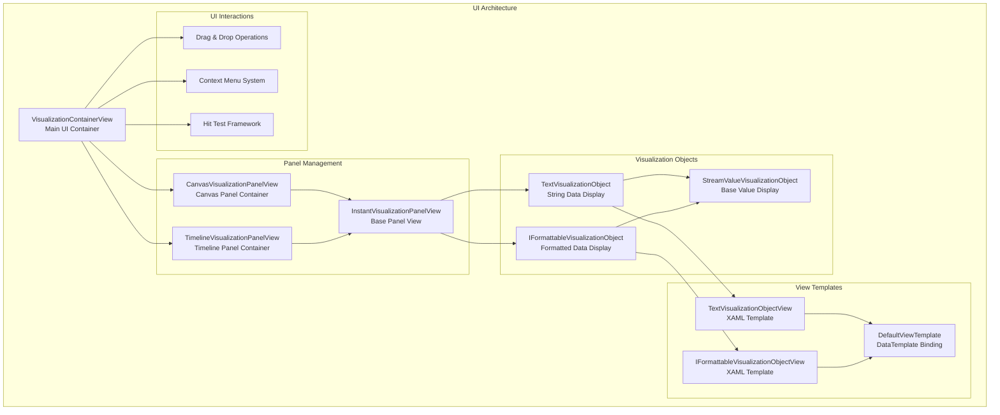
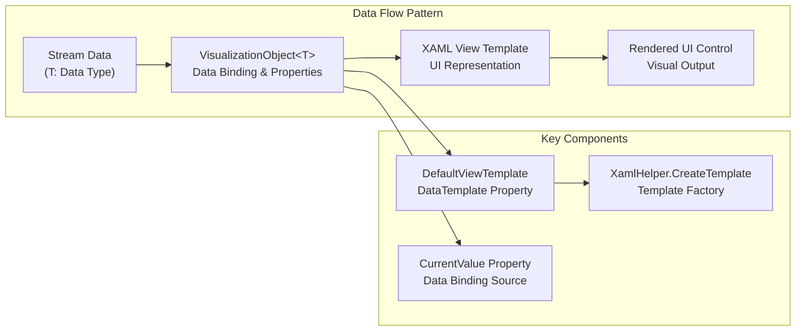
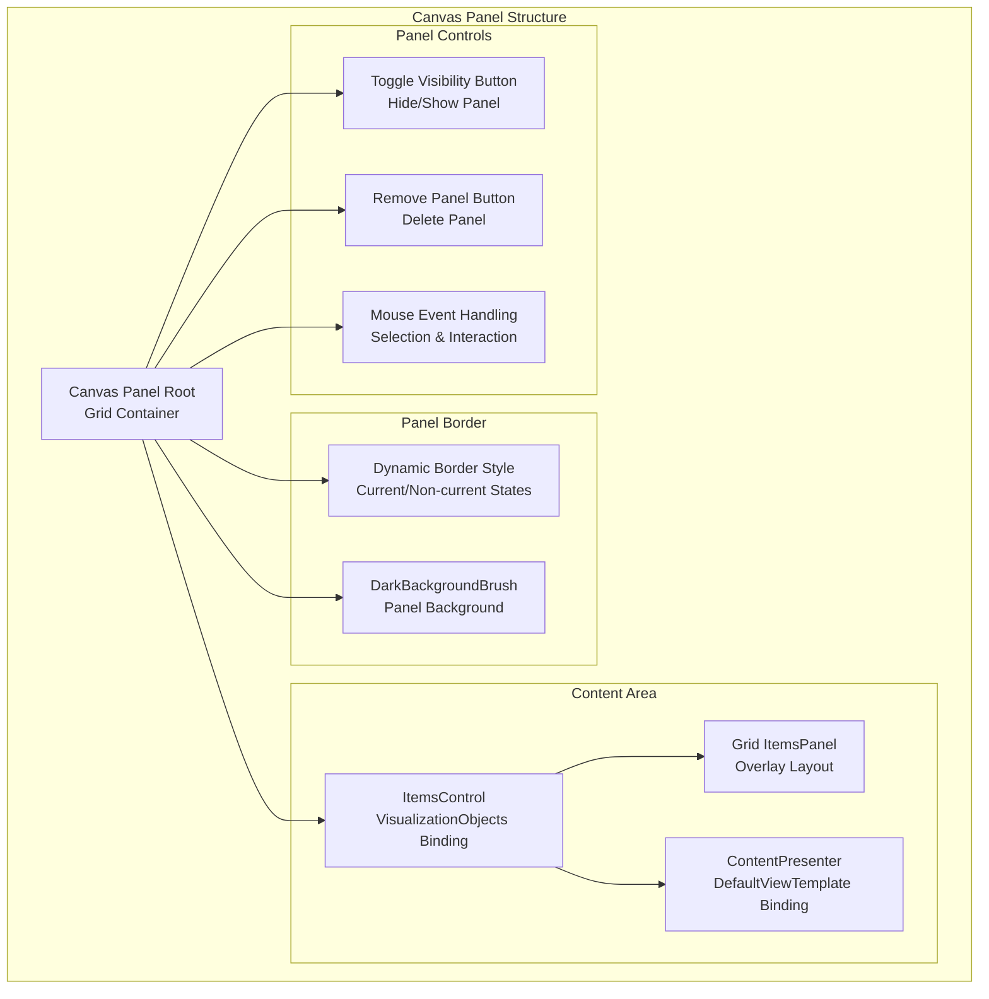
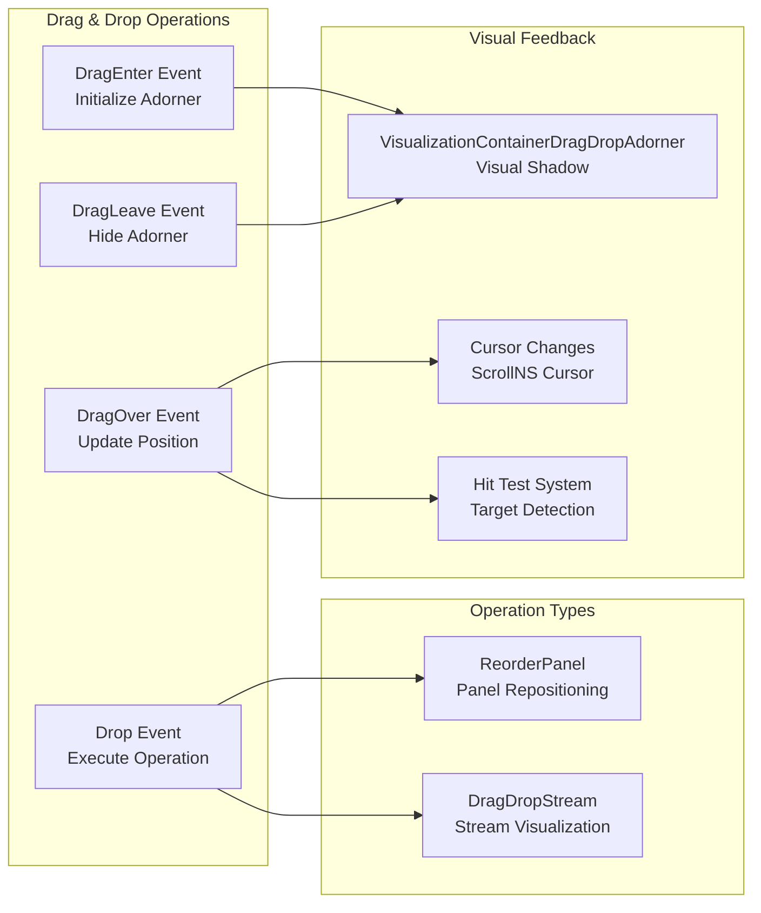
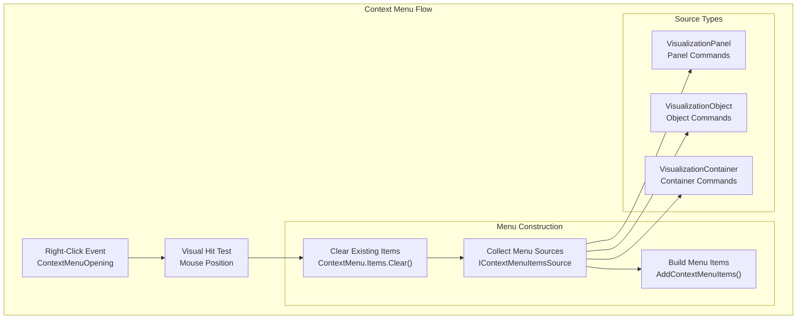

<!-- source: DeepWiki mcp.deepwiki.com · repo microsoft/psi · page 4.2 Visualization Components and UI · fetched 2026-10-26 -->

# Visualization Components and UI

Relevant source files

The following files were used as context for generating this wiki page:

- [Sources/Visualization/Microsoft.Psi.Visualization.Windows/Views/CanvasVisualizationPanelView.xaml](Sources/Visualization/Microsoft.Psi.Visualization.Windows/Views/CanvasVisualizationPanelView.xaml)
- [Sources/Visualization/Microsoft.Psi.Visualization.Windows/Views/VisualizationContainerView.xaml.cs](Sources/Visualization/Microsoft.Psi.Visualization.Windows/Views/VisualizationContainerView.xaml.cs)
- [Sources/Visualization/Microsoft.Psi.Visualization.Windows/Views/Visuals2D/IFormattableVisualizationObjectView.xaml](Sources/Visualization/Microsoft.Psi.Visualization.Windows/Views/Visuals2D/IFormattableVisualizationObjectView.xaml)
- [Sources/Visualization/Microsoft.Psi.Visualization.Windows/Views/Visuals2D/TextVisualizationObjectView.xaml](Sources/Visualization/Microsoft.Psi.Visualization.Windows/Views/Visuals2D/TextVisualizationObjectView.xaml)
- [Sources/Visualization/Microsoft.Psi.Visualization.Windows/VisualizationObjects/IFormattableVisualizationObject.cs](Sources/Visualization/Microsoft.Psi.Visualization.Windows/VisualizationObjects/IFormattableVisualizationObject.cs)
- [Sources/Visualization/Microsoft.Psi.Visualization.Windows/VisualizationObjects/TextVisualizationObject.cs](Sources/Visualization/Microsoft.Psi.Visualization.Windows/VisualizationObjects/TextVisualizationObject.cs)

This page documents the user interface components and visualization framework that powers PsiStudio's data exploration capabilities. It covers the XAML views, visualization objects, panels, and interaction patterns that enable users to visualize and interact with temporal data streams.

For information about the underlying data models and stream organization, see [Data Models and Stream Tree](#4.3). For details about timeline navigation and temporal data exploration, see [PsiStudio and Timeline Navigation](#4.1).

## Purpose and Scope

The visualization UI system provides the visual representation layer for Psi data streams, enabling users to:
- View different data types through specialized visualization objects
- Organize visualizations in resizable panels  
- Interact with data through drag-drop operations and context menus
- Navigate temporal data with synchronized timeline controls

## UI Architecture Overview

The visualization UI follows a hierarchical model-view pattern where data flows from visualization objects through view templates to rendered UI components.

**Sources:** [Sources/Visualization/Microsoft.Psi.Visualization.Windows/Views/VisualizationContainerView.xaml.cs:1-402](), [Sources/Visualization/Microsoft.Psi.Visualization.Windows/Views/CanvasVisualizationPanelView.xaml:1-106](), [Sources/Visualization/Microsoft.Psi.Visualization.Windows/VisualizationObjects/TextVisualizationObject.cs:1-39](), [Sources/Visualization/Microsoft.Psi.Visualization.Windows/VisualizationObjects/IFormattableVisualizationObject.cs:1-77]()

## Visualization Objects and Views

Visualization objects represent data streams and define how they should be rendered. Each visualization object has a corresponding XAML view template that specifies the UI representation.

### Core Visualization Object Pattern

**Sources:** [Sources/Visualization/Microsoft.Psi.Visualization.Windows/VisualizationObjects/TextVisualizationObject.cs:22-25](), [Sources/Visualization/Microsoft.Psi.Visualization.Windows/VisualizationObjects/IFormattableVisualizationObject.cs:26-29]()

### Text Visualization Object

The `TextVisualizationObject` provides a simple string display with configurable margins:

| Property | Type | Description |
|----------|------|-------------|
| `Margin` | `Thickness` | Left, top, right, bottom padding in pixels |
| `DefaultViewTemplate` | `DataTemplate` | XAML template binding to `TextVisualizationObjectView` |
| `CurrentValue.Data` | `string` | The text content to display |

The corresponding XAML view [Sources/Visualization/Microsoft.Psi.Visualization.Windows/Views/Visuals2D/TextVisualizationObjectView.xaml:29-30]() binds directly to `CurrentValue.Data` for real-time text updates.

**Sources:** [Sources/Visualization/Microsoft.Psi.Visualization.Windows/VisualizationObjects/TextVisualizationObject.cs:18-37](), [Sources/Visualization/Microsoft.Psi.Visualization.Windows/Views/Visuals2D/TextVisualizationObjectView.xaml:1-34]()

### IFormattable Visualization Object

The `IFormattableVisualizationObject` extends text display with custom formatting capabilities:

| Property | Type | Description |
|----------|------|-------------|
| `FormatString` | `string` | Format string for `IFormattable.ToString()` |
| `FormattedData` | `string` | Computed formatted output |
| `Margin` | `Thickness` | Display padding configuration |

The formatting logic updates automatically when either `CurrentValue` or `FormatString` changes [Sources/Visualization/Microsoft.Psi.Visualization.Windows/VisualizationObjects/IFormattableVisualizationObject.cs:70-73]().

**Sources:** [Sources/Visualization/Microsoft.Psi.Visualization.Windows/VisualizationObjects/IFormattableVisualizationObject.cs:15-76](), [Sources/Visualization/Microsoft.Psi.Visualization.Windows/Views/Visuals2D/IFormattableVisualizationObjectView.xaml:1-36]()

## Visualization Panels

Panels serve as containers for visualization objects, providing layout management and user interaction capabilities.

### Canvas Visualization Panel

The `CanvasVisualizationPanelView` provides a free-form layout container for visualization objects:

The panel border changes color based on the `IsCurrentPanel` property [Sources/Visualization/Microsoft.Psi.Visualization.Windows/Views/CanvasVisualizationPanelView.xaml:26-31](), providing visual feedback for the active panel.

**Sources:** [Sources/Visualization/Microsoft.Psi.Visualization.Windows/Views/CanvasVisualizationPanelView.xaml:1-106]()

### Panel Interaction Patterns

Canvas panels support several interaction patterns:

| Interaction | Trigger | Handler |
|-------------|---------|---------|
| Panel Selection | `PreviewMouseLeftButtonDown` | `MouseLeftButtonDownCommand` |
| Hide Panel | Toggle Button Click | `ToggleVisibilityCommand` |
| Remove Panel | Remove Button Click | `RemovePanelCommand` |
| Panel Visibility | Mouse Hover | Button visibility states |

The buttons appear only on mouse hover [Sources/Visualization/Microsoft.Psi.Visualization.Windows/Views/CanvasVisualizationPanelView.xaml:70-76](), maintaining a clean interface while providing accessible controls.

**Sources:** [Sources/Visualization/Microsoft.Psi.Visualization.Windows/Views/CanvasVisualizationPanelView.xaml:49-103]()

## Container and Interaction Management

The `VisualizationContainerView` serves as the top-level container managing panel layout, drag-drop operations, and context menu systems.

### Drag and Drop System

The drag-drop system supports two primary operations identified by the `DragDropOperation` data [Sources/Visualization/Microsoft.Psi.Visualization.Windows/Views/VisualizationContainerView.xaml.cs:44-45]():

1. **Panel Reordering** - Moving panels within the container
2. **Stream Visualization** - Adding stream visualizers to panels

**Sources:** [Sources/Visualization/Microsoft.Psi.Visualization.Windows/Views/VisualizationContainerView.xaml.cs:41-161]()

### Context Menu System

The context menu system uses hit testing to build dynamic menus based on the UI elements under the mouse cursor:

The hit test traverses the visual tree [Sources/Visualization/Microsoft.Psi.Visualization.Windows/Views/VisualizationContainerView.xaml.cs:322-356]() to identify all `IContextMenuItemsSource` objects, building hierarchical menus for visualization objects when multiple are present.

**Sources:** [Sources/Visualization/Microsoft.Psi.Visualization.Windows/Views/VisualizationContainerView.xaml.cs:245-401]()

### Hit Testing and Visual Tree Navigation

The container implements sophisticated hit testing for both drag-drop target detection and context menu construction:

| Method | Purpose | Key Logic |
|--------|---------|-----------|
| `HitTestFilter` | Filter visible elements | Excludes hidden panels and UI elements |
| `HitTestResultCallback` | Process hit results | Traverses visual tree to root container |
| `GetVisualizationPanelUnderMouse` | Find target panel | Identifies drop targets for stream operations |

The hit testing system ensures accurate interaction targeting while respecting panel visibility states [Sources/Visualization/Microsoft.Psi.Visualization.Windows/Views/VisualizationContainerView.xaml.cs:177-186]().

**Sources:** [Sources/Visualization/Microsoft.Psi.Visualization.Windows/Views/VisualizationContainerView.xaml.cs:163-192](), [Sources/Visualization/Microsoft.Psi.Visualization.Windows/Views/VisualizationContainerView.xaml.cs:307-360]()

---

