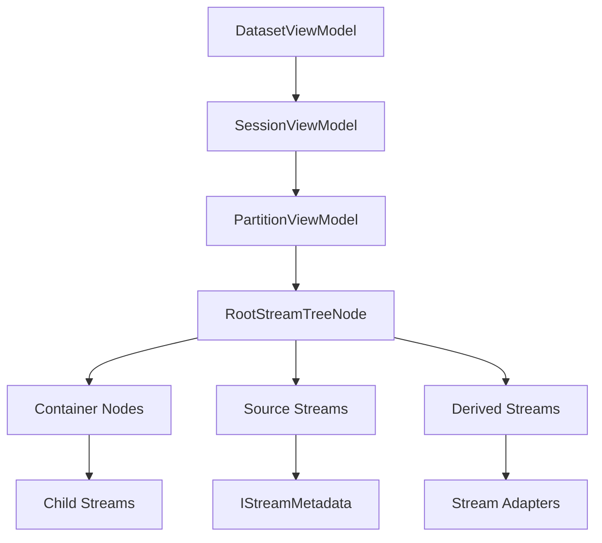
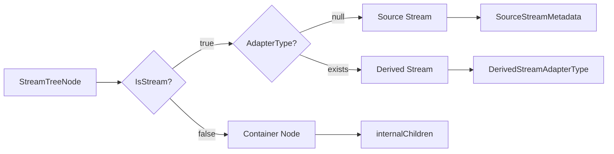
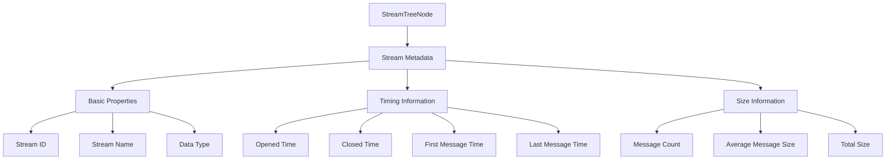
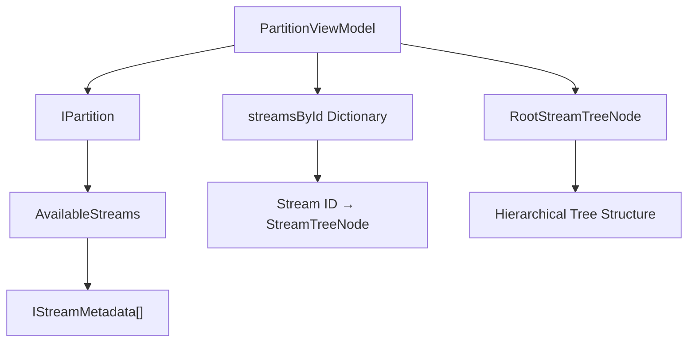
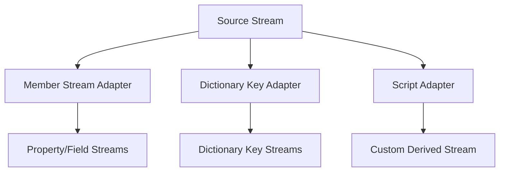
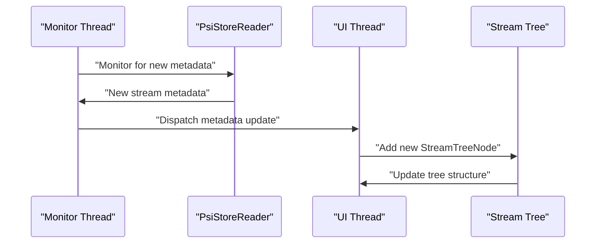

<!-- source: DeepWiki mcp.deepwiki.com · repo microsoft/psi · page 4.3 Data Models and Stream Tree · fetched 2026-10-26 -->

# Data Models and Stream Tree

Relevant source files

The following files were used as context for generating this wiki page:

- [Sources/Visualization/Microsoft.Psi.Visualization.Windows/ViewModels/PartitionViewModel.cs](Sources/Visualization/Microsoft.Psi.Visualization.Windows/ViewModels/PartitionViewModel.cs)
- [Sources/Visualization/Microsoft.Psi.Visualization.Windows/ViewModels/StreamTreeNode.cs](Sources/Visualization/Microsoft.Psi.Visualization.Windows/ViewModels/StreamTreeNode.cs)

This document covers the data models and hierarchical tree structures used to organize and represent data streams within PsiStudio's visualization interface. It focuses specifically on how streams are modeled, organized into tree hierarchies, and managed within partitions for visualization purposes.

For information about the underlying data persistence mechanisms, see [Data Persistence and Storage](#2.2). For details about the visualization UI components that display these data models, see [Visualization Components and UI](#4.2).

## Overview

The PsiStudio visualization system organizes data streams into a hierarchical tree structure that mirrors the logical organization of data within datasets, sessions, and partitions. The core data model consists of two primary components:

- **`StreamTreeNode`** - Represents individual nodes in the stream hierarchy, which can be actual streams, derived streams, or container nodes
- **`PartitionViewModel`** - Manages collections of streams within a partition and maintains the root of the stream tree

## Stream Tree Hierarchy

The stream tree follows a hierarchical organization that maps from the dataset level down to individual streams:

**Sources:** [Sources/Visualization/Microsoft.Psi.Visualization.Windows/ViewModels/StreamTreeNode.cs:42-101](), [Sources/Visualization/Microsoft.Psi.Visualization.Windows/ViewModels/PartitionViewModel.cs:79-90]()

## StreamTreeNode Structure

The `StreamTreeNode` class serves as the fundamental building block for representing streams in the visualization tree. Each node can represent one of three types:

### Node Types

| Type | Description | Key Properties |
|------|-------------|----------------|
| **Source Stream** | Direct streams from data stores | `IsSourceStream = true`, has `SourceStreamMetadata` |
| **Derived Stream** | Computed streams using adapters | `IsDerivedStream = true`, has `DerivedStreamAdapterType` |
| **Container** | Groups other streams hierarchically | `IsContainer = true`, no stream metadata |

**Sources:** [Sources/Visualization/Microsoft.Psi.Visualization.Windows/ViewModels/StreamTreeNode.cs:198-238]()

### Core Properties

The `StreamTreeNode` class exposes several key properties for stream identification and management:

- **`FullName`** - Complete hierarchical path (e.g., "Camera.Image.RGB")
- **`Name`** - Local node name (e.g., "RGB")
- **`DataType`** - .NET type of data in the stream
- **`SourceStreamMetadata`** - Metadata for source streams from stores
- **`Children`** - Read-only collection of child nodes

**Sources:** [Sources/Visualization/Microsoft.Psi.Visualization.Windows/ViewModels/StreamTreeNode.cs:132-196]()

## Stream Metadata Integration

Each stream node maintains comprehensive metadata about the underlying data stream:

**Sources:** [Sources/Visualization/Microsoft.Psi.Visualization.Windows/ViewModels/StreamTreeNode.cs:354-516]()

### Aggregated Metadata

Container nodes automatically compute aggregated metadata from their descendants:

- **`SubsumedOpenedTime`** - Earliest opened time of all child streams
- **`SubsumedClosedTime`** - Latest closed time of all child streams  
- **`SubsumedMessageCount`** - Total messages across all child streams
- **`SubsumedSize`** - Total data size across all child streams

**Sources:** [Sources/Visualization/Microsoft.Psi.Visualization.Windows/ViewModels/StreamTreeNode.cs:565-739]()

## Partition Management

The `PartitionViewModel` serves as the container and manager for stream trees within a partition:

### Stream Organization

**Sources:** [Sources/Visualization/Microsoft.Psi.Visualization.Windows/ViewModels/PartitionViewModel.cs:50-90]()

### Tree Construction Process

The partition builds the stream tree by processing available streams from the underlying data store:

1. **Root Creation** - Create a root `StreamTreeNode` using `StreamTreeNode.CreateRoot()`
2. **Stream Enumeration** - Iterate through `partition.AvailableStreams`
3. **Node Addition** - Add each stream using `RootStreamTreeNode.AddChild()`
4. **ID Mapping** - Maintain `streamsById` dictionary for quick lookups

**Sources:** [Sources/Visualization/Microsoft.Psi.Visualization.Windows/ViewModels/PartitionViewModel.cs:85-90]()

## Tree Construction and Navigation

### Adding Child Nodes

The `StreamTreeNode.AddChild()` method handles hierarchical path construction:

**Sources:** [Sources/Visualization/Microsoft.Psi.Visualization.Windows/ViewModels/StreamTreeNode.cs:953-976]()

### Navigation Methods

The tree provides several navigation and search capabilities:

- **`SelectChild(childName)`** - Selects and expands path to a child node
- **`FindChild(childName)`** - Locates a child node by path
- **`ExpandAll()`** / **`CollapseAll()`** - Tree expansion control

**Sources:** [Sources/Visualization/Microsoft.Psi.Visualization.Windows/ViewModels/StreamTreeNode.cs:982-1016]()

## Derived Stream Support

The system supports derived streams computed from source streams using adapters:

### Derived Stream Types

- **Member Expansion** - Expose object properties/fields as separate streams
- **Dictionary Keys** - Expand dictionary entries as individual streams  
- **Script-based** - Custom transformations using script adapters

**Sources:** [Sources/Visualization/Microsoft.Psi.Visualization.Windows/ViewModels/StreamTreeNode.cs:1898-1946](), [Sources/Visualization/Microsoft.Psi.Visualization.Windows/ViewModels/StreamTreeNode.cs:245-270]()

## Live Data Integration

For live partitions, the stream tree dynamically updates as new streams become available:

### Live Stream Monitoring

**Sources:** [Sources/Visualization/Microsoft.Psi.Visualization.Windows/ViewModels/PartitionViewModel.cs:659-680](), [Sources/Visualization/Microsoft.Psi.Visualization.Windows/ViewModels/PartitionViewModel.cs:747-763]()

The system maintains responsiveness by updating the UI at controlled intervals while continuously monitoring for new stream data in live scenarios.

---

