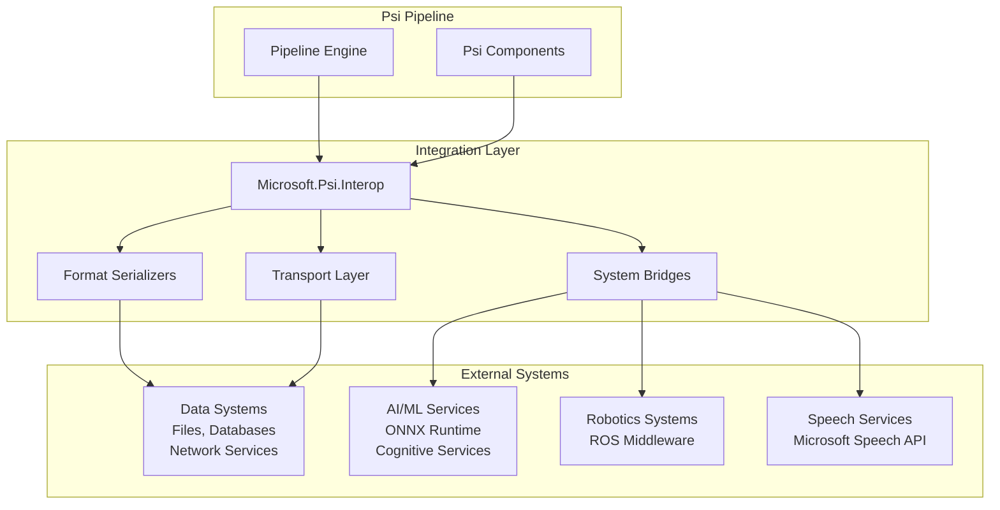
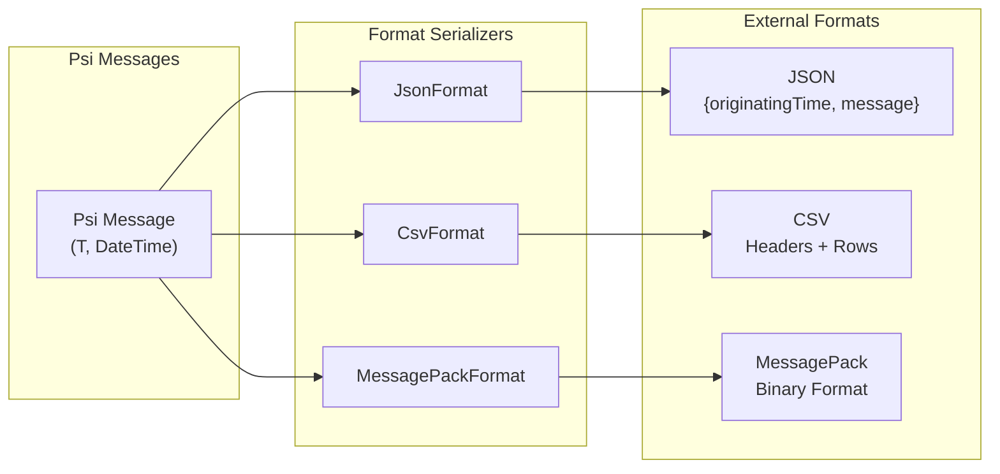
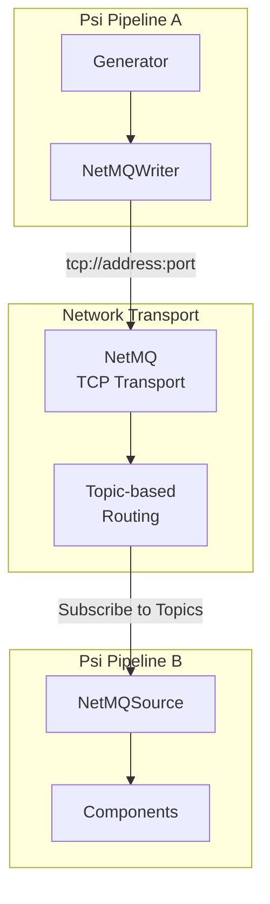
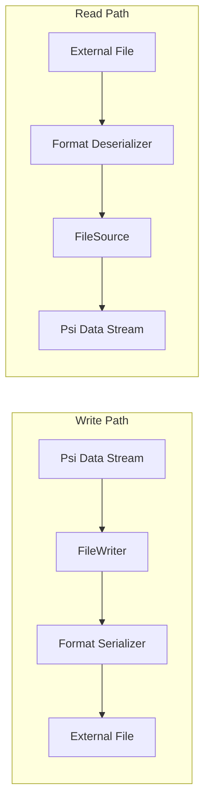

<!-- source: DeepWiki mcp.deepwiki.com · repo microsoft/psi · page 5 External Integrations · fetched 2026-10-26 -->

# External Integrations

<details>
<summary>Relevant source files</summary>

The following files were used as context for generating this wiki page:

- [Sources/MixedReality/Microsoft.Psi.MixedReality.UniversalWindows/Microsoft.Psi.MixedReality.UniversalWindows.csproj](Sources/MixedReality/Microsoft.Psi.MixedReality.UniversalWindows/Microsoft.Psi.MixedReality.UniversalWindows.csproj)
- [Sources/Runtime/Microsoft.Psi.Interop/Format/JsonFormat.cs](Sources/Runtime/Microsoft.Psi.Interop/Format/JsonFormat.cs)
- [Sources/Runtime/Microsoft.Psi.Interop/Microsoft.Psi.Interop.csproj](Sources/Runtime/Microsoft.Psi.Interop/Microsoft.Psi.Interop.csproj)
- [Sources/Runtime/Test.Psi/InteropTests.cs](Sources/Runtime/Test.Psi/InteropTests.cs)

</details>


## Purpose and Scope

This section documents Microsoft Psi's capabilities for integrating with external systems and frameworks. External integrations enable Psi pipelines to exchange data with other software systems, consume external services, and interoperate with different data formats and transport protocols.

The external integrations are organized into several key areas: AI/ML model integration for [AI and Machine Learning with ONNX](#5.1), robotics middleware connectivity for [Robotics Integration with ROS](#5.2), cloud-based speech services for [Speech Recognition and Processing](#5.3), data format conversion and network transport for [Data Interoperability and Transport](#5.4), and remote AI model servers for [AI Model Server Integration](#5.5).

For core Psi framework functionality, see [Core Framework](#2). For visualization and analysis tools, see [Visualization and Analysis](#4).

## Integration Architecture Overview

The external integrations in Psi follow a component-based architecture where external systems are wrapped as Psi components that can participate in the standard pipeline message flow.



**Sources:** [Sources/Runtime/Microsoft.Psi.Interop/Microsoft.Psi.Interop.csproj:1-54]()

## Data Format Integration

Psi provides built-in support for multiple data serialization formats to enable interoperability with external systems that use different data representations.

### Format Serialization Architecture



**Sources:** [Sources/Runtime/Microsoft.Psi.Interop/Format/JsonFormat.cs:1-124](), [Sources/Runtime/Test.Psi/InteropTests.cs:66-246]()

### Core Format Types

| Format | Class | Use Case | Features |
|--------|--------|----------|----------|
| JSON | `JsonFormat` | Web APIs, Configuration | Human-readable, hierarchical data |
| CSV | `CsvFormat` | Data analysis, Excel | Tabular data, flattened structure |
| MessagePack | `MessagePackFormat` | High-performance IPC | Binary, compact, fast |

The format serializers implement both `IFormatSerializer`/`IFormatDeserializer` for message-based communication and `IPersistentFormatSerializer`/`IPersistentFormatDeserializer` for file-based storage.

**Sources:** [Sources/Runtime/Microsoft.Psi.Interop/Microsoft.Psi.Interop.csproj:32-40](), [Sources/Runtime/Test.Psi/InteropTests.cs:39-64]()

## Network Transport Integration

Psi integrates with NetMQ for distributed messaging, enabling pipelines to communicate across process and machine boundaries.

### NetMQ Transport Architecture



**Sources:** [Sources/Runtime/Test.Psi/InteropTests.cs:250-337](), [Sources/Runtime/Microsoft.Psi.Interop/Microsoft.Psi.Interop.csproj:39]()

### Multi-Topic Support

The NetMQ integration supports multiple topics on a single transport connection:

- `NetMQWriter` can serve multiple topics via `AddTopic<T>(string topic)`
- `NetMQSource<T>` subscribes to specific topics
- Topics enable selective message routing and filtering

**Sources:** [Sources/Runtime/Test.Psi/InteropTests.cs:290-337]()

## Integration Component Patterns

### File-based Integration



**Sources:** [Sources/Runtime/Test.Psi/InteropTests.cs:218-246]()

### Message Serialization Pattern

All external integrations follow a consistent message serialization pattern where Psi messages are wrapped with originating timestamps:

```json
{
  "originatingTime": "1971-11-03T00:00:00.1234567Z",
  "message": <actual_data>
}
```

This ensures temporal consistency across system boundaries while preserving the original message data.

**Sources:** [Sources/Runtime/Microsoft.Psi.Interop/Format/JsonFormat.cs:31-46](), [Sources/Runtime/Test.Psi/InteropTests.cs:71-119]()

## Integration Dependencies

The core interop functionality relies on several external packages:

| Package | Version | Purpose |
|---------|---------|---------|
| `CsvHelper` | 15.0.0 | CSV format processing |
| `MessagePack` | 2.5.187 | Binary serialization |
| `NetMQ` | 4.0.1.6 | ZeroMQ transport |
| `Newtonsoft.Json` | 13.0.2 | JSON serialization |

**Sources:** [Sources/Runtime/Microsoft.Psi.Interop/Microsoft.Psi.Interop.csproj:32-47]()

The integration framework provides the foundation for all external system connectivity in Psi, with specific implementations detailed in the following subsections for different domains and use cases.

---

