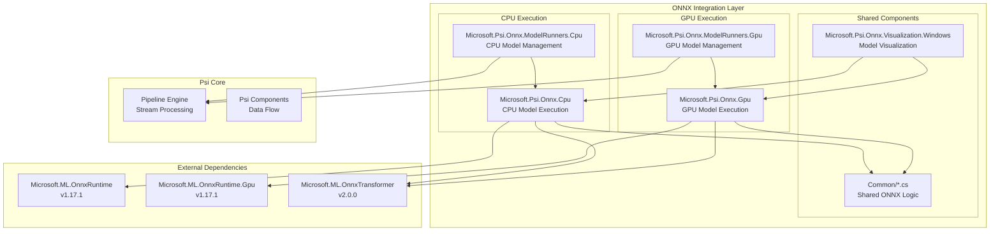
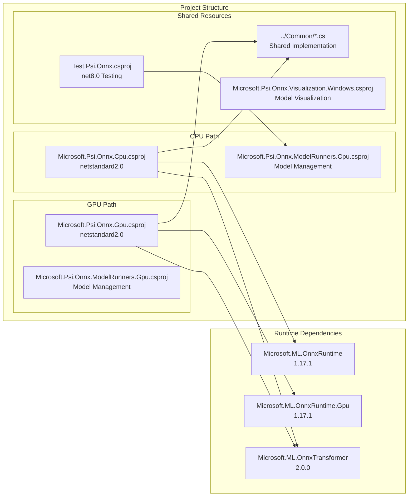
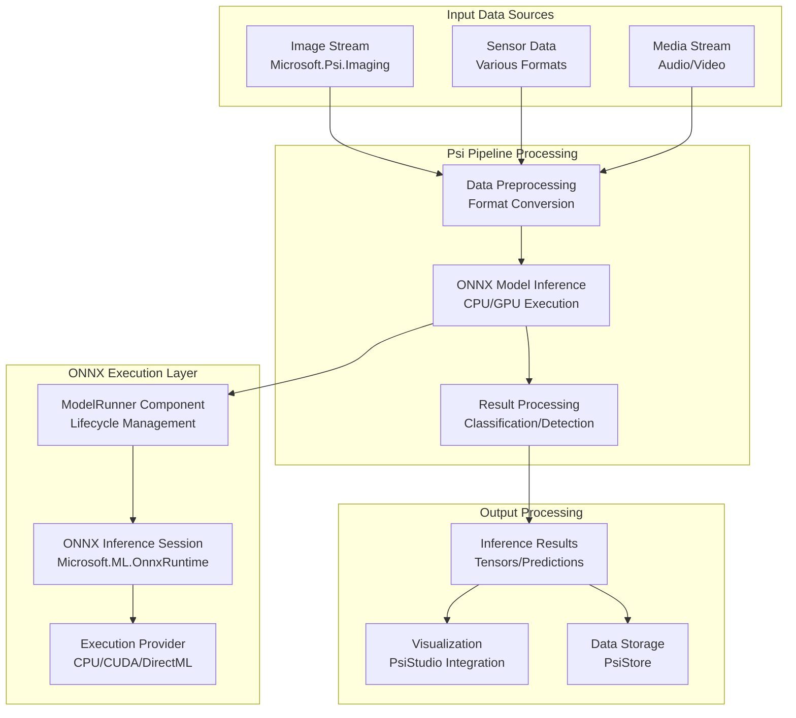
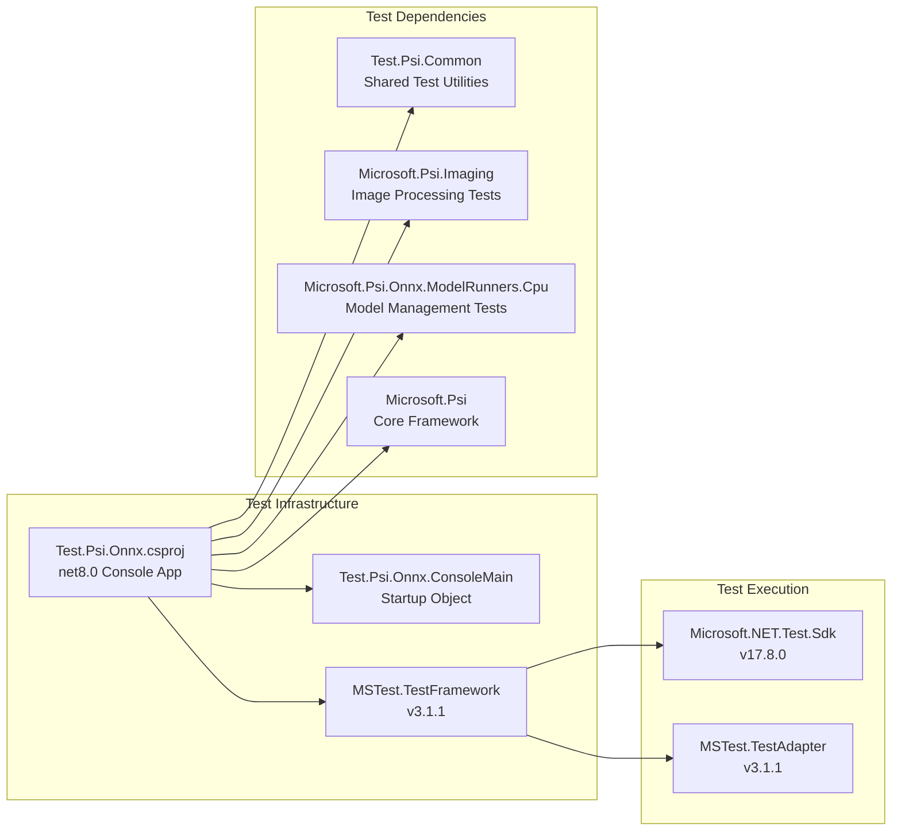

<!-- source: DeepWiki mcp.deepwiki.com · repo microsoft/psi · page 5.1 AI and Machine Learning with ONNX · fetched 2026-10-26 -->

# AI and Machine Learning with ONNX

Relevant source files

The following files were used as context for generating this wiki page:

- [Psi.sln](Psi.sln)
- [Sources/Calibration/Test.Psi.Calibration/Test.Psi.Calibration.csproj](Sources/Calibration/Test.Psi.Calibration/Test.Psi.Calibration.csproj)
- [Sources/Integrations/CognitiveServices/Microsoft.Psi.CognitiveServices.Language.Windows/Microsoft.Psi.CognitiveServices.Language.Windows.csproj](Sources/Integrations/CognitiveServices/Microsoft.Psi.CognitiveServices.Language.Windows/Microsoft.Psi.CognitiveServices.Language.Windows.csproj)
- [Sources/Integrations/Onnx/Microsoft.Psi.Onnx.Cpu/Microsoft.Psi.Onnx.Cpu.csproj](Sources/Integrations/Onnx/Microsoft.Psi.Onnx.Cpu/Microsoft.Psi.Onnx.Cpu.csproj)
- [Sources/Integrations/Onnx/Microsoft.Psi.Onnx.Gpu/Microsoft.Psi.Onnx.Gpu.csproj](Sources/Integrations/Onnx/Microsoft.Psi.Onnx.Gpu/Microsoft.Psi.Onnx.Gpu.csproj)
- [Sources/Integrations/Onnx/Test.Psi.Onnx/Test.Psi.Onnx.csproj](Sources/Integrations/Onnx/Test.Psi.Onnx/Test.Psi.Onnx.csproj)

This section covers the ONNX (Open Neural Network Exchange) integration within the Microsoft Psi framework, providing components for running pre-trained machine learning models in real-time streaming scenarios. The ONNX integration supports both CPU and GPU execution environments for neural network inference.

For information about other AI integrations such as Microsoft Cognitive Services, see [Speech Recognition and Processing](#5.3). For robotics-specific AI applications, see [Robotics Integration with ROS](#5.2).

## Architecture Overview

The ONNX integration in Psi is structured around separate CPU and GPU execution paths, each with corresponding model runners and shared common functionality. This design allows developers to choose the appropriate execution environment based on performance requirements and hardware availability.

**Sources:** [Sources/Integrations/Onnx/Microsoft.Psi.Onnx.Cpu/Microsoft.Psi.Onnx.Cpu.csproj:1-42](), [Sources/Integrations/Onnx/Microsoft.Psi.Onnx.Gpu/Microsoft.Psi.Onnx.Gpu.csproj:1-42](), [Psi.sln:180-191]()

## Core ONNX Components

The ONNX integration provides parallel CPU and GPU execution paths, each implemented as separate NuGet packages targeting .NET Standard 2.0 for broad compatibility.

**Sources:** [Sources/Integrations/Onnx/Microsoft.Psi.Onnx.Cpu/Microsoft.Psi.Onnx.Cpu.csproj:28-29](), [Sources/Integrations/Onnx/Microsoft.Psi.Onnx.Gpu/Microsoft.Psi.Onnx.Gpu.csproj:28-29](), [Sources/Integrations/Onnx/Test.Psi.Onnx/Test.Psi.Onnx.csproj:30-34]()

## Package Dependencies and Configuration

Both CPU and GPU ONNX packages share a common dependency structure while targeting different execution providers for the underlying ONNX Runtime.

| Component | CPU Package | GPU Package | Purpose |
|-----------|-------------|-------------|---------|
| **ONNX Runtime** | `Microsoft.ML.OnnxRuntime` v1.17.1 | `Microsoft.ML.OnnxRuntime.Gpu` v1.17.1 | Core inference engine |
| **ONNX Transformer** | `Microsoft.ML.OnnxTransformer` v2.0.0 | `Microsoft.ML.OnnxTransformer` v2.0.0 | Model transformation utilities |
| **Target Framework** | netstandard2.0 | netstandard2.0 | Cross-platform compatibility |
| **Root Namespace** | `Microsoft.Psi.Onnx` | `Microsoft.Psi.Onnx` | Unified API surface |

**Sources:** [Sources/Integrations/Onnx/Microsoft.Psi.Onnx.Cpu/Microsoft.Psi.Onnx.Cpu.csproj:35-36](), [Sources/Integrations/Onnx/Microsoft.Psi.Onnx.Gpu/Microsoft.Psi.Onnx.Gpu.csproj:35-36]()

## Model Execution Pipeline Integration

The ONNX components integrate into Psi's stream processing pipeline, enabling real-time inference on data flowing through the system. The model runners provide higher-level abstractions for managing model lifecycle and execution.

**Sources:** [Sources/Integrations/Onnx/Test.Psi.Onnx/Test.Psi.Onnx.csproj:31-32](), [Psi.sln:186-189]()

## Testing and Development Framework

The ONNX integration includes comprehensive testing infrastructure that validates both CPU and GPU execution paths using the MSTest framework.

**Sources:** [Sources/Integrations/Onnx/Test.Psi.Onnx/Test.Psi.Onnx.csproj:4-6](), [Sources/Integrations/Onnx/Test.Psi.Onnx/Test.Psi.Onnx.csproj:22-27](), [Sources/Integrations/Onnx/Test.Psi.Onnx/Test.Psi.Onnx.csproj:29-34]()

## Build Configuration and Code Quality

Both ONNX packages enforce strict code quality standards through StyleCop analyzers and treat warnings as errors in both Debug and Release configurations.

| Configuration Aspect | Setting | Purpose |
|---------------------|---------|---------|
| **Code Analysis** | `Microsoft.Psi.ruleset` | Enforces Psi coding standards |
| **Warning Treatment** | `TreatWarningsAsErrors=true` | Ensures code quality |
| **Documentation** | Auto-generated XML files | API documentation |
| **StyleCop** | v1.1.118 | Code style enforcement |
| **Package Generation** | `GeneratePackageOnBuild=true` | Automated NuGet packaging |

**Sources:** [Sources/Integrations/Onnx/Microsoft.Psi.Onnx.Cpu/Microsoft.Psi.Onnx.Cpu.csproj:8-19](), [Sources/Integrations/Onnx/Microsoft.Psi.Onnx.Gpu/Microsoft.Psi.Onnx.Gpu.csproj:8-19]()

---

