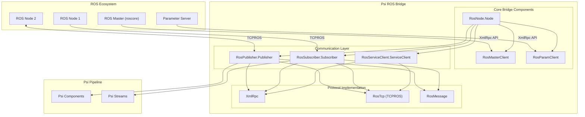
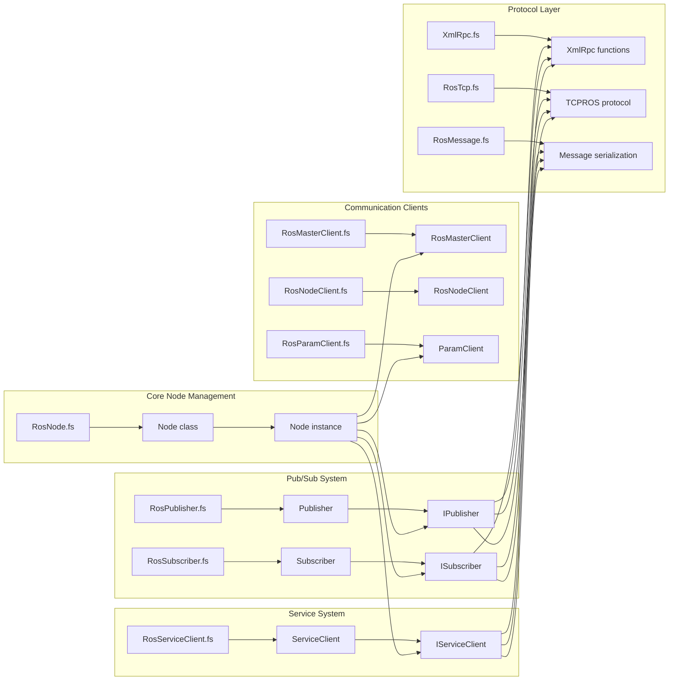
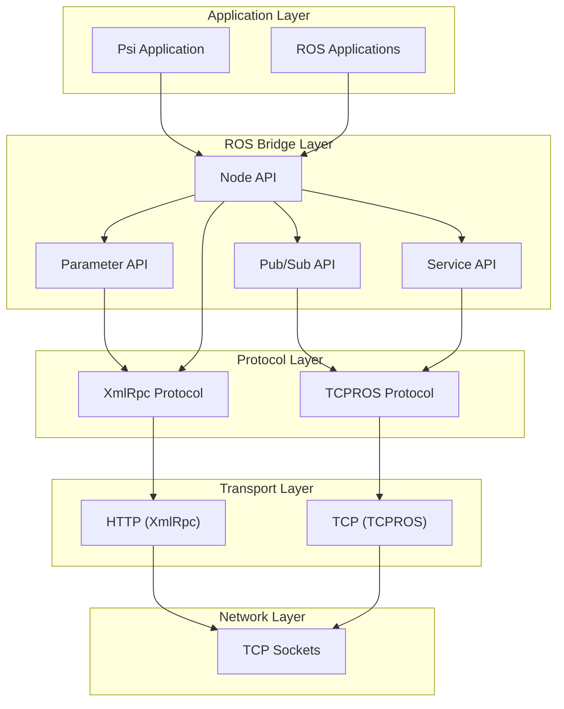
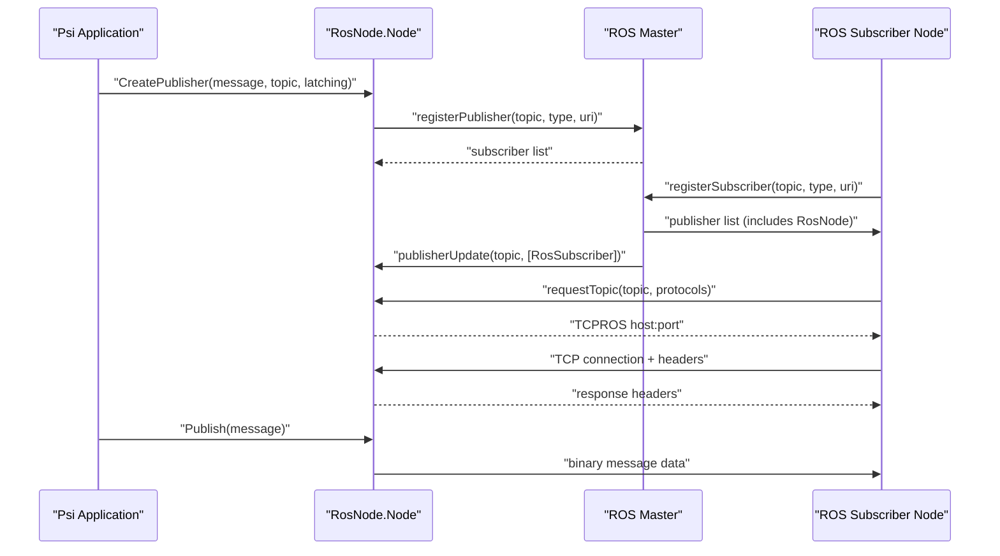
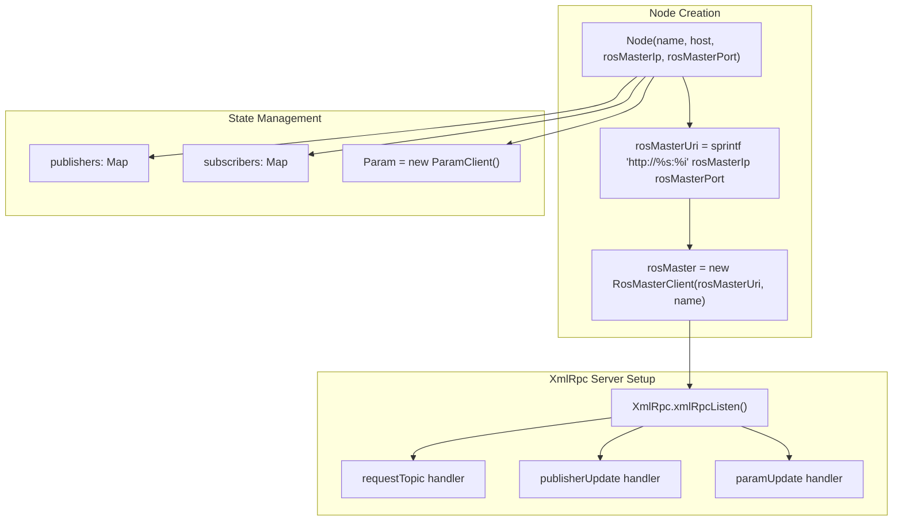
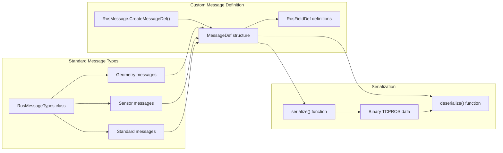
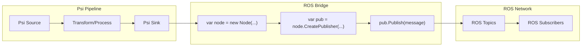
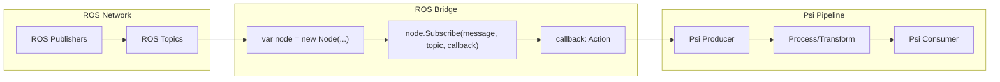

<!-- source: DeepWiki mcp.deepwiki.com · repo microsoft/psi · page 5.2 Robotics Integration with ROS · fetched 2026-10-26 -->

# Robotics Integration with ROS

<details>
<summary>Relevant source files</summary>

The following files were used as context for generating this wiki page:

- [Sources/Integrations/ROS/Microsoft.Psi.ROS/Microsoft.Psi.ROS.fsproj](Sources/Integrations/ROS/Microsoft.Psi.ROS/Microsoft.Psi.ROS.fsproj)
- [Sources/Integrations/ROS/Microsoft.Psi.ROS/Readme.md](Sources/Integrations/ROS/Microsoft.Psi.ROS/Readme.md)
- [Sources/Integrations/ROS/Microsoft.Psi.ROS/RosNode.fs](Sources/Integrations/ROS/Microsoft.Psi.ROS/RosNode.fs)
- [Sources/Integrations/ROS/Microsoft.Psi.ROS/RosNodeClient.fs](Sources/Integrations/ROS/Microsoft.Psi.ROS/RosNodeClient.fs)
- [Sources/Integrations/ROS/Microsoft.Psi.ROS/RosSubscriber.fs](Sources/Integrations/ROS/Microsoft.Psi.ROS/RosSubscriber.fs)

</details>


This document covers the Microsoft Psi integration with ROS (Robot Operating System), providing a bridge between the .NET/Psi ecosystem and the robotics community's standard middleware. The integration enables Psi applications to communicate with ROS nodes, publish and subscribe to ROS topics, call ROS services, and participate in distributed robotics systems.

For AI model integration capabilities, see [AI and Machine Learning with ONNX](#5.1). For general data interoperability and transport mechanisms, see [Data Interoperability and Transport](#5.4).

## Architecture Overview

The ROS integration provides a comprehensive bridge that implements the ROS communication protocols and patterns within the Psi framework. The system handles both the discovery and coordination aspects (via ROS Master) and the direct peer-to-peer message passing between nodes.

### ROS Bridge System Architecture



Sources: [Sources/Integrations/ROS/Microsoft.Psi.ROS/Readme.md:1-259](), [Sources/Integrations/ROS/Microsoft.Psi.ROS/Microsoft.Psi.ROS.fsproj:23-38]()

## Core Components and Code Mapping

The ROS bridge consists of several key F# modules that implement different aspects of the ROS protocol and integration patterns.

### Component Architecture and File Structure



Sources: [Sources/Integrations/ROS/Microsoft.Psi.ROS/Microsoft.Psi.ROS.fsproj:23-38](), [Sources/Integrations/ROS/Microsoft.Psi.ROS/RosNode.fs:1-89]()

### Key Classes and Interfaces

| Component | File | Primary Classes | Purpose |
|-----------|------|-----------------|---------|
| Node Management | [RosNode.fs]() | `Node` | Main ROS node implementation, manages publishers/subscribers |
| Master Communication | [RosMasterClient.fs]() | `RosMasterClient` | Communicates with ROS Master for registration/discovery |
| Node Communication | [RosNodeClient.fs]() | `RosNodeClient` | Direct node-to-node communication |
| Parameter Access | [RosParamClient.fs]() | `ParamClient` | Parameter server operations |
| Publishing | [RosPublisher.fs]() | `Publisher`, `IPublisher` | Publishes messages to ROS topics |
| Subscription | [RosSubscriber.fs]() | `Subscriber`, `ISubscriber` | Subscribes to ROS topics |
| Services | [RosServiceClient.fs]() | `ServiceClient`, `IServiceClient` | ROS service client implementation |

Sources: [Sources/Integrations/ROS/Microsoft.Psi.ROS/Microsoft.Psi.ROS.fsproj:23-38]()

## Communication Protocols

The ROS bridge implements two primary communication protocols used by ROS: XmlRpc for coordination and TCPROS for message passing.

### Protocol Stack



Sources: [Sources/Integrations/ROS/Microsoft.Psi.ROS/Readme.md:75-175]()

### Message Flow Sequence

The following sequence shows how a Psi application publishes to a ROS topic and how ROS nodes discover and subscribe to it:



Sources: [Sources/Integrations/ROS/Microsoft.Psi.ROS/Readme.md:84-102](), [Sources/Integrations/ROS/Microsoft.Psi.ROS/RosNode.fs:70-76]()

## Node Management and Lifecycle

The `RosNode.Node` class serves as the primary entry point for ROS integration, managing the lifecycle of publishers, subscribers, and service clients.

### Node Initialization and Registration

The `Node` constructor establishes connection to the ROS Master and sets up the XmlRpc endpoint for receiving ROS protocol messages:



Sources: [Sources/Integrations/ROS/Microsoft.Psi.ROS/RosNode.fs:26-68]()

### Publisher and Subscriber Management

The `Node` class provides methods to create and manage publishers and subscribers, with automatic registration to the ROS Master:

| Method | Parameters | Purpose | ROS Master Interaction |
|--------|------------|---------|----------------------|
| `CreatePublisher` | `message`, `topic`, `latching` | Creates a new publisher | Calls `registerPublisher` |
| `Subscribe` | `message`, `topic`, `callback` | Creates a new subscriber | Calls `registerSubscriber` |
| `UnregisterPublisher` | `topic` | Removes publisher | Calls `unregisterPublisher` |
| `UnregisterSubscriber` | `topic` | Removes subscriber | Calls `unregisterSubscriber` |
| `CreateServiceClient` | `service`, `name`, `latching` | Creates service client | Calls `lookupService` |

Sources: [Sources/Integrations/ROS/Microsoft.Psi.ROS/RosNode.fs:70-89]()

## Message Definition and Serialization

ROS messages are defined using the `RosMessage.MessageDef` structure, which includes type information, MD5 hash for version compatibility, and field definitions for serialization.

### Message Type System



Sources: [Sources/Integrations/ROS/Microsoft.Psi.ROS/Readme.md:58-72]()

### Message Definition Example

The README demonstrates custom message definition using the `turtlesim/Pose` message type:

```
var poseMessageDef = RosMessage.CreateMessageDef(
  "turtlesim/Pose",
  "863b248d5016ca62ea2e895ae5265cf9",
  new[] {
    Tuple.Create("x", RosMessage.RosFieldDef.Float32Def),
    Tuple.Create("y", RosMessage.RosFieldDef.Float32Def),
    Tuple.Create("theta", RosMessage.RosFieldDef.Float32Def),
    Tuple.Create("linear_velocity", RosMessage.RosFieldDef.Float32Def),
    Tuple.Create("angular_velocity", RosMessage.RosFieldDef.Float32Def)
  })
```

Sources: [Sources/Integrations/ROS/Microsoft.Psi.ROS/Readme.md:62-72]()

## Usage Patterns and Integration

### Basic Publisher Pattern

The typical pattern for publishing ROS messages from Psi involves creating a `Node`, registering a publisher, and then publishing messages through the Psi pipeline:



### Basic Subscriber Pattern

For subscribing to ROS topics, the bridge provides callback-based subscription that can feed into Psi streams:



Sources: [Sources/Integrations/ROS/Microsoft.Psi.ROS/RosNode.fs:78-83](), [Sources/Integrations/ROS/Microsoft.Psi.ROS/RosSubscriber.fs:31-63]()

### DNS Resolution and Distributed Systems

The bridge includes `RosDns` functionality to handle hostname resolution in distributed ROS systems where nodes run on different machines:

| Component | Purpose | Usage |
|-----------|---------|-------|
| `RosDns.add()` | Add hostname/IP mapping | `RosDns.add("my-hostname", "10.1.2.3")` |
| `RosDns.resolve()` | Resolve hostname to IP | Used internally by subscribers and service clients |

Sources: [Sources/Integrations/ROS/Microsoft.Psi.ROS/Readme.md:47-48]()

---

