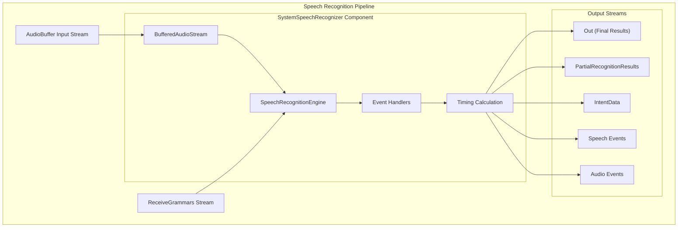
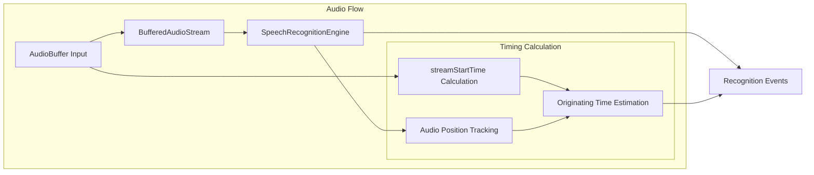
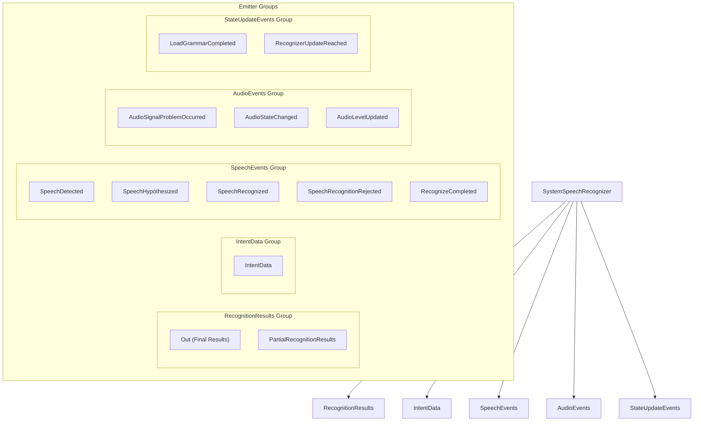
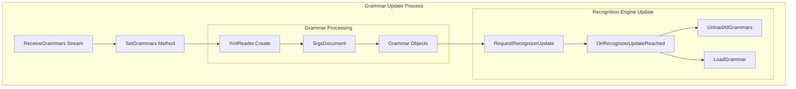

<!-- source: DeepWiki mcp.deepwiki.com · repo microsoft/psi · page 5.3 Speech Recognition and Processing · fetched 2026-10-26 -->

# Speech Recognition and Processing

Relevant source files

The following files were used as context for generating this wiki page:

- [Sources/Speech/Microsoft.Psi.Speech.Windows/SystemSpeechRecognizer.cs](Sources/Speech/Microsoft.Psi.Speech.Windows/SystemSpeechRecognizer.cs)
- [Sources/Speech/Microsoft.Psi.Speech.Windows/SystemSpeechRecognizerConfiguration.cs](Sources/Speech/Microsoft.Psi.Speech.Windows/SystemSpeechRecognizerConfiguration.cs)

This document covers the speech recognition and processing capabilities in Microsoft Psi, focusing on integration with Microsoft's System.Speech framework for Windows-based speech recognition. The system provides continuous speech recognition with support for custom grammars, partial results, and comprehensive event handling.

For AI model integration more broadly, see [AI and Machine Learning with ONNX](#5.1). For audio processing capabilities, see [Media Processing](#6).

## Component Overview

The speech recognition system is built around the `SystemSpeechRecognizer` component, which integrates Microsoft's System.Speech recognition engine into the Psi streaming framework. This component processes continuous audio streams and produces speech recognition results with precise timing information.

**Title:** Speech Recognition Component Architecture

The `SystemSpeechRecognizer` class serves as the primary interface between Psi and the underlying speech recognition engine. It handles audio buffering, event processing, and maintains timing consistency across multiple output streams.

**Sources:** [Sources/Speech/Microsoft.Psi.Speech.Windows/SystemSpeechRecognizer.cs:37-121]()

## Configuration

The `SystemSpeechRecognizerConfiguration` class provides comprehensive configuration options for the speech recognition component:

| Configuration Property | Default Value | Description |
|------------------------|---------------|-------------|
| `Language` | "en-us" | Speech recognition locale |
| `Grammars` | null | Array of SRGS grammar files |
| `BufferLengthInMs` | 1000 | Audio buffer length in milliseconds |
| `InitialSilenceTimeoutMs` | 0 | Timeout for initial silence detection |
| `BabbleTimeoutMs` | 0 | Timeout for background noise detection |
| `EndSilenceTimeoutMs` | 150 | Silence timeout for unambiguous input |
| `EndSilenceTimeoutAmbiguousMs` | 500 | Silence timeout for ambiguous input |
| `InputFormat` | 16kHz, 1-channel, 16-bit PCM | Expected audio format |

The configuration supports multiple languages including "en-gb", "de-de", "es-es", "fr-fr", "ja-jp", "zh-cn", and "zh-tw". Grammar files must conform to the W3C Speech Recognition Grammar Specification (SRGS) Version 1.0.

**Sources:** [Sources/Speech/Microsoft.Psi.Speech.Windows/SystemSpeechRecognizerConfiguration.cs:16-100]()

## Audio Processing Pipeline

The component processes audio through a buffered stream architecture that maintains timing precision for recognition events:

**Title:** Audio Processing and Timing Flow

The `Receive` method processes incoming audio buffers and calculates precise timing information for recognition events. The component maintains a `streamStartTime` that serves as the basis for computing originating times of all recognition events.

**Sources:** [Sources/Speech/Microsoft.Psi.Speech.Windows/SystemSpeechRecognizer.cs:301-312]()

## Recognition Results and Output Streams

The speech recognizer produces multiple types of output streams organized into emitter groups for timing consistency:

**Title:** Output Stream Organization and Emitter Groups

Each emitter group enforces monotonically increasing originating times to maintain Psi's timing requirements. The `PostWithOriginatingTimeConsistencyCheck` method ensures temporal consistency across all streams within each group.

### Recognition Result Types

- **Final Results:** Complete recognition results with confidence scores and alternates
- **Partial Results:** Intermediate hypotheses during ongoing speech
- **Intent Data:** Semantic interpretation results from grammar-based recognition
- **Speech Events:** Low-level speech detection and recognition events
- **Audio Events:** Audio signal quality and state information

**Sources:** [Sources/Speech/Microsoft.Psi.Speech.Windows/SystemSpeechRecognizer.cs:86-107](), [Sources/Speech/Microsoft.Psi.Speech.Windows/SystemSpeechRecognizer.cs:526-545]()

## Grammar Management

The system supports dynamic grammar updates through the `ReceiveGrammars` input stream and `SetGrammars` method:

**Title:** Dynamic Grammar Update Process

Grammar updates are processed asynchronously to avoid interrupting ongoing recognition. The `RequestRecognizerUpdate` method queues the update, and the actual grammar replacement occurs in the `OnRecognizerUpdateReached` event handler.

**Sources:** [Sources/Speech/Microsoft.Psi.Speech.Windows/SystemSpeechRecognizer.cs:228-237](), [Sources/Speech/Microsoft.Psi.Speech.Windows/SystemSpeechRecognizer.cs:450-464]()

## Integration with Psi Framework

The `SystemSpeechRecognizer` implements key Psi interfaces for seamless pipeline integration:

- **`ConsumerProducer<AudioBuffer, IStreamingSpeechRecognitionResult>`:** Processes audio input and produces recognition results
- **`ISpeechRecognizer`:** Standard interface for speech recognition components
- **`ISourceComponent`:** Indicates the component can generate data independently
- **`IDisposable`:** Proper resource management for the underlying speech engine

The component uses `EmitterGroup` enums to organize output streams and maintain timing consistency through the `PostWithOriginatingTimeConsistencyCheck` mechanism.

**Sources:** [Sources/Speech/Microsoft.Psi.Speech.Windows/SystemSpeechRecognizer.cs:37-37](), [Sources/Speech/Microsoft.Psi.Speech.Windows/SystemSpeechRecognizer.cs:140-147]()

---

