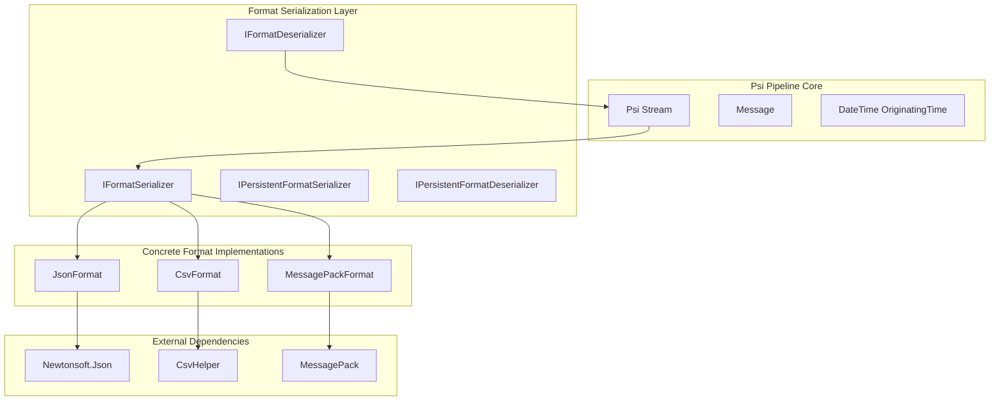
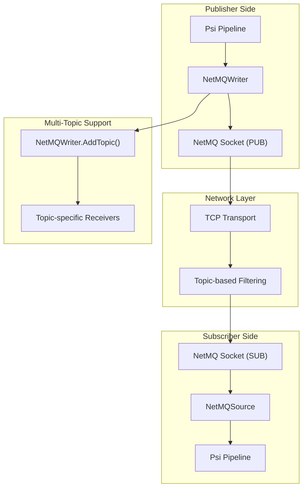
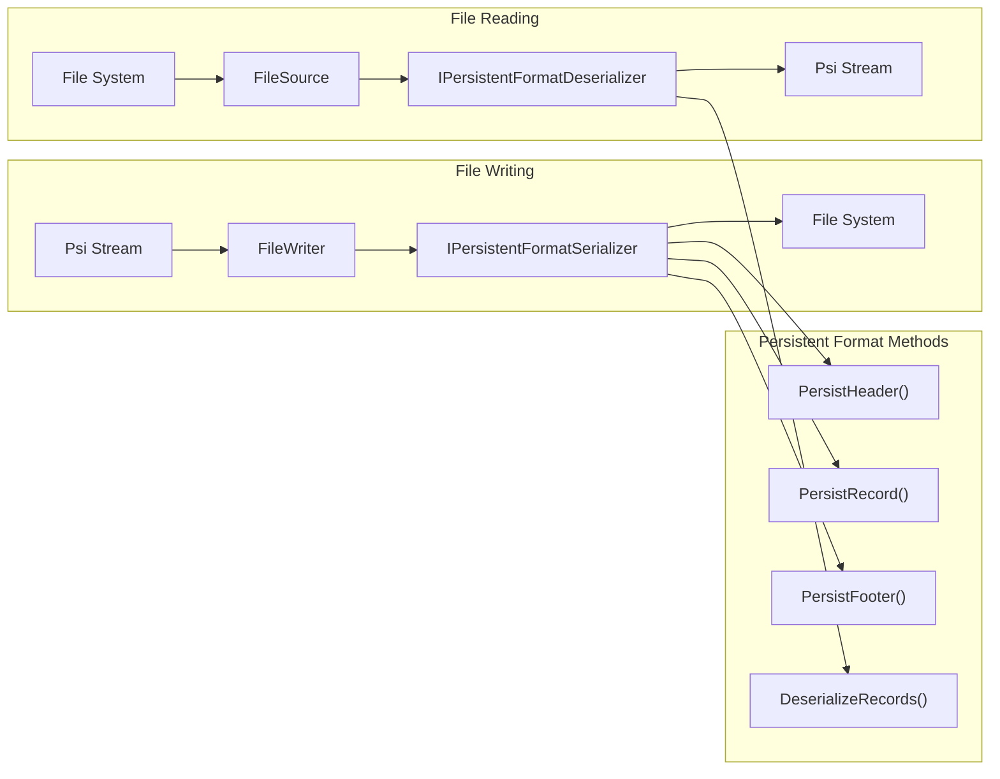

<!-- source: DeepWiki mcp.deepwiki.com · repo microsoft/psi · page 5.4 Data Interoperability and Transport · fetched 2026-10-26 -->

# Data Interoperability and Transport

<details>
<summary>Relevant source files</summary>

The following files were used as context for generating this wiki page:

- [Sources/MixedReality/Microsoft.Psi.MixedReality.UniversalWindows/Microsoft.Psi.MixedReality.UniversalWindows.csproj](Sources/MixedReality/Microsoft.Psi.MixedReality.UniversalWindows/Microsoft.Psi.MixedReality.UniversalWindows.csproj)
- [Sources/Runtime/Microsoft.Psi.Interop/Format/JsonFormat.cs](Sources/Runtime/Microsoft.Psi.Interop/Format/JsonFormat.cs)
- [Sources/Runtime/Microsoft.Psi.Interop/Microsoft.Psi.Interop.csproj](Sources/Runtime/Microsoft.Psi.Interop/Microsoft.Psi.Interop.csproj)
- [Sources/Runtime/Test.Psi/InteropTests.cs](Sources/Runtime/Test.Psi/InteropTests.cs)

</details>


This document covers the data interoperability and transport capabilities of the Microsoft Psi framework, focusing on external data format support and network communication mechanisms. This includes serialization to standard formats like JSON, CSV, and MessagePack, as well as network transport using NetMQ for distributed messaging.

For AI model integration and external service connectivity, see [AI Model Server Integration](#5.5). For robotics system communication, see [Robotics Integration with ROS](#5.2).

## Overview

The Microsoft Psi interoperability system enables seamless data exchange between Psi pipelines and external systems through standardized formats and transport protocols. The system provides bidirectional conversion between Psi's internal data representation and common interchange formats, along with network transport capabilities for distributed processing scenarios.

## Data Format Support Architecture



Sources: [Sources/Runtime/Microsoft.Psi.Interop/Microsoft.Psi.Interop.csproj:32-40](), [Sources/Runtime/Test.Psi/InteropTests.cs:14-16]()

## Serialization Format Implementations

The framework supports three primary serialization formats, each optimized for different use cases:

| Format | Class | Use Case | File Extension | Human Readable |
|--------|-------|----------|----------------|----------------|
| JSON | `JsonFormat` | Web APIs, configuration | `.json` | Yes |
| CSV | `CsvFormat` | Data analysis, spreadsheets | `.csv` | Yes |
| MessagePack | `MessagePackFormat` | High-performance binary | `.msg` | No |

### JSON Format Implementation

The `JsonFormat` class provides JSON serialization with timestamp preservation:

```mermaid
graph LR
    PsiMessage["Psi Message<T>"] --> JsonFormat["JsonFormat.SerializeMessage()"]
    JsonFormat --> JsonStructure["{\"originatingTime\": \"...\", \"message\": {...}}"]
    JsonStructure --> JsonFormat2["JsonFormat.DeserializeMessage()"]
    JsonFormat2 --> PsiMessage2["Psi Message<T>"]
    
    subgraph "JSON Processing"
        NewtonsoftJson["Newtonsoft.Json.JsonConvert"]
        JToken["JToken Processing"]
        ExpandoObject["ExpandoObject Creation"]
    end
    
    JsonFormat --> NewtonsoftJson
    NewtonsoftJson --> JToken
    JToken --> ExpandoObject
```

Sources: [Sources/Runtime/Microsoft.Psi.Interop/Format/JsonFormat.cs:31-46]()

### CSV Format Characteristics

The CSV format implementation handles structured data flattening:

- Nested objects are flattened into columns
- Arrays become individual columns (`_Column0_`, `_Column1_`, etc.)
- Timestamps preserved in `_OriginatingTime_` column
- Complex hierarchies lose nesting structure

Sources: [Sources/Runtime/Test.Psi/InteropTests.cs:125-178]()

### MessagePack Binary Format

MessagePack provides efficient binary serialization for high-throughput scenarios with minimal overhead compared to text-based formats.

Sources: [Sources/Runtime/Test.Psi/InteropTests.cs:182-216]()

## Network Transport with NetMQ



Sources: [Sources/Runtime/Test.Psi/InteropTests.cs:250-337](), [Sources/Runtime/Microsoft.Psi.Interop/Microsoft.Psi.Interop.csproj:39]()

### NetMQ Transport Features

The NetMQ transport system provides:

- **Topic-based Publishing**: Multiple data streams over single connection
- **TCP-based Communication**: Reliable network transport
- **Format-agnostic**: Works with any `IFormatSerializer`
- **Multi-subscriber Support**: One-to-many message distribution

Example address format: `tcp://localhost:12345`

Sources: [Sources/Runtime/Test.Psi/InteropTests.cs:253-294]()

## File I/O and Persistence



Sources: [Sources/Runtime/Test.Psi/InteropTests.cs:218-246]()

### Persistent Format Interface

The persistent format interface extends basic serialization for file-based storage:

- `PersistHeader()`: Initialize file format structure
- `PersistRecord()`: Serialize individual messages
- `PersistFooter()`: Finalize file format structure
- `DeserializeRecords()`: Stream-based deserialization

For JSON files, this creates array format: `[{message1}, {message2}, ...]`

Sources: [Sources/Runtime/Microsoft.Psi.Interop/Format/JsonFormat.cs:49-88]()

## Integration Points

The interoperability system integrates with other Psi components through:

- **Core Runtime**: Direct pipeline integration via `FileWriter<T>` and `FileSource<T>`
- **Persistence System**: Compatible with PsiStore for format conversion
- **External Systems**: Standard format output for analysis tools
- **Cloud Services**: JSON format for REST API communication

## Performance Considerations

| Aspect | JSON | CSV | MessagePack |
|--------|------|-----|-------------|
| Serialization Speed | Medium | Fast | Fastest |
| Size Efficiency | Medium | Good | Best |
| Human Readability | Excellent | Good | None |
| Schema Evolution | Flexible | Limited | Flexible |

The choice of format depends on the specific requirements of the target system and performance constraints.

Sources: [Sources/Runtime/Microsoft.Psi.Interop/Microsoft.Psi.Interop.csproj:32-40]()

---

