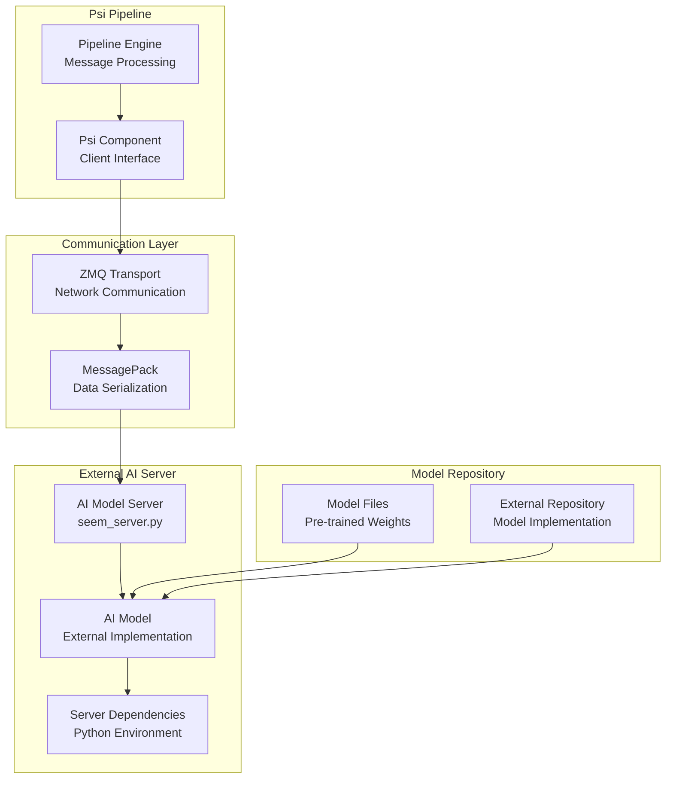
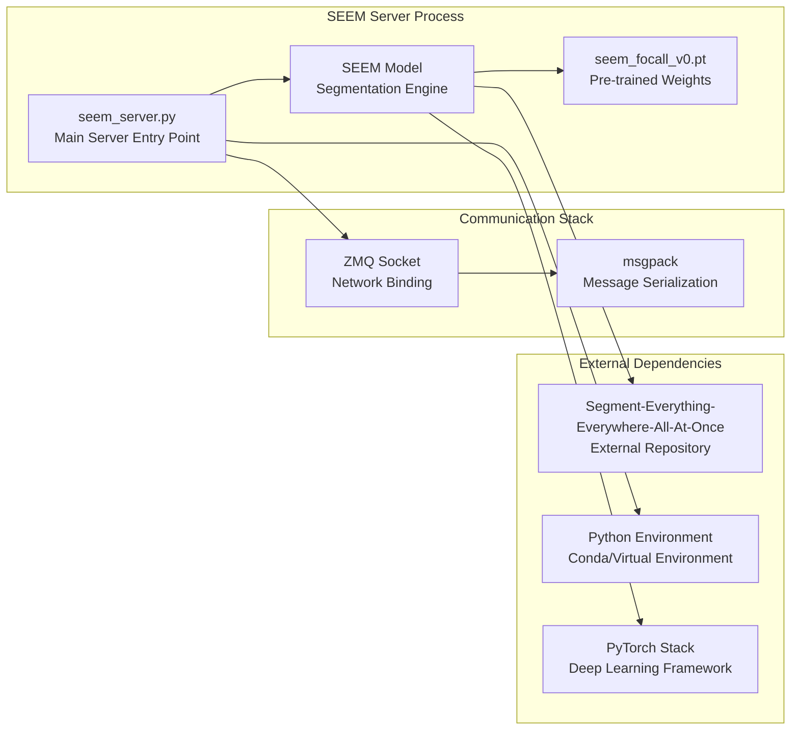
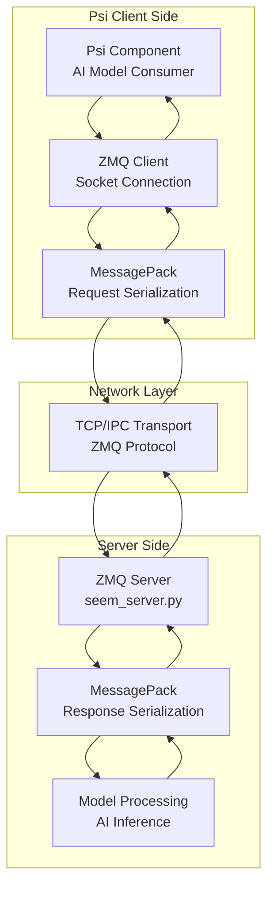

<!-- source: DeepWiki mcp.deepwiki.com · repo microsoft/psi · page 5.5 AI Model Server Integration · fetched 2026-10-26 -->

# AI Model Server Integration

<details>
<summary>Relevant source files</summary>

The following files were used as context for generating this wiki page:

- [Sources/Integrations/Models/SEEM/SEEMServer/Readme.md](Sources/Integrations/Models/SEEM/SEEMServer/Readme.md)
- [Sources/Integrations/Models/SEEM/SEEMServer/SEEMServer.pyproj](Sources/Integrations/Models/SEEM/SEEMServer/SEEMServer.pyproj)

</details>


## Purpose and Scope

This document covers the integration of external AI model servers with the Microsoft Psi framework. AI model servers provide a way to leverage specialized machine learning models running in separate processes or on remote machines, enabling access to models that may have different runtime requirements or dependencies than the main Psi pipeline.

This page specifically focuses on external server-based AI model integration. For embedded AI model integration using ONNX runtime, see [AI and Machine Learning with ONNX](#5.1). For data transport mechanisms used by these integrations, see [Data Interoperability and Transport](#5.4).

## Architecture Overview

AI model server integration in Psi follows a client-server architecture where external AI models run as independent services that can be accessed from Psi pipeline components through network communication protocols.

### High-Level Integration Architecture



Sources: [Sources/Integrations/Models/SEEM/SEEMServer/Readme.md:36](), [Sources/Integrations/Models/SEEM/SEEMServer/SEEMServer.pyproj:7]()

## SEEM Server Integration

The primary implementation of AI model server integration in Psi is the SEEM (Segment Everything Everywhere All at Once) server, which provides advanced image segmentation capabilities through an external Python-based service.

### SEEM Server Components



Sources: [Sources/Integrations/Models/SEEM/SEEMServer/SEEMServer.pyproj:24](), [Sources/Integrations/Models/SEEM/SEEMServer/Readme.md:39](), [Sources/Integrations/Models/SEEM/SEEMServer/Readme.md:15]()

### Server Configuration and Dependencies

The SEEM server requires a carefully configured Python environment with specific dependencies and model files:

| Component | Requirement | Purpose |
|-----------|-------------|---------|
| Python Environment | Python 3.9 via Conda | Runtime environment |
| External Repository | Segment-Everything-Everywhere-All-At-Once | Model implementation |
| Communication Libraries | zmq, msgpack | Network transport and serialization |
| Deep Learning Stack | PyTorch 2.1.0, torchvision 0.16.0 | Model execution framework |
| Model Weights | seem_focall_v0.pt | Pre-trained model parameters |
| Environment Variable | PYTHONPATH | Repository path configuration |

Sources: [Sources/Integrations/Models/SEEM/SEEMServer/Readme.md:11](), [Sources/Integrations/Models/SEEM/SEEMServer/Readme.md:36](), [Sources/Integrations/Models/SEEM/SEEMServer/Readme.md:39](), [Sources/Integrations/Models/SEEM/SEEMServer/Readme.md:41]()

## Communication Protocol

The AI model server integration uses ZeroMQ (ZMQ) for network communication and MessagePack for efficient binary serialization of data between Psi components and external AI servers.

### Protocol Stack



Sources: [Sources/Integrations/Models/SEEM/SEEMServer/Readme.md:36]()

### Message Format and Data Exchange

The communication between Psi and AI model servers follows a request-response pattern where:

- **Request Messages**: Contain input data (e.g., images for segmentation) serialized using MessagePack
- **Response Messages**: Return processed results (e.g., segmentation masks) in MessagePack format
- **Transport Layer**: ZMQ provides reliable message delivery and connection management
- **Data Types**: Binary image data, metadata, and processing parameters

Sources: [Sources/Integrations/Models/SEEM/SEEMServer/Readme.md:36]()

## Setup and Deployment

### Environment Preparation

The SEEM server requires manual environment setup due to its external dependencies and specific Python requirements:

1. **Create Conda Environment**:
   ```bash
   conda create --name seem python==3.9 -y
   conda activate seem
   ```

2. **Clone External Repository**:
   ```bash
   git clone https://github.com/UX-Decoder/Segment-Everything-Everywhere-All-At-Once
   cd Segment-Everything-Everywhere-All-At-Once
   git checkout 7b2e76dbb17d0b7831c6813a921fe2bc8de22926
   ```

3. **Install Dependencies**:
   ```bash
   pip install -r assets/requirements/requirements.txt
   pip install -r assets/requirements/requirements_custom.txt
   pip install zmq msgpack
   ```

4. **Configure Model Weights**:
   - Download `seem_focall_v0.pt` from HuggingFace
   - Place in the Segment-Everything-Everywhere-All-At-Once directory

5. **Set Environment Variables**:
   ```bash
   # Configure PYTHONPATH for the external repository
   conda env config vars set PYTHONPATH=/path/to/Segment-Everything-Everywhere-All-At-Once
   ```

Sources: [Sources/Integrations/Models/SEEM/SEEMServer/Readme.md:9-58]()

### Server Execution

The SEEM server is launched as a standalone Python process:

```bash
python /path/to/psi/Sources/Integrations/Models/SEEM/SEEMServer/seem_server.py
```

The server entry point is defined in the project file as `seem_server.py`, which establishes the ZMQ server socket and handles incoming AI processing requests from Psi pipeline components.

Sources: [Sources/Integrations/Models/SEEM/SEEMServer/SEEMServer.pyproj:7](), [Sources/Integrations/Models/SEEM/SEEMServer/Readme.md:62]()

### Platform Considerations

The integration includes platform-specific configuration requirements:

- **Windows**: Requires modified PyTorch installation with CUDA support and specific package versions
- **Linux**: Uses standard PyTorch installation from requirements
- **Dependencies**: Platform-specific handling of deepspeed and pillow versions

Sources: [Sources/Integrations/Models/SEEM/SEEMServer/Readme.md:22-28]()

---

