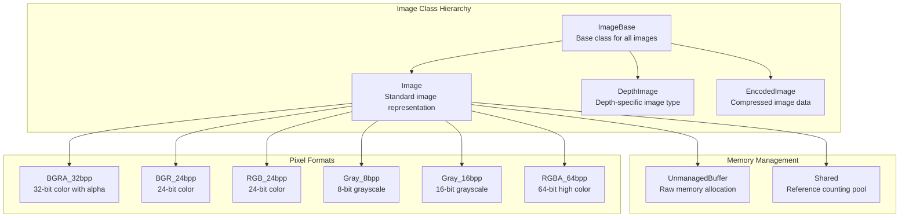
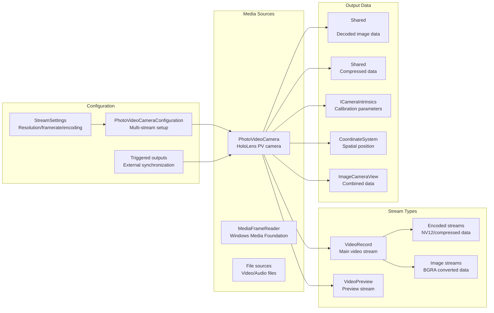
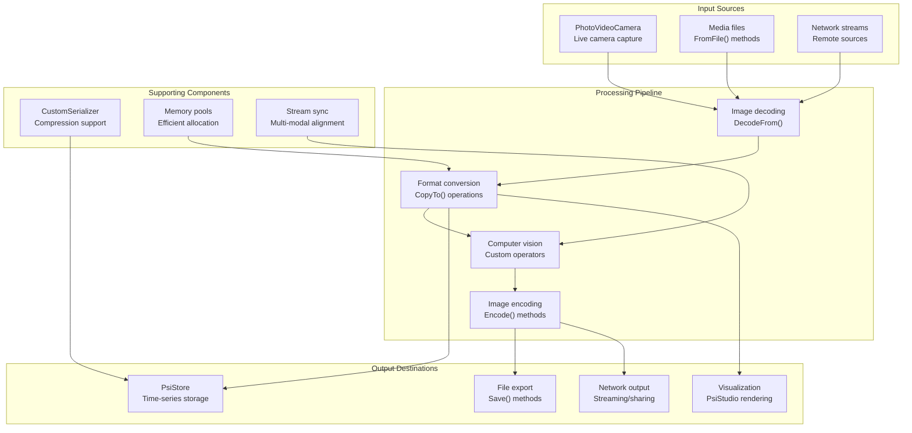
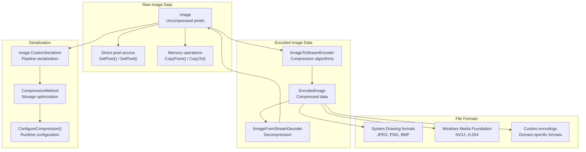
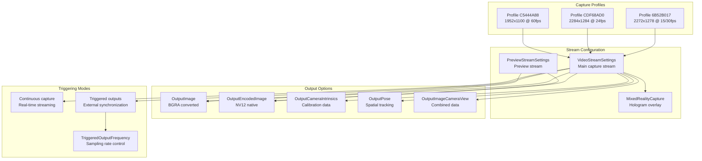

<!-- source: DeepWiki mcp.deepwiki.com · repo microsoft/psi · page 6 Media Processing · fetched 2026-10-26 -->

# Media Processing

Relevant source files

The following files were used as context for generating this wiki page:

- [Sources/Imaging/Microsoft.Psi.Imaging/Image.cs](Sources/Imaging/Microsoft.Psi.Imaging/Image.cs)
- [Sources/MixedReality/Microsoft.Psi.MixedReality.UniversalWindows/MediaCapture/PhotoVideoCamera.cs](Sources/MixedReality/Microsoft.Psi.MixedReality.UniversalWindows/MediaCapture/PhotoVideoCamera.cs)
- [Sources/MixedReality/Microsoft.Psi.MixedReality.UniversalWindows/MediaCapture/PhotoVideoCameraConfiguration.cs](Sources/MixedReality/Microsoft.Psi.MixedReality.UniversalWindows/MediaCapture/PhotoVideoCameraConfiguration.cs)

## Purpose and Scope

The Media Processing system provides comprehensive capabilities for handling images, audio, and video within the Microsoft Psi framework. This system enables real-time capture, processing, transformation, and storage of multimedia data through the Psi pipeline architecture. The media processing components integrate seamlessly with the core framework's message-passing and serialization systems to support multimodal, integrative AI applications.

For detailed information about image manipulation and computer vision operations, see [Image Processing and Computer Vision](#6.1). For data persistence of media streams, see [Data Persistence and Storage](#2.2).

## Core Media Representation

### Image Class Architecture

The foundation of media processing in Psi is the `Image` class, which provides efficient representation and manipulation of image data in unmanaged memory. This design enables high-performance processing without managed memory overhead.

Sources: [Sources/Imaging/Microsoft.Psi.Imaging/Image.cs:13-527]()

### Media Capture Components

The media capture system provides real-time acquisition of video and audio streams from various sources, with particular emphasis on mixed reality scenarios.

Sources: [Sources/MixedReality/Microsoft.Psi.MixedReality.UniversalWindows/MediaCapture/PhotoVideoCamera.cs:28-732](), [Sources/MixedReality/Microsoft.Psi.MixedReality.UniversalWindows/MediaCapture/PhotoVideoCameraConfiguration.cs:9-170]()

## Pipeline Integration

### Media Processing Workflow

Media processing components integrate with the Psi pipeline architecture to provide time-synchronized, message-driven processing of multimedia streams.

Sources: [Sources/Imaging/Microsoft.Psi.Imaging/Image.cs:263-291](), [Sources/MixedReality/Microsoft.Psi.MixedReality.UniversalWindows/MediaCapture/PhotoVideoCamera.cs:552-697]()

## Supported Media Formats

### Image Formats and Conversions

The framework supports a comprehensive set of image formats with automatic conversion capabilities between different pixel representations.

| Pixel Format | Bits per Pixel | Description | Use Cases |
|--------------|---------------|-------------|-----------|
| `BGRA_32bpp` | 32 | Blue-Green-Red-Alpha | Standard color with transparency |
| `BGR_24bpp` | 24 | Blue-Green-Red | Standard color images |
| `RGB_24bpp` | 24 | Red-Green-Blue | OpenCV compatibility |
| `BGRX_32bpp` | 32 | Blue-Green-Red with padding | Memory-aligned color |
| `Gray_8bpp` | 8 | 8-bit grayscale | Efficient monochrome processing |
| `Gray_16bpp` | 16 | 16-bit grayscale | High dynamic range, depth data |
| `RGBA_64bpp` | 64 | High-precision color | Scientific imaging |

Sources: [Sources/Imaging/Microsoft.Psi.Imaging/Image.cs:336-382]()

### Encoding and Compression

Media data can be processed in both raw and compressed formats to balance quality and performance requirements.

Sources: [Sources/Imaging/Microsoft.Psi.Imaging/Image.cs:477-525](), [Sources/Imaging/Microsoft.Psi.Imaging/Image.cs:281-290]()

## Camera Capture Configuration

### Multi-Stream Configuration

The `PhotoVideoCamera` component supports simultaneous capture of multiple video streams with different resolutions and frame rates, particularly useful for mixed reality applications.

Sources: [Sources/MixedReality/Microsoft.Psi.MixedReality.UniversalWindows/MediaCapture/PhotoVideoCameraConfiguration.cs:52-168](), [Sources/MixedReality/Microsoft.Psi.MixedReality.UniversalWindows/MediaCapture/PhotoVideoCamera.cs:45-94]()

## Performance and Memory Management

### Efficient Resource Utilization

The media processing system is designed for high-performance, real-time applications with careful attention to memory allocation and processing efficiency.

| Component | Optimization Strategy | Implementation |
|-----------|----------------------|----------------|
| **Image Storage** | Unmanaged memory allocation | `UnmanagedBuffer` with direct pointer access |
| **Memory Pooling** | Shared resource pooling | `Shared<Image>` reference counting |
| **Pixel Access** | Unsafe pointer operations | Direct memory manipulation for performance |
| **Serialization** | Configurable compression | Runtime compression algorithm selection |
| **Stream Processing** | Zero-copy operations | In-place format conversions where possible |

The framework minimizes garbage collection pressure by using unmanaged memory for image data and implementing efficient copy operations that avoid unnecessary allocations.

Sources: [Sources/Imaging/Microsoft.Psi.Imaging/Image.cs:32-77](), [Sources/Imaging/Microsoft.Psi.Imaging/Image.cs:175-238](), [Sources/MixedReality/Microsoft.Psi.MixedReality.UniversalWindows/MediaCapture/PhotoVideoCamera.cs:624-695]()

---

