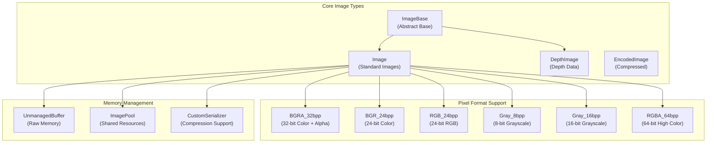
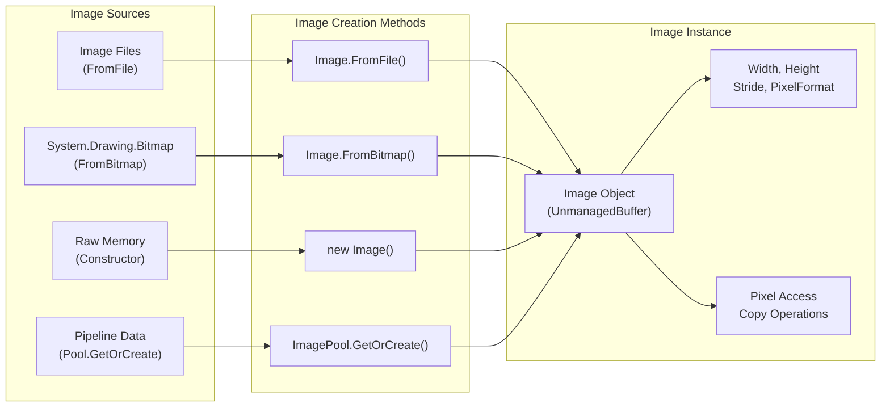
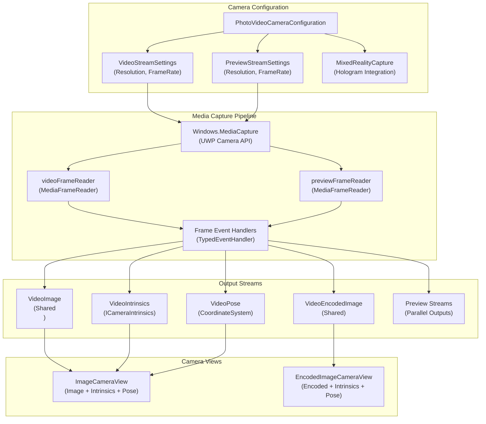
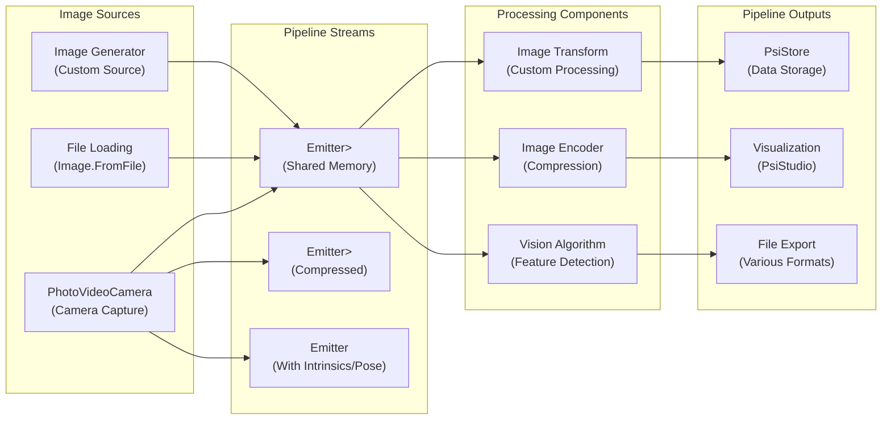
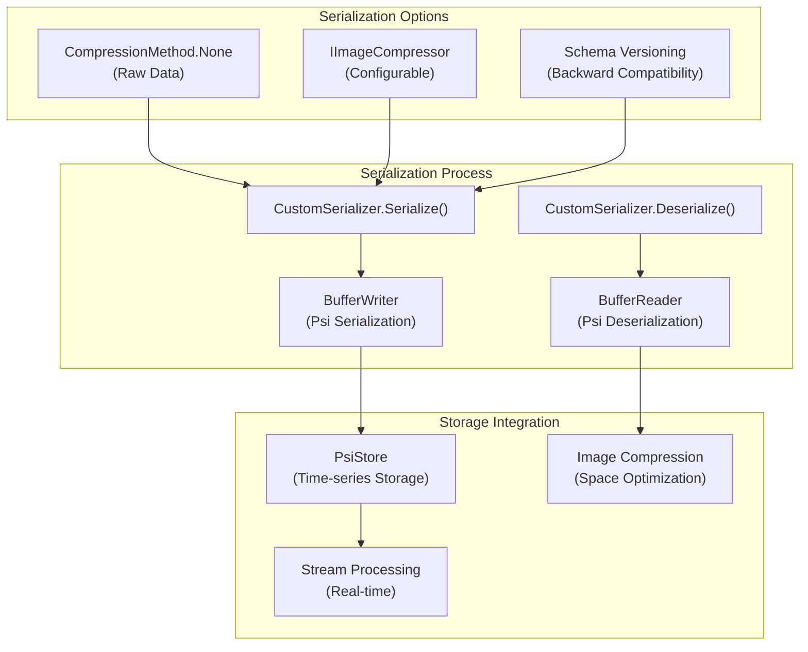

<!-- source: DeepWiki mcp.deepwiki.com · repo microsoft/psi · page 6.1 Image Processing and Computer Vision · fetched 2026-10-26 -->

# Image Processing and Computer Vision

Relevant source files

The following files were used as context for generating this wiki page:

- [Sources/Imaging/Microsoft.Psi.Imaging/Image.cs](Sources/Imaging/Microsoft.Psi.Imaging/Image.cs)
- [Sources/MixedReality/Microsoft.Psi.MixedReality.UniversalWindows/MediaCapture/PhotoVideoCamera.cs](Sources/MixedReality/Microsoft.Psi.MixedReality.UniversalWindows/MediaCapture/PhotoVideoCamera.cs)
- [Sources/MixedReality/Microsoft.Psi.MixedReality.UniversalWindows/MediaCapture/PhotoVideoCameraConfiguration.cs](Sources/MixedReality/Microsoft.Psi.MixedReality.UniversalWindows/MediaCapture/PhotoVideoCameraConfiguration.cs)

## Purpose and Scope

This document covers the image processing and computer vision capabilities within the Microsoft Psi framework, focusing on image representation, manipulation, and camera capture components. The material includes core image classes, pixel format support, image transformations, and integration with camera hardware for mixed reality applications.

For information about AI/ML model integration with computer vision, see [AI and Machine Learning with ONNX](#5.1). For mixed reality framework components beyond image capture, see [Mixed Reality Framework Components](#3.4).

## Core Image Representation

The Psi imaging system centers around the `Image` class, which represents images stored in unmanaged memory for efficient processing and serialization within the Psi pipeline.

### Image Class Architecture

Sources: [Sources/Imaging/Microsoft.Psi.Imaging/Image.cs:1-527]()

### Pixel Format Support

The `Image` class supports multiple pixel formats optimized for different use cases:

| Pixel Format | Bits Per Pixel | Use Case | System Bitmap Compatible |
|--------------|----------------|----------|-------------------------|
| `BGRA_32bpp` | 32 | Standard color with transparency | Yes |
| `BGR_24bpp` | 24 | Standard color without alpha | Yes |
| `RGB_24bpp` | 24 | RGB color (requires conversion for saving) | No |
| `Gray_8bpp` | 8 | Grayscale imaging | Yes |
| `Gray_16bpp` | 16 | High-precision grayscale/depth | No |
| `RGBA_64bpp` | 64 | High dynamic range color | No |

Sources: [Sources/Imaging/Microsoft.Psi.Imaging/Image.cs:336-455]()

## Image Operations and Transformations

### Image Creation and Loading

The `Image` class provides multiple construction patterns for different data sources:

Sources: [Sources/Imaging/Microsoft.Psi.Imaging/Image.cs:111-148](), [Sources/Imaging/Microsoft.Psi.Imaging/Image.cs:32-77]()

### Image Copying and Format Conversion

The framework supports flexible copying between different image formats and types:

- **Image-to-Image copying** with automatic format translation [Sources/Imaging/Microsoft.Psi.Imaging/Image.cs:299-318]()
- **Bitmap integration** for System.Drawing interoperability [Sources/Imaging/Microsoft.Psi.Imaging/Image.cs:206-238]()
- **Depth image conversion** for specialized depth data handling [Sources/Imaging/Microsoft.Psi.Imaging/Image.cs:258-261]()
- **Pixel-level access** through `GetPixel` and `SetPixel` methods [Sources/Imaging/Microsoft.Psi.Imaging/Image.cs:326-468]()

### Encoding and Compression

Images support encoding and compression through configurable encoders:

- **Encoder interface** via `IImageToStreamEncoder` for custom compression [Sources/Imaging/Microsoft.Psi.Imaging/Image.cs:285-290]()
- **Decoder interface** via `IImageFromStreamDecoder` for decompression [Sources/Imaging/Microsoft.Psi.Imaging/Image.cs:269-278]()
- **Serialization compression** configurable through `CustomSerializer.ConfigureCompression()` [Sources/Imaging/Microsoft.Psi.Imaging/Image.cs:487-490]()

## Camera Integration and Capture

### PhotoVideoCamera Component

The `PhotoVideoCamera` class provides camera capture capabilities specifically designed for mixed reality scenarios:

Sources: [Sources/MixedReality/Microsoft.Psi.MixedReality.UniversalWindows/MediaCapture/PhotoVideoCamera.cs:28-284]()

### Camera Stream Configuration

The camera supports multiple concurrent streams with different configurations:

| Stream Type | Purpose | Output Formats | Includes Pose/Intrinsics |
|-------------|---------|----------------|-------------------------|
| Video | High-quality recording | BGRA_32bpp, NV12 encoded | Yes |
| Preview | Live preview/processing | BGRA_32bpp, NV12 encoded | Yes |

Camera profiles for HoloLens 2 support various resolutions from 424×240 up to 2284×1284 at different frame rates (5fps to 60fps). [Sources/MixedReality/Microsoft.Psi.MixedReality.UniversalWindows/MediaCapture/PhotoVideoCameraConfiguration.cs:56-108]()

### Triggered Capture Mode

The camera supports triggered output mode for synchronized capture:

- **Trigger input** via `TriggerInput` receiver for external synchronization [Sources/MixedReality/Microsoft.Psi.MixedReality.UniversalWindows/MediaCapture/PhotoVideoCamera.cs:285-294]()
- **Frequency control** through `TriggeredOutputFrequency` parameter [Sources/MixedReality/Microsoft.Psi.MixedReality.UniversalWindows/MediaCapture/PhotoVideoCameraConfiguration.cs:47-49]()
- **Frame selection** based on temporal proximity to trigger events [Sources/MixedReality/Microsoft.Psi.MixedReality.UniversalWindows/MediaCapture/PhotoVideoCamera.cs:585-590]()

## Pipeline Integration

### Stream Processing Integration

Images integrate seamlessly with the Psi pipeline through emitters and receivers:

Sources: [Sources/MixedReality/Microsoft.Psi.MixedReality.UniversalWindows/MediaCapture/PhotoVideoCamera.cs:73-84]()

### Memory Management and Performance

The imaging system uses shared memory pools for efficient resource management:

- **Shared image instances** through `ImagePool.GetOrCreate()` for memory reuse
- **Unmanaged memory** allocation for performance-critical operations [Sources/Imaging/Microsoft.Psi.Imaging/Image.cs:32-35]()
- **Zero-copy operations** where possible to minimize memory allocations
- **Automatic disposal** through using statements and shared resource patterns

## Serialization and Persistence

### Custom Serialization

The `Image` class implements custom serialization optimized for pipeline storage:

Sources: [Sources/Imaging/Microsoft.Psi.Imaging/Image.cs:479-525]()

### Compression Configuration

Image compression can be configured globally through the serializer:

- **Compression method selection** via `ConfigureCompression()` static method [Sources/Imaging/Microsoft.Psi.Imaging/Image.cs:487-490]()
- **Schema version handling** for backward compatibility with older data [Sources/Imaging/Microsoft.Psi.Imaging/Image.cs:510-514]()
- **Conditional compression** based on serialization context and image properties [Sources/Imaging/Microsoft.Psi.Imaging/Image.cs:495-504]()

The imaging system provides a comprehensive foundation for computer vision applications within the Psi framework, supporting efficient image representation, flexible camera integration, and seamless pipeline processing with optimized serialization for both real-time and stored data scenarios.

---

