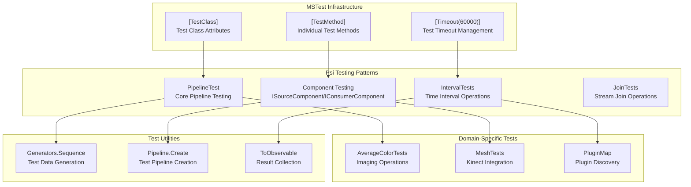
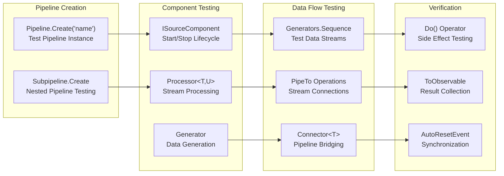
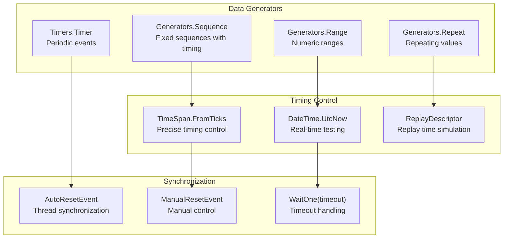
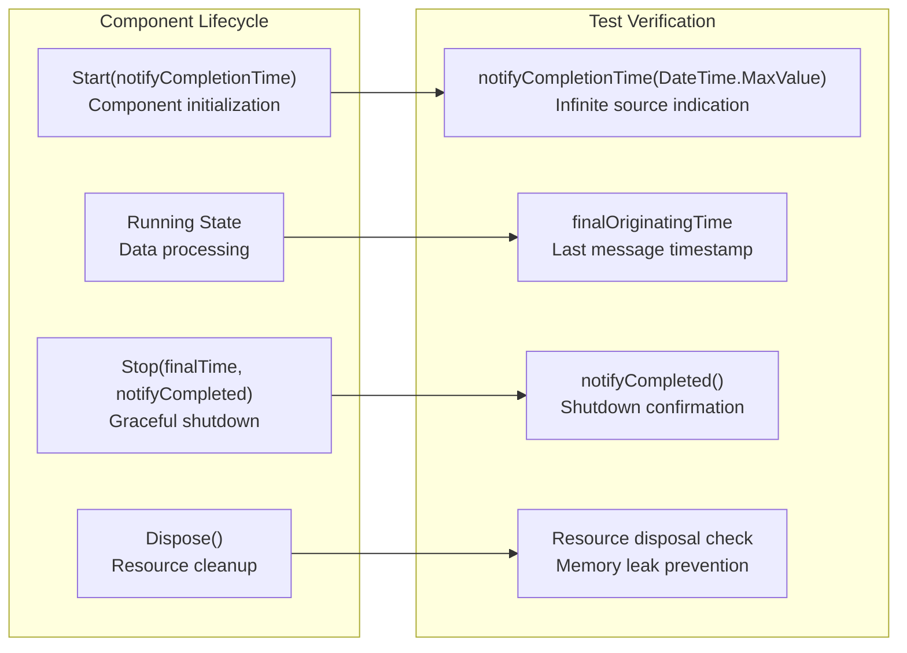
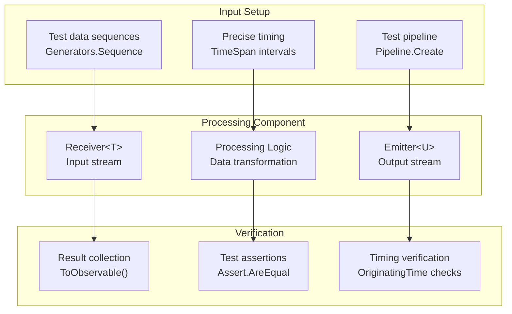
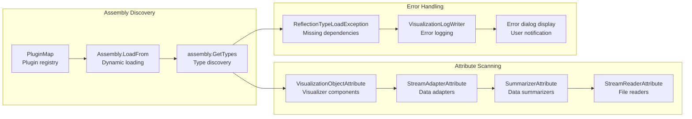
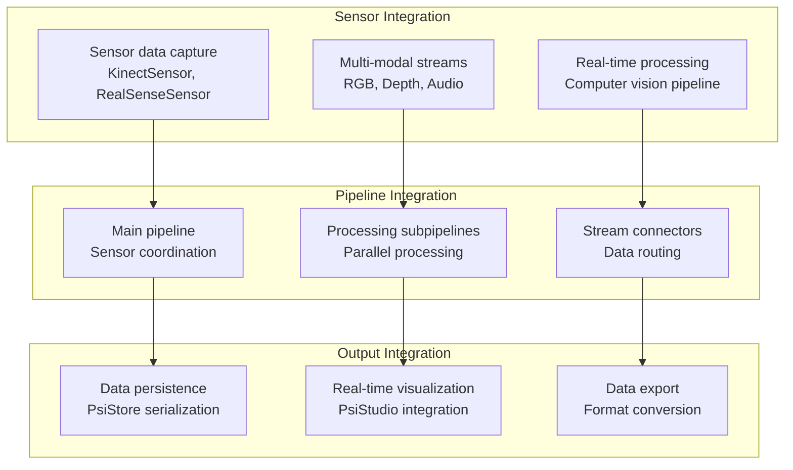

<!-- source: DeepWiki mcp.deepwiki.com · repo microsoft/psi · page 7 Development and Testing · fetched 2026-10-26 -->

# Development and Testing

Relevant source files

The following files were used as context for generating this wiki page:

- [Sources/Imaging/Test.Psi.Imaging.Windows/AverageColorTests.cs](Sources/Imaging/Test.Psi.Imaging.Windows/AverageColorTests.cs)
- [Sources/Kinect/Test.Psi.Kinect.Windows.x64/MeshTests.cs](Sources/Kinect/Test.Psi.Kinect.Windows.x64/MeshTests.cs)
- [Sources/Media/Microsoft.Psi.Media.Windows.x64/MediaSource.cs](Sources/Media/Microsoft.Psi.Media.Windows.x64/MediaSource.cs)
- [Sources/RealSense/Microsoft.Psi.RealSense.Windows.x64/RealSenseSensor.cs](Sources/RealSense/Microsoft.Psi.RealSense.Windows.x64/RealSenseSensor.cs)
- [Sources/Runtime/Test.Psi/CommonTester.cs](Sources/Runtime/Test.Psi/CommonTester.cs)
- [Sources/Runtime/Test.Psi/IntervalTests.cs](Sources/Runtime/Test.Psi/IntervalTests.cs)
- [Sources/Runtime/Test.Psi/JoinTests.cs](Sources/Runtime/Test.Psi/JoinTests.cs)
- [Sources/Runtime/Test.Psi/PipelineTest.cs](Sources/Runtime/Test.Psi/PipelineTest.cs)
- [Sources/Visualization/Microsoft.Psi.Visualization.Windows/PluginMap.cs](Sources/Visualization/Microsoft.Psi.Visualization.Windows/PluginMap.cs)

This page covers the development workflows, testing frameworks, and testing practices used in the Microsoft Psi framework. It provides an overview of how components are developed, tested, and integrated into the platform.

For information about specific build system configuration and NuGet packaging, see [Build System and Configuration](#7.2). For contributing guidelines and submission processes, see [Contributing to Psi](#7.3).

## Testing Infrastructure

The Psi framework employs a comprehensive testing infrastructure built on MSTest, with specialized testing patterns for stream processing components, pipeline management, and multimodal data handling.

### Core Testing Framework Architecture

Sources: [Sources/Runtime/Test.Psi/PipelineTest.cs:18-19](), [Sources/Runtime/Test.Psi/CommonTester.cs:14-15](), [Sources/Runtime/Test.Psi/IntervalTests.cs:10-11]()

### Pipeline Testing Patterns

The framework provides specialized patterns for testing pipeline components and their interactions:

Sources: [Sources/Runtime/Test.Psi/PipelineTest.cs:25-40](), [Sources/Runtime/Test.Psi/PipelineTest.cs:90-105]()

## Development Workflows

### Component Development and Testing Cycle

The typical development workflow involves creating components, writing tests, and verifying integration with the pipeline system:

| Phase | Activities | Key Classes | Test Patterns |
|-------|------------|-------------|---------------|
| **Component Design** | Interface definition, data flow planning | `ISourceComponent`, `IConsumerComponent` | Mock data generation |
| **Implementation** | Core logic, emitter/receiver setup | `Emitter<T>`, `Receiver<T>` | Unit testing with `Generators.Sequence` |
| **Pipeline Integration** | Connection testing, timing verification | `Pipeline`, `Subpipeline` | Integration testing with real data flows |
| **Performance Testing** | Latency, throughput measurement | `GeneratorWithLatency` | Load testing with artificial delays |
| **Finalization Testing** | Resource cleanup, shutdown behavior | Component lifecycle | Shutdown sequence verification |

### Test Data Generation Patterns

The framework provides several utilities for generating test data and controlling timing:

Sources: [Sources/Runtime/Test.Psi/PipelineTest.cs:29](), [Sources/Runtime/Test.Psi/PipelineTest.cs:496-500](), [Sources/Runtime/Test.Psi/JoinTests.cs:28-29]()

## Component Testing Patterns

### Lifecycle Testing

Components must properly handle start, stop, and disposal operations:

Sources: [Sources/RealSense/Microsoft.Psi.RealSense.Windows.x64/RealSenseSensor.cs:60-89](), [Sources/Media/Microsoft.Psi.Media.Windows.x64/MediaSource.cs:60-97]()

### Stream Processing Testing

Testing stream processing components involves verifying correct data transformation and timing:

Sources: [Sources/Runtime/Test.Psi/JoinTests.cs:104-118](), [Sources/Imaging/Test.Psi.Imaging.Windows/AverageColorTests.cs:52-66]()

## Plugin System Testing

The plugin discovery and loading system requires testing for dynamic component loading:

### Plugin Discovery Testing

Sources: [Sources/Visualization/Microsoft.Psi.Visualization.Windows/PluginMap.cs:129-243](), [Sources/Visualization/Microsoft.Psi.Visualization.Windows/PluginMap.cs:245-277]()

### Default Assembly Search

The plugin system searches a predefined set of assemblies for components:

| Assembly | Purpose | Components |
|----------|---------|------------|
| `Microsoft.Psi.dll` | Core runtime | Pipeline, operators, serialization |
| `Microsoft.Psi.Audio.dll` | Audio processing | Audio sources, processors |
| `Microsoft.Psi.Data.dll` | Data persistence | PsiStore, importers/exporters |
| `Microsoft.Psi.Visualization.Windows.dll` | Visualization | Visualizers, UI components |

Sources: [Sources/Visualization/Microsoft.Psi.Visualization.Windows/PluginMap.cs:25-31]()

## Integration Testing Approaches

### Multi-Component Integration

Integration tests verify that multiple components work together correctly in realistic scenarios:

Sources: [Sources/Kinect/Test.Psi.Kinect.Windows.x64/MeshTests.cs:30-37](), [Sources/Kinect/Test.Psi.Kinect.Windows.x64/MeshTests.cs:49-52]()

### Performance and Stress Testing

The framework includes patterns for testing component performance under load:

- **Latency Testing**: Using `GeneratorWithLatency` to simulate processing delays
- **Throughput Testing**: High-frequency data generation with `Timers.Timer`
- **Memory Testing**: Resource allocation patterns and cleanup verification
- **Shutdown Testing**: Graceful termination under various conditions

Sources: [Sources/Runtime/Test.Psi/PipelineTest.cs:464-487](), [Sources/Runtime/Test.Psi/PipelineTest.cs:577-595]()

---

