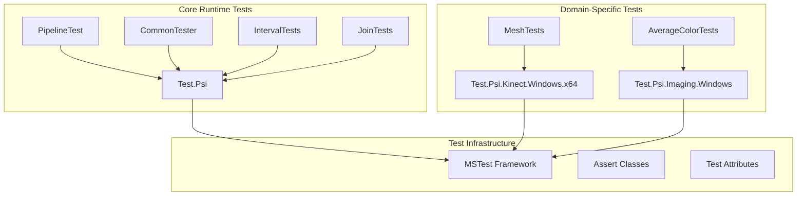
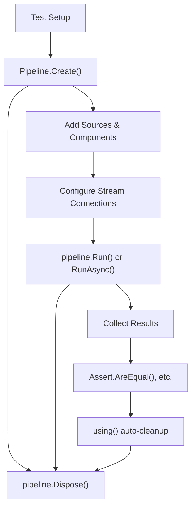
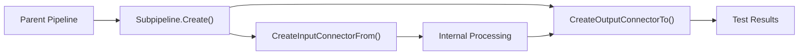

<!-- source: DeepWiki mcp.deepwiki.com · repo microsoft/psi · page 7.1 Testing Framework and Practices · fetched 2026-10-26 -->

# Testing Framework and Practices

<details>
<summary>Relevant source files</summary>

The following files were used as context for generating this wiki page:

- [Sources/Imaging/Test.Psi.Imaging.Windows/AverageColorTests.cs](Sources/Imaging/Test.Psi.Imaging.Windows/AverageColorTests.cs)
- [Sources/Kinect/Test.Psi.Kinect.Windows.x64/MeshTests.cs](Sources/Kinect/Test.Psi.Kinect.Windows.x64/MeshTests.cs)
- [Sources/Media/Microsoft.Psi.Media.Windows.x64/MediaSource.cs](Sources/Media/Microsoft.Psi.Media.Windows.x64/MediaSource.cs)
- [Sources/RealSense/Microsoft.Psi.RealSense.Windows.x64/RealSenseSensor.cs](Sources/RealSense/Microsoft.Psi.RealSense.Windows.x64/RealSenseSensor.cs)
- [Sources/Runtime/Test.Psi/CommonTester.cs](Sources/Runtime/Test.Psi/CommonTester.cs)
- [Sources/Runtime/Test.Psi/IntervalTests.cs](Sources/Runtime/Test.Psi/IntervalTests.cs)
- [Sources/Runtime/Test.Psi/JoinTests.cs](Sources/Runtime/Test.Psi/JoinTests.cs)
- [Sources/Runtime/Test.Psi/PipelineTest.cs](Sources/Runtime/Test.Psi/PipelineTest.cs)
- [Sources/Visualization/Microsoft.Psi.Visualization.Windows/PluginMap.cs](Sources/Visualization/Microsoft.Psi.Visualization.Windows/PluginMap.cs)

</details>


This document covers the testing infrastructure, patterns, and best practices used in the Microsoft Psi framework. It focuses on the unit testing approach, test organization, and specific strategies for testing stream processing pipelines and components.

For information about build system configuration, see [Build System and Configuration](#7.2). For guidance on contributing code and following coding standards, see [Contributing to Psi](#7.3).

## Test Framework Overview

The Psi codebase uses MSTest as the primary testing framework, with tests organized into separate test assemblies that mirror the main project structure. Each test project follows the naming convention `Test.Psi.{Module}`, providing comprehensive coverage for pipeline operations, component behavior, and system integration scenarios.

### Test Assembly Structure



Sources: [Sources/Runtime/Test.Psi/PipelineTest.cs:18-19](), [Sources/Runtime/Test.Psi/CommonTester.cs:14-15](), [Sources/Kinect/Test.Psi.Kinect.Windows.x64/MeshTests.cs:15-17](), [Sources/Imaging/Test.Psi.Imaging.Windows/AverageColorTests.cs:19-20]()

## Testing Patterns and Attributes

### Core Test Attributes

All test classes use standard MSTest attributes with consistent patterns:

| Attribute | Usage | Example |
|-----------|-------|---------|
| `[TestClass]` | Marks test class | Applied to all test classes |
| `[TestMethod]` | Marks individual tests | Applied to each test method |
| `[Timeout(60000)]` | Sets 60-second timeout | Universal across all tests |
| `[Ignore]` | Skips test execution | Used for hardware-dependent tests |
| `[ExpectedException(typeof(Exception))]` | Tests exception scenarios | Used for validation tests |

### Pipeline Test Execution Flow



Sources: [Sources/Runtime/Test.Psi/PipelineTest.cs:25-40](), [Sources/Runtime/Test.Psi/JoinTests.cs:102-119]()

## Pipeline Testing Strategies

### Basic Pipeline Testing Pattern

The fundamental pattern for testing pipeline operations involves creating a pipeline, adding components, running the pipeline, and validating results:

```csharp
[TestMethod]
[Timeout(60000)]
public void TestName()
{
    using (var pipeline = Pipeline.Create())
    {
        // Setup sources and components
        var source = Generators.Sequence(pipeline, data, timeSpan);
        var processor = source.Select(x => transform(x));
        
        // Collect results
        var results = processor.ToObservable().ToListObservable();
        
        // Execute pipeline
        pipeline.Run();
        
        // Validate results
        Assert.AreEqual(expected, results);
    }
}
```

Sources: [Sources/Runtime/Test.Psi/PipelineTest.cs:21-40](), [Sources/Runtime/Test.Psi/JoinTests.cs:16-35]()

### Test Data Generation

The framework provides several generators for creating test data streams:

| Generator | Purpose | Usage Example |
|-----------|---------|---------------|
| `Generators.Sequence()` | Fixed sequences | `Generators.Sequence(p, new[] { 1, 2, 3 }, TimeSpan.FromTicks(1))` |
| `Generators.Range()` | Numeric ranges | `Generators.Range(p, 0, 10, TimeSpan.FromMilliseconds(10))` |
| `Generators.Timer()` | Periodic events | `Timers.Timer(p, TimeSpan.FromMilliseconds(5))` |
| `Generators.Return()` | Single values | `Generators.Return(pipeline, 123)` |
| `Generators.Repeat()` | Repeated values | `Generators.Repeat(p, 123, TimeSpan.FromMilliseconds(1))` |

Sources: [Sources/Runtime/Test.Psi/PipelineTest.cs:29](), [Sources/Runtime/Test.Psi/JoinTests.cs:28-29](), [Sources/Runtime/Test.Psi/PipelineTest.cs:51]()

### Complex Testing Scenarios

#### Subpipeline Testing



Sources: [Sources/Runtime/Test.Psi/PipelineTest.cs:75-88](), [Sources/Runtime/Test.Psi/PipelineTest.cs:190-213]()

#### Join Operation Testing

Complex join scenarios test temporal alignment and stream synchronization:

Sources: [Sources/Runtime/Test.Psi/JoinTests.cs:18-35](), [Sources/Runtime/Test.Psi/JoinTests.cs:95-141]()

#### Finalization and Resource Management Testing

Tests verify proper component cleanup and resource disposal order:

Sources: [Sources/Runtime/Test.Psi/PipelineTest.cs:615-661](), [Sources/Runtime/Test.Psi/PipelineTest.cs:665-696]()

## Component Testing Architecture

### Test Component Structure

```mermaid
graph TB
    subgraph "Test Component Classes"
        TestReactiveCompositeComponent["TestReactiveCompositeComponent"]
        TestFiniteSourceCompositeComponent["TestFiniteSourceCompositeComponent"] 
        TestInfiniteSourceCompositeComponent["TestInfiniteSourceCompositeComponent"]
        FinalizationTestComponent["FinalizationTestComponent"]
        GeneratorWithLatency["GeneratorWithLatency"]
    end
    
    subgraph "Base Classes"
        Subpipeline["Subpipeline"]
        Generator["Generator"]
        ISourceComponent["ISourceComponent"]
    end
    
    subgraph "Test Scenarios"
        SubpipelineTests["Subpipeline Tests"]
        LatencyTests["Latency Tests"]
        FinalizationTests["Finalization Tests"]
        LifecycleTests["Component Lifecycle Tests"]
    end
    
    TestReactiveCompositeComponent --> Subpipeline
    TestFiniteSourceCompositeComponent --> Subpipeline
    TestInfiniteSourceCompositeComponent --> Subpipeline
    GeneratorWithLatency --> Generator
    FinalizationTestComponent --> ISourceComponent
    
    TestReactiveCompositeComponent --> SubpipelineTests
    GeneratorWithLatency --> LatencyTests
    FinalizationTestComponent --> FinalizationTests
```



Sources: [Sources/Runtime/Test.Psi/PipelineTest.cs:90-105](), [Sources/Runtime/Test.Psi/PipelineTest.cs:464-487](), [Sources/Runtime/Test.Psi/PipelineTest.cs:1141-1232]()

## Domain-Specific Testing

### Imaging Tests

Imaging tests focus on pixel format conversion and image processing operations:

Sources: [Sources/Imaging/Test.Psi.Imaging.Windows/AverageColorTests.cs:45-85](), [Sources/Imaging/Test.Psi.Imaging.Windows/AverageColorTests.cs:90-95]()

### Hardware Component Tests

Hardware-dependent tests use `[Ignore]` attribute and proper resource management:

Sources: [Sources/Kinect/Test.Psi.Kinect.Windows.x64/MeshTests.cs:16](), [Sources/Kinect/Test.Psi.Kinect.Windows.x64/MeshTests.cs:134-170]()

## Test Organization and Naming

### File Structure Convention

```
Sources/
├── Runtime/
│   └── Test.Psi/
│       ├── PipelineTest.cs
│       ├── CommonTester.cs
│       ├── IntervalTests.cs
│       └── JoinTests.cs
├── Imaging/
│   └── Test.Psi.Imaging.Windows/
│       └── AverageColorTests.cs
└── Kinect/
    └── Test.Psi.Kinect.Windows.x64/
        └── MeshTests.cs
```

### Test Method Naming

Test methods follow descriptive naming patterns that indicate:
- The functionality being tested
- The expected behavior or scenario
- Any special conditions

Examples:
- `Pass_Data_From_One_Pipeline_To_Another`
- `SubpipelineAsReactiveComponent`
- `PipelineShutdownWithLatency`
- `AverageSolidColors_BGRA_32bpp`

Sources: [Sources/Runtime/Test.Psi/PipelineTest.cs:23](), [Sources/Runtime/Test.Psi/PipelineTest.cs:109](), [Sources/Imaging/Test.Psi.Imaging.Windows/AverageColorTests.cs:92]()

## Best Practices

### Resource Management

All tests use `using` statements for automatic pipeline disposal and proper resource cleanup:

```csharp
using (var pipeline = Pipeline.Create())
{
    // Test implementation
} // Automatic disposal
```

### Timeout Management

Every test method includes a 60-second timeout to prevent hanging tests:

```csharp
[TestMethod]
[Timeout(60000)]
```

### Assertion Patterns

Tests use appropriate assertion methods for different validation scenarios:
- `Assert.AreEqual()` for value comparisons
- `Assert.IsTrue()/Assert.IsFalse()` for boolean conditions  
- `CollectionAssert.AreEqual()` for sequence comparisons
- `Assert.IsTrue(Enumerable.SequenceEqual())` for LINQ-based comparisons

### Test Data Management

Tests create minimal, focused test data sets that clearly demonstrate the behavior being verified, often using simple numeric sequences or well-defined input patterns.

Sources: [Sources/Runtime/Test.Psi/PipelineTest.cs:22](), [Sources/Runtime/Test.Psi/CommonTester.cs:18](), [Sources/Runtime/Test.Psi/JoinTests.cs:17](), [Sources/Imaging/Test.Psi.Imaging.Windows/AverageColorTests.cs:91]()

---

