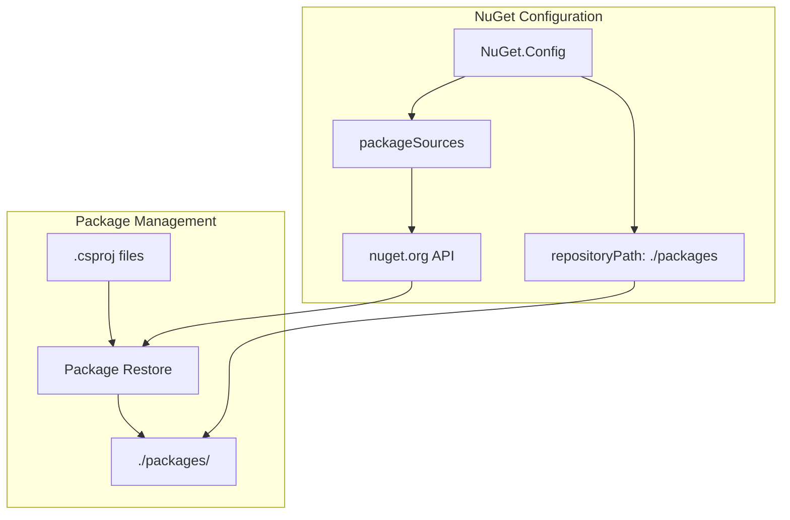
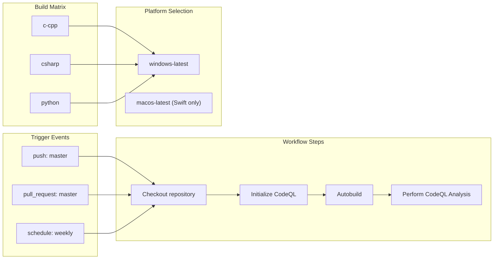
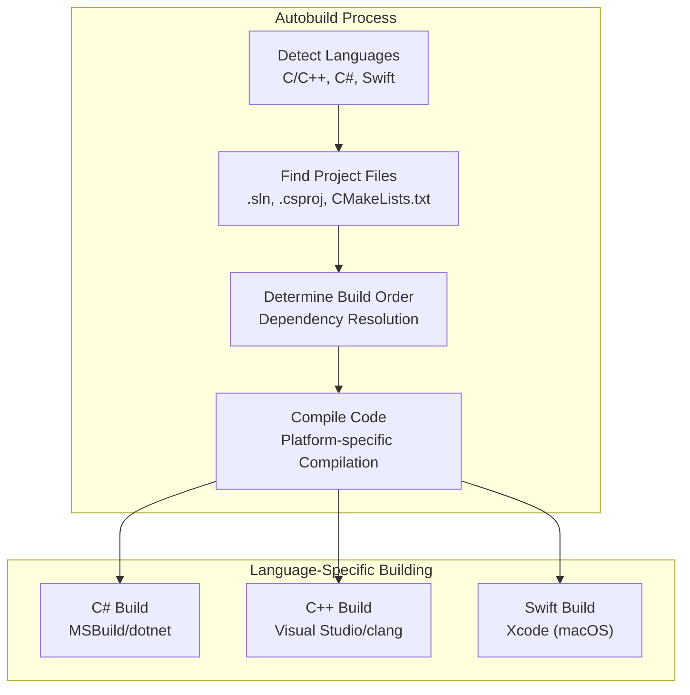
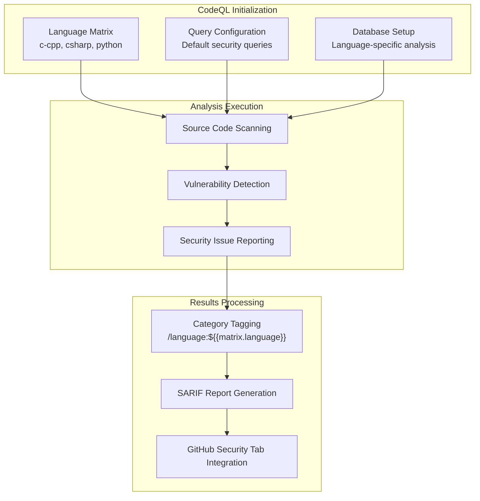
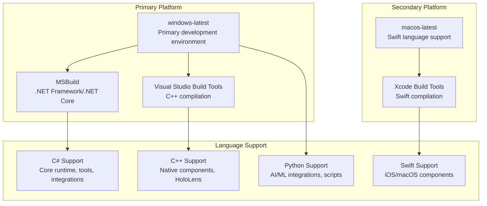

<!-- source: DeepWiki mcp.deepwiki.com · repo microsoft/psi · page 7.2 Build System and Configuration · fetched 2026-10-26 -->

# Build System and Configuration

<details>
<summary>Relevant source files</summary>

The following files were used as context for generating this wiki page:

- [.github/workflows/codeql-analysis.yml](.github/workflows/codeql-analysis.yml)
- [NuGet.Config](NuGet.Config)

</details>


## Purpose and Scope

This document covers the build system infrastructure, package management configuration, and continuous integration processes for the Microsoft Psi framework. This includes NuGet package configuration, GitHub Actions workflows for automated building and testing, and code analysis systems.

For information about testing frameworks and practices, see [Testing Framework and Practices](#7.1). For guidance on contributing code and development workflows, see [Contributing to Psi](#7.3).

## NuGet Package Management

The Psi framework uses NuGet for dependency management with a centralized configuration that standardizes package sources and repository locations across all projects.

### Package Configuration Structure



The [NuGet.Config:1-10]() file establishes the package management configuration:

| Configuration Key | Value | Purpose |
|------------------|--------|---------|
| `repositoryPath` | `./packages` | Centralizes all downloaded packages in a single directory |
| `packageSources` | `nuget.org` only | Ensures consistent package source across environments |

**Sources:** [NuGet.Config:1-10]()

### Package Source Management

The configuration uses a `clear` directive followed by explicit source addition to ensure deterministic package resolution:

```xml
<packageSources>
  <clear />
  <add key="nuget.org" value="https://api.nuget.org/v3/index.json" />
</packageSources>
```

This approach prevents conflicts from machine-specific or global NuGet configurations and ensures all developers and build systems use the same package sources.

**Sources:** [NuGet.Config:6-9]()

## Continuous Integration Pipeline

The framework implements automated building and code analysis through GitHub Actions workflows that support multiple programming languages and platforms.

### CodeQL Security Analysis Workflow



**Sources:** [.github/workflows/codeql-analysis.yml:1-85]()

### Workflow Configuration Details

The CodeQL analysis workflow [.github/workflows/codeql-analysis.yml:14-48]() defines comprehensive security scanning:

| Configuration | Value | Purpose |
|--------------|--------|---------|
| Trigger branches | `master` | Ensures analysis on main development branch |
| Language matrix | `c-cpp`, `csharp`, `python` | Covers all primary languages in the codebase |
| Runner OS | `windows-latest` | Provides Windows development environment |
| Timeout | 360 minutes (6 hours) | Allows for comprehensive analysis of large codebase |
| Schedule | `28 3 * * 6` (Saturday 3:28 AM) | Weekly security analysis |

**Sources:** [.github/workflows/codeql-analysis.yml:14-31]()

### Build Process and Autobuild

The workflow uses GitHub's autobuild feature [.github/workflows/codeql-analysis.yml:68-69]() which automatically detects and builds compiled languages:



The autobuild system automatically handles:
- Solution file discovery and dependency resolution
- Platform-specific compiler selection
- Build configuration optimization for analysis

**Sources:** [.github/workflows/codeql-analysis.yml:66-69]()

## Security and Code Analysis

### CodeQL Analysis Configuration

The security analysis system provides comprehensive code scanning with configurable query sets and language-specific analysis:



The analysis workflow [.github/workflows/codeql-analysis.yml:54-84]() implements:
- Multi-language security scanning for C/C++, C#, and Python
- Automated vulnerability detection using GitHub's security query database
- Integration with GitHub Security tab for issue tracking and remediation

**Sources:** [.github/workflows/codeql-analysis.yml:54-84]()

### Permissions and Security Model

The workflow operates with minimal required permissions [.github/workflows/codeql-analysis.yml:32-38]():

| Permission | Access Level | Purpose |
|-----------|-------------|---------|
| `security-events` | `write` | Upload security analysis results |
| `actions` | `read` | Access workflow metadata (private repos only) |
| `contents` | `read` | Read repository source code (private repos only) |

This permission model follows the principle of least privilege while enabling comprehensive security analysis.

**Sources:** [.github/workflows/codeql-analysis.yml:32-38]()

## Platform and Environment Support

### Build Environment Matrix

The build system supports multiple platforms and runtime environments optimized for the diverse requirements of the Psi framework:



The platform selection logic [.github/workflows/codeql-analysis.yml:30]() uses conditional expressions to optimize build environments:
- Windows environment for C/C++, C#, and Python development
- macOS environment specifically for Swift language support
- Automatic platform selection based on language matrix

**Sources:** [.github/workflows/codeql-analysis.yml:30-43]()

---

