# Page: Overview

# Overview

<details>
<summary>Relevant source files</summary>

The following files were used as context for generating this wiki page:

- [.gitignore](.gitignore)
- [CONTRIBUTING.md](CONTRIBUTING.md)
- [README.md](README.md)

</details>


This document provides a high-level introduction to the Platform for Situated Intelligence (Psi) framework, covering its purpose, architecture, and key capabilities. It serves as the entry point for understanding how the various components of the Psi ecosystem work together to enable multimodal, integrative AI systems.

For detailed information about specific subsystems, see the [Core Framework](#2) for runtime components, [Mixed Reality and HoloLens](#3) for spatial computing capabilities, [Visualization and Analysis](#4) for PsiStudio tools, [External Integrations](#5) for third-party system connectivity, and [Development and Testing](#7) for build and contribution workflows.

## What is Platform for Situated Intelligence

Platform for Situated Intelligence (Psi) is an open-source framework for developing multimodal, integrative AI systems that process streaming sensor data under real-time constraints. The framework enables applications such as social robots, embodied conversational agents, mixed-reality systems, and ambient intelligence solutions.

The framework is built on .NET Standard, providing cross-platform support for Windows and Linux environments. It follows a stream-centric processing model where all data flows through time-synchronized message streams, enabling precise temporal coordination across multiple input modalities.

**Sources:** [README.md:6-12]()

## Key Features and Capabilities

| Feature | Description | Key Components |
|---------|-------------|----------------|
| **Stream Processing** | Time-synchronized message delivery and processing | `Pipeline`, `DeliveryQueue`, message streams |
| **Data Persistence** | Efficient storage and replay of temporal data | `PsiStore`, serialization system |
| **Mixed Reality** | HoloLens integration and spatial computing | HoloLens capture, Sigma application |
| **Visualization** | Interactive data analysis and timeline navigation | PsiStudio, timeline navigator |
| **AI/ML Integration** | Support for ONNX models and cognitive services | ONNX runtime, speech recognition |
| **External Connectivity** | Integration with ROS, cloud services, and data formats | ROS bridge, NetMQ transport |

**Sources:** [README.md:8-12](), [README.md:37-52]()

## Platform Architecture

### Overall System Architecture

The Psi platform consists of several interconnected subsystems that work together to provide a comprehensive development environment for multimodal AI applications.

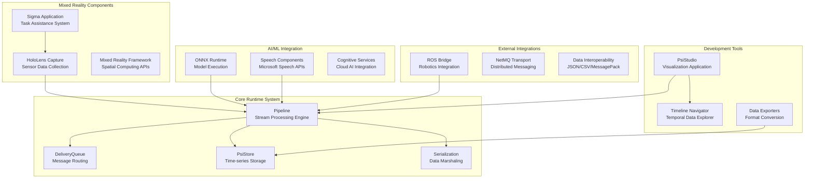

**Sources:** [README.md:8-12](), [README.md:22-26]()

### Core Data Flow Architecture

This diagram shows how data flows through the core Psi runtime system, from input sources through processing components to storage and visualization.

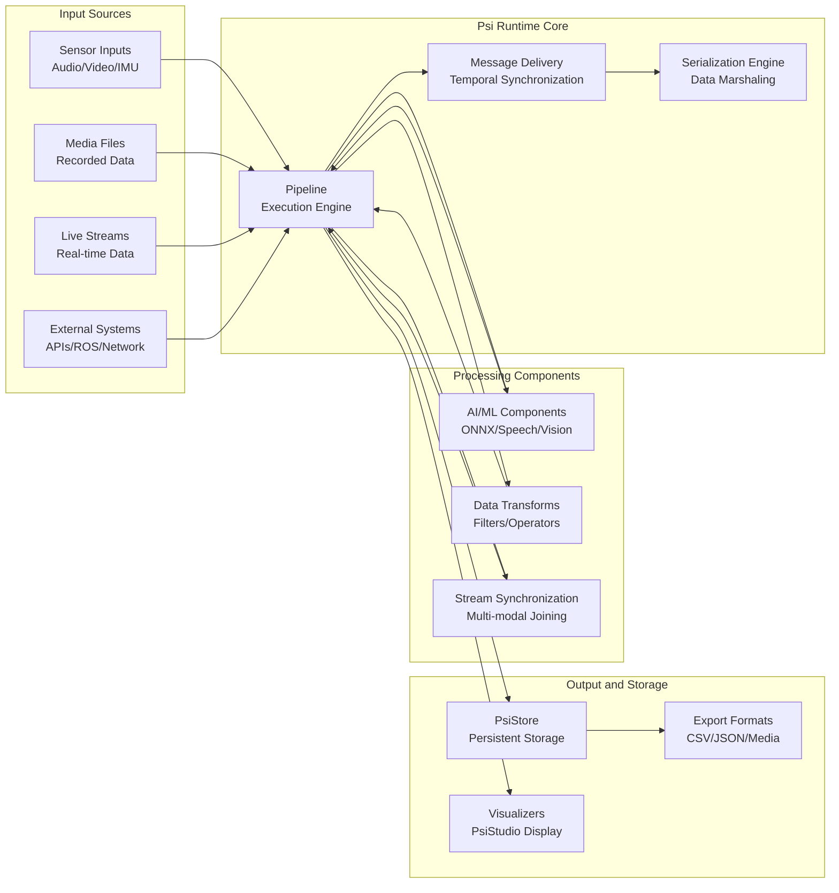

**Sources:** [README.md:6-12](), [README.md:37-52]()

## Core System Components

### Runtime Infrastructure

The core runtime provides the fundamental infrastructure for stream processing and data management:

- **Pipeline Engine**: Manages component lifecycle, message routing, and temporal synchronization across all data streams
- **Message Delivery System**: Ensures time-ordered delivery of messages with support for real-time and replay scenarios  
- **Serialization Framework**: Handles cross-platform data marshaling and type safety for stream persistence
- **PsiStore**: Provides efficient storage and indexing for time-series data with support for random access and streaming replay

### Development and Analysis Tools

- **PsiStudio**: Interactive visualization application for exploring temporal data, debugging pipelines, and analyzing multimodal streams
- **Timeline Navigator**: Temporal exploration interface allowing navigation through recorded data sessions
- **Data Exporters**: Tools for converting PsiStore data to various formats including CSV, JSON, and media files

### Mixed Reality Capabilities

- **HoloLens Capture System**: Comprehensive data collection from HoloLens 2 sensors including cameras, IMU, audio, and spatial mapping
- **Sigma Application**: Mixed reality task assistance system demonstrating real-time interactive agent capabilities
- **Mixed Reality Framework**: Core utilities for spatial computing, coordinate transformations, and mixed reality application development

**Sources:** [README.md:22-26](), [README.md:47-50]()

## Getting Started

### Prerequisites and Installation

Psi requires .NET development environment and supports both Windows and Linux platforms. Applications can be built using either:

- **NuGet Packages**: Reference pre-built `Microsoft.Psi.*` packages for rapid development
- **Source Build**: Clone and build the repository for full access to source code and latest features

### Sample Applications

The framework includes several sample applications demonstrating key concepts:

| Sample | Complexity | Requirements | Purpose |
|--------|------------|--------------|---------|
| **HelloWorld** | Basic | None | Simple pipeline creation and stream processing |
| **SimpleVoiceActivityDetector** | Basic | Microphone | Audio capture and voice activity detection |
| **WebcamWithAudio** | Intermediate | Webcam + Microphone | Multi-modal synchronization demonstration |
| **WhatIsThat** | Advanced | Azure Kinect + Cognitive Services | Object detection with pointing recognition |
| **HoloLensSample** | Advanced | HoloLens 2 | Mixed reality application development |

### Development Workflow

1. **Create Pipeline**: Instantiate `Pipeline` class to manage component execution
2. **Add Components**: Connect input sources, processing components, and output sinks
3. **Configure Streams**: Set up message routing and temporal synchronization requirements
4. **Run or Store**: Execute pipeline in real-time or persist data to `PsiStore` for analysis
5. **Visualize**: Use PsiStudio to explore data and debug pipeline behavior

**Sources:** [README.md:35-52](), [README.md:43-50]()

## Community and Resources

The Psi framework is actively used by research institutions including Microsoft Research, Cornell Tech, MIT, Carnegie Mellon University, and others. The project welcomes community contributions through GitHub issues, discussions, and pull requests.

For technical support, use the GitHub [Discussions](https://github.com/microsoft/psi/discussions) forum. For bug reports and feature requests, file [GitHub issues](https://github.com/microsoft/psi/issues) with appropriate labels.

**Sources:** [README.md:54-82](), [README.md:60-62]()

---

# Page: Core Framework

# Core Framework

<details>
<summary>Relevant source files</summary>

The following files were used as context for generating this wiki page:

- [Sources/Audio/Microsoft.Psi.Audio.Windows/AudioCapture.cs](Sources/Audio/Microsoft.Psi.Audio.Windows/AudioCapture.cs)
- [Sources/Runtime/Microsoft.Psi/Common/DeliveryPolicy.cs](Sources/Runtime/Microsoft.Psi/Common/DeliveryPolicy.cs)
- [Sources/Runtime/Microsoft.Psi/Common/DeliveryPolicy{T}.cs](Sources/Runtime/Microsoft.Psi/Common/DeliveryPolicy{T}.cs)
- [Sources/Runtime/Microsoft.Psi/Executive/Pipeline.cs](Sources/Runtime/Microsoft.Psi/Executive/Pipeline.cs)
- [Sources/Runtime/Microsoft.Psi/Streams/DeliveryQueue.cs](Sources/Runtime/Microsoft.Psi/Streams/DeliveryQueue.cs)
- [Sources/Runtime/Microsoft.Psi/Streams/Receiver{T}.cs](Sources/Runtime/Microsoft.Psi/Streams/Receiver{T}.cs)
- [Sources/Runtime/Test.Psi/DeliveryPolicyTest.cs](Sources/Runtime/Test.Psi/DeliveryPolicyTest.cs)

</details>


This document covers the fundamental runtime components that form the backbone of the Microsoft Psi framework. The core framework provides the essential infrastructure for message-based stream processing, including pipeline execution, message delivery, component communication, and queue management.

For information about data storage and retrieval, see [Data Persistence and Storage](#2.2). For details about serialization mechanisms, see [Serialization System](#2.3). For stream processing operators and transformations, see [Stream Processing Operators](#2.4).

## Pipeline Architecture

The `Pipeline` class serves as the central orchestrator for all component execution and message delivery in the Psi framework. It manages component lifecycles, schedules message processing, and coordinates inter-component communication through a sophisticated messaging system.

**Pipeline Component Architecture**
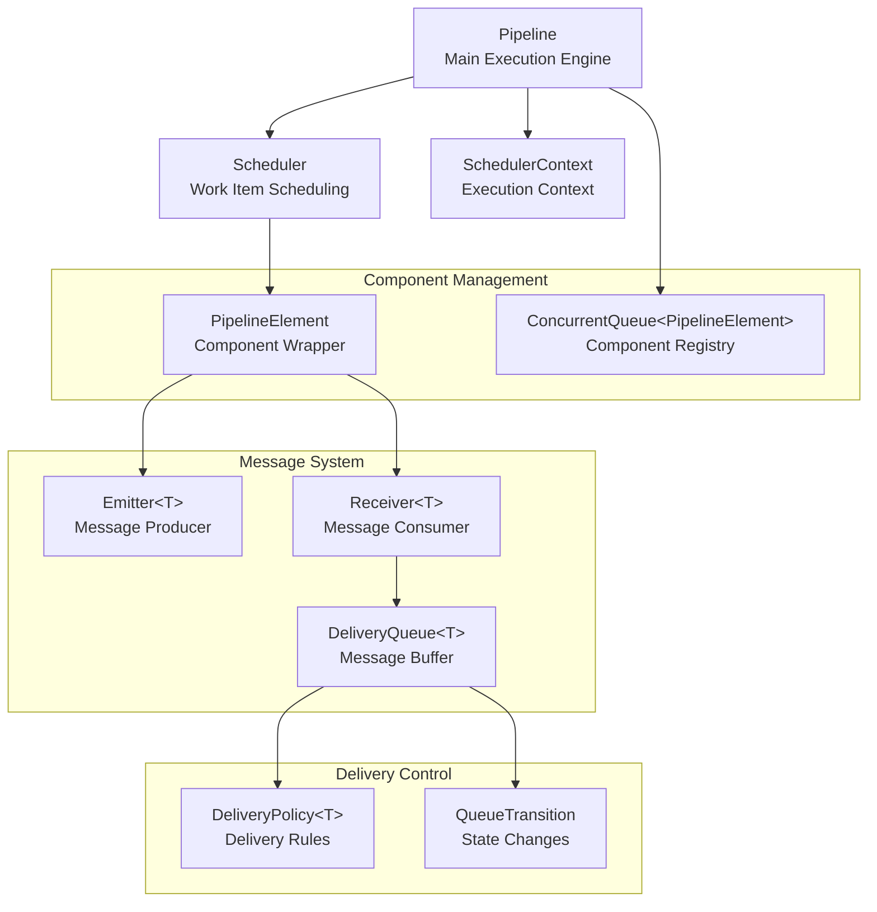

Sources: [Sources/Runtime/Microsoft.Psi/Executive/Pipeline.cs:21-153](), [Sources/Runtime/Microsoft.Psi/Streams/Receiver{T}.cs:27-84]()

The pipeline maintains several key responsibilities:

| Component | Purpose | Key Methods |
|-----------|---------|-------------|
| `Pipeline` | Central coordinator | `Create()`, `Run()`, `RunAsync()` |
| `Scheduler` | Work item execution | `Schedule()`, `TryExecute()` |
| `PipelineElement` | Component wrapper | `Initialize()`, `AddInput()`, `AddOutput()` |
| `ConcurrentQueue<PipelineElement>` | Component registry | Thread-safe component storage |

## Message Processing and Delivery

The message processing system implements a sophisticated delivery mechanism that handles message routing, queuing, and execution scheduling. Messages flow through the system via `Emitter` and `Receiver` pairs, with delivery behavior controlled by configurable policies.

**Message Flow Architecture**
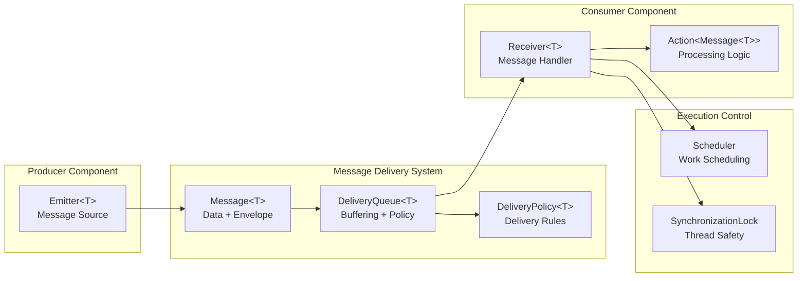

Sources: [Sources/Runtime/Microsoft.Psi/Streams/Receiver{T}.cs:239-323](), [Sources/Runtime/Microsoft.Psi/Streams/DeliveryQueue.cs:87-130]()

### Message Delivery Process

The `Receiver<T>` class implements a two-path delivery mechanism:

1. **Synchronous Path**: Direct execution when conditions allow
2. **Asynchronous Path**: Queued execution through the scheduler

The delivery process in the `Receive` method [Sources/Runtime/Microsoft.Psi/Streams/Receiver{T}.cs:268-322]() follows this pattern:

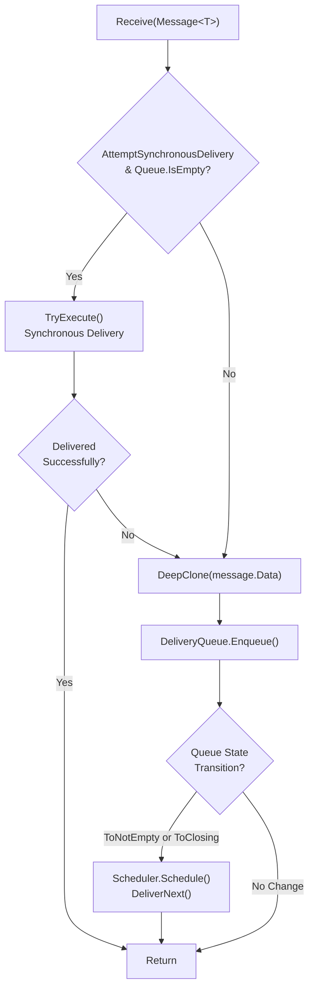

Sources: [Sources/Runtime/Microsoft.Psi/Streams/Receiver{T}.cs:268-322]()

## Delivery Policies and Queue Management

The `DeliveryPolicy` system provides configurable message delivery behaviors that control how messages are queued, when they are dropped, and how backpressure is handled. The `DeliveryQueue<T>` implements these policies through sophisticated queuing logic.

**Delivery Policy Types**
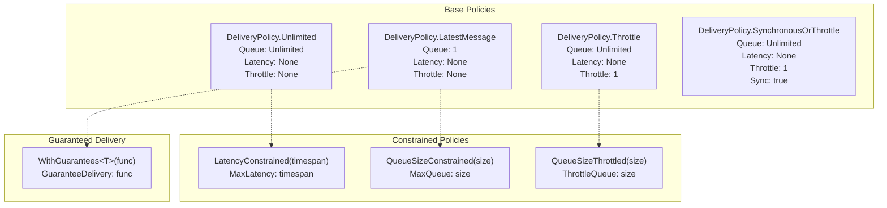

Sources: [Sources/Runtime/Microsoft.Psi/Common/DeliveryPolicy.cs:21-61](), [Sources/Runtime/Microsoft.Psi/Common/DeliveryPolicy{T}.cs:111-119]()

### Queue State Management

The `DeliveryQueue<T>` manages complex state transitions through the `QueueTransition` struct, which tracks changes in queue state and triggers appropriate throttling behavior:

| Transition | Description | Action |
|------------|-------------|---------|
| `ToEmpty` | Queue became empty | Stop scheduling delivery |
| `ToNotEmpty` | Queue received first message | Start scheduling delivery |
| `ToStartThrottling` | Queue reached throttle threshold | Freeze upstream producer |
| `ToStopThrottling` | Queue dropped below throttle threshold | Unfreeze upstream producer |
| `ToClosing` | Received closing message | Schedule final delivery |

Sources: [Sources/Runtime/Microsoft.Psi/Streams/DeliveryQueue.cs:14-40](), [Sources/Runtime/Microsoft.Psi/Streams/DeliveryQueue.cs:282-304]()

### Message Dropping Logic

The queue implements sophisticated message dropping logic in the `Enqueue` method [Sources/Runtime/Microsoft.Psi/Streams/DeliveryQueue.cs:140-270]() that respects delivery guarantees:

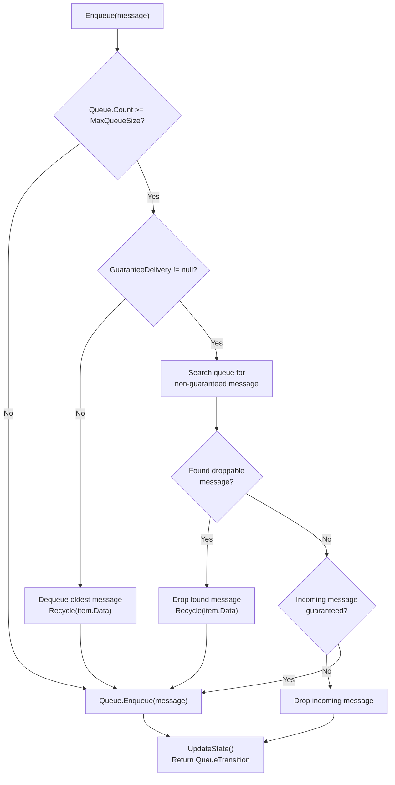

Sources: [Sources/Runtime/Microsoft.Psi/Streams/DeliveryQueue.cs:153-270]()

## Component Communication Infrastructure

The framework provides a robust component communication system through the `CreateReceiver` and `CreateEmitter` methods on the `Pipeline` class. This system ensures type safety, proper lifecycle management, and efficient message routing.

**Component Wiring Architecture**
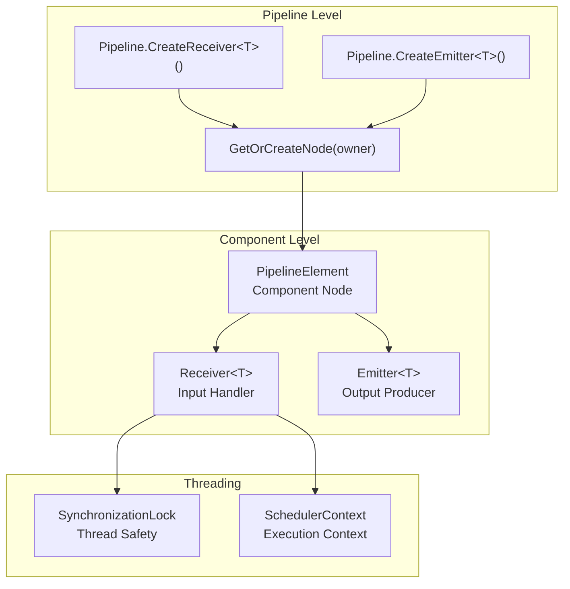

Sources: [Sources/Runtime/Microsoft.Psi/Executive/Pipeline.cs:353-387](), [Sources/Runtime/Microsoft.Psi/Executive/Pipeline.cs:442-445]()

The pipeline ensures that all receivers associated with the same component owner are never executed concurrently, providing a critical thread-safety guarantee for component implementations.

Sources: [Sources/Runtime/Microsoft.Psi/Executive/Pipeline.cs:21-153](), [Sources/Runtime/Microsoft.Psi/Streams/DeliveryQueue.cs:47-306](), [Sources/Runtime/Microsoft.Psi/Streams/Receiver{T}.cs:27-454](), [Sources/Runtime/Microsoft.Psi/Common/DeliveryPolicy.cs:11-236](), [Sources/Runtime/Microsoft.Psi/Common/DeliveryPolicy{T}.cs:12-121]()

---

# Page: Pipeline and Message Processing

# Pipeline and Message Processing

<details>
<summary>Relevant source files</summary>

The following files were used as context for generating this wiki page:

- [Sources/Audio/Microsoft.Psi.Audio.Windows/AudioCapture.cs](Sources/Audio/Microsoft.Psi.Audio.Windows/AudioCapture.cs)
- [Sources/Imaging/Test.Psi.Imaging.Windows/AverageColorTests.cs](Sources/Imaging/Test.Psi.Imaging.Windows/AverageColorTests.cs)
- [Sources/Kinect/Test.Psi.Kinect.Windows.x64/MeshTests.cs](Sources/Kinect/Test.Psi.Kinect.Windows.x64/MeshTests.cs)
- [Sources/Media/Microsoft.Psi.Media.Windows.x64/MediaSource.cs](Sources/Media/Microsoft.Psi.Media.Windows.x64/MediaSource.cs)
- [Sources/RealSense/Microsoft.Psi.RealSense.Windows.x64/RealSenseSensor.cs](Sources/RealSense/Microsoft.Psi.RealSense.Windows.x64/RealSenseSensor.cs)
- [Sources/Runtime/Microsoft.Psi/Common/DeliveryPolicy.cs](Sources/Runtime/Microsoft.Psi/Common/DeliveryPolicy.cs)
- [Sources/Runtime/Microsoft.Psi/Common/DeliveryPolicy{T}.cs](Sources/Runtime/Microsoft.Psi/Common/DeliveryPolicy{T}.cs)
- [Sources/Runtime/Microsoft.Psi/Executive/Pipeline.cs](Sources/Runtime/Microsoft.Psi/Executive/Pipeline.cs)
- [Sources/Runtime/Microsoft.Psi/Streams/DeliveryQueue.cs](Sources/Runtime/Microsoft.Psi/Streams/DeliveryQueue.cs)
- [Sources/Runtime/Microsoft.Psi/Streams/Receiver{T}.cs](Sources/Runtime/Microsoft.Psi/Streams/Receiver{T}.cs)
- [Sources/Runtime/Test.Psi/CommonTester.cs](Sources/Runtime/Test.Psi/CommonTester.cs)
- [Sources/Runtime/Test.Psi/DeliveryPolicyTest.cs](Sources/Runtime/Test.Psi/DeliveryPolicyTest.cs)
- [Sources/Runtime/Test.Psi/IntervalTests.cs](Sources/Runtime/Test.Psi/IntervalTests.cs)
- [Sources/Runtime/Test.Psi/JoinTests.cs](Sources/Runtime/Test.Psi/JoinTests.cs)
- [Sources/Runtime/Test.Psi/PipelineTest.cs](Sources/Runtime/Test.Psi/PipelineTest.cs)
- [Sources/Visualization/Microsoft.Psi.Visualization.Windows/PluginMap.cs](Sources/Visualization/Microsoft.Psi.Visualization.Windows/PluginMap.cs)

</details>


This document covers the core runtime architecture of Microsoft Psi's pipeline system, focusing on how components communicate through message passing, delivery queues, and scheduling mechanisms. It explains the fundamental classes and patterns that enable real-time stream processing in Psi applications.

For information about data persistence and storage, see [Data Persistence and Storage](#2.2). For details about serialization mechanisms, see [Serialization System](#2.3).

## Core Pipeline Architecture

The `Pipeline` class serves as the central execution engine that manages a graph of interconnected components. Each pipeline contains components that communicate through typed message streams using emitters and receivers.

### Pipeline Component Graph

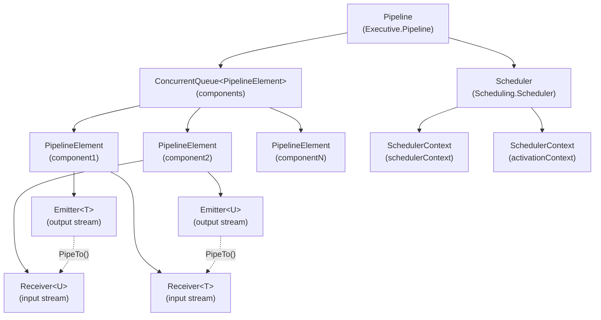

The pipeline maintains component references in a `ConcurrentQueue<PipelineElement>` and uses two distinct scheduler contexts: one for message delivery and another exclusively for component activation.

Sources: [Sources/Runtime/Microsoft.Psi/Executive/Pipeline.cs:21-263](), [Sources/Runtime/Test.Psi/PipelineTest.cs:25-40]()

## Message Delivery System

Message delivery in Psi follows a sophisticated queuing and scheduling system that ensures proper ordering and timing while supporting various delivery policies.

### Message Flow Architecture

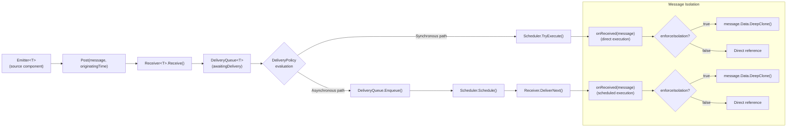

The system attempts synchronous delivery first when possible (based on `DeliveryPolicy.AttemptSynchronousDelivery`), falling back to asynchronous queued delivery when necessary.

Sources: [Sources/Runtime/Microsoft.Psi/Streams/Receiver{T}.cs:239-323](), [Sources/Runtime/Microsoft.Psi/Streams/DeliveryQueue.cs:132-270]()

## Delivery Policies and Queue Management

Delivery policies control message queuing behavior, latency constraints, and dropping strategies. The `DeliveryQueue<T>` implements these policies while maintaining message ordering.

### DeliveryPolicy Types

| Policy | Description | Queue Behavior | Use Case |
|--------|-------------|----------------|----------|
| `Unlimited` | No queue size limit | Grows indefinitely | Lossless processing |
| `LatestMessage` | Queue size of 1 | Drops old messages | Real-time scenarios |
| `Throttle` | Throttles source when queue full | Blocks upstream | Back-pressure control |
| `SynchronousOrThrottle` | Attempts sync delivery first | Sync then throttle | Low-latency processing |

### Queue State Management

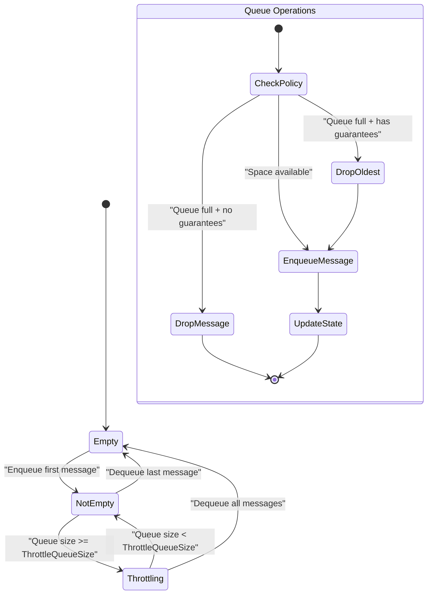

The `QueueTransition` struct tracks state changes (`ToEmpty`, `ToNotEmpty`, `ToStartThrottling`, `ToStopThrottling`, `ToClosing`) to trigger appropriate scheduling and throttling actions.

Sources: [Sources/Runtime/Microsoft.Psi/Streams/DeliveryQueue.cs:14-305](), [Sources/Runtime/Microsoft.Psi/Common/DeliveryPolicy.cs:11-236](), [Sources/Runtime/Test.Psi/DeliveryPolicyTest.cs:15-349]()

## Scheduling and Threading

The `Scheduler` class manages thread pools and work item execution. Components are associated with `SynchronizationLock` contexts that ensure exclusive execution of receivers belonging to the same component.

### Scheduler Architecture

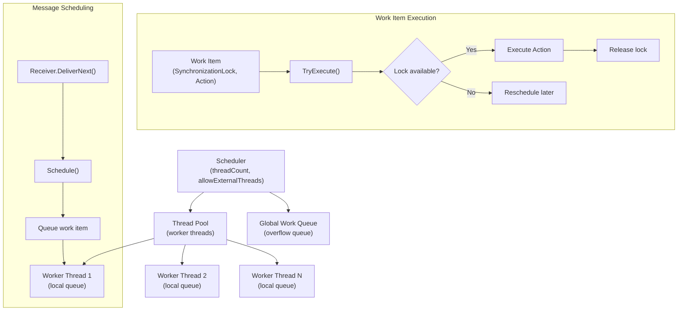

Each component has a `SynchronizationLock` that prevents concurrent execution of its receivers, ensuring thread safety without explicit locking in component code.

Sources: [Sources/Runtime/Microsoft.Psi/Executive/Pipeline.cs:45-99](), [Sources/Runtime/Test.Psi/PipelineTest.cs:311-324]()

## Component Lifecycle Management

Pipeline components follow a defined lifecycle with explicit start/stop phases and completion tracking for both finite and infinite source components.

### Component States and Transitions

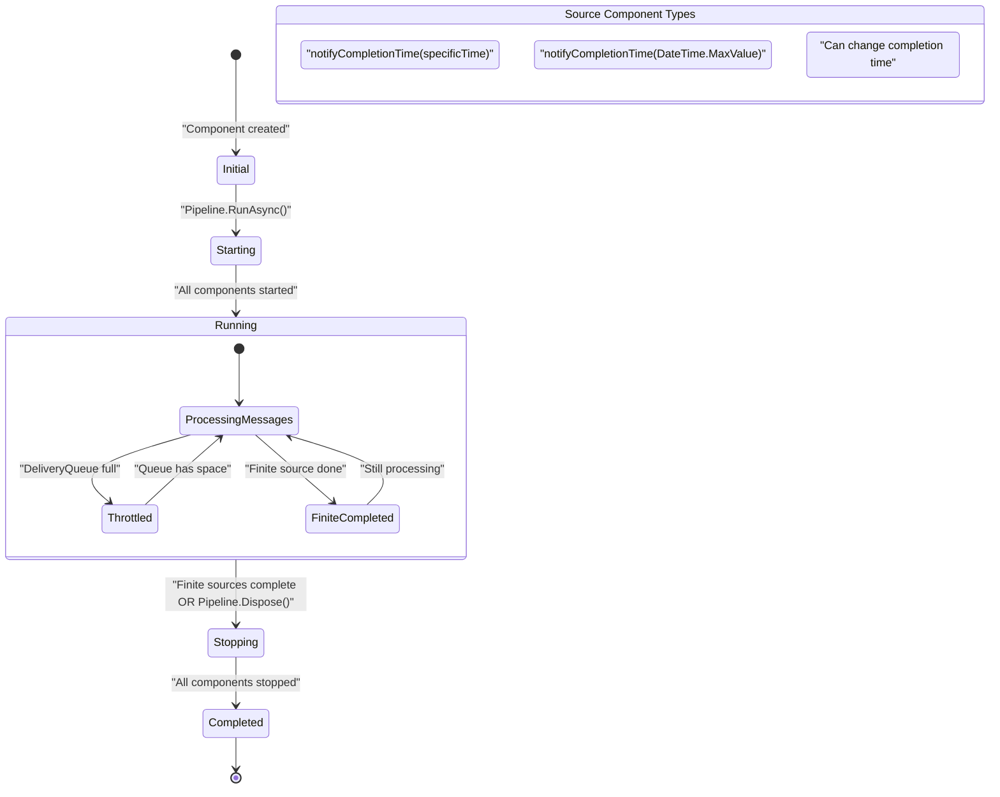

The pipeline tracks `completableComponents` and uses the `NoRemainingCompletableComponents` event to coordinate shutdown. Finite sources signal completion by calling `notifyCompletionTime` with their final originating time.

Sources: [Sources/Runtime/Microsoft.Psi/Executive/Pipeline.cs:173-286](), [Sources/Runtime/Test.Psi/PipelineTest.cs:376-461]()

## Error Handling and Diagnostics

The pipeline provides comprehensive error handling and diagnostic capabilities through the `DiagnosticsCollector` system and exception management.

### Error Flow and Diagnostics

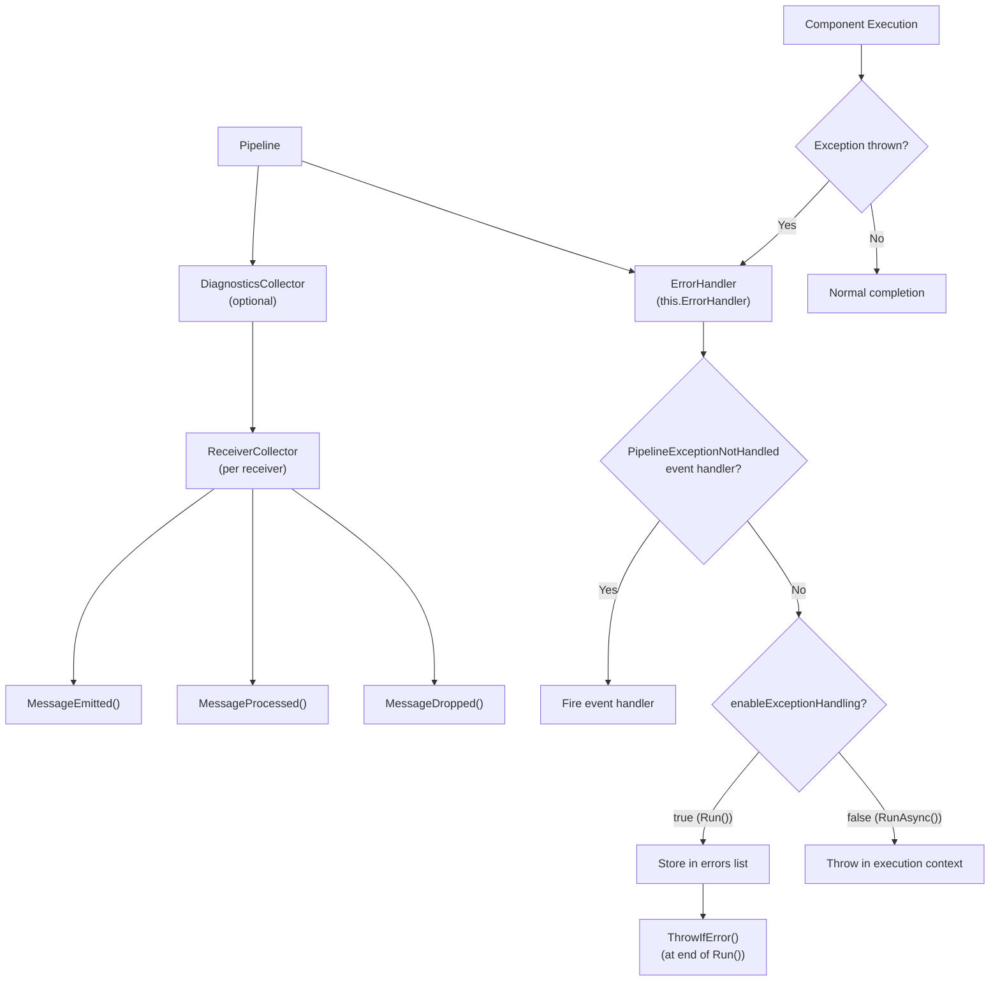

The pipeline distinguishes between synchronous execution (where exceptions are collected and re-thrown) and asynchronous execution (where exceptions propagate immediately unless handled).

Sources: [Sources/Runtime/Microsoft.Psi/Executive/Pipeline.cs:474-487](), [Sources/Runtime/Microsoft.Psi/Streams/Receiver{T}.cs:241-296]()

---

# Page: Data Persistence and Storage

# Data Persistence and Storage

<details>
<summary>Relevant source files</summary>

The following files were used as context for generating this wiki page:

- [.github/workflows/msbuild.yml](.github/workflows/msbuild.yml)
- [Sources/Runtime/Microsoft.Psi/Persistence/PageIndexCache.cs](Sources/Runtime/Microsoft.Psi/Persistence/PageIndexCache.cs)
- [Sources/Runtime/Test.Psi/PersistenceTest.cs](Sources/Runtime/Test.Psi/PersistenceTest.cs)

</details>


This document covers the PsiStore system, which provides efficient time-series data storage and retrieval capabilities for the Microsoft Psi framework. The PsiStore system handles persisting multimodal streaming data to disk with temporal indexing, enabling efficient replay and analysis of recorded sessions.

For information about the pipeline processing that generates the data being stored, see [Pipeline and Message Processing](#2.1). For details about data serialization formats, see [Serialization System](#2.3).

## Core Architecture

The PsiStore system is built around a multi-layered architecture that provides efficient storage and retrieval of time-ordered streaming data:

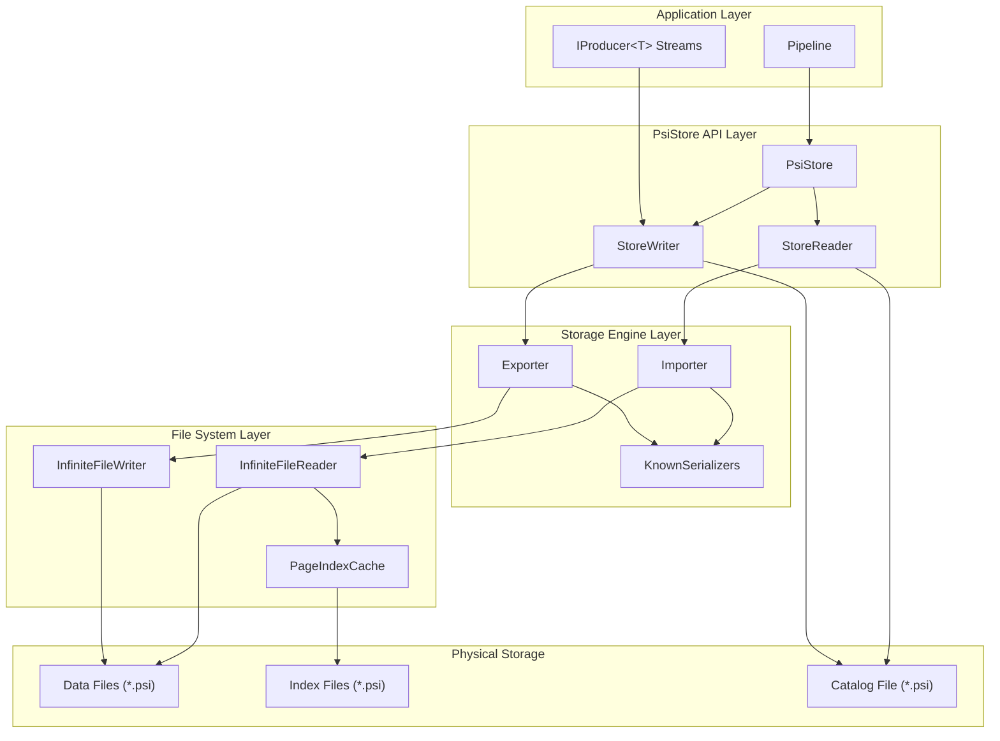

**Sources:** [Sources/Runtime/Test.Psi/PersistenceTest.cs:1-50](), [Sources/Runtime/Microsoft.Psi/Persistence/PageIndexCache.cs:1-25]()

## PsiStore Operations

The `PsiStore` class provides the primary interface for data persistence operations. The following diagram shows the key operations and their relationships:

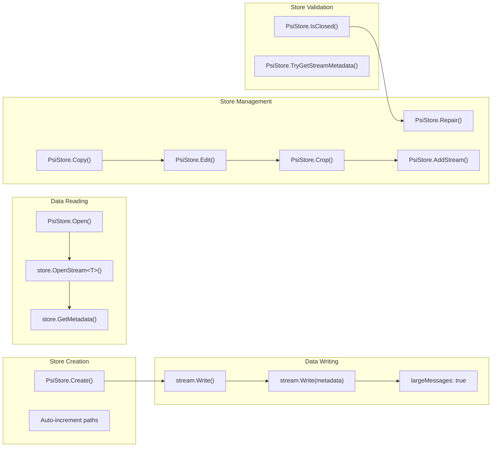

**Sources:** [Sources/Runtime/Test.Psi/PersistenceTest.cs:128-165](), [Sources/Runtime/Test.Psi/PersistenceTest.cs:236-272](), [Sources/Runtime/Test.Psi/PersistenceTest.cs:375-449]()

## File Structure and Storage Format

PsiStore uses a segmented file approach with the `InfiniteFileWriter` and `InfiniteFileReader` classes managing the low-level storage:

| Component | File Pattern | Purpose |
|-----------|--------------|---------|
| Data Extents | `{name}_{000000}.psi` | Segmented data storage with configurable extent size |
| Index Files | `{name}.index.psi` | Temporal index entries for efficient seeking |
| Catalog File | `{name}.catalog.psi` | Stream metadata and store configuration |
| Live Marker | `{name}.Live` | Indicates active writing session |

### Extent Management

The infinite file system automatically manages storage extents:

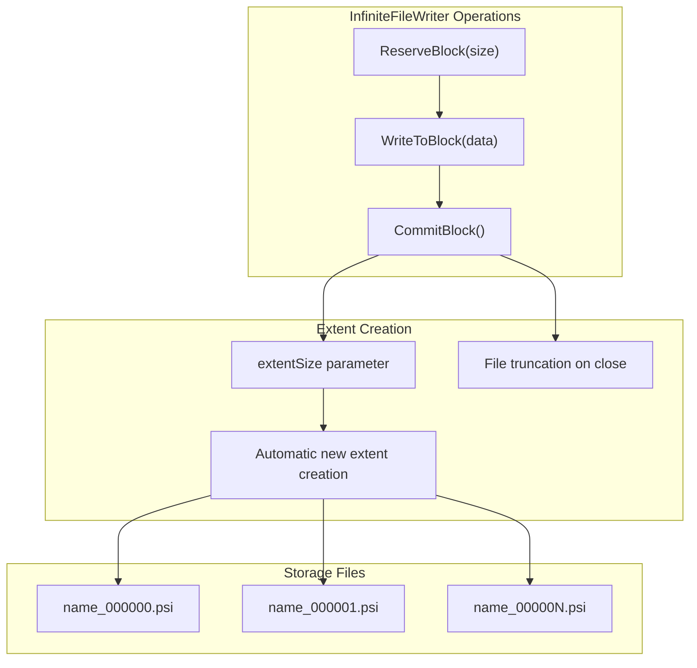

**Sources:** [Sources/Runtime/Test.Psi/PersistenceTest.cs:38-93](), [Sources/Runtime/Test.Psi/PersistenceTest.cs:97-122]()

## Indexing and Search

The `PageIndexCache` class provides efficient temporal seeking through hierarchical indexing:

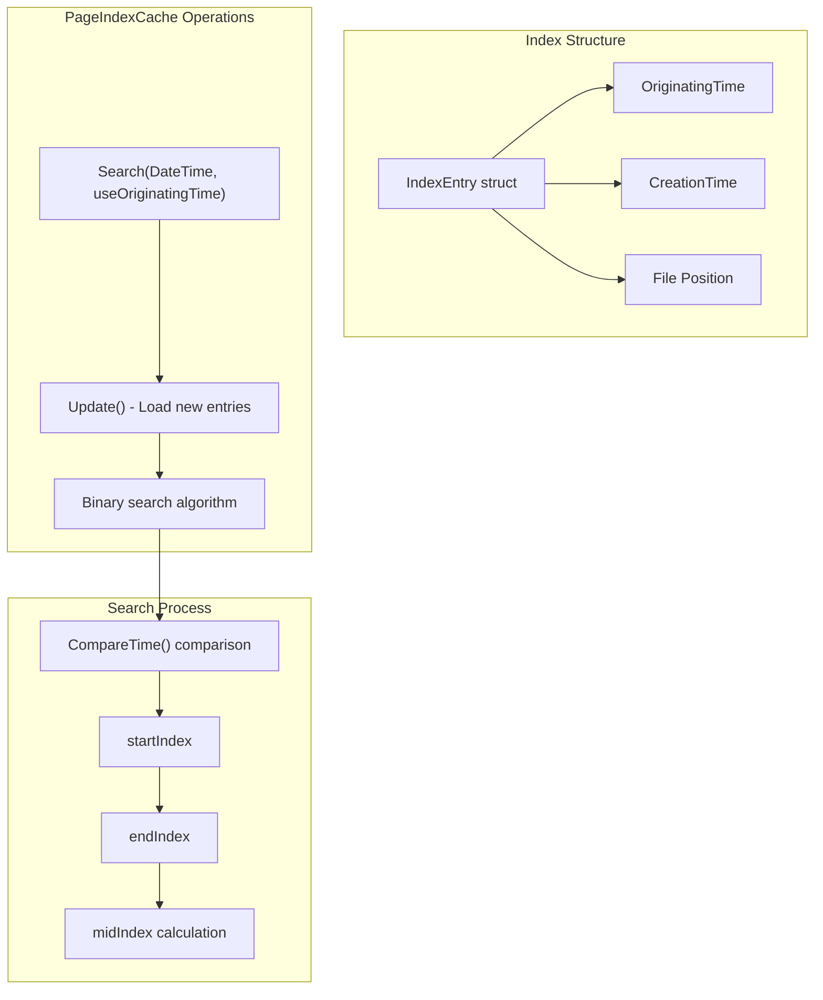

**Sources:** [Sources/Runtime/Microsoft.Psi/Persistence/PageIndexCache.cs:33-78](), [Sources/Runtime/Microsoft.Psi/Persistence/PageIndexCache.cs:80-118]()

## Advanced Features

### Real-time Reading During Writing

PsiStore supports concurrent reading while data is being written, enabling live analysis scenarios:

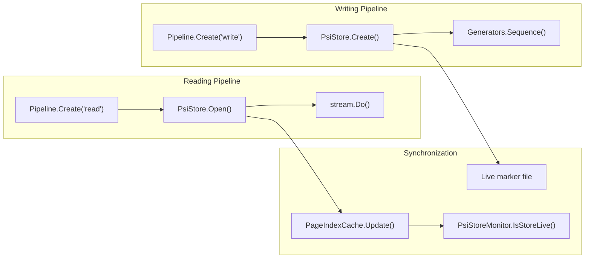

**Sources:** [Sources/Runtime/Test.Psi/PersistenceTest.cs:577-617](), [Sources/Runtime/Microsoft.Psi/Persistence/PageIndexCache.cs:102-106]()

### Large Message Handling

For messages exceeding normal size limits, PsiStore provides specialized large message support:

| Feature | Configuration | Usage |
|---------|---------------|--------|
| Large Messages | `largeMessages: true` | `stream.Write("name", store, largeMessages: true)` |
| Unaligned Blocks | Automatic | Handles non-4KB aligned data efficiently |
| Memory Management | Background disposal | `MemoryMappedView` cleanup on separate thread |

**Sources:** [Sources/Runtime/Test.Psi/PersistenceTest.cs:621-649](), [Sources/Runtime/Test.Psi/PersistenceTest.cs:653-686]()

## Store Management Operations

### Store Editing and Transformation

PsiStore provides several operations for post-processing stored data:

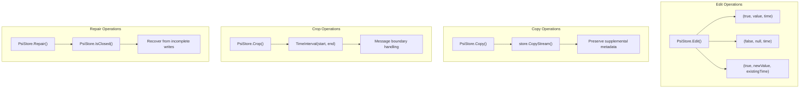

**Sources:** [Sources/Runtime/Test.Psi/PersistenceTest.cs:274-371](), [Sources/Runtime/Test.Psi/PersistenceTest.cs:993-1043](), [Sources/Runtime/Test.Psi/PersistenceTest.cs:1047-1105](), [Sources/Runtime/Test.Psi/PersistenceTest.cs:1109-1226]()

### Metadata Management

Stream metadata provides essential information for data interpretation:

| Metadata Type | Purpose | Access Method |
|---------------|---------|---------------|
| Stream Metadata | Type info, message counts, time ranges | `store.GetMetadata(streamName)` |
| Supplemental Metadata | Custom application data | `store.GetSupplementalMetadata<T>()` |
| Type Registration | Custom serialization handling | `store.Serializers.Register<T>()` |

**Sources:** [Sources/Runtime/Test.Psi/PersistenceTest.cs:839-858](), [Sources/Runtime/Test.Psi/PersistenceTest.cs:862-890](), [Sources/Runtime/Test.Psi/PersistenceTest.cs:920-944]()

---

# Page: Serialization System

# Serialization System

<details>
<summary>Relevant source files</summary>

The following files were used as context for generating this wiki page:

- [Sources/Imaging/Microsoft.Psi.Imaging/EncodedImage.cs](Sources/Imaging/Microsoft.Psi.Imaging/EncodedImage.cs)
- [Sources/Runtime/Microsoft.Psi/Common/BufferReader.cs](Sources/Runtime/Microsoft.Psi/Common/BufferReader.cs)
- [Sources/Runtime/Microsoft.Psi/Common/BufferWriter.cs](Sources/Runtime/Microsoft.Psi/Common/BufferWriter.cs)
- [Sources/Runtime/Microsoft.Psi/Common/RuntimeInfo.cs](Sources/Runtime/Microsoft.Psi/Common/RuntimeInfo.cs)
- [Sources/Runtime/Microsoft.Psi/Serialization/KnownSerializers.cs](Sources/Runtime/Microsoft.Psi/Serialization/KnownSerializers.cs)
- [Sources/Runtime/Microsoft.Psi/Serialization/MemoryStreamSerializer.cs](Sources/Runtime/Microsoft.Psi/Serialization/MemoryStreamSerializer.cs)
- [Sources/Runtime/Test.Psi/MemoryStreamTester.cs](Sources/Runtime/Test.Psi/MemoryStreamTester.cs)
- [Sources/Runtime/Test.Psi/SerializationTester.cs](Sources/Runtime/Test.Psi/SerializationTester.cs)

</details>


The Psi Serialization System provides cross-platform data marshaling capabilities for efficient serialization, deserialization, and deep cloning of objects within the Psi framework. This system enables data persistence to stores, message passing between pipeline components, and cross-platform compatibility. The serialization system supports both built-in .NET types and custom user-defined types through automatic code generation and custom serializer registration.

For information about data persistence to disk, see [Data Persistence and Storage](#2.2). For stream processing operations that utilize serialization, see [Stream Processing Operators](#2.4).

## Core Architecture

The serialization system is built around a set of core components that work together to provide efficient binary serialization with support for polymorphic types, reference preservation, and schema evolution.

```mermaid
graph TB
    subgraph "Core Serialization Infrastructure"
        Serializer["Serializer<br/>(Static Entry Point)"]
        BufferWriter["BufferWriter<br/>(Binary Output)"]
        BufferReader["BufferReader<br/>(Binary Input)"]
        SerializationContext["SerializationContext<br/>(Operation State)"]
    end
    
    subgraph "Type System Management"
        KnownSerializers["KnownSerializers<br/>(Type Registry)"]
        TypeSchema["TypeSchema<br/>(Type Metadata)"]
        SerializationHandler["SerializationHandler<br/>(Type-specific Logic)"]
    end
    
    subgraph "Custom Serializers"
        ISerializer["ISerializer&lt;T&gt;<br/>(Serializer Interface)"]
        MemoryStreamSerializer["MemoryStreamSerializer"]
        StringSerializer["StringSerializer"]
        ByteArraySerializer["ByteArraySerializer"]
    end
    
    subgraph "Runtime Management"
        RuntimeInfo["RuntimeInfo<br/>(Version Info)"]
    end
    
    Serializer --> BufferWriter
    Serializer --> BufferReader
    Serializer --> SerializationContext
    Serializer --> KnownSerializers
    
    KnownSerializers --> TypeSchema
    KnownSerializers --> SerializationHandler
    KnownSerializers --> RuntimeInfo
    
    SerializationHandler --> ISerializer
    ISerializer --> MemoryStreamSerializer
    ISerializer --> StringSerializer
    ISerializer --> ByteArraySerializer
```

Sources: [Sources/Runtime/Microsoft.Psi/Serialization/KnownSerializers.cs:1-200](), [Sources/Runtime/Microsoft.Psi/Common/BufferWriter.cs:1-50](), [Sources/Runtime/Microsoft.Psi/Common/BufferReader.cs:1-50](), [Sources/Runtime/Microsoft.Psi/Common/RuntimeInfo.cs:1-56]()

## Primary Operations

The serialization system provides three primary operations for working with objects: serialization/deserialization, deep cloning, and resource clearing.

### Serialization and Deserialization

Serialization converts objects to binary format using `BufferWriter`, while deserialization reconstructs objects from binary data using `BufferReader`.

```mermaid
graph LR
    subgraph "Serialization Flow"
        Object1["Source Object"] --> Serialize["Serializer.Serialize()"]
        Serialize --> BufferWriter1["BufferWriter"]
        BufferWriter1 --> BinaryData["Binary Buffer"]
    end
    
    subgraph "Deserialization Flow"
        BinaryData2["Binary Buffer"] --> BufferReader1["BufferReader"]
        BufferReader1 --> Deserialize["Serializer.Deserialize()"]
        Deserialize --> Object2["Target Object"]
    end
    
    BinaryData -.-> BinaryData2
```

Sources: [Sources/Runtime/Test.Psi/SerializationTester.cs:47-56](), [Sources/Runtime/Microsoft.Psi/Common/BufferWriter.cs:84-94](), [Sources/Runtime/Microsoft.Psi/Common/BufferReader.cs:122-132]()

### Deep Cloning

Deep cloning creates independent copies of objects, preserving reference relationships while ensuring no shared state between source and target.

```mermaid
graph TB
    SourceObj["Source Object"]
    CloneMethod["obj.DeepClone()"]
    TargetObj["Cloned Object"]
    
    SourceObj --> CloneMethod
    CloneMethod --> TargetObj
    
    subgraph "Reference Preservation"
        SharedRef1["Shared Reference A"]
        SharedRef2["Shared Reference A"]
        SharedRef1 -.-> SharedRef2
    end
    
    TargetObj --> SharedRef2
    SourceObj --> SharedRef1
```

Sources: [Sources/Runtime/Test.Psi/SerializationTester.cs:122-133](), [Sources/Runtime/Test.Psi/SerializationTester.cs:234-240]()

### Resource Clearing

The clear operation releases resources held by objects, particularly important for `Shared<T>` objects that manage unmanaged resources.

Sources: [Sources/Runtime/Test.Psi/SerializationTester.cs:731-782]()

## Type Registration and Schema Management

The `KnownSerializers` class manages the mapping between .NET types and their corresponding serializers, supporting both automatic code generation and explicit registration of custom serializers.

```mermaid
graph TB
    subgraph "Type Registration Methods"
        Register1["Register&lt;T&gt;()<br/>(Simple Registration)"]
        Register2["Register&lt;T, TSerializer&gt;()<br/>(Custom Serializer)"]
        Register3["Register(Type, contractName)<br/>(Contract Mapping)"]
        RegisterGeneric["RegisterGenericSerializer()<br/>(Template Registration)"]
    end
    
    subgraph "KnownSerializers State"
        KnownTypes["knownTypes<br/>(Contract → Type)"]
        KnownNames["knownNames<br/>(Type → Contract)"]
        Serializers["serializers<br/>(Type → Serializer)"]
        Templates["templates<br/>(Generic Templates)"]
        Schemas["schemas<br/>(Type Schemas)"]
    end
    
    subgraph "Handler Creation"
        AddHandler["AddHandler&lt;T&gt;()"]
        SerializationHandler1["SerializationHandler&lt;T&gt;"]
    end
    
    Register1 --> KnownTypes
    Register2 --> Serializers
    Register3 --> KnownNames
    RegisterGeneric --> Templates
    
    KnownTypes --> AddHandler
    Serializers --> AddHandler
    Schemas --> AddHandler
    
    AddHandler --> SerializationHandler1
```

Sources: [Sources/Runtime/Microsoft.Psi/Serialization/KnownSerializers.cs:206-298](), [Sources/Runtime/Microsoft.Psi/Serialization/KnownSerializers.cs:467-543]()

## Built-in Serializers

The system includes several optimized serializers for common .NET types, each implementing the `ISerializer<T>` interface.

| Type | Serializer Class | Special Features |
|------|-----------------|------------------|
| `string` | `StringSerializer` | UTF-8 encoding, null handling |
| `byte[]` | `ByteArraySerializer` | Direct binary copy |
| `BufferReader` | `BufferSerializer` | Shared buffer optimization |
| `string[]` | `StringArraySerializer` | Array-specific optimization |
| `MemoryStream` | `MemoryStreamSerializer` | Version compatibility, capacity management |
| `IEnumerable<T>` | `EnumerableSerializer<T>` | Generic collection support |
| `Dictionary<K,V>` | `DictionarySerializer<K,V>` | Key-value pair optimization |

Sources: [Sources/Runtime/Microsoft.Psi/Serialization/KnownSerializers.cs:176-184](), [Sources/Runtime/Microsoft.Psi/Serialization/MemoryStreamSerializer.cs:13-96]()

## Binary Format and BufferWriter/BufferReader

The serialization system uses a custom binary format optimized for performance, implemented through `BufferWriter` and `BufferReader` classes that provide type-safe binary I/O operations.

### BufferWriter Capabilities

```mermaid
graph TB
    subgraph "BufferWriter Methods"
        WritePrimitive["Write(primitive)<br/>(int, float, bool, etc.)"]
        WriteArray["Write(array[])<br/>(int[], double[], etc.)"]
        WritePointer["Write(void*, length)<br/>(Unsafe Pointer Copy)"]
        WriteString["Write(string)<br/>(UTF-8 Encoded)"]
        WriteStream["CopyFromStream()<br/>(Stream Integration)"]
    end
    
    subgraph "Auto-Resizing Buffer"
        Buffer["byte[] buffer"]
        Position["int currentPosition"]
        AutoResize["MoveCurrentPosition()<br/>(Auto-resize Logic)"]
    end
    
    WritePrimitive --> AutoResize
    WriteArray --> AutoResize
    WritePointer --> AutoResize
    WriteString --> AutoResize
    WriteStream --> AutoResize
    
    AutoResize --> Buffer
    AutoResize --> Position
```

Sources: [Sources/Runtime/Microsoft.Psi/Common/BufferWriter.cs:84-94](), [Sources/Runtime/Microsoft.Psi/Common/BufferWriter.cs:304-434](), [Sources/Runtime/Microsoft.Psi/Common/BufferWriter.cs:527-547]()

### BufferReader Capabilities

The `BufferReader` provides corresponding read operations with the same type safety and performance characteristics.

Sources: [Sources/Runtime/Microsoft.Psi/Common/BufferReader.cs:122-132](), [Sources/Runtime/Microsoft.Psi/Common/BufferReader.cs:274-513]()

## Schema Evolution and Versioning

The serialization system supports schema evolution through version management and backwards compatibility mechanisms.

```mermaid
graph TB
    subgraph "Version Management"
        RuntimeInfo1["RuntimeInfo<br/>(Current Version)"]
        SerializationSystemVersion["SerializationSystemVersion<br/>(Schema Compatibility)"]
        TypeSchema1["TypeSchema<br/>(Type Structure)"]
    end
    
    subgraph "Backwards Compatibility"
        OldSchema["Old Schema<br/>(Persisted Data)"]
        NewSchema["New Schema<br/>(Current Type)"]
        VersionCheck["Version Check<br/>(Compatibility Logic)"]
    end
    
    subgraph "Custom Serializer Adaptation"
        MemoryStreamSerializer1["MemoryStreamSerializer<br/>(Version-aware)"]
        ClassSerializer["ClassSerializer<br/>(Fallback for old data)"]
    end
    
    RuntimeInfo1 --> SerializationSystemVersion
    SerializationSystemVersion --> TypeSchema1
    
    OldSchema --> VersionCheck
    NewSchema --> VersionCheck
    VersionCheck --> MemoryStreamSerializer1
    MemoryStreamSerializer1 --> ClassSerializer
```

Sources: [Sources/Runtime/Microsoft.Psi/Common/RuntimeInfo.cs:15-35](), [Sources/Runtime/Microsoft.Psi/Serialization/MemoryStreamSerializer.cs:21-35]()

## Testing and Validation

The serialization system includes comprehensive testing infrastructure that validates correctness across different scenarios.

### Test Coverage Areas

| Test Category | Purpose | Example Tests |
|---------------|---------|---------------|
| Simple Types | Basic primitive serialization | `int`, `string`, `double`, `DateTime` |
| Complex Types | Class and struct serialization | Custom classes with nested fields |
| Collections | Array and enumerable handling | `int[]`, `List<T>`, `Dictionary<K,V>` |
| Polymorphic Types | Runtime type resolution | Interface implementations |
| Reference Preservation | Shared object maintenance | Multiple references to same object |
| Performance | Serialization speed benchmarks | Clone operations per second |

Sources: [Sources/Runtime/Test.Psi/SerializationTester.cs:25-56](), [Sources/Runtime/Test.Psi/SerializationTester.cs:574-641](), [Sources/Runtime/Test.Psi/SerializationTester.cs:688-727]()

## Integration Points

The serialization system integrates with several other Psi framework components:

- **Pipeline Message Processing**: Automatic serialization for message delivery between components
- **PsiStore**: Persistent storage of serialized stream data  
- **Cross-platform Communication**: Binary format exchange between different runtime environments
- **Shared Resources**: Proper lifecycle management for `Shared<T>` objects

Sources: [Sources/Runtime/Test.Psi/SerializationTester.cs:62-85](), [Sources/Runtime/Test.Psi/SerializationTester.cs:733-782]()

---

# Page: Stream Processing Operators

# Stream Processing Operators

<details>
<summary>Relevant source files</summary>

The following files were used as context for generating this wiki page:

- [Sources/Runtime/Microsoft.Psi/Components/RelativeTimeWindow.cs](Sources/Runtime/Microsoft.Psi/Components/RelativeTimeWindow.cs)
- [Sources/Runtime/Microsoft.Psi/Components/Zip.cs](Sources/Runtime/Microsoft.Psi/Components/Zip.cs)
- [Sources/Runtime/Microsoft.Psi/Operators/Enumerable.cs](Sources/Runtime/Microsoft.Psi/Operators/Enumerable.cs)
- [Sources/Runtime/Test.Psi/OperatorTests.cs](Sources/Runtime/Test.Psi/OperatorTests.cs)

</details>


Stream processing operators in Microsoft Psi provide composable transformation and analysis capabilities for real-time data streams. This document covers the available operators for filtering, transforming, aggregating, and combining streams within the Psi pipeline execution model.

For information about the underlying pipeline architecture and message processing, see [Pipeline and Message Processing](#2.1). For data serialization mechanisms used by operators, see [Serialization System](#2.3).

## Operator Architecture Overview

Stream operators in Psi are implemented as components that consume input streams and produce output streams, operating within the pipeline's message delivery framework.

```mermaid
graph TB
    subgraph "Stream Processing Flow"
        InputStream["Input Stream<T>"]
        Operator["Stream Operator"]
        OutputStream["Output Stream<U>"]
        
        InputStream --> Operator
        Operator --> OutputStream
    end
    
    subgraph "Core Operator Types"
        Transform["Transformation Operators<br/>Select, Where, Cast"]
        Aggregate["Aggregation Operators<br/>Sum, Count, Average"]
        Window["Windowing Operators<br/>Buffer, Sample, History"]
        Combine["Stream Combination<br/>Join, Zip, Merge"]
        Temporal["Temporal Operators<br/>Delay, Throttle, Sample"]
    end
    
    subgraph "Implementation Components"
        ConsumerProducer["ConsumerProducer<TIn,TOut>"]
        Processor["Processor<TIn,TOut>"]
        Receiver["Receiver<T>"]
        Emitter["Emitter<T>"]
    end
    
    Transform --> ConsumerProducer
    Aggregate --> ConsumerProducer
    Window --> ConsumerProducer
    Combine --> Processor
    Temporal --> ConsumerProducer
```

Sources: [Sources/Runtime/Microsoft.Psi/Components/RelativeTimeWindow.cs:15-16](), [Sources/Runtime/Microsoft.Psi/Components/Zip.cs:16]()

## Basic Transformation Operators

### Selection and Filtering

The framework provides standard functional operators for stream transformation:

| Operator | Purpose | Implementation |
|----------|---------|----------------|
| `Select` | Transform each message | Maps `T` to `U` using provided function |
| `Where` | Filter messages | Includes only messages matching predicate |
| `Cast` | Type conversion | Safely converts between compatible types |

### Observable Integration

Psi streams can be converted to and from Reactive Extensions `IObservable<T>` for integration with external systems.

```mermaid
graph LR
    subgraph "Observable Integration"
        PsiStream["IProducer<T>"]
        ToObservable["ToObservable()"]
        Observable["IObservable<T>"]
        Subscribe["Subscribe/ToListObservable"]
        Results["Collection Results"]
        
        PsiStream --> ToObservable
        ToObservable --> Observable
        Observable --> Subscribe
        Subscribe --> Results
    end
    
    subgraph "Error Handling"
        OnError["OnError handlers"]
        ErrorResume["OnErrorResumeNext"]
        Observable --> OnError
        Observable --> ErrorResume
    end
```

Sources: [Sources/Runtime/Test.Psi/OperatorTests.cs:125-193](), [Sources/Runtime/Microsoft.Psi/Operators/Enumerable.cs:19-31]()

## Aggregation Operators

### Statistical Aggregations

Psi provides real-time aggregation operators that compute running statistics over stream data:

| Operator | Data Types | Functionality |
|----------|------------|---------------|
| `Count()` | All types | Running count of messages |
| `LongCount()` | All types | Running count as `long` |
| `Sum()` | Numeric types | Running sum calculation |
| `Average()` | Numeric types | Running average calculation |
| `Min()` | Comparable types | Running minimum value |
| `Max()` | Comparable types | Running maximum value |

```mermaid
graph TB
    subgraph "Aggregation Operator Types"
        SimpleAgg["Simple Aggregations<br/>Count, Sum, Average"]
        ConditionalAgg["Conditional Aggregations<br/>Count(predicate), Sum(predicate)"]
        HistoryAgg["History-Based Aggregations<br/>Sum(windowSize), Average(timeSpan)"]
        CustomAgg["Custom Aggregations<br/>Aggregate(func), Min/Max(comparer)"]
    end
    
    subgraph "Supported Data Types"
        Numeric["Numeric Types<br/>int, long, float, double, decimal"]
        Nullable["Nullable Types<br/>int?, long?, float?, double?, decimal?"]
        Comparable["IComparable<T><br/>Custom types with comparison"]
    end
    
    SimpleAgg --> Numeric
    ConditionalAgg --> Numeric
    HistoryAgg --> Numeric
    HistoryAgg --> Nullable
    CustomAgg --> Comparable
```

Sources: [Sources/Runtime/Test.Psi/OperatorTests.cs:197-258](), [Sources/Runtime/Test.Psi/OperatorTests.cs:262-320](), [Sources/Runtime/Test.Psi/OperatorTests.cs:679-691]()

### Conditional Aggregations

Aggregation operators support predicate-based filtering:

```csharp
// Example usage patterns from tests
range.Count(x => x % 2 == 0)        // Count even numbers
range.Sum(x => x > threshold)       // Sum values above threshold
range.Average(i => i % 2 == 0)      // Average of even numbers
```

Sources: [Sources/Runtime/Test.Psi/OperatorTests.cs:203](), [Sources/Runtime/Test.Psi/OperatorTests.cs:298]()

## Windowing Operators

### History-Based Windows

Psi provides windowing operators that maintain historical data for analysis:

| Window Type | Parameters | Behavior |
|-------------|------------|----------|
| Count-based | `size: int` | Maintains last N messages |
| Time-based | `timeSpan: TimeSpan` | Maintains messages within time window |
| Relative time | `RelativeTimeInterval` | Window relative to anchor message |

```mermaid
graph TB
    subgraph "Windowing Implementation"
        RelativeTimeWindow["RelativeTimeWindow<TInput,TOutput>"]
        Buffer["Queue<Message<TInput>> buffer"]
        Selector["Func<IEnumerable<Message<TInput>>, TOutput>"]
        
        RelativeTimeWindow --> Buffer
        RelativeTimeWindow --> Selector
    end
    
    subgraph "Window Processing"
        AnchorMessage["Anchor Message"]
        TimeInterval["Time Interval Calculation"]
        MessageSelection["Message Selection"]
        OutputGeneration["Output Generation"]
        
        AnchorMessage --> TimeInterval
        TimeInterval --> MessageSelection
        MessageSelection --> OutputGeneration
    end
    
    subgraph "Buffer Management"
        EnqueueMessage["Enqueue New Message"]
        ProcessRemoval["Process Removal"]
        DequeueOld["Dequeue Old Messages"]
        
        EnqueueMessage --> ProcessRemoval
        ProcessRemoval --> DequeueOld
    end
```

Sources: [Sources/Runtime/Microsoft.Psi/Components/RelativeTimeWindow.cs:15-35](), [Sources/Runtime/Microsoft.Psi/Components/RelativeTimeWindow.cs:41-46]()

### Relative Time Windows

The `RelativeTimeWindow<TInput, TOutput>` component implements sophisticated time-based windowing:

```csharp
// Key implementation details
private readonly RelativeTimeInterval relativeTimeInterval;
private readonly Func<IEnumerable<Message<TInput>>, TOutput> selector;
private readonly Queue<Message<TInput>> buffer = new Queue<Message<TInput>>();
```

The component maintains an anchor message and processes windows relative to that anchor's originating time.

Sources: [Sources/Runtime/Microsoft.Psi/Components/RelativeTimeWindow.cs:18-20](), [Sources/Runtime/Microsoft.Psi/Components/RelativeTimeWindow.cs:48-51]()

## Stream Combination Operators

### Zip Operator

The `Zip<T>` component combines multiple streams while preserving temporal ordering:

```mermaid
graph TB
    subgraph "Zip Component Architecture"
        ZipComponent["Zip<T>"]
        InputReceivers["List<Receiver<T>> inputs"]
        MessageBuffer["List<(T data, Envelope envelope, IRecyclingPool<T> recycler)> buffer"]
        OutputEmitter["Emitter<T[]> Out"]
        
        ZipComponent --> InputReceivers
        ZipComponent --> MessageBuffer
        ZipComponent --> OutputEmitter
    end
    
    subgraph "Message Processing Flow"
        ReceiveMessage["Receive(T data, Envelope envelope)"]
        CloneData["data.DeepClone(recycler)"]
        BufferMessage["buffer.Add()"]
        PublishResults["Publish()"]
        
        ReceiveMessage --> CloneData
        CloneData --> BufferMessage
        BufferMessage --> PublishResults
    end
    
    subgraph "Publishing Logic"
        FindFrontier["Min(inputs.LastEnvelope.OriginatingTime)"]
        SelectEligible["buffer.Where(m => m.envelope.OriginatingTime <= frontier)"]
        GroupByTime["GroupBy(m => m.envelope.OriginatingTime)"]
        PostArrays["Out.Post(group.Select(t => t.data).ToArray())"]
        
        FindFrontier --> SelectEligible
        SelectEligible --> GroupByTime
        GroupByTime --> PostArrays
    end
```

Sources: [Sources/Runtime/Microsoft.Psi/Components/Zip.cs:16-33](), [Sources/Runtime/Microsoft.Psi/Components/Zip.cs:67-72](), [Sources/Runtime/Microsoft.Psi/Components/Zip.cs:74-96]()

### Pairing and Repeat Operations

The framework supports stream pairing with configurable initial values and repetition behavior:

```csharp
// Test examples showing pairing patterns
var output = clock.Pair(input, -1).Item2()  // With initial value
var output = clock.Pair(input).Item2()      // Without initial value
```

Sources: [Sources/Runtime/Test.Psi/OperatorTests.cs:57-94]()

## Temporal Operators

### Delay Operator

The delay operator shifts messages in time while preserving originating timestamps:

```mermaid
graph LR
    subgraph "Delay Operation"
        SourceStream["Source Stream"]
        DelayOperator["Delay(TimeSpan.FromMilliseconds(50))"]
        DelayedStream["Delayed Stream"]
        
        SourceStream --> DelayOperator
        DelayOperator --> DelayedStream
    end
    
    subgraph "Timestamp Behavior"
        OriginatingTime["OriginatingTime<br/>(preserved)"]
        CreationTime["CreationTime<br/>(delayed by 50ms)"]
        
        DelayedStream --> OriginatingTime
        DelayedStream --> CreationTime
    end
```

Sources: [Sources/Runtime/Test.Psi/OperatorTests.cs:23-53]()

### Event Source Integration

The `EventSource<THandler, TOut>` component bridges external events into Psi streams:

```csharp
var eventSource = new EventSource<EventHandler<int>, double>(
    pipeline,
    handler => this.EventSourceTestEvent += handler,    // Subscribe
    handler => this.EventSourceTestEvent -= handler,    // Unsubscribe  
    post => new EventHandler<int>((sender, e) => post(e / 10.0)));  // Transform
```

Sources: [Sources/Runtime/Test.Psi/OperatorTests.cs:104-108]()

## Stream Enumeration

### IEnumerable Integration

The `ToEnumerable<T>` operator converts Psi streams to standard .NET enumerables:

```mermaid
graph TB
    subgraph "Stream Enumeration Architecture"
        StreamEnumerable["StreamEnumerable<T>"]
        StreamEnumerator["StreamEnumerator"]
        ConcurrentQueue["ConcurrentQueue<T>"]
        ManualResetEvents["ManualResetEvent<br/>Enqueued, Closed"]
        
        StreamEnumerable --> StreamEnumerator
        StreamEnumerator --> ConcurrentQueue
        StreamEnumerator --> ManualResetEvents
    end
    
    subgraph "Processing Flow"
        Processor["Processor<T,T>"]
        DeepClone["d.DeepClone()"]
        QueueEnqueue["Queue.Enqueue()"]
        SetEvent["Enqueued.Set()"]
        
        Processor --> DeepClone
        DeepClone --> QueueEnqueue
        QueueEnqueue --> SetEvent
    end
    
    subgraph "Enumeration Control"
        MoveNext["MoveNext()"]
        TryDequeue["Queue.TryDequeue()"]
        WaitHandle["WaitHandle.WaitAny()"]
        PredicateCheck["predicate(current)"]
        
        MoveNext --> TryDequeue
        TryDequeue --> WaitHandle
        WaitHandle --> PredicateCheck
    end
```

Sources: [Sources/Runtime/Microsoft.Psi/Operators/Enumerable.cs:37-63](), [Sources/Runtime/Microsoft.Psi/Operators/Enumerable.cs:83-136]()

## Advanced Operators

### Custom Aggregation

The `Aggregate` operator enables custom reduction operations:

```csharp
// Factorial calculation example from tests
var factorials = Generators.Range(pipeline, 1, 7, TimeSpan.FromTicks(1))
    .Aggregate((x, y) => x * y);
```

Sources: [Sources/Runtime/Test.Psi/OperatorTests.cs:666-667]()

### Min/Max with Custom Comparers

Min and Max operators support custom comparison logic:

```csharp
var reverseComparer = new CompareIntsReversed();
var min = seq.Min(reverseComparer);
var max = seq.Max(reverseComparer);
```

Sources: [Sources/Runtime/Test.Psi/OperatorTests.cs:697-702]()

---

# Page: Mixed Reality and HoloLens

# Mixed Reality and HoloLens

<details>
<summary>Relevant source files</summary>

The following files were used as context for generating this wiki page:

- [Sources/MixedReality/HoloLensCapture/HoloLensCaptureApp/Assets/Logo/SplashScreen.scale-100.png](Sources/MixedReality/HoloLensCapture/HoloLensCaptureApp/Assets/Logo/SplashScreen.scale-100.png)
- [Sources/MixedReality/HoloLensCapture/HoloLensCaptureApp/Assets/Logo/Square150x150Logo.scale-100.png](Sources/MixedReality/HoloLensCapture/HoloLensCaptureApp/Assets/Logo/Square150x150Logo.scale-100.png)
- [Sources/MixedReality/HoloLensCapture/HoloLensCaptureApp/Assets/Logo/Wide310x150Logo.scale-100.png](Sources/MixedReality/HoloLensCapture/HoloLensCaptureApp/Assets/Logo/Wide310x150Logo.scale-100.png)
- [Sources/MixedReality/HoloLensCapture/HoloLensCaptureApp/HoloLensCaptureApp.cs](Sources/MixedReality/HoloLensCapture/HoloLensCaptureApp/HoloLensCaptureApp.cs)
- [Sources/MixedReality/HoloLensCapture/HoloLensCaptureApp/HoloLensCaptureApp.csproj](Sources/MixedReality/HoloLensCapture/HoloLensCaptureApp/HoloLensCaptureApp.csproj)
- [Sources/MixedReality/HoloLensCapture/HoloLensCaptureServer/HoloLensCaptureServer.cs](Sources/MixedReality/HoloLensCapture/HoloLensCaptureServer/HoloLensCaptureServer.cs)
- [Sources/MixedReality/HoloLensCapture/HoloLensCaptureServer/HoloLensCaptureServer.csproj](Sources/MixedReality/HoloLensCapture/HoloLensCaptureServer/HoloLensCaptureServer.csproj)
- [Sources/MixedReality/HoloLensCapture/HoloLensCaptureServer/ImageViewer.cs](Sources/MixedReality/HoloLensCapture/HoloLensCaptureServer/ImageViewer.cs)

</details>


The Mixed Reality and HoloLens subsystem provides comprehensive capabilities for capturing, streaming, and processing multi-modal sensor data from Microsoft HoloLens devices within the Psi framework. This system enables real-time collection of spatial computing data including head tracking, hand tracking, eye gaze, audio, RGB video, depth imaging, and scene understanding for research and application development.

For information about general mixed reality framework components, see [Mixed Reality Framework Components](#3.4). For data export and analysis tools, see [Data Export and Format Conversion](#3.2). For the Sigma task assistance application, see [Sigma Task Assistance Application](#3.3).

## System Architecture

The HoloLens integration follows a client-server architecture where a UWP application running on the HoloLens device captures sensor data and streams it over TCP to a desktop server application for persistence and analysis.

```mermaid
graph TB
    subgraph "HoloLens Device"
        CaptureApp["HoloLensCaptureApp<br/>(UWP Application)"]
        
        subgraph "Sensor Systems"
            IMU["IMU Sensors<br/>Accelerometer, Gyroscope, Magnetometer"]
            PhotoVideo["PhotoVideoCamera<br/>RGB Video Stream"]
            DepthSensors["Research Mode Cameras<br/>DepthCamera, VisibleLightCamera"]
            Tracking["Tracking Systems<br/>Head, Hands, Eyes"]
            Audio["Audio<br/>Microphone Array"]
            SceneUnderstanding["SceneUnderstanding<br/>Spatial Mapping"]
        end
        
        PipelineEngine["Pipeline Engine<br/>Stream Processing"]
        TcpWriters["TCP Writers<br/>Data Streaming"]
    end
    
    subgraph "Desktop/Server"
        CaptureServer["HoloLensCaptureServer<br/>(Console Application)"]
        RendezvousServer["RendezvousServer<br/>Connection Management"]
        PsiStore["PsiStore<br/>Data Persistence"]
        ImageViewer["ImageViewer<br/>Real-time Preview"]
    end
    
    IMU --> PipelineEngine
    PhotoVideo --> PipelineEngine
    DepthSensors --> PipelineEngine
    Tracking --> PipelineEngine
    Audio --> PipelineEngine
    SceneUnderstanding --> PipelineEngine
    
    PipelineEngine --> TcpWriters
    TcpWriters -->|"TCP Streams"| RendezvousServer
    RendezvousServer --> CaptureServer
    CaptureServer --> PsiStore
    CaptureServer --> ImageViewer
```

Sources: [Sources/MixedReality/HoloLensCapture/HoloLensCaptureApp/HoloLensCaptureApp.cs:1-750](), [Sources/MixedReality/HoloLensCapture/HoloLensCaptureServer/HoloLensCaptureServer.cs:1-569]()

## HoloLens Capture Application

The `HoloLensCaptureApp` class implements the client-side data collection system that runs on HoloLens devices. It constructs a comprehensive sensor pipeline and streams data to a connected server.

### Sensor Configuration

The application provides configurable access to all major HoloLens sensor systems:

| Sensor Type | Configuration Class | Key Parameters |
|-------------|-------------------|----------------|
| IMU | `Accelerometer`, `Gyroscope`, `Magnetometer` | Always enabled when `IncludeImu = true` |
| RGB Video | `PhotoVideoCamera` | Resolution: 896x504, Frame rate: 30fps |
| Depth | `DepthCamera` | Long-throw and AHAT modes available |
| Gray Cameras | `VisibleLightCamera` | Front and side cameras, JPEG/GZip encoding |
| Head Tracking | `StereoKitHeadSensor` | 20ms interval |
| Eye Tracking | `WinRTGazeSensor` | 45Hz update rate |
| Hand Tracking | `OpenXRHandsSensor` | 45Hz update rate |
| Audio | `Microphone` | 16384 sample frames |
| Scene Understanding | `SceneUnderstanding` | 60-second intervals |

Sources: [Sources/MixedReality/HoloLensCapture/HoloLensCaptureApp/HoloLensCaptureApp.cs:58-110](), [Sources/MixedReality/HoloLensCapture/HoloLensCaptureApp/HoloLensCaptureApp.cs:249-387]()

### Pipeline Construction and State Management

The application uses a state machine to manage the capture lifecycle:

```mermaid
stateDiagram-v2
    [*] --> WaitingToStart
    WaitingToStart --> ConstructPipeline : User clicks Start
    ConstructPipeline --> ConstructingPipeline
    ConstructingPipeline --> CalibrateCameras : Cameras need calibration
    ConstructingPipeline --> ConnectToCaptureServer : No calibration needed
    CalibrateCameras --> CalibratingCameras
    CalibratingCameras --> ConnectToCaptureServer
    ConnectToCaptureServer --> WaitingForCaptureServer
    WaitingForCaptureServer --> Capturing : Server connected
    Capturing --> StoppingPipeline : Stop requested
    StoppingPipeline --> WaitingToStart
    StoppingPipeline --> Exited : Exit requested
```

Sources: [Sources/MixedReality/HoloLensCapture/HoloLensCaptureApp/HoloLensCaptureApp.cs:124-136](), [Sources/MixedReality/HoloLensCapture/HoloLensCaptureApp/HoloLensCaptureApp.cs:214-397]()

### TCP Streaming Protocol

Data streams are transmitted using the Rendezvous protocol with `TcpWriter` components. Each sensor stream is assigned a dedicated TCP port starting from 30000:

```mermaid
graph LR
    subgraph "Sensor Streams"
        AccelStream["Accelerometer<br/>Port 30000"]
        GyroStream["Gyroscope<br/>Port 30001"] 
        MagStream["Magnetometer<br/>Port 30002"]
        HeadStream["Head<br/>Port 30003"]
        EyesStream["Eyes<br/>Port 30004"]
        HandsStream["Hands<br/>Port 30005"]
        AudioStream["Audio<br/>Port 30006"]
        VideoStream["VideoEncodedImageCameraView<br/>Port 30007"]
        DepthStream["DepthImageCameraView<br/>Port 30008"]
    end
    
    subgraph "TCP Writers"
        TcpWriter1["TcpWriter&lt;IMU&gt;"]
        TcpWriter2["TcpWriter&lt;CoordinateSystem&gt;"]
        TcpWriter3["TcpWriter&lt;WinRTEyes&gt;"]
        TcpWriter4["TcpWriter&lt;OpenXRHands&gt;"]
        TcpWriter5["TcpWriter&lt;AudioBuffer&gt;"]
        TcpWriter6["TcpWriter&lt;EncodedImageCameraView&gt;"]
    end
    
    AccelStream --> TcpWriter1
    HeadStream --> TcpWriter2
    EyesStream --> TcpWriter3
    HandsStream --> TcpWriter4
    AudioStream --> TcpWriter5
    VideoStream --> TcpWriter6
```

Sources: [Sources/MixedReality/HoloLensCapture/HoloLensCaptureApp/HoloLensCaptureApp.cs:504-509](), [Sources/MixedReality/HoloLensCapture/HoloLensCaptureApp/HoloLensCaptureApp.cs:513-647]()

## HoloLens Capture Server

The `HoloLensCaptureServer` class implements the server-side component that receives streams from HoloLens devices and persists them to `PsiStore` for analysis.

### Stream Type Mapping

The server maintains a dictionary mapping stream types to capture actions:

```mermaid
graph TD
    subgraph "Stream Type Recognition"
        TypeName["SimplifyTypeName()<br/>Stream Type Parser"]
        CaptureActions["CaptureStreamAction<br/>Dictionary"]
    end
    
    subgraph "Supported Types"
        CoordSystem["CoordinateSystem<br/>Head tracking data"]
        OpenXRHand["OpenXRHand<br/>Hand tracking data"]
        WinRTEyes["WinRTEyes<br/>Eye gaze data"]
        AudioBuffer["AudioBuffer<br/>Microphone data"]
        SharedImage["Shared&lt;Image&gt;<br/>RGB camera data"]
        EncodedImage["Shared&lt;EncodedImage&gt;<br/>Compressed images"]
        DepthImage["Shared&lt;DepthImage&gt;<br/>Depth sensor data"]
        SceneObjects["SceneObjectCollection<br/>Scene understanding"]
    end
    
    TypeName --> CaptureActions
    CaptureActions --> CoordSystem
    CaptureActions --> OpenXRHand
    CaptureActions --> WinRTEyes
    CaptureActions --> AudioBuffer
    CaptureActions --> SharedImage
    CaptureActions --> EncodedImage
    CaptureActions --> DepthImage
    CaptureActions --> SceneObjects
```

Sources: [Sources/MixedReality/HoloLensCapture/HoloLensCaptureServer/HoloLensCaptureServer.cs:37-143]()

### Data Processing Pipeline

The server creates a processing pipeline for each connected HoloLens device:

```mermaid
graph TB
    subgraph "Server Pipeline"
        RendezvousServer["RendezvousServer<br/>Client connection handler"]
        RemoteClock["RemoteClockImporter<br/>Time synchronization"]
        TcpSources["TcpSource&lt;T&gt;<br/>Stream receivers"]
        Statistics["StreamStatistics<br/>Performance monitoring"]
        PsiStore["PsiStore<br/>Data persistence"]
        ImageViewer["ImageViewer<br/>Real-time preview"]
    end
    
    subgraph "Processing Functions"
        CaptureTcpStream["CaptureTcpStream&lt;T&gt;<br/>Generic stream capture"]
        ViewImageStream["ViewImageStream<br/>Image display routing"]
        ReportMessage["ReportMessage<br/>Statistics tracking"]
    end
    
    RendezvousServer --> RemoteClock
    RendezvousServer --> TcpSources
    TcpSources --> CaptureTcpStream
    CaptureTcpStream --> Statistics
    CaptureTcpStream --> PsiStore
    CaptureTcpStream --> ViewImageStream
    ViewImageStream --> ImageViewer
    Statistics --> ReportMessage
```

Sources: [Sources/MixedReality/HoloLensCapture/HoloLensCaptureServer/HoloLensCaptureServer.cs:223-353](), [Sources/MixedReality/HoloLensCapture/HoloLensCaptureServer/HoloLensCaptureServer.cs:355-379]()

## Configuration and Deployment

### Build Configuration

The HoloLens capture system requires specific build configurations for Universal Windows Platform (UWP) deployment:

| Component | Target Framework | Platform |
|-----------|------------------|----------|
| HoloLensCaptureApp | UWP 10.0.22621.0 | ARM |
| HoloLensCaptureServer | .NET Framework 4.7.2 | AnyCPU |

Sources: [Sources/MixedReality/HoloLensCapture/HoloLensCaptureApp/HoloLensCaptureApp.csproj:14-16](), [Sources/MixedReality/HoloLensCapture/HoloLensCaptureServer/HoloLensCaptureServer.csproj:5]()

### Dependencies

The system relies on several key dependencies:

- **HoloLens2ResearchMode**: Native C++ component for accessing research mode cameras
- **Microsoft.Psi.MixedReality**: Core mixed reality components and sensor interfaces  
- **Microsoft.Psi.Interop**: Cross-process communication and serialization
- **StereoKit**: Mixed reality toolkit for spatial interaction
- **MathNet.Spatial**: Spatial mathematics and coordinate transformations

Sources: [Sources/MixedReality/HoloLensCapture/HoloLensCaptureApp/HoloLensCaptureApp.csproj:92-131](), [Sources/MixedReality/HoloLensCapture/HoloLensCaptureServer/HoloLensCaptureServer.csproj:36-43]()

## Performance Monitoring

The server provides comprehensive performance monitoring through the `StreamStatistics` class:

```mermaid
graph LR
    subgraph "Statistics Tracking"
        MessageCount["MessageCount<br/>Total messages received"]
        FirstMessage["FirstMessage<br/>Session start time"]
        LastMessage["LastMessage<br/>Most recent message"]
        MessagesPerSecond["MessagesPerSecond<br/>5-second sliding window"]
    end
    
    subgraph "Reporting"
        Console["Console Output<br/>Real-time statistics"]
        LogFile["CaptureLog.txt<br/>Persistent logging"]
        ServerHeartbeat["ServerHeartbeat<br/>FPS monitoring stream"]
    end
    
    MessageCount --> Console
    MessagesPerSecond --> Console
    FirstMessage --> LogFile
    LastMessage --> LogFile
    MessagesPerSecond --> ServerHeartbeat
```

Sources: [Sources/MixedReality/HoloLensCapture/HoloLensCaptureServer/HoloLensCaptureServer.cs:511-566](), [Sources/MixedReality/HoloLensCapture/HoloLensCaptureServer/HoloLensCaptureServer.cs:285-346]()

---

# Page: HoloLens Data Capture

# HoloLens Data Capture

<details>
<summary>Relevant source files</summary>

The following files were used as context for generating this wiki page:

- [Sources/Audio/Microsoft.Psi.Audio/Reframe.cs](Sources/Audio/Microsoft.Psi.Audio/Reframe.cs)
- [Sources/MixedReality/HoloLensCapture/HoloLensCaptureApp/Assets/Logo/SplashScreen.scale-100.png](Sources/MixedReality/HoloLensCapture/HoloLensCaptureApp/Assets/Logo/SplashScreen.scale-100.png)
- [Sources/MixedReality/HoloLensCapture/HoloLensCaptureApp/Assets/Logo/Square150x150Logo.scale-100.png](Sources/MixedReality/HoloLensCapture/HoloLensCaptureApp/Assets/Logo/Square150x150Logo.scale-100.png)
- [Sources/MixedReality/HoloLensCapture/HoloLensCaptureApp/Assets/Logo/Wide310x150Logo.scale-100.png](Sources/MixedReality/HoloLensCapture/HoloLensCaptureApp/Assets/Logo/Wide310x150Logo.scale-100.png)
- [Sources/MixedReality/HoloLensCapture/HoloLensCaptureApp/HoloLensCaptureApp.cs](Sources/MixedReality/HoloLensCapture/HoloLensCaptureApp/HoloLensCaptureApp.cs)
- [Sources/MixedReality/HoloLensCapture/HoloLensCaptureApp/HoloLensCaptureApp.csproj](Sources/MixedReality/HoloLensCapture/HoloLensCaptureApp/HoloLensCaptureApp.csproj)
- [Sources/MixedReality/HoloLensCapture/HoloLensCaptureExporter/Readme.md](Sources/MixedReality/HoloLensCapture/HoloLensCaptureExporter/Readme.md)
- [Sources/MixedReality/HoloLensCapture/HoloLensCaptureServer/HoloLensCaptureServer.cs](Sources/MixedReality/HoloLensCapture/HoloLensCaptureServer/HoloLensCaptureServer.cs)
- [Sources/MixedReality/HoloLensCapture/HoloLensCaptureServer/HoloLensCaptureServer.csproj](Sources/MixedReality/HoloLensCapture/HoloLensCaptureServer/HoloLensCaptureServer.csproj)
- [Sources/MixedReality/HoloLensCapture/HoloLensCaptureServer/ImageViewer.cs](Sources/MixedReality/HoloLensCapture/HoloLensCaptureServer/ImageViewer.cs)
- [Sources/MixedReality/Microsoft.Psi.MixedReality.UniversalWindows/SceneUnderstanding.cs](Sources/MixedReality/Microsoft.Psi.MixedReality.UniversalWindows/SceneUnderstanding.cs)

</details>


## Purpose and Scope

The HoloLens Data Capture system provides a comprehensive solution for collecting, streaming, and storing multi-modal sensor data from Microsoft HoloLens 2 devices. This system consists of three main components: a HoloLens capture application, a capture server for data aggregation and storage, and an exporter for converting captured data to various analysis formats.

This document covers the data capture pipeline from sensor acquisition through network streaming to persistent storage. For information about exported data formats and analysis workflows, see [Data Export and Format Conversion](#3.2). For details about the underlying mixed reality framework components, see [Mixed Reality Framework Components](#3.4).

## System Architecture

The HoloLens Data Capture system follows a distributed architecture where sensor data is captured on the HoloLens device and streamed over TCP to a server for storage and processing.

```mermaid
graph TB
    subgraph "HoloLens Device"
        CaptureApp["HoloLensCaptureApp"]
        
        subgraph "Sensor Components"
            IMU["IMU Sensors<br/>Accelerometer<br/>Gyroscope<br/>Magnetometer"]
            Head["StereoKitHeadSensor"]
            Eyes["WinRTGazeSensor"]
            Hands["OpenXRHandsSensor"]
            Audio["Microphone"]
            Camera["PhotoVideoCamera"]
            Depth["DepthCamera"]
            Scene["SceneUnderstanding"]
        end
        
        subgraph "Processing Pipeline"
            Pipeline["Psi Pipeline"]
            Encoding["Image Encoding<br/>JPEG/GZIP"]
            Serialization["TCP Serialization"]
        end
        
        IMU --> Pipeline
        Head --> Pipeline
        Eyes --> Pipeline
        Hands --> Pipeline
        Audio --> Pipeline
        Camera --> Pipeline
        Depth --> Pipeline
        Scene --> Pipeline
        
        Pipeline --> Encoding
        Encoding --> Serialization
        CaptureApp --> Pipeline
    end
    
    subgraph "Network Layer"
        TCP["TCP Streams<br/>Port 30000+"]
        Rendezvous["Rendezvous Protocol<br/>Service Discovery"]
        ClockSync["Remote Clock Sync"]
    end
    
    subgraph "Server PC"
        CaptureServer["HoloLensCaptureServer"]
        
        subgraph "Storage Layer"
            PsiStore["PsiStore Database"]
            Diagnostics["Diagnostics Stream"]
            Statistics["Stream Statistics"]
        end
        
        subgraph "Visualization"
            ImageViewer["Real-time Image Viewer"]
            Console["Console Logging"]
        end
    end
    
    Serialization --> TCP
    TCP --> Rendezvous
    Rendezvous --> CaptureServer
    ClockSync --> CaptureServer
    
    CaptureServer --> PsiStore
    CaptureServer --> Diagnostics
    CaptureServer --> Statistics
    CaptureServer --> ImageViewer
    CaptureServer --> Console
```

Sources: [Sources/MixedReality/HoloLensCapture/HoloLensCaptureApp/HoloLensCaptureApp.cs:1-849](), [Sources/MixedReality/HoloLensCapture/HoloLensCaptureServer/HoloLensCaptureServer.cs:1-569]()

## HoloLens Capture Application

The `HoloLensCaptureApp` is a Universal Windows Platform (UWP) application that runs on HoloLens 2 devices and orchestrates the collection of sensor data.

### Application States

The capture application operates through a state machine that manages the capture lifecycle:

```mermaid
stateDiagram-v2
    [*] --> WaitingToStart
    WaitingToStart --> ConstructPipeline : Start Button
    ConstructPipeline --> ConstructingPipeline
    ConstructingPipeline --> CalibrateCameras : Cameras Enabled
    ConstructingPipeline --> ConnectToCaptureServer : No Cameras
    CalibrateCameras --> CalibratingCameras
    CalibratingCameras --> ConnectToCaptureServer
    ConnectToCaptureServer --> WaitingForCaptureServer
    WaitingForCaptureServer --> Capturing : Server Connected
    Capturing --> StoppingPipeline : Stop/Error
    StoppingPipeline --> WaitingToStart
    WaitingToStart --> Exited : Exit Button
    Exited --> [*]
```

Sources: [Sources/MixedReality/HoloLensCapture/HoloLensCaptureApp/HoloLensCaptureApp.cs:124-136]()

### Sensor Configuration

The application provides extensive configuration options for each sensor type:

| Sensor Type | Configuration Class | Key Parameters |
|-------------|-------------------|----------------|
| IMU | `Accelerometer`, `Gyroscope`, `Magnetometer` | Sample rate (hardware dependent) |
| Head Tracking | `StereoKitHeadSensor` | `HeadInterval` (20ms default) |
| Eye Tracking | `WinRTGazeSensor` | `EyesInterval` (45Hz default) |
| Hand Tracking | `OpenXRHandsSensor` | `HandsInterval` (45Hz default) |
| Audio | `Microphone` | 16384 byte frames, 48kHz |
| Video | `PhotoVideoCamera` | 896x504@30fps, JPEG encoding |
| Depth | `DepthCamera` | Long-throw and AHAT modes |
| Scene | `SceneUnderstanding` | 60 second intervals |

Sources: [Sources/MixedReality/HoloLensCapture/HoloLensCaptureApp/HoloLensCaptureApp.cs:89-109]()

### Data Streaming Pipeline

The application uses Psi's TCP transport mechanism to stream data to the server:

```mermaid
graph LR
    subgraph "Data Sources"
        Sensors["Sensor Components"]
    end
    
    subgraph "Psi Pipeline Processing"
        Components["Psi Components"]
        Transforms["Data Transforms<br/>Encoding/Compression"]
        Serializers["Format Serializers<br/>InteropSerialization"]
    end
    
    subgraph "Network Transport"
        TcpWriters["TcpWriter Components<br/>Port 30000+"]
        RendezvousProcess["Rendezvous.Process<br/>Service Registration"]
        RemoteClock["RemoteClockExporter<br/>Time Synchronization"]
    end
    
    Sensors --> Components
    Components --> Transforms
    Transforms --> Serializers
    Serializers --> TcpWriters
    TcpWriters --> RendezvousProcess
    RemoteClock --> RendezvousProcess
```

The streaming process creates individual TCP writers for each data type, starting from port 30000 and incrementing for each stream. Each writer is registered with the rendezvous service for automatic discovery by the server.

Sources: [Sources/MixedReality/HoloLensCapture/HoloLensCaptureApp/HoloLensCaptureApp.cs:504-509](), [Sources/MixedReality/HoloLensCapture/HoloLensCaptureApp/HoloLensCaptureApp.cs:513-600]()

## Capture Server

The `HoloLensCaptureServer` is a .NET Framework console application that receives streamed data and persists it to storage.

### Server Components

```mermaid
graph TB
    subgraph "Network Layer"
        RendezvousServer["RendezvousServer<br/>Service Discovery"]
        TcpSources["TcpSource Components<br/>Data Receivers"]
        RemoteClockImporter["RemoteClockImporter<br/>Clock Synchronization"]
    end
    
    subgraph "Processing Layer"
        Pipeline["Server Pipeline"]
        Deserializers["Format Deserializers"]
        Statistics["StreamStatistics<br/>Performance Monitoring"]
    end
    
    subgraph "Storage Layer"
        PsiStore["PsiStore<br/>Time-series Database"]
        Diagnostics["Pipeline Diagnostics"]
        FrameRate["Frame Rate Tracking"]
    end
    
    subgraph "Visualization"
        ImageViewer["WPF ImageViewer<br/>Real-time Display"]
        ConsoleOutput["Console Statistics<br/>Log Files"]
    end
    
    RendezvousServer --> TcpSources
    TcpSources --> Deserializers
    RemoteClockImporter --> Pipeline
    Deserializers --> Pipeline
    Pipeline --> Statistics
    Pipeline --> PsiStore
    Pipeline --> Diagnostics
    Pipeline --> FrameRate
    Pipeline --> ImageViewer
    Statistics --> ConsoleOutput
```

Sources: [Sources/MixedReality/HoloLensCapture/HoloLensCaptureServer/HoloLensCaptureServer.cs:145-150](), [Sources/MixedReality/HoloLensCapture/HoloLensCaptureServer/HoloLensCaptureServer.cs:223-353]()

### Stream Type Mapping

The server uses a dictionary-based dispatch system to handle different data types:

| Stream Type | Handler Function | Serializer Format |
|-------------|------------------|-------------------|
| `CoordinateSystem` | `CaptureTcpStream<CoordinateSystem>` | `CoordinateSystemFormat()` |
| `WinRTEyes` | `CaptureTcpStream<WinRTEyes>` | `WinRTEyesFormat()` |
| `OpenXRHand` | `CaptureTcpStream<OpenXRHand>` | `OpenXRHandFormat()` |
| `AudioBuffer` | `CaptureTcpStream<AudioBuffer>` | `AudioBufferFormat()` |
| `Shared<EncodedImage>` | `ViewImageStream + Decode` | `SharedEncodedImageFormat()` |
| `DepthImageCameraView` | `CaptureTcpStream<DepthImageCameraView>` | `DepthImageCameraViewFormat()` |
| `SceneObjectCollection` | `CaptureTcpStream<SceneObjectCollection>` | `SceneObjectCollectionFormat()` |

Sources: [Sources/MixedReality/HoloLensCapture/HoloLensCaptureServer/HoloLensCaptureServer.cs:37-143]()

### Data Storage Schema

The server stores data using the PsiStore format with automatic stream indexing and compression:

```mermaid
graph LR
    subgraph "PsiStore Database"
        StreamIndex["Stream Index<br/>Temporal Lookup"]
        DataPages["Data Pages<br/>Compressed Blocks"]
        Metadata["Stream Metadata<br/>Type Information"]
    end
    
    subgraph "Additional Outputs"
        FrameRates["Frame Rate Streams<br/>3-second Windows"]
        ServerDiag["Server Diagnostics<br/>Performance Metrics"]
        CaptureLog["CaptureLog.txt<br/>Statistics Summary"]
    end
    
    StreamIndex --> DataPages
    DataPages --> Metadata
    FrameRates --> StreamIndex
    ServerDiag --> StreamIndex
    CaptureLog --> StreamIndex
```

Sources: [Sources/MixedReality/HoloLensCapture/HoloLensCaptureServer/HoloLensCaptureServer.cs:242-243](), [Sources/MixedReality/HoloLensCapture/HoloLensCaptureServer/HoloLensCaptureServer.cs:370-376]()

## Data Export System

The export system converts captured PsiStore data into analysis-ready formats. For detailed information about export formats and usage, see the [HoloLens Capture Exporter documentation](#3.2).

### Export Process Flow

```mermaid
graph LR
    subgraph "Input"
        PsiStoreData["PsiStore<br/>HoloLensCapture"]
    end
    
    subgraph "Export Engine"
        StreamDetection["Stream Type Detection"]
        FormatConverters["Format Converters<br/>CSV/Images/Video/OBJ"]
        TimestampProcessing["Timestamp Conversion<br/>UTC Ticks"]
    end
    
    subgraph "Output Formats"
        CSVFiles["CSV Files<br/>Sensor Data"]
        ImageSequences["Image Sequences<br/>PNG/JPEG"]
        VideoFiles["Video Files<br/>MPEG with Audio"]
        MeshFiles["3D Meshes<br/>OBJ Format"]
        CalibrationData["Calibration Files<br/>Intrinsics/Maps"]
    end
    
    PsiStoreData --> StreamDetection
    StreamDetection --> FormatConverters
    FormatConverters --> TimestampProcessing
    TimestampProcessing --> CSVFiles
    TimestampProcessing --> ImageSequences
    TimestampProcessing --> VideoFiles
    TimestampProcessing --> MeshFiles
    TimestampProcessing --> CalibrationData
```

Sources: [Sources/MixedReality/HoloLensCapture/HoloLensCaptureExporter/Readme.md:1-304]()

## Configuration and Deployment

### Build Configuration

The HoloLens capture application targets the Universal Windows Platform with specific requirements:

- **Target Platform**: `UAP` (Universal Windows Platform)
- **Minimum Version**: `10.0.17763.0` (Windows 10 v1809)
- **Target Version**: `10.0.22621.0` (Windows 11 22H2)
- **Architecture**: `ARM` for HoloLens 2 deployment

Sources: [Sources/MixedReality/HoloLensCapture/HoloLensCaptureApp/HoloLensCaptureApp.csproj:13-16]()

### Required Capabilities

The application requires specific UWP capabilities for sensor access:
- Spatial Perception (for scene understanding)
- Microphone access
- Camera access
- Network connectivity

### Server Configuration

The capture server uses app.config settings for customization:

| Setting | Default | Purpose |
|---------|---------|---------|
| `storeName` | "HoloLensCapture" | PsiStore database name |
| `storePath` | User-specified | Storage directory path |
| `diagnosticsIntervalSeconds` | 5.0 | Performance monitoring interval |

Sources: [Sources/MixedReality/HoloLensCapture/HoloLensCaptureServer/HoloLensCaptureServer.cs:225-229]()

The server listens on the default rendezvous port and automatically discovers HoloLens devices on the network. Clock synchronization ensures accurate temporal alignment between captured sensor streams.

---

# Page: Data Export and Format Conversion

# Data Export and Format Conversion

<details>
<summary>Relevant source files</summary>

The following files were used as context for generating this wiki page:

- [Sources/Audio/Microsoft.Psi.Audio/Reframe.cs](Sources/Audio/Microsoft.Psi.Audio/Reframe.cs)
- [Sources/MixedReality/HoloLensCapture/HoloLensCapture.sln](Sources/MixedReality/HoloLensCapture/HoloLensCapture.sln)
- [Sources/MixedReality/HoloLensCapture/HoloLensCaptureExporter/DataExporter.cs](Sources/MixedReality/HoloLensCapture/HoloLensCaptureExporter/DataExporter.cs)
- [Sources/MixedReality/HoloLensCapture/HoloLensCaptureExporter/HoloLensCaptureExporter.csproj](Sources/MixedReality/HoloLensCapture/HoloLensCaptureExporter/HoloLensCaptureExporter.csproj)
- [Sources/MixedReality/HoloLensCapture/HoloLensCaptureExporter/Readme.md](Sources/MixedReality/HoloLensCapture/HoloLensCaptureExporter/Readme.md)
- [Sources/MixedReality/Microsoft.Psi.MixedReality.UniversalWindows/SceneUnderstanding.cs](Sources/MixedReality/Microsoft.Psi.MixedReality.UniversalWindows/SceneUnderstanding.cs)

</details>


This document covers the data export and format conversion capabilities for HoloLens sensor data collected within Microsoft Psi. The system converts time-series data stored in PsiStore format to various external formats suitable for analysis, research, and interoperability with other tools.

For information about collecting HoloLens data, see [HoloLens Data Capture](#3.1). For details on the core data persistence system, see [Data Persistence and Storage](#2.2).

## Overview

The data export system enables conversion of multimodal HoloLens sensor data from Psi's native storage format to standard formats including CSV, image files, audio files, video, and 3D meshes. The primary tool is the `HoloLensCaptureExporter` command-line application, which processes PsiStore files and outputs structured directories containing the converted data.

## Export System Architecture

The export system is built around the `DataExporter` class and a collection of specialized export operators that handle different data types and output formats.

### Core Export Architecture

```mermaid
graph TB
    subgraph "Export Pipeline"
        CLI["HoloLensCaptureExporter CLI"]
        DataExporter["DataExporter.Run()"]
        Pipeline["Pipeline.Create()"]
        Store["PsiStore.Open()"]
    end
    
    subgraph "Stream Processing"
        StreamRefs["Stream References"]
        ExportOps["Export Operators"]
        Converters["Format Converters"]
    end
    
    subgraph "Output Generation"
        TextFiles["Text Files (CSV/TSV)"]
        ImageFiles["Image Files (JPEG/PNG)"]
        AudioFiles["Audio Files (WAV)"]
        VideoFiles["Video Files (MPEG)"]
        MeshFiles["Mesh Files (OBJ)"]
    end
    
    CLI --> DataExporter
    DataExporter --> Pipeline
    DataExporter --> Store
    Store --> StreamRefs
    StreamRefs --> ExportOps
    ExportOps --> Converters
    Converters --> TextFiles
    Converters --> ImageFiles
    Converters --> AudioFiles
    Converters --> VideoFiles
    Converters --> MeshFiles
```

**Sources:** [Sources/MixedReality/HoloLensCapture/HoloLensCaptureExporter/DataExporter.cs:20-273]()

### Data Flow and Stream Handling

```mermaid
graph LR
    subgraph "PsiStore Streams"
        IMUStreams["IMU Streams<br/>Accelerometer<br/>Gyroscope<br/>Magnetometer"]
        TrackingStreams["Tracking Streams<br/>Head<br/>Eyes<br/>Hands"]
        CameraStreams["Camera Streams<br/>Video<br/>Depth<br/>Preview<br/>Infrared"]
        AudioStream["Audio Stream<br/>AudioBuffer"]
        SceneStream["Scene Stream<br/>SceneUnderstanding"]
    end
    
    subgraph "Export Operations"
        SelectManyImuSamples["SelectManyImuSamples()"]
        ImageExport["HoloLensCaptureInterop.Operators.Export()"]
        AudioExport["AudioBuffer.Export()"]
        SceneExport["SceneObjectCollection.Export()"]
        MpegExport["ExportToMpeg()"]
    end
    
    subgraph "Output Formats"
        IMUFiles["IMU/*.txt"]
        TrackingFiles["Head/Eyes/Hands/*.txt"]
        ImageDirs["Video/Depth/*/<br/>Images + Timing + Pose"]
        AudioDir["Audio/<br/>*.wav + Buffers"]
        SceneDir["SceneUnderstanding/<br/>Meshes + Rectangles"]
        VideoFile["Video/Video.mpeg"]
    end
    
    IMUStreams --> SelectManyImuSamples
    SelectManyImuSamples --> IMUFiles
    
    TrackingStreams --> TrackingFiles
    
    CameraStreams --> ImageExport
    ImageExport --> ImageDirs
    
    AudioStream --> AudioExport
    AudioStream --> MpegExport
    AudioExport --> AudioDir
    
    SceneStream --> SceneExport
    SceneExport --> SceneDir
    
    CameraStreams --> MpegExport
    MpegExport --> VideoFile
```

**Sources:** [Sources/MixedReality/HoloLensCapture/HoloLensCaptureExporter/DataExporter.cs:60-198]()

## Supported Data Types and Export Formats

The export system handles the following HoloLens sensor data types:

### IMU Data Streams

| Stream Type | Export Format | Output Location |
|-------------|---------------|-----------------|
| Accelerometer | Tab-separated text | `IMU/Accelerometer/Accelerometer.txt` |
| Gyroscope | Tab-separated text | `IMU/Gyroscope/Gyroscope.txt` |
| Magnetometer | Tab-separated text | `IMU/Magnetometer/Magnetometer.txt` |

Each IMU file contains timestamp and X/Y/Z values with appropriate units (m/s², rad/s, μT).

**Sources:** [Sources/MixedReality/HoloLensCapture/HoloLensCaptureExporter/DataExporter.cs:139-141](), [Sources/MixedReality/HoloLensCapture/HoloLensCaptureExporter/Readme.md:58-96]()

### Camera and Image Streams

The system exports multiple camera streams including:

- **Video**: Front-facing color camera (`VideoImageCameraView`/`VideoEncodedImageCameraView`)
- **Preview**: Mixed reality preview with holograms  
- **Depth**: Far-depth camera (`DepthImageCameraView`)
- **Infrared**: Infrared depth camera views
- **Grayscale cameras**: `LeftFront`, `RightFront`, `LeftLeft`, `RightRight`

Each camera stream exports:
- Individual frame images (JPEG for encoded streams, PNG for unencoded)
- Timing information (`Timing.txt`)
- Camera pose data (`Pose.txt`)
- Camera intrinsics (`Intrinsics.txt`)
- Calibration maps when available (`CalibrationMap.txt`)

**Sources:** [Sources/MixedReality/HoloLensCapture/HoloLensCaptureExporter/DataExporter.cs:117-136](), [Sources/MixedReality/HoloLensCapture/HoloLensCaptureExporter/Readme.md:178-258]()

### Tracking Data

| Data Type | Format | Output Location |
|-----------|--------|-----------------|
| Head pose | 4×4 transformation matrix | `Head/Head.txt` |
| Eye gaze | 3D ray (origin + direction) | `Eyes/Eyes.txt` |
| Hand poses | Joint matrices + validity flags | `Hands/Left.txt`, `Hands/Right.txt` |

Hand tracking exports 26 joints per hand with pose matrices, validity states, and tracking states.

**Sources:** [Sources/MixedReality/HoloLensCapture/HoloLensCaptureExporter/DataExporter.cs:144-179](), [Sources/MixedReality/HoloLensCapture/HoloLensCaptureExporter/Readme.md:98-163]()

### Audio Data

Audio streams export to multiple formats:
- **WAV file**: `Audio/Audio.wav` (IEEE float, 48KHz, mono)
- **Buffer files**: Individual audio buffers as `.bin` files in `Audio/Buffers/`
- **Timing data**: Buffer timing information in `Audio/Buffers/Timing.txt`

**Sources:** [Sources/MixedReality/HoloLensCapture/HoloLensCaptureExporter/DataExporter.cs:182](), [Sources/MixedReality/HoloLensCapture/HoloLensCaptureExporter/Readme.md:164-177]()

### Scene Understanding Data

Scene understanding streams export spatial environment data:
- **Rectangles**: Flat surface definitions (`Rectangles.txt`)
- **Meshes**: 3D mesh data as OBJ files in `Meshes/` and `ColliderMeshes/` subdirectories
- **Mesh counts**: Number of meshes per timestamp (`Meshes.txt`)

Data is categorized by scene object types: World, Inferred, Background, Wall, Floor, Ceiling, Platform, Unknown.

**Sources:** [Sources/MixedReality/HoloLensCapture/HoloLensCaptureExporter/DataExporter.cs:185](), [Sources/MixedReality/HoloLensCapture/HoloLensCaptureExporter/Readme.md:262-296]()

## Export Process Implementation

### Command Line Interface

The export process is initiated through the `HoloLensCaptureExporter` command-line tool:

```bash
HoloLensCaptureExporter -p <store_path> -o <output_path> [-n <store_name>]
```

**Sources:** [Sources/MixedReality/HoloLensCapture/HoloLensCaptureExporter/Readme.md:3-19]()

### Core Export Logic

```mermaid
graph TD
    subgraph "DataExporter.Run() Method"
        Init["Register Platform Resources"]
        CreatePipeline["Pipeline.Create()"]
        OpenStore["PsiStore.Open()"]
        GetStreams["OpenStreamOrDefault<T>()"]
        VerifyStreams["VerifyMutualExclusivity()"]
        SetupExports["Setup Export Operations"]
        RunPipeline["p.RunAsync(ReplayDescriptor.ReplayAll)"]
        CloseWriters["Close StreamWriters"]
    end
    
    Init --> CreatePipeline
    CreatePipeline --> OpenStore
    OpenStore --> GetStreams
    GetStreams --> VerifyStreams
    VerifyStreams --> SetupExports
    SetupExports --> RunPipeline
    RunPipeline --> CloseWriters
```

**Sources:** [Sources/MixedReality/HoloLensCapture/HoloLensCaptureExporter/DataExporter.cs:45-213]()

### Type-Specific Export Handling

The system uses dynamic type checking to handle different versions of data structures:

```mermaid
graph LR
    subgraph "Type Resolution"
        CheckStream["store.Contains()"]
        GetMetadata["store.GetMetadata().TypeName"]
        SimplifyType["SimplifyTypeName()"]
        MatchType["Type Matching Logic"]
    end
    
    subgraph "Export Variants"
        StereoKitHands["StereoKitHand Export"]
        OpenXRHands["OpenXRHand Export"]
        Ray3DEyes["Ray3D Eyes Export"]
        WinRTEyes["WinRTEyes Export"]
    end
    
    CheckStream --> GetMetadata
    GetMetadata --> SimplifyType
    SimplifyType --> MatchType
    MatchType --> StereoKitHands
    MatchType --> OpenXRHands
    MatchType --> Ray3DEyes
    MatchType --> WinRTEyes
```

**Sources:** [Sources/MixedReality/HoloLensCapture/HoloLensCaptureExporter/DataExporter.cs:146-179](), [Sources/MixedReality/HoloLensCapture/HoloLensCaptureExporter/DataExporter.cs:225-271]()

## Data Format Specifications

### Timestamp Format

All timestamps use Coordinated Universal Time (UTC) as 64-bit integers counting 100-nanosecond ticks since January 1, 0001 CE.

### Pose Data Format

Poses are represented as 4×4 transformation matrices in row-major order with tab-separated values:

```
M₀₀  M₀₁  M₀₂  M₀₃  M₁₀  M₁₁  M₁₂  M₁₃  M₂₀  M₂₁  M₂₂  M₂₃  M₃₀  M₃₁  M₃₂  M₃₃
```

### Camera Intrinsics Format

Camera intrinsics files contain tab-separated fields for the intrinsics matrix, distortion parameters, focal lengths, and principal point information.

**Sources:** [Sources/MixedReality/HoloLensCapture/HoloLensCaptureExporter/Readme.md:27-245]()

## Video Export Integration

The system includes specialized video export functionality that combines video and audio streams into MPEG format:

```mermaid
graph LR
    subgraph "Video Export Pipeline"
        VideoStream["ImageCameraView/EncodedImageCameraView"]
        AudioStream["AudioBuffer"]
        ExportToMpeg["HoloLensCaptureInterop.Operators.ExportToMpeg()"]
        OutputMpeg["Video/Video.mpeg"]
        TimingFile["Video/VideoMpegTiming.txt"]
    end
    
    VideoStream --> ExportToMpeg
    AudioStream --> ExportToMpeg
    ExportToMpeg --> OutputMpeg
    ExportToMpeg --> TimingFile
```

The video export handles audio resampling from 32-bit IEEE Float to 16-bit PCM and synchronizes video frames with audio buffers.

**Sources:** [Sources/MixedReality/HoloLensCapture/HoloLensCaptureExporter/DataExporter.cs:187-197](), [Sources/MixedReality/HoloLensCapture/HoloLensCaptureExporter/Readme.md:256-261]()

---

# Page: Sigma Task Assistance Application

# Sigma Task Assistance Application

<details>
<summary>Relevant source files</summary>

The following files were used as context for generating this wiki page:

- [Applications/Sigma/Sigma/InteractionModels/Diamond/DiamondDialogStates.cs](Applications/Sigma/Sigma/InteractionModels/Diamond/DiamondDialogStates.cs)
- [Applications/Sigma/Sigma/InteractionModels/Diamond/DiamondInteractionModel.cs](Applications/Sigma/Sigma/InteractionModels/Diamond/DiamondInteractionModel.cs)
- [Applications/Sigma/Sigma/SigmaInteractionModel.cs](Applications/Sigma/Sigma/SigmaInteractionModel.cs)
- [Applications/Sigma/Sigma/Task/ComplexStep.cs](Applications/Sigma/Sigma/Task/ComplexStep.cs)
- [Applications/Sigma/Sigma/Task/DoStep.cs](Applications/Sigma/Sigma/Task/DoStep.cs)
- [Applications/Sigma/Sigma/Task/GatherStep.cs](Applications/Sigma/Sigma/Task/GatherStep.cs)
- [Applications/Sigma/Sigma/Task/Step.cs](Applications/Sigma/Sigma/Task/Step.cs)
- [Applications/Sigma/Sigma/UserInterface/ComplexStepPanel.cs](Applications/Sigma/Sigma/UserInterface/ComplexStepPanel.cs)
- [Applications/Sigma/Sigma/UserInterface/TaskPanelUserInterface.cs](Applications/Sigma/Sigma/UserInterface/TaskPanelUserInterface.cs)
- [Applications/Sigma/Sigma/UserInterface/TaskPanelUserInterfaceConfiguration.cs](Applications/Sigma/Sigma/UserInterface/TaskPanelUserInterfaceConfiguration.cs)
- [Sources/MixedReality/HoloLensCapture/HoloLensCaptureApp/Properties/AssemblyInfo.cs](Sources/MixedReality/HoloLensCapture/HoloLensCaptureApp/Properties/AssemblyInfo.cs)

</details>


## Purpose and Scope

The Sigma Task Assistance Application is a mixed reality system that provides interactive, step-by-step guidance for completing real-world tasks through natural language dialog and visual interfaces. Built on the Microsoft Psi framework, Sigma runs on HoloLens devices and combines speech recognition, object detection, and spatial computing to create an intelligent task assistant.

This document covers the core application architecture, dialog management, task modeling, and user interface systems. For information about the underlying HoloLens data capture capabilities, see [HoloLens Data Capture](#3.1). For broader mixed reality framework components, see [Mixed Reality Framework Components](#3.4).

## System Overview

Sigma implements a conversational task assistance system that guides users through complex procedures using natural language interaction and mixed reality visualization. The system operates through three main architectural layers: dialog management, task execution, and user interface rendering.

```mermaid
graph TB
    subgraph "Sigma Application Architecture"
        subgraph "Dialog Management Layer"
            DialogStates["DiamondDialogStates<br/>State Machine"]
            InteractionModel["DiamondInteractionModel<br/>Business Logic"]
            SpeechInput["SpeechRecognitionInputEvent<br/>Voice Commands"]
        end
        
        subgraph "Task Execution Layer"
            TaskModel["Task<br/>Step Hierarchy"]
            DoStep["DoStep<br/>Action Instructions"]
            GatherStep["GatherStep<br/>Object Collection"]
            ComplexStep["ComplexStep<br/>Multi-part Procedures"]
        end
        
        subgraph "User Interface Layer"
            TaskPanel["TaskPanelUserInterface<br/>Step Display"]
            StepPanels["StepPanel Variants<br/>Specialized Renderers"]
            GemUI["GemUserInterfaceCommand<br/>Spatial Indicator"]
        end
        
        subgraph "Mixed Reality Integration"
            ObjectDetection["ObjectsDetectedInputEvent<br/>Scene Understanding"]
            SpatialTracking["UserState<br/>Head/Hand Tracking"]
            TextBillboards["TextBillboardUserInterfaceCommand<br/>Spatial Labels"]
        end
    end
    
    SpeechInput --> DialogStates
    DialogStates --> InteractionModel
    InteractionModel --> TaskModel
    TaskModel --> TaskPanel
    TaskPanel --> StepPanels
    ObjectDetection --> InteractionModel
    SpatialTracking --> InteractionModel
    InteractionModel --> GemUI
    InteractionModel --> TextBillboards
```

**Sources**: [Applications/Sigma/Sigma/InteractionModels/Diamond/DiamondDialogStates.cs:1-856](), [Applications/Sigma/Sigma/InteractionModels/Diamond/DiamondInteractionModel.cs:1-157](), [Applications/Sigma/Sigma/SigmaInteractionModel.cs:1-568]()

## Dialog Management System

The dialog system implements a finite state machine pattern through the `DiamondDialogStates` class, managing conversational flow from introduction through task completion. Each dialog state handles specific user intents and transitions to appropriate next states based on speech recognition results.

```mermaid
stateDiagram-v2
    [*] --> Intro
    
    Intro --> WhatAreWeDoing : "No auto-start task"
    Intro --> WaitForReadyToStart : "Auto-start task configured"
    
    WhatAreWeDoing --> ExecuteStep : "guide intent + known task"
    WhatAreWeDoing --> AskContextQuestions : "guide intent + unknown task"
    WhatAreWeDoing --> WhatAreWeDoing : "list intent (show task list)"
    
    WaitForReadyToStart --> ExecuteStep : "ready"
    
    AskContextQuestions --> ExecuteStep : "all questions answered"
    AskContextQuestions --> WhatAreWeDoing : "task generation failed"
    
    ExecuteStep --> ExecuteStep : "next step"
    ExecuteStep --> ExecuteComplexStep : "complex step selected"
    ExecuteStep --> PauseInteraction : "pause/freeze"
    ExecuteStep --> TakeANote : "take note"
    ExecuteStep --> WhatAreWeDoing : "abandon task"
    
    ExecuteComplexStep --> ExecuteSubStep : "enter complex step"
    
    ExecuteSubStep --> ExecuteSubStep : "next substep"
    ExecuteSubStep --> ExecuteStep : "complex step complete"
    ExecuteSubStep --> PauseInteraction : "pause/freeze"
    ExecuteSubStep --> WhatAreWeDoing : "abandon task"
    
    PauseInteraction --> ExecuteStep : "resume (from step)"
    PauseInteraction --> ExecuteSubStep : "resume (from substep)"
    PauseInteraction --> WhatAreWeDoing : "resume (from main)"
    
    TakeANote --> ExecuteStep : "note complete"
    
    ExecuteStep --> WeAreDone : "task complete + no auto-start"
    ExecuteStep --> [*] : "task complete + auto-start"
```

**Sources**: [Applications/Sigma/Sigma/InteractionModels/Diamond/DiamondDialogStates.cs:12-856]()

### Key Dialog States

The system implements several specialized dialog states that handle different interaction scenarios:

| State Class | Purpose | Key Transitions |
|------------|---------|----------------|
| `Intro` | Initial greeting and task setup | → `WhatAreWeDoing` or `WaitForReadyToStart` |
| `WaitForReadyToStart` | Confirmation before beginning | → `ExecuteStep` |
| `WhatAreWeDoing` | Intent recognition and task selection | → `ExecuteStep`, `AskContextQuestions` |
| `ExecuteStep` | Primary step execution | → `ExecuteComplexStep`, `PauseInteraction` |
| `ExecuteComplexStep` | Complex step introduction | → `ExecuteSubStep` |
| `ExecuteSubStep` | Sub-step execution | → `ExecuteSubStep`, `ExecuteStep` |
| `AskContextQuestions` | Context gathering for task generation | → `ExecuteStep` |
| `PauseInteraction` | Temporary pause handling | → Previous state |

**Sources**: [Applications/Sigma/Sigma/InteractionModels/Diamond/DiamondDialogStates.cs:20-856]()

## Task System

Sigma models tasks as hierarchical structures composed of different step types. The task system supports three primary step varieties, each with specialized rendering and interaction behaviors.

```mermaid
classDiagram
    class Task {
        +string Name
        +List~Step~ Steps
        +GetStepsOfType~T~() IEnumerable~T~
    }
    
    class Step {
        <<abstract>>
        +GetSpokenInstructions() string
        +GetDisplayInstructions() string
        +UpdateStepPanel() StepPanel
    }
    
    class DoStep {
        +string Label
        +string Description
        +TimeSpan TimerDuration
        +GetSpokenInstructions() string
        +UpdateStepPanel() DoStepPanel
    }
    
    class GatherStep {
        +string Label
        +string Verb
        +string Noun
        +List~string~ Objects
        +GetSpokenInstructions() string
        +UpdateStepPanel() GatherStepPanel
    }
    
    class ComplexStep {
        +string Label
        +string Description
        +List~SubStep~ SubSteps
        +GetSubStepsOfType~T~() IEnumerable~T~
        +UpdateStepPanel() ComplexStepPanel
    }
    
    class SubStep {
        +string Label
        +string Description
        +List~VirtualObjectSpec~ VirtualObjects
    }
    
    Task "1" --> "*" Step
    Step <|-- DoStep
    Step <|-- GatherStep
    Step <|-- ComplexStep
    ComplexStep "1" --> "*" SubStep
```

**Sources**: [Applications/Sigma/Sigma/Task/Step.cs:1-60](), [Applications/Sigma/Sigma/Task/DoStep.cs:1-100](), [Applications/Sigma/Sigma/Task/GatherStep.cs:1-104](), [Applications/Sigma/Sigma/Task/ComplexStep.cs:1-122]()

### Step Type Behaviors

Each step type implements specific interaction patterns:

- **DoStep**: Represents action-oriented instructions with optional timer support. Users advance by saying "next step" or requesting timer functionality.

- **GatherStep**: Manages object collection tasks. The system tracks found objects through speech recognition ("I have the...") and object detection events, automatically advancing when all required objects are located.

- **ComplexStep**: Contains multiple sub-steps with optional 3D model visualization. Supports both object checklist mode and sub-step navigation mode.

**Sources**: [Applications/Sigma/Sigma/Task/DoStep.cs:13-100](), [Applications/Sigma/Sigma/Task/GatherStep.cs:13-104](), [Applications/Sigma/Sigma/Task/ComplexStep.cs:13-122]()

## User Interface System

The Sigma UI system renders task information through specialized panel components that adapt to different step types and interaction modes. The system uses StereoKit for 3D rendering within the mixed reality environment.

```mermaid
graph TB
    subgraph "UI Component Hierarchy"
        TaskPanelUI["TaskPanelUserInterface&lt;TTask&gt;<br/>Main Panel Container"]
        
        subgraph "Step Panel Types"
            StepPanel["StepPanel<br/>Base Class"]
            DoStepPanel["DoStepPanel<br/>Action Step Renderer"]
            GatherStepPanel["GatherStepPanel<br/>Object Collection Renderer"]
            ComplexStepPanel["ComplexStepPanel<br/>Multi-step Renderer"]
        end
        
        subgraph "UI Commands"
            TaskPanelCommand["TaskPanelUserInterfaceCommand<br/>Display State"]
            GemCommand["GemUserInterfaceCommand<br/>Spatial Indicator"]
            TimerCommand["TimerUserInterfaceCommand<br/>Timer Display"]
            TextBillboard["TextBillboardUserInterfaceCommand<br/>Object Labels"]
        end
        
        subgraph "Configuration"
            UIConfig["TaskPanelUserInterfaceConfiguration<br/>Styling/Layout"]
        end
    end
    
    TaskPanelUI --> StepPanel
    StepPanel <|-- DoStepPanel
    StepPanel <|-- GatherStepPanel  
    StepPanel <|-- ComplexStepPanel
    
    TaskPanelCommand --> TaskPanelUI
    GemCommand --> TaskPanelUI
    TimerCommand --> TaskPanelUI
    TextBillboard --> TaskPanelUI
    
    UIConfig --> TaskPanelUI
    UIConfig --> DoStepPanel
    UIConfig --> GatherStepPanel
    UIConfig --> ComplexStepPanel
```

**Sources**: [Applications/Sigma/Sigma/UserInterface/TaskPanelUserInterface.cs:1-346](), [Applications/Sigma/Sigma/UserInterface/ComplexStepPanel.cs:1-284](), [Applications/Sigma/Sigma/UserInterface/TaskPanelUserInterfaceConfiguration.cs:1-89]()

### UI Rendering Pipeline

The UI system operates through a command-driven architecture where the `SigmaInteractionModel` generates UI commands that are consumed by rendering components:

1. **Command Generation**: `ComputeUserInterfaceCommands()` creates UI command structures based on current interaction state
2. **Panel Updates**: `TaskPanelUserInterface.Update()` processes commands and updates internal panel state
3. **Rendering**: `Render()` methods traverse the panel hierarchy and emit 3D geometry

**Sources**: [Applications/Sigma/Sigma/SigmaInteractionModel.cs:40-199](), [Applications/Sigma/Sigma/UserInterface/TaskPanelUserInterface.cs:89-163]()

### Task Panel Modes

The system supports three distinct display modes controlled by `TaskPanelMode`:

| Mode | Purpose | Display Content |
|------|---------|----------------|
| `None` | Hidden state | No panel rendering |
| `Task` | Active task execution | Current task steps with selection highlighting |
| `TaskList` | Task browsing | Available tasks from task library |

**Sources**: [Applications/Sigma/Sigma/UserInterface/TaskPanelUserInterface.cs:17-33]()

## Mixed Reality Integration

Sigma integrates deeply with mixed reality capabilities through spatial tracking, object detection, and 3D visualization systems. The application maintains spatial awareness through `UserState` tracking and responds to environmental changes via object detection events.

```mermaid
graph LR
    subgraph "Mixed Reality Input Events"
        SpeechEvent["SpeechRecognitionInputEvent<br/>Voice Commands"]
        ObjectEvent["ObjectsDetectedInputEvent<br/>Scene Objects"]
        UserState["UserState<br/>Head/Hand Tracking"]
    end
    
    subgraph "Interaction Processing"
        InteractionModel["SigmaInteractionModel<br/>State Management"]
        DialogEngine["DiamondDialogStates<br/>Conversation Logic"]
    end
    
    subgraph "Spatial Output"
        GemPosition["GemState<br/>Indicator Placement"]
        TextLabels["TextBillboards<br/>Object Annotations"]
        UIPosition["UserInterfacePose<br/>Panel Placement"]
        Timers["Timer Locations<br/>Temporal Displays"]
    end
    
    SpeechEvent --> DialogEngine
    ObjectEvent --> InteractionModel
    UserState --> InteractionModel
    
    DialogEngine --> InteractionModel
    InteractionModel --> GemPosition
    InteractionModel --> TextLabels
    InteractionModel --> UIPosition
    InteractionModel --> Timers
```

**Sources**: [Applications/Sigma/Sigma/SigmaInteractionModel.cs:36-199](), [Applications/Sigma/Sigma/InteractionModels/Diamond/DiamondDialogStates.cs:364-434]()

### Spatial Behaviors

The system implements several spatial interaction patterns:

- **Glanceable Positioning**: Automatically moves UI to peripheral vision during task execution via `MoveToGlanceablePosition()`
- **Object Highlighting**: Places text billboards at detected object locations during gather steps
- **Gem Indicator**: Provides spatial reference through a moveable 3D indicator that points to objects or stays with the UI
- **Timer Placement**: Positions countdown timers in user-specified 3D locations

**Sources**: [Applications/Sigma/Sigma/SigmaInteractionModel.cs:404-413](), [Applications/Sigma/Sigma/SigmaInteractionModel.cs:288-299](), [Applications/Sigma/Sigma/SigmaInteractionModel.cs:274-285]()

## Integration with Microsoft Psi

Sigma extends the Microsoft Psi framework's interaction model architecture through the `SigmaInteractionModel<>` generic base class, enabling integration with Psi's streaming data pipeline and mixed reality components.

The application operates within Psi's component model, receiving sensor streams (speech, objects, tracking) and producing user interface commands that drive the mixed reality rendering system. This integration allows Sigma to leverage Psi's temporal data processing capabilities while maintaining real-time interaction responsiveness.

**Sources**: [Applications/Sigma/Sigma/SigmaInteractionModel.cs:24-32]()

---

# Page: Mixed Reality Framework Components

# Mixed Reality Framework Components

<details>
<summary>Relevant source files</summary>

The following files were used as context for generating this wiki page:

- [Sources/MixedReality/Microsoft.Psi.MixedReality.UniversalWindows/MixedReality.cs](Sources/MixedReality/Microsoft.Psi.MixedReality.UniversalWindows/MixedReality.cs)

</details>


This document covers the core mixed reality framework components that provide foundational spatial computing capabilities for the Microsoft Psi platform. These components enable applications to establish and maintain persistent spatial coordinate systems, manage spatial anchors, and integrate with mixed reality rendering frameworks like StereoKit.

For information about HoloLens sensor data capture, see [HoloLens Data Capture](#3.1). For details about the Sigma task assistance application that uses these components, see [Sigma Task Assistance Application](#3.3).

## Framework Architecture

The mixed reality framework is built around a centralized `MixedReality` static class that coordinates spatial tracking, anchor management, and coordinate system transformations. The framework integrates with Windows Perception Spatial APIs and StereoKit to provide a unified spatial computing foundation.

```mermaid
graph TB
    subgraph "Mixed Reality Framework"
        MixedReality["MixedReality<br/>(Static Class)"]
        SpatialAnchorProvider["ISpatialAnchorProvider<br/>(Interface)"]
        LocalSpatialAnchorProvider["LocalSpatialAnchorProvider<br/>(Implementation)"]
        StereoKitTransforms["StereoKitTransforms<br/>(Transform Manager)"]
        StereoKitTransformsUpdater["StereoKitTransformsUpdater<br/>(Internal Stepper)"]
    end
    
    subgraph "External Dependencies"
        StereoKit["StereoKit Framework<br/>(Rendering & Tracking)"]
        WindowsPerception["Windows.Perception.Spatial<br/>(Spatial APIs)"]
        SpatialAnchorManager["SpatialAnchorManager<br/>(Windows API)"]
    end
    
    subgraph "Coordinate Systems"
        WorldCoordinateSystem["WorldSpatialCoordinateSystem<br/>(Primary Reference)"]
        DeviceLocator["SpatialLocator<br/>(Device Position)"]
        SpatialAnchors["SpatialAnchor Objects<br/>(Persistent References)"]
    end
    
    MixedReality --> SpatialAnchorProvider
    SpatialAnchorProvider --> LocalSpatialAnchorProvider
    MixedReality --> StereoKitTransforms
    MixedReality --> StereoKitTransformsUpdater
    
    LocalSpatialAnchorProvider --> SpatialAnchorManager
    MixedReality --> StereoKit
    MixedReality --> WindowsPerception
    
    MixedReality --> WorldCoordinateSystem
    MixedReality --> DeviceLocator
    SpatialAnchorProvider --> SpatialAnchors
```

**Sources:** [Sources/MixedReality/Microsoft.Psi.MixedReality.UniversalWindows/MixedReality.cs:1-284]()

## Core MixedReality Class

The `MixedReality` class serves as the primary entry point for mixed reality functionality, providing static properties and methods to manage the world coordinate system and spatial anchors.

### Key Properties

| Property | Type | Description |
|----------|------|-------------|
| `WorldSpatialCoordinateSystem` | `SpatialCoordinateSystem` | The primary world coordinate system reference |
| `WorldSpatialAnchorId` | `string` | Identifier for the world spatial anchor |
| `SpatialAnchorProvider` | `ISpatialAnchorProvider` | Interface for spatial anchor operations |
| `LocalizationState` | `LocalizationState` | Current localization status |

### Initialization Process

The framework initialization follows a specific sequence to establish the world coordinate system:

```mermaid
flowchart TD
    Start["Application Start"]
    CheckSK{"StereoKit<br/>Initialized?"}
    InitSK["Initialize StereoKit"]
    InitMR["MixedReality.Initialize()"]
    SetupHands["Configure Hand Tracking<br/>(Disabled by Default)"]
    SetWorld["SetWorldCoordinateSystem()"]
    
    CreateProvider["Create LocalSpatialAnchorProvider<br/>via SpatialAnchorManager"]
    CheckAnchor{"World Anchor<br/>Provided?"}
    LoadAnchor["Load Existing Anchor<br/>by WorldSpatialAnchorId"]
    CreateAnchor["Create New Anchor<br/>at Current Location"]
    
    InitTransforms["Initialize StereoKitTransforms"]
    RegisterUpdater["Register StereoKitTransformsUpdater"]
    Ready["Framework Ready"]
    
    Start --> CheckSK
    CheckSK -->|No| InitSK
    CheckSK -->|Yes| InitMR
    InitSK --> InitMR
    InitMR --> SetupHands
    SetupHands --> SetWorld
    SetWorld --> CreateProvider
    CreateProvider --> CheckAnchor
    CheckAnchor -->|Yes| InitTransforms
    CheckAnchor -->|No| LoadAnchor
    LoadAnchor -->|Found| InitTransforms
    LoadAnchor -->|Not Found| CreateAnchor
    CreateAnchor --> InitTransforms
    InitTransforms --> RegisterUpdater
    RegisterUpdater --> Ready
```

**Sources:** [Sources/MixedReality/Microsoft.Psi.MixedReality.UniversalWindows/MixedReality.cs:54-179]()

## Spatial Anchor Management

The framework uses spatial anchors to maintain persistent world coordinate systems across application sessions. The `ISpatialAnchorProvider` interface abstracts spatial anchor operations, with `LocalSpatialAnchorProvider` providing local storage functionality.

### Anchor Lifecycle

```mermaid
stateDiagram-v2
    [*] --> NotLocalized
    NotLocalized --> Localizing: Start localization
    Localizing --> Localized: Anchor found & valid
    Localizing --> CreateNew: Anchor not found & create=true
    CreateNew --> Localized: Anchor created successfully
    Localized --> Invalidated: Lost tracking
    Invalidated --> Localizing: Attempting relocalization
    Invalidated --> Regenerate: Regenerate flag=true
    Regenerate --> Localized: New anchor created
    Localized --> [*]: Application shutdown
```

### Anchor Provider Interface

The spatial anchor provider handles persistence and retrieval of spatial anchors:

- `TryGetSpatialAnchor(string id)` - Retrieves an existing spatial anchor
- `TryCreateSpatialAnchor(string id, SpatialCoordinateSystem coordinateSystem)` - Creates and persists a new spatial anchor
- `RemoveSpatialAnchor(string id)` - Removes a stored spatial anchor

**Sources:** [Sources/MixedReality/Microsoft.Psi.MixedReality.UniversalWindows/MixedReality.cs:95-179]()

## Localization State Management

The framework tracks the current localization state through the `LocalizationState` enumeration, which indicates whether the system can properly locate itself relative to the world coordinate system.

### State Transitions

| State | Description | Typical Causes |
|-------|-------------|----------------|
| `NotLocalized` | Initial state before localization attempt | Application startup |
| `Localizing` | Actively attempting to establish localization | Searching for spatial anchors |
| `Localized` | Successfully localized to world coordinate system | Anchor found and validated |
| `Invalidated` | Previously localized but lost tracking | Environment changes, tracking loss |

### Continuous State Monitoring

The `StereoKitTransformsUpdater` class implements the `IStepper` interface to continuously monitor localization state:

```mermaid
graph LR
    StereoKitStep["StereoKit.Step()"]
    TransformUpdater["StereoKitTransformsUpdater.Step()"]
    CheckAnchor["Check World Anchor<br/>via SpatialAnchorProvider"]
    ValidatePose["Validate Anchor Pose<br/>(Quaternion Length Check)"]
    UpdateState["Update LocalizationState"]
    UpdateTransforms["Update StereoKitTransforms<br/>(if pose changed)"]
    
    StereoKitStep --> TransformUpdater
    TransformUpdater --> CheckAnchor
    CheckAnchor --> ValidatePose
    ValidatePose --> UpdateState
    ValidatePose --> UpdateTransforms
```

**Sources:** [Sources/MixedReality/Microsoft.Psi.MixedReality.UniversalWindows/MixedReality.cs:185-282]()

## StereoKit Integration

The framework integrates with StereoKit for mixed reality rendering and tracking. Key integration points include:

### Hand Tracking Configuration

The framework disables hand rendering and physics interaction by default:
- `Input.HandVisible(Handed.Max, false)` - Hides hand visualization
- `Input.HandSolid(Handed.Max, false)` - Disables hand physics collision

### Transform Synchronization

The `StereoKitTransforms` class manages coordinate transformations between the Windows Perception Spatial coordinate system and StereoKit's coordinate system. The framework:

1. Converts spatial anchors to StereoKit poses using `World.FromPerceptionAnchor()`
2. Initializes transforms with `StereoKitTransforms.Initialize(worldAnchorPose)`
3. Continuously updates transforms when the world anchor pose changes

### Pose Validation

The framework validates spatial anchor poses to ensure tracking quality:

```csharp
// Quaternion length should be approximately 1.0 for valid orientation
var quaternionLength = worldAnchorPose.orientation.q.Length();
var validWorldAnchorPose = !PosesEqual(worldAnchorPose, Pose.Identity, 0) && 
                          quaternionLength >= 0.9f && quaternionLength <= 1.1f;
```

**Sources:** [Sources/MixedReality/Microsoft.Psi.MixedReality.UniversalWindows/MixedReality.cs:62-63](), [Sources/MixedReality/Microsoft.Psi.MixedReality.UniversalWindows/MixedReality.cs:213-230](), [Sources/MixedReality/Microsoft.Psi.MixedReality.UniversalWindows/MixedReality.cs:266-280]()

## Configuration Options

The framework provides several configuration options during initialization:

### World Coordinate System Setup

| Parameter | Type | Default | Description |
|-----------|------|---------|-------------|
| `worldSpatialAnchor` | `SpatialAnchor` | `null` | Pre-existing anchor to use as world origin |
| `regenerateDefaultWorldSpatialAnchorIfNeeded` | `bool` | `false` | Whether to recreate anchor if localization fails |
| `createWorldSpatialAnchorIfNeeded` | `bool` | `true` | Whether to create new anchor if none exists |
| `worldSpatialAnchorId` | `string` | `"_world"` | Identifier for the world spatial anchor |

### Usage Patterns

```csharp
// Basic initialization with default settings
MixedReality.Initialize();

// Initialize with custom spatial anchor
MixedReality.Initialize(existingSpatialAnchor, regenerateIfNeeded: true);

// Custom coordinate system setup
MixedReality.SetWorldCoordinateSystem(
    spatialAnchorProvider: customProvider,
    worldSpatialAnchorId: "custom_world_anchor",
    createWorldSpatialAnchorIfNeeded: true,
    regenerateWorldSpatialAnchorIfNeeded: false);
```

**Sources:** [Sources/MixedReality/Microsoft.Psi.MixedReality.UniversalWindows/MixedReality.cs:54-72](), [Sources/MixedReality/Microsoft.Psi.MixedReality.UniversalWindows/MixedReality.cs:95-101]()

---

# Page: Visualization and Analysis

# Visualization and Analysis

<details>
<summary>Relevant source files</summary>

The following files were used as context for generating this wiki page:

- [Sources/Data/Microsoft.Psi.Data/Session.cs](Sources/Data/Microsoft.Psi.Data/Session.cs)
- [Sources/Tools/PsiStudio/Microsoft.Psi.PsiStudio/MainWindow.xaml](Sources/Tools/PsiStudio/Microsoft.Psi.PsiStudio/MainWindow.xaml)
- [Sources/Tools/PsiStudio/Microsoft.Psi.PsiStudio/MainWindowViewModel.cs](Sources/Tools/PsiStudio/Microsoft.Psi.PsiStudio/MainWindowViewModel.cs)
- [Sources/Visualization/Microsoft.Psi.Visualization.Windows/Navigation/Navigator.cs](Sources/Visualization/Microsoft.Psi.Visualization.Windows/Navigation/Navigator.cs)
- [Sources/Visualization/Microsoft.Psi.Visualization.Windows/ViewModels/DatasetViewModel.cs](Sources/Visualization/Microsoft.Psi.Visualization.Windows/ViewModels/DatasetViewModel.cs)
- [Sources/Visualization/Microsoft.Psi.Visualization.Windows/Views/VisualizationPanelView.cs](Sources/Visualization/Microsoft.Psi.Visualization.Windows/Views/VisualizationPanelView.cs)
- [Sources/Visualization/Microsoft.Psi.Visualization.Windows/VisualizationContext.cs](Sources/Visualization/Microsoft.Psi.Visualization.Windows/VisualizationContext.cs)

</details>


This document covers the visualization and analysis capabilities of the Microsoft Psi framework, primarily implemented through PsiStudio - an interactive application for exploring, visualizing, and analyzing multimodal time-series data. The visualization system provides timeline-based navigation, real-time data exploration, and flexible visualization panels for examining Psi data stores and live streams.

For information about data persistence and storage formats, see [Data Persistence and Storage](#2.2). For details about the core pipeline processing that generates the data being visualized, see [Pipeline and Message Processing](#2.1).

## System Overview

The visualization and analysis system centers around PsiStudio, a Windows-based application that provides interactive exploration of Psi datasets. The architecture consists of several key layers: data management, visualization objects, timeline navigation, and user interface components.

```mermaid
graph TB
    subgraph "PsiStudio Application"
        MainWindow["MainWindow<br/>(MainWindow.xaml)"]
        MainWindowVM["MainWindowViewModel<br/>(MainWindowViewModel.cs)"]
        
        subgraph "Core Visualization"
            VisContext["VisualizationContext<br/>(VisualizationContext.cs)"]
            VisContainer["VisualizationContainer"]
            Navigator["Navigator<br/>(Navigator.cs)"]
        end
        
        subgraph "Data Models"
            DatasetVM["DatasetViewModel<br/>(DatasetViewModel.cs)"]
            SessionVM["SessionViewModel"]
            PartitionVM["PartitionViewModel"]
        end
        
        subgraph "Visualization Components"
            VisPanels["VisualizationPanels"]
            VisObjects["VisualizationObjects"]
            StreamTree["StreamTreeNodes"]
        end
    end
    
    subgraph "Data Layer"
        DataManager["DataManager"]
        PsiStore["PsiStore"]
        Session["Session<br/>(Session.cs)"]
    end
    
    MainWindow --> MainWindowVM
    MainWindowVM --> VisContext
    VisContext --> VisContainer
    VisContext --> DatasetVM
    VisContainer --> Navigator
    VisContainer --> VisPanels
    VisPanels --> VisObjects
    DatasetVM --> SessionVM
    SessionVM --> PartitionVM
    PartitionVM --> StreamTree
    VisContext --> DataManager
    DataManager --> PsiStore
    DatasetVM --> Session
```

Sources: [Sources/Tools/PsiStudio/Microsoft.Psi.PsiStudio/MainWindow.xaml](), [Sources/Tools/PsiStudio/Microsoft.Psi.PsiStudio/MainWindowViewModel.cs](), [Sources/Visualization/Microsoft.Psi.Visualization.Windows/VisualizationContext.cs](), [Sources/Visualization/Microsoft.Psi.Visualization.Windows/Navigation/Navigator.cs]()

## Core Components

### VisualizationContext

The `VisualizationContext` serves as the central coordination point for the entire visualization system. It maintains the singleton pattern and coordinates between data loading, visualization container management, and user interactions.

```mermaid
graph LR
    subgraph "VisualizationContext Responsibilities"
        DatasetMgmt["Dataset Management<br/>DatasetViewModel"]
        LayoutMgmt["Layout Management<br/>OpenLayout()"]
        StreamVis["Stream Visualization<br/>VisualizeStream()"]
        LiveMode["Live Mode Support<br/>ToggleLiveMode()"]
        PluginMap["Plugin Management<br/>PluginMap"]
    end
    
    VisContext["VisualizationContext<br/>.Instance"] --> DatasetMgmt
    VisContext --> LayoutMgmt
    VisContext --> StreamVis
    VisContext --> LiveMode
    VisContext --> PluginMap
    
    DatasetMgmt --> LoadDataset["LoadDatasetOrStoreAsync()"]
    LayoutMgmt --> ClearLayout["ClearLayout()"]
    StreamVis --> CreateVisObj["Create VisualizationObject"]
    LiveMode --> NavigatorMode["Navigator.SetLiveCursorMode()"]
```

Sources: [Sources/Visualization/Microsoft.Psi.Visualization.Windows/VisualizationContext.cs:26-561]()

### Navigator

The `Navigator` class manages timeline navigation, cursor positioning, and playback controls. It provides three cursor modes: Manual, Playback, and Live, each with specific behaviors for data exploration.

| Property | Type | Purpose |
|----------|------|---------|
| `CursorMode` | `CursorMode` | Current navigation mode (Manual/Playback/Live) |
| `Cursor` | `DateTime` | Current cursor position in timeline |
| `DataRange` | `NavigatorRange` | Overall time range of loaded data |
| `ViewRange` | `NavigatorRange` | Currently visible time range |
| `SelectionRange` | `NavigatorRange` | User-selected time interval |
| `PlaySpeed` | `double` | Playback speed multiplier |

```mermaid
stateDiagram-v2
    [*] --> Manual
    Manual --> Playback : SetPlaybackCursorMode()
    Manual --> Live : SetLiveCursorMode()
    Playback --> Manual : SetManualCursorMode()
    Live --> Manual : SetManualCursorMode()
    
    state Manual {
        [*] --> CursorFollowsMouse
        CursorFollowsMouse --> CursorPositioning
    }
    
    state Playback {
        [*] --> AudioPlayback
        AudioPlayback --> TimerBasedAdvancement
        TimerBasedAdvancement --> RepeatMode
    }
    
    state Live {
        [*] --> FollowLiveData
        FollowLiveData --> AutoViewportUpdate
    }
```

Sources: [Sources/Visualization/Microsoft.Psi.Visualization.Windows/Navigation/Navigator.cs:25-1465]()

### Data Model Hierarchy

The visualization system organizes data through a hierarchical model that mirrors the structure of Psi datasets:

```mermaid
graph TB
    Dataset["Dataset<br/>(Session.cs)"] --> Session1["Session"]
    Dataset --> Session2["Session"]
    Dataset --> SessionN["Session..."]
    
    Session1 --> Partition1["Partition"]
    Session1 --> Partition2["Partition"]
    Session1 --> PartitionN["Partition..."]
    
    Partition1 --> Stream1["StreamTreeNode"]
    Partition1 --> Stream2["StreamTreeNode"]
    Partition1 --> StreamN["StreamTreeNode..."]
    
    subgraph "View Models"
        DatasetVM2["DatasetViewModel<br/>(DatasetViewModel.cs)"]
        SessionVM2["SessionViewModel"]
        PartitionVM2["PartitionViewModel"]
    end
    
    Dataset -.-> DatasetVM2
    Session1 -.-> SessionVM2
    Partition1 -.-> PartitionVM2
    
    Stream1 --> VisObject["VisualizationObject"]
```

Sources: [Sources/Data/Microsoft.Psi.Data/Session.cs:19-507](), [Sources/Visualization/Microsoft.Psi.Visualization.Windows/ViewModels/DatasetViewModel.cs:307-1182]()

## Visualization Pipeline

The process of visualizing data follows a well-defined pipeline from data loading to visual presentation:

```mermaid
flowchart TD
    LoadData["Load Dataset/Store<br/>OpenDatasetOrStoreAsync()"] --> CreateViewModel["Create DatasetViewModel"]
    CreateViewModel --> BuildStreamTree["Build StreamTreeNodes"]
    BuildStreamTree --> SelectStream["User Selects Stream"]
    
    SelectStream --> FindVisualizer["Find Compatible Visualizer<br/>PluginMap.GetVisualizers()"]
    FindVisualizer --> CreateVisPanel["Create/Select VisualizationPanel"]
    CreateVisPanel --> CreateVisObject["Create VisualizationObject<br/>VisualizeStream()"]
    
    CreateVisObject --> BindStream["Bind Stream<br/>StreamBinding"]
    BindStream --> UpdateSource["UpdateStreamSource()"]
    UpdateSource --> ReadData["DataManager.ReadAndPublishStreamValue()"]
    ReadData --> RenderVisualization["Render in Panel"]
    
    RenderVisualization --> NavigatorUpdate["Navigator Cursor Movement"]
    NavigatorUpdate --> ReadData
```

Sources: [Sources/Visualization/Microsoft.Psi.Visualization.Windows/VisualizationContext.cs:236-307](), [Sources/Visualization/Microsoft.Psi.Visualization.Windows/VisualizationContext.cs:472-529]()

## Timeline Navigation Features

The Navigator provides comprehensive timeline control capabilities:

### Cursor Modes and Navigation

| Mode | Behavior | Use Case |
|------|----------|----------|
| **Manual** | User-controlled cursor positioning | Interactive data exploration |
| **Playback** | Automated cursor advancement with audio sync | Data replay and presentation |
| **Live** | Follows live data streams | Real-time monitoring |

### Timing Display Options

The system supports multiple timing reference frames accessible through toolbar toggles:

- **Absolute Timing**: Wall-clock timestamps
- **Relative to Session Start**: Elapsed time from session beginning  
- **Relative to Selection Start**: Elapsed time from selection start

```mermaid
graph LR
    subgraph "Navigation Controls"
        PlayPause["Play/Pause<br/>PlayPauseFromCursorCommand"]
        ZoomControls["Zoom Controls<br/>ZoomToSelection(), ZoomToDataRange()"]
        SelectionMgmt["Selection Management<br/>MoveSelectionLeft/Right()"]
        CursorMgmt["Cursor Movement<br/>MoveCursorTo(), NudgeLeft/Right()"]
        SpeedControl["Speed Control<br/>PlaySpeed property"]
    end
    
    Navigator --> PlayPause
    Navigator --> ZoomControls  
    Navigator --> SelectionMgmt
    Navigator --> CursorMgmt
    Navigator --> SpeedControl
```

Sources: [Sources/Visualization/Microsoft.Psi.Visualization.Windows/Navigation/Navigator.cs:193-211](), [Sources/Tools/PsiStudio/Microsoft.Psi.PsiStudio/MainWindowViewModel.cs:254-600]()

## User Interface Structure

PsiStudio organizes its interface into distinct functional areas:

### Main Window Layout

```mermaid
graph TB
    subgraph "MainWindow Layout"
        MenuBar["Menu Bar<br/>File, Tools, Help"]
        ToolBar["Tool Bar<br/>Quick Actions"]
        
        subgraph "Content Area"
            DatasetsPanel["Datasets Panel<br/>TreeView"]
            VisualizationArea["Visualization Area<br/>Panels & Timeline"]
            PropertiesPanel["Properties Panel<br/>Object Inspector"]
        end
        
        StatusArea["Status & Timing Info"]
    end
    
    MenuBar --> OpenStore["Open Store Command"]
    MenuBar --> SaveDataset["Save Dataset Command"]
    ToolBar --> PlaybackControls["Playback Controls"]
    ToolBar --> NavigationControls["Navigation Controls"]
    
    DatasetsPanel --> StreamSelection["Stream Selection"]
    VisualizationArea --> TimelinePanel["Timeline Panels"]
    VisualizationArea --> InstantPanel["Instant Panels"]
    PropertiesPanel --> ObjectProperties["Selected Object Properties"]
```

Sources: [Sources/Tools/PsiStudio/Microsoft.Psi.PsiStudio/MainWindow.xaml:54-534]()

### Command Structure

The application uses the MVVM pattern with RelayCommands for user interactions:

| Command Category | Key Commands | Purpose |
|------------------|--------------|---------|
| **File Operations** | `OpenStoreCommand`, `OpenDatasetCommand`, `SaveDatasetAsCommand` | Data loading and saving |
| **Navigation** | `PlayPauseFromCursorCommand`, `ZoomToSelectionCommand`, `GoToTimeCommand` | Timeline control |
| **Layout Management** | `InsertTimelinePanelCommand`, `SaveLayoutCommand`, `ClearLayoutCommand` | Visualization setup |
| **Selection Control** | `MoveSelectionLeftCommand`, `ClearSelectionCommand` | Time interval selection |

Sources: [Sources/Tools/PsiStudio/Microsoft.Psi.PsiStudio/MainWindowViewModel.cs:254-643]()

## Data Flow and Updates

The visualization system maintains data currency through event-driven updates:

```mermaid
sequenceDiagram
    participant User
    participant Navigator
    participant DataManager
    participant VisualizationObject
    participant UI
    
    User->>Navigator: Move Cursor
    Navigator->>Navigator: Update Cursor Property
    Navigator->>DataManager: ReadAndPublishStreamValue(cursor)
    DataManager->>DataManager: Read data at timestamp
    DataManager->>VisualizationObject: Publish new data
    VisualizationObject->>VisualizationObject: Process/transform data
    VisualizationObject->>UI: Update visual representation
    UI->>User: Display updated visualization
```

Sources: [Sources/Visualization/Microsoft.Psi.Visualization.Windows/Navigation/Navigator.cs:165-170]()

This visualization and analysis system provides a comprehensive platform for exploring Psi data, supporting both offline analysis of recorded sessions and real-time monitoring of live data streams. The modular architecture allows for extensible visualization types while maintaining consistent navigation and timing semantics across all visualization modes.

---

# Page: PsiStudio and Timeline Navigation

# PsiStudio and Timeline Navigation

<details>
<summary>Relevant source files</summary>

The following files were used as context for generating this wiki page:

- [Sources/Data/Microsoft.Psi.Data/Session.cs](Sources/Data/Microsoft.Psi.Data/Session.cs)
- [Sources/Tools/PsiStudio/Microsoft.Psi.PsiStudio/MainWindow.xaml](Sources/Tools/PsiStudio/Microsoft.Psi.PsiStudio/MainWindow.xaml)
- [Sources/Tools/PsiStudio/Microsoft.Psi.PsiStudio/MainWindowViewModel.cs](Sources/Tools/PsiStudio/Microsoft.Psi.PsiStudio/MainWindowViewModel.cs)
- [Sources/Visualization/Microsoft.Psi.Visualization.Windows/Navigation/Navigator.cs](Sources/Visualization/Microsoft.Psi.Visualization.Windows/Navigation/Navigator.cs)
- [Sources/Visualization/Microsoft.Psi.Visualization.Windows/ViewModels/DatasetViewModel.cs](Sources/Visualization/Microsoft.Psi.Visualization.Windows/ViewModels/DatasetViewModel.cs)
- [Sources/Visualization/Microsoft.Psi.Visualization.Windows/Views/VisualizationPanelView.cs](Sources/Visualization/Microsoft.Psi.Visualization.Windows/Views/VisualizationPanelView.cs)
- [Sources/Visualization/Microsoft.Psi.Visualization.Windows/VisualizationContext.cs](Sources/Visualization/Microsoft.Psi.Visualization.Windows/VisualizationContext.cs)

</details>


PsiStudio is the primary visualization and analysis application for the Microsoft Psi framework. This document covers the main application interface and the timeline navigation system that enables users to explore temporal data interactively. For information about visualization components and panels, see [Visualization Components and UI](#4.2). For details about data models and stream organization, see [Data Models and Stream Tree](#4.3).

## Overview

PsiStudio provides an integrated environment for loading, visualizing, and analyzing time-series data from Psi stores and datasets. The application centers around a timeline-based navigation system that allows users to scrub through data, make selections, control playback, and zoom to different temporal extents.

The main components include:
- **Navigator**: Core timeline navigation and cursor management
- **MainWindow**: Primary application interface with toolbars and panels  
- **VisualizationContainer**: Manages visualization panels and objects
- **DatasetViewModel**: Handles dataset and session management

## Application Architecture

The PsiStudio application follows an MVVM architecture with the main window coordinating between data models, visualization components, and navigation controls.

```mermaid
graph TB
    subgraph "PsiStudio Application"
        MW["MainWindow"] --> MVM["MainWindowViewModel"]
        MW --> VCV["VisualizationContainerView"]
        
        subgraph "Core Navigation"
            NAV["Navigator"] --> NR["NavigatorRange"]
            NAV --> CM["CursorMode"]
            NAV --> PB["PlaybackTimer"]
        end
        
        subgraph "Data Management" 
            VC["VisualizationContext"] --> DVM["DatasetViewModel"]
            DVM --> SVM["SessionViewModel"]
            VC --> DM["DataManager"]
        end
        
        subgraph "Visualization System"
            VCont["VisualizationContainer"] --> VP["VisualizationPanel"]
            VP --> VO["VisualizationObject"]
            VCont --> NAV
        end
    end
    
    MVM --> NAV
    VC --> VCont
    MVM --> VC
```

**Core Navigation System**
```mermaid
graph LR
    subgraph "Navigator Class"
        NAV["Navigator"] --> DR["dataRange: NavigatorRange"]
        NAV --> VR["viewRange: NavigatorRange"] 
        NAV --> SR["selectionRange: NavigatorRange"]
        NAV --> CUR["cursor: DateTime"]
        NAV --> MODE["cursorMode: CursorMode"]
    end
    
    subgraph "Navigation Operations"
        NAV --> ZM["Zoom Methods"]
        NAV --> SM["Selection Methods"]
        NAV --> PM["Playback Methods"]
        NAV --> CM["Cursor Methods"]
    end
    
    subgraph "CursorMode Enum"
        MODE --> MAN["Manual"]
        MODE --> PLAY["Playback"] 
        MODE --> LIVE["Live"]
    end
```

Sources: [Sources/Visualization/Microsoft.Psi.Visualization.Windows/Navigation/Navigator.cs:1-147](), [Sources/Tools/PsiStudio/Microsoft.Psi.PsiStudio/MainWindowViewModel.cs:1-50](), [Sources/Visualization/Microsoft.Psi.Visualization.Windows/VisualizationContext.cs:1-50]()

## Navigator Class and Timeline Control

The `Navigator` class is the central component for timeline navigation, managing temporal positioning, ranges, and playback modes. It maintains three key time ranges and provides methods for navigation and playback control.

### Time Range Management

The Navigator manages three distinct time ranges:

| Range Type | Purpose | Property |
|------------|---------|----------|
| **Data Range** | Total extent of available data | `dataRange: NavigatorRange` |
| **View Range** | Currently visible time window | `viewRange: NavigatorRange` |  
| **Selection Range** | User-selected time interval | `selectionRange: NavigatorRange` |

```mermaid
graph TB
    subgraph "NavigatorRange Properties"
        NR["NavigatorRange"] --> ST["StartTime: DateTime"]
        NR --> ET["EndTime: DateTime"]
        NR --> DUR["Duration: TimeSpan"]
        NR --> FIN["IsFinite: bool"]
    end
    
    subgraph "Range Operations"
        NR --> SET["Set(start, end)"]
        NR --> SET2["Set(timeInterval)"]
        NR --> EV["RangeChanged Event"]
    end
    
    subgraph "Navigator Range Usage"
        NAV2["Navigator"] --> DR2["dataRange"]
        NAV2 --> VR2["viewRange"]
        NAV2 --> SR2["selectionRange"]
        
        DR2 --> NR
        VR2 --> NR
        SR2 --> NR
    end
```

Sources: [Sources/Visualization/Microsoft.Psi.Visualization.Windows/Navigation/Navigator.cs:33-36](), [Sources/Visualization/Microsoft.Psi.Visualization.Windows/Navigation/Navigator.cs:244-318]()

### Cursor Modes and Navigation

The Navigator supports three distinct cursor modes that determine how timeline navigation behaves:

```mermaid
stateDiagram-v2
    [*] --> Manual
    Manual --> Playback: SetPlaybackCursorMode()
    Manual --> Live: SetLiveCursorMode()
    Playback --> Manual: SetManualCursorMode()
    Live --> Manual: SetManualCursorMode()
    Live --> Playback: SetPlaybackCursorMode()
    Playback --> Live: StopPlaybackMode() + SetLiveCursorMode()
    
    Manual: cursor follows user input
    Playback: cursor advances automatically
    Live: cursor tracks live data
```

**Cursor Movement Methods**
```mermaid
graph LR
    subgraph "Manual Navigation"
        MC["MoveCursorTo(dateTime)"]
        MSS["MoveCursorToSelectionStart()"]
        MSE["MoveCursorToSelectionEnd()"] 
        EC["EnsureCursorVisible()"]
    end
    
    subgraph "Selection Operations"
        MSL["MoveSelectionLeft()"]
        MSR["MoveSelectionRight()"]
        MSPA["MoveSelectionToPreviousAnnotation()"]
        MSNA["MoveSelectionToNextAnnotation()"]
        CS["ClearSelection()"]
    end
    
    subgraph "Zoom Operations"
        ZTS["ZoomToSelection()"]
        ZTD["ZoomToDataRange()"]
        ZAC["ZoomAroundCenter(ratio)"]
        ZI["ZoomIn()"]
        ZO["ZoomOut()"]
    end
```

Sources: [Sources/Visualization/Microsoft.Psi.Visualization.Windows/Navigation/Navigator.cs:120-147](), [Sources/Visualization/Microsoft.Psi.Visualization.Windows/Navigation/Navigator.cs:410-448](), [Sources/Visualization/Microsoft.Psi.Visualization.Windows/Navigation/Navigator.cs:554-633]()

## Playback System

The Navigator includes a sophisticated playback system that supports both temporal scrubbing and audio playback synchronization.

### Playback Pipeline and Audio

```mermaid
graph TB
    subgraph "Playback Components"
        PBT["playbackTimer: DispatcherTimer"] --> TI["Tick Interval: 10ms"]
        APS["audioPlaybackSources: Dictionary"] --> AVOs["AudioVisualizationObject[]"]
        APP["audioPlaybackPipeline: Pipeline"] --> SS["StreamSource[]"]
    end
    
    subgraph "Playback Control"
        PS["playSpeed: double"] --> UP["UpdatePlayback()"]
        RP["repeatPlayback: bool"] --> LP["Loop Control"]
        PST["playbackStartTime"] --> PET["playbackEndTime"]
    end
    
    subgraph "Playback Methods"
        SPM["StartPlaybackMode()"] --> UPB["UpdatePlayback()"]
        STPM["StopPlaybackMode()"] --> CPL["Cleanup Pipeline"]
        AAPO["AddOrUpdateAudioPlaybackSource()"] --> UPB2["UpdatePlayback()"]
    end
```

The playback system coordinates multiple components:
- `playbackTimer` fires every 10ms to advance the cursor position
- `audioPlaybackSources` manages audio streams for synchronized playback  
- `audioPlaybackPipeline` handles real-time audio rendering at 1x speed
- Playback automatically stops when reaching `playbackEndTime` or switches to repeat mode

Sources: [Sources/Visualization/Microsoft.Psi.Visualization.Windows/Navigation/Navigator.cs:41-76](), [Sources/Visualization/Microsoft.Psi.Visualization.Windows/Navigation/Navigator.cs:800-916]()

## Live Mode Navigation

Live mode enables real-time tracking of streaming data sources, automatically updating the view range and cursor position as new data arrives.

```mermaid
sequenceDiagram
    participant LDS as Live Data Source
    participant NAV as Navigator
    participant VR as ViewRange
    participant CUR as Cursor
    
    LDS->>NAV: NotifyLiveMessageReceived(datetime)
    NAV->>NAV: Check if datetime > DataRange.EndTime
    NAV->>NAV: Update DataRange.Set(start, datetime)
    
    alt CursorMode == Live
        NAV->>VR: Set new view range based on live offset
        NAV->>CUR: Set cursor to datetime
    end
```

**Live Mode Properties**
- `liveCursorViewportPosition`: Position of cursor in viewport (default: 80%)
- `liveCursorOffsetFromViewRangeStart`: Time offset from view range start
- `DefaultLiveModeViewportWidthSeconds`: Default viewport width (30 seconds)

Sources: [Sources/Visualization/Microsoft.Psi.Visualization.Windows/Navigation/Navigator.cs:27-54](), [Sources/Visualization/Microsoft.Psi.Visualization.Windows/Navigation/Navigator.cs:527-547]()

## Main Window Interface

The PsiStudio main window provides a comprehensive interface organized into several key areas:

### Toolbar and Menu System

```mermaid
graph LR
    subgraph "Main Toolbar Controls"
        subgraph "File Operations"
            OSC["OpenStoreCommand"] 
            ODC["OpenDatasetCommand"]
            SDC["SaveDatasetAsCommand"]
        end
        
        subgraph "Navigation Controls" 
            PPF["PlayPauseFromCursorCommand"]
            PPS["PlayPauseFromSelectionStartCommand"]
            GTC["GoToTimeCommand"]
            TCF["ToggleCursorFollowsMouseCommand"]
        end
        
        subgraph "View Controls"
            ZSE["ZoomToSessionExtentsCommand"]
            ZTS2["ZoomToSelectionCommand"] 
            MSL2["MoveSelectionLeftCommand"]
            MSR2["MoveSelectionRightCommand"]
        end
        
        subgraph "Timing Display"
            SAT["ShowAbsoluteTiming"]
            SRS["ShowTimingRelativeToSessionStart"]
            SRSS["ShowTimingRelativeToSelectionStart"]
        end
    end
```

### Panel Layout Structure  

```mermaid
graph TB
    subgraph "Main Window Layout"
        subgraph "Left Panel"
            DTV["DatasetsTreeView"] --> DSV["DatasetViewModels"]
            VTV["VisualizationsTreeView"] --> VPs["VisualizationPanels"]
        end
        
        subgraph "Center Panel"
            VCV2["VisualizationContainerView"] --> TLV["TimelineVisualizationPanels"]
            VCV2 --> IV["InstantVisualizationContainers"]
        end
        
        subgraph "Right Panel"  
            PPV["PropertiesView"] --> SPO["SelectedPropertiesObject"]
        end
        
        subgraph "Bottom Panel"
            NAV3["Navigator Timing Headers"] --> ATH["Absolute/Relative Timing"]
        end
    end
```

Sources: [Sources/Tools/PsiStudio/Microsoft.Psi.PsiStudio/MainWindow.xaml:65-260](), [Sources/Tools/PsiStudio/Microsoft.Psi.PsiStudio/MainWindowViewModel.cs:250-325]()

## Navigation Commands and Keyboard Shortcuts

PsiStudio provides extensive keyboard shortcuts for efficient timeline navigation:

| Operation | Keyboard Shortcut | Command |
|-----------|------------------|---------|
| Play/Pause from cursor | `Space` | `PlayPauseFromCursorCommand` |
| Play/Pause from selection | `Ctrl+Space` | `PlayPauseFromSelectionStartCommand` |
| Go to time | `Ctrl+G` | `GoToTimeCommand` |
| Zoom to session extents | `Ctrl+A` | `ZoomToSessionExtentsCommand` |
| Zoom to selection | `Ctrl+S` | `ZoomToSelectionCommand` |
| Toggle cursor follows mouse | `Alt+F` | `ToggleCursorFollowsMouseCommand` |
| Move to selection start | `Alt+S` | `MoveCursorToSelectionStartCommand` |
| Move to selection end | `Alt+E` | `MoveCursorToSelectionEndCommand` |
| Move selection left | `Alt+Left` | `MoveSelectionLeftCommand` |
| Move selection right | `Alt+Right` | `MoveSelectionRightCommand` |
| Clear selection | `Alt+C` | `ClearSelectionCommand` |
| Nudge cursor right | `Ctrl+.` | `NudgeRightCommand` |
| Nudge cursor left | `Ctrl+,` | `NudgeLeftCommand` |

**Navigation Time Constants**
- `nudgeTimeSpan`: 1/30 second (33.33ms) for fine cursor movement
- `jumpTimeSpan`: 1/6 second (166.67ms) for larger cursor jumps

Sources: [Sources/Tools/PsiStudio/Microsoft.Psi.PsiStudio/MainWindow.xaml:25-43](), [Sources/Tools/PsiStudio/Microsoft.Psi.PsiStudio/MainWindowViewModel.cs:77-78](), [Sources/Tools/PsiStudio/Microsoft.Psi.PsiStudio/MainWindowViewModel.cs:286-324]()

## Data Binding and Session Management

The navigation system integrates closely with dataset and session management through the `VisualizationContext` and `DatasetViewModel` classes.

### Session Visualization Flow

```mermaid
sequenceDiagram
    participant DVM as DatasetViewModel
    participant VC as VisualizationContext  
    participant VCont as VisualizationContainer
    participant NAV as Navigator
    participant DM as DataManager
    
    DVM->>DVM: VisualizeSession(sessionViewModel)
    DVM->>VCont: Navigator.SetManualCursorMode()
    DVM->>NAV: UpdateStreamSources(session)
    DVM->>NAV: DataRange.Set(sessionExtents)
    DVM->>NAV: ViewRange.Set(sessionExtents)
    DVM->>NAV: Set cursor to session start
    
    alt Session has live partitions
        DVM->>NAV: SetLiveCursorMode()
    end
    
    NAV->>DM: ReadAndPublishStreamValue(cursor)
```

### Live Partition Monitoring

The system includes automatic live partition detection and monitoring:

```mermaid
graph TB
    subgraph "Live Mode Management"
        LST["liveStatusTimer: DispatcherTimer"] --> "10 second interval"
        LST --> ULP["UpdateLivePartitionStatuses()"]
        ULP --> CLP["Check for live partitions"]
        
        CLP --> SLM["Set Live Mode"] 
        CLP --> ELM["Exit Live Mode"]
        
        SLM --> NAV4["Navigator.SetLiveCursorMode()"]
        ELM --> NAV5["Navigator.SetManualCursorMode()"]
    end
```

Sources: [Sources/Visualization/Microsoft.Psi.Visualization.Windows/ViewModels/DatasetViewModel.cs:615-652](), [Sources/Visualization/Microsoft.Psi.Visualization.Windows/VisualizationContext.cs:28-44](), [Sources/Visualization/Microsoft.Psi.Visualization.Windows/VisualizationContext.cs:547-560]()

## Timeline Display and Timing Headers

The Navigator supports multiple timing display modes to assist with temporal analysis:

### Timing Header Configuration

```mermaid
graph LR
    subgraph "Timing Display Options"
        SAT2["ShowAbsoluteTiming"] --> ABS["Absolute timestamps"]
        SRSS2["ShowTimingRelativeToSessionStart"] --> REL["Relative to session start"]  
        SRSS3["ShowTimingRelativeToSelectionStart"] --> RELS["Relative to selection start"]
        
        SAT2 --> STH["ShowTimingHeader"]
        SRSS2 --> STH
        SRSS3 --> STH
    end
    
    subgraph "Formatted Time Properties"
        CRS["CursorRelativeToSessionStartFormatted"]
        CRSEL["CursorRelativeToSelectionStartFormatted"] 
        SSF["SelectionStartFormatted"]
        SEF["SelectionEndFormatted"]
    end
```

The timing system provides formatted string properties for display in the UI:
- **Absolute timing**: `DateTimeHelper.FormatDateTime()` for full timestamps
- **Relative timing**: `FormatTimespan()` for duration-based display
- **Multiple reference points**: Session start, selection start, or absolute time

Sources: [Sources/Visualization/Microsoft.Psi.Visualization.Windows/Navigation/Navigator.cs:216-312](), [Sources/Visualization/Microsoft.Psi.Visualization.Windows/Navigation/Navigator.cs:330-378]()

---

# Page: Visualization Components and UI

# Visualization Components and UI

<details>
<summary>Relevant source files</summary>

The following files were used as context for generating this wiki page:

- [Sources/Visualization/Microsoft.Psi.Visualization.Windows/Views/CanvasVisualizationPanelView.xaml](Sources/Visualization/Microsoft.Psi.Visualization.Windows/Views/CanvasVisualizationPanelView.xaml)
- [Sources/Visualization/Microsoft.Psi.Visualization.Windows/Views/VisualizationContainerView.xaml.cs](Sources/Visualization/Microsoft.Psi.Visualization.Windows/Views/VisualizationContainerView.xaml.cs)
- [Sources/Visualization/Microsoft.Psi.Visualization.Windows/Views/Visuals2D/IFormattableVisualizationObjectView.xaml](Sources/Visualization/Microsoft.Psi.Visualization.Windows/Views/Visuals2D/IFormattableVisualizationObjectView.xaml)
- [Sources/Visualization/Microsoft.Psi.Visualization.Windows/Views/Visuals2D/TextVisualizationObjectView.xaml](Sources/Visualization/Microsoft.Psi.Visualization.Windows/Views/Visuals2D/TextVisualizationObjectView.xaml)
- [Sources/Visualization/Microsoft.Psi.Visualization.Windows/VisualizationObjects/IFormattableVisualizationObject.cs](Sources/Visualization/Microsoft.Psi.Visualization.Windows/VisualizationObjects/IFormattableVisualizationObject.cs)
- [Sources/Visualization/Microsoft.Psi.Visualization.Windows/VisualizationObjects/TextVisualizationObject.cs](Sources/Visualization/Microsoft.Psi.Visualization.Windows/VisualizationObjects/TextVisualizationObject.cs)

</details>


This page documents the user interface components and visualization framework that powers PsiStudio's data exploration capabilities. It covers the XAML views, visualization objects, panels, and interaction patterns that enable users to visualize and interact with temporal data streams.

For information about the underlying data models and stream organization, see [Data Models and Stream Tree](#4.3). For details about timeline navigation and temporal data exploration, see [PsiStudio and Timeline Navigation](#4.1).

## Purpose and Scope

The visualization UI system provides the visual representation layer for Psi data streams, enabling users to:
- View different data types through specialized visualization objects
- Organize visualizations in resizable panels  
- Interact with data through drag-drop operations and context menus
- Navigate temporal data with synchronized timeline controls

## UI Architecture Overview

The visualization UI follows a hierarchical model-view pattern where data flows from visualization objects through view templates to rendered UI components.

```mermaid
graph TD
    subgraph "UI Architecture"
        VisualizationContainer["VisualizationContainerView<br/>Main UI Container"]
        
        subgraph "Panel Management"
            CanvasPanel["CanvasVisualizationPanelView<br/>Canvas Panel Container"]
            TimelinePanel["TimelineVisualizationPanelView<br/>Timeline Panel Container"]
            InstantPanel["InstantVisualizationPanelView<br/>Base Panel View"]
        end
        
        subgraph "Visualization Objects"
            TextVizObj["TextVisualizationObject<br/>String Data Display"]
            FormattableVizObj["IFormattableVisualizationObject<br/>Formatted Data Display"]
            StreamValueVizObj["StreamValueVisualizationObject<br/>Base Value Display"]
        end
        
        subgraph "View Templates"
            TextView["TextVisualizationObjectView<br/>XAML Template"]
            FormattableView["IFormattableVisualizationObjectView<br/>XAML Template"]
            DefaultTemplate["DefaultViewTemplate<br/>DataTemplate Binding"]
        end
        
        subgraph "UI Interactions"
            DragDrop["Drag & Drop Operations"]
            ContextMenu["Context Menu System"]
            HitTest["Hit Test Framework"]
        end
    end
    
    VisualizationContainer --> CanvasPanel
    VisualizationContainer --> TimelinePanel
    CanvasPanel --> InstantPanel
    TimelinePanel --> InstantPanel
    
    InstantPanel --> TextVizObj
    InstantPanel --> FormattableVizObj
    TextVizObj --> StreamValueVizObj
    FormattableVizObj --> StreamValueVizObj
    
    TextVizObj --> TextView
    FormattableVizObj --> FormattableView
    TextView --> DefaultTemplate
    FormattableView --> DefaultTemplate
    
    VisualizationContainer --> DragDrop
    VisualizationContainer --> ContextMenu
    VisualizationContainer --> HitTest
```

**Sources:** [Sources/Visualization/Microsoft.Psi.Visualization.Windows/Views/VisualizationContainerView.xaml.cs:1-402](), [Sources/Visualization/Microsoft.Psi.Visualization.Windows/Views/CanvasVisualizationPanelView.xaml:1-106](), [Sources/Visualization/Microsoft.Psi.Visualization.Windows/VisualizationObjects/TextVisualizationObject.cs:1-39](), [Sources/Visualization/Microsoft.Psi.Visualization.Windows/VisualizationObjects/IFormattableVisualizationObject.cs:1-77]()

## Visualization Objects and Views

Visualization objects represent data streams and define how they should be rendered. Each visualization object has a corresponding XAML view template that specifies the UI representation.

### Core Visualization Object Pattern

```mermaid
graph LR
    subgraph "Data Flow Pattern"
        StreamData["Stream Data<br/>(T: Data Type)"]
        VizObject["VisualizationObject&lt;T&gt;<br/>Data Binding & Properties"]
        ViewTemplate["XAML View Template<br/>UI Representation"]
        RenderedUI["Rendered UI Control<br/>Visual Output"]
    end
    
    StreamData --> VizObject
    VizObject --> ViewTemplate
    ViewTemplate --> RenderedUI
    
    subgraph "Key Components"
        DefaultViewTemplate["DefaultViewTemplate<br/>DataTemplate Property"]
        XamlHelper["XamlHelper.CreateTemplate<br/>Template Factory"]
        CurrentValue["CurrentValue Property<br/>Data Binding Source"]
    end
    
    VizObject --> DefaultViewTemplate
    DefaultViewTemplate --> XamlHelper
    VizObject --> CurrentValue
```

**Sources:** [Sources/Visualization/Microsoft.Psi.Visualization.Windows/VisualizationObjects/TextVisualizationObject.cs:22-25](), [Sources/Visualization/Microsoft.Psi.Visualization.Windows/VisualizationObjects/IFormattableVisualizationObject.cs:26-29]()

### Text Visualization Object

The `TextVisualizationObject` provides a simple string display with configurable margins:

| Property | Type | Description |
|----------|------|-------------|
| `Margin` | `Thickness` | Left, top, right, bottom padding in pixels |
| `DefaultViewTemplate` | `DataTemplate` | XAML template binding to `TextVisualizationObjectView` |
| `CurrentValue.Data` | `string` | The text content to display |

The corresponding XAML view [Sources/Visualization/Microsoft.Psi.Visualization.Windows/Views/Visuals2D/TextVisualizationObjectView.xaml:29-30]() binds directly to `CurrentValue.Data` for real-time text updates.

**Sources:** [Sources/Visualization/Microsoft.Psi.Visualization.Windows/VisualizationObjects/TextVisualizationObject.cs:18-37](), [Sources/Visualization/Microsoft.Psi.Visualization.Windows/Views/Visuals2D/TextVisualizationObjectView.xaml:1-34]()

### IFormattable Visualization Object

The `IFormattableVisualizationObject` extends text display with custom formatting capabilities:

| Property | Type | Description |
|----------|------|-------------|
| `FormatString` | `string` | Format string for `IFormattable.ToString()` |
| `FormattedData` | `string` | Computed formatted output |
| `Margin` | `Thickness` | Display padding configuration |

The formatting logic updates automatically when either `CurrentValue` or `FormatString` changes [Sources/Visualization/Microsoft.Psi.Visualization.Windows/VisualizationObjects/IFormattableVisualizationObject.cs:70-73]().

**Sources:** [Sources/Visualization/Microsoft.Psi.Visualization.Windows/VisualizationObjects/IFormattableVisualizationObject.cs:15-76](), [Sources/Visualization/Microsoft.Psi.Visualization.Windows/Views/Visuals2D/IFormattableVisualizationObjectView.xaml:1-36]()

## Visualization Panels

Panels serve as containers for visualization objects, providing layout management and user interaction capabilities.

### Canvas Visualization Panel

The `CanvasVisualizationPanelView` provides a free-form layout container for visualization objects:

```mermaid
graph TD
    subgraph "Canvas Panel Structure"
        PanelRoot["Canvas Panel Root<br/>Grid Container"]
        
        subgraph "Panel Border"
            BorderStyle["Dynamic Border Style<br/>Current/Non-current States"]
            BackgroundBrush["DarkBackgroundBrush<br/>Panel Background"]
        end
        
        subgraph "Content Area"
            ItemsControl["ItemsControl<br/>VisualizationObjects Binding"]
            GridPanel["Grid ItemsPanel<br/>Overlay Layout"]
            ContentPresenter["ContentPresenter<br/>DefaultViewTemplate Binding"]
        end
        
        subgraph "Panel Controls"
            ToggleButton["Toggle Visibility Button<br/>Hide/Show Panel"]
            RemoveButton["Remove Panel Button<br/>Delete Panel"]
            MouseEvents["Mouse Event Handling<br/>Selection & Interaction"]
        end
    end
    
    PanelRoot --> BorderStyle
    PanelRoot --> BackgroundBrush
    PanelRoot --> ItemsControl
    ItemsControl --> GridPanel
    ItemsControl --> ContentPresenter
    PanelRoot --> ToggleButton
    PanelRoot --> RemoveButton
    PanelRoot --> MouseEvents
```

The panel border changes color based on the `IsCurrentPanel` property [Sources/Visualization/Microsoft.Psi.Visualization.Windows/Views/CanvasVisualizationPanelView.xaml:26-31](), providing visual feedback for the active panel.

**Sources:** [Sources/Visualization/Microsoft.Psi.Visualization.Windows/Views/CanvasVisualizationPanelView.xaml:1-106]()

### Panel Interaction Patterns

Canvas panels support several interaction patterns:

| Interaction | Trigger | Handler |
|-------------|---------|---------|
| Panel Selection | `PreviewMouseLeftButtonDown` | `MouseLeftButtonDownCommand` |
| Hide Panel | Toggle Button Click | `ToggleVisibilityCommand` |
| Remove Panel | Remove Button Click | `RemovePanelCommand` |
| Panel Visibility | Mouse Hover | Button visibility states |

The buttons appear only on mouse hover [Sources/Visualization/Microsoft.Psi.Visualization.Windows/Views/CanvasVisualizationPanelView.xaml:70-76](), maintaining a clean interface while providing accessible controls.

**Sources:** [Sources/Visualization/Microsoft.Psi.Visualization.Windows/Views/CanvasVisualizationPanelView.xaml:49-103]()

## Container and Interaction Management

The `VisualizationContainerView` serves as the top-level container managing panel layout, drag-drop operations, and context menu systems.

### Drag and Drop System

```mermaid
graph LR
    subgraph "Drag & Drop Operations"
        DragEnter["DragEnter Event<br/>Initialize Adorner"]
        DragOver["DragOver Event<br/>Update Position"]
        DragLeave["DragLeave Event<br/>Hide Adorner"]
        Drop["Drop Event<br/>Execute Operation"]
    end
    
    subgraph "Operation Types"
        ReorderPanel["ReorderPanel<br/>Panel Repositioning"]
        DragDropStream["DragDropStream<br/>Stream Visualization"]
    end
    
    subgraph "Visual Feedback"
        DragDropAdorner["VisualizationContainerDragDropAdorner<br/>Visual Shadow"]
        CursorChange["Cursor Changes<br/>ScrollNS Cursor"]
        HitTest["Hit Test System<br/>Target Detection"]
    end
    
    DragEnter --> DragDropAdorner
    DragOver --> CursorChange
    DragOver --> HitTest
    Drop --> ReorderPanel
    Drop --> DragDropStream
    DragLeave --> DragDropAdorner
```

The drag-drop system supports two primary operations identified by the `DragDropOperation` data [Sources/Visualization/Microsoft.Psi.Visualization.Windows/Views/VisualizationContainerView.xaml.cs:44-45]():

1. **Panel Reordering** - Moving panels within the container
2. **Stream Visualization** - Adding stream visualizers to panels

**Sources:** [Sources/Visualization/Microsoft.Psi.Visualization.Windows/Views/VisualizationContainerView.xaml.cs:41-161]()

### Context Menu System

The context menu system uses hit testing to build dynamic menus based on the UI elements under the mouse cursor:

```mermaid
graph TD
    subgraph "Context Menu Flow"
        RightClick["Right-Click Event<br/>ContextMenuOpening"]
        HitTest["Visual Hit Test<br/>Mouse Position"]
        
        subgraph "Menu Construction"
            ClearMenu["Clear Existing Items<br/>ContextMenu.Items.Clear()"]
            CollectSources["Collect Menu Sources<br/>IContextMenuItemsSource"]
            BuildMenu["Build Menu Items<br/>AddContextMenuItems()"]
        end
        
        subgraph "Source Types"
            VizPanel["VisualizationPanel<br/>Panel Commands"]
            VizObject["VisualizationObject<br/>Object Commands"]
            Container["VisualizationContainer<br/>Container Commands"]
        end
    end
    
    RightClick --> HitTest
    HitTest --> ClearMenu
    ClearMenu --> CollectSources
    CollectSources --> VizPanel
    CollectSources --> VizObject
    CollectSources --> Container
    CollectSources --> BuildMenu
```

The hit test traverses the visual tree [Sources/Visualization/Microsoft.Psi.Visualization.Windows/Views/VisualizationContainerView.xaml.cs:322-356]() to identify all `IContextMenuItemsSource` objects, building hierarchical menus for visualization objects when multiple are present.

**Sources:** [Sources/Visualization/Microsoft.Psi.Visualization.Windows/Views/VisualizationContainerView.xaml.cs:245-401]()

### Hit Testing and Visual Tree Navigation

The container implements sophisticated hit testing for both drag-drop target detection and context menu construction:

| Method | Purpose | Key Logic |
|--------|---------|-----------|
| `HitTestFilter` | Filter visible elements | Excludes hidden panels and UI elements |
| `HitTestResultCallback` | Process hit results | Traverses visual tree to root container |
| `GetVisualizationPanelUnderMouse` | Find target panel | Identifies drop targets for stream operations |

The hit testing system ensures accurate interaction targeting while respecting panel visibility states [Sources/Visualization/Microsoft.Psi.Visualization.Windows/Views/VisualizationContainerView.xaml.cs:177-186]().

**Sources:** [Sources/Visualization/Microsoft.Psi.Visualization.Windows/Views/VisualizationContainerView.xaml.cs:163-192](), [Sources/Visualization/Microsoft.Psi.Visualization.Windows/Views/VisualizationContainerView.xaml.cs:307-360]()

---

# Page: Data Models and Stream Tree

# Data Models and Stream Tree

<details>
<summary>Relevant source files</summary>

The following files were used as context for generating this wiki page:

- [Sources/Visualization/Microsoft.Psi.Visualization.Windows/ViewModels/PartitionViewModel.cs](Sources/Visualization/Microsoft.Psi.Visualization.Windows/ViewModels/PartitionViewModel.cs)
- [Sources/Visualization/Microsoft.Psi.Visualization.Windows/ViewModels/StreamTreeNode.cs](Sources/Visualization/Microsoft.Psi.Visualization.Windows/ViewModels/StreamTreeNode.cs)

</details>


This document covers the data models and hierarchical tree structures used to organize and represent data streams within PsiStudio's visualization interface. It focuses specifically on how streams are modeled, organized into tree hierarchies, and managed within partitions for visualization purposes.

For information about the underlying data persistence mechanisms, see [Data Persistence and Storage](#2.2). For details about the visualization UI components that display these data models, see [Visualization Components and UI](#4.2).

## Overview

The PsiStudio visualization system organizes data streams into a hierarchical tree structure that mirrors the logical organization of data within datasets, sessions, and partitions. The core data model consists of two primary components:

- **`StreamTreeNode`** - Represents individual nodes in the stream hierarchy, which can be actual streams, derived streams, or container nodes
- **`PartitionViewModel`** - Manages collections of streams within a partition and maintains the root of the stream tree

## Stream Tree Hierarchy

The stream tree follows a hierarchical organization that maps from the dataset level down to individual streams:

```mermaid
graph TD
    Dataset["DatasetViewModel"] --> Session["SessionViewModel"]
    Session --> Partition["PartitionViewModel"]
    Partition --> Root["RootStreamTreeNode"]
    Root --> Container["Container Nodes"]
    Root --> SourceStream["Source Streams"]
    Root --> DerivedStream["Derived Streams"]
    Container --> ChildStreams["Child Streams"]
    SourceStream --> Metadata["IStreamMetadata"]
    DerivedStream --> Adapter["Stream Adapters"]
```

**Sources:** [Sources/Visualization/Microsoft.Psi.Visualization.Windows/ViewModels/StreamTreeNode.cs:42-101](), [Sources/Visualization/Microsoft.Psi.Visualization.Windows/ViewModels/PartitionViewModel.cs:79-90]()

## StreamTreeNode Structure

The `StreamTreeNode` class serves as the fundamental building block for representing streams in the visualization tree. Each node can represent one of three types:

### Node Types

| Type | Description | Key Properties |
|------|-------------|----------------|
| **Source Stream** | Direct streams from data stores | `IsSourceStream = true`, has `SourceStreamMetadata` |
| **Derived Stream** | Computed streams using adapters | `IsDerivedStream = true`, has `DerivedStreamAdapterType` |
| **Container** | Groups other streams hierarchically | `IsContainer = true`, no stream metadata |

```mermaid
graph LR
    StreamTreeNode["StreamTreeNode"] --> SourceCheck{"IsStream?"}
    SourceCheck -->|true| StreamType{"AdapterType?"}
    SourceCheck -->|false| Container["Container Node"]
    StreamType -->|null| SourceStream["Source Stream"]
    StreamType -->|exists| DerivedStream["Derived Stream"]
    
    SourceStream --> Metadata["SourceStreamMetadata"]
    DerivedStream --> Adapter["DerivedStreamAdapterType"]
    Container --> Children["internalChildren"]
```

**Sources:** [Sources/Visualization/Microsoft.Psi.Visualization.Windows/ViewModels/StreamTreeNode.cs:198-238]()

### Core Properties

The `StreamTreeNode` class exposes several key properties for stream identification and management:

- **`FullName`** - Complete hierarchical path (e.g., "Camera.Image.RGB")
- **`Name`** - Local node name (e.g., "RGB")
- **`DataType`** - .NET type of data in the stream
- **`SourceStreamMetadata`** - Metadata for source streams from stores
- **`Children`** - Read-only collection of child nodes

**Sources:** [Sources/Visualization/Microsoft.Psi.Visualization.Windows/ViewModels/StreamTreeNode.cs:132-196]()

## Stream Metadata Integration

Each stream node maintains comprehensive metadata about the underlying data stream:

```mermaid
graph TD
    StreamTreeNode --> Metadata["Stream Metadata"]
    Metadata --> Basic["Basic Properties"]
    Metadata --> Timing["Timing Information"] 
    Metadata --> Size["Size Information"]
    
    Basic --> Id["Stream ID"]
    Basic --> Name["Stream Name"]
    Basic --> Type["Data Type"]
    
    Timing --> OpenTime["Opened Time"]
    Timing --> CloseTime["Closed Time"]
    Timing --> FirstMsg["First Message Time"]
    Timing --> LastMsg["Last Message Time"]
    
    Size --> MsgCount["Message Count"]
    Size --> AvgSize["Average Message Size"]
    Size --> TotalSize["Total Size"]
```

**Sources:** [Sources/Visualization/Microsoft.Psi.Visualization.Windows/ViewModels/StreamTreeNode.cs:354-516]()

### Aggregated Metadata

Container nodes automatically compute aggregated metadata from their descendants:

- **`SubsumedOpenedTime`** - Earliest opened time of all child streams
- **`SubsumedClosedTime`** - Latest closed time of all child streams  
- **`SubsumedMessageCount`** - Total messages across all child streams
- **`SubsumedSize`** - Total data size across all child streams

**Sources:** [Sources/Visualization/Microsoft.Psi.Visualization.Windows/ViewModels/StreamTreeNode.cs:565-739]()

## Partition Management

The `PartitionViewModel` serves as the container and manager for stream trees within a partition:

### Stream Organization

```mermaid
graph TD
    PartitionViewModel --> RootNode["RootStreamTreeNode"]
    PartitionViewModel --> StreamsById["streamsById Dictionary<int, StreamTreeNode>"]
    PartitionViewModel --> Partition["IPartition"]
    
    Partition --> AvailableStreams["AvailableStreams"]
    AvailableStreams --> StreamMetadata["IStreamMetadata[]"]
    
    StreamsById --> StreamLookup["Stream ID → StreamTreeNode"]
    RootNode --> TreeStructure["Hierarchical Tree Structure"]
```

**Sources:** [Sources/Visualization/Microsoft.Psi.Visualization.Windows/ViewModels/PartitionViewModel.cs:50-90]()

### Tree Construction Process

The partition builds the stream tree by processing available streams from the underlying data store:

1. **Root Creation** - Create a root `StreamTreeNode` using `StreamTreeNode.CreateRoot()`
2. **Stream Enumeration** - Iterate through `partition.AvailableStreams`
3. **Node Addition** - Add each stream using `RootStreamTreeNode.AddChild()`
4. **ID Mapping** - Maintain `streamsById` dictionary for quick lookups

**Sources:** [Sources/Visualization/Microsoft.Psi.Visualization.Windows/ViewModels/PartitionViewModel.cs:85-90]()

## Tree Construction and Navigation

### Adding Child Nodes

The `StreamTreeNode.AddChild()` method handles hierarchical path construction:

```mermaid
graph LR
    AddChild["AddChild(childName)"] --> Split["Split by '.'"]
    Split --> Recursive["Recursive Path Processing"]
    Recursive --> Container["Create Containers"]
    Container --> FinalNode["Create Stream Node"]
    FinalNode --> UpdateFlags["Update HasSourceStreamDescendants"]
```

**Sources:** [Sources/Visualization/Microsoft.Psi.Visualization.Windows/ViewModels/StreamTreeNode.cs:953-976]()

### Navigation Methods

The tree provides several navigation and search capabilities:

- **`SelectChild(childName)`** - Selects and expands path to a child node
- **`FindChild(childName)`** - Locates a child node by path
- **`ExpandAll()`** / **`CollapseAll()`** - Tree expansion control

**Sources:** [Sources/Visualization/Microsoft.Psi.Visualization.Windows/ViewModels/StreamTreeNode.cs:982-1016]()

## Derived Stream Support

The system supports derived streams computed from source streams using adapters:

### Derived Stream Types

- **Member Expansion** - Expose object properties/fields as separate streams
- **Dictionary Keys** - Expand dictionary entries as individual streams  
- **Script-based** - Custom transformations using script adapters

```mermaid
graph TD
    SourceStream["Source Stream"] --> MemberAdapter["Member Stream Adapter"]
    SourceStream --> DictAdapter["Dictionary Key Adapter"]
    SourceStream --> ScriptAdapter["Script Adapter"]
    
    MemberAdapter --> MemberStreams["Property/Field Streams"]
    DictAdapter --> KeyStreams["Dictionary Key Streams"]
    ScriptAdapter --> CustomStream["Custom Derived Stream"]
```

**Sources:** [Sources/Visualization/Microsoft.Psi.Visualization.Windows/ViewModels/StreamTreeNode.cs:1898-1946](), [Sources/Visualization/Microsoft.Psi.Visualization.Windows/ViewModels/StreamTreeNode.cs:245-270]()

## Live Data Integration

For live partitions, the stream tree dynamically updates as new streams become available:

### Live Stream Monitoring

```mermaid
sequenceDiagram
    participant Monitor as "Monitor Thread"
    participant Store as "PsiStoreReader"
    participant UI as "UI Thread"
    participant Tree as "Stream Tree"
    
    Monitor->>Store: "Monitor for new metadata"
    Store->>Monitor: "New stream metadata"
    Monitor->>UI: "Dispatch metadata update"
    UI->>Tree: "Add new StreamTreeNode"
    Tree->>UI: "Update tree structure"
```

**Sources:** [Sources/Visualization/Microsoft.Psi.Visualization.Windows/ViewModels/PartitionViewModel.cs:659-680](), [Sources/Visualization/Microsoft.Psi.Visualization.Windows/ViewModels/PartitionViewModel.cs:747-763]()

The system maintains responsiveness by updating the UI at controlled intervals while continuously monitoring for new stream data in live scenarios.

---

# Page: External Integrations

# External Integrations

<details>
<summary>Relevant source files</summary>

The following files were used as context for generating this wiki page:

- [Sources/MixedReality/Microsoft.Psi.MixedReality.UniversalWindows/Microsoft.Psi.MixedReality.UniversalWindows.csproj](Sources/MixedReality/Microsoft.Psi.MixedReality.UniversalWindows/Microsoft.Psi.MixedReality.UniversalWindows.csproj)
- [Sources/Runtime/Microsoft.Psi.Interop/Format/JsonFormat.cs](Sources/Runtime/Microsoft.Psi.Interop/Format/JsonFormat.cs)
- [Sources/Runtime/Microsoft.Psi.Interop/Microsoft.Psi.Interop.csproj](Sources/Runtime/Microsoft.Psi.Interop/Microsoft.Psi.Interop.csproj)
- [Sources/Runtime/Test.Psi/InteropTests.cs](Sources/Runtime/Test.Psi/InteropTests.cs)

</details>


## Purpose and Scope

This section documents Microsoft Psi's capabilities for integrating with external systems and frameworks. External integrations enable Psi pipelines to exchange data with other software systems, consume external services, and interoperate with different data formats and transport protocols.

The external integrations are organized into several key areas: AI/ML model integration for [AI and Machine Learning with ONNX](#5.1), robotics middleware connectivity for [Robotics Integration with ROS](#5.2), cloud-based speech services for [Speech Recognition and Processing](#5.3), data format conversion and network transport for [Data Interoperability and Transport](#5.4), and remote AI model servers for [AI Model Server Integration](#5.5).

For core Psi framework functionality, see [Core Framework](#2). For visualization and analysis tools, see [Visualization and Analysis](#4).

## Integration Architecture Overview

The external integrations in Psi follow a component-based architecture where external systems are wrapped as Psi components that can participate in the standard pipeline message flow.

```mermaid
graph TB
    subgraph "Psi Pipeline"
        Pipeline["Pipeline Engine"]
        Components["Psi Components"]
    end
    
    subgraph "Integration Layer"
        Interop["Microsoft.Psi.Interop"]
        Formats["Format Serializers"]
        Transport["Transport Layer"]
        Bridges["System Bridges"]
    end
    
    subgraph "External Systems"
        AI["AI/ML Services<br/>ONNX Runtime<br/>Cognitive Services"]
        Robotics["Robotics Systems<br/>ROS Middleware"]
        Data["Data Systems<br/>Files, Databases<br/>Network Services"]
        Speech["Speech Services<br/>Microsoft Speech API"]
    end
    
    Pipeline --> Interop
    Components --> Interop
    Interop --> Formats
    Interop --> Transport
    Interop --> Bridges
    
    Formats --> Data
    Transport --> Data
    Bridges --> AI
    Bridges --> Robotics
    Bridges --> Speech
```

**Sources:** [Sources/Runtime/Microsoft.Psi.Interop/Microsoft.Psi.Interop.csproj:1-54]()

## Data Format Integration

Psi provides built-in support for multiple data serialization formats to enable interoperability with external systems that use different data representations.

### Format Serialization Architecture

```mermaid
graph LR
    subgraph "Psi Messages"
        PsiMsg["Psi Message<br/>(T, DateTime)"]
    end
    
    subgraph "Format Serializers"
        JsonFormat["JsonFormat"]
        CsvFormat["CsvFormat"] 
        MessagePackFormat["MessagePackFormat"]
    end
    
    subgraph "External Formats"
        JSON["JSON<br/>{originatingTime, message}"]
        CSV["CSV<br/>Headers + Rows"]
        MsgPack["MessagePack<br/>Binary Format"]
    end
    
    PsiMsg --> JsonFormat
    PsiMsg --> CsvFormat
    PsiMsg --> MessagePackFormat
    
    JsonFormat --> JSON
    CsvFormat --> CSV
    MessagePackFormat --> MsgPack
```

**Sources:** [Sources/Runtime/Microsoft.Psi.Interop/Format/JsonFormat.cs:1-124](), [Sources/Runtime/Test.Psi/InteropTests.cs:66-246]()

### Core Format Types

| Format | Class | Use Case | Features |
|--------|--------|----------|----------|
| JSON | `JsonFormat` | Web APIs, Configuration | Human-readable, hierarchical data |
| CSV | `CsvFormat` | Data analysis, Excel | Tabular data, flattened structure |
| MessagePack | `MessagePackFormat` | High-performance IPC | Binary, compact, fast |

The format serializers implement both `IFormatSerializer`/`IFormatDeserializer` for message-based communication and `IPersistentFormatSerializer`/`IPersistentFormatDeserializer` for file-based storage.

**Sources:** [Sources/Runtime/Microsoft.Psi.Interop/Microsoft.Psi.Interop.csproj:32-40](), [Sources/Runtime/Test.Psi/InteropTests.cs:39-64]()

## Network Transport Integration

Psi integrates with NetMQ for distributed messaging, enabling pipelines to communicate across process and machine boundaries.

### NetMQ Transport Architecture

```mermaid
graph TB
    subgraph "Psi Pipeline A"
        GenA["Generator<T>"]
        WriterA["NetMQWriter<T>"]
    end
    
    subgraph "Network Transport"
        NetMQ["NetMQ<br/>TCP Transport"]
        Topics["Topic-based<br/>Routing"]
    end
    
    subgraph "Psi Pipeline B"
        ReaderB["NetMQSource<T>"]
        ProcessorB["Components"]
    end
    
    GenA --> WriterA
    WriterA -->|"tcp://address:port"| NetMQ
    NetMQ --> Topics
    Topics -->|"Subscribe to Topics"| ReaderB
    ReaderB --> ProcessorB
```

**Sources:** [Sources/Runtime/Test.Psi/InteropTests.cs:250-337](), [Sources/Runtime/Microsoft.Psi.Interop/Microsoft.Psi.Interop.csproj:39]()

### Multi-Topic Support

The NetMQ integration supports multiple topics on a single transport connection:

- `NetMQWriter` can serve multiple topics via `AddTopic<T>(string topic)`
- `NetMQSource<T>` subscribes to specific topics
- Topics enable selective message routing and filtering

**Sources:** [Sources/Runtime/Test.Psi/InteropTests.cs:290-337]()

## Integration Component Patterns

### File-based Integration

```mermaid
graph LR
    subgraph "Write Path"
        PsiDataW["Psi Data Stream"]
        FileWriterW["FileWriter<T>"]
        FormatW["Format Serializer"]
        FileW["External File"]
    end
    
    subgraph "Read Path"
        FileR["External File"]
        FormatR["Format Deserializer"]
        FileSourceR["FileSource<T>"]
        PsiDataR["Psi Data Stream"]
    end
    
    PsiDataW --> FileWriterW
    FileWriterW --> FormatW
    FormatW --> FileW
    
    FileR --> FormatR
    FormatR --> FileSourceR
    FileSourceR --> PsiDataR
```

**Sources:** [Sources/Runtime/Test.Psi/InteropTests.cs:218-246]()

### Message Serialization Pattern

All external integrations follow a consistent message serialization pattern where Psi messages are wrapped with originating timestamps:

```json
{
  "originatingTime": "1971-11-03T00:00:00.1234567Z",
  "message": <actual_data>
}
```

This ensures temporal consistency across system boundaries while preserving the original message data.

**Sources:** [Sources/Runtime/Microsoft.Psi.Interop/Format/JsonFormat.cs:31-46](), [Sources/Runtime/Test.Psi/InteropTests.cs:71-119]()

## Integration Dependencies

The core interop functionality relies on several external packages:

| Package | Version | Purpose |
|---------|---------|---------|
| `CsvHelper` | 15.0.0 | CSV format processing |
| `MessagePack` | 2.5.187 | Binary serialization |
| `NetMQ` | 4.0.1.6 | ZeroMQ transport |
| `Newtonsoft.Json` | 13.0.2 | JSON serialization |

**Sources:** [Sources/Runtime/Microsoft.Psi.Interop/Microsoft.Psi.Interop.csproj:32-47]()

The integration framework provides the foundation for all external system connectivity in Psi, with specific implementations detailed in the following subsections for different domains and use cases.

---

# Page: AI and Machine Learning with ONNX

# AI and Machine Learning with ONNX

<details>
<summary>Relevant source files</summary>

The following files were used as context for generating this wiki page:

- [Psi.sln](Psi.sln)
- [Sources/Calibration/Test.Psi.Calibration/Test.Psi.Calibration.csproj](Sources/Calibration/Test.Psi.Calibration/Test.Psi.Calibration.csproj)
- [Sources/Integrations/CognitiveServices/Microsoft.Psi.CognitiveServices.Language.Windows/Microsoft.Psi.CognitiveServices.Language.Windows.csproj](Sources/Integrations/CognitiveServices/Microsoft.Psi.CognitiveServices.Language.Windows/Microsoft.Psi.CognitiveServices.Language.Windows.csproj)
- [Sources/Integrations/Onnx/Microsoft.Psi.Onnx.Cpu/Microsoft.Psi.Onnx.Cpu.csproj](Sources/Integrations/Onnx/Microsoft.Psi.Onnx.Cpu/Microsoft.Psi.Onnx.Cpu.csproj)
- [Sources/Integrations/Onnx/Microsoft.Psi.Onnx.Gpu/Microsoft.Psi.Onnx.Gpu.csproj](Sources/Integrations/Onnx/Microsoft.Psi.Onnx.Gpu/Microsoft.Psi.Onnx.Gpu.csproj)
- [Sources/Integrations/Onnx/Test.Psi.Onnx/Test.Psi.Onnx.csproj](Sources/Integrations/Onnx/Test.Psi.Onnx/Test.Psi.Onnx.csproj)

</details>


This section covers the ONNX (Open Neural Network Exchange) integration within the Microsoft Psi framework, providing components for running pre-trained machine learning models in real-time streaming scenarios. The ONNX integration supports both CPU and GPU execution environments for neural network inference.

For information about other AI integrations such as Microsoft Cognitive Services, see [Speech Recognition and Processing](#5.3). For robotics-specific AI applications, see [Robotics Integration with ROS](#5.2).

## Architecture Overview

The ONNX integration in Psi is structured around separate CPU and GPU execution paths, each with corresponding model runners and shared common functionality. This design allows developers to choose the appropriate execution environment based on performance requirements and hardware availability.

```mermaid
graph TB
    subgraph "ONNX Integration Layer"
        subgraph "CPU Execution"
            OnnxCpu["Microsoft.Psi.Onnx.Cpu<br/>CPU Model Execution"]
            ModelRunnerCpu["Microsoft.Psi.Onnx.ModelRunners.Cpu<br/>CPU Model Management"]
        end
        
        subgraph "GPU Execution"
            OnnxGpu["Microsoft.Psi.Onnx.Gpu<br/>GPU Model Execution"]
            ModelRunnerGpu["Microsoft.Psi.Onnx.ModelRunners.Gpu<br/>GPU Model Management"]
        end
        
        subgraph "Shared Components"
            CommonCode["Common/*.cs<br/>Shared ONNX Logic"]
            OnnxViz["Microsoft.Psi.Onnx.Visualization.Windows<br/>Model Visualization"]
        end
    end
    
    subgraph "External Dependencies"
        OnnxRuntimeCpu["Microsoft.ML.OnnxRuntime<br/>v1.17.1"]
        OnnxRuntimeGpu["Microsoft.ML.OnnxRuntime.Gpu<br/>v1.17.1"]
        OnnxTransformer["Microsoft.ML.OnnxTransformer<br/>v2.0.0"]
    end
    
    subgraph "Psi Core"
        PsiPipeline["Pipeline Engine<br/>Stream Processing"]
        PsiComponents["Psi Components<br/>Data Flow"]
    end
    
    OnnxCpu --> OnnxRuntimeCpu
    OnnxGpu --> OnnxRuntimeGpu
    OnnxCpu --> OnnxTransformer
    OnnxGpu --> OnnxTransformer
    
    ModelRunnerCpu --> OnnxCpu
    ModelRunnerGpu --> OnnxGpu
    
    OnnxCpu --> CommonCode
    OnnxGpu --> CommonCode
    
    ModelRunnerCpu --> PsiPipeline
    ModelRunnerGpu --> PsiPipeline
    
    OnnxViz --> OnnxCpu
    OnnxViz --> OnnxGpu
```

**Sources:** [Sources/Integrations/Onnx/Microsoft.Psi.Onnx.Cpu/Microsoft.Psi.Onnx.Cpu.csproj:1-42](), [Sources/Integrations/Onnx/Microsoft.Psi.Onnx.Gpu/Microsoft.Psi.Onnx.Gpu.csproj:1-42](), [Psi.sln:180-191]()

## Core ONNX Components

The ONNX integration provides parallel CPU and GPU execution paths, each implemented as separate NuGet packages targeting .NET Standard 2.0 for broad compatibility.

```mermaid
graph LR
    subgraph "Project Structure"
        subgraph "CPU Path"
            CpuProject["Microsoft.Psi.Onnx.Cpu.csproj<br/>netstandard2.0"]
            CpuRunners["Microsoft.Psi.Onnx.ModelRunners.Cpu.csproj<br/>Model Management"]
        end
        
        subgraph "GPU Path" 
            GpuProject["Microsoft.Psi.Onnx.Gpu.csproj<br/>netstandard2.0"]
            GpuRunners["Microsoft.Psi.Onnx.ModelRunners.Gpu.csproj<br/>Model Management"]
        end
        
        subgraph "Shared Resources"
            CommonFiles["../Common/*.cs<br/>Shared Implementation"]
            TestProject["Test.Psi.Onnx.csproj<br/>net8.0 Testing"]
            VisualizationProject["Microsoft.Psi.Onnx.Visualization.Windows.csproj<br/>Model Visualization"]
        end
    end
    
    subgraph "Runtime Dependencies"
        MLOnnxRuntime["Microsoft.ML.OnnxRuntime<br/>1.17.1"]
        MLOnnxRuntimeGpu["Microsoft.ML.OnnxRuntime.Gpu<br/>1.17.1"]
        MLOnnxTransformer["Microsoft.ML.OnnxTransformer<br/>2.0.0"]
    end
    
    CpuProject --> CommonFiles
    GpuProject --> CommonFiles
    CpuProject --> MLOnnxRuntime
    GpuProject --> MLOnnxRuntimeGpu
    CpuProject --> MLOnnxTransformer
    GpuProject --> MLOnnxTransformer
    
    TestProject --> CpuRunners
```

**Sources:** [Sources/Integrations/Onnx/Microsoft.Psi.Onnx.Cpu/Microsoft.Psi.Onnx.Cpu.csproj:28-29](), [Sources/Integrations/Onnx/Microsoft.Psi.Onnx.Gpu/Microsoft.Psi.Onnx.Gpu.csproj:28-29](), [Sources/Integrations/Onnx/Test.Psi.Onnx/Test.Psi.Onnx.csproj:30-34]()

## Package Dependencies and Configuration

Both CPU and GPU ONNX packages share a common dependency structure while targeting different execution providers for the underlying ONNX Runtime.

| Component | CPU Package | GPU Package | Purpose |
|-----------|-------------|-------------|---------|
| **ONNX Runtime** | `Microsoft.ML.OnnxRuntime` v1.17.1 | `Microsoft.ML.OnnxRuntime.Gpu` v1.17.1 | Core inference engine |
| **ONNX Transformer** | `Microsoft.ML.OnnxTransformer` v2.0.0 | `Microsoft.ML.OnnxTransformer` v2.0.0 | Model transformation utilities |
| **Target Framework** | netstandard2.0 | netstandard2.0 | Cross-platform compatibility |
| **Root Namespace** | `Microsoft.Psi.Onnx` | `Microsoft.Psi.Onnx` | Unified API surface |

**Sources:** [Sources/Integrations/Onnx/Microsoft.Psi.Onnx.Cpu/Microsoft.Psi.Onnx.Cpu.csproj:35-36](), [Sources/Integrations/Onnx/Microsoft.Psi.Onnx.Gpu/Microsoft.Psi.Onnx.Gpu.csproj:35-36]()

## Model Execution Pipeline Integration

The ONNX components integrate into Psi's stream processing pipeline, enabling real-time inference on data flowing through the system. The model runners provide higher-level abstractions for managing model lifecycle and execution.

```mermaid
graph TB
    subgraph "Input Data Sources"
        ImageStream["Image Stream<br/>Microsoft.Psi.Imaging"]
        DataStream["Sensor Data<br/>Various Formats"]
        MediaStream["Media Stream<br/>Audio/Video"]
    end
    
    subgraph "Psi Pipeline Processing"
        PreProcess["Data Preprocessing<br/>Format Conversion"]
        ModelInference["ONNX Model Inference<br/>CPU/GPU Execution"]
        PostProcess["Result Processing<br/>Classification/Detection"]
    end
    
    subgraph "ONNX Execution Layer"
        ModelRunnerComponent["ModelRunner Component<br/>Lifecycle Management"]
        OnnxSession["ONNX Inference Session<br/>Microsoft.ML.OnnxRuntime"]
        ExecutionProvider["Execution Provider<br/>CPU/CUDA/DirectML"]
    end
    
    subgraph "Output Processing"
        Results["Inference Results<br/>Tensors/Predictions"]
        Visualization["Visualization<br/>PsiStudio Integration"]
        Storage["Data Storage<br/>PsiStore"]
    end
    
    ImageStream --> PreProcess
    DataStream --> PreProcess
    MediaStream --> PreProcess
    
    PreProcess --> ModelInference
    ModelInference --> PostProcess
    
    ModelInference --> ModelRunnerComponent
    ModelRunnerComponent --> OnnxSession
    OnnxSession --> ExecutionProvider
    
    PostProcess --> Results
    Results --> Visualization
    Results --> Storage
```

**Sources:** [Sources/Integrations/Onnx/Test.Psi.Onnx/Test.Psi.Onnx.csproj:31-32](), [Psi.sln:186-189]()

## Testing and Development Framework

The ONNX integration includes comprehensive testing infrastructure that validates both CPU and GPU execution paths using the MSTest framework.

```mermaid
graph LR
    subgraph "Test Infrastructure"
        TestProject["Test.Psi.Onnx.csproj<br/>net8.0 Console App"]
        TestMain["Test.Psi.Onnx.ConsoleMain<br/>Startup Object"]
        TestFramework["MSTest.TestFramework<br/>v3.1.1"]
    end
    
    subgraph "Test Dependencies"
        CommonTests["Test.Psi.Common<br/>Shared Test Utilities"]
        ImagingTests["Microsoft.Psi.Imaging<br/>Image Processing Tests"]
        ModelRunnerTests["Microsoft.Psi.Onnx.ModelRunners.Cpu<br/>Model Management Tests"]
        PsiCore["Microsoft.Psi<br/>Core Framework"]
    end
    
    subgraph "Test Execution"
        MSTestSdk["Microsoft.NET.Test.Sdk<br/>v17.8.0"]
        MSTestAdapter["MSTest.TestAdapter<br/>v3.1.1"]
    end
    
    TestProject --> TestMain
    TestProject --> TestFramework
    TestProject --> CommonTests
    TestProject --> ImagingTests
    TestProject --> ModelRunnerTests
    TestProject --> PsiCore
    
    TestFramework --> MSTestSdk
    TestFramework --> MSTestAdapter
```

**Sources:** [Sources/Integrations/Onnx/Test.Psi.Onnx/Test.Psi.Onnx.csproj:4-6](), [Sources/Integrations/Onnx/Test.Psi.Onnx/Test.Psi.Onnx.csproj:22-27](), [Sources/Integrations/Onnx/Test.Psi.Onnx/Test.Psi.Onnx.csproj:29-34]()

## Build Configuration and Code Quality

Both ONNX packages enforce strict code quality standards through StyleCop analyzers and treat warnings as errors in both Debug and Release configurations.

| Configuration Aspect | Setting | Purpose |
|---------------------|---------|---------|
| **Code Analysis** | `Microsoft.Psi.ruleset` | Enforces Psi coding standards |
| **Warning Treatment** | `TreatWarningsAsErrors=true` | Ensures code quality |
| **Documentation** | Auto-generated XML files | API documentation |
| **StyleCop** | v1.1.118 | Code style enforcement |
| **Package Generation** | `GeneratePackageOnBuild=true` | Automated NuGet packaging |

**Sources:** [Sources/Integrations/Onnx/Microsoft.Psi.Onnx.Cpu/Microsoft.Psi.Onnx.Cpu.csproj:8-19](), [Sources/Integrations/Onnx/Microsoft.Psi.Onnx.Gpu/Microsoft.Psi.Onnx.Gpu.csproj:8-19]()

---

# Page: Robotics Integration with ROS

# Robotics Integration with ROS

<details>
<summary>Relevant source files</summary>

The following files were used as context for generating this wiki page:

- [Sources/Integrations/ROS/Microsoft.Psi.ROS/Microsoft.Psi.ROS.fsproj](Sources/Integrations/ROS/Microsoft.Psi.ROS/Microsoft.Psi.ROS.fsproj)
- [Sources/Integrations/ROS/Microsoft.Psi.ROS/Readme.md](Sources/Integrations/ROS/Microsoft.Psi.ROS/Readme.md)
- [Sources/Integrations/ROS/Microsoft.Psi.ROS/RosNode.fs](Sources/Integrations/ROS/Microsoft.Psi.ROS/RosNode.fs)
- [Sources/Integrations/ROS/Microsoft.Psi.ROS/RosNodeClient.fs](Sources/Integrations/ROS/Microsoft.Psi.ROS/RosNodeClient.fs)
- [Sources/Integrations/ROS/Microsoft.Psi.ROS/RosSubscriber.fs](Sources/Integrations/ROS/Microsoft.Psi.ROS/RosSubscriber.fs)

</details>


This document covers the Microsoft Psi integration with ROS (Robot Operating System), providing a bridge between the .NET/Psi ecosystem and the robotics community's standard middleware. The integration enables Psi applications to communicate with ROS nodes, publish and subscribe to ROS topics, call ROS services, and participate in distributed robotics systems.

For AI model integration capabilities, see [AI and Machine Learning with ONNX](#5.1). For general data interoperability and transport mechanisms, see [Data Interoperability and Transport](#5.4).

## Architecture Overview

The ROS integration provides a comprehensive bridge that implements the ROS communication protocols and patterns within the Psi framework. The system handles both the discovery and coordination aspects (via ROS Master) and the direct peer-to-peer message passing between nodes.

### ROS Bridge System Architecture

```mermaid
graph TB
    subgraph "ROS Ecosystem"
        ROSMaster["ROS Master (roscore)"]
        ROSNode1["ROS Node 1"]
        ROSNode2["ROS Node 2"] 
        ParamServer["Parameter Server"]
    end
    
    subgraph "Psi ROS Bridge"
        subgraph "Core Bridge Components"
            RosNode["RosNode.Node"]
            RosMasterClient["RosMasterClient"]
            RosParamClient["RosParamClient"] 
        end
        
        subgraph "Communication Layer"
            RosPublisher["RosPublisher.Publisher"]
            RosSubscriber["RosSubscriber.Subscriber"]
            RosServiceClient["RosServiceClient.ServiceClient"]
        end
        
        subgraph "Protocol Implementation"
            XmlRpc["XmlRpc"]
            RosTcp["RosTcp (TCPROS)"]
            RosMessage["RosMessage"]
        end
    end
    
    subgraph "Psi Pipeline"
        PsiComponents["Psi Components"]
        PsiStreams["Psi Streams"]
    end
    
    ROSMaster -->|"XmlRpc API"| RosMasterClient
    ParamServer -->|"XmlRpc API"| RosParamClient
    ROSNode1 -->|"TCPROS"| RosSubscriber
    ROSNode2 <-->|"TCPROS"| RosPublisher
    
    RosNode --> RosMasterClient
    RosNode --> RosParamClient
    RosNode --> RosPublisher
    RosNode --> RosSubscriber
    RosNode --> RosServiceClient
    
    RosPublisher --> XmlRpc
    RosSubscriber --> XmlRpc
    RosServiceClient --> XmlRpc
    
    RosPublisher --> RosTcp
    RosSubscriber --> RosTcp
    RosServiceClient --> RosTcp
    
    RosPublisher --> RosMessage
    RosSubscriber --> RosMessage
    
    RosPublisher --> PsiComponents
    RosSubscriber --> PsiStreams
```

Sources: [Sources/Integrations/ROS/Microsoft.Psi.ROS/Readme.md:1-259](), [Sources/Integrations/ROS/Microsoft.Psi.ROS/Microsoft.Psi.ROS.fsproj:23-38]()

## Core Components and Code Mapping

The ROS bridge consists of several key F# modules that implement different aspects of the ROS protocol and integration patterns.

### Component Architecture and File Structure

```mermaid
graph LR
    subgraph "Core Node Management"
        RosNodeFs["RosNode.fs"]
        NodeClass["Node class"]
        NodeInstance["Node instance"]
    end
    
    subgraph "Communication Clients"
        RosMasterClientFs["RosMasterClient.fs"] 
        RosNodeClientFs["RosNodeClient.fs"]
        RosParamClientFs["RosParamClient.fs"]
        MasterClient["RosMasterClient"]
        NodeClient["RosNodeClient"] 
        ParamClient["ParamClient"]
    end
    
    subgraph "Pub/Sub System"
        RosPublisherFs["RosPublisher.fs"]
        RosSubscriberFs["RosSubscriber.fs"]
        PublisherClass["Publisher"]
        SubscriberClass["Subscriber"]
        IPublisher["IPublisher"]
        ISubscriber["ISubscriber"]
    end
    
    subgraph "Service System"
        RosServiceClientFs["RosServiceClient.fs"]
        ServiceClientClass["ServiceClient"]
        IServiceClient["IServiceClient"]
    end
    
    subgraph "Protocol Layer"
        XmlRpcFs["XmlRpc.fs"]
        RosTcpFs["RosTcp.fs"]
        RosMessageFs["RosMessage.fs"]
        XmlRpcImpl["XmlRpc functions"]
        TcprosImpl["TCPROS protocol"]
        MessageSerialization["Message serialization"]
    end
    
    RosNodeFs --> NodeClass
    NodeClass --> NodeInstance
    
    RosMasterClientFs --> MasterClient
    RosNodeClientFs --> NodeClient
    RosParamClientFs --> ParamClient
    
    RosPublisherFs --> PublisherClass
    RosSubscriberFs --> SubscriberClass
    PublisherClass --> IPublisher
    SubscriberClass --> ISubscriber
    
    RosServiceClientFs --> ServiceClientClass
    ServiceClientClass --> IServiceClient
    
    XmlRpcFs --> XmlRpcImpl
    RosTcpFs --> TcprosImpl
    RosMessageFs --> MessageSerialization
    
    NodeInstance --> MasterClient
    NodeInstance --> ParamClient
    NodeInstance --> IPublisher
    NodeInstance --> ISubscriber
    NodeInstance --> IServiceClient
    
    IPublisher --> XmlRpcImpl
    ISubscriber --> XmlRpcImpl
    IServiceClient --> XmlRpcImpl
    
    IPublisher --> TcprosImpl
    ISubscriber --> TcprosImpl
    IServiceClient --> TcprosImpl
    
    IPublisher --> MessageSerialization
    ISubscriber --> MessageSerialization
    IServiceClient --> MessageSerialization
```

Sources: [Sources/Integrations/ROS/Microsoft.Psi.ROS/Microsoft.Psi.ROS.fsproj:23-38](), [Sources/Integrations/ROS/Microsoft.Psi.ROS/RosNode.fs:1-89]()

### Key Classes and Interfaces

| Component | File | Primary Classes | Purpose |
|-----------|------|-----------------|---------|
| Node Management | [RosNode.fs]() | `Node` | Main ROS node implementation, manages publishers/subscribers |
| Master Communication | [RosMasterClient.fs]() | `RosMasterClient` | Communicates with ROS Master for registration/discovery |
| Node Communication | [RosNodeClient.fs]() | `RosNodeClient` | Direct node-to-node communication |
| Parameter Access | [RosParamClient.fs]() | `ParamClient` | Parameter server operations |
| Publishing | [RosPublisher.fs]() | `Publisher`, `IPublisher` | Publishes messages to ROS topics |
| Subscription | [RosSubscriber.fs]() | `Subscriber`, `ISubscriber` | Subscribes to ROS topics |
| Services | [RosServiceClient.fs]() | `ServiceClient`, `IServiceClient` | ROS service client implementation |

Sources: [Sources/Integrations/ROS/Microsoft.Psi.ROS/Microsoft.Psi.ROS.fsproj:23-38]()

## Communication Protocols

The ROS bridge implements two primary communication protocols used by ROS: XmlRpc for coordination and TCPROS for message passing.

### Protocol Stack

```mermaid
graph TB
    subgraph "Application Layer"
        PsiApp["Psi Application"]
        RosApp["ROS Applications"]
    end
    
    subgraph "ROS Bridge Layer"
        NodeAPI["Node API"]
        PubSubAPI["Pub/Sub API"]
        ServiceAPI["Service API"]
        ParamAPI["Parameter API"]
    end
    
    subgraph "Protocol Layer"
        XmlRpcProtocol["XmlRpc Protocol"]
        TcprosProtocol["TCPROS Protocol"]
    end
    
    subgraph "Transport Layer"
        HttpTransport["HTTP (XmlRpc)"]
        TcpTransport["TCP (TCPROS)"]
    end
    
    subgraph "Network Layer"
        TcpSockets["TCP Sockets"]
    end
    
    PsiApp --> NodeAPI
    RosApp --> NodeAPI
    
    NodeAPI --> PubSubAPI
    NodeAPI --> ServiceAPI
    NodeAPI --> ParamAPI
    
    PubSubAPI --> TcprosProtocol
    ServiceAPI --> TcprosProtocol
    ParamAPI --> XmlRpcProtocol
    NodeAPI --> XmlRpcProtocol
    
    XmlRpcProtocol --> HttpTransport
    TcprosProtocol --> TcpTransport
    
    HttpTransport --> TcpSockets
    TcpTransport --> TcpSockets
```

Sources: [Sources/Integrations/ROS/Microsoft.Psi.ROS/Readme.md:75-175]()

### Message Flow Sequence

The following sequence shows how a Psi application publishes to a ROS topic and how ROS nodes discover and subscribe to it:

```mermaid
sequenceDiagram
    participant PsiApp as "Psi Application"
    participant RosNode as "RosNode.Node"
    participant RosMaster as "ROS Master"
    participant RosSubscriber as "ROS Subscriber Node"
    
    PsiApp->>RosNode: "CreatePublisher(message, topic, latching)"
    RosNode->>RosMaster: "registerPublisher(topic, type, uri)"
    RosMaster-->>RosNode: "subscriber list"
    
    RosSubscriber->>RosMaster: "registerSubscriber(topic, type, uri)"
    RosMaster->>RosSubscriber: "publisher list (includes RosNode)"
    RosMaster->>RosNode: "publisherUpdate(topic, [RosSubscriber])"
    
    RosSubscriber->>RosNode: "requestTopic(topic, protocols)"
    RosNode-->>RosSubscriber: "TCPROS host:port"
    
    RosSubscriber->>RosNode: "TCP connection + headers"
    RosNode-->>RosSubscriber: "response headers"
    
    PsiApp->>RosNode: "Publish(message)"
    RosNode->>RosSubscriber: "binary message data"
```

Sources: [Sources/Integrations/ROS/Microsoft.Psi.ROS/Readme.md:84-102](), [Sources/Integrations/ROS/Microsoft.Psi.ROS/RosNode.fs:70-76]()

## Node Management and Lifecycle

The `RosNode.Node` class serves as the primary entry point for ROS integration, managing the lifecycle of publishers, subscribers, and service clients.

### Node Initialization and Registration

The `Node` constructor establishes connection to the ROS Master and sets up the XmlRpc endpoint for receiving ROS protocol messages:

```mermaid
graph TB
    subgraph "Node Creation"
        Constructor["Node(name, host, rosMasterIp, rosMasterPort)"]
        RosMasterUri["rosMasterUri = sprintf 'http://%s:%i' rosMasterIp rosMasterPort"]
        RosMasterClient["rosMaster = new RosMasterClient(rosMasterUri, name)"]
    end
    
    subgraph "XmlRpc Server Setup"
        XmlRpcListen["XmlRpc.xmlRpcListen()"]
        RequestTopic["requestTopic handler"]
        PublisherUpdate["publisherUpdate handler"]
        ParamUpdate["paramUpdate handler"]
    end
    
    subgraph "State Management"
        PublishersMap["publishers: Map<string, IPublisher>"]
        SubscribersMap["subscribers: Map<string, ISubscriber>"]
        ParamClient["Param = new ParamClient()"]
    end
    
    Constructor --> RosMasterUri
    RosMasterUri --> RosMasterClient
    RosMasterClient --> XmlRpcListen
    
    XmlRpcListen --> RequestTopic
    XmlRpcListen --> PublisherUpdate
    XmlRpcListen --> ParamUpdate
    
    Constructor --> PublishersMap
    Constructor --> SubscribersMap
    Constructor --> ParamClient
```

Sources: [Sources/Integrations/ROS/Microsoft.Psi.ROS/RosNode.fs:26-68]()

### Publisher and Subscriber Management

The `Node` class provides methods to create and manage publishers and subscribers, with automatic registration to the ROS Master:

| Method | Parameters | Purpose | ROS Master Interaction |
|--------|------------|---------|----------------------|
| `CreatePublisher` | `message`, `topic`, `latching` | Creates a new publisher | Calls `registerPublisher` |
| `Subscribe` | `message`, `topic`, `callback` | Creates a new subscriber | Calls `registerSubscriber` |
| `UnregisterPublisher` | `topic` | Removes publisher | Calls `unregisterPublisher` |
| `UnregisterSubscriber` | `topic` | Removes subscriber | Calls `unregisterSubscriber` |
| `CreateServiceClient` | `service`, `name`, `latching` | Creates service client | Calls `lookupService` |

Sources: [Sources/Integrations/ROS/Microsoft.Psi.ROS/RosNode.fs:70-89]()

## Message Definition and Serialization

ROS messages are defined using the `RosMessage.MessageDef` structure, which includes type information, MD5 hash for version compatibility, and field definitions for serialization.

### Message Type System

```mermaid
graph LR
    subgraph "Standard Message Types"
        RosMessageTypes["RosMessageTypes class"]
        GeometryMsgs["Geometry messages"]
        SensorMsgs["Sensor messages"]
        StdMsgs["Standard messages"]
    end
    
    subgraph "Custom Message Definition"
        CreateMessageDef["RosMessage.CreateMessageDef()"]
        MessageDefStruct["MessageDef structure"]
        FieldDefs["RosFieldDef definitions"]
    end
    
    subgraph "Serialization"
        Serialize["serialize() function"]
        Deserialize["deserialize() function"]
        BinaryData["Binary TCPROS data"]
    end
    
    RosMessageTypes --> GeometryMsgs
    RosMessageTypes --> SensorMsgs
    RosMessageTypes --> StdMsgs
    
    CreateMessageDef --> MessageDefStruct
    MessageDefStruct --> FieldDefs
    
    MessageDefStruct --> Serialize
    MessageDefStruct --> Deserialize
    Serialize --> BinaryData
    BinaryData --> Deserialize
    
    GeometryMsgs --> MessageDefStruct
    SensorMsgs --> MessageDefStruct
    StdMsgs --> MessageDefStruct
```

Sources: [Sources/Integrations/ROS/Microsoft.Psi.ROS/Readme.md:58-72]()

### Message Definition Example

The README demonstrates custom message definition using the `turtlesim/Pose` message type:

```
var poseMessageDef = RosMessage.CreateMessageDef(
  "turtlesim/Pose",
  "863b248d5016ca62ea2e895ae5265cf9",
  new[] {
    Tuple.Create("x", RosMessage.RosFieldDef.Float32Def),
    Tuple.Create("y", RosMessage.RosFieldDef.Float32Def),
    Tuple.Create("theta", RosMessage.RosFieldDef.Float32Def),
    Tuple.Create("linear_velocity", RosMessage.RosFieldDef.Float32Def),
    Tuple.Create("angular_velocity", RosMessage.RosFieldDef.Float32Def)
  })
```

Sources: [Sources/Integrations/ROS/Microsoft.Psi.ROS/Readme.md:62-72]()

## Usage Patterns and Integration

### Basic Publisher Pattern

The typical pattern for publishing ROS messages from Psi involves creating a `Node`, registering a publisher, and then publishing messages through the Psi pipeline:

```mermaid
graph LR
    subgraph "Psi Pipeline"
        PsiSource["Psi Source"]
        PsiTransform["Transform/Process"]
        PsiSink["Psi Sink"]
    end
    
    subgraph "ROS Bridge"
        CreateNode["var node = new Node(...)"]
        CreatePublisher["var pub = node.CreatePublisher(...)"]
        PublishMessage["pub.Publish(message)"]
    end
    
    subgraph "ROS Network"
        RosTopics["ROS Topics"]
        RosSubscribers["ROS Subscribers"]
    end
    
    PsiSource --> PsiTransform
    PsiTransform --> PsiSink
    PsiSink --> CreateNode
    CreateNode --> CreatePublisher
    CreatePublisher --> PublishMessage
    PublishMessage --> RosTopics
    RosTopics --> RosSubscribers
```

### Basic Subscriber Pattern

For subscribing to ROS topics, the bridge provides callback-based subscription that can feed into Psi streams:

```mermaid
graph LR
    subgraph "ROS Network"
        RosPublishers["ROS Publishers"]
        RosTopics["ROS Topics"]
    end
    
    subgraph "ROS Bridge"
        CreateNode["var node = new Node(...)"]
        Subscribe["node.Subscribe(message, topic, callback)"]
        CallbackFunction["callback: Action<NamedRosFieldVal seq>"]
    end
    
    subgraph "Psi Pipeline"
        PsiProducer["Psi Producer"]
        PsiProcess["Process/Transform"]
        PsiConsumer["Psi Consumer"]
    end
    
    RosPublishers --> RosTopics
    RosTopics --> CreateNode
    CreateNode --> Subscribe
    Subscribe --> CallbackFunction
    CallbackFunction --> PsiProducer
    PsiProducer --> PsiProcess
    PsiProcess --> PsiConsumer
```

Sources: [Sources/Integrations/ROS/Microsoft.Psi.ROS/RosNode.fs:78-83](), [Sources/Integrations/ROS/Microsoft.Psi.ROS/RosSubscriber.fs:31-63]()

### DNS Resolution and Distributed Systems

The bridge includes `RosDns` functionality to handle hostname resolution in distributed ROS systems where nodes run on different machines:

| Component | Purpose | Usage |
|-----------|---------|-------|
| `RosDns.add()` | Add hostname/IP mapping | `RosDns.add("my-hostname", "10.1.2.3")` |
| `RosDns.resolve()` | Resolve hostname to IP | Used internally by subscribers and service clients |

Sources: [Sources/Integrations/ROS/Microsoft.Psi.ROS/Readme.md:47-48]()

---

# Page: Speech Recognition and Processing

# Speech Recognition and Processing

<details>
<summary>Relevant source files</summary>

The following files were used as context for generating this wiki page:

- [Sources/Speech/Microsoft.Psi.Speech.Windows/SystemSpeechRecognizer.cs](Sources/Speech/Microsoft.Psi.Speech.Windows/SystemSpeechRecognizer.cs)
- [Sources/Speech/Microsoft.Psi.Speech.Windows/SystemSpeechRecognizerConfiguration.cs](Sources/Speech/Microsoft.Psi.Speech.Windows/SystemSpeechRecognizerConfiguration.cs)

</details>


This document covers the speech recognition and processing capabilities in Microsoft Psi, focusing on integration with Microsoft's System.Speech framework for Windows-based speech recognition. The system provides continuous speech recognition with support for custom grammars, partial results, and comprehensive event handling.

For AI model integration more broadly, see [AI and Machine Learning with ONNX](#5.1). For audio processing capabilities, see [Media Processing](#6).

## Component Overview

The speech recognition system is built around the `SystemSpeechRecognizer` component, which integrates Microsoft's System.Speech recognition engine into the Psi streaming framework. This component processes continuous audio streams and produces speech recognition results with precise timing information.

```mermaid
graph TB
    subgraph "Speech Recognition Pipeline"
        AudioInput["AudioBuffer Input Stream"]
        
        subgraph "SystemSpeechRecognizer Component"
            AudioBuffer["BufferedAudioStream"]
            SpeechEngine["SpeechRecognitionEngine"]
            EventHandlers["Event Handlers"]
            TimingCalc["Timing Calculation"]
        end
        
        subgraph "Output Streams"
            FinalResults["Out (Final Results)"]
            PartialResults["PartialRecognitionResults"]
            IntentData["IntentData"]
            SpeechEvents["Speech Events"]
            AudioEvents["Audio Events"]
        end
        
        GrammarInput["ReceiveGrammars Stream"]
    end
    
    AudioInput --> AudioBuffer
    AudioBuffer --> SpeechEngine
    SpeechEngine --> EventHandlers
    EventHandlers --> TimingCalc
    TimingCalc --> FinalResults
    TimingCalc --> PartialResults
    TimingCalc --> IntentData
    TimingCalc --> SpeechEvents
    TimingCalc --> AudioEvents
    
    GrammarInput --> SpeechEngine
```

**Title:** Speech Recognition Component Architecture

The `SystemSpeechRecognizer` class serves as the primary interface between Psi and the underlying speech recognition engine. It handles audio buffering, event processing, and maintains timing consistency across multiple output streams.

**Sources:** [Sources/Speech/Microsoft.Psi.Speech.Windows/SystemSpeechRecognizer.cs:37-121]()

## Configuration

The `SystemSpeechRecognizerConfiguration` class provides comprehensive configuration options for the speech recognition component:

| Configuration Property | Default Value | Description |
|------------------------|---------------|-------------|
| `Language` | "en-us" | Speech recognition locale |
| `Grammars` | null | Array of SRGS grammar files |
| `BufferLengthInMs` | 1000 | Audio buffer length in milliseconds |
| `InitialSilenceTimeoutMs` | 0 | Timeout for initial silence detection |
| `BabbleTimeoutMs` | 0 | Timeout for background noise detection |
| `EndSilenceTimeoutMs` | 150 | Silence timeout for unambiguous input |
| `EndSilenceTimeoutAmbiguousMs` | 500 | Silence timeout for ambiguous input |
| `InputFormat` | 16kHz, 1-channel, 16-bit PCM | Expected audio format |

The configuration supports multiple languages including "en-gb", "de-de", "es-es", "fr-fr", "ja-jp", "zh-cn", and "zh-tw". Grammar files must conform to the W3C Speech Recognition Grammar Specification (SRGS) Version 1.0.

**Sources:** [Sources/Speech/Microsoft.Psi.Speech.Windows/SystemSpeechRecognizerConfiguration.cs:16-100]()

## Audio Processing Pipeline

The component processes audio through a buffered stream architecture that maintains timing precision for recognition events:

```mermaid
graph LR
    subgraph "Audio Flow"
        AudioBuffer["AudioBuffer Input"]
        BufferedStream["BufferedAudioStream"]
        SpeechEngine["SpeechRecognitionEngine"]
        
        subgraph "Timing Calculation"
            StreamStart["streamStartTime Calculation"]
            AudioPosition["Audio Position Tracking"]
            OriginatingTime["Originating Time Estimation"]
        end
    end
    
    AudioBuffer --> BufferedStream
    BufferedStream --> SpeechEngine
    AudioBuffer --> StreamStart
    SpeechEngine --> AudioPosition
    StreamStart --> OriginatingTime
    AudioPosition --> OriginatingTime
    
    SpeechEngine --> RecognitionEvents["Recognition Events"]
    OriginatingTime --> RecognitionEvents
```

**Title:** Audio Processing and Timing Flow

The `Receive` method processes incoming audio buffers and calculates precise timing information for recognition events. The component maintains a `streamStartTime` that serves as the basis for computing originating times of all recognition events.

**Sources:** [Sources/Speech/Microsoft.Psi.Speech.Windows/SystemSpeechRecognizer.cs:301-312]()

## Recognition Results and Output Streams

The speech recognizer produces multiple types of output streams organized into emitter groups for timing consistency:

```mermaid
graph TB
    subgraph "Emitter Groups"
        subgraph "RecognitionResults Group"
            Out["Out (Final Results)"]
            PartialResults["PartialRecognitionResults"]
        end
        
        subgraph "IntentData Group"
            IntentOutput["IntentData"]
        end
        
        subgraph "SpeechEvents Group"
            SpeechDetected["SpeechDetected"]
            SpeechHypothesized["SpeechHypothesized"]
            SpeechRecognized["SpeechRecognized"]
            SpeechRejected["SpeechRecognitionRejected"]
            RecognizeCompleted["RecognizeCompleted"]
        end
        
        subgraph "AudioEvents Group"
            AudioProblem["AudioSignalProblemOccurred"]
            AudioStateChanged["AudioStateChanged"]
            AudioLevelUpdated["AudioLevelUpdated"]
        end
        
        subgraph "StateUpdateEvents Group"
            LoadGrammarCompleted["LoadGrammarCompleted"]
            RecognizerUpdateReached["RecognizerUpdateReached"]
        end
    end
    
    SystemSpeechRecognizer --> RecognitionResults
    SystemSpeechRecognizer --> IntentData
    SystemSpeechRecognizer --> SpeechEvents
    SystemSpeechRecognizer --> AudioEvents
    SystemSpeechRecognizer --> StateUpdateEvents
```

**Title:** Output Stream Organization and Emitter Groups

Each emitter group enforces monotonically increasing originating times to maintain Psi's timing requirements. The `PostWithOriginatingTimeConsistencyCheck` method ensures temporal consistency across all streams within each group.

### Recognition Result Types

- **Final Results:** Complete recognition results with confidence scores and alternates
- **Partial Results:** Intermediate hypotheses during ongoing speech
- **Intent Data:** Semantic interpretation results from grammar-based recognition
- **Speech Events:** Low-level speech detection and recognition events
- **Audio Events:** Audio signal quality and state information

**Sources:** [Sources/Speech/Microsoft.Psi.Speech.Windows/SystemSpeechRecognizer.cs:86-107](), [Sources/Speech/Microsoft.Psi.Speech.Windows/SystemSpeechRecognizer.cs:526-545]()

## Grammar Management

The system supports dynamic grammar updates through the `ReceiveGrammars` input stream and `SetGrammars` method:

```mermaid
graph TB
    subgraph "Grammar Update Process"
        GrammarInput["ReceiveGrammars Stream"]
        SetGrammars["SetGrammars Method"]
        
        subgraph "Grammar Processing"
            XmlReader["XmlReader.Create"]
            SrgsDocument["SrgsDocument"]
            Grammar["Grammar Objects"]
        end
        
        subgraph "Recognition Engine Update"
            RequestUpdate["RequestRecognizerUpdate"]
            UpdateReached["OnRecognizerUpdateReached"]
            UnloadAll["UnloadAllGrammars"]
            LoadNew["LoadGrammar"]
        end
    end
    
    GrammarInput --> SetGrammars
    SetGrammars --> XmlReader
    XmlReader --> SrgsDocument
    SrgsDocument --> Grammar
    Grammar --> RequestUpdate
    RequestUpdate --> UpdateReached
    UpdateReached --> UnloadAll
    UpdateReached --> LoadNew
```

**Title:** Dynamic Grammar Update Process

Grammar updates are processed asynchronously to avoid interrupting ongoing recognition. The `RequestRecognizerUpdate` method queues the update, and the actual grammar replacement occurs in the `OnRecognizerUpdateReached` event handler.

**Sources:** [Sources/Speech/Microsoft.Psi.Speech.Windows/SystemSpeechRecognizer.cs:228-237](), [Sources/Speech/Microsoft.Psi.Speech.Windows/SystemSpeechRecognizer.cs:450-464]()

## Integration with Psi Framework

The `SystemSpeechRecognizer` implements key Psi interfaces for seamless pipeline integration:

- **`ConsumerProducer<AudioBuffer, IStreamingSpeechRecognitionResult>`:** Processes audio input and produces recognition results
- **`ISpeechRecognizer`:** Standard interface for speech recognition components
- **`ISourceComponent`:** Indicates the component can generate data independently
- **`IDisposable`:** Proper resource management for the underlying speech engine

The component uses `EmitterGroup` enums to organize output streams and maintain timing consistency through the `PostWithOriginatingTimeConsistencyCheck` mechanism.

**Sources:** [Sources/Speech/Microsoft.Psi.Speech.Windows/SystemSpeechRecognizer.cs:37-37](), [Sources/Speech/Microsoft.Psi.Speech.Windows/SystemSpeechRecognizer.cs:140-147]()

---

# Page: Data Interoperability and Transport

# Data Interoperability and Transport

<details>
<summary>Relevant source files</summary>

The following files were used as context for generating this wiki page:

- [Sources/MixedReality/Microsoft.Psi.MixedReality.UniversalWindows/Microsoft.Psi.MixedReality.UniversalWindows.csproj](Sources/MixedReality/Microsoft.Psi.MixedReality.UniversalWindows/Microsoft.Psi.MixedReality.UniversalWindows.csproj)
- [Sources/Runtime/Microsoft.Psi.Interop/Format/JsonFormat.cs](Sources/Runtime/Microsoft.Psi.Interop/Format/JsonFormat.cs)
- [Sources/Runtime/Microsoft.Psi.Interop/Microsoft.Psi.Interop.csproj](Sources/Runtime/Microsoft.Psi.Interop/Microsoft.Psi.Interop.csproj)
- [Sources/Runtime/Test.Psi/InteropTests.cs](Sources/Runtime/Test.Psi/InteropTests.cs)

</details>


This document covers the data interoperability and transport capabilities of the Microsoft Psi framework, focusing on external data format support and network communication mechanisms. This includes serialization to standard formats like JSON, CSV, and MessagePack, as well as network transport using NetMQ for distributed messaging.

For AI model integration and external service connectivity, see [AI Model Server Integration](#5.5). For robotics system communication, see [Robotics Integration with ROS](#5.2).

## Overview

The Microsoft Psi interoperability system enables seamless data exchange between Psi pipelines and external systems through standardized formats and transport protocols. The system provides bidirectional conversion between Psi's internal data representation and common interchange formats, along with network transport capabilities for distributed processing scenarios.

## Data Format Support Architecture

```mermaid
graph TB
    subgraph "Psi Pipeline Core"
        PsiStream["Psi Stream<T>"]
        PsiMessage["Message<T>"]
        OriginatingTime["DateTime OriginatingTime"]
    end
    
    subgraph "Format Serialization Layer"
        IFormatSerializer["IFormatSerializer"]
        IFormatDeserializer["IFormatDeserializer"]
        IPersistentFormatSerializer["IPersistentFormatSerializer"]
        IPersistentFormatDeserializer["IPersistentFormatDeserializer"]
    end
    
    subgraph "Concrete Format Implementations"
        JsonFormat["JsonFormat"]
        CsvFormat["CsvFormat"] 
        MessagePackFormat["MessagePackFormat"]
    end
    
    subgraph "External Dependencies"
        NewtonsoftJson["Newtonsoft.Json"]
        CsvHelper["CsvHelper"]
        MessagePack["MessagePack"]
    end
    
    PsiStream --> IFormatSerializer
    IFormatSerializer --> JsonFormat
    IFormatSerializer --> CsvFormat
    IFormatSerializer --> MessagePackFormat
    
    JsonFormat --> NewtonsoftJson
    CsvFormat --> CsvHelper
    MessagePackFormat --> MessagePack
    
    IFormatDeserializer --> PsiStream
```

Sources: [Sources/Runtime/Microsoft.Psi.Interop/Microsoft.Psi.Interop.csproj:32-40](), [Sources/Runtime/Test.Psi/InteropTests.cs:14-16]()

## Serialization Format Implementations

The framework supports three primary serialization formats, each optimized for different use cases:

| Format | Class | Use Case | File Extension | Human Readable |
|--------|-------|----------|----------------|----------------|
| JSON | `JsonFormat` | Web APIs, configuration | `.json` | Yes |
| CSV | `CsvFormat` | Data analysis, spreadsheets | `.csv` | Yes |
| MessagePack | `MessagePackFormat` | High-performance binary | `.msg` | No |

### JSON Format Implementation

The `JsonFormat` class provides JSON serialization with timestamp preservation:

```mermaid
graph LR
    PsiMessage["Psi Message<T>"] --> JsonFormat["JsonFormat.SerializeMessage()"]
    JsonFormat --> JsonStructure["{\"originatingTime\": \"...\", \"message\": {...}}"]
    JsonStructure --> JsonFormat2["JsonFormat.DeserializeMessage()"]
    JsonFormat2 --> PsiMessage2["Psi Message<T>"]
    
    subgraph "JSON Processing"
        NewtonsoftJson["Newtonsoft.Json.JsonConvert"]
        JToken["JToken Processing"]
        ExpandoObject["ExpandoObject Creation"]
    end
    
    JsonFormat --> NewtonsoftJson
    NewtonsoftJson --> JToken
    JToken --> ExpandoObject
```

Sources: [Sources/Runtime/Microsoft.Psi.Interop/Format/JsonFormat.cs:31-46]()

### CSV Format Characteristics

The CSV format implementation handles structured data flattening:

- Nested objects are flattened into columns
- Arrays become individual columns (`_Column0_`, `_Column1_`, etc.)
- Timestamps preserved in `_OriginatingTime_` column
- Complex hierarchies lose nesting structure

Sources: [Sources/Runtime/Test.Psi/InteropTests.cs:125-178]()

### MessagePack Binary Format

MessagePack provides efficient binary serialization for high-throughput scenarios with minimal overhead compared to text-based formats.

Sources: [Sources/Runtime/Test.Psi/InteropTests.cs:182-216]()

## Network Transport with NetMQ

```mermaid
graph TB
    subgraph "Publisher Side"
        PsiPipeline1["Psi Pipeline"]
        NetMQWriter["NetMQWriter<T>"]
        NetMQSocket1["NetMQ Socket (PUB)"]
    end
    
    subgraph "Network Layer"
        TCP["TCP Transport"]
        TopicFilter["Topic-based Filtering"]
    end
    
    subgraph "Subscriber Side"
        NetMQSocket2["NetMQ Socket (SUB)"]
        NetMQSource["NetMQSource<T>"]
        PsiPipeline2["Psi Pipeline"]
    end
    
    subgraph "Multi-Topic Support"
        AddTopic["NetMQWriter.AddTopic<T>()"]
        TopicReceiver["Topic-specific Receivers"]
    end
    
    PsiPipeline1 --> NetMQWriter
    NetMQWriter --> NetMQSocket1
    NetMQSocket1 --> TCP
    TCP --> TopicFilter
    TopicFilter --> NetMQSocket2
    NetMQSocket2 --> NetMQSource
    NetMQSource --> PsiPipeline2
    
    NetMQWriter --> AddTopic
    AddTopic --> TopicReceiver
```

Sources: [Sources/Runtime/Test.Psi/InteropTests.cs:250-337](), [Sources/Runtime/Microsoft.Psi.Interop/Microsoft.Psi.Interop.csproj:39]()

### NetMQ Transport Features

The NetMQ transport system provides:

- **Topic-based Publishing**: Multiple data streams over single connection
- **TCP-based Communication**: Reliable network transport
- **Format-agnostic**: Works with any `IFormatSerializer`
- **Multi-subscriber Support**: One-to-many message distribution

Example address format: `tcp://localhost:12345`

Sources: [Sources/Runtime/Test.Psi/InteropTests.cs:253-294]()

## File I/O and Persistence

```mermaid
graph LR
    subgraph "File Writing"
        PsiStream1["Psi Stream"]
        FileWriter["FileWriter<T>"]
        FormatSerializer["IPersistentFormatSerializer"]
        FileSystem1["File System"]
    end
    
    subgraph "File Reading"
        FileSystem2["File System"]
        FileSource["FileSource<T>"]
        FormatDeserializer["IPersistentFormatDeserializer"]
        PsiStream2["Psi Stream"]
    end
    
    subgraph "Persistent Format Methods"
        PersistHeader["PersistHeader()"]
        PersistRecord["PersistRecord()"]
        PersistFooter["PersistFooter()"]
        DeserializeRecords["DeserializeRecords()"]
    end
    
    PsiStream1 --> FileWriter
    FileWriter --> FormatSerializer
    FormatSerializer --> PersistHeader
    FormatSerializer --> PersistRecord
    FormatSerializer --> PersistFooter
    FormatSerializer --> FileSystem1
    
    FileSystem2 --> FileSource
    FileSource --> FormatDeserializer
    FormatDeserializer --> DeserializeRecords
    FormatDeserializer --> PsiStream2
```

Sources: [Sources/Runtime/Test.Psi/InteropTests.cs:218-246]()

### Persistent Format Interface

The persistent format interface extends basic serialization for file-based storage:

- `PersistHeader()`: Initialize file format structure
- `PersistRecord()`: Serialize individual messages
- `PersistFooter()`: Finalize file format structure
- `DeserializeRecords()`: Stream-based deserialization

For JSON files, this creates array format: `[{message1}, {message2}, ...]`

Sources: [Sources/Runtime/Microsoft.Psi.Interop/Format/JsonFormat.cs:49-88]()

## Integration Points

The interoperability system integrates with other Psi components through:

- **Core Runtime**: Direct pipeline integration via `FileWriter<T>` and `FileSource<T>`
- **Persistence System**: Compatible with PsiStore for format conversion
- **External Systems**: Standard format output for analysis tools
- **Cloud Services**: JSON format for REST API communication

## Performance Considerations

| Aspect | JSON | CSV | MessagePack |
|--------|------|-----|-------------|
| Serialization Speed | Medium | Fast | Fastest |
| Size Efficiency | Medium | Good | Best |
| Human Readability | Excellent | Good | None |
| Schema Evolution | Flexible | Limited | Flexible |

The choice of format depends on the specific requirements of the target system and performance constraints.

Sources: [Sources/Runtime/Microsoft.Psi.Interop/Microsoft.Psi.Interop.csproj:32-40]()

---

# Page: AI Model Server Integration

# AI Model Server Integration

<details>
<summary>Relevant source files</summary>

The following files were used as context for generating this wiki page:

- [Sources/Integrations/Models/SEEM/SEEMServer/Readme.md](Sources/Integrations/Models/SEEM/SEEMServer/Readme.md)
- [Sources/Integrations/Models/SEEM/SEEMServer/SEEMServer.pyproj](Sources/Integrations/Models/SEEM/SEEMServer/SEEMServer.pyproj)

</details>


## Purpose and Scope

This document covers the integration of external AI model servers with the Microsoft Psi framework. AI model servers provide a way to leverage specialized machine learning models running in separate processes or on remote machines, enabling access to models that may have different runtime requirements or dependencies than the main Psi pipeline.

This page specifically focuses on external server-based AI model integration. For embedded AI model integration using ONNX runtime, see [AI and Machine Learning with ONNX](#5.1). For data transport mechanisms used by these integrations, see [Data Interoperability and Transport](#5.4).

## Architecture Overview

AI model server integration in Psi follows a client-server architecture where external AI models run as independent services that can be accessed from Psi pipeline components through network communication protocols.

### High-Level Integration Architecture

```mermaid
graph TB
    subgraph "Psi Pipeline"
        PsiComponent["Psi Component<br/>Client Interface"]
        Pipeline["Pipeline Engine<br/>Message Processing"]
    end
    
    subgraph "Communication Layer"
        ZMQ["ZMQ Transport<br/>Network Communication"]
        Serialization["MessagePack<br/>Data Serialization"]
    end
    
    subgraph "External AI Server"
        AIServer["AI Model Server<br/>seem_server.py"]
        Model["AI Model<br/>External Implementation"]
        Dependencies["Server Dependencies<br/>Python Environment"]
    end
    
    subgraph "Model Repository"
        ModelFiles["Model Files<br/>Pre-trained Weights"]
        ExternalRepo["External Repository<br/>Model Implementation"]
    end
    
    Pipeline --> PsiComponent
    PsiComponent --> ZMQ
    ZMQ --> Serialization
    Serialization --> AIServer
    AIServer --> Model
    Model --> Dependencies
    ModelFiles --> Model
    ExternalRepo --> Model
```

Sources: [Sources/Integrations/Models/SEEM/SEEMServer/Readme.md:36](), [Sources/Integrations/Models/SEEM/SEEMServer/SEEMServer.pyproj:7]()

## SEEM Server Integration

The primary implementation of AI model server integration in Psi is the SEEM (Segment Everything Everywhere All at Once) server, which provides advanced image segmentation capabilities through an external Python-based service.

### SEEM Server Components

```mermaid
graph LR
    subgraph "SEEM Server Process"
        ServerScript["seem_server.py<br/>Main Server Entry Point"]
        SEEMModel["SEEM Model<br/>Segmentation Engine"]
        ModelWeights["seem_focall_v0.pt<br/>Pre-trained Weights"]
    end
    
    subgraph "Communication Stack"
        ZMQBinding["ZMQ Socket<br/>Network Binding"]
        MessagePack["msgpack<br/>Message Serialization"]
    end
    
    subgraph "External Dependencies"
        SEEMRepo["Segment-Everything-Everywhere-All-At-Once<br/>External Repository"]
        PythonEnv["Python Environment<br/>Conda/Virtual Environment"]
        PyTorchStack["PyTorch Stack<br/>Deep Learning Framework"]
    end
    
    ServerScript --> SEEMModel
    SEEMModel --> ModelWeights
    ServerScript --> ZMQBinding
    ZMQBinding --> MessagePack
    
    SEEMModel --> SEEMRepo
    ServerScript --> PythonEnv
    SEEMModel --> PyTorchStack
```

Sources: [Sources/Integrations/Models/SEEM/SEEMServer/SEEMServer.pyproj:24](), [Sources/Integrations/Models/SEEM/SEEMServer/Readme.md:39](), [Sources/Integrations/Models/SEEM/SEEMServer/Readme.md:15]()

### Server Configuration and Dependencies

The SEEM server requires a carefully configured Python environment with specific dependencies and model files:

| Component | Requirement | Purpose |
|-----------|-------------|---------|
| Python Environment | Python 3.9 via Conda | Runtime environment |
| External Repository | Segment-Everything-Everywhere-All-At-Once | Model implementation |
| Communication Libraries | zmq, msgpack | Network transport and serialization |
| Deep Learning Stack | PyTorch 2.1.0, torchvision 0.16.0 | Model execution framework |
| Model Weights | seem_focall_v0.pt | Pre-trained model parameters |
| Environment Variable | PYTHONPATH | Repository path configuration |

Sources: [Sources/Integrations/Models/SEEM/SEEMServer/Readme.md:11](), [Sources/Integrations/Models/SEEM/SEEMServer/Readme.md:36](), [Sources/Integrations/Models/SEEM/SEEMServer/Readme.md:39](), [Sources/Integrations/Models/SEEM/SEEMServer/Readme.md:41]()

## Communication Protocol

The AI model server integration uses ZeroMQ (ZMQ) for network communication and MessagePack for efficient binary serialization of data between Psi components and external AI servers.

### Protocol Stack

```mermaid
graph TB
    subgraph "Psi Client Side"
        ClientComponent["Psi Component<br/>AI Model Consumer"]
        ClientZMQ["ZMQ Client<br/>Socket Connection"]
        ClientSerialization["MessagePack<br/>Request Serialization"]
    end
    
    subgraph "Network Layer"
        Transport["TCP/IPC Transport<br/>ZMQ Protocol"]
    end
    
    subgraph "Server Side"
        ServerZMQ["ZMQ Server<br/>seem_server.py"]
        ServerSerialization["MessagePack<br/>Response Serialization"]
        ModelProcessor["Model Processing<br/>AI Inference"]
    end
    
    ClientComponent --> ClientZMQ
    ClientZMQ --> ClientSerialization
    ClientSerialization --> Transport
    Transport --> ServerZMQ
    ServerZMQ --> ServerSerialization
    ServerSerialization --> ModelProcessor
    
    ModelProcessor --> ServerSerialization
    ServerSerialization --> ServerZMQ
    ServerZMQ --> Transport
    Transport --> ClientSerialization
    ClientSerialization --> ClientZMQ
    ClientZMQ --> ClientComponent
```

Sources: [Sources/Integrations/Models/SEEM/SEEMServer/Readme.md:36]()

### Message Format and Data Exchange

The communication between Psi and AI model servers follows a request-response pattern where:

- **Request Messages**: Contain input data (e.g., images for segmentation) serialized using MessagePack
- **Response Messages**: Return processed results (e.g., segmentation masks) in MessagePack format
- **Transport Layer**: ZMQ provides reliable message delivery and connection management
- **Data Types**: Binary image data, metadata, and processing parameters

Sources: [Sources/Integrations/Models/SEEM/SEEMServer/Readme.md:36]()

## Setup and Deployment

### Environment Preparation

The SEEM server requires manual environment setup due to its external dependencies and specific Python requirements:

1. **Create Conda Environment**:
   ```bash
   conda create --name seem python==3.9 -y
   conda activate seem
   ```

2. **Clone External Repository**:
   ```bash
   git clone https://github.com/UX-Decoder/Segment-Everything-Everywhere-All-At-Once
   cd Segment-Everything-Everywhere-All-At-Once
   git checkout 7b2e76dbb17d0b7831c6813a921fe2bc8de22926
   ```

3. **Install Dependencies**:
   ```bash
   pip install -r assets/requirements/requirements.txt
   pip install -r assets/requirements/requirements_custom.txt
   pip install zmq msgpack
   ```

4. **Configure Model Weights**:
   - Download `seem_focall_v0.pt` from HuggingFace
   - Place in the Segment-Everything-Everywhere-All-At-Once directory

5. **Set Environment Variables**:
   ```bash
   # Configure PYTHONPATH for the external repository
   conda env config vars set PYTHONPATH=/path/to/Segment-Everything-Everywhere-All-At-Once
   ```

Sources: [Sources/Integrations/Models/SEEM/SEEMServer/Readme.md:9-58]()

### Server Execution

The SEEM server is launched as a standalone Python process:

```bash
python /path/to/psi/Sources/Integrations/Models/SEEM/SEEMServer/seem_server.py
```

The server entry point is defined in the project file as `seem_server.py`, which establishes the ZMQ server socket and handles incoming AI processing requests from Psi pipeline components.

Sources: [Sources/Integrations/Models/SEEM/SEEMServer/SEEMServer.pyproj:7](), [Sources/Integrations/Models/SEEM/SEEMServer/Readme.md:62]()

### Platform Considerations

The integration includes platform-specific configuration requirements:

- **Windows**: Requires modified PyTorch installation with CUDA support and specific package versions
- **Linux**: Uses standard PyTorch installation from requirements
- **Dependencies**: Platform-specific handling of deepspeed and pillow versions

Sources: [Sources/Integrations/Models/SEEM/SEEMServer/Readme.md:22-28]()

---

# Page: Media Processing

# Media Processing

<details>
<summary>Relevant source files</summary>

The following files were used as context for generating this wiki page:

- [Sources/Imaging/Microsoft.Psi.Imaging/Image.cs](Sources/Imaging/Microsoft.Psi.Imaging/Image.cs)
- [Sources/MixedReality/Microsoft.Psi.MixedReality.UniversalWindows/MediaCapture/PhotoVideoCamera.cs](Sources/MixedReality/Microsoft.Psi.MixedReality.UniversalWindows/MediaCapture/PhotoVideoCamera.cs)
- [Sources/MixedReality/Microsoft.Psi.MixedReality.UniversalWindows/MediaCapture/PhotoVideoCameraConfiguration.cs](Sources/MixedReality/Microsoft.Psi.MixedReality.UniversalWindows/MediaCapture/PhotoVideoCameraConfiguration.cs)

</details>


## Purpose and Scope

The Media Processing system provides comprehensive capabilities for handling images, audio, and video within the Microsoft Psi framework. This system enables real-time capture, processing, transformation, and storage of multimedia data through the Psi pipeline architecture. The media processing components integrate seamlessly with the core framework's message-passing and serialization systems to support multimodal, integrative AI applications.

For detailed information about image manipulation and computer vision operations, see [Image Processing and Computer Vision](#6.1). For data persistence of media streams, see [Data Persistence and Storage](#2.2).

## Core Media Representation

### Image Class Architecture

The foundation of media processing in Psi is the `Image` class, which provides efficient representation and manipulation of image data in unmanaged memory. This design enables high-performance processing without managed memory overhead.

```mermaid
graph TB
    subgraph "Image Class Hierarchy"
        ImageBase["ImageBase<br/>Base class for all images"]
        Image["Image<br/>Standard image representation"]
        DepthImage["DepthImage<br/>Depth-specific image type"]
        EncodedImage["EncodedImage<br/>Compressed image data"]
    end
    
    subgraph "Memory Management"
        UnmanagedBuffer["UnmanagedBuffer<br/>Raw memory allocation"]
        SharedPool["Shared<T><br/>Reference counting pool"]
    end
    
    subgraph "Pixel Formats"
        BGRA32["BGRA_32bpp<br/>32-bit color with alpha"]
        BGR24["BGR_24bpp<br/>24-bit color"]
        RGB24["RGB_24bpp<br/>24-bit color"]
        Gray8["Gray_8bpp<br/>8-bit grayscale"]
        Gray16["Gray_16bpp<br/>16-bit grayscale"]
        RGBA64["RGBA_64bpp<br/>64-bit high color"]
    end
    
    ImageBase --> Image
    ImageBase --> DepthImage
    ImageBase --> EncodedImage
    Image --> UnmanagedBuffer
    Image --> SharedPool
    Image --> BGRA32
    Image --> BGR24
    Image --> RGB24
    Image --> Gray8
    Image --> Gray16
    Image --> RGBA64
```

Sources: [Sources/Imaging/Microsoft.Psi.Imaging/Image.cs:13-527]()

### Media Capture Components

The media capture system provides real-time acquisition of video and audio streams from various sources, with particular emphasis on mixed reality scenarios.

```mermaid
graph LR
    subgraph "Media Sources"
        PhotoVideoCamera["PhotoVideoCamera<br/>HoloLens PV camera"]
        MediaFrameReader["MediaFrameReader<br/>Windows Media Foundation"]
        FileSource["File sources<br/>Video/Audio files"]
    end
    
    subgraph "Stream Types"
        VideoRecord["VideoRecord<br/>Main video stream"]
        VideoPreview["VideoPreview<br/>Preview stream"]
        EncodedStreams["Encoded streams<br/>NV12/compressed data"]
        ImageStreams["Image streams<br/>BGRA converted data"]
    end
    
    subgraph "Configuration"
        StreamSettings["StreamSettings<br/>Resolution/framerate/encoding"]
        CameraConfig["PhotoVideoCameraConfiguration<br/>Multi-stream setup"]
        TriggerConfig["Triggered outputs<br/>External synchronization"]
    end
    
    subgraph "Output Data"
        ImageOutput["Shared<Image><br/>Decoded image data"]
        EncodedOutput["Shared<EncodedImage><br/>Compressed data"]
        CameraIntrinsics["ICameraIntrinsics<br/>Calibration parameters"]
        CameraPose["CoordinateSystem<br/>Spatial position"]
        CameraView["ImageCameraView<br/>Combined data"]
    end
    
    PhotoVideoCamera --> VideoRecord
    PhotoVideoCamera --> VideoPreview
    VideoRecord --> EncodedStreams
    VideoRecord --> ImageStreams
    StreamSettings --> CameraConfig
    CameraConfig --> PhotoVideoCamera
    TriggerConfig --> PhotoVideoCamera
    PhotoVideoCamera --> ImageOutput
    PhotoVideoCamera --> EncodedOutput
    PhotoVideoCamera --> CameraIntrinsics
    PhotoVideoCamera --> CameraPose
    PhotoVideoCamera --> CameraView
```

Sources: [Sources/MixedReality/Microsoft.Psi.MixedReality.UniversalWindows/MediaCapture/PhotoVideoCamera.cs:28-732](), [Sources/MixedReality/Microsoft.Psi.MixedReality.UniversalWindows/MediaCapture/PhotoVideoCameraConfiguration.cs:9-170]()

## Pipeline Integration

### Media Processing Workflow

Media processing components integrate with the Psi pipeline architecture to provide time-synchronized, message-driven processing of multimedia streams.

```mermaid
flowchart TD
    subgraph "Input Sources"
        Camera["PhotoVideoCamera<br/>Live camera capture"]
        Files["Media files<br/>FromFile() methods"]
        Network["Network streams<br/>Remote sources"]
    end
    
    subgraph "Processing Pipeline"
        Decode["Image decoding<br/>DecodeFrom()"]
        Transform["Format conversion<br/>CopyTo() operations"]
        Encode["Image encoding<br/>Encode() methods"]
        Process["Computer vision<br/>Custom operators"]
    end
    
    subgraph "Output Destinations"
        Storage["PsiStore<br/>Time-series storage"]
        Export["File export<br/>Save() methods"]
        Display["Visualization<br/>PsiStudio rendering"]
        Network2["Network output<br/>Streaming/sharing"]
    end
    
    subgraph "Supporting Components"
        Serializer["CustomSerializer<br/>Compression support"]
        MemoryPool["Memory pools<br/>Efficient allocation"]
        Sync["Stream sync<br/>Multi-modal alignment"]
    end
    
    Camera --> Decode
    Files --> Decode
    Network --> Decode
    Decode --> Transform
    Transform --> Process
    Process --> Encode
    Transform --> Storage
    Encode --> Export
    Transform --> Display
    Encode --> Network2
    Serializer --> Storage
    MemoryPool --> Transform
    Sync --> Process
```

Sources: [Sources/Imaging/Microsoft.Psi.Imaging/Image.cs:263-291](), [Sources/MixedReality/Microsoft.Psi.MixedReality.UniversalWindows/MediaCapture/PhotoVideoCamera.cs:552-697]()

## Supported Media Formats

### Image Formats and Conversions

The framework supports a comprehensive set of image formats with automatic conversion capabilities between different pixel representations.

| Pixel Format | Bits per Pixel | Description | Use Cases |
|--------------|---------------|-------------|-----------|
| `BGRA_32bpp` | 32 | Blue-Green-Red-Alpha | Standard color with transparency |
| `BGR_24bpp` | 24 | Blue-Green-Red | Standard color images |
| `RGB_24bpp` | 24 | Red-Green-Blue | OpenCV compatibility |
| `BGRX_32bpp` | 32 | Blue-Green-Red with padding | Memory-aligned color |
| `Gray_8bpp` | 8 | 8-bit grayscale | Efficient monochrome processing |
| `Gray_16bpp` | 16 | 16-bit grayscale | High dynamic range, depth data |
| `RGBA_64bpp` | 64 | High-precision color | Scientific imaging |

Sources: [Sources/Imaging/Microsoft.Psi.Imaging/Image.cs:336-382]()

### Encoding and Compression

Media data can be processed in both raw and compressed formats to balance quality and performance requirements.

```mermaid
graph TB
    subgraph "Raw Image Data"
        ImageClass["Image<br/>Uncompressed pixels"]
        PixelAccess["Direct pixel access<br/>GetPixel() / SetPixel()"]
        MemoryCopy["Memory operations<br/>CopyFrom() / CopyTo()"]
    end
    
    subgraph "Encoded Image Data"
        EncodedImageClass["EncodedImage<br/>Compressed data"]
        StreamEncoders["IImageToStreamEncoder<br/>Compression algorithms"]
        StreamDecoders["IImageFromStreamDecoder<br/>Decompression"]
    end
    
    subgraph "Serialization"
        CustomSerializer["Image.CustomSerializer<br/>Pipeline serialization"]
        CompressionMethod["CompressionMethod<br/>Storage optimization"]
        ConfigurableCompression["ConfigureCompression()<br/>Runtime configuration"]
    end
    
    subgraph "File Formats"
        SystemFormats["System.Drawing formats<br/>JPEG, PNG, BMP"]
        MediaFoundation["Windows Media Foundation<br/>NV12, H.264"]
        CustomFormats["Custom encodings<br/>Domain-specific formats"]
    end
    
    ImageClass --> PixelAccess
    ImageClass --> MemoryCopy
    ImageClass --> StreamEncoders
    StreamEncoders --> EncodedImageClass
    EncodedImageClass --> StreamDecoders
    StreamDecoders --> ImageClass
    ImageClass --> CustomSerializer
    CustomSerializer --> CompressionMethod
    CompressionMethod --> ConfigurableCompression
    EncodedImageClass --> SystemFormats
    EncodedImageClass --> MediaFoundation
    EncodedImageClass --> CustomFormats
```

Sources: [Sources/Imaging/Microsoft.Psi.Imaging/Image.cs:477-525](), [Sources/Imaging/Microsoft.Psi.Imaging/Image.cs:281-290]()

## Camera Capture Configuration

### Multi-Stream Configuration

The `PhotoVideoCamera` component supports simultaneous capture of multiple video streams with different resolutions and frame rates, particularly useful for mixed reality applications.

```mermaid
graph TB
    subgraph "Capture Profiles"
        Profile1["Profile 6B52B017<br/>2272x1278 @ 15/30fps"]
        Profile2["Profile CDF68AD0<br/>2284x1284 @ 24fps"]
        Profile3["Profile C5444A88<br/>1952x1100 @ 60fps"]
    end
    
    subgraph "Stream Configuration"
        VideoSettings["VideoStreamSettings<br/>Main capture stream"]
        PreviewSettings["PreviewStreamSettings<br/>Preview stream"]
        MRCapture["MixedRealityCapture<br/>Hologram overlay"]
    end
    
    subgraph "Output Options"
        OutputImage["OutputImage<br/>BGRA converted"]
        OutputEncoded["OutputEncodedImage<br/>NV12 native"]
        OutputIntrinsics["OutputCameraIntrinsics<br/>Calibration data"]
        OutputPose["OutputPose<br/>Spatial tracking"]
        OutputCameraView["OutputImageCameraView<br/>Combined data"]
    end
    
    subgraph "Triggering Modes"
        Continuous["Continuous capture<br/>Real-time streaming"]
        Triggered["Triggered outputs<br/>External synchronization"]
        TriggerFreq["TriggeredOutputFrequency<br/>Sampling rate control"]
    end
    
    Profile1 --> VideoSettings
    Profile2 --> VideoSettings
    Profile3 --> VideoSettings
    VideoSettings --> OutputImage
    VideoSettings --> OutputEncoded
    PreviewSettings --> OutputImage
    PreviewSettings --> OutputEncoded
    VideoSettings --> MRCapture
    VideoSettings --> OutputIntrinsics
    VideoSettings --> OutputPose
    VideoSettings --> OutputCameraView
    VideoSettings --> Continuous
    VideoSettings --> Triggered
    Triggered --> TriggerFreq
```

Sources: [Sources/MixedReality/Microsoft.Psi.MixedReality.UniversalWindows/MediaCapture/PhotoVideoCameraConfiguration.cs:52-168](), [Sources/MixedReality/Microsoft.Psi.MixedReality.UniversalWindows/MediaCapture/PhotoVideoCamera.cs:45-94]()

## Performance and Memory Management

### Efficient Resource Utilization

The media processing system is designed for high-performance, real-time applications with careful attention to memory allocation and processing efficiency.

| Component | Optimization Strategy | Implementation |
|-----------|----------------------|----------------|
| **Image Storage** | Unmanaged memory allocation | `UnmanagedBuffer` with direct pointer access |
| **Memory Pooling** | Shared resource pooling | `Shared<Image>` reference counting |
| **Pixel Access** | Unsafe pointer operations | Direct memory manipulation for performance |
| **Serialization** | Configurable compression | Runtime compression algorithm selection |
| **Stream Processing** | Zero-copy operations | In-place format conversions where possible |

The framework minimizes garbage collection pressure by using unmanaged memory for image data and implementing efficient copy operations that avoid unnecessary allocations.

Sources: [Sources/Imaging/Microsoft.Psi.Imaging/Image.cs:32-77](), [Sources/Imaging/Microsoft.Psi.Imaging/Image.cs:175-238](), [Sources/MixedReality/Microsoft.Psi.MixedReality.UniversalWindows/MediaCapture/PhotoVideoCamera.cs:624-695]()

---

# Page: Image Processing and Computer Vision

# Image Processing and Computer Vision

<details>
<summary>Relevant source files</summary>

The following files were used as context for generating this wiki page:

- [Sources/Imaging/Microsoft.Psi.Imaging/Image.cs](Sources/Imaging/Microsoft.Psi.Imaging/Image.cs)
- [Sources/MixedReality/Microsoft.Psi.MixedReality.UniversalWindows/MediaCapture/PhotoVideoCamera.cs](Sources/MixedReality/Microsoft.Psi.MixedReality.UniversalWindows/MediaCapture/PhotoVideoCamera.cs)
- [Sources/MixedReality/Microsoft.Psi.MixedReality.UniversalWindows/MediaCapture/PhotoVideoCameraConfiguration.cs](Sources/MixedReality/Microsoft.Psi.MixedReality.UniversalWindows/MediaCapture/PhotoVideoCameraConfiguration.cs)

</details>


## Purpose and Scope

This document covers the image processing and computer vision capabilities within the Microsoft Psi framework, focusing on image representation, manipulation, and camera capture components. The material includes core image classes, pixel format support, image transformations, and integration with camera hardware for mixed reality applications.

For information about AI/ML model integration with computer vision, see [AI and Machine Learning with ONNX](#5.1). For mixed reality framework components beyond image capture, see [Mixed Reality Framework Components](#3.4).

## Core Image Representation

The Psi imaging system centers around the `Image` class, which represents images stored in unmanaged memory for efficient processing and serialization within the Psi pipeline.

### Image Class Architecture

```mermaid
graph TB
    subgraph "Core Image Types"
        ImageBase["ImageBase<br/>(Abstract Base)"]
        Image["Image<br/>(Standard Images)"]
        DepthImage["DepthImage<br/>(Depth Data)"]
        EncodedImage["EncodedImage<br/>(Compressed)"]
    end
    
    subgraph "Pixel Format Support"
        BGRA32["BGRA_32bpp<br/>(32-bit Color + Alpha)"]
        BGR24["BGR_24bpp<br/>(24-bit Color)"]
        RGB24["RGB_24bpp<br/>(24-bit RGB)"]
        Gray8["Gray_8bpp<br/>(8-bit Grayscale)"]
        Gray16["Gray_16bpp<br/>(16-bit Grayscale)"]
        RGBA64["RGBA_64bpp<br/>(64-bit High Color)"]
    end
    
    subgraph "Memory Management"
        UnmanagedBuffer["UnmanagedBuffer<br/>(Raw Memory)"]
        SharedPool["ImagePool<br/>(Shared Resources)"]
        Serializer["CustomSerializer<br/>(Compression Support)"]
    end
    
    ImageBase --> Image
    ImageBase --> DepthImage
    Image --> BGRA32
    Image --> BGR24
    Image --> RGB24
    Image --> Gray8
    Image --> Gray16
    Image --> RGBA64
    
    Image --> UnmanagedBuffer
    Image --> SharedPool
    Image --> Serializer
```

Sources: [Sources/Imaging/Microsoft.Psi.Imaging/Image.cs:1-527]()

### Pixel Format Support

The `Image` class supports multiple pixel formats optimized for different use cases:

| Pixel Format | Bits Per Pixel | Use Case | System Bitmap Compatible |
|--------------|----------------|----------|-------------------------|
| `BGRA_32bpp` | 32 | Standard color with transparency | Yes |
| `BGR_24bpp` | 24 | Standard color without alpha | Yes |
| `RGB_24bpp` | 24 | RGB color (requires conversion for saving) | No |
| `Gray_8bpp` | 8 | Grayscale imaging | Yes |
| `Gray_16bpp` | 16 | High-precision grayscale/depth | No |
| `RGBA_64bpp` | 64 | High dynamic range color | No |

Sources: [Sources/Imaging/Microsoft.Psi.Imaging/Image.cs:336-455]()

## Image Operations and Transformations

### Image Creation and Loading

The `Image` class provides multiple construction patterns for different data sources:

```mermaid
graph LR
    subgraph "Image Sources"
        File["Image Files<br/>(FromFile)"]
        Bitmap["System.Drawing.Bitmap<br/>(FromBitmap)"]
        Memory["Raw Memory<br/>(Constructor)"]
        Pipeline["Pipeline Data<br/>(Pool.GetOrCreate)"]
    end
    
    subgraph "Image Creation Methods"
        FromFile["Image.FromFile()"]
        FromBitmap["Image.FromBitmap()"]
        Constructor["new Image()"]
        Pool["ImagePool.GetOrCreate()"]
    end
    
    subgraph "Image Instance"
        ImageObj["Image Object<br/>(UnmanagedBuffer)"]
        Properties["Width, Height<br/>Stride, PixelFormat"]
        Operations["Pixel Access<br/>Copy Operations"]
    end
    
    File --> FromFile
    Bitmap --> FromBitmap
    Memory --> Constructor
    Pipeline --> Pool
    
    FromFile --> ImageObj
    FromBitmap --> ImageObj
    Constructor --> ImageObj
    Pool --> ImageObj
    
    ImageObj --> Properties
    ImageObj --> Operations
```

Sources: [Sources/Imaging/Microsoft.Psi.Imaging/Image.cs:111-148](), [Sources/Imaging/Microsoft.Psi.Imaging/Image.cs:32-77]()

### Image Copying and Format Conversion

The framework supports flexible copying between different image formats and types:

- **Image-to-Image copying** with automatic format translation [Sources/Imaging/Microsoft.Psi.Imaging/Image.cs:299-318]()
- **Bitmap integration** for System.Drawing interoperability [Sources/Imaging/Microsoft.Psi.Imaging/Image.cs:206-238]()
- **Depth image conversion** for specialized depth data handling [Sources/Imaging/Microsoft.Psi.Imaging/Image.cs:258-261]()
- **Pixel-level access** through `GetPixel` and `SetPixel` methods [Sources/Imaging/Microsoft.Psi.Imaging/Image.cs:326-468]()

### Encoding and Compression

Images support encoding and compression through configurable encoders:

- **Encoder interface** via `IImageToStreamEncoder` for custom compression [Sources/Imaging/Microsoft.Psi.Imaging/Image.cs:285-290]()
- **Decoder interface** via `IImageFromStreamDecoder` for decompression [Sources/Imaging/Microsoft.Psi.Imaging/Image.cs:269-278]()
- **Serialization compression** configurable through `CustomSerializer.ConfigureCompression()` [Sources/Imaging/Microsoft.Psi.Imaging/Image.cs:487-490]()

## Camera Integration and Capture

### PhotoVideoCamera Component

The `PhotoVideoCamera` class provides camera capture capabilities specifically designed for mixed reality scenarios:

```mermaid
graph TB
    subgraph "Camera Configuration"
        Config["PhotoVideoCameraConfiguration"]
        VideoSettings["VideoStreamSettings<br/>(Resolution, FrameRate)"]
        PreviewSettings["PreviewStreamSettings<br/>(Resolution, FrameRate)"]
        MRCapture["MixedRealityCapture<br/>(Hologram Integration)"]
    end
    
    subgraph "Media Capture Pipeline"
        MediaCapture["Windows.MediaCapture<br/>(UWP Camera API)"]
        VideoReader["videoFrameReader<br/>(MediaFrameReader)"]
        PreviewReader["previewFrameReader<br/>(MediaFrameReader)"]
        FrameHandler["Frame Event Handlers<br/>(TypedEventHandler)"]
    end
    
    subgraph "Output Streams"
        VideoImage["VideoImage<br/>(Shared<Image>)"]
        VideoEncoded["VideoEncodedImage<br/>(Shared<EncodedImage>)"]
        VideoIntrinsics["VideoIntrinsics<br/>(ICameraIntrinsics)"]
        VideoPose["VideoPose<br/>(CoordinateSystem)"]
        PreviewStreams["Preview Streams<br/>(Parallel Outputs)"]
    end
    
    subgraph "Camera Views"
        ImageCameraView["ImageCameraView<br/>(Image + Intrinsics + Pose)"]
        EncodedCameraView["EncodedImageCameraView<br/>(Encoded + Intrinsics + Pose)"]
    end
    
    Config --> VideoSettings
    Config --> PreviewSettings
    Config --> MRCapture
    
    VideoSettings --> MediaCapture
    PreviewSettings --> MediaCapture
    MediaCapture --> VideoReader
    MediaCapture --> PreviewReader
    
    VideoReader --> FrameHandler
    PreviewReader --> FrameHandler
    
    FrameHandler --> VideoImage
    FrameHandler --> VideoEncoded
    FrameHandler --> VideoIntrinsics
    FrameHandler --> VideoPose
    FrameHandler --> PreviewStreams
    
    VideoImage --> ImageCameraView
    VideoEncoded --> EncodedCameraView
    VideoIntrinsics --> ImageCameraView
    VideoPose --> ImageCameraView
```

Sources: [Sources/MixedReality/Microsoft.Psi.MixedReality.UniversalWindows/MediaCapture/PhotoVideoCamera.cs:28-284]()

### Camera Stream Configuration

The camera supports multiple concurrent streams with different configurations:

| Stream Type | Purpose | Output Formats | Includes Pose/Intrinsics |
|-------------|---------|----------------|-------------------------|
| Video | High-quality recording | BGRA_32bpp, NV12 encoded | Yes |
| Preview | Live preview/processing | BGRA_32bpp, NV12 encoded | Yes |

Camera profiles for HoloLens 2 support various resolutions from 424×240 up to 2284×1284 at different frame rates (5fps to 60fps). [Sources/MixedReality/Microsoft.Psi.MixedReality.UniversalWindows/MediaCapture/PhotoVideoCameraConfiguration.cs:56-108]()

### Triggered Capture Mode

The camera supports triggered output mode for synchronized capture:

- **Trigger input** via `TriggerInput` receiver for external synchronization [Sources/MixedReality/Microsoft.Psi.MixedReality.UniversalWindows/MediaCapture/PhotoVideoCamera.cs:285-294]()
- **Frequency control** through `TriggeredOutputFrequency` parameter [Sources/MixedReality/Microsoft.Psi.MixedReality.UniversalWindows/MediaCapture/PhotoVideoCameraConfiguration.cs:47-49]()
- **Frame selection** based on temporal proximity to trigger events [Sources/MixedReality/Microsoft.Psi.MixedReality.UniversalWindows/MediaCapture/PhotoVideoCamera.cs:585-590]()

## Pipeline Integration

### Stream Processing Integration

Images integrate seamlessly with the Psi pipeline through emitters and receivers:

```mermaid
graph LR
    subgraph "Image Sources"
        Camera["PhotoVideoCamera<br/>(Camera Capture)"]
        FileSource["File Loading<br/>(Image.FromFile)"]
        Generator["Image Generator<br/>(Custom Source)"]
    end
    
    subgraph "Pipeline Streams"
        ImageStream["Emitter<Shared<Image>><br/>(Shared Memory)"]
        EncodedStream["Emitter<Shared<EncodedImage>><br/>(Compressed)"]
        CameraViewStream["Emitter<ImageCameraView><br/>(With Intrinsics/Pose)"]
    end
    
    subgraph "Processing Components"
        Transformer["Image Transform<br/>(Custom Processing)"]
        Encoder["Image Encoder<br/>(Compression)"]
        Analyzer["Vision Algorithm<br/>(Feature Detection)"]
    end
    
    subgraph "Pipeline Outputs"
        Persistence["PsiStore<br/>(Data Storage)"]
        Display["Visualization<br/>(PsiStudio)"]
        Export["File Export<br/>(Various Formats)"]
    end
    
    Camera --> ImageStream
    Camera --> EncodedStream
    Camera --> CameraViewStream
    FileSource --> ImageStream
    Generator --> ImageStream
    
    ImageStream --> Transformer
    ImageStream --> Encoder
    ImageStream --> Analyzer
    
    Transformer --> Persistence
    Encoder --> Display
    Analyzer --> Export
```

Sources: [Sources/MixedReality/Microsoft.Psi.MixedReality.UniversalWindows/MediaCapture/PhotoVideoCamera.cs:73-84]()

### Memory Management and Performance

The imaging system uses shared memory pools for efficient resource management:

- **Shared image instances** through `ImagePool.GetOrCreate()` for memory reuse
- **Unmanaged memory** allocation for performance-critical operations [Sources/Imaging/Microsoft.Psi.Imaging/Image.cs:32-35]()
- **Zero-copy operations** where possible to minimize memory allocations
- **Automatic disposal** through using statements and shared resource patterns

## Serialization and Persistence

### Custom Serialization

The `Image` class implements custom serialization optimized for pipeline storage:

```mermaid
graph TB
    subgraph "Serialization Options"
        NoCompression["CompressionMethod.None<br/>(Raw Data)"]
        WithCompression["IImageCompressor<br/>(Configurable)"]
        Schema["Schema Versioning<br/>(Backward Compatibility)"]
    end
    
    subgraph "Serialization Process"
        Serialize["CustomSerializer.Serialize()"]
        Deserialize["CustomSerializer.Deserialize()"]
        BufferWriter["BufferWriter<br/>(Psi Serialization)"]
        BufferReader["BufferReader<br/>(Psi Deserialization)"]
    end
    
    subgraph "Storage Integration"
        PsiStore["PsiStore<br/>(Time-series Storage)"]
        Compression["Image Compression<br/>(Space Optimization)"]
        Streaming["Stream Processing<br/>(Real-time)"]
    end
    
    NoCompression --> Serialize
    WithCompression --> Serialize
    Schema --> Serialize
    
    Serialize --> BufferWriter
    Deserialize --> BufferReader
    
    BufferWriter --> PsiStore
    BufferReader --> Compression
    PsiStore --> Streaming
```

Sources: [Sources/Imaging/Microsoft.Psi.Imaging/Image.cs:479-525]()

### Compression Configuration

Image compression can be configured globally through the serializer:

- **Compression method selection** via `ConfigureCompression()` static method [Sources/Imaging/Microsoft.Psi.Imaging/Image.cs:487-490]()
- **Schema version handling** for backward compatibility with older data [Sources/Imaging/Microsoft.Psi.Imaging/Image.cs:510-514]()
- **Conditional compression** based on serialization context and image properties [Sources/Imaging/Microsoft.Psi.Imaging/Image.cs:495-504]()

The imaging system provides a comprehensive foundation for computer vision applications within the Psi framework, supporting efficient image representation, flexible camera integration, and seamless pipeline processing with optimized serialization for both real-time and stored data scenarios.

---

# Page: Development and Testing

# Development and Testing

<details>
<summary>Relevant source files</summary>

The following files were used as context for generating this wiki page:

- [Sources/Imaging/Test.Psi.Imaging.Windows/AverageColorTests.cs](Sources/Imaging/Test.Psi.Imaging.Windows/AverageColorTests.cs)
- [Sources/Kinect/Test.Psi.Kinect.Windows.x64/MeshTests.cs](Sources/Kinect/Test.Psi.Kinect.Windows.x64/MeshTests.cs)
- [Sources/Media/Microsoft.Psi.Media.Windows.x64/MediaSource.cs](Sources/Media/Microsoft.Psi.Media.Windows.x64/MediaSource.cs)
- [Sources/RealSense/Microsoft.Psi.RealSense.Windows.x64/RealSenseSensor.cs](Sources/RealSense/Microsoft.Psi.RealSense.Windows.x64/RealSenseSensor.cs)
- [Sources/Runtime/Test.Psi/CommonTester.cs](Sources/Runtime/Test.Psi/CommonTester.cs)
- [Sources/Runtime/Test.Psi/IntervalTests.cs](Sources/Runtime/Test.Psi/IntervalTests.cs)
- [Sources/Runtime/Test.Psi/JoinTests.cs](Sources/Runtime/Test.Psi/JoinTests.cs)
- [Sources/Runtime/Test.Psi/PipelineTest.cs](Sources/Runtime/Test.Psi/PipelineTest.cs)
- [Sources/Visualization/Microsoft.Psi.Visualization.Windows/PluginMap.cs](Sources/Visualization/Microsoft.Psi.Visualization.Windows/PluginMap.cs)

</details>


This page covers the development workflows, testing frameworks, and testing practices used in the Microsoft Psi framework. It provides an overview of how components are developed, tested, and integrated into the platform.

For information about specific build system configuration and NuGet packaging, see [Build System and Configuration](#7.2). For contributing guidelines and submission processes, see [Contributing to Psi](#7.3).

## Testing Infrastructure

The Psi framework employs a comprehensive testing infrastructure built on MSTest, with specialized testing patterns for stream processing components, pipeline management, and multimodal data handling.

### Core Testing Framework Architecture

```mermaid
graph TB
    subgraph "MSTest Infrastructure"
        TestClass["[TestClass]<br/>Test Class Attributes"]
        TestMethod["[TestMethod]<br/>Individual Test Methods"]
        Timeout["[Timeout(60000)]<br/>Test Timeout Management"]
    end
    
    subgraph "Psi Testing Patterns"
        PipelineTest["PipelineTest<br/>Core Pipeline Testing"]
        ComponentTest["Component Testing<br/>ISourceComponent/IConsumerComponent"]
        IntervalTest["IntervalTests<br/>Time Interval Operations"]
        JoinTest["JoinTests<br/>Stream Join Operations"]
    end
    
    subgraph "Domain-Specific Tests"
        ImagingTest["AverageColorTests<br/>Imaging Operations"]
        KinectTest["MeshTests<br/>Kinect Integration"]
        VisualizationTest["PluginMap<br/>Plugin Discovery"]
    end
    
    subgraph "Test Utilities"
        Generators["Generators.Sequence<br/>Test Data Generation"]
        Pipeline["Pipeline.Create<br/>Test Pipeline Creation"]
        Observable["ToObservable<br/>Result Collection"]
    end
    
    TestClass --> PipelineTest
    TestMethod --> ComponentTest
    Timeout --> IntervalTest
    
    PipelineTest --> Generators
    ComponentTest --> Pipeline
    IntervalTest --> Observable
    
    PipelineTest --> ImagingTest
    ComponentTest --> KinectTest
    IntervalTest --> VisualizationTest
```

Sources: [Sources/Runtime/Test.Psi/PipelineTest.cs:18-19](), [Sources/Runtime/Test.Psi/CommonTester.cs:14-15](), [Sources/Runtime/Test.Psi/IntervalTests.cs:10-11]()

### Pipeline Testing Patterns

The framework provides specialized patterns for testing pipeline components and their interactions:

```mermaid
graph LR
    subgraph "Pipeline Creation"
        CreatePipeline["Pipeline.Create('name')<br/>Test Pipeline Instance"]
        Subpipeline["Subpipeline.Create<br/>Nested Pipeline Testing"]
    end
    
    subgraph "Component Testing"
        SourceComponent["ISourceComponent<br/>Start/Stop Lifecycle"]
        Processor["Processor&lt;T,U&gt;<br/>Stream Processing"]
        Generator["Generator<br/>Data Generation"]
    end
    
    subgraph "Data Flow Testing"
        Generators["Generators.Sequence<br/>Test Data Streams"]
        PipeTo["PipeTo Operations<br/>Stream Connections"]
        Connectors["Connector&lt;T&gt;<br/>Pipeline Bridging"]
    end
    
    subgraph "Verification"
        DoOperator["Do() Operator<br/>Side Effect Testing"]
        ToObservable["ToObservable<br/>Result Collection"]
        AutoResetEvent["AutoResetEvent<br/>Synchronization"]
    end
    
    CreatePipeline --> SourceComponent
    Subpipeline --> Processor
    SourceComponent --> Generators
    Processor --> PipeTo
    Generator --> Connectors
    
    Generators --> DoOperator
    PipeTo --> ToObservable
    Connectors --> AutoResetEvent
```

Sources: [Sources/Runtime/Test.Psi/PipelineTest.cs:25-40](), [Sources/Runtime/Test.Psi/PipelineTest.cs:90-105]()

## Development Workflows

### Component Development and Testing Cycle

The typical development workflow involves creating components, writing tests, and verifying integration with the pipeline system:

| Phase | Activities | Key Classes | Test Patterns |
|-------|------------|-------------|---------------|
| **Component Design** | Interface definition, data flow planning | `ISourceComponent`, `IConsumerComponent` | Mock data generation |
| **Implementation** | Core logic, emitter/receiver setup | `Emitter<T>`, `Receiver<T>` | Unit testing with `Generators.Sequence` |
| **Pipeline Integration** | Connection testing, timing verification | `Pipeline`, `Subpipeline` | Integration testing with real data flows |
| **Performance Testing** | Latency, throughput measurement | `GeneratorWithLatency` | Load testing with artificial delays |
| **Finalization Testing** | Resource cleanup, shutdown behavior | Component lifecycle | Shutdown sequence verification |

### Test Data Generation Patterns

The framework provides several utilities for generating test data and controlling timing:

```mermaid
graph TB
    subgraph "Data Generators"
        Sequence["Generators.Sequence<br/>Fixed sequences with timing"]
        Range["Generators.Range<br/>Numeric ranges"]
        Repeat["Generators.Repeat<br/>Repeating values"]
        Timer["Timers.Timer<br/>Periodic events"]
    end
    
    subgraph "Timing Control"
        TimeSpan["TimeSpan.FromTicks<br/>Precise timing control"]
        DateTime["DateTime.UtcNow<br/>Real-time testing"]
        ReplayDescriptor["ReplayDescriptor<br/>Replay time simulation"]
    end
    
    subgraph "Synchronization"
        AutoResetEvent["AutoResetEvent<br/>Thread synchronization"]
        ManualResetEvent["ManualResetEvent<br/>Manual control"]
        WaitOne["WaitOne(timeout)<br/>Timeout handling"]
    end
    
    Sequence --> TimeSpan
    Range --> DateTime
    Repeat --> ReplayDescriptor
    Timer --> AutoResetEvent
    
    TimeSpan --> ManualResetEvent
    DateTime --> WaitOne
```

Sources: [Sources/Runtime/Test.Psi/PipelineTest.cs:29](), [Sources/Runtime/Test.Psi/PipelineTest.cs:496-500](), [Sources/Runtime/Test.Psi/JoinTests.cs:28-29]()

## Component Testing Patterns

### Lifecycle Testing

Components must properly handle start, stop, and disposal operations:

```mermaid
graph LR
    subgraph "Component Lifecycle"
        Start["Start(notifyCompletionTime)<br/>Component initialization"]
        Running["Running State<br/>Data processing"]
        Stop["Stop(finalTime, notifyCompleted)<br/>Graceful shutdown"]
        Dispose["Dispose()<br/>Resource cleanup"]
    end
    
    subgraph "Test Verification"
        NotifyCompletion["notifyCompletionTime(DateTime.MaxValue)<br/>Infinite source indication"]
        FinalTime["finalOriginatingTime<br/>Last message timestamp"]
        NotifyCompleted["notifyCompleted()<br/>Shutdown confirmation"]
        ResourceCheck["Resource disposal check<br/>Memory leak prevention"]
    end
    
    Start --> NotifyCompletion
    Running --> FinalTime
    Stop --> NotifyCompleted
    Dispose --> ResourceCheck
```

Sources: [Sources/RealSense/Microsoft.Psi.RealSense.Windows.x64/RealSenseSensor.cs:60-89](), [Sources/Media/Microsoft.Psi.Media.Windows.x64/MediaSource.cs:60-97]()

### Stream Processing Testing

Testing stream processing components involves verifying correct data transformation and timing:

```mermaid
graph TB
    subgraph "Input Setup"
        TestData["Test data sequences<br/>Generators.Sequence"]
        Timing["Precise timing<br/>TimeSpan intervals"]
        Pipeline["Test pipeline<br/>Pipeline.Create"]
    end
    
    subgraph "Processing Component"
        Receiver["Receiver&lt;T&gt;<br/>Input stream"]
        Processor["Processing Logic<br/>Data transformation"]
        Emitter["Emitter&lt;U&gt;<br/>Output stream"]
    end
    
    subgraph "Verification"
        Collector["Result collection<br/>ToObservable()"]
        Assertion["Test assertions<br/>Assert.AreEqual"]
        Timing2["Timing verification<br/>OriginatingTime checks"]
    end
    
    TestData --> Receiver
    Timing --> Processor
    Pipeline --> Emitter
    
    Receiver --> Collector
    Processor --> Assertion
    Emitter --> Timing2
```

Sources: [Sources/Runtime/Test.Psi/JoinTests.cs:104-118](), [Sources/Imaging/Test.Psi.Imaging.Windows/AverageColorTests.cs:52-66]()

## Plugin System Testing

The plugin discovery and loading system requires testing for dynamic component loading:

### Plugin Discovery Testing

```mermaid
graph LR
    subgraph "Assembly Discovery"
        PluginMap["PluginMap<br/>Plugin registry"]
        LoadAssembly["Assembly.LoadFrom<br/>Dynamic loading"]
        GetTypes["assembly.GetTypes<br/>Type discovery"]
    end
    
    subgraph "Attribute Scanning"
        VisualizationObject["VisualizationObjectAttribute<br/>Visualizer components"]
        StreamAdapter["StreamAdapterAttribute<br/>Data adapters"]
        Summarizer["SummarizerAttribute<br/>Data summarizers"]
        StreamReader["StreamReaderAttribute<br/>File readers"]
    end
    
    subgraph "Error Handling"
        ReflectionException["ReflectionTypeLoadException<br/>Missing dependencies"]
        VisualizationLogWriter["VisualizationLogWriter<br/>Error logging"]
        ErrorDisplay["Error dialog display<br/>User notification"]
    end
    
    PluginMap --> LoadAssembly
    LoadAssembly --> GetTypes
    GetTypes --> VisualizationObject
    
    VisualizationObject --> StreamAdapter
    StreamAdapter --> Summarizer
    Summarizer --> StreamReader
    
    GetTypes --> ReflectionException
    ReflectionException --> VisualizationLogWriter
    VisualizationLogWriter --> ErrorDisplay
```

Sources: [Sources/Visualization/Microsoft.Psi.Visualization.Windows/PluginMap.cs:129-243](), [Sources/Visualization/Microsoft.Psi.Visualization.Windows/PluginMap.cs:245-277]()

### Default Assembly Search

The plugin system searches a predefined set of assemblies for components:

| Assembly | Purpose | Components |
|----------|---------|------------|
| `Microsoft.Psi.dll` | Core runtime | Pipeline, operators, serialization |
| `Microsoft.Psi.Audio.dll` | Audio processing | Audio sources, processors |
| `Microsoft.Psi.Data.dll` | Data persistence | PsiStore, importers/exporters |
| `Microsoft.Psi.Visualization.Windows.dll` | Visualization | Visualizers, UI components |

Sources: [Sources/Visualization/Microsoft.Psi.Visualization.Windows/PluginMap.cs:25-31]()

## Integration Testing Approaches

### Multi-Component Integration

Integration tests verify that multiple components work together correctly in realistic scenarios:

```mermaid
graph TB
    subgraph "Sensor Integration"
        SensorCapture["Sensor data capture<br/>KinectSensor, RealSenseSensor"]
        DataFlow["Multi-modal streams<br/>RGB, Depth, Audio"]
        Processing["Real-time processing<br/>Computer vision pipeline"]
    end
    
    subgraph "Pipeline Integration"
        MainPipeline["Main pipeline<br/>Sensor coordination"]
        Subpipelines["Processing subpipelines<br/>Parallel processing"]
        Connectors["Stream connectors<br/>Data routing"]
    end
    
    subgraph "Output Integration"
        PsiStore["Data persistence<br/>PsiStore serialization"]
        Visualization["Real-time visualization<br/>PsiStudio integration"]
        Export["Data export<br/>Format conversion"]
    end
    
    SensorCapture --> MainPipeline
    DataFlow --> Subpipelines
    Processing --> Connectors
    
    MainPipeline --> PsiStore
    Subpipelines --> Visualization
    Connectors --> Export
```

Sources: [Sources/Kinect/Test.Psi.Kinect.Windows.x64/MeshTests.cs:30-37](), [Sources/Kinect/Test.Psi.Kinect.Windows.x64/MeshTests.cs:49-52]()

### Performance and Stress Testing

The framework includes patterns for testing component performance under load:

- **Latency Testing**: Using `GeneratorWithLatency` to simulate processing delays
- **Throughput Testing**: High-frequency data generation with `Timers.Timer`
- **Memory Testing**: Resource allocation patterns and cleanup verification
- **Shutdown Testing**: Graceful termination under various conditions

Sources: [Sources/Runtime/Test.Psi/PipelineTest.cs:464-487](), [Sources/Runtime/Test.Psi/PipelineTest.cs:577-595]()

---

# Page: Testing Framework and Practices

# Testing Framework and Practices

<details>
<summary>Relevant source files</summary>

The following files were used as context for generating this wiki page:

- [Sources/Imaging/Test.Psi.Imaging.Windows/AverageColorTests.cs](Sources/Imaging/Test.Psi.Imaging.Windows/AverageColorTests.cs)
- [Sources/Kinect/Test.Psi.Kinect.Windows.x64/MeshTests.cs](Sources/Kinect/Test.Psi.Kinect.Windows.x64/MeshTests.cs)
- [Sources/Media/Microsoft.Psi.Media.Windows.x64/MediaSource.cs](Sources/Media/Microsoft.Psi.Media.Windows.x64/MediaSource.cs)
- [Sources/RealSense/Microsoft.Psi.RealSense.Windows.x64/RealSenseSensor.cs](Sources/RealSense/Microsoft.Psi.RealSense.Windows.x64/RealSenseSensor.cs)
- [Sources/Runtime/Test.Psi/CommonTester.cs](Sources/Runtime/Test.Psi/CommonTester.cs)
- [Sources/Runtime/Test.Psi/IntervalTests.cs](Sources/Runtime/Test.Psi/IntervalTests.cs)
- [Sources/Runtime/Test.Psi/JoinTests.cs](Sources/Runtime/Test.Psi/JoinTests.cs)
- [Sources/Runtime/Test.Psi/PipelineTest.cs](Sources/Runtime/Test.Psi/PipelineTest.cs)
- [Sources/Visualization/Microsoft.Psi.Visualization.Windows/PluginMap.cs](Sources/Visualization/Microsoft.Psi.Visualization.Windows/PluginMap.cs)

</details>


This document covers the testing infrastructure, patterns, and best practices used in the Microsoft Psi framework. It focuses on the unit testing approach, test organization, and specific strategies for testing stream processing pipelines and components.

For information about build system configuration, see [Build System and Configuration](#7.2). For guidance on contributing code and following coding standards, see [Contributing to Psi](#7.3).

## Test Framework Overview

The Psi codebase uses MSTest as the primary testing framework, with tests organized into separate test assemblies that mirror the main project structure. Each test project follows the naming convention `Test.Psi.{Module}`, providing comprehensive coverage for pipeline operations, component behavior, and system integration scenarios.

### Test Assembly Structure

```mermaid
graph TB
    subgraph "Core Runtime Tests"
        TestPsi["Test.Psi"]
        PipelineTest["PipelineTest"]
        CommonTester["CommonTester"] 
        IntervalTests["IntervalTests"]
        JoinTests["JoinTests"]
    end
    
    subgraph "Domain-Specific Tests"
        TestPsiKinect["Test.Psi.Kinect.Windows.x64"]
        TestPsiImaging["Test.Psi.Imaging.Windows"]
        MeshTests["MeshTests"]
        AverageColorTests["AverageColorTests"]
    end
    
    subgraph "Test Infrastructure"
        MSTest["MSTest Framework"]
        Assertions["Assert Classes"]
        Attributes["Test Attributes"]
    end
    
    TestPsi --> MSTest
    TestPsiKinect --> MSTest
    TestPsiImaging --> MSTest
    
    PipelineTest --> TestPsi
    CommonTester --> TestPsi
    IntervalTests --> TestPsi
    JoinTests --> TestPsi
    
    MeshTests --> TestPsiKinect
    AverageColorTests --> TestPsiImaging
```

Sources: [Sources/Runtime/Test.Psi/PipelineTest.cs:18-19](), [Sources/Runtime/Test.Psi/CommonTester.cs:14-15](), [Sources/Kinect/Test.Psi.Kinect.Windows.x64/MeshTests.cs:15-17](), [Sources/Imaging/Test.Psi.Imaging.Windows/AverageColorTests.cs:19-20]()

## Testing Patterns and Attributes

### Core Test Attributes

All test classes use standard MSTest attributes with consistent patterns:

| Attribute | Usage | Example |
|-----------|-------|---------|
| `[TestClass]` | Marks test class | Applied to all test classes |
| `[TestMethod]` | Marks individual tests | Applied to each test method |
| `[Timeout(60000)]` | Sets 60-second timeout | Universal across all tests |
| `[Ignore]` | Skips test execution | Used for hardware-dependent tests |
| `[ExpectedException(typeof(Exception))]` | Tests exception scenarios | Used for validation tests |

### Pipeline Test Execution Flow

```mermaid
graph TD
    Setup["Test Setup"] --> CreatePipeline["Pipeline.Create()"]
    CreatePipeline --> AddComponents["Add Sources & Components"]
    AddComponents --> ConfigureStreams["Configure Stream Connections"]
    ConfigureStreams --> RunPipeline["pipeline.Run() or RunAsync()"]
    RunPipeline --> CollectResults["Collect Results"]
    CollectResults --> Assertions["Assert.AreEqual(), etc."]
    Assertions --> Cleanup["using() auto-cleanup"]
    
    CreatePipeline --> DisposePipeline["pipeline.Dispose()"]
    RunPipeline --> DisposePipeline
    Cleanup --> DisposePipeline
```

Sources: [Sources/Runtime/Test.Psi/PipelineTest.cs:25-40](), [Sources/Runtime/Test.Psi/JoinTests.cs:102-119]()

## Pipeline Testing Strategies

### Basic Pipeline Testing Pattern

The fundamental pattern for testing pipeline operations involves creating a pipeline, adding components, running the pipeline, and validating results:

```csharp
[TestMethod]
[Timeout(60000)]
public void TestName()
{
    using (var pipeline = Pipeline.Create())
    {
        // Setup sources and components
        var source = Generators.Sequence(pipeline, data, timeSpan);
        var processor = source.Select(x => transform(x));
        
        // Collect results
        var results = processor.ToObservable().ToListObservable();
        
        // Execute pipeline
        pipeline.Run();
        
        // Validate results
        Assert.AreEqual(expected, results);
    }
}
```

Sources: [Sources/Runtime/Test.Psi/PipelineTest.cs:21-40](), [Sources/Runtime/Test.Psi/JoinTests.cs:16-35]()

### Test Data Generation

The framework provides several generators for creating test data streams:

| Generator | Purpose | Usage Example |
|-----------|---------|---------------|
| `Generators.Sequence()` | Fixed sequences | `Generators.Sequence(p, new[] { 1, 2, 3 }, TimeSpan.FromTicks(1))` |
| `Generators.Range()` | Numeric ranges | `Generators.Range(p, 0, 10, TimeSpan.FromMilliseconds(10))` |
| `Generators.Timer()` | Periodic events | `Timers.Timer(p, TimeSpan.FromMilliseconds(5))` |
| `Generators.Return()` | Single values | `Generators.Return(pipeline, 123)` |
| `Generators.Repeat()` | Repeated values | `Generators.Repeat(p, 123, TimeSpan.FromMilliseconds(1))` |

Sources: [Sources/Runtime/Test.Psi/PipelineTest.cs:29](), [Sources/Runtime/Test.Psi/JoinTests.cs:28-29](), [Sources/Runtime/Test.Psi/PipelineTest.cs:51]()

### Complex Testing Scenarios

#### Subpipeline Testing

```mermaid
graph LR
    ParentPipeline["Parent Pipeline"] --> Subpipeline["Subpipeline.Create()"]
    Subpipeline --> InputConnector["CreateInputConnectorFrom()"]
    Subpipeline --> OutputConnector["CreateOutputConnectorTo()"]
    InputConnector --> Processing["Internal Processing"]
    Processing --> OutputConnector
    OutputConnector --> Results["Test Results"]
```

Sources: [Sources/Runtime/Test.Psi/PipelineTest.cs:75-88](), [Sources/Runtime/Test.Psi/PipelineTest.cs:190-213]()

#### Join Operation Testing

Complex join scenarios test temporal alignment and stream synchronization:

Sources: [Sources/Runtime/Test.Psi/JoinTests.cs:18-35](), [Sources/Runtime/Test.Psi/JoinTests.cs:95-141]()

#### Finalization and Resource Management Testing

Tests verify proper component cleanup and resource disposal order:

Sources: [Sources/Runtime/Test.Psi/PipelineTest.cs:615-661](), [Sources/Runtime/Test.Psi/PipelineTest.cs:665-696]()

## Component Testing Architecture

### Test Component Structure

```mermaid
graph TB
    subgraph "Test Component Classes"
        TestReactiveCompositeComponent["TestReactiveCompositeComponent"]
        TestFiniteSourceCompositeComponent["TestFiniteSourceCompositeComponent"] 
        TestInfiniteSourceCompositeComponent["TestInfiniteSourceCompositeComponent"]
        FinalizationTestComponent["FinalizationTestComponent"]
        GeneratorWithLatency["GeneratorWithLatency"]
    end
    
    subgraph "Base Classes"
        Subpipeline["Subpipeline"]
        Generator["Generator"]
        ISourceComponent["ISourceComponent"]
    end
    
    subgraph "Test Scenarios"
        SubpipelineTests["Subpipeline Tests"]
        LatencyTests["Latency Tests"]
        FinalizationTests["Finalization Tests"]
        LifecycleTests["Component Lifecycle Tests"]
    end
    
    TestReactiveCompositeComponent --> Subpipeline
    TestFiniteSourceCompositeComponent --> Subpipeline
    TestInfiniteSourceCompositeComponent --> Subpipeline
    GeneratorWithLatency --> Generator
    FinalizationTestComponent --> ISourceComponent
    
    TestReactiveCompositeComponent --> SubpipelineTests
    GeneratorWithLatency --> LatencyTests
    FinalizationTestComponent --> FinalizationTests
```

Sources: [Sources/Runtime/Test.Psi/PipelineTest.cs:90-105](), [Sources/Runtime/Test.Psi/PipelineTest.cs:464-487](), [Sources/Runtime/Test.Psi/PipelineTest.cs:1141-1232]()

## Domain-Specific Testing

### Imaging Tests

Imaging tests focus on pixel format conversion and image processing operations:

Sources: [Sources/Imaging/Test.Psi.Imaging.Windows/AverageColorTests.cs:45-85](), [Sources/Imaging/Test.Psi.Imaging.Windows/AverageColorTests.cs:90-95]()

### Hardware Component Tests

Hardware-dependent tests use `[Ignore]` attribute and proper resource management:

Sources: [Sources/Kinect/Test.Psi.Kinect.Windows.x64/MeshTests.cs:16](), [Sources/Kinect/Test.Psi.Kinect.Windows.x64/MeshTests.cs:134-170]()

## Test Organization and Naming

### File Structure Convention

```
Sources/
├── Runtime/
│   └── Test.Psi/
│       ├── PipelineTest.cs
│       ├── CommonTester.cs
│       ├── IntervalTests.cs
│       └── JoinTests.cs
├── Imaging/
│   └── Test.Psi.Imaging.Windows/
│       └── AverageColorTests.cs
└── Kinect/
    └── Test.Psi.Kinect.Windows.x64/
        └── MeshTests.cs
```

### Test Method Naming

Test methods follow descriptive naming patterns that indicate:
- The functionality being tested
- The expected behavior or scenario
- Any special conditions

Examples:
- `Pass_Data_From_One_Pipeline_To_Another`
- `SubpipelineAsReactiveComponent`
- `PipelineShutdownWithLatency`
- `AverageSolidColors_BGRA_32bpp`

Sources: [Sources/Runtime/Test.Psi/PipelineTest.cs:23](), [Sources/Runtime/Test.Psi/PipelineTest.cs:109](), [Sources/Imaging/Test.Psi.Imaging.Windows/AverageColorTests.cs:92]()

## Best Practices

### Resource Management

All tests use `using` statements for automatic pipeline disposal and proper resource cleanup:

```csharp
using (var pipeline = Pipeline.Create())
{
    // Test implementation
} // Automatic disposal
```

### Timeout Management

Every test method includes a 60-second timeout to prevent hanging tests:

```csharp
[TestMethod]
[Timeout(60000)]
```

### Assertion Patterns

Tests use appropriate assertion methods for different validation scenarios:
- `Assert.AreEqual()` for value comparisons
- `Assert.IsTrue()/Assert.IsFalse()` for boolean conditions  
- `CollectionAssert.AreEqual()` for sequence comparisons
- `Assert.IsTrue(Enumerable.SequenceEqual())` for LINQ-based comparisons

### Test Data Management

Tests create minimal, focused test data sets that clearly demonstrate the behavior being verified, often using simple numeric sequences or well-defined input patterns.

Sources: [Sources/Runtime/Test.Psi/PipelineTest.cs:22](), [Sources/Runtime/Test.Psi/CommonTester.cs:18](), [Sources/Runtime/Test.Psi/JoinTests.cs:17](), [Sources/Imaging/Test.Psi.Imaging.Windows/AverageColorTests.cs:91]()

---

# Page: Build System and Configuration

# Build System and Configuration

<details>
<summary>Relevant source files</summary>

The following files were used as context for generating this wiki page:

- [.github/workflows/codeql-analysis.yml](.github/workflows/codeql-analysis.yml)
- [NuGet.Config](NuGet.Config)

</details>


## Purpose and Scope

This document covers the build system infrastructure, package management configuration, and continuous integration processes for the Microsoft Psi framework. This includes NuGet package configuration, GitHub Actions workflows for automated building and testing, and code analysis systems.

For information about testing frameworks and practices, see [Testing Framework and Practices](#7.1). For guidance on contributing code and development workflows, see [Contributing to Psi](#7.3).

## NuGet Package Management

The Psi framework uses NuGet for dependency management with a centralized configuration that standardizes package sources and repository locations across all projects.

### Package Configuration Structure

```mermaid
graph TB
    subgraph "NuGet Configuration"
        NuGetConfig["NuGet.Config"]
        RepoPath["repositoryPath: ./packages"]
        PackageSources["packageSources"]
        NuGetOrg["nuget.org API"]
    end
    
    subgraph "Package Management"
        LocalPackages["./packages/"]
        ProjectFiles[".csproj files"]
        PackageRestore["Package Restore"]
    end
    
    NuGetConfig --> RepoPath
    NuGetConfig --> PackageSources
    PackageSources --> NuGetOrg
    RepoPath --> LocalPackages
    ProjectFiles --> PackageRestore
    PackageRestore --> LocalPackages
    NuGetOrg --> PackageRestore
```

The [NuGet.Config:1-10]() file establishes the package management configuration:

| Configuration Key | Value | Purpose |
|------------------|--------|---------|
| `repositoryPath` | `./packages` | Centralizes all downloaded packages in a single directory |
| `packageSources` | `nuget.org` only | Ensures consistent package source across environments |

**Sources:** [NuGet.Config:1-10]()

### Package Source Management

The configuration uses a `clear` directive followed by explicit source addition to ensure deterministic package resolution:

```xml
<packageSources>
  <clear />
  <add key="nuget.org" value="https://api.nuget.org/v3/index.json" />
</packageSources>
```

This approach prevents conflicts from machine-specific or global NuGet configurations and ensures all developers and build systems use the same package sources.

**Sources:** [NuGet.Config:6-9]()

## Continuous Integration Pipeline

The framework implements automated building and code analysis through GitHub Actions workflows that support multiple programming languages and platforms.

### CodeQL Security Analysis Workflow

```mermaid
graph LR
    subgraph "Trigger Events"
        PushMaster["push: master"]
        PRMaster["pull_request: master"] 
        Schedule["schedule: weekly"]
    end
    
    subgraph "Build Matrix"
        CppLang["c-cpp"]
        CSharpLang["csharp"]
        PythonLang["python"]
    end
    
    subgraph "Workflow Steps"
        Checkout["Checkout repository"]
        InitCodeQL["Initialize CodeQL"]
        Autobuild["Autobuild"]
        Analyze["Perform CodeQL Analysis"]
    end
    
    subgraph "Platform Selection"
        WindowsRunner["windows-latest"]
        MacOSRunner["macos-latest (Swift only)"]
    end
    
    PushMaster --> Checkout
    PRMaster --> Checkout
    Schedule --> Checkout
    
    Checkout --> InitCodeQL
    InitCodeQL --> Autobuild
    Autobuild --> Analyze
    
    CppLang --> WindowsRunner
    CSharpLang --> WindowsRunner
    PythonLang --> WindowsRunner
```

**Sources:** [.github/workflows/codeql-analysis.yml:1-85]()

### Workflow Configuration Details

The CodeQL analysis workflow [.github/workflows/codeql-analysis.yml:14-48]() defines comprehensive security scanning:

| Configuration | Value | Purpose |
|--------------|--------|---------|
| Trigger branches | `master` | Ensures analysis on main development branch |
| Language matrix | `c-cpp`, `csharp`, `python` | Covers all primary languages in the codebase |
| Runner OS | `windows-latest` | Provides Windows development environment |
| Timeout | 360 minutes (6 hours) | Allows for comprehensive analysis of large codebase |
| Schedule | `28 3 * * 6` (Saturday 3:28 AM) | Weekly security analysis |

**Sources:** [.github/workflows/codeql-analysis.yml:14-31]()

### Build Process and Autobuild

The workflow uses GitHub's autobuild feature [.github/workflows/codeql-analysis.yml:68-69]() which automatically detects and builds compiled languages:

```mermaid
graph TB
    subgraph "Autobuild Process"
        DetectLang["Detect Languages<br/>C/C++, C#, Swift"]
        FindProjects["Find Project Files<br/>.sln, .csproj, CMakeLists.txt"]
        BuildOrder["Determine Build Order<br/>Dependency Resolution"]
        CompileCode["Compile Code<br/>Platform-specific Compilation"]
    end
    
    subgraph "Language-Specific Building"
        CSharpBuild["C# Build<br/>MSBuild/dotnet"]
        CppBuild["C++ Build<br/>Visual Studio/clang"]
        SwiftBuild["Swift Build<br/>Xcode (macOS)"]
    end
    
    DetectLang --> FindProjects
    FindProjects --> BuildOrder
    BuildOrder --> CompileCode
    
    CompileCode --> CSharpBuild
    CompileCode --> CppBuild
    CompileCode --> SwiftBuild
```

The autobuild system automatically handles:
- Solution file discovery and dependency resolution
- Platform-specific compiler selection
- Build configuration optimization for analysis

**Sources:** [.github/workflows/codeql-analysis.yml:66-69]()

## Security and Code Analysis

### CodeQL Analysis Configuration

The security analysis system provides comprehensive code scanning with configurable query sets and language-specific analysis:

```mermaid
graph TB
    subgraph "CodeQL Initialization"
        LanguageMatrix["Language Matrix<br/>c-cpp, csharp, python"]
        QueryConfig["Query Configuration<br/>Default security queries"]
        DatabaseSetup["Database Setup<br/>Language-specific analysis"]
    end
    
    subgraph "Analysis Execution"
        SourceScanning["Source Code Scanning"]
        VulnerabilityDetection["Vulnerability Detection"]
        SecurityIssues["Security Issue Reporting"]
    end
    
    subgraph "Results Processing"
        CategoryTagging["Category Tagging<br/>/language:${{matrix.language}}"]
        SARIFGeneration["SARIF Report Generation"]
        GitHubIntegration["GitHub Security Tab Integration"]
    end
    
    LanguageMatrix --> SourceScanning
    QueryConfig --> SourceScanning
    DatabaseSetup --> SourceScanning
    
    SourceScanning --> VulnerabilityDetection
    VulnerabilityDetection --> SecurityIssues
    SecurityIssues --> CategoryTagging
    CategoryTagging --> SARIFGeneration
    SARIFGeneration --> GitHubIntegration
```

The analysis workflow [.github/workflows/codeql-analysis.yml:54-84]() implements:
- Multi-language security scanning for C/C++, C#, and Python
- Automated vulnerability detection using GitHub's security query database
- Integration with GitHub Security tab for issue tracking and remediation

**Sources:** [.github/workflows/codeql-analysis.yml:54-84]()

### Permissions and Security Model

The workflow operates with minimal required permissions [.github/workflows/codeql-analysis.yml:32-38]():

| Permission | Access Level | Purpose |
|-----------|-------------|---------|
| `security-events` | `write` | Upload security analysis results |
| `actions` | `read` | Access workflow metadata (private repos only) |
| `contents` | `read` | Read repository source code (private repos only) |

This permission model follows the principle of least privilege while enabling comprehensive security analysis.

**Sources:** [.github/workflows/codeql-analysis.yml:32-38]()

## Platform and Environment Support

### Build Environment Matrix

The build system supports multiple platforms and runtime environments optimized for the diverse requirements of the Psi framework:

```mermaid
graph TB
    subgraph "Primary Platform"
        Windows["windows-latest<br/>Primary development environment"]
        MSBuild["MSBuild<br/>.NET Framework/.NET Core"]
        VisualStudio["Visual Studio Build Tools<br/>C++ compilation"]
    end
    
    subgraph "Secondary Platform"
        MacOS["macos-latest<br/>Swift language support"]
        Xcode["Xcode Build Tools<br/>Swift compilation"]
    end
    
    subgraph "Language Support"
        CSharpSupport["C# Support<br/>Core runtime, tools, integrations"]
        CppSupport["C++ Support<br/>Native components, HoloLens"]
        PythonSupport["Python Support<br/>AI/ML integrations, scripts"]
        SwiftSupport["Swift Support<br/>iOS/macOS components"]
    end
    
    Windows --> MSBuild
    Windows --> VisualStudio
    MacOS --> Xcode
    
    MSBuild --> CSharpSupport
    VisualStudio --> CppSupport
    Windows --> PythonSupport
    Xcode --> SwiftSupport
```

The platform selection logic [.github/workflows/codeql-analysis.yml:30]() uses conditional expressions to optimize build environments:
- Windows environment for C/C++, C#, and Python development
- macOS environment specifically for Swift language support
- Automatic platform selection based on language matrix

**Sources:** [.github/workflows/codeql-analysis.yml:30-43]()

---

# Page: Contributing to Psi

# Contributing to Psi

<details>
<summary>Relevant source files</summary>

The following files were used as context for generating this wiki page:

- [.gitignore](.gitignore)
- [CONTRIBUTING.md](CONTRIBUTING.md)
- [README.md](README.md)

</details>


This document provides comprehensive guidance for contributing to the Platform for Situated Intelligence codebase. It covers community engagement, development workflows, coding standards, and submission processes for both new components and core framework improvements.

For information about testing frameworks and best practices, see [Testing Framework and Practices](#7.1). For build system configuration and CI/CD processes, see [Build System and Configuration](#7.2).

## Types of Contributions

The Psi project welcomes contributions in multiple forms, each serving different community needs and technical requirements.

### Community Engagement and Issue Reporting

```mermaid
graph TD
    subgraph "Community Channels"
        Issues["GitHub Issues<br/>Bug Reports & Feature Requests"]
        Discussions["GitHub Discussions<br/>Questions & Ideas"]
        Gitter["Gitter Chat<br/>Real-time Communication"]
    end
    
    subgraph "Issue Types"
        Bug["bug label<br/>Code Defects"]
        Feature["feature request label<br/>New Capabilities"]
        Docs["documentation label<br/>Improved Documentation"]
        Help["help wanted label<br/>Community Contributions"]
        FirstIssue["good first issue label<br/>Beginner-friendly Tasks"]
    end
    
    subgraph "Discussion Categories"
        QA["Q&A<br/>General Questions"]
        Ideas["Ideas<br/>Feature Brainstorming"] 
        ShowTell["Show and Tell<br/>Community Projects"]
    end
    
    Issues --> Bug
    Issues --> Feature
    Issues --> Docs
    Issues --> Help
    Issues --> FirstIssue
    
    Discussions --> QA
    Discussions --> Ideas
    Discussions --> ShowTell
```

Sources: [README.md:56-58](), [README.md:30-31](), [CONTRIBUTING.md:9-24]()

### External Component Development

Contributors can extend the Psi ecosystem by developing independent components that integrate with the framework.

```mermaid
graph LR
    subgraph "Component Development"
        NewComponent["New Component<br/>Custom Functionality"]
        NuGetPkg["NuGet Package<br/>[YourInstitution].Psi.[Foo]"]
        Targeting[".NET Standard<br/>Cross-platform Support"]
    end
    
    subgraph "Naming Conventions"
        Platform["Platform Suffix<br/>.Windows / .Linux"]
        Architecture["Architecture Suffix<br/>.x64 / .x86"]
        Description["Package Description<br/>Provides Platform for Situated Intelligence APIs..."]
        Tags["Package Tags<br/>Include 'Psi' tag"]
    end
    
    subgraph "Community Integration"
        Announcement["GitHub Issue<br/>announcement label"]
        Ecosystem["Component Ecosystem<br/>Community Discovery"]
    end
    
    NewComponent --> NuGetPkg
    NewComponent --> Targeting
    NuGetPkg --> Platform
    NuGetPkg --> Architecture
    NuGetPkg --> Description
    NuGetPkg --> Tags
    NuGetPkg --> Announcement
    Announcement --> Ecosystem
```

Sources: [CONTRIBUTING.md:25-40]()

## Core Framework Development Process

### Legal Requirements and Setup

All contributions to the core codebase require completion of a Contributor License Agreement (CLA) through the Microsoft CLA system at https://cla.microsoft.com.

```mermaid
graph TD
    subgraph "Contribution Prerequisites"
        CLA["Contributor License Agreement<br/>cla.microsoft.com"]
        CodeConduct["Microsoft Open Source Code of Conduct<br/>opensource.microsoft.com/codeofconduct"]
    end
    
    subgraph "Development Setup"
        Fork["Fork Repository<br/>GitHub Fork"]
        Clone["Clone Source<br/>Local Development"]
        Build["Build System<br/>Complete Rebuild"]
    end
    
    subgraph "Validation Process"
        DebugBuild["Debug Configuration<br/>Development Build"]
        ReleaseBuild["Release Configuration<br/>Production Build"] 
        UnitTests["Unit Test Execution<br/>All Tests Pass"]
    end
    
    CLA --> Fork
    CodeConduct --> Fork
    Fork --> Clone
    Clone --> Build
    Build --> DebugBuild
    Build --> ReleaseBuild
    DebugBuild --> UnitTests
    ReleaseBuild --> UnitTests
```

Sources: [CONTRIBUTING.md:5-7](), [CONTRIBUTING.md:45-49](), [CONTRIBUTING.md:82-84]()

### Code Organization Structure

The Psi codebase follows a structured organization with specific folders for different component types and functionality areas.

```mermaid
graph TB
    subgraph "Psi Source Tree"
        Build["Build/<br/>Build Tools"]
        Sources["Sources/<br/>Core Source Code"]
    end
    
    subgraph "Sources Structure"
        Audio["Audio/<br/>Audio Components"]
        Calibration["Calibration/<br/>Camera Calibration"]
        Common["Common/<br/>Test Support"]
        Data["Data/<br/>Dataset Manipulation"]
        Devices["Devices/<br/>Device Enumeration"]
        Imaging["Imaging/<br/>Image & Video Processing"]
        Integrations["Integrations/<br/>3rd Party Shims"]
        Kinect["Kinect/<br/>Azure Kinect & Kinect V2"]
        Language["Language/<br/>NLP Components"]
        Media["Media/<br/>Media Components"]
        RealSense["RealSense/<br/>RealSense Sensors"]
        Runtime["Runtime/<br/>Core Runtime"]
        Speech["Speech/<br/>Speech Components"]
        Toolkits["Toolkits/<br/>FSM & Other Toolkits"]
        Tools["Tools/<br/>PsiStudio & Tools"]
        Visualization["Visualization/<br/>Visualization Libraries"]
    end
    
    Sources --> Audio
    Sources --> Calibration
    Sources --> Common
    Sources --> Data
    Sources --> Devices
    Sources --> Imaging
    Sources --> Integrations
    Sources --> Kinect
    Sources --> Language
    Sources --> Media
    Sources --> RealSense
    Sources --> Runtime
    Sources --> Speech
    Sources --> Toolkits
    Sources --> Tools
    Sources --> Visualization
```

Sources: [CONTRIBUTING.md:51-75]()

## Development Standards and Practices

### Coding Conventions

The codebase follows Microsoft's standard .NET coding conventions and design guidelines, ensuring consistency across all components.

| Standard Type | Reference | Application |
|---------------|-----------|-------------|
| Coding Conventions | [Microsoft .NET Coding Conventions](https://docs.microsoft.com/en-us/dotnet/csharp/programming-guide/inside-a-program/coding-conventions) | Code formatting, naming, structure |
| Design Guidelines | [Microsoft .NET Design Guidelines](https://docs.microsoft.com/en-us/dotnet/standard/design-guidelines/) | API design, architecture patterns |
| Project Setup | Psi.sln consistency | Project configuration, dependencies |

Sources: [CONTRIBUTING.md:76-81]()

### Pull Request Workflow

```mermaid
graph TD
    subgraph "Preparation Phase"
        IssueCheck["Check Existing Issues<br/>Link or Create Issue"]
        FeatureDiscussion["Feature Discussion<br/>Community Input"]
        BranchCreate["Create Feature Branch<br/>Recent Master Commit"]
    end
    
    subgraph "Development Phase" 
        CodeChanges["Implement Changes<br/>Bug Fix or Feature"]
        TestDevelopment["Write Tests<br/>Adequate Coverage"]
        LocalValidation["Local Testing<br/>Debug & Release"]
    end
    
    subgraph "Submission Phase"
        PRCreate["Create Pull Request<br/>Clear Description"]
        CIValidation["CI/CD Pipeline<br/>Automated Testing"]
        CodeReview["Code Review<br/>Community Review"]
        Merge["Merge to Master<br/>Integration"]
    end
    
    IssueCheck --> FeatureDiscussion
    FeatureDiscussion --> BranchCreate
    BranchCreate --> CodeChanges
    CodeChanges --> TestDevelopment
    TestDevelopment --> LocalValidation
    LocalValidation --> PRCreate
    PRCreate --> CIValidation
    CIValidation --> CodeReview
    CodeReview --> Merge
```

Sources: [CONTRIBUTING.md:86-97]()

## Pull Request Requirements

All pull requests must meet specific technical and documentation standards to ensure code quality and maintainability:

### Technical Requirements

- **Description**: Include clear explanation of intended changes and functionality
- **Branch Management**: Base on reasonably recent commit from master branch  
- **Testing**: Pass all existing unit tests and include adequate new tests
- **Commit Quality**: Clear, descriptive commit messages
- **Issue Linking**: Reference related GitHub issues for bug fixes

### Build Validation

Contributors must perform complete validation across both build configurations:

| Configuration | Purpose | Requirements |
|---------------|---------|--------------|
| Debug | Development and debugging | Full rebuild, all tests pass |
| Release | Production deployment | Full rebuild, all tests pass |

Sources: [CONTRIBUTING.md:88-97](), [CONTRIBUTING.md:82-84]()

## Community Guidelines

### Code of Conduct

All community interactions follow the Microsoft Open Source Code of Conduct. Contributors should familiarize themselves with these guidelines and contact opencode@microsoft.com for questions or concerns.

### Communication Channels

| Channel | Purpose | Usage Guidelines |
|---------|---------|------------------|
| GitHub Issues | Bug reports, feature requests | Use appropriate labels, provide reproduction steps |
| GitHub Discussions | Questions, ideas, showcases | Engage respectfully, share knowledge |
| Gitter Chat | Real-time communication | Quick questions, community support |

Sources: [CONTRIBUTING.md:5-7](), [README.md:30-31](), [README.md:4]()