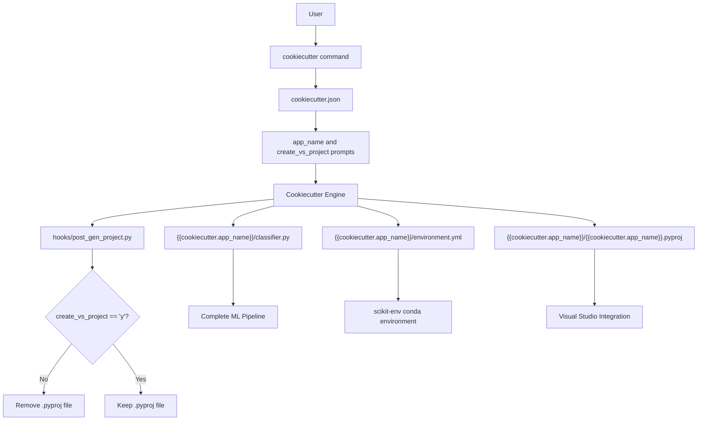
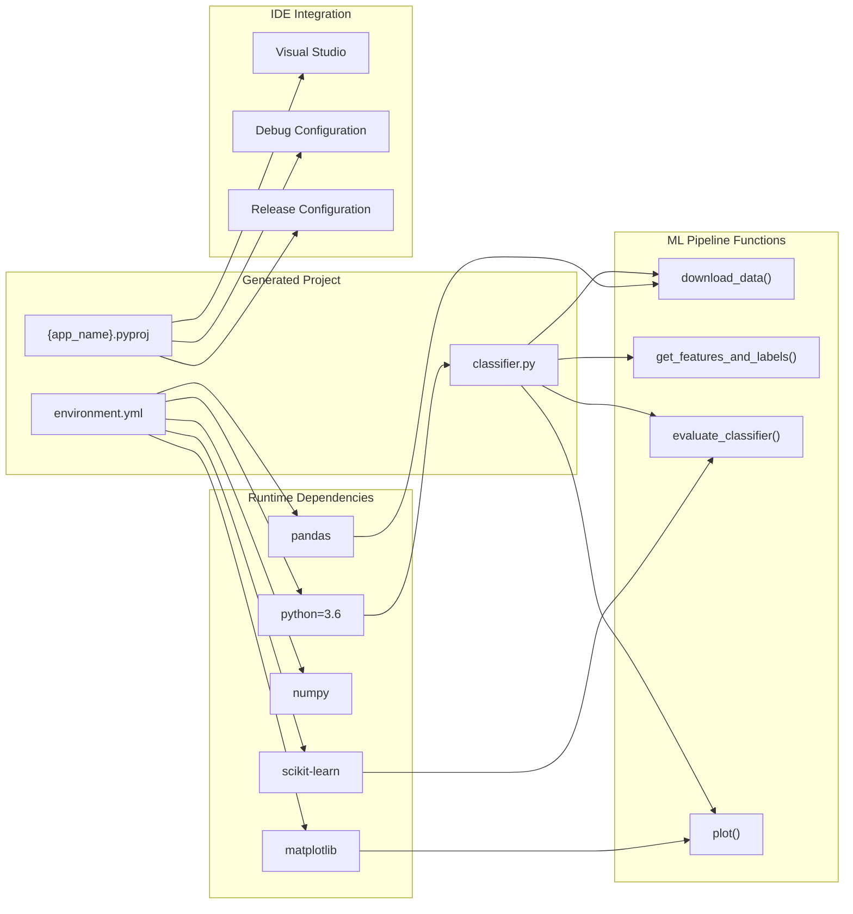
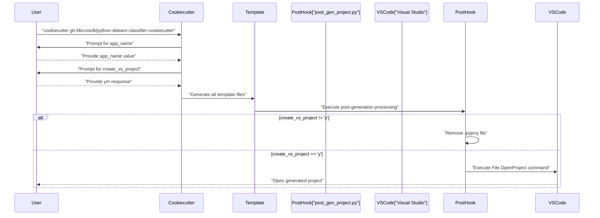

<!-- source: DeepWiki mcp.deepwiki.com · repo microsoft/python-sklearn-classifier-cookiecutter · page 1 Overview · fetched 2026-10-26 -->

# Overview

Relevant source files

The following files were used as context for generating this wiki page:

- [README.md](README.md)
- [cookiecutter.json](cookiecutter.json)

This document provides a comprehensive introduction to the `python-sklearn-classifier-cookiecutter` template, which is a Microsoft-maintained Cookiecutter template for generating complete Python machine learning classification projects. The template creates ready-to-use scikit-learn-based classification pipelines with proper environment configuration, IDE integration, and visualization capabilities.

The scope of this document covers the template's architecture, generated project structure, and core functionality. For detailed implementation of the machine learning pipeline, see [Generated Machine Learning Pipeline](#2). For environment setup and dependency management, see [Development Environment Setup](#3). For template customization options, see [Template Configuration and Customization](#4).

## Template Architecture

The `python-sklearn-classifier-cookiecutter` follows a standard Cookiecutter template structure that transforms user inputs into a complete machine learning project. The template generates three primary components: a complete ML pipeline implementation, a configured development environment, and optional IDE integration.

**Template Generation Flow**

Sources: [cookiecutter.json:1-19](), [README.md:7-21]()

## Generated Project Structure

When executed, the template creates a project with the following core structure and dependencies:

**Core Project Components**

| Component | File Path | Purpose | Importance |
|-----------|-----------|---------|------------|
| ML Pipeline | `classifier.py` | Complete data processing, model training, and evaluation pipeline | Critical |
| Environment | `environment.yml` | Conda environment with Python 3.6 and ML dependencies | High |
| VS Project | `{app_name}.pyproj` | Visual Studio project configuration (optional) | Medium |
| Documentation | `README.md` | Project documentation and usage instructions | Low |

**System Dependencies and Data Flow**

Sources: [cookiecutter.json:2-3](), [README.md:19-20]()

## Key Template Configuration

The template uses a minimal configuration approach with two primary user inputs defined in `cookiecutter.json`. The configuration includes special Visual Studio integration settings that enable seamless IDE workflow.

**Template Variables**

| Variable | Default Value | Purpose | Visual Studio Integration |
|----------|---------------|---------|---------------------------|
| `app_name` | `"classifier"` | Project folder and file naming | Maps to `ProjectName` |
| `create_vs_project` | `"y"` | Controls .pyproj file generation | Maps to `IsNewProject` |

The template includes advanced Visual Studio integration through the `_visual_studio` configuration block, which provides automatic project opening capabilities via the `File.OpenProject` command targeting the generated `.pyproj` file.

**Configuration Processing Workflow**

Sources: [cookiecutter.json:1-19](), [README.md:17-20]()

## Usage Workflow

The template follows a standard Cookiecutter installation and execution pattern, requiring only Python package management knowledge and basic command-line operation. The generated project becomes immediately executable with proper dependency installation.

**Standard Template Usage Steps**

1. **Installation**: Install Cookiecutter via pip or conda
2. **Template Generation**: Execute `cookiecutter gh:Microsoft/python-sklearn-classifier-cookiecutter`
3. **Configuration**: Provide `app_name` and `create_vs_project` responses
4. **Environment Setup**: Execute `conda env create -f environment.yml` in generated project
5. **Activation**: Execute `conda activate scikit-env`
6. **Execution**: Run `python classifier.py` to execute ML pipeline

The template is designed for immediate productivity, generating a complete working machine learning project that requires no additional code modification to demonstrate classification capabilities with multiple algorithms and visualization output.

Sources: [README.md:7-16](), [cookiecutter.json:1-3]()

---

