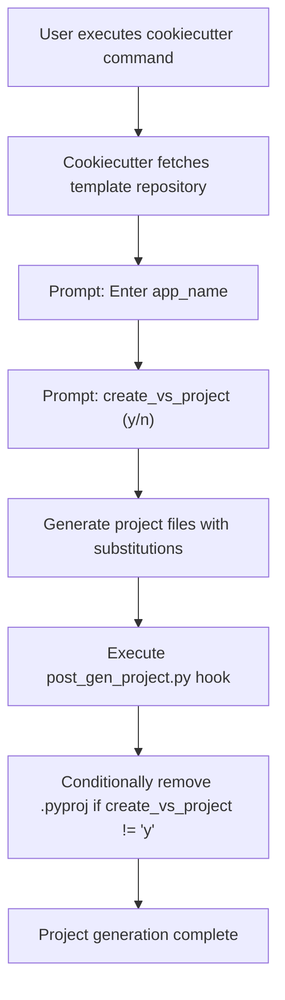
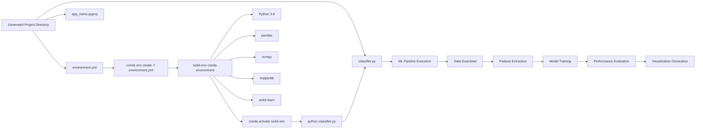

<!-- source: DeepWiki mcp.deepwiki.com · repo microsoft/python-sklearn-classifier-cookiecutter · page 1.1 Quick Start Guide · fetched 2026-10-26 -->

# Quick Start Guide

<details>
<summary>Relevant source files</summary>

The following files were used as context for generating this wiki page:

- [README.md](README.md)
- [{{cookiecutter.app_name}}/environment.yml]({{cookiecutter.app_name}}/environment.yml)

</details>


This document provides step-by-step instructions for using the python-sklearn-classifier-cookiecutter template to generate a new machine learning classification project and getting it running. This covers the complete workflow from template generation through executing the generated classifier pipeline.

For detailed information about the generated machine learning pipeline components, see [Generated Machine Learning Pipeline](#2). For comprehensive environment configuration details, see [Development Environment Setup](#3).

## Prerequisites

Before using this template, you need to install Cookiecutter, which is the template engine that processes this repository.

**Installation Options:**
- Via pip: `pip install cookiecutter`
- Via conda: `conda install cookiecutter`
- Follow the [official Cookiecutter installation guide](http://cookiecutter.readthedocs.io/en/latest/installation.html)

Sources: [README.md:9]()

## Project Generation Process

### Step 1: Execute Template Generation

Run the cookiecutter command to generate a new project from this template:

```bash
cookiecutter gh:Microsoft/python-sklearn-classifier-cookiecutter
```

Alternative syntax using the full GitHub URL:
```bash
cookiecutter https://github.com/Microsoft/python-sklearn-classifier-cookiecutter.git
```

### Step 2: Configure Template Variables

During generation, cookiecutter will prompt you for configuration values:

| Variable | Purpose | Valid Values | Default |
|----------|---------|--------------|---------|
| `app_name` | Name of the folder/project to create | Any valid directory name | None |
| `create_vs_project` | Whether to generate Visual Studio project file | `y` or `n` | None |

The `app_name` becomes the root directory name for your generated project. The `create_vs_project` setting determines whether a `.pyproj` file is included for Visual Studio integration.

Sources: [README.md:17-21]()

### Template Generation Workflow



Sources: [README.md:10-15](), [README.md:17-21]()

## Environment Setup and Activation

### Step 3: Create Conda Environment

Navigate to your generated project directory and create the conda environment using the provided configuration:

```bash
cd your_app_name
conda env create -f environment.yml
```

This creates a conda environment named `scikit-env` with the following dependencies:
- Python 3.6
- pandas (data manipulation)
- numpy (numerical computing)
- matplotlib (plotting)
- scikit-learn (machine learning)

### Step 4: Activate Environment

Activate the newly created environment:

```bash
conda activate scikit-env
```

Sources: [{{cookiecutter.app_name}}/environment.yml:1-8]()

## Running the Generated Project

### Step 5: Execute the Classifier Pipeline

Once the environment is activated, run the main classifier script:

```bash
python classifier.py
```

This executes the complete machine learning pipeline including:
- Data download and preprocessing
- Model training with multiple classifiers
- Performance evaluation and metrics calculation
- Precision-recall curve visualization

### Generated Project Structure and Execution Flow



Sources: [{{cookiecutter.app_name}}/environment.yml:1-8](), [README.md:15]()

## Verification and Next Steps

After successful execution, you should see:
- Console output showing model training progress
- Performance metrics for multiple classifiers (LinearSVC, NuSVC, AdaBoost)
- Generated precision-recall curve plots
- Classification accuracy results

The generated project is now ready for development and customization. You can modify the `classifier.py` file to work with your own datasets, adjust model parameters, or add additional machine learning algorithms.

For detailed information about customizing the machine learning pipeline, see [Generated Machine Learning Pipeline](#2). For Visual Studio integration details, see [Visual Studio Integration](#3.2).

Sources: [README.md:1-35](), [{{cookiecutter.app_name}}/environment.yml:1-8]()

---

