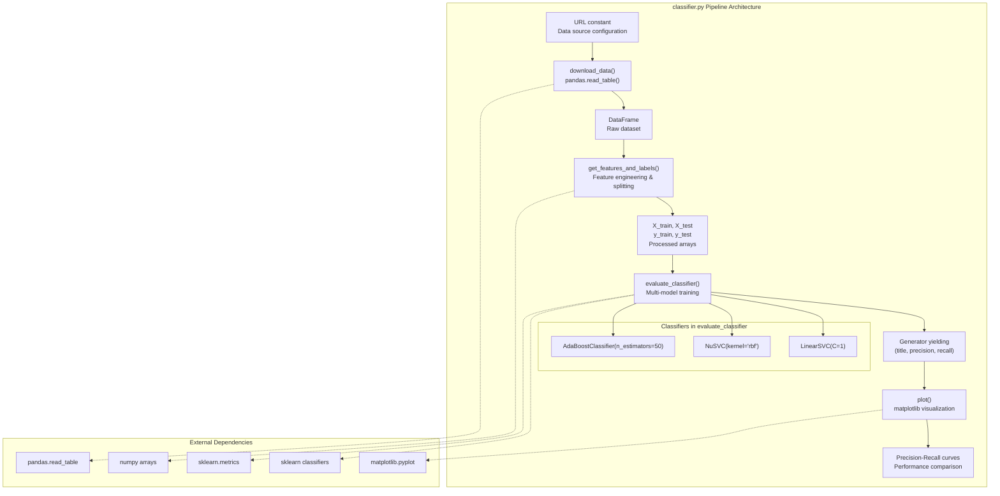
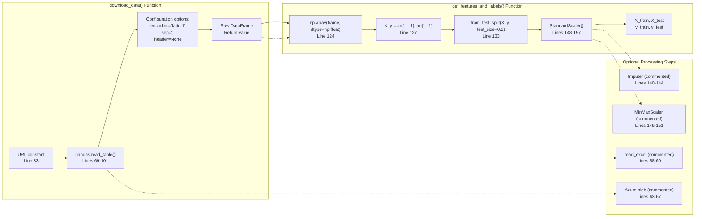
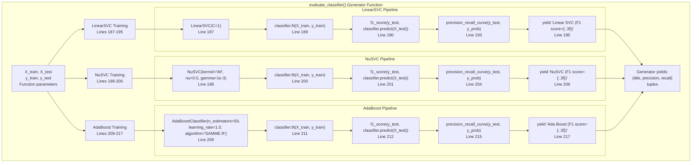
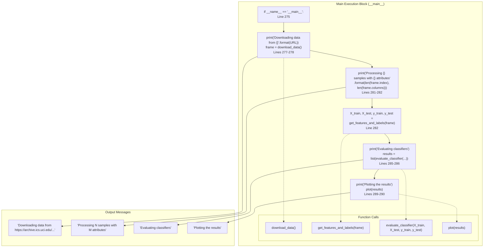

<!-- source: DeepWiki mcp.deepwiki.com · repo microsoft/python-sklearn-classifier-cookiecutter · page 2 Generated Machine Learning Pipeline · fetched 2026-10-26 -->

# Generated Machine Learning Pipeline

Relevant source files

The following files were used as context for generating this wiki page:

- [{{cookiecutter.app_name}}/classifier.py]({{cookiecutter.app_name}}/classifier.py)

## Purpose and Scope

This document provides a comprehensive technical overview of the machine learning pipeline implemented in the generated `classifier.py` file. This pipeline serves as the core executable component of projects created by the cookiecutter template, implementing a complete end-to-end machine learning workflow from data ingestion to result visualization.

The pipeline demonstrates best practices for scikit-learn based classification projects including data preprocessing, model comparison, and performance evaluation. For detailed information about specific pipeline components, see [Data Processing Pipeline](#2.1), [Model Training and Evaluation](#2.2), and [Visualization and Results](#2.3). For environment setup and dependencies, see [Development Environment Setup](#3).

## Pipeline Architecture Overview

The generated machine learning pipeline follows a modular four-stage architecture that can be easily adapted for different classification tasks:

**Sources:** [{{cookiecutter.app_name}}/classifier.py:1-291]()

## Data Processing and Feature Engineering Flow

The pipeline implements a robust data processing workflow with comprehensive preprocessing capabilities:

**Sources:** [{{cookiecutter.app_name}}/classifier.py:52-161]()

## Model Training and Evaluation Architecture

The `evaluate_classifier` function implements a generator-based approach to train and evaluate multiple classifiers with consistent metrics:

**Sources:** [{{cookiecutter.app_name}}/classifier.py:166-218]()

## Configuration and Customization Points

The pipeline provides extensive configuration options through commented code blocks and modular design:

| Configuration Area | Location | Options |
|-------------------|----------|---------|
| **Data Source** | [Line 33]() | `URL` constant for different datasets |
| **File Format** | [Lines 58-67]() | Excel files (`read_excel`), Azure blob storage |
| **Data Processing** | [Lines 72-101]() | Compression, encoding, separators, headers |
| **Feature Scaling** | [Lines 149-151]() | `StandardScaler` vs `MinMaxScaler` |
| **Data Imputation** | [Lines 140-144]() | Missing value handling with `Imputer` |
| **Train/Test Split** | [Line 133]() | `test_size` parameter in `train_test_split` |
| **Classifier Parameters** | [Lines 187-217]() | Hyperparameters for each model |
| **Visualization** | [Lines 37-38, 252-266]() | Interactive display vs image export |

**Sources:** [{{cookiecutter.app_name}}/classifier.py:33-266]()

## Main Execution Flow

The pipeline's main execution block orchestrates the entire workflow with comprehensive logging:

**Sources:** [{{cookiecutter.app_name}}/classifier.py:275-291]()

## Key Implementation Features

### Generator-Based Model Evaluation
The `evaluate_classifier` function uses Python generators to yield results incrementally, allowing for memory-efficient processing of multiple models without storing all results simultaneously in memory [{{cookiecutter.app_name}}/classifier.py:195,206,217]().

### Modular Function Design
Each major pipeline stage is implemented as a separate function with clear input/output contracts:
- `download_data()` returns a pandas DataFrame [{{cookiecutter.app_name}}/classifier.py:52-107]()
- `get_features_and_labels(frame)` returns train/test arrays [{{cookiecutter.app_name}}/classifier.py:113-161]()
- `evaluate_classifier()` yields evaluation tuples [{{cookiecutter.app_name}}/classifier.py:166-217]()
- `plot(results)` handles visualization [{{cookiecutter.app_name}}/classifier.py:222-270]()

### Comprehensive Documentation
The pipeline includes extensive inline documentation with alternative implementation options commented out, making it easy to adapt for different use cases [{{cookiecutter.app_name}}/classifier.py:1-30,58-67,140-151]().

### Standard ML Practices
The implementation follows scikit-learn best practices including proper train/test splitting, feature scaling, and standardized evaluation metrics (F1 score, precision-recall curves) [{{cookiecutter.app_name}}/classifier.py:133,148-157,190-217]().

**Sources:** [{{cookiecutter.app_name}}/classifier.py:1-291]()

---

