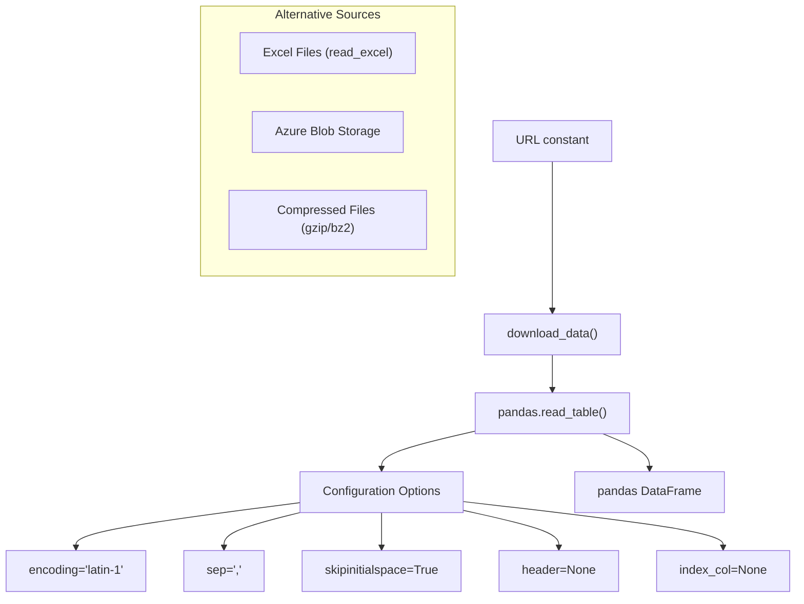
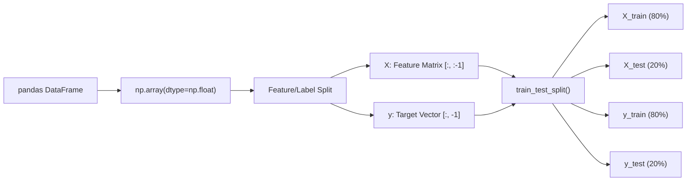
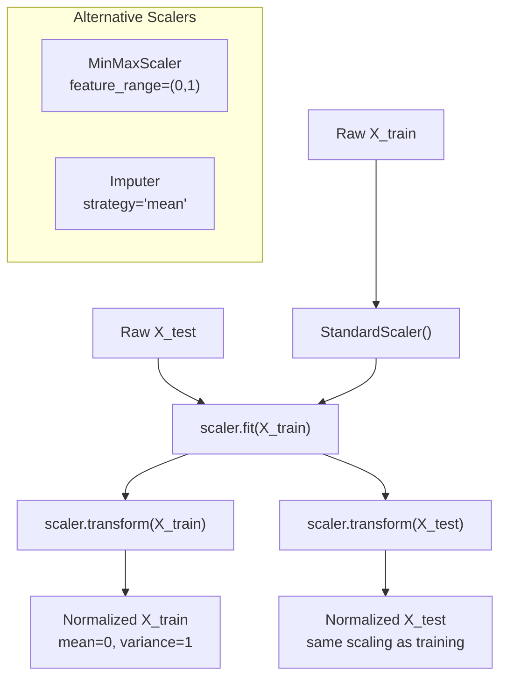
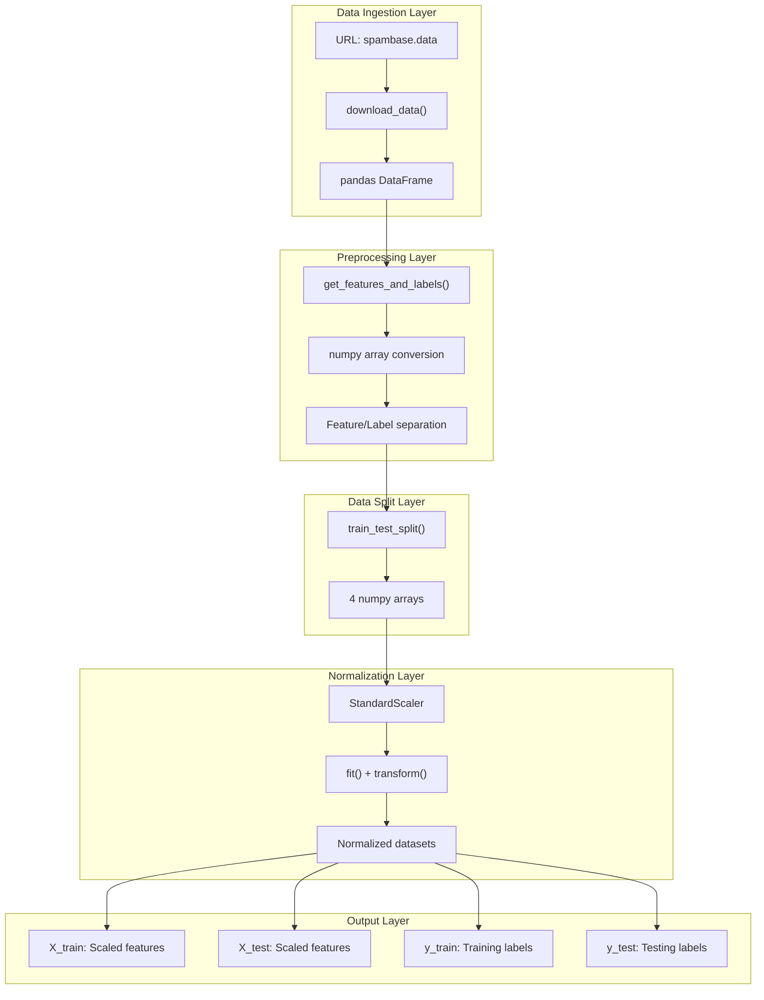

<!-- source: DeepWiki mcp.deepwiki.com · repo microsoft/python-sklearn-classifier-cookiecutter · page 2.1 Data Processing Pipeline · fetched 2026-10-26 -->

# Data Processing Pipeline

Relevant source files

The following files were used as context for generating this wiki page:

- [{{cookiecutter.app_name}}/classifier.py]({{cookiecutter.app_name}}/classifier.py)

## Purpose and Scope

This document explains the data processing pipeline implemented in the generated machine learning project, specifically covering the data ingestion, preprocessing, feature extraction, and preparation stages. The pipeline transforms raw data from external sources into properly formatted training and testing datasets ready for machine learning algorithms.

For information about the machine learning models and evaluation process, see [Model Training and Evaluation](#2.2). For details about result visualization, see [Visualization and Results](#2.3).

## Data Download Pipeline

The data processing pipeline begins with the `download_data()` function, which handles data ingestion from external sources. The function provides a flexible framework for downloading data from various sources including URLs, Excel files, and Azure blob storage.

### Core Download Implementation

The primary data source is configured via the `URL` constant, which points to the UCI Machine Learning Repository's spambase dataset. The `download_data()` function uses pandas `read_table()` with comprehensive configuration options:

**Sources:** [{{cookiecutter.app_name}}/classifier.py:52-107]()

The function includes extensive configuration options for different data formats:
- Character encoding support (`latin-1`, `utf-8`)
- Multiple separator types (comma, tab, space)
- Header and index column handling
- Compression support for gzip and bz2 files

Alternative data sources are supported through commented examples for Excel files using `read_excel()` and Azure blob storage using `BlockBlobService`.

## Feature Extraction and Preprocessing

The `get_features_and_labels()` function transforms the raw DataFrame into properly formatted feature matrices and target vectors suitable for machine learning algorithms.

### Data Type Conversion and Structure

The function performs several critical preprocessing steps:

**Sources:** [{{cookiecutter.app_name}}/classifier.py:113-160]()

The preprocessing pipeline includes:

1. **Data Type Conversion**: Converting DataFrame values to numpy float arrays for numerical processing
2. **Feature-Target Separation**: Using array slicing to separate features (`X`) from labels (`y`)
   - Features: `arr[:, :-1]` (all columns except last)
   - Labels: `arr[:, -1]` (last column only)
3. **Missing Value Handling**: Framework for replacing null values or using scikit-learn's `Imputer`

## Train-Test Data Splitting

The pipeline uses scikit-learn's `train_test_split()` function to create training and testing datasets with an 80-20 split ratio.

### Split Configuration

| Parameter | Value | Purpose |
|-----------|--------|---------|
| `test_size` | 0.2 | Reserve 20% of data for testing |
| Split Method | Random | Ensures unbiased data distribution |
| Output Arrays | 4 | `X_train`, `X_test`, `y_train`, `y_test` |

The function maintains data integrity by ensuring that corresponding feature vectors and labels remain aligned after the split operation.

**Sources:** [{{cookiecutter.app_name}}/classifier.py:131-133]()

## Data Normalization and Scaling

The final preprocessing stage applies feature scaling using scikit-learn's `StandardScaler` to normalize attribute values for optimal machine learning performance.

### Scaling Pipeline

**Sources:** [{{cookiecutter.app_name}}/classifier.py:146-157]()

### Scaling Strategy

The normalization process follows best practices:

1. **Fit on Training Data**: The scaler parameters are computed using only training data to prevent data leakage
2. **Apply to Both Sets**: The same scaling transformation is applied to both training and test datasets
3. **Standardization**: Features are normalized to have mean=0 and variance=1
4. **Alternative Options**: Framework includes `MinMaxScaler` for range-based scaling

## Complete Data Flow Architecture

The entire data processing pipeline follows a linear flow from raw data source to machine learning-ready datasets:

**Sources:** [{{cookiecutter.app_name}}/classifier.py:52-160](), [{{cookiecutter.app_name}}/classifier.py:275-282]()

This architecture ensures that data flows through each processing stage systematically, maintaining data integrity and following machine learning best practices for train-test separation and feature scaling.

---

