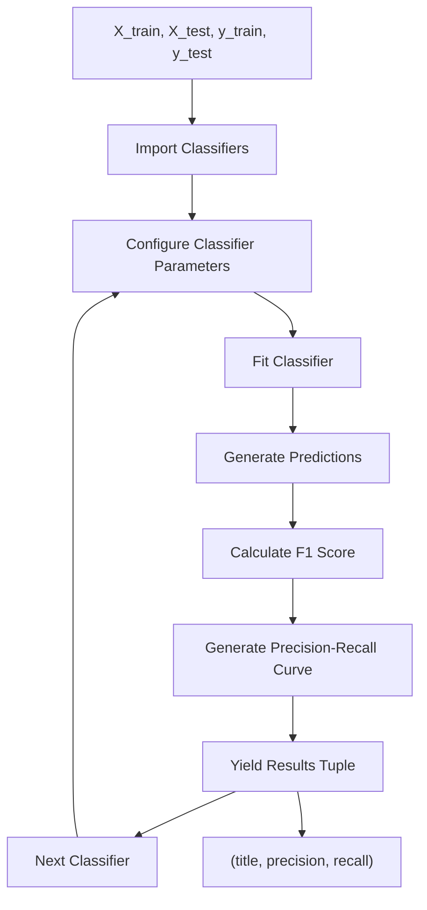
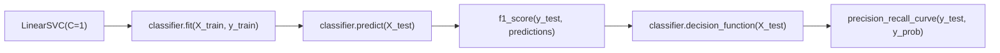
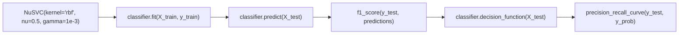
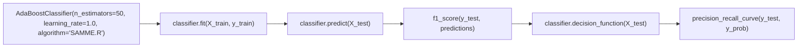
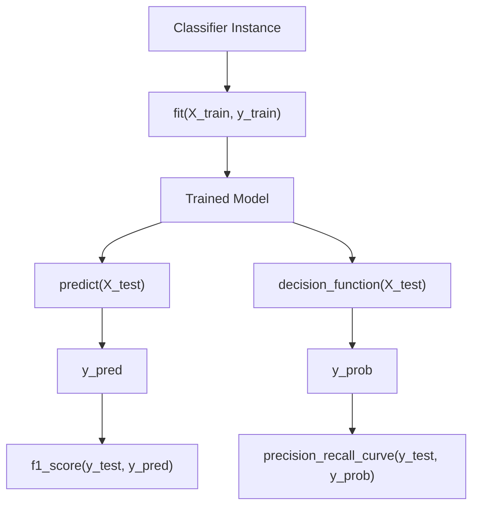
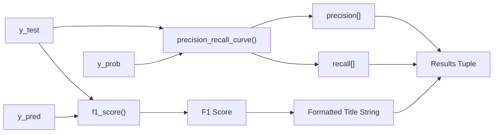
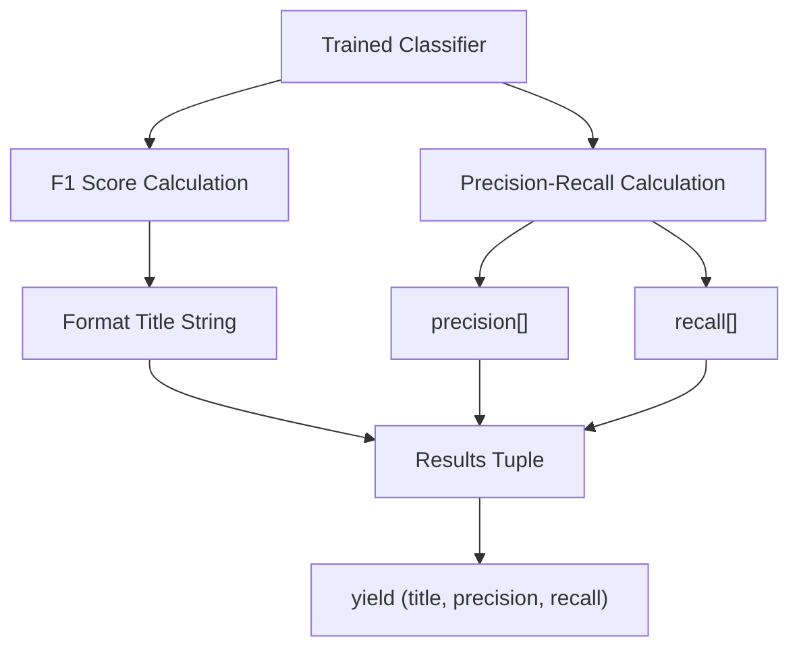

<!-- source: DeepWiki mcp.deepwiki.com · repo microsoft/python-sklearn-classifier-cookiecutter · page 2.2 Model Training and Evaluation · fetched 2026-10-26 -->

# Model Training and Evaluation

<details>
<summary>Relevant source files</summary>

The following files were used as context for generating this wiki page:

- [{{cookiecutter.app_name}}/classifier.py]({{cookiecutter.app_name}}/classifier.py)

</details>


This document covers the machine learning model training and evaluation functionality within the generated classifier pipeline. It focuses specifically on the `evaluate_classifier` function and the three classifiers it implements: LinearSVC, NuSVC, and AdaBoostClassifier. This includes their configuration parameters, training process, and evaluation metrics.

For information about data preprocessing and feature extraction that precedes model training, see [Data Processing Pipeline](#2.1). For details about visualization of the evaluation results, see [Visualization and Results](#2.3).

## Evaluation Process Overview

The model training and evaluation process is centralized in the `evaluate_classifier` function, which implements a standardized workflow for training multiple classifiers and comparing their performance.

**Evaluation Workflow**


Sources: [{{cookiecutter.app_name}}/classifier.py:166-217]()

## Classifier Implementations

The evaluation function tests three distinct machine learning algorithms, each configured with specific parameters optimized for classification tasks.

### LinearSVC Configuration

The Linear Support Vector Classifier is configured as the first classifier in the evaluation pipeline:

| Parameter | Value | Purpose |
|-----------|-------|---------|
| `C` | 1 | Regularization parameter controlling overfitting |
| Algorithm | Linear SVM | Optimized for linearly separable data |

**LinearSVC Training Process**


Sources: [{{cookiecutter.app_name}}/classifier.py:187-195]()

### NuSVC Configuration

The Nu Support Vector Classifier implements a more sophisticated SVM variant with RBF kernel:

| Parameter | Value | Purpose |
|-----------|-------|---------|
| `kernel` | 'rbf' | Radial basis function for non-linear classification |
| `nu` | 0.5 | Controls the number of support vectors |
| `gamma` | 1e-3 | Kernel coefficient for RBF |

**NuSVC Training Process**


Sources: [{{cookiecutter.app_name}}/classifier.py:198-206]()

### AdaBoostClassifier Configuration

The AdaBoost ensemble classifier combines multiple weak learners:

| Parameter | Value | Purpose |
|-----------|-------|---------|
| `n_estimators` | 50 | Number of weak learners in the ensemble |
| `learning_rate` | 1.0 | Shrinks the contribution of each classifier |
| `algorithm` | 'SAMME.R' | Real boosting algorithm variant |

**AdaBoostClassifier Training Process**


Sources: [{{cookiecutter.app_name}}/classifier.py:209-217]()

## Training Process

Each classifier follows an identical training workflow implemented through scikit-learn's standard interface:

1. **Instantiation**: Create classifier with predefined parameters
2. **Training**: Call `fit(X_train, y_train)` to train on training data
3. **Prediction**: Generate predictions using `predict(X_test)`
4. **Decision Function**: Calculate decision scores using `decision_function(X_test)`

**Unified Training Interface**


Sources: [{{cookiecutter.app_name}}/classifier.py:189-190](), [{{cookiecutter.app_name}}/classifier.py:200-201](), [{{cookiecutter.app_name}}/classifier.py:211-212]()

## Evaluation Metrics

The evaluation process generates two primary metrics for each classifier:

### F1 Score Calculation

The F1 score provides a single metric combining precision and recall:

```python
score = f1_score(y_test, classifier.predict(X_test))
```

This score is incorporated into the result title string for display purposes.

### Precision-Recall Curve Generation

Precision-recall curves are generated using the classifier's decision function output:

```python
y_prob = classifier.decision_function(X_test)
precision, recall, _ = precision_recall_curve(y_test, y_prob)
```

**Evaluation Metrics Pipeline**


Sources: [{{cookiecutter.app_name}}/classifier.py:181](), [{{cookiecutter.app_name}}/classifier.py:190-194]()

## Results Structure

The `evaluate_classifier` function yields results as tuples containing three elements:

| Position | Type | Content | Example |
|----------|------|---------|---------|
| 0 | `str` | Formatted title with F1 score | `'Linear SVC (F1 score=0.923)'` |
| 1 | `np.array` | Precision values for P-R curve | `[0.95, 0.92, 0.89, ...]` |
| 2 | `np.array` | Recall values for P-R curve | `[0.87, 0.90, 0.93, ...]` |

**Results Generation Flow**


Sources: [{{cookiecutter.app_name}}/classifier.py:195](), [{{cookiecutter.app_name}}/classifier.py:206](), [{{cookiecutter.app_name}}/classifier.py:217]()

## Generator Function Implementation

The `evaluate_classifier` function is implemented as a generator, yielding results for each classifier sequentially. This design allows for memory-efficient processing and enables the calling code to process results as they become available.

The generator yields three tuples total, one for each classifier, which are collected into a list in the main execution flow at [{{cookiecutter.app_name}}/classifier.py:286]().

Sources: [{{cookiecutter.app_name}}/classifier.py:166-217](), [{{cookiecutter.app_name}}/classifier.py:286]()

---

