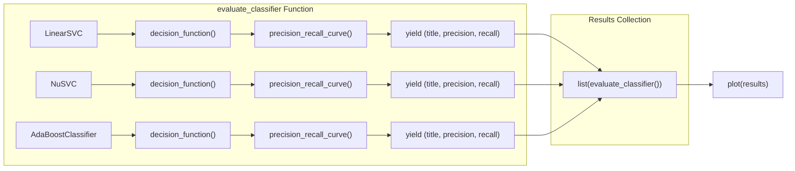
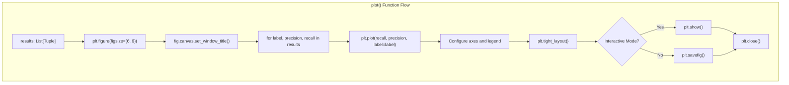
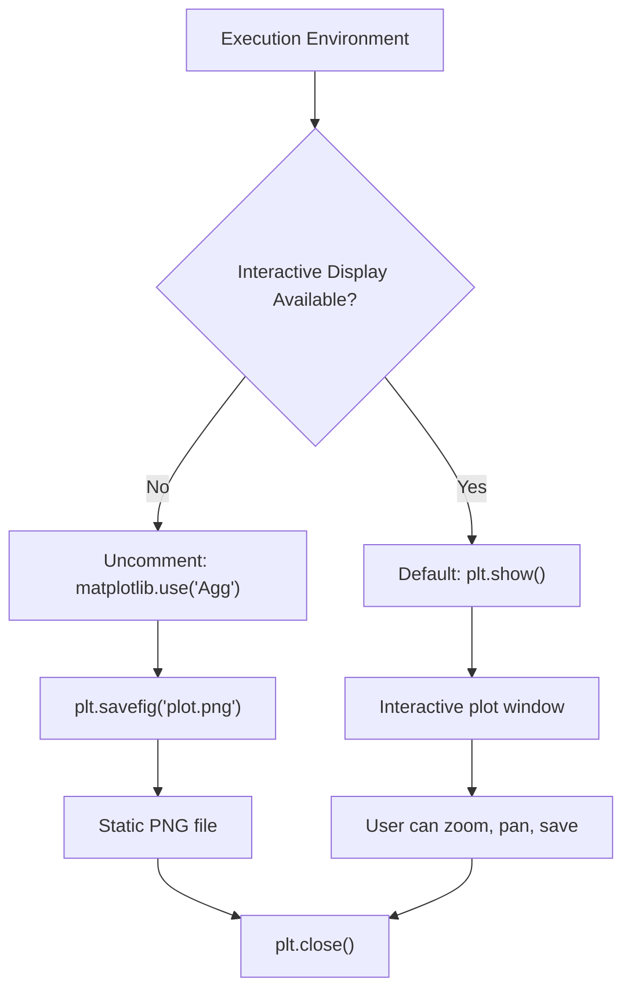

<!-- source: DeepWiki mcp.deepwiki.com · repo microsoft/python-sklearn-classifier-cookiecutter · page 2.3 Visualization and Results · fetched 2026-10-26 -->

# Visualization and Results

<details>
<summary>Relevant source files</summary>

The following files were used as context for generating this wiki page:

- [{{cookiecutter.app_name}}/classifier.py]({{cookiecutter.app_name}}/classifier.py)

</details>


This document covers the visualization and results display functionality of the generated machine learning pipeline. It explains how classification performance metrics are computed, formatted, and displayed as precision-recall curves using matplotlib. For information about the model training and evaluation process that generates these results, see [Model Training and Evaluation](#2.2).

## Purpose and Scope

The visualization system transforms raw classification metrics into interpretable precision-recall curves that allow comparison of multiple classifiers. The system handles both interactive display and static image generation, with configurable output options for different deployment scenarios.

## Results Data Structure

The visualization system operates on a standardized results format generated by the `evaluate_classifier` function. Each classifier produces a tuple containing the display title, precision array, and recall array.

| Component | Type | Description |
|-----------|------|-------------|
| Title | `str` | Classifier name with F1 score (e.g., "Linear SVC (F1 score=0.847)") |
| Precision | `numpy.ndarray` | Precision values for P-R curve |
| Recall | `numpy.ndarray` | Recall values for P-R curve |

The results generator yields tuples in the format `(title, precision, recall)` for each of the three classifiers: LinearSVC, NuSVC, and AdaBoostClassifier. The F1 score is calculated using `f1_score(y_test, classifier.predict(X_test))` and embedded in the title string for display in the plot legend.

**Results Generation Flow**



Sources: [{{cookiecutter.app_name}}/classifier.py:166-217]()

## Precision-Recall Curve Visualization

The `plot` function creates a comparative visualization of classifier performance using matplotlib. The function accepts the results list and generates a single figure with overlaid precision-recall curves for each classifier.

**Plot Generation Pipeline**



Sources: [{{cookiecutter.app_name}}/classifier.py:222-269]()

The plot function configures several matplotlib parameters:

- **Figure size**: 6x6 inches for square aspect ratio
- **Window title**: "Classifying data from [URL]" where URL is the data source
- **Axes labels**: "Precision" (x-axis) and "Recall" (y-axis)
- **Legend position**: Lower left corner
- **Layout**: `tight_layout()` for automatic spacing optimization

## Display and Output Options

The system supports multiple output modes through conditional code blocks that can be uncommented based on deployment requirements.

### Interactive Display Mode

The default configuration uses `plt.show()` for interactive display, suitable for development and exploratory analysis:

```python
plt.show()
```

### Static Image Generation

For automated or headless environments, the system can save plots to files:

```python
# Uncomment for file output
#plt.savefig('plot.png')
```

### Non-Interactive Backend

For server environments without display capabilities, the matplotlib backend can be configured to 'Agg' mode:

```python
# Uncomment for headless operation
#import matplotlib
#matplotlib.use('Agg')
```

**Output Mode Configuration**



Sources: [{{cookiecutter.app_name}}/classifier.py:35-38](), [{{cookiecutter.app_name}}/classifier.py:249-269]()

## Memory Management and Resource Cleanup

The visualization system includes explicit memory management through `plt.close()` to prevent memory leaks in long-running processes. This is particularly important when generating multiple plots or running in batch processing scenarios.

The function also provides commented examples for advanced output scenarios:
- **In-memory image generation**: Using `BytesIO` for web service integration
- **External viewer launching**: Using `subprocess.Popen` for automatic image viewing
- **Stream-like output**: For HTTP responses or file streaming

## Seaborn Integration

The system optionally imports seaborn for enhanced plot aesthetics through a try/except block, providing graceful degradation when seaborn is not available:

```python
try:
    import seaborn
except ImportError:
    pass
```

This approach ensures the visualization functionality remains fully operational regardless of seaborn availability while providing improved visual styling when possible.

Sources: [{{cookiecutter.app_name}}/classifier.py:44-48](), [{{cookiecutter.app_name}}/classifier.py:268-269]()

---

