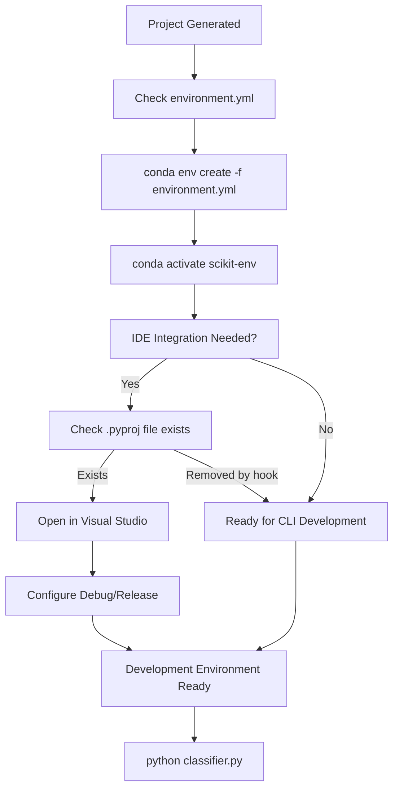
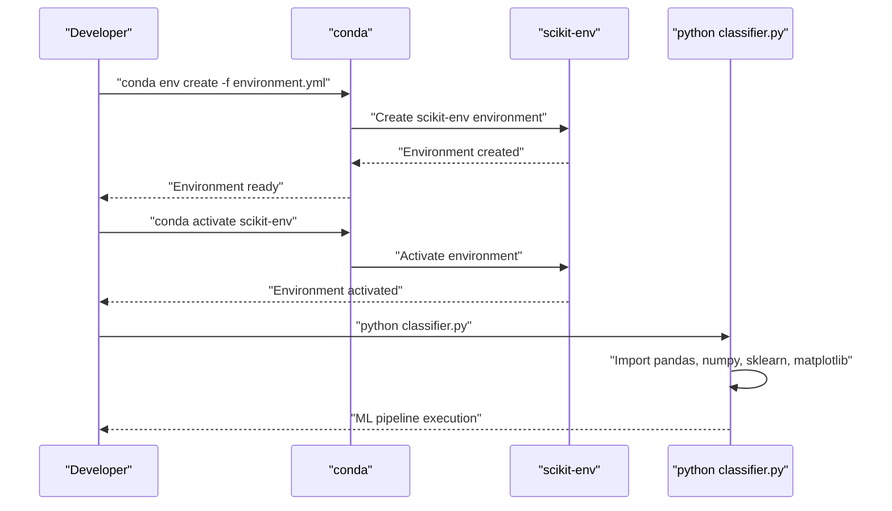
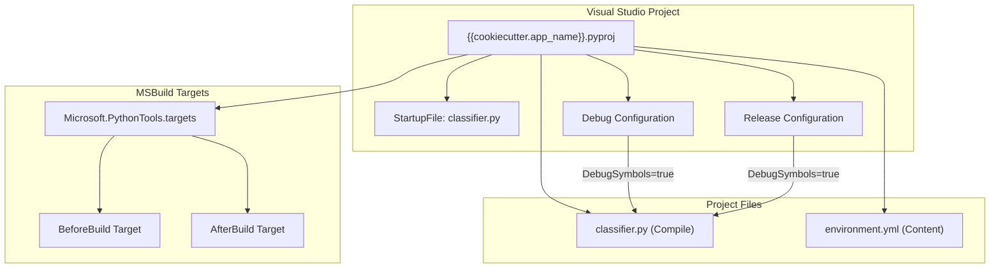

<!-- source: DeepWiki mcp.deepwiki.com · repo microsoft/python-sklearn-classifier-cookiecutter · page 3 Development Environment Setup · fetched 2026-10-26 -->

# Development Environment Setup

<details>
<summary>Relevant source files</summary>

The following files were used as context for generating this wiki page:

- [{{cookiecutter.app_name}}/environment.yml]({{cookiecutter.app_name}}/environment.yml)
- [{{cookiecutter.app_name}}/{{cookiecutter.app_name}}.pyproj]({{cookiecutter.app_name}}/{{cookiecutter.app_name}}.pyproj)

</details>


This document provides guidance for setting up and working with the development environment of projects generated by the python-sklearn-classifier-cookiecutter template. It covers the conda environment configuration, dependency management, and IDE integration options that are automatically configured when you generate a new project.

For initial project generation steps, see [Quick Start Guide](#1.1). For detailed conda environment configuration, see [Python Environment Configuration](#3.1). For Visual Studio-specific setup and features, see [Visual Studio Integration](#3.2).

## Development Environment Overview

The cookiecutter template generates a complete development environment configuration that includes both conda environment management and optional IDE integration. The generated project provides two key configuration files that define the development environment:

| Component | File | Purpose |
|-----------|------|---------|
| Conda Environment | `environment.yml` | Defines Python version and ML dependencies |
| Visual Studio Project | `{{cookiecutter.app_name}}.pyproj` | Provides IDE integration and debugging configuration |

The development environment is designed to be immediately usable after project generation, requiring minimal setup steps to begin machine learning development.

**Environment Setup Workflow**



Sources: `{{cookiecutter.app_name}}/environment.yml`, `{{cookiecutter.app_name}}/{{cookiecutter.app_name}}.pyproj`

## Development Environment Components

The generated development environment consists of several key components that work together to provide a complete machine learning development setup.

**Conda Environment Configuration**

The `environment.yml` file defines a conda environment named `scikit-env` with curated dependencies for machine learning development:

```yaml
name: scikit-env
dependencies:
  - python=3.6
  - pandas
  - numpy  
  - matplotlib
  - scikit-learn
```

This configuration provides:
- **Python 3.6**: Baseline Python version for compatibility
- **Core ML Stack**: pandas, numpy, scikit-learn for data processing and modeling
- **Visualization**: matplotlib for plotting precision-recall curves

**Visual Studio Project Integration**

When Visual Studio integration is enabled during template generation, the `.pyproj` file provides:

| Configuration | Purpose |
|---------------|---------|
| `StartupFile` | Sets `classifier.py` as the default entry point [{{cookiecutter.app_name}}/{{cookiecutter.app_name}}.pyproj:8]() |
| `Debug` Configuration | Enables debugging symbols and unmanaged debugging disabled [{{cookiecutter.app_name}}/{{cookiecutter.app_name}}.pyproj:14-17]() |
| `Release` Configuration | Production build settings with debugging symbols [{{cookiecutter.app_name}}/{{cookiecutter.app_name}}.pyproj:18-21]() |

Sources: `{{cookiecutter.app_name}}/environment.yml:1-8`, `{{cookiecutter.app_name}}/{{cookiecutter.app_name}}.pyproj:8,14-21`

## Environment Activation and Usage

**Standard Conda Workflow**



The conda environment activation process ensures all required dependencies are available in the correct versions for the machine learning pipeline execution.

Sources: `{{cookiecutter.app_name}}/environment.yml:1-8`

## IDE Integration Architecture

**Visual Studio Project Structure**



The Visual Studio project configuration provides:
- **Startup File**: Automatically runs `classifier.py` when debugging [{{cookiecutter.app_name}}/{{cookiecutter.app_name}}.pyproj:8]()
- **Build Configurations**: Both Debug and Release modes with debugging symbols enabled [{{cookiecutter.app_name}}/{{cookiecutter.app_name}}.pyproj:14-21]()
- **File Management**: Includes `classifier.py` as compilable code and `environment.yml` as content [{{cookiecutter.app_name}}/{{cookiecutter.app_name}}.pyproj:22-27]()

Sources: `{{cookiecutter.app_name}}/{{cookiecutter.app_name}}.pyproj:8,14-27`

## Environment Management Best Practices

**Dependency Resolution**

The `environment.yml` file uses conda's dependency resolution to automatically install compatible versions of:
- `pandas` for data manipulation and CSV processing
- `numpy` for numerical computations and array operations  
- `matplotlib` for precision-recall curve visualization
- `scikit-learn` for machine learning models (LinearSVC, NuSVC, AdaBoostClassifier)

**Development Workflow Integration**

The development environment supports both command-line and IDE-based workflows:

| Workflow Type | Entry Point | Configuration |
|---------------|-------------|---------------|
| Command Line | `python classifier.py` | Conda environment activation |
| Visual Studio | F5 Debug | `.pyproj` startup file configuration |
| Visual Studio | Ctrl+F5 Run | Release configuration |

The environment is designed to be consistent across both development approaches, ensuring the same dependency versions and Python environment regardless of how the code is executed.

Sources: `{{cookiecutter.app_name}}/environment.yml:2-7`, `{{cookiecutter.app_name}}/{{cookiecutter.app_name}}.pyproj:8,14-21`

---

