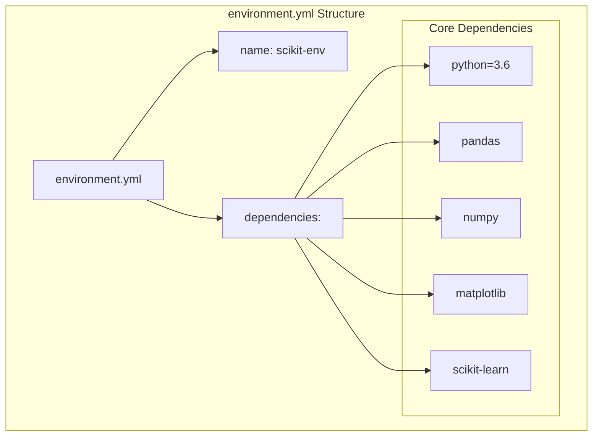
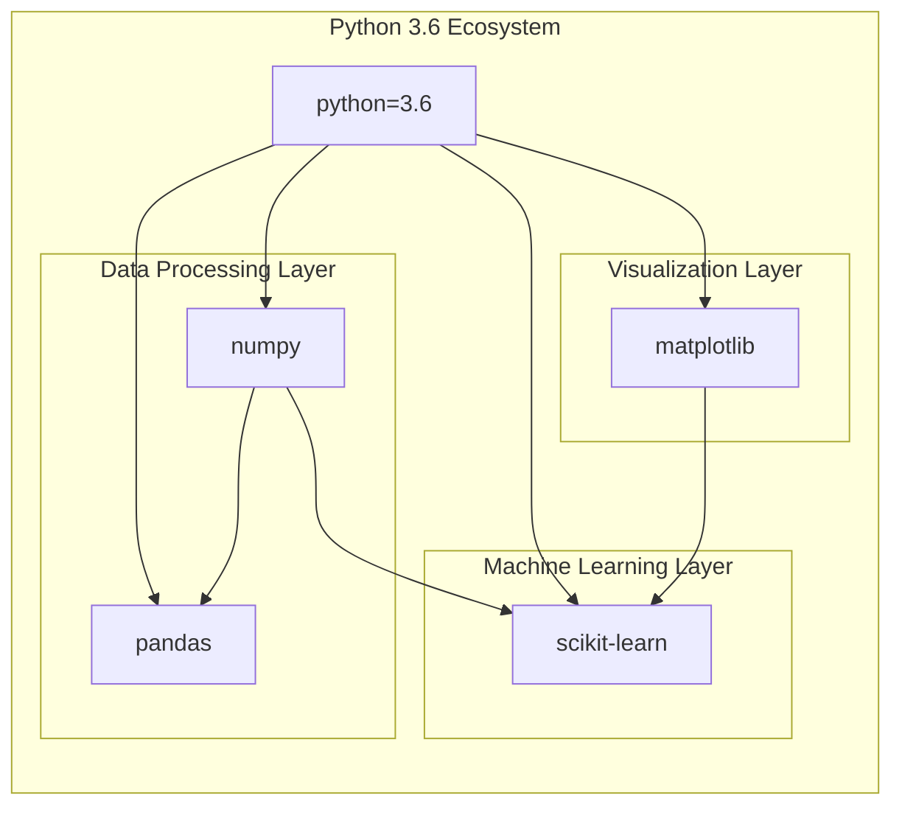
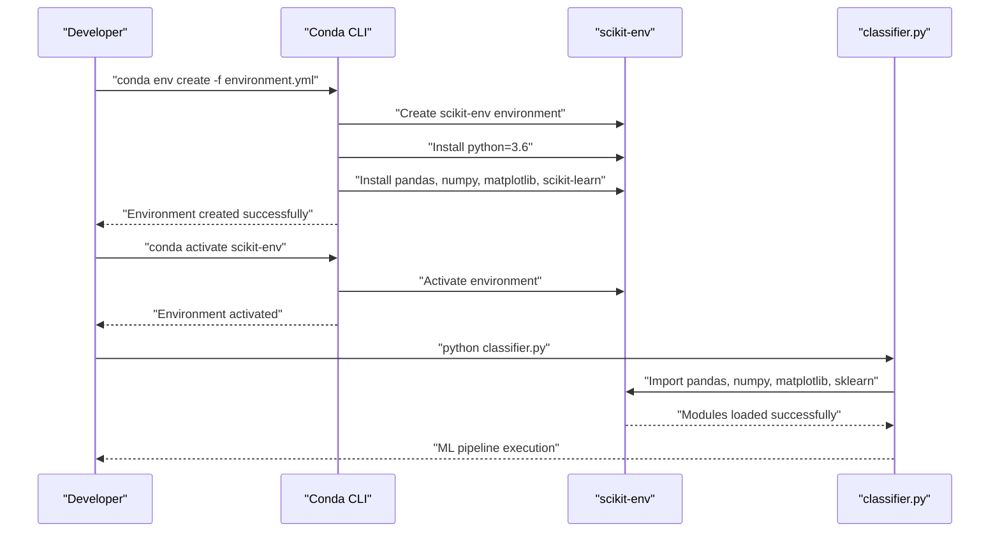
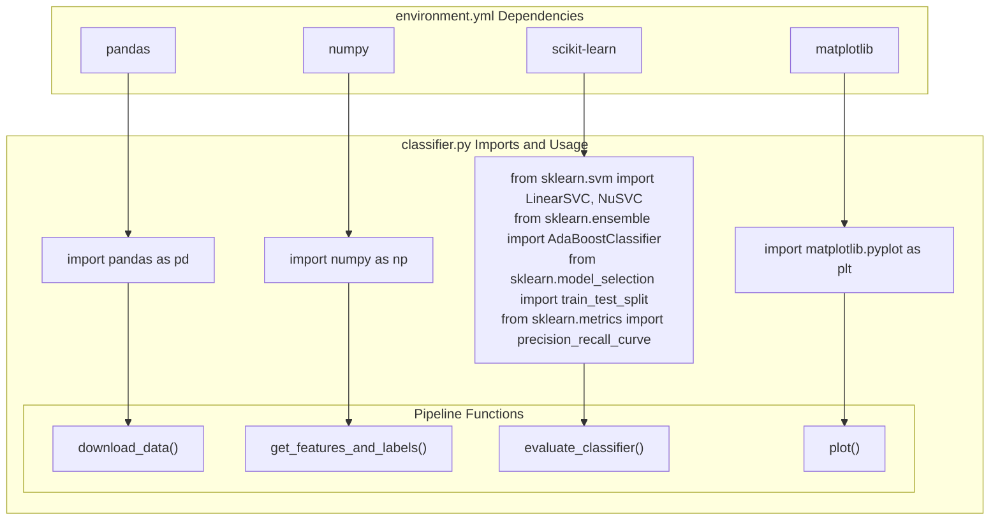

<!-- source: DeepWiki mcp.deepwiki.com · repo microsoft/python-sklearn-classifier-cookiecutter · page 3.1 Python Environment Configuration · fetched 2026-10-26 -->

# Python Environment Configuration

Relevant source files

The following files were used as context for generating this wiki page:

- [{{cookiecutter.app_name}}/environment.yml]({{cookiecutter.app_name}}/environment.yml)

## Purpose and Scope

This document details the conda environment configuration for generated projects, including dependency management, package specifications, and environment lifecycle. The environment configuration enables the machine learning pipeline to execute with all required dependencies properly installed and versioned.

For information about the machine learning pipeline that runs within this environment, see [Generated Machine Learning Pipeline](#2). For Visual Studio IDE integration with this environment, see [Visual Studio Integration](#3.2).

## Environment Configuration Overview

The generated project includes a conda environment specification that creates an isolated Python environment named `scikit-env`. This environment provides all dependencies required for the machine learning classification pipeline.

### Environment Specification Structure

Sources: [{{cookiecutter.app_name}}/environment.yml:1-8]()

The environment specification uses conda's YAML format with a fixed environment name and version-pinned Python interpreter alongside latest-compatible versions of data science packages.

### Dependency Matrix

| Package | Version | Purpose | Required By |
|---------|---------|---------|-------------|
| python | 3.6 | Base interpreter | All components |
| pandas | latest | Data manipulation, CSV processing | `download_data()`, `get_features_and_labels()` |
| numpy | latest | Numerical arrays, mathematical operations | scikit-learn, feature processing |
| matplotlib | latest | Plotting, visualization | `plot()` function |
| scikit-learn | latest | Machine learning algorithms, evaluation | `evaluate_classifier()` |

Sources: [{{cookiecutter.app_name}}/environment.yml:3-7]()

## Dependency Analysis

### Core Runtime Dependencies

#### Python 3.6 Specification
The environment pins Python to version 3.6, ensuring compatibility with the machine learning pipeline codebase. This version provides stable feature sets for the scientific computing stack.

Sources: [{{cookiecutter.app_name}}/environment.yml:3]()

#### Scientific Computing Stack
The environment includes the standard scientific Python stack without version constraints, allowing conda to resolve compatible versions automatically.

**pandas**: Provides DataFrame structures for CSV data loading and manipulation in the `download_data()` pipeline stage.

**numpy**: Supplies numerical array operations and mathematical functions required by scikit-learn algorithms and feature processing.

**matplotlib**: Enables precision-recall curve generation and result visualization through the `plot()` function.

**scikit-learn**: Contains machine learning algorithms (LinearSVC, NuSVC, AdaBoostClassifier) and evaluation metrics used in the classification pipeline.

Sources: [{{cookiecutter.app_name}}/environment.yml:4-7]()

## Environment Lifecycle Management

### Environment Creation and Activation

Sources: [{{cookiecutter.app_name}}/environment.yml:1-8]()

### Environment Commands

| Command | Purpose | Result |
|---------|---------|---------|
| `conda env create -f environment.yml` | Create new environment | Installs all dependencies in isolated environment |
| `conda activate scikit-env` | Activate environment | Makes packages available to Python interpreter |
| `conda deactivate` | Deactivate environment | Returns to base conda environment |
| `conda env remove -n scikit-env` | Remove environment | Deletes environment and all installed packages |

## Integration with Machine Learning Pipeline

### Package Import Dependencies

The environment configuration directly supports the import statements and function calls within the generated machine learning pipeline:

Sources: [{{cookiecutter.app_name}}/environment.yml:4-7]()

### Runtime Environment Validation

The conda environment ensures all required packages are available when the ML pipeline executes, preventing import errors and version conflicts during classification model training and evaluation.

Sources: [{{cookiecutter.app_name}}/environment.yml:1-8]()

---

