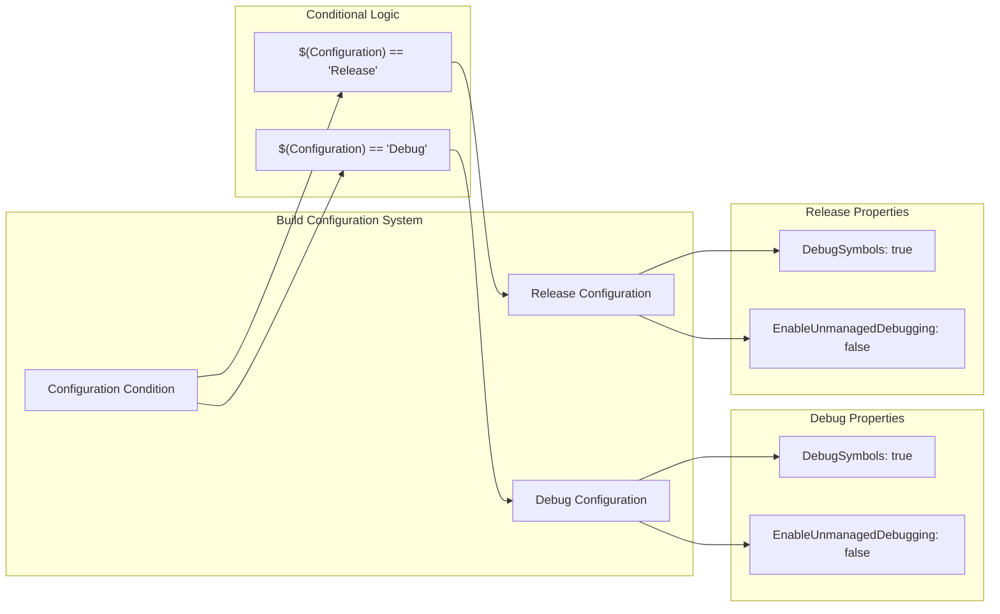
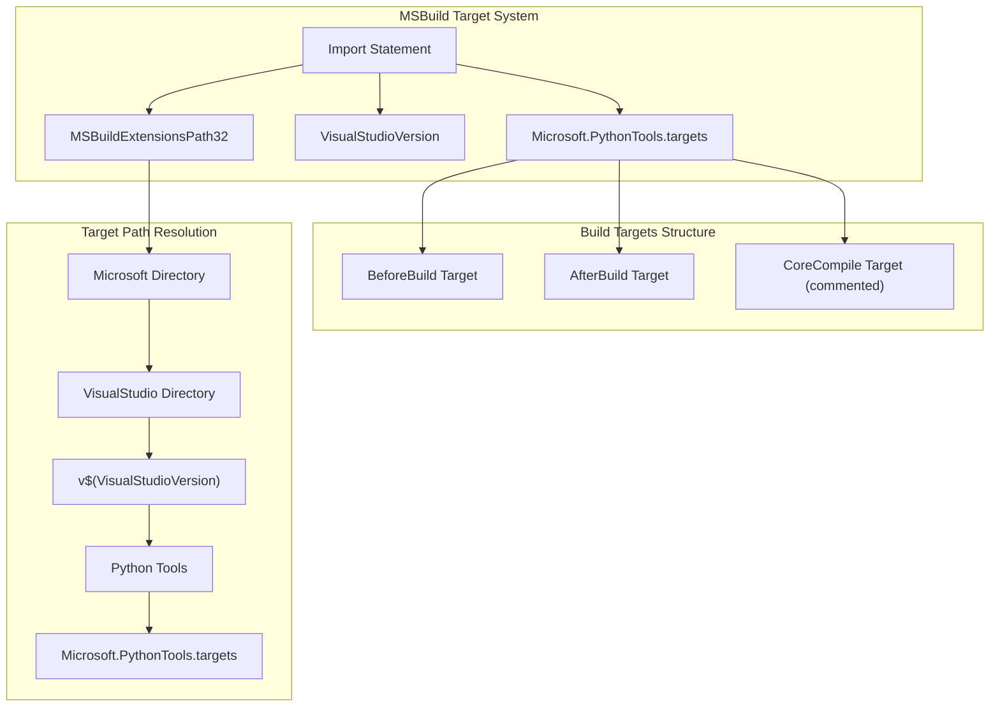

<!-- source: DeepWiki mcp.deepwiki.com · repo microsoft/python-sklearn-classifier-cookiecutter · page 3.2 Visual Studio Integration · fetched 2026-10-26 -->

# Visual Studio Integration

Relevant source files

The following files were used as context for generating this wiki page:

- [{{cookiecutter.app_name}}/{{cookiecutter.app_name}}.pyproj]({{cookiecutter.app_name}}/{{cookiecutter.app_name}}.pyproj)

This document covers the Visual Studio project integration capabilities provided by the cookiecutter template. The integration is implemented through a generated `.pyproj` file that configures Visual Studio to work seamlessly with the machine learning classifier project. For information about the conda environment setup that works alongside Visual Studio, see [3.1](#3.1). For details about the template's conditional file generation logic, see [4.2](#4.2).

## Project File Architecture

The Visual Studio integration centers around the `{{cookiecutter.app_name}}.pyproj` file, which is an MSBuild project that configures Python Tools for Visual Studio (PTVS). This project file establishes the development environment, build configurations, and file organization for the generated classifier project.

### Visual Studio Project Structure

```mermaid
graph TD
    subgraph "MSBuild Project Structure"
        PYPROJ["{{cookiecutter.app_name}}.pyproj"]
        PROPS["PropertyGroup Elements"]
        DEBUG["Debug Configuration"]
        RELEASE["Release Configuration"] 
        ITEMS["ItemGroup Elements"]
        TARGETS["Build Targets"]
    end
    
    subgraph "Project Properties"
        PROPS --> CONFIG["Configuration"]
        PROPS --> SCHEMA["SchemaVersion: 2.0"]
        PROPS --> GUID["ProjectTypeGuids"]
        PROPS --> HOME["ProjectHome: ."]
        PROPS --> STARTUP["StartupFile: classifier.py"]
        PROPS --> WORK["WorkingDirectory: ."]
    end
    
    subgraph "Configuration Settings"
        DEBUG --> DEBUG_SYM["DebugSymbols: true"]
        DEBUG --> DEBUG_UNMAN["EnableUnmanagedDebugging: false"]
        RELEASE --> REL_SYM["DebugSymbols: true"] 
        RELEASE --> REL_UNMAN["EnableUnmanagedDebugging: false"]
    end
    
    subgraph "File Management"
        ITEMS --> COMPILE["Compile Include"]
        ITEMS --> CONTENT["Content Include"]
        COMPILE --> CLASSIFIER_PY["classifier.py"]
        CONTENT --> ENV_YML["environment.yml"]
    end
    
    subgraph "Build Integration"
        TARGETS --> BEFORE["BeforeBuild Target"]
        TARGETS --> AFTER["AfterBuild Target"]
        TARGETS --> CORE["CoreCompile Target (commented)"]
    end
    
    PYPROJ --> PROPS
    PYPROJ --> DEBUG
    PYPROJ --> RELEASE
    PYPROJ --> ITEMS
    PYPROJ --> TARGETS
```

Sources: [{{cookiecutter.app_name}}/{{cookiecutter.app_name}}.pyproj:1-37]()

### Project Type Configuration

The project file uses specific GUIDs to identify it as a Python project compatible with Visual Studio's Python Tools:

| Property | Value | Purpose |
|----------|--------|---------|
| `ProjectTypeGuids` | `{a41c8ea1-112a-4a2d-9f91-29557995525f};{888888a0-9f3d-457c-b088-3a5042f75d52}` | Identifies project as Python Tools for Visual Studio project |
| `SchemaVersion` | `2.0` | MSBuild schema version for compatibility |
| `StartupFile` | `classifier.py` | Primary executable file for F5 debugging |
| `ProjectHome` | `.` | Root directory for project files |
| `WorkingDirectory` | `.` | Execution directory for Python scripts |

Sources: [{{cookiecutter.app_name}}/{{cookiecutter.app_name}}.pyproj:5-12]()

## Build Configurations

The project defines two standard build configurations that control debugging behavior and symbol generation during development and deployment phases.

### Configuration Properties Mapping

Sources: [{{cookiecutter.app_name}}/{{cookiecutter.app_name}}.pyproj:14-21]()

Both configurations maintain identical debugging settings, ensuring consistent development experience across build modes. The `DebugSymbols` property is enabled in both configurations to support debugging and profiling activities. The `EnableUnmanagedDebugging` property is disabled since the project uses pure Python code without C extensions.

## File Integration and Organization

The project file organizes source files into two categories through MSBuild `ItemGroup` elements: compiled Python files and content files that support the development environment.

### File Classification System

| Item Type | Files | Purpose |
|-----------|--------|---------|
| `Compile` | `classifier.py` | Primary Python source code for execution and debugging |
| `Content` | `environment.yml` | Conda environment specification for dependency management |

The `Compile` include for `classifier.py` enables Visual Studio's Python intellisense, syntax highlighting, and debugging capabilities. The `Content` include for `environment.yml` makes the conda environment configuration visible in the Solution Explorer for easy access and modification.

Sources: [{{cookiecutter.app_name}}/{{cookiecutter.app_name}}.pyproj:22-27]()

## Python Tools Integration

The project integrates with Microsoft's Python Tools for Visual Studio through the MSBuild targets import system. This integration provides full IDE support for Python development within the Visual Studio ecosystem.

### Python Tools Target Integration

Sources: [{{cookiecutter.app_name}}/{{cookiecutter.app_name}}.pyproj:28-36]()

The import statement at [{{cookiecutter.app_name}}/{{cookiecutter.app_name}}.pyproj:28]() dynamically resolves the Python Tools targets based on the installed Visual Studio version. The `BeforeBuild` and `AfterBuild` targets are defined but empty, providing extension points for custom build logic. The `CoreCompile` target remains commented out since Python doesn't require compilation, but can be enabled for advanced scenarios requiring custom build steps.

## Conditional Generation and Cleanup

The Visual Studio project file generation is controlled by the cookiecutter template's conditional logic. When users specify `create_vs_project != 'y'` during template instantiation, the post-generation hook removes the `.pyproj` file to maintain a clean project structure for non-Visual Studio workflows.

This conditional approach ensures that developers who prefer alternative IDEs or command-line workflows aren't burdened with unnecessary Visual Studio-specific files, while those using Visual Studio receive a fully configured development environment.

Sources: [{{cookiecutter.app_name}}/{{cookiecutter.app_name}}.pyproj:1-37]()

---

