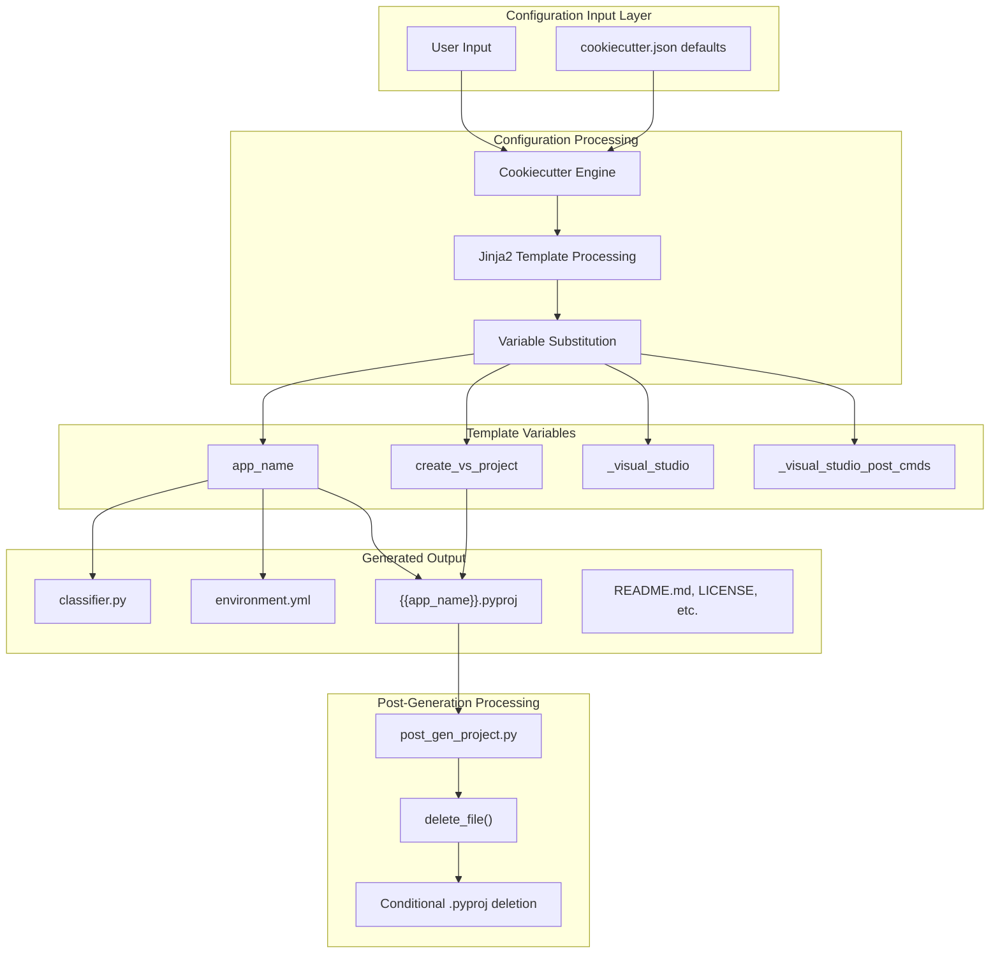
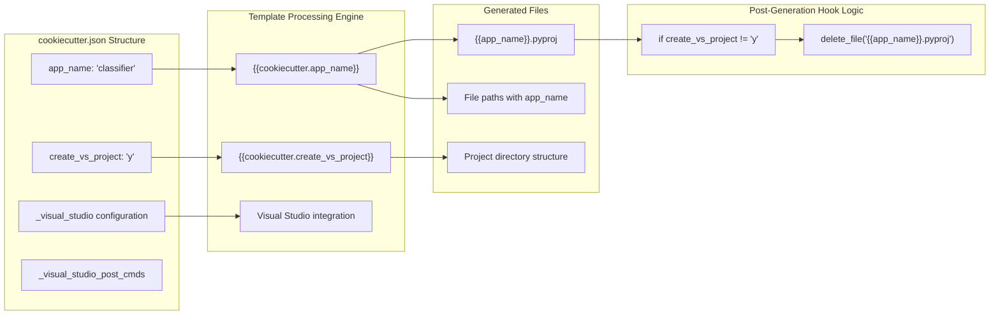
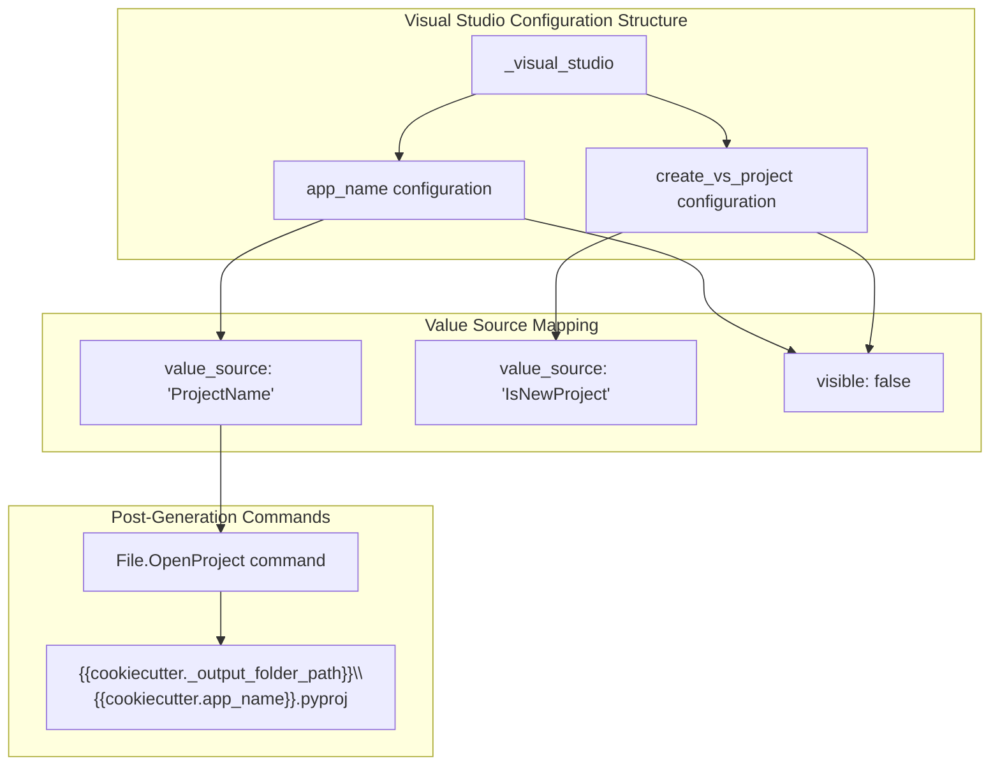
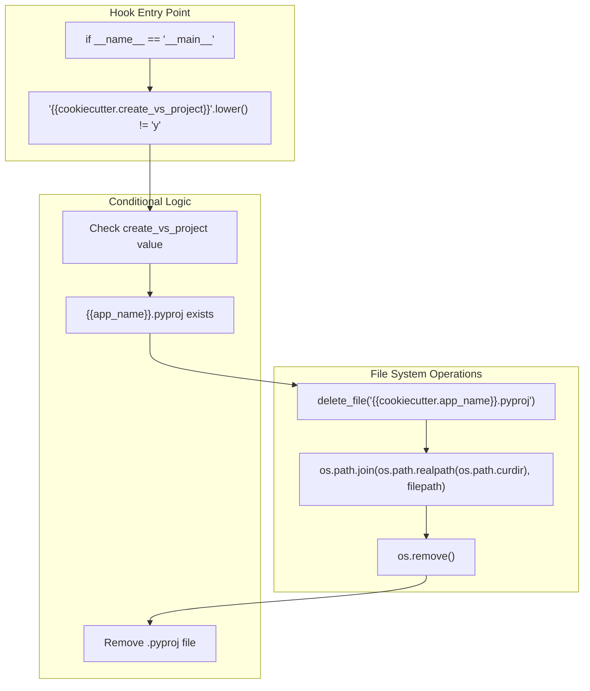

<!-- source: DeepWiki mcp.deepwiki.com · repo microsoft/python-sklearn-classifier-cookiecutter · page 4 Template Configuration and Customization · fetched 2026-10-26 -->

# Template Configuration and Customization

Relevant source files

The following files were used as context for generating this wiki page:

- [cookiecutter.json](cookiecutter.json)
- [hooks/post_gen_project.py](hooks/post_gen_project.py)

This document provides a comprehensive guide to configuring and customizing the cookiecutter template for different use cases. It covers the template's configuration system, available customization options, and how to modify the template behavior through configuration variables and post-generation hooks.

For detailed information about specific template variables, see [Template Variables and Options](#4.1). For information about the post-generation processing system, see [Post-Generation Processing](#4.2). For details about Visual Studio integration features, see [Visual Studio Integration](#3.2).

## Configuration Architecture Overview

The template configuration system operates through a layered architecture that processes user input, applies template variables, and executes conditional post-generation logic.

### Template Configuration Flow

Sources: [cookiecutter.json:1-19](), [hooks/post_gen_project.py:1-10]()

## Core Configuration Components

The template configuration consists of several key components that control project generation behavior:

| Component | Purpose | Configuration Location |
|-----------|---------|----------------------|
| `app_name` | Defines project name and file naming | [cookiecutter.json:2]() |
| `create_vs_project` | Controls Visual Studio project generation | [cookiecutter.json:3]() |
| `_visual_studio` | Visual Studio IDE integration settings | [cookiecutter.json:4-13]() |
| `_visual_studio_post_cmds` | Post-generation IDE commands | [cookiecutter.json:14-19]() |
| Post-generation hooks | Conditional file processing logic | [hooks/post_gen_project.py]() |

### Variable Processing System

Sources: [cookiecutter.json:2-3](), [hooks/post_gen_project.py:8-9]()

## Configuration Variable Types

The template supports several categories of configuration variables:

### User-Facing Variables
- **`app_name`**: Primary project identifier used throughout file naming and content generation
- **`create_vs_project`**: Boolean flag controlling Visual Studio project file generation

### Internal Configuration Variables
- **`_visual_studio`**: Contains metadata for Visual Studio integration including `value_source` mappings and visibility settings
- **`_visual_studio_post_cmds`**: Defines IDE commands executed after project generation

### Visual Studio Integration Configuration

The `_visual_studio` section provides sophisticated IDE integration through value source mapping:

Sources: [cookiecutter.json:4-18]()

## Post-Generation Hook System

The template implements conditional processing through the `post_gen_project.py` hook, which executes after file generation to apply configuration-based modifications:

### Hook Execution Flow

Sources: [hooks/post_gen_project.py:7-9]()

The hook implements a simple but effective pattern for conditional file management based on user configuration choices.

## Customization Patterns

The template configuration supports several customization patterns:

### Project Naming Customization
The `app_name` variable drives consistent naming across all generated files and directories through Jinja2 template substitution.

### IDE Integration Control
The `create_vs_project` variable provides granular control over development environment setup, allowing users to opt out of Visual Studio integration while maintaining the core machine learning pipeline functionality.

### Extension Points
The configuration architecture supports extension through:
- Additional variables in `cookiecutter.json`
- Extended post-generation hook logic in `post_gen_project.py`
- Custom Visual Studio command configurations

Sources: [cookiecutter.json:1-19](), [hooks/post_gen_project.py:1-10]()

---

