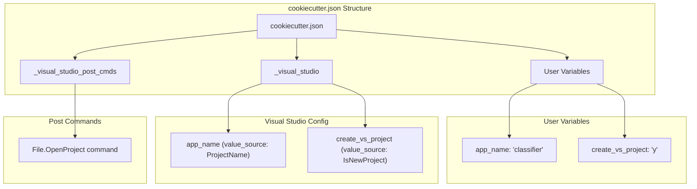
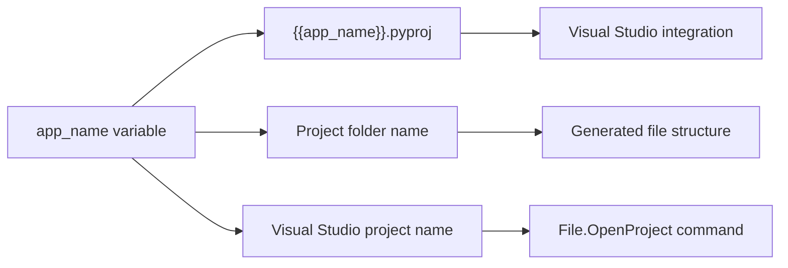
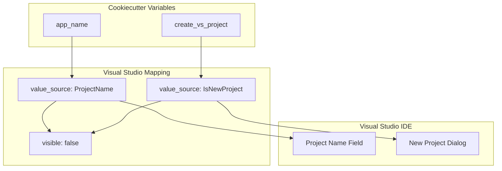
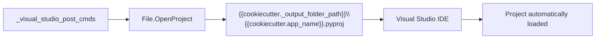
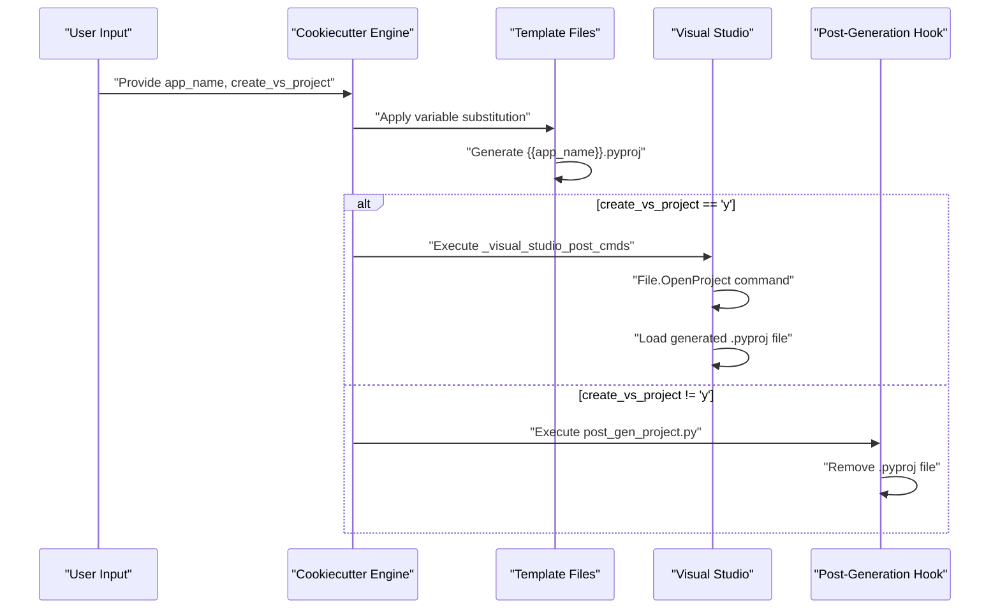

<!-- source: DeepWiki mcp.deepwiki.com · repo microsoft/python-sklearn-classifier-cookiecutter · page 4.1 Template Variables and Options · fetched 2026-10-26 -->

# Template Variables and Options

Relevant source files

The following files were used as context for generating this wiki page:

- [cookiecutter.json](cookiecutter.json)

This document provides a comprehensive explanation of the configuration variables and options available in the cookiecutter template, covering how they control project generation and Visual Studio integration. The template's behavior is primarily controlled through the `cookiecutter.json` configuration file.

For information about post-generation processing that uses these variables, see [Post-Generation Processing](#4.2). For details about the generated development environment, see [Development Environment Setup](#3).

## Configuration File Structure

The template's configuration is defined in `cookiecutter.json`, which contains user-configurable variables, Visual Studio integration settings, and post-generation commands.

### Configuration Architecture

Sources: [cookiecutter.json:1-19]()

## User-Configurable Variables

The template exposes two primary variables that users can customize during project generation.

| Variable | Default Value | Purpose | Impact |
|----------|---------------|---------|--------|
| `app_name` | `"classifier"` | Sets the project name | Controls generated file names and project structure |
| `create_vs_project` | `"y"` | Controls Visual Studio project generation | Determines whether `.pyproj` file is created |

### app_name Variable

The `app_name` variable controls the naming throughout the generated project:

Sources: [cookiecutter.json:2](), [cookiecutter.json:17]()

### create_vs_project Variable

The `create_vs_project` variable is a boolean flag that controls Visual Studio integration:

- `"y"`: Generates Visual Studio project file (`.pyproj`)
- Any other value: Triggers post-generation cleanup to remove Visual Studio files

Sources: [cookiecutter.json:3]()

## Visual Studio Integration Configuration

The `_visual_studio` section provides metadata for Visual Studio template integration, mapping cookiecutter variables to Visual Studio's internal project creation system.

### Visual Studio Variable Mapping

The configuration includes:

- **value_source**: Maps to Visual Studio's internal parameter names
  - `"ProjectName"` for `app_name`
  - `"IsNewProject"` for `create_vs_project`
- **visible**: Set to `false` to hide these variables from Visual Studio's template UI

Sources: [cookiecutter.json:4-13]()

## Post-Generation Commands

The `_visual_studio_post_cmds` section defines actions that Visual Studio should execute after project generation.

### Command Structure

The command configuration:
- **name**: `"File.OpenProject"` - Visual Studio command to open a project file
- **args**: Dynamic path using template variables to locate the generated `.pyproj` file

Sources: [cookiecutter.json:14-19]()

## Variable Usage Flow

The following diagram shows how template variables flow through the generation process:

## Template Variable Reference

| Variable Path | Type | Description | Usage |
|---------------|------|-------------|-------|
| `app_name` | String | Project name identifier | File naming, project structure |
| `create_vs_project` | String | Visual Studio integration flag | Controls `.pyproj` generation |
| `_visual_studio.app_name.value_source` | String | VS parameter mapping | Maps to `ProjectName` |
| `_visual_studio.create_vs_project.value_source` | String | VS parameter mapping | Maps to `IsNewProject` |
| `_visual_studio_post_cmds[0].name` | String | VS command name | `File.OpenProject` |
| `_visual_studio_post_cmds[0].args` | String | Command arguments | Dynamic path to `.pyproj` |

Sources: [cookiecutter.json:1-19]()

---

