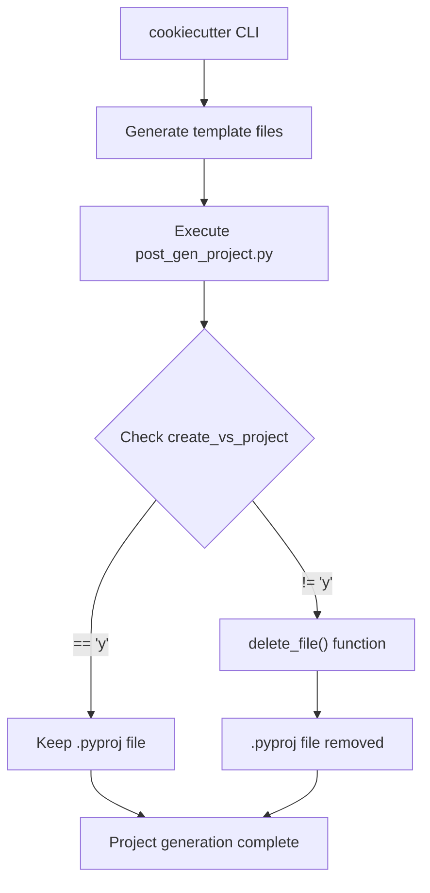
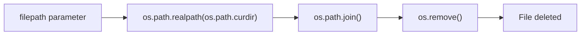
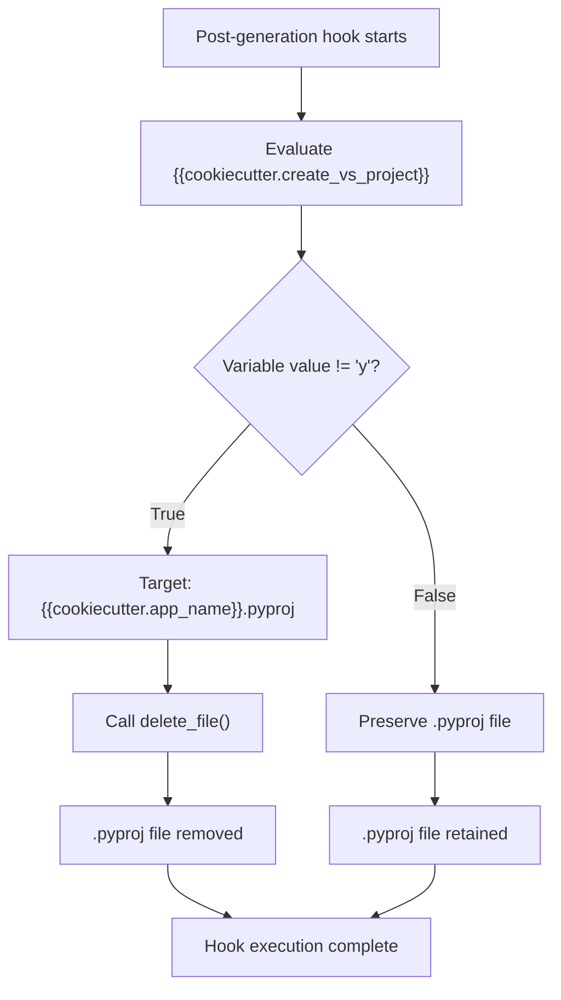
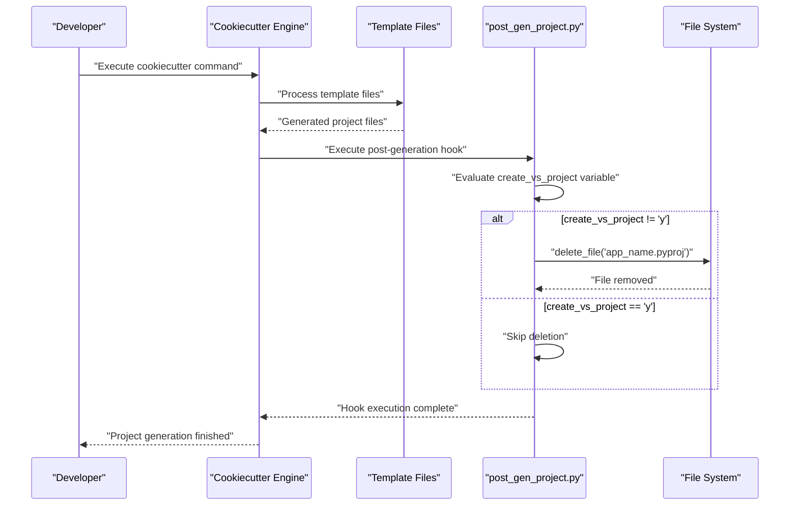

<!-- source: DeepWiki mcp.deepwiki.com · repo microsoft/python-sklearn-classifier-cookiecutter · page 4.2 Post-Generation Processing · fetched 2026-10-26 -->

# Post-Generation Processing

Relevant source files

The following files were used as context for generating this wiki page:

- [hooks/post_gen_project.py](hooks/post_gen_project.py)

This document covers the automated post-generation processing system that executes after cookiecutter generates project files. The system provides conditional file cleanup and project customization based on user configuration choices. For information about the template variables that drive this processing, see [Template Variables and Options](#4.1). For details about the Visual Studio project files that are conditionally processed, see [Visual Studio Integration](#3.2).

## Post-Generation Hook Architecture

The template implements a post-generation hook system through the `post_gen_project.py` script located in the `hooks` directory. This script executes automatically after cookiecutter completes the initial file generation process.

### Hook Execution Flow

Sources: [hooks/post_gen_project.py:1-10]()

### Hook Script Structure

The post-generation hook implements a minimal, focused architecture with two primary components:

| Component | Function | Purpose |
|-----------|----------|---------|
| `delete_file` | File removal utility | Safely removes specified files from the generated project directory |
| Main execution block | Conditional logic | Evaluates user preferences and triggers appropriate cleanup actions |

Sources: [hooks/post_gen_project.py:4-9]()

## File Deletion Logic

### delete_file Function

The `delete_file` function provides a centralized file removal utility that operates within the generated project's root directory:

The function uses `os.path.realpath(os.path.curdir)` to ensure file operations occur within the correct directory context, then combines the provided filepath using `os.path.join()` before executing the removal operation.

Sources: [hooks/post_gen_project.py:4-5]()

## Visual Studio Project Conditional Processing

### Conditional Cleanup Logic

The primary use case for post-generation processing is the conditional removal of Visual Studio project files based on user preferences:

### Template Variable Integration

The hook system integrates with cookiecutter's templating engine through the `{{cookiecutter.create_vs_project}}` variable. The processing logic evaluates this variable using string comparison with case-insensitive matching:

- **Value 'y'**: Visual Studio project file is preserved
- **Any other value**: Visual Studio project file is removed

Sources: [hooks/post_gen_project.py:8-9]()

## Execution Context and Timing

### Hook Execution Sequence

### Working Directory Context

The hook executes within the newly generated project directory, with `os.path.curdir` pointing to the project root. This ensures that file operations target the correct location without requiring explicit path resolution to parent directories.

Sources: [hooks/post_gen_project.py:5]()

## Error Handling and Robustness

The current implementation provides basic file deletion functionality without explicit error handling. The `os.remove()` operation will raise exceptions for common failure scenarios such as:

- File not found (if the target `.pyproj` file wasn't generated)
- Permission errors (if the file system restricts deletion)
- Directory vs file conflicts (if a directory exists with the same name)

The hook system assumes that the targeted files exist and are accessible for deletion operations.

Sources: [hooks/post_gen_project.py:5]()

---

