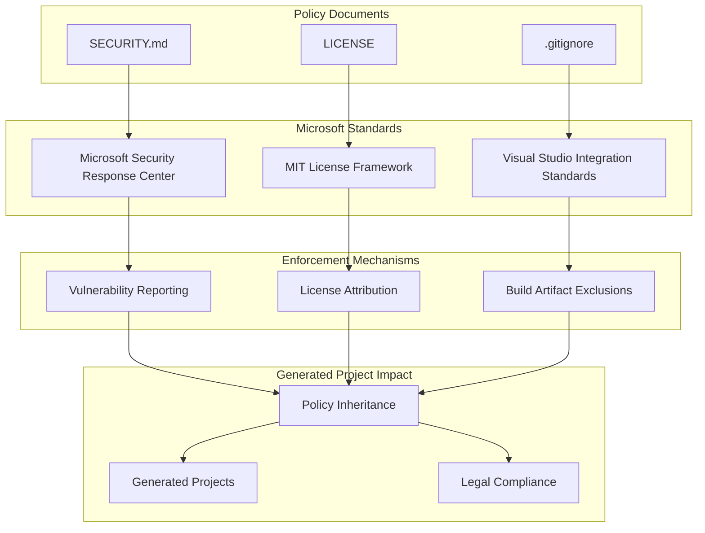
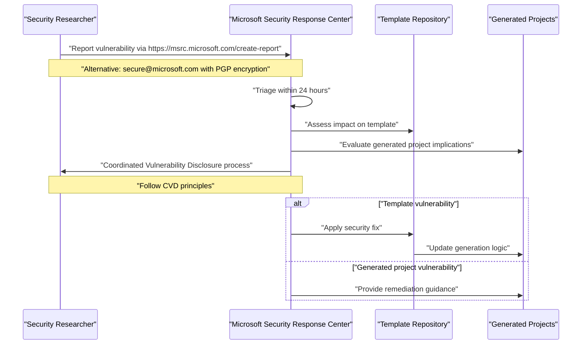
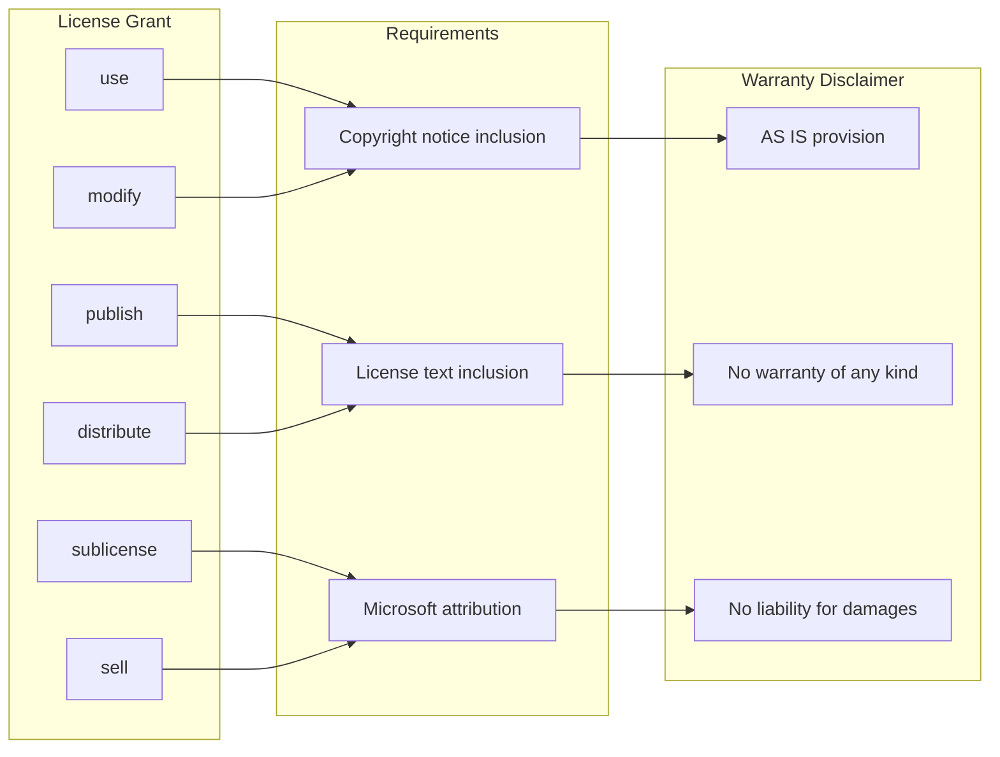
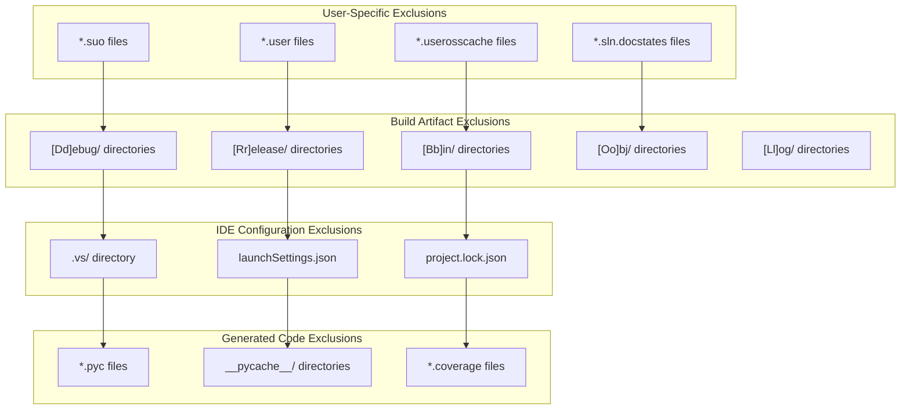

<!-- source: DeepWiki mcp.deepwiki.com · repo microsoft/python-sklearn-classifier-cookiecutter · page 5 Repository Policies and Guidelines · fetched 2026-10-26 -->

# Repository Policies and Guidelines

Relevant source files

The following files were used as context for generating this wiki page:

- [.gitignore](.gitignore)
- [LICENSE](LICENSE)
- [SECURITY.md](SECURITY.md)

This document outlines the governance policies, security procedures, licensing terms, and development workflow guidelines that apply to the python-sklearn-classifier-cookiecutter repository. It covers Microsoft's standardized policies for open source projects, vulnerability reporting procedures, and file management practices that ensure consistent project quality.

For detailed information about the security vulnerability reporting process, see [Security Policy](#5.1). For licensing terms and legal obligations, see [License and Legal Information](#5.2). For development workflow practices and repository maintenance, see [Development Workflow Guidelines](#5.3).

## Repository Governance Framework

The repository follows Microsoft's standardized open source governance model, implementing enterprise-grade policies for security, licensing, and development workflows. This framework ensures consistent quality and legal compliance across all generated projects.

Sources: [SECURITY.md:1-42](), [LICENSE:1-22](), [.gitignore:1-289]()

## Security Vulnerability Management

The repository implements Microsoft's standardized security vulnerability disclosure process through the Microsoft Security Response Center (MSRC). This process applies to both the template repository and all generated projects.

### Vulnerability Reporting Workflow

### Security Reporting Requirements

The security policy mandates specific information for effective vulnerability reports:

| Information Category | Required Details | Purpose |
|---------------------|------------------|---------|
| Issue Classification | `Type of issue (e.g. buffer overflow, SQL injection, cross-site scripting, etc.)` | Threat categorization |
| Source Location | `Full paths of source file(s) related to the manifestation of the issue` | Impact assessment |
| Code Reference | `The location of the affected source code (tag/branch/commit or direct URL)` | Reproducibility |
| Configuration | `Any special configuration required to reproduce the issue` | Environment setup |
| Reproduction | `Step-by-step instructions to reproduce the issue` | Validation |
| Proof of Concept | `Proof-of-concept or exploit code (if possible)` | Severity assessment |
| Impact Analysis | `Impact of the issue, including how an attacker might exploit the issue` | Risk evaluation |

Sources: [SECURITY.md:21-27]()

## Licensing and Legal Framework

The repository operates under the MIT License, providing broad permissions for use, modification, and distribution while maintaining Microsoft's copyright attribution requirements.

### MIT License Terms

The license grants the following permissions without restriction:
- Use of the software for any purpose
- Modification of source code
- Publication and distribution
- Sublicensing to third parties
- Commercial sale

### Legal Obligations

Users must include the complete license text and copyright notice in all copies or substantial portions of the software. The copyright holder is identified as "Microsoft Corporation" with all rights reserved.

Sources: [LICENSE:3](), [LICENSE:12-13](), [LICENSE:15-21]()

## Development Workflow and File Management

The repository implements comprehensive file exclusion policies through `.gitignore` to maintain clean version control and prevent sensitive information exposure.

### Visual Studio Integration Policies

The `.gitignore` configuration specifically targets Visual Studio development environments, excluding build artifacts, temporary files, and user-specific configurations:

### File Exclusion Categories

The `.gitignore` configuration implements systematic exclusions across multiple categories:

| Category | File Patterns | Purpose |
|----------|---------------|---------|
| User-Specific | `*.suo`, `*.user`, `*.userosscache` | Prevent personal IDE settings from being committed |
| Build Results | `[Dd]ebug/`, `[Rr]elease/`, `[Bb]in/`, `[Oo]bj/` | Exclude compiled outputs and build artifacts |
| IDE Cache | `.vs/`, `*.cache`, `*.opendb` | Prevent IDE temporary files from cluttering repository |
| Python Runtime | `__pycache__/`, `*.pyc` | Exclude Python bytecode and cache directories |
| Package Management | `*.nupkg`, `packages/`, `node_modules/` | Prevent package artifacts from being versioned |

Sources: [.gitignore:6-10](), [.gitignore:16-25](), [.gitignore:27-28](), [.gitignore:274-275](), [.gitignore:162-171]()

### Repository Maintenance Standards

The file exclusion policies ensure that generated projects maintain clean version control practices:

1. **Build Artifact Management**: All compilation outputs are automatically excluded to prevent repository bloat
2. **IDE Configuration Isolation**: User-specific IDE settings remain local to prevent configuration conflicts
3. **Package Management**: External dependencies are excluded, relying on package managers for dependency resolution
4. **Cross-Platform Compatibility**: Exclusions account for both Windows and cross-platform development scenarios

Sources: [.gitignore:1-5](), [.gitignore:236-249](), [.gitignore:266-275]()

---

