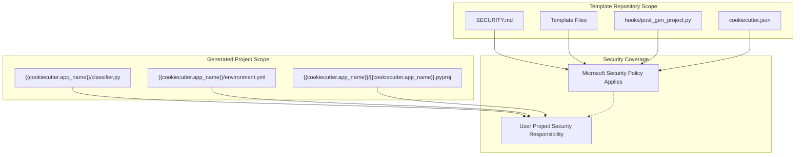
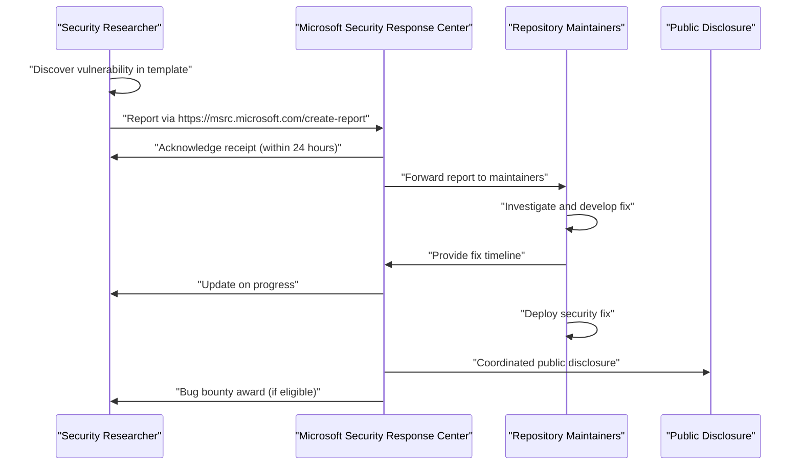
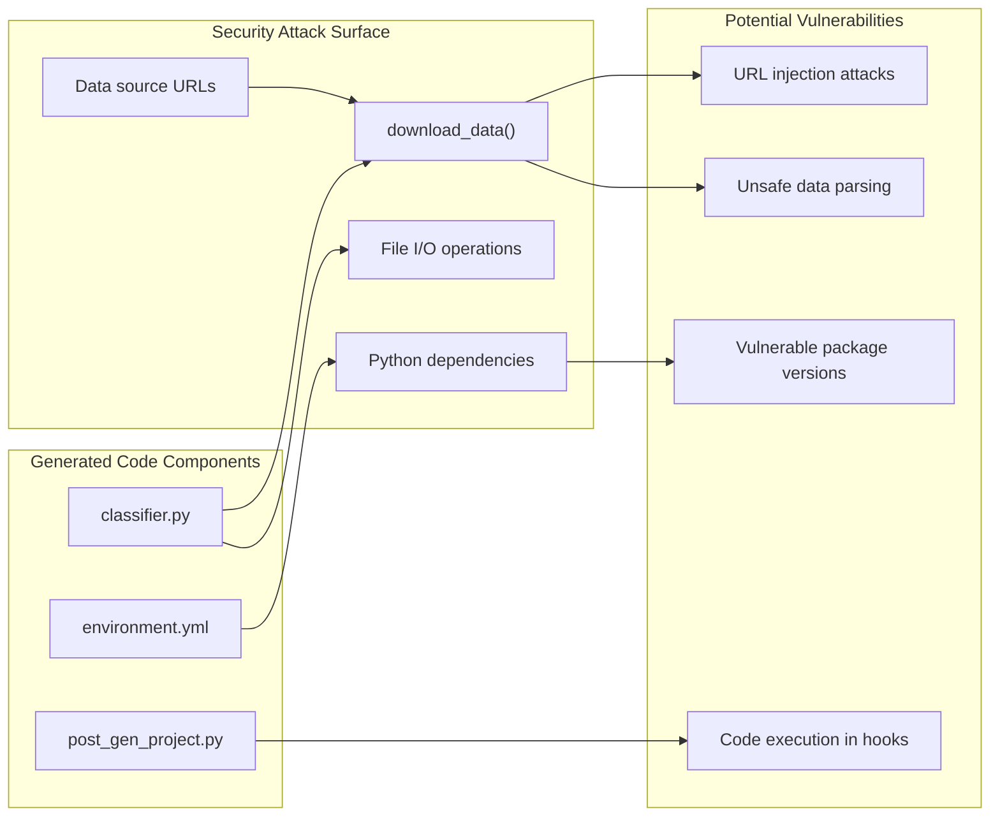

<!-- source: DeepWiki mcp.deepwiki.com · repo microsoft/python-sklearn-classifier-cookiecutter · page 5.1 Security Policy · fetched 2026-10-26 -->

# Security Policy

Relevant source files

The following files were used as context for generating this wiki page:

- [SECURITY.md](SECURITY.md)

This document outlines the security vulnerability reporting process and responsible disclosure guidelines for the Microsoft Python scikit-learn classifier cookiecutter template repository. This policy covers security issues found in the template code, configuration files, and generation logic itself.

For information about licensing and legal aspects of using this template, see [License and Legal Information](#5.2). For development workflow and contribution guidelines, see [Development Workflow Guidelines](#5.3).

## Policy Scope and Application

The security policy applies to vulnerabilities discovered in the cookiecutter template infrastructure and the code generation process. This includes the template files, post-generation hooks, and configuration logic that creates new machine learning projects.

**Security Policy Coverage**

| Component Type | Coverage | Responsibility |
|----------------|----------|----------------|
| Template repository files | Full Microsoft security policy | Microsoft MSRC |
| Generation logic and hooks | Full Microsoft security policy | Microsoft MSRC |
| Generated project code | Initial template security baseline | Project maintainer |
| User modifications | Not covered | Project maintainer |

The security policy covers the template repository but not the individual projects generated from it. Once a project is generated, security responsibility transfers to the project maintainer.

Sources: [SECURITY.md:1-42]()

## Vulnerability Reporting Process

Microsoft follows a coordinated vulnerability disclosure process for all repositories under Microsoft GitHub organizations. Security vulnerabilities must be reported through official channels, not through public GitHub issues.

### Primary Reporting Channels

**Web Portal**: Submit reports through the Microsoft Security Response Center at `https://msrc.microsoft.com/create-report`

**Email**: Send reports to `secure@microsoft.com` for submissions without web portal login

**PGP Encryption**: Encrypt sensitive reports using Microsoft's PGP key available at `https://aka.ms/opensource/security/pgpkey`

Sources: [SECURITY.md:11-17]()

## Required Vulnerability Information

When reporting security issues, include comprehensive technical details to help Microsoft's security team understand and reproduce the vulnerability.

### Essential Technical Details

| Information Category | Required Details | Examples |
|---------------------|------------------|----------|
| **Vulnerability Type** | Classification of security issue | Buffer overflow, code injection, path traversal |
| **Affected Files** | Full paths to vulnerable template files | `{{cookiecutter.app_name}}/classifier.py`, `hooks/post_gen_project.py` |
| **Source Location** | Specific code location references | Git commit hash, branch name, line numbers |
| **Configuration** | Special setup needed for reproduction | Specific `cookiecutter.json` values, OS requirements |
| **Reproduction Steps** | Detailed step-by-step instructions | Cookiecutter command, input values, execution sequence |
| **Proof of Concept** | Exploit code or demonstration | Working exploit, vulnerable input examples |
| **Impact Assessment** | Potential damage and attack scenarios | Data exposure, code execution, privilege escalation |

### Template-Specific Reporting Considerations

When reporting vulnerabilities in this cookiecutter template, consider these specific aspects:

- **Template Variable Injection**: Issues with unsanitized `cookiecutter.json` variable substitution
- **Post-Generation Hook Security**: Vulnerabilities in `hooks/post_gen_project.py` execution
- **Generated Code Security**: Security flaws introduced into generated `classifier.py` or other files
- **Dependency Vulnerabilities**: Issues with packages specified in `environment.yml`

Sources: [SECURITY.md:19-29]()

## Response Timeline and Bug Bounty

Microsoft provides structured response timelines and potential compensation for qualifying security reports.

### Response Expectations

**Initial Response**: Microsoft Security Response Center acknowledges reports within 24 hours of submission

**Follow-up Process**: If no response received within 24 hours, follow up via email to ensure receipt

**Additional Information**: Visit `microsoft.com/msrc` for comprehensive security response information

### Bug Bounty Eligibility

Valid security vulnerabilities in Microsoft-owned repositories may qualify for bug bounty awards. Complete, detailed reports with proof-of-concept code contribute to higher award amounts.

**Bug Bounty Program**: Visit `https://aka.ms/opensource/security/bounty` for current program details and scope

Sources: [SECURITY.md:17-18](), [SECURITY.md:31-32]()

## Communication Guidelines

All security-related communications should follow Microsoft's established protocols for responsible disclosure.

### Language Requirements

**Preferred Language**: English for all security communications to ensure clear understanding and rapid response

### Disclosure Policy

**Coordinated Vulnerability Disclosure**: Microsoft follows industry-standard coordinated disclosure practices, allowing time for fixes before public announcement

**Public Issue Restrictions**: Security vulnerabilities must not be reported through public GitHub issues, pull requests, or discussion forums

Sources: [SECURITY.md:11](), [SECURITY.md:35](), [SECURITY.md:39]()

## Template Security Considerations

Understanding the security implications of the generated machine learning pipeline helps users assess potential vulnerabilities in their projects.

### Template-Generated Security Baseline

The template generates code with these security characteristics:

- **Data Download Security**: The `download_data()` function in generated `classifier.py` performs HTTP requests to user-specified URLs
- **Dependency Management**: The `environment.yml` specifies Python package versions that should be regularly updated for security patches  
- **File System Access**: Generated code performs file I/O operations for data caching and model artifacts
- **Post-Generation Execution**: The `hooks/post_gen_project.py` script executes during project creation with file system access

Users should review generated code for security implications and maintain current dependency versions in their projects.

Sources: [SECURITY.md:1-42]()

---

