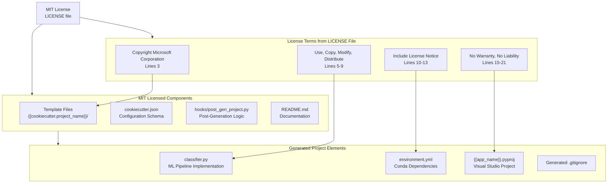
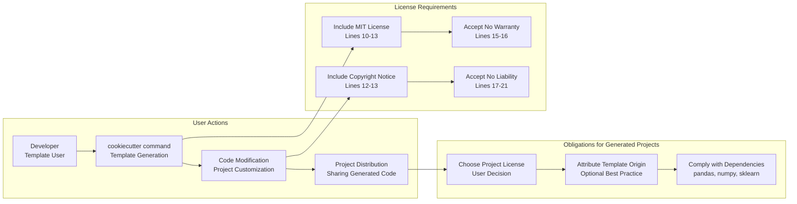
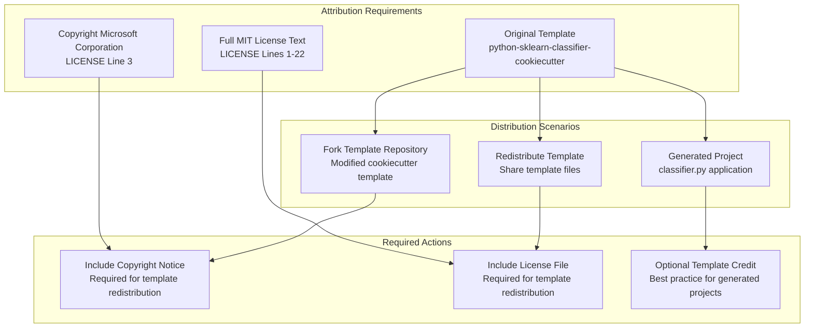

<!-- source: DeepWiki mcp.deepwiki.com · repo microsoft/python-sklearn-classifier-cookiecutter · page 5.2 License and Legal Information · fetched 2026-10-26 -->

# License and Legal Information

Relevant source files

The following files were used as context for generating this wiki page:

- [LICENSE](LICENSE)

This document explains the licensing terms and legal framework governing the python-sklearn-classifier-cookiecutter template repository. It covers the MIT License terms, user rights and obligations, and how licensing applies to both the template code and generated projects.

For information about security policies and vulnerability reporting, see [Security Policy](#5.1). For development workflow and contribution guidelines, see [Development Workflow Guidelines](#5.3).

## License Overview

The python-sklearn-classifier-cookiecutter repository is distributed under the MIT License, one of the most permissive open-source licenses available. This license provides broad permissions for use, modification, and distribution while maintaining minimal restrictions.

### MIT License Terms

The repository is licensed under the MIT License with copyright held by Microsoft Corporation. The complete license text specifies the following key provisions:

| License Component | Description | Citation |
|------------------|-------------|----------|
| **Grant of Rights** | Permission to use, copy, modify, merge, publish, distribute, sublicense, and sell | [LICENSE:5-9]() |
| **Conditions** | Copyright notice and license text must be included in all copies | [LICENSE:10-13]() |
| **Warranty Disclaimer** | Software provided "AS IS" without warranties | [LICENSE:15-16]() |
| **Liability Limitation** | No liability for damages or claims | [LICENSE:17-21]() |

Sources: [LICENSE:1-22]()

## License Scope and Application

### Template Repository Coverage

The MIT License applies comprehensively to all components within the template repository, establishing clear legal boundaries for different system elements.

**License Coverage Scope**

Sources: [LICENSE:1-22]()

## User Rights and Permissions

The MIT License grants extensive rights to users of the template, with minimal restrictions. Understanding these rights helps users make informed decisions about template usage and project distribution.

### Permitted Actions

| Right | Description | Template Usage | Generated Projects |
|-------|-------------|----------------|-------------------|
| **Use** | Execute and run the software | ✅ Generate projects | ✅ Run `classifier.py` |
| **Copy** | Make copies and distribute | ✅ Fork repository | ✅ Share generated code |
| **Modify** | Alter and customize code | ✅ Customize templates | ✅ Modify ML pipeline |
| **Merge** | Combine with other software | ✅ Integrate templates | ✅ Combine with other projects |
| **Publish** | Make publicly available | ✅ Share modified templates | ✅ Publish ML projects |
| **Distribute** | Share with others | ✅ Redistribute template | ✅ Distribute applications |
| **Sublicense** | Apply different licenses | ✅ Change template license | ✅ Choose project license |
| **Sell** | Commercial use permitted | ✅ Commercial template use | ✅ Commercial ML applications |

Sources: [LICENSE:5-9]()

### Rights and Obligations Flow

Sources: [LICENSE:10-21]()

## Generated Project Licensing

### Template vs. Generated Project Legal Status

An important distinction exists between the licensing of the template itself and the licensing of projects generated from the template. The MIT License on the template does not automatically apply to generated projects.

| Component | License Status | User Control |
|-----------|---------------|--------------|
| **Template Repository** | MIT Licensed by Microsoft | Fixed, cannot change |
| **Generated `classifier.py`** | User determines license | Full control |
| **Generated `environment.yml`** | User determines license | Full control |
| **Generated `.pyproj` files** | User determines license | Full control |
| **Template Attribution** | Optional best practice | User choice |

### Dependency License Considerations

Generated projects include dependencies specified in `environment.yml` that have their own licensing requirements:

| Dependency | Typical License | Consideration |
|------------|----------------|---------------|
| **Python 3.6** | Python Software Foundation License | Permissive |
| **pandas** | BSD 3-Clause | Permissive |
| **numpy** | BSD 3-Clause | Permissive |
| **scikit-learn** | BSD 3-Clause | Permissive |
| **matplotlib** | Python Software Foundation License | Permissive |

Sources: [LICENSE:1-22]()

## Attribution and Copyright Notice Requirements

### Required Attribution for Template Use

When redistributing the template itself (not generated projects), users must comply with the attribution requirements specified in the MIT License.

**Required Attribution Elements:**

1. **Copyright Notice**: `Copyright (c) Microsoft Corporation. All rights reserved.` [LICENSE:3]()
2. **License Text**: Complete MIT License text [LICENSE:1-22]()
3. **Inclusion Location**: All copies or substantial portions [LICENSE:12-13]()

### Template Attribution Flow

Sources: [LICENSE:3](), [LICENSE:10-13]()

## Warranty Disclaimers and Liability Limitations

### No Warranty Provisions

The MIT License explicitly disclaims all warranties for the template and its generated code. Users accept the software "AS IS" without any guarantees of functionality or fitness for purpose.

**Warranty Disclaimer Coverage:**
- **Express Warranties**: None provided [LICENSE:15-16]()
- **Implied Warranties**: Explicitly disclaimed [LICENSE:15-16]()
- **MERCHANTABILITY**: No warranty of merchantability [LICENSE:16]()
- **FITNESS FOR PURPOSE**: No guarantee of suitability [LICENSE:16]()
- **NON-INFRINGEMENT**: No warranty against IP violations [LICENSE:16]()

### Liability Limitations

Microsoft Corporation and template contributors are protected from liability claims related to template usage or generated project deployment.

**Liability Exclusions:**
- **Direct Damages**: Not liable for direct losses [LICENSE:17-21]()
- **Indirect Damages**: Not liable for consequential damages [LICENSE:17-21]()
- **Contract Claims**: No liability under contract theory [LICENSE:19]()
- **Tort Claims**: No liability under tort theory [LICENSE:19]()
- **Legal Basis**: Regardless of legal theory [LICENSE:19-21]()

Sources: [LICENSE:15-21]()

## Legal Compliance Best Practices

### Template Usage Recommendations

1. **Review License Terms**: Understand MIT License permissions and requirements
2. **Include Attribution**: When redistributing template, include copyright notice and license
3. **Choose Project License**: Select appropriate license for generated projects
4. **Document Dependencies**: Understand third-party library licenses in `environment.yml`
5. **Maintain Records**: Keep documentation of template origin for audit purposes

### Generated Project License Selection

Generated projects are separate works that can be licensed independently. Consider factors such as:
- **Intended Distribution**: Open source vs. proprietary
- **Commercial Use**: Revenue generation requirements
- **Collaboration Model**: Community contribution preferences
- **Dependency Compatibility**: Ensure license compatibility with required libraries

Sources: [LICENSE:1-22]()

---

