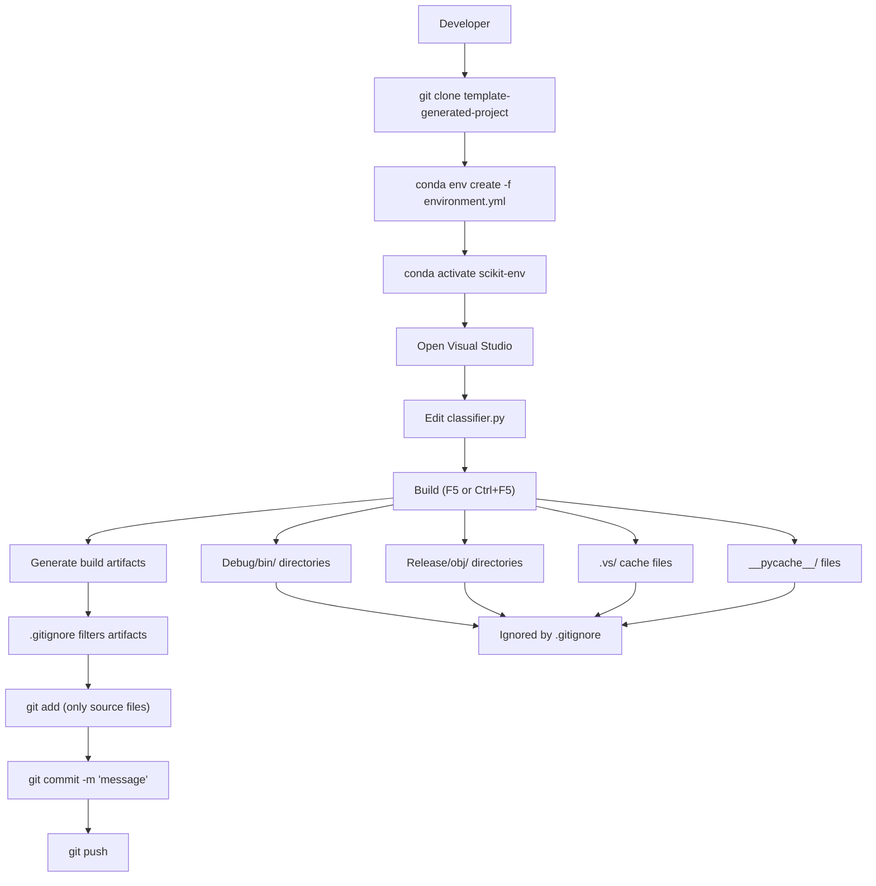
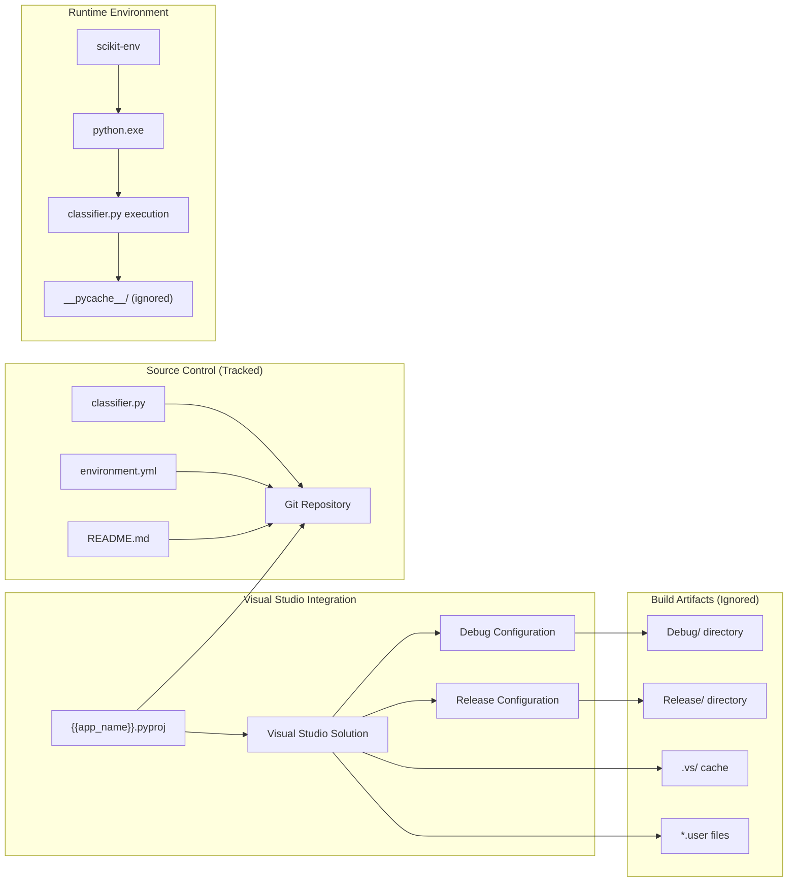
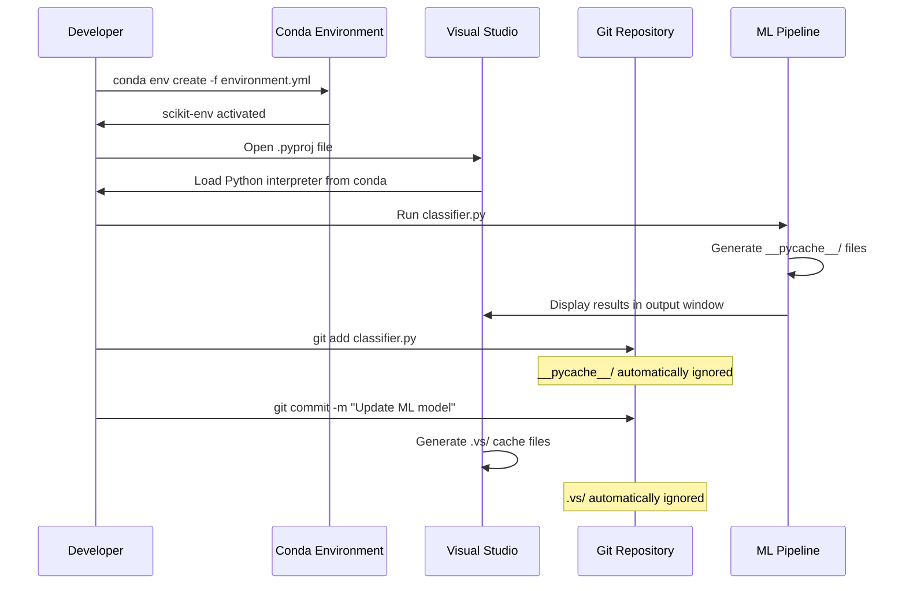
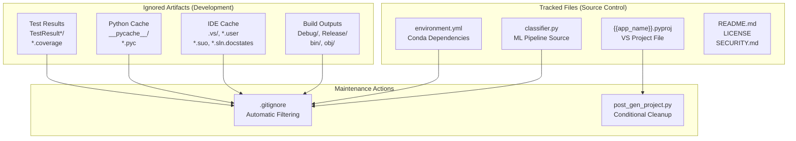
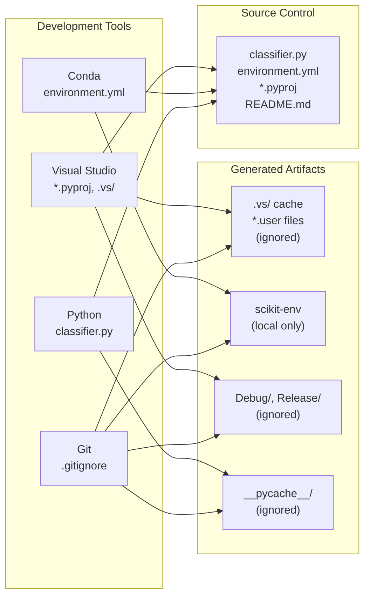

<!-- source: DeepWiki mcp.deepwiki.com · repo microsoft/python-sklearn-classifier-cookiecutter · page 5.3 Development Workflow Guidelines · fetched 2026-10-26 -->

# Development Workflow Guidelines

Relevant source files

The following files were used as context for generating this wiki page:

- [.gitignore](.gitignore)

This document outlines the development workflow guidelines and best practices for projects generated from the python-sklearn-classifier-cookiecutter template. It covers version control practices, Visual Studio integration workflows, build artifact management, and repository maintenance procedures.

For information about Visual Studio project configuration and IDE features, see [3.2](#3.2). For details about the post-generation hook processing, see [4.2](#4.2). For security and legal policies, see [5.1](#5.1) and [5.2](#5.2).

## Version Control and Git Workflow

The template includes a comprehensive `.gitignore` configuration designed specifically for Python machine learning projects with Visual Studio integration. The git workflow follows Microsoft's enterprise standards for open-source projects.

### Git Ignore Strategy

The `.gitignore` configuration implements a multi-layered approach to exclude development artifacts:

| Category | Purpose | Key Patterns |
|----------|---------|--------------|
| Visual Studio Files | User-specific IDE settings | `*.suo`, `*.user`, `*.userosscache` |
| Build Artifacts | Compiled outputs and intermediates | `[Dd]ebug/`, `[Rr]elease/`, `[Bb]in/`, `[Oo]bj/` |
| Test Results | Test execution outputs | `[Tt]est[Rr]esult*/`, `TestResult.xml` |
| Python Runtime | Python bytecode and cache | `__pycache__/`, `*.pyc` |
| IDE Cache | Visual Studio cache and options | `.vs/`, `*.VC.db` |

**Git Workflow Process**

Sources: [.gitignore:1-289]()

## Visual Studio Development Workflow

The development workflow integrates seamlessly with Visual Studio through the generated `.pyproj` file and comprehensive build artifact management.

### IDE Integration Points

Sources: [.gitignore:16-30](), [.gitignore:273-276]()

### Build Configuration Management

The workflow supports multiple build configurations with automatic artifact exclusion:

**Debug Workflow**
- Build artifacts in `[Dd]ebug/` and `[Dd]ebugPublic/` directories
- Debug symbols and intermediate files (`*.pdb`, `*.ilk`, `*.obj`)
- Temporary files and logs (`*.tmp`, `*.log`)

**Release Workflow**  
- Build artifacts in `[Rr]elease/` and `[Rr]eleases/` directories
- Optimized binaries and deployment packages
- Publishing profiles and Azure configurations

Sources: [.gitignore:15-26](), [.gitignore:51-74]()

## Python Development Practices

The workflow incorporates Python-specific development patterns optimized for machine learning projects.

### Python Environment Workflow

Sources: [.gitignore:273-276](), [.gitignore:27-30]()

### Python-Specific Exclusions

The template handles Python development artifacts systematically:

| Artifact Type | Pattern | Purpose |
|---------------|---------|---------|
| Bytecode | `__pycache__/` | Runtime compilation cache |
| Compiled Modules | `*.pyc` | Python bytecode files |
| Package Files | `*.egg-info/` | Package metadata |
| Virtual Environments | `venv/`, `env/` | Isolated Python environments |

Sources: [.gitignore:273-276]()

## Repository Maintenance Practices

The template enforces consistent repository maintenance through automated exclusion patterns and standardized file organization.

### Artifact Management Strategy

Sources: [.gitignore:1-289]()

### Continuous Integration Considerations

The `.gitignore` configuration supports CI/CD workflows by excluding platform-specific and user-specific artifacts while preserving essential build and deployment configurations:

**CI-Friendly Exclusions:**
- Platform-specific cache files (`.vs/`, `ipch/`)
- User-specific settings (`*.user`, `*.suo`)
- Build intermediates that can be regenerated
- Test execution artifacts that are environment-specific

**CI-Required Inclusions:**
- Source code (`classifier.py`)
- Environment specifications (`environment.yml`)
- Project configuration files (`*.pyproj`)
- Documentation and licensing files

Sources: [.gitignore:6-30](), [.gitignore:32-74]()

## Tool Integration Workflow

The development workflow integrates multiple tools through standardized file patterns and exclusion rules.

### Multi-Tool Development Environment

Sources: [.gitignore:27-30](), [.gitignore:273-276](), [.gitignore:15-26]()