# Page: Overview

# Overview

<details>
<summary>Relevant source files</summary>

The following files were used as context for generating this wiki page:

- [README.md](README.md)
- [cookiecutter.json](cookiecutter.json)

</details>


This document provides a comprehensive introduction to the `python-sklearn-classifier-cookiecutter` template, which is a Microsoft-maintained Cookiecutter template for generating complete Python machine learning classification projects. The template creates ready-to-use scikit-learn-based classification pipelines with proper environment configuration, IDE integration, and visualization capabilities.

The scope of this document covers the template's architecture, generated project structure, and core functionality. For detailed implementation of the machine learning pipeline, see [Generated Machine Learning Pipeline](#2). For environment setup and dependency management, see [Development Environment Setup](#3). For template customization options, see [Template Configuration and Customization](#4).

## Template Architecture

The `python-sklearn-classifier-cookiecutter` follows a standard Cookiecutter template structure that transforms user inputs into a complete machine learning project. The template generates three primary components: a complete ML pipeline implementation, a configured development environment, and optional IDE integration.

**Template Generation Flow**

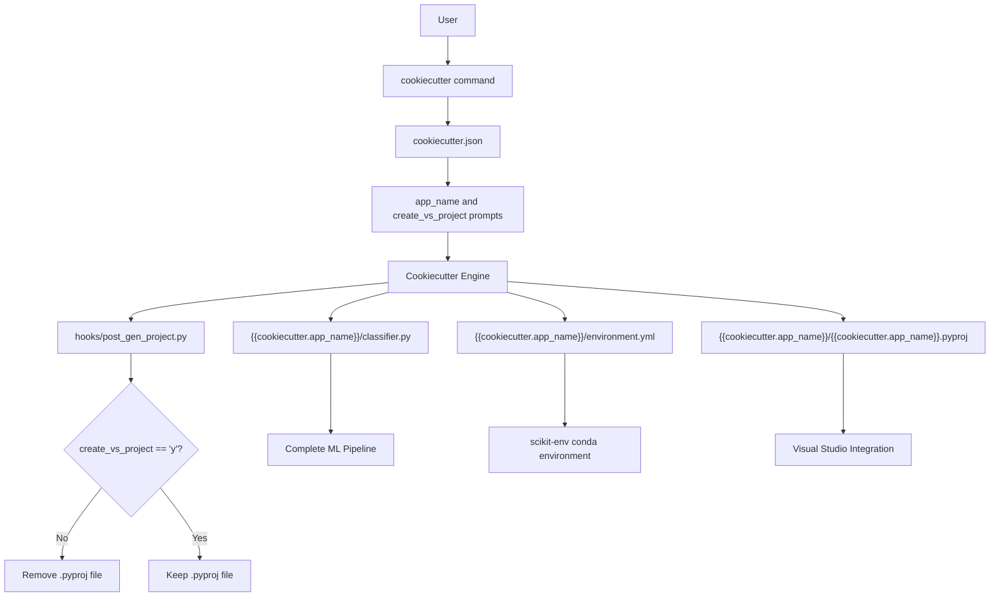

Sources: [cookiecutter.json:1-19](), [README.md:7-21]()

## Generated Project Structure

When executed, the template creates a project with the following core structure and dependencies:

**Core Project Components**

| Component | File Path | Purpose | Importance |
|-----------|-----------|---------|------------|
| ML Pipeline | `classifier.py` | Complete data processing, model training, and evaluation pipeline | Critical |
| Environment | `environment.yml` | Conda environment with Python 3.6 and ML dependencies | High |
| VS Project | `{app_name}.pyproj` | Visual Studio project configuration (optional) | Medium |
| Documentation | `README.md` | Project documentation and usage instructions | Low |

**System Dependencies and Data Flow**

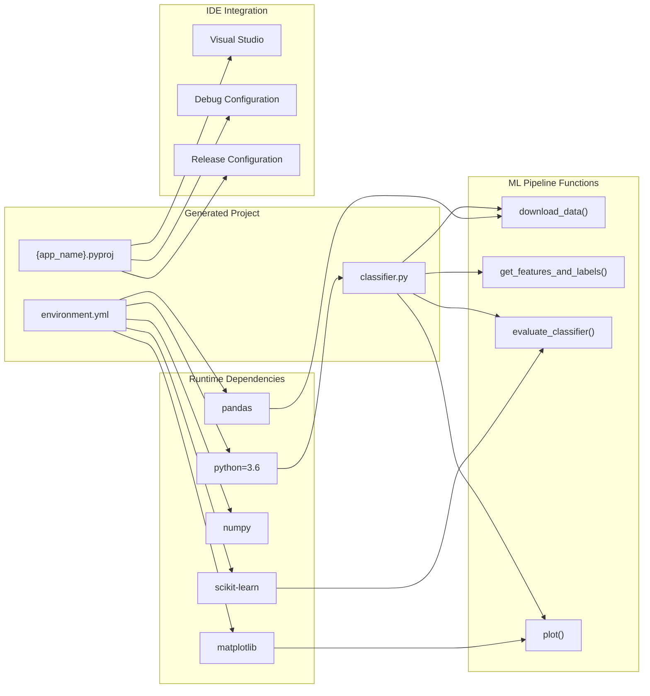

Sources: [cookiecutter.json:2-3](), [README.md:19-20]()

## Key Template Configuration

The template uses a minimal configuration approach with two primary user inputs defined in `cookiecutter.json`. The configuration includes special Visual Studio integration settings that enable seamless IDE workflow.

**Template Variables**

| Variable | Default Value | Purpose | Visual Studio Integration |
|----------|---------------|---------|---------------------------|
| `app_name` | `"classifier"` | Project folder and file naming | Maps to `ProjectName` |
| `create_vs_project` | `"y"` | Controls .pyproj file generation | Maps to `IsNewProject` |

The template includes advanced Visual Studio integration through the `_visual_studio` configuration block, which provides automatic project opening capabilities via the `File.OpenProject` command targeting the generated `.pyproj` file.

**Configuration Processing Workflow**

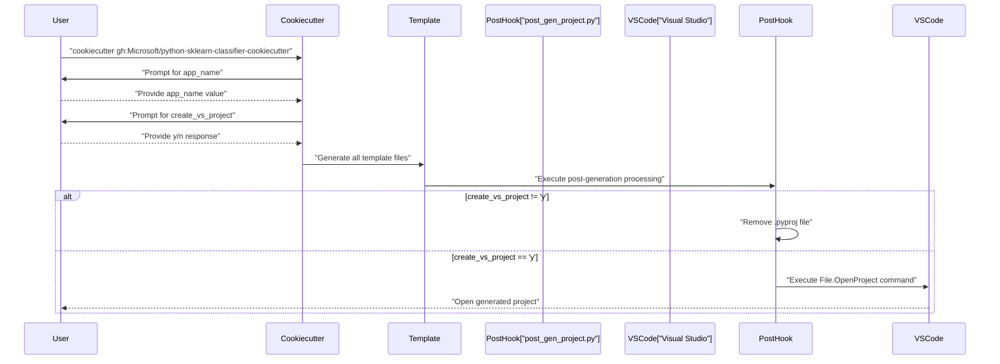

Sources: [cookiecutter.json:1-19](), [README.md:17-20]()

## Usage Workflow

The template follows a standard Cookiecutter installation and execution pattern, requiring only Python package management knowledge and basic command-line operation. The generated project becomes immediately executable with proper dependency installation.

**Standard Template Usage Steps**

1. **Installation**: Install Cookiecutter via pip or conda
2. **Template Generation**: Execute `cookiecutter gh:Microsoft/python-sklearn-classifier-cookiecutter`
3. **Configuration**: Provide `app_name` and `create_vs_project` responses
4. **Environment Setup**: Execute `conda env create -f environment.yml` in generated project
5. **Activation**: Execute `conda activate scikit-env`
6. **Execution**: Run `python classifier.py` to execute ML pipeline

The template is designed for immediate productivity, generating a complete working machine learning project that requires no additional code modification to demonstrate classification capabilities with multiple algorithms and visualization output.

Sources: [README.md:7-16](), [cookiecutter.json:1-3]()

---

# Page: Quick Start Guide

# Quick Start Guide

<details>
<summary>Relevant source files</summary>

The following files were used as context for generating this wiki page:

- [README.md](README.md)
- [{{cookiecutter.app_name}}/environment.yml]({{cookiecutter.app_name}}/environment.yml)

</details>


This document provides step-by-step instructions for using the python-sklearn-classifier-cookiecutter template to generate a new machine learning classification project and getting it running. This covers the complete workflow from template generation through executing the generated classifier pipeline.

For detailed information about the generated machine learning pipeline components, see [Generated Machine Learning Pipeline](#2). For comprehensive environment configuration details, see [Development Environment Setup](#3).

## Prerequisites

Before using this template, you need to install Cookiecutter, which is the template engine that processes this repository.

**Installation Options:**
- Via pip: `pip install cookiecutter`
- Via conda: `conda install cookiecutter`
- Follow the [official Cookiecutter installation guide](http://cookiecutter.readthedocs.io/en/latest/installation.html)

Sources: [README.md:9]()

## Project Generation Process

### Step 1: Execute Template Generation

Run the cookiecutter command to generate a new project from this template:

```bash
cookiecutter gh:Microsoft/python-sklearn-classifier-cookiecutter
```

Alternative syntax using the full GitHub URL:
```bash
cookiecutter https://github.com/Microsoft/python-sklearn-classifier-cookiecutter.git
```

### Step 2: Configure Template Variables

During generation, cookiecutter will prompt you for configuration values:

| Variable | Purpose | Valid Values | Default |
|----------|---------|--------------|---------|
| `app_name` | Name of the folder/project to create | Any valid directory name | None |
| `create_vs_project` | Whether to generate Visual Studio project file | `y` or `n` | None |

The `app_name` becomes the root directory name for your generated project. The `create_vs_project` setting determines whether a `.pyproj` file is included for Visual Studio integration.

Sources: [README.md:17-21]()

### Template Generation Workflow

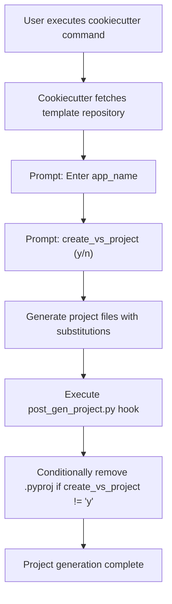

Sources: [README.md:10-15](), [README.md:17-21]()

## Environment Setup and Activation

### Step 3: Create Conda Environment

Navigate to your generated project directory and create the conda environment using the provided configuration:

```bash
cd your_app_name
conda env create -f environment.yml
```

This creates a conda environment named `scikit-env` with the following dependencies:
- Python 3.6
- pandas (data manipulation)
- numpy (numerical computing)
- matplotlib (plotting)
- scikit-learn (machine learning)

### Step 4: Activate Environment

Activate the newly created environment:

```bash
conda activate scikit-env
```

Sources: [{{cookiecutter.app_name}}/environment.yml:1-8]()

## Running the Generated Project

### Step 5: Execute the Classifier Pipeline

Once the environment is activated, run the main classifier script:

```bash
python classifier.py
```

This executes the complete machine learning pipeline including:
- Data download and preprocessing
- Model training with multiple classifiers
- Performance evaluation and metrics calculation
- Precision-recall curve visualization

### Generated Project Structure and Execution Flow

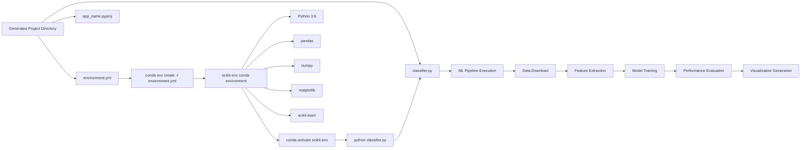

Sources: [{{cookiecutter.app_name}}/environment.yml:1-8](), [README.md:15]()

## Verification and Next Steps

After successful execution, you should see:
- Console output showing model training progress
- Performance metrics for multiple classifiers (LinearSVC, NuSVC, AdaBoost)
- Generated precision-recall curve plots
- Classification accuracy results

The generated project is now ready for development and customization. You can modify the `classifier.py` file to work with your own datasets, adjust model parameters, or add additional machine learning algorithms.

For detailed information about customizing the machine learning pipeline, see [Generated Machine Learning Pipeline](#2). For Visual Studio integration details, see [Visual Studio Integration](#3.2).

Sources: [README.md:1-35](), [{{cookiecutter.app_name}}/environment.yml:1-8]()

---

# Page: Generated Machine Learning Pipeline

# Generated Machine Learning Pipeline

<details>
<summary>Relevant source files</summary>

The following files were used as context for generating this wiki page:

- [{{cookiecutter.app_name}}/classifier.py]({{cookiecutter.app_name}}/classifier.py)

</details>


## Purpose and Scope

This document provides a comprehensive technical overview of the machine learning pipeline implemented in the generated `classifier.py` file. This pipeline serves as the core executable component of projects created by the cookiecutter template, implementing a complete end-to-end machine learning workflow from data ingestion to result visualization.

The pipeline demonstrates best practices for scikit-learn based classification projects including data preprocessing, model comparison, and performance evaluation. For detailed information about specific pipeline components, see [Data Processing Pipeline](#2.1), [Model Training and Evaluation](#2.2), and [Visualization and Results](#2.3). For environment setup and dependencies, see [Development Environment Setup](#3).

## Pipeline Architecture Overview

The generated machine learning pipeline follows a modular four-stage architecture that can be easily adapted for different classification tasks:

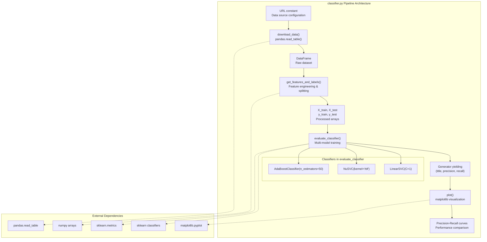

**Sources:** [{{cookiecutter.app_name}}/classifier.py:1-291]()

## Data Processing and Feature Engineering Flow

The pipeline implements a robust data processing workflow with comprehensive preprocessing capabilities:

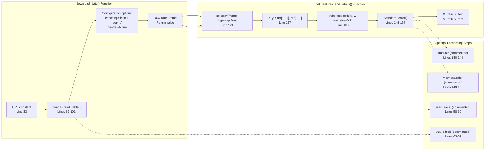

**Sources:** [{{cookiecutter.app_name}}/classifier.py:52-161]()

## Model Training and Evaluation Architecture

The `evaluate_classifier` function implements a generator-based approach to train and evaluate multiple classifiers with consistent metrics:

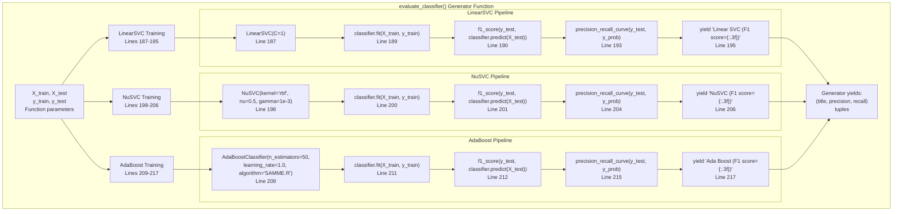

**Sources:** [{{cookiecutter.app_name}}/classifier.py:166-218]()

## Configuration and Customization Points

The pipeline provides extensive configuration options through commented code blocks and modular design:

| Configuration Area | Location | Options |
|-------------------|----------|---------|
| **Data Source** | [Line 33]() | `URL` constant for different datasets |
| **File Format** | [Lines 58-67]() | Excel files (`read_excel`), Azure blob storage |
| **Data Processing** | [Lines 72-101]() | Compression, encoding, separators, headers |
| **Feature Scaling** | [Lines 149-151]() | `StandardScaler` vs `MinMaxScaler` |
| **Data Imputation** | [Lines 140-144]() | Missing value handling with `Imputer` |
| **Train/Test Split** | [Line 133]() | `test_size` parameter in `train_test_split` |
| **Classifier Parameters** | [Lines 187-217]() | Hyperparameters for each model |
| **Visualization** | [Lines 37-38, 252-266]() | Interactive display vs image export |

**Sources:** [{{cookiecutter.app_name}}/classifier.py:33-266]()

## Main Execution Flow

The pipeline's main execution block orchestrates the entire workflow with comprehensive logging:

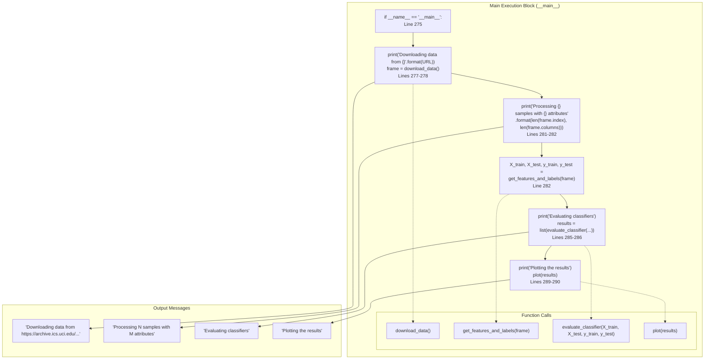

**Sources:** [{{cookiecutter.app_name}}/classifier.py:275-291]()

## Key Implementation Features

### Generator-Based Model Evaluation
The `evaluate_classifier` function uses Python generators to yield results incrementally, allowing for memory-efficient processing of multiple models without storing all results simultaneously in memory [{{cookiecutter.app_name}}/classifier.py:195,206,217]().

### Modular Function Design
Each major pipeline stage is implemented as a separate function with clear input/output contracts:
- `download_data()` returns a pandas DataFrame [{{cookiecutter.app_name}}/classifier.py:52-107]()
- `get_features_and_labels(frame)` returns train/test arrays [{{cookiecutter.app_name}}/classifier.py:113-161]()
- `evaluate_classifier()` yields evaluation tuples [{{cookiecutter.app_name}}/classifier.py:166-217]()
- `plot(results)` handles visualization [{{cookiecutter.app_name}}/classifier.py:222-270]()

### Comprehensive Documentation
The pipeline includes extensive inline documentation with alternative implementation options commented out, making it easy to adapt for different use cases [{{cookiecutter.app_name}}/classifier.py:1-30,58-67,140-151]().

### Standard ML Practices
The implementation follows scikit-learn best practices including proper train/test splitting, feature scaling, and standardized evaluation metrics (F1 score, precision-recall curves) [{{cookiecutter.app_name}}/classifier.py:133,148-157,190-217]().

**Sources:** [{{cookiecutter.app_name}}/classifier.py:1-291]()

---

# Page: Data Processing Pipeline

# Data Processing Pipeline

<details>
<summary>Relevant source files</summary>

The following files were used as context for generating this wiki page:

- [{{cookiecutter.app_name}}/classifier.py]({{cookiecutter.app_name}}/classifier.py)

</details>


## Purpose and Scope

This document explains the data processing pipeline implemented in the generated machine learning project, specifically covering the data ingestion, preprocessing, feature extraction, and preparation stages. The pipeline transforms raw data from external sources into properly formatted training and testing datasets ready for machine learning algorithms.

For information about the machine learning models and evaluation process, see [Model Training and Evaluation](#2.2). For details about result visualization, see [Visualization and Results](#2.3).

## Data Download Pipeline

The data processing pipeline begins with the `download_data()` function, which handles data ingestion from external sources. The function provides a flexible framework for downloading data from various sources including URLs, Excel files, and Azure blob storage.

### Core Download Implementation

The primary data source is configured via the `URL` constant, which points to the UCI Machine Learning Repository's spambase dataset. The `download_data()` function uses pandas `read_table()` with comprehensive configuration options:

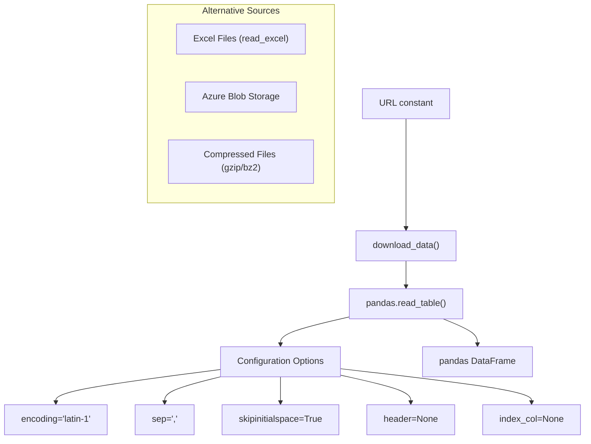

**Sources:** [{{cookiecutter.app_name}}/classifier.py:52-107]()

The function includes extensive configuration options for different data formats:
- Character encoding support (`latin-1`, `utf-8`)
- Multiple separator types (comma, tab, space)
- Header and index column handling
- Compression support for gzip and bz2 files

Alternative data sources are supported through commented examples for Excel files using `read_excel()` and Azure blob storage using `BlockBlobService`.

## Feature Extraction and Preprocessing

The `get_features_and_labels()` function transforms the raw DataFrame into properly formatted feature matrices and target vectors suitable for machine learning algorithms.

### Data Type Conversion and Structure

The function performs several critical preprocessing steps:

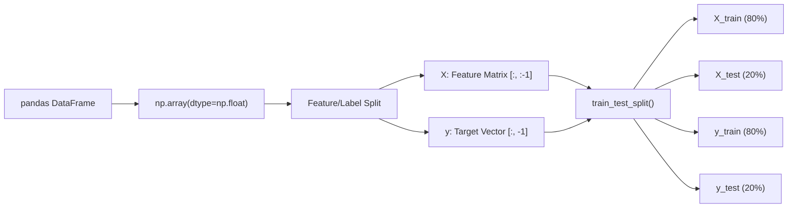

**Sources:** [{{cookiecutter.app_name}}/classifier.py:113-160]()

The preprocessing pipeline includes:

1. **Data Type Conversion**: Converting DataFrame values to numpy float arrays for numerical processing
2. **Feature-Target Separation**: Using array slicing to separate features (`X`) from labels (`y`)
   - Features: `arr[:, :-1]` (all columns except last)
   - Labels: `arr[:, -1]` (last column only)
3. **Missing Value Handling**: Framework for replacing null values or using scikit-learn's `Imputer`

## Train-Test Data Splitting

The pipeline uses scikit-learn's `train_test_split()` function to create training and testing datasets with an 80-20 split ratio.

### Split Configuration

| Parameter | Value | Purpose |
|-----------|--------|---------|
| `test_size` | 0.2 | Reserve 20% of data for testing |
| Split Method | Random | Ensures unbiased data distribution |
| Output Arrays | 4 | `X_train`, `X_test`, `y_train`, `y_test` |

The function maintains data integrity by ensuring that corresponding feature vectors and labels remain aligned after the split operation.

**Sources:** [{{cookiecutter.app_name}}/classifier.py:131-133]()

## Data Normalization and Scaling

The final preprocessing stage applies feature scaling using scikit-learn's `StandardScaler` to normalize attribute values for optimal machine learning performance.

### Scaling Pipeline

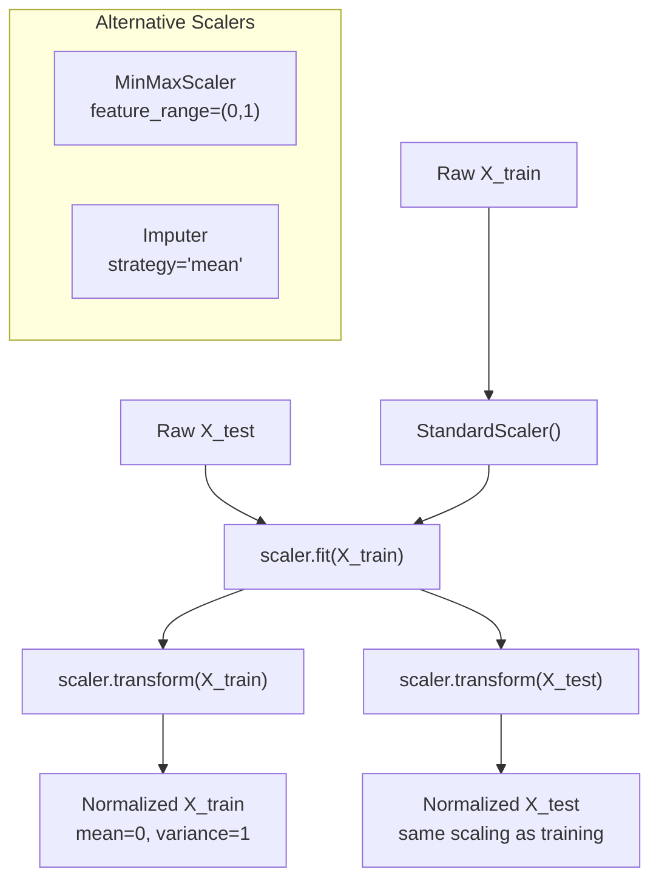

**Sources:** [{{cookiecutter.app_name}}/classifier.py:146-157]()

### Scaling Strategy

The normalization process follows best practices:

1. **Fit on Training Data**: The scaler parameters are computed using only training data to prevent data leakage
2. **Apply to Both Sets**: The same scaling transformation is applied to both training and test datasets
3. **Standardization**: Features are normalized to have mean=0 and variance=1
4. **Alternative Options**: Framework includes `MinMaxScaler` for range-based scaling

## Complete Data Flow Architecture

The entire data processing pipeline follows a linear flow from raw data source to machine learning-ready datasets:

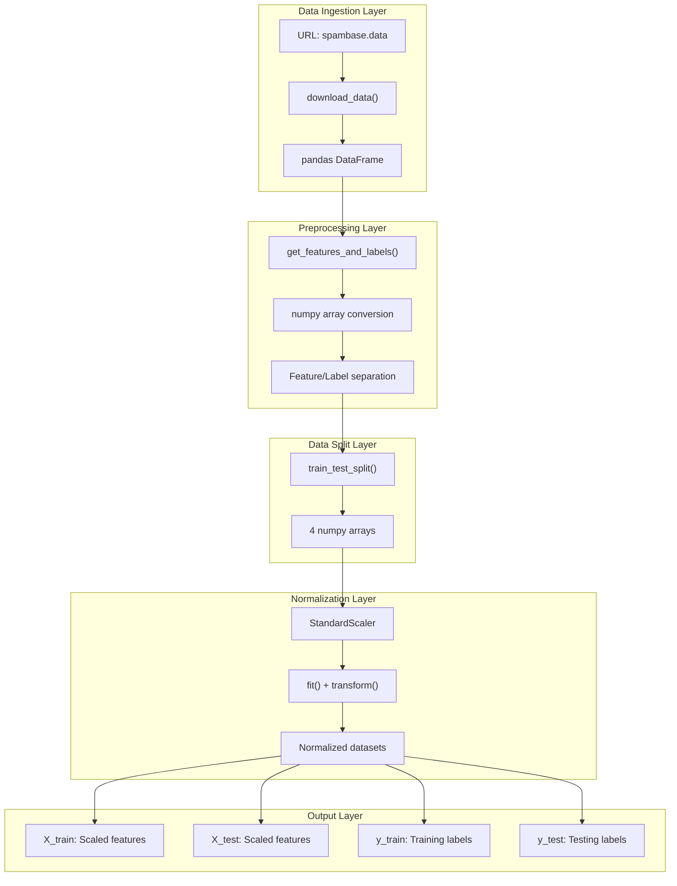

**Sources:** [{{cookiecutter.app_name}}/classifier.py:52-160](), [{{cookiecutter.app_name}}/classifier.py:275-282]()

This architecture ensures that data flows through each processing stage systematically, maintaining data integrity and following machine learning best practices for train-test separation and feature scaling.

---

# Page: Model Training and Evaluation

# Model Training and Evaluation

<details>
<summary>Relevant source files</summary>

The following files were used as context for generating this wiki page:

- [{{cookiecutter.app_name}}/classifier.py]({{cookiecutter.app_name}}/classifier.py)

</details>


This document covers the machine learning model training and evaluation functionality within the generated classifier pipeline. It focuses specifically on the `evaluate_classifier` function and the three classifiers it implements: LinearSVC, NuSVC, and AdaBoostClassifier. This includes their configuration parameters, training process, and evaluation metrics.

For information about data preprocessing and feature extraction that precedes model training, see [Data Processing Pipeline](#2.1). For details about visualization of the evaluation results, see [Visualization and Results](#2.3).

## Evaluation Process Overview

The model training and evaluation process is centralized in the `evaluate_classifier` function, which implements a standardized workflow for training multiple classifiers and comparing their performance.

**Evaluation Workflow**
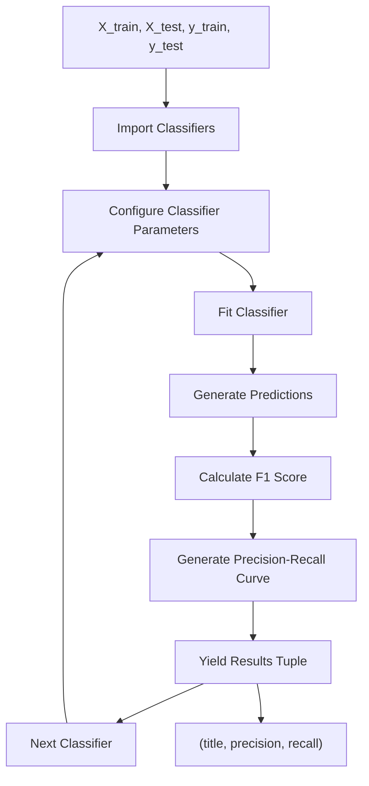

Sources: [{{cookiecutter.app_name}}/classifier.py:166-217]()

## Classifier Implementations

The evaluation function tests three distinct machine learning algorithms, each configured with specific parameters optimized for classification tasks.

### LinearSVC Configuration

The Linear Support Vector Classifier is configured as the first classifier in the evaluation pipeline:

| Parameter | Value | Purpose |
|-----------|-------|---------|
| `C` | 1 | Regularization parameter controlling overfitting |
| Algorithm | Linear SVM | Optimized for linearly separable data |

**LinearSVC Training Process**
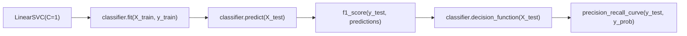

Sources: [{{cookiecutter.app_name}}/classifier.py:187-195]()

### NuSVC Configuration

The Nu Support Vector Classifier implements a more sophisticated SVM variant with RBF kernel:

| Parameter | Value | Purpose |
|-----------|-------|---------|
| `kernel` | 'rbf' | Radial basis function for non-linear classification |
| `nu` | 0.5 | Controls the number of support vectors |
| `gamma` | 1e-3 | Kernel coefficient for RBF |

**NuSVC Training Process**
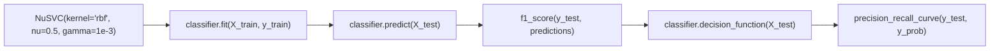

Sources: [{{cookiecutter.app_name}}/classifier.py:198-206]()

### AdaBoostClassifier Configuration

The AdaBoost ensemble classifier combines multiple weak learners:

| Parameter | Value | Purpose |
|-----------|-------|---------|
| `n_estimators` | 50 | Number of weak learners in the ensemble |
| `learning_rate` | 1.0 | Shrinks the contribution of each classifier |
| `algorithm` | 'SAMME.R' | Real boosting algorithm variant |

**AdaBoostClassifier Training Process**
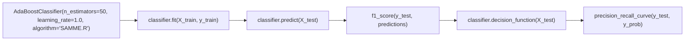

Sources: [{{cookiecutter.app_name}}/classifier.py:209-217]()

## Training Process

Each classifier follows an identical training workflow implemented through scikit-learn's standard interface:

1. **Instantiation**: Create classifier with predefined parameters
2. **Training**: Call `fit(X_train, y_train)` to train on training data
3. **Prediction**: Generate predictions using `predict(X_test)`
4. **Decision Function**: Calculate decision scores using `decision_function(X_test)`

**Unified Training Interface**
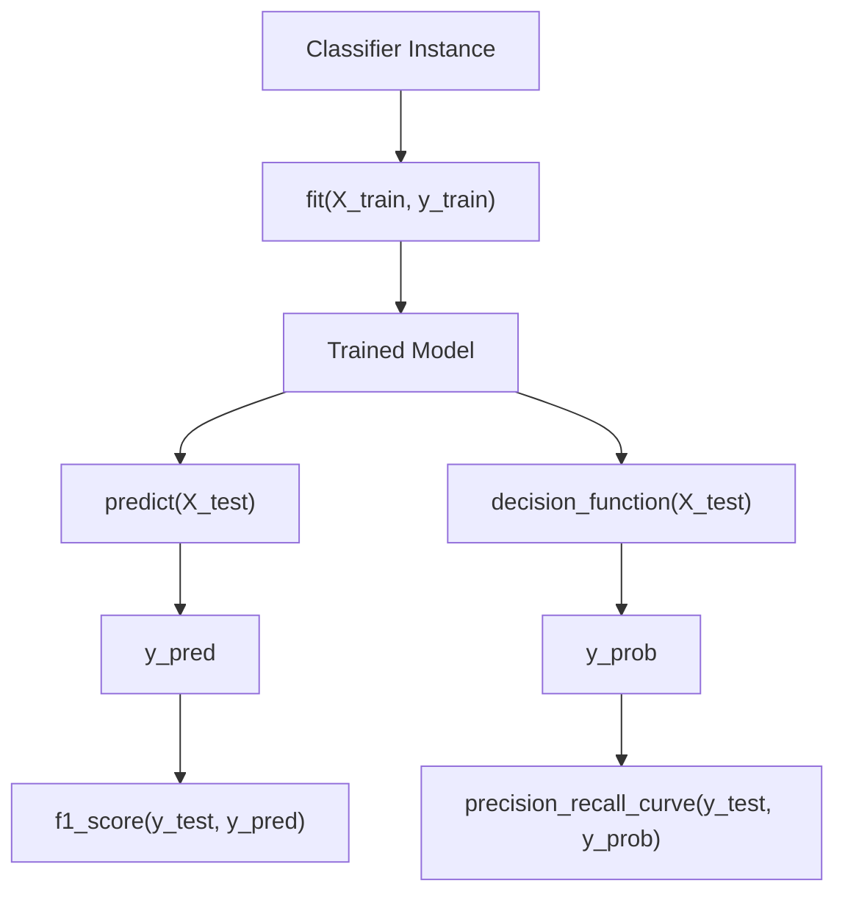

Sources: [{{cookiecutter.app_name}}/classifier.py:189-190](), [{{cookiecutter.app_name}}/classifier.py:200-201](), [{{cookiecutter.app_name}}/classifier.py:211-212]()

## Evaluation Metrics

The evaluation process generates two primary metrics for each classifier:

### F1 Score Calculation

The F1 score provides a single metric combining precision and recall:

```python
score = f1_score(y_test, classifier.predict(X_test))
```

This score is incorporated into the result title string for display purposes.

### Precision-Recall Curve Generation

Precision-recall curves are generated using the classifier's decision function output:

```python
y_prob = classifier.decision_function(X_test)
precision, recall, _ = precision_recall_curve(y_test, y_prob)
```

**Evaluation Metrics Pipeline**
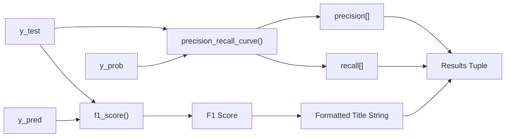

Sources: [{{cookiecutter.app_name}}/classifier.py:181](), [{{cookiecutter.app_name}}/classifier.py:190-194]()

## Results Structure

The `evaluate_classifier` function yields results as tuples containing three elements:

| Position | Type | Content | Example |
|----------|------|---------|---------|
| 0 | `str` | Formatted title with F1 score | `'Linear SVC (F1 score=0.923)'` |
| 1 | `np.array` | Precision values for P-R curve | `[0.95, 0.92, 0.89, ...]` |
| 2 | `np.array` | Recall values for P-R curve | `[0.87, 0.90, 0.93, ...]` |

**Results Generation Flow**
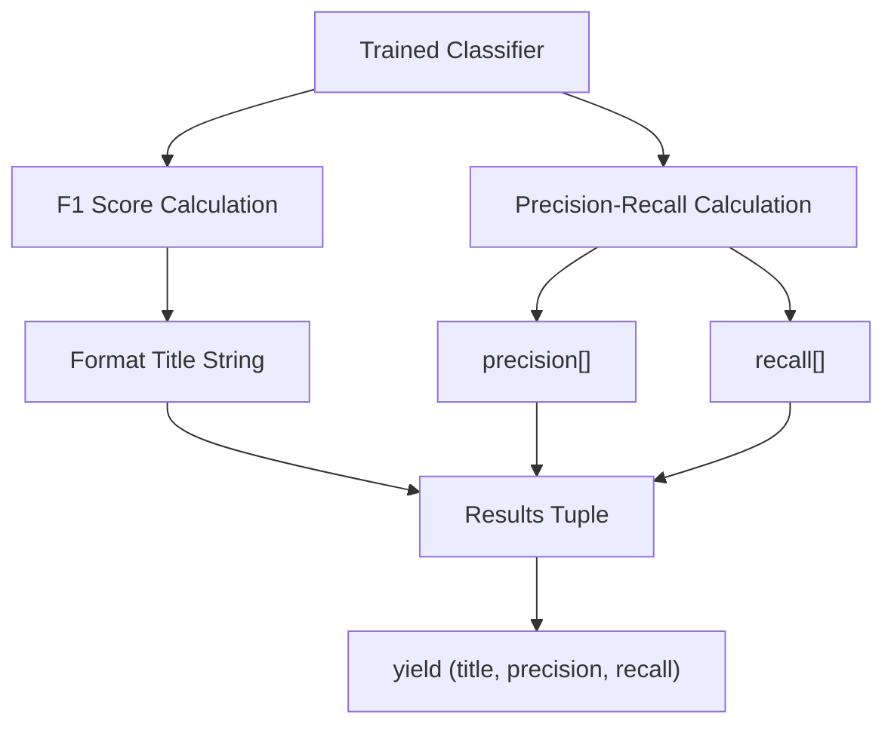

Sources: [{{cookiecutter.app_name}}/classifier.py:195](), [{{cookiecutter.app_name}}/classifier.py:206](), [{{cookiecutter.app_name}}/classifier.py:217]()

## Generator Function Implementation

The `evaluate_classifier` function is implemented as a generator, yielding results for each classifier sequentially. This design allows for memory-efficient processing and enables the calling code to process results as they become available.

The generator yields three tuples total, one for each classifier, which are collected into a list in the main execution flow at [{{cookiecutter.app_name}}/classifier.py:286]().

Sources: [{{cookiecutter.app_name}}/classifier.py:166-217](), [{{cookiecutter.app_name}}/classifier.py:286]()

---

# Page: Visualization and Results

# Visualization and Results

<details>
<summary>Relevant source files</summary>

The following files were used as context for generating this wiki page:

- [{{cookiecutter.app_name}}/classifier.py]({{cookiecutter.app_name}}/classifier.py)

</details>


This document covers the visualization and results display functionality of the generated machine learning pipeline. It explains how classification performance metrics are computed, formatted, and displayed as precision-recall curves using matplotlib. For information about the model training and evaluation process that generates these results, see [Model Training and Evaluation](#2.2).

## Purpose and Scope

The visualization system transforms raw classification metrics into interpretable precision-recall curves that allow comparison of multiple classifiers. The system handles both interactive display and static image generation, with configurable output options for different deployment scenarios.

## Results Data Structure

The visualization system operates on a standardized results format generated by the `evaluate_classifier` function. Each classifier produces a tuple containing the display title, precision array, and recall array.

| Component | Type | Description |
|-----------|------|-------------|
| Title | `str` | Classifier name with F1 score (e.g., "Linear SVC (F1 score=0.847)") |
| Precision | `numpy.ndarray` | Precision values for P-R curve |
| Recall | `numpy.ndarray` | Recall values for P-R curve |

The results generator yields tuples in the format `(title, precision, recall)` for each of the three classifiers: LinearSVC, NuSVC, and AdaBoostClassifier. The F1 score is calculated using `f1_score(y_test, classifier.predict(X_test))` and embedded in the title string for display in the plot legend.

**Results Generation Flow**

```mermaid
graph LR
    subgraph "evaluate_classifier Function"
        LinearSVC["LinearSVC"] --> DecisionFunction1["decision_function()"]
        NuSVC["NuSVC"] --> DecisionFunction2["decision_function()"]
        AdaBoost["AdaBoostClassifier"] --> DecisionFunction3["decision_function()"]
        
        DecisionFunction1 --> PR1["precision_recall_curve()"]
        DecisionFunction2 --> PR2["precision_recall_curve()"]
        DecisionFunction3 --> PR3["precision_recall_curve()"]
        
        PR1 --> Yield1["yield (title, precision, recall)"]
        PR2 --> Yield2["yield (title, precision, recall)"]
        PR3 --> Yield3["yield (title, precision, recall)"]
    end
    
    subgraph "Results Collection"
        Yield1 --> ResultsList["list(evaluate_classifier())"]
        Yield2 --> ResultsList
        Yield3 --> ResultsList
    end
    
    ResultsList --> PlotFunction["plot(results)"]
```

Sources: [{{cookiecutter.app_name}}/classifier.py:166-217]()

## Precision-Recall Curve Visualization

The `plot` function creates a comparative visualization of classifier performance using matplotlib. The function accepts the results list and generates a single figure with overlaid precision-recall curves for each classifier.

**Plot Generation Pipeline**

```mermaid
graph TD
    subgraph "plot() Function Flow"
        Results["results: List[Tuple]"] --> CreateFigure["plt.figure(figsize=(6, 6))"]
        CreateFigure --> SetTitle["fig.canvas.set_window_title()"]
        SetTitle --> IterateResults["for label, precision, recall in results"]
        
        IterateResults --> PlotCurve["plt.plot(recall, precision, label=label)"]
        PlotCurve --> ConfigurePlot["Configure axes and legend"]
        ConfigurePlot --> TightLayout["plt.tight_layout()"]
        TightLayout --> DisplayDecision{"Interactive Mode?"}
        
        DisplayDecision -->|Yes| ShowPlot["plt.show()"]
        DisplayDecision -->|No| SavePlot["plt.savefig()"]
        
        ShowPlot --> CleanupMemory["plt.close()"]
        SavePlot --> CleanupMemory
    end
```

Sources: [{{cookiecutter.app_name}}/classifier.py:222-269]()

The plot function configures several matplotlib parameters:

- **Figure size**: 6x6 inches for square aspect ratio
- **Window title**: "Classifying data from [URL]" where URL is the data source
- **Axes labels**: "Precision" (x-axis) and "Recall" (y-axis)
- **Legend position**: Lower left corner
- **Layout**: `tight_layout()` for automatic spacing optimization

## Display and Output Options

The system supports multiple output modes through conditional code blocks that can be uncommented based on deployment requirements.

### Interactive Display Mode

The default configuration uses `plt.show()` for interactive display, suitable for development and exploratory analysis:

```python
plt.show()
```

### Static Image Generation

For automated or headless environments, the system can save plots to files:

```python
# Uncomment for file output
#plt.savefig('plot.png')
```

### Non-Interactive Backend

For server environments without display capabilities, the matplotlib backend can be configured to 'Agg' mode:

```python
# Uncomment for headless operation
#import matplotlib
#matplotlib.use('Agg')
```

**Output Mode Configuration**

```mermaid
flowchart TD
    Environment["Execution Environment"] --> Interactive{"Interactive Display Available?"}
    
    Interactive -->|Yes| DefaultMode["Default: plt.show()"]
    Interactive -->|No| HeadlessMode["Uncomment: matplotlib.use('Agg')"]
    
    DefaultMode --> ShowPlot["Interactive plot window"]
    HeadlessMode --> SaveFile["plt.savefig('plot.png')"]
    
    SaveFile --> FileOutput["Static PNG file"]
    ShowPlot --> UserInteraction["User can zoom, pan, save"]
    
    FileOutput --> MemoryCleanup["plt.close()"]
    UserInteraction --> MemoryCleanup
```

Sources: [{{cookiecutter.app_name}}/classifier.py:35-38](), [{{cookiecutter.app_name}}/classifier.py:249-269]()

## Memory Management and Resource Cleanup

The visualization system includes explicit memory management through `plt.close()` to prevent memory leaks in long-running processes. This is particularly important when generating multiple plots or running in batch processing scenarios.

The function also provides commented examples for advanced output scenarios:
- **In-memory image generation**: Using `BytesIO` for web service integration
- **External viewer launching**: Using `subprocess.Popen` for automatic image viewing
- **Stream-like output**: For HTTP responses or file streaming

## Seaborn Integration

The system optionally imports seaborn for enhanced plot aesthetics through a try/except block, providing graceful degradation when seaborn is not available:

```python
try:
    import seaborn
except ImportError:
    pass
```

This approach ensures the visualization functionality remains fully operational regardless of seaborn availability while providing improved visual styling when possible.

Sources: [{{cookiecutter.app_name}}/classifier.py:44-48](), [{{cookiecutter.app_name}}/classifier.py:268-269]()

---

# Page: Development Environment Setup

# Development Environment Setup

<details>
<summary>Relevant source files</summary>

The following files were used as context for generating this wiki page:

- [{{cookiecutter.app_name}}/environment.yml]({{cookiecutter.app_name}}/environment.yml)
- [{{cookiecutter.app_name}}/{{cookiecutter.app_name}}.pyproj]({{cookiecutter.app_name}}/{{cookiecutter.app_name}}.pyproj)

</details>


This document provides guidance for setting up and working with the development environment of projects generated by the python-sklearn-classifier-cookiecutter template. It covers the conda environment configuration, dependency management, and IDE integration options that are automatically configured when you generate a new project.

For initial project generation steps, see [Quick Start Guide](#1.1). For detailed conda environment configuration, see [Python Environment Configuration](#3.1). For Visual Studio-specific setup and features, see [Visual Studio Integration](#3.2).

## Development Environment Overview

The cookiecutter template generates a complete development environment configuration that includes both conda environment management and optional IDE integration. The generated project provides two key configuration files that define the development environment:

| Component | File | Purpose |
|-----------|------|---------|
| Conda Environment | `environment.yml` | Defines Python version and ML dependencies |
| Visual Studio Project | `{{cookiecutter.app_name}}.pyproj` | Provides IDE integration and debugging configuration |

The development environment is designed to be immediately usable after project generation, requiring minimal setup steps to begin machine learning development.

**Environment Setup Workflow**

```mermaid
flowchart TD
    START["Project Generated"] --> ENV_CHECK["Check environment.yml"]
    ENV_CHECK --> CONDA_CREATE["conda env create -f environment.yml"]
    CONDA_CREATE --> CONDA_ACTIVATE["conda activate scikit-env"]
    CONDA_ACTIVATE --> CHECK_IDE["IDE Integration Needed?"]
    
    CHECK_IDE -->|Yes| PYPROJ_CHECK["Check .pyproj file exists"]
    CHECK_IDE -->|No| CLI_READY["Ready for CLI Development"]
    
    PYPROJ_CHECK -->|Exists| VS_OPEN["Open in Visual Studio"]
    PYPROJ_CHECK -->|Removed by hook| CLI_READY
    
    VS_OPEN --> VS_CONFIG["Configure Debug/Release"]
    VS_CONFIG --> DEV_READY["Development Environment Ready"]
    CLI_READY --> DEV_READY
    
    DEV_READY --> RUN_CLASSIFIER["python classifier.py"]
```

Sources: `{{cookiecutter.app_name}}/environment.yml`, `{{cookiecutter.app_name}}/{{cookiecutter.app_name}}.pyproj`

## Development Environment Components

The generated development environment consists of several key components that work together to provide a complete machine learning development setup.

**Conda Environment Configuration**

The `environment.yml` file defines a conda environment named `scikit-env` with curated dependencies for machine learning development:

```yaml
name: scikit-env
dependencies:
  - python=3.6
  - pandas
  - numpy  
  - matplotlib
  - scikit-learn
```

This configuration provides:
- **Python 3.6**: Baseline Python version for compatibility
- **Core ML Stack**: pandas, numpy, scikit-learn for data processing and modeling
- **Visualization**: matplotlib for plotting precision-recall curves

**Visual Studio Project Integration**

When Visual Studio integration is enabled during template generation, the `.pyproj` file provides:

| Configuration | Purpose |
|---------------|---------|
| `StartupFile` | Sets `classifier.py` as the default entry point [{{cookiecutter.app_name}}/{{cookiecutter.app_name}}.pyproj:8]() |
| `Debug` Configuration | Enables debugging symbols and unmanaged debugging disabled [{{cookiecutter.app_name}}/{{cookiecutter.app_name}}.pyproj:14-17]() |
| `Release` Configuration | Production build settings with debugging symbols [{{cookiecutter.app_name}}/{{cookiecutter.app_name}}.pyproj:18-21]() |

Sources: `{{cookiecutter.app_name}}/environment.yml:1-8`, `{{cookiecutter.app_name}}/{{cookiecutter.app_name}}.pyproj:8,14-21`

## Environment Activation and Usage

**Standard Conda Workflow**

```mermaid
sequenceDiagram
    participant USER as "Developer"
    participant CONDA as "conda"
    participant ENV as "scikit-env"
    participant PYTHON as "python classifier.py"
    
    USER->>CONDA: "conda env create -f environment.yml"
    CONDA->>ENV: "Create scikit-env environment"
    ENV-->>CONDA: "Environment created"
    CONDA-->>USER: "Environment ready"
    
    USER->>CONDA: "conda activate scikit-env"
    CONDA->>ENV: "Activate environment"
    ENV-->>USER: "Environment activated"
    
    USER->>PYTHON: "python classifier.py"
    PYTHON->>PYTHON: "Import pandas, numpy, sklearn, matplotlib"
    PYTHON-->>USER: "ML pipeline execution"
```

The conda environment activation process ensures all required dependencies are available in the correct versions for the machine learning pipeline execution.

Sources: `{{cookiecutter.app_name}}/environment.yml:1-8`

## IDE Integration Architecture

**Visual Studio Project Structure**

```mermaid
graph TB
    subgraph VS_PROJECT["Visual Studio Project"]
        PYPROJ["{{cookiecutter.app_name}}.pyproj"]
        STARTUP["StartupFile: classifier.py"]
        DEBUG_CONFIG["Debug Configuration"]
        RELEASE_CONFIG["Release Configuration"]
    end
    
    subgraph BUILD_TARGETS["MSBuild Targets"]
        PYTHON_TOOLS["Microsoft.PythonTools.targets"]
        BEFORE_BUILD["BeforeBuild Target"]
        AFTER_BUILD["AfterBuild Target"]
    end
    
    subgraph PROJECT_FILES["Project Files"]
        CLASSIFIER["classifier.py (Compile)"]
        ENV_YML["environment.yml (Content)"]
    end
    
    PYPROJ --> STARTUP
    PYPROJ --> DEBUG_CONFIG
    PYPROJ --> RELEASE_CONFIG
    
    PYPROJ --> PYTHON_TOOLS
    PYTHON_TOOLS --> BEFORE_BUILD
    PYTHON_TOOLS --> AFTER_BUILD
    
    PYPROJ --> CLASSIFIER
    PYPROJ --> ENV_YML
    
    DEBUG_CONFIG --> |"DebugSymbols=true"| CLASSIFIER
    RELEASE_CONFIG --> |"DebugSymbols=true"| CLASSIFIER
```

The Visual Studio project configuration provides:
- **Startup File**: Automatically runs `classifier.py` when debugging [{{cookiecutter.app_name}}/{{cookiecutter.app_name}}.pyproj:8]()
- **Build Configurations**: Both Debug and Release modes with debugging symbols enabled [{{cookiecutter.app_name}}/{{cookiecutter.app_name}}.pyproj:14-21]()
- **File Management**: Includes `classifier.py` as compilable code and `environment.yml` as content [{{cookiecutter.app_name}}/{{cookiecutter.app_name}}.pyproj:22-27]()

Sources: `{{cookiecutter.app_name}}/{{cookiecutter.app_name}}.pyproj:8,14-27`

## Environment Management Best Practices

**Dependency Resolution**

The `environment.yml` file uses conda's dependency resolution to automatically install compatible versions of:
- `pandas` for data manipulation and CSV processing
- `numpy` for numerical computations and array operations  
- `matplotlib` for precision-recall curve visualization
- `scikit-learn` for machine learning models (LinearSVC, NuSVC, AdaBoostClassifier)

**Development Workflow Integration**

The development environment supports both command-line and IDE-based workflows:

| Workflow Type | Entry Point | Configuration |
|---------------|-------------|---------------|
| Command Line | `python classifier.py` | Conda environment activation |
| Visual Studio | F5 Debug | `.pyproj` startup file configuration |
| Visual Studio | Ctrl+F5 Run | Release configuration |

The environment is designed to be consistent across both development approaches, ensuring the same dependency versions and Python environment regardless of how the code is executed.

Sources: `{{cookiecutter.app_name}}/environment.yml:2-7`, `{{cookiecutter.app_name}}/{{cookiecutter.app_name}}.pyproj:8,14-21`

---

# Page: Python Environment Configuration

# Python Environment Configuration

<details>
<summary>Relevant source files</summary>

The following files were used as context for generating this wiki page:

- [{{cookiecutter.app_name}}/environment.yml]({{cookiecutter.app_name}}/environment.yml)

</details>


## Purpose and Scope

This document details the conda environment configuration for generated projects, including dependency management, package specifications, and environment lifecycle. The environment configuration enables the machine learning pipeline to execute with all required dependencies properly installed and versioned.

For information about the machine learning pipeline that runs within this environment, see [Generated Machine Learning Pipeline](#2). For Visual Studio IDE integration with this environment, see [Visual Studio Integration](#3.2).

## Environment Configuration Overview

The generated project includes a conda environment specification that creates an isolated Python environment named `scikit-env`. This environment provides all dependencies required for the machine learning classification pipeline.

### Environment Specification Structure

```mermaid
graph TB
    subgraph "environment.yml Structure"
        ENV["environment.yml"]
        NAME["name: scikit-env"]
        DEPS["dependencies:"]
        
        ENV --> NAME
        ENV --> DEPS
        
        subgraph "Core Dependencies"
            PYTHON["python=3.6"]
            PANDAS["pandas"]
            NUMPY["numpy"]
            MATPLOTLIB["matplotlib"]
            SKLEARN["scikit-learn"]
        end
        
        DEPS --> PYTHON
        DEPS --> PANDAS
        DEPS --> NUMPY
        DEPS --> MATPLOTLIB
        DEPS --> SKLEARN
    end
```

Sources: [{{cookiecutter.app_name}}/environment.yml:1-8]()

The environment specification uses conda's YAML format with a fixed environment name and version-pinned Python interpreter alongside latest-compatible versions of data science packages.

### Dependency Matrix

| Package | Version | Purpose | Required By |
|---------|---------|---------|-------------|
| python | 3.6 | Base interpreter | All components |
| pandas | latest | Data manipulation, CSV processing | `download_data()`, `get_features_and_labels()` |
| numpy | latest | Numerical arrays, mathematical operations | scikit-learn, feature processing |
| matplotlib | latest | Plotting, visualization | `plot()` function |
| scikit-learn | latest | Machine learning algorithms, evaluation | `evaluate_classifier()` |

Sources: [{{cookiecutter.app_name}}/environment.yml:3-7]()

## Dependency Analysis

### Core Runtime Dependencies

#### Python 3.6 Specification
The environment pins Python to version 3.6, ensuring compatibility with the machine learning pipeline codebase. This version provides stable feature sets for the scientific computing stack.

```mermaid
graph LR
    subgraph "Python 3.6 Ecosystem"
        PYTHON36["python=3.6"]
        
        subgraph "Data Processing Layer"
            PANDAS["pandas"]
            NUMPY["numpy"]
        end
        
        subgraph "Machine Learning Layer"
            SKLEARN["scikit-learn"]
        end
        
        subgraph "Visualization Layer"
            MATPLOTLIB["matplotlib"]
        end
        
        PYTHON36 --> PANDAS
        PYTHON36 --> NUMPY
        PYTHON36 --> SKLEARN
        PYTHON36 --> MATPLOTLIB
        
        NUMPY --> SKLEARN
        NUMPY --> PANDAS
        MATPLOTLIB --> SKLEARN
    end
```

Sources: [{{cookiecutter.app_name}}/environment.yml:3]()

#### Scientific Computing Stack
The environment includes the standard scientific Python stack without version constraints, allowing conda to resolve compatible versions automatically.

**pandas**: Provides DataFrame structures for CSV data loading and manipulation in the `download_data()` pipeline stage.

**numpy**: Supplies numerical array operations and mathematical functions required by scikit-learn algorithms and feature processing.

**matplotlib**: Enables precision-recall curve generation and result visualization through the `plot()` function.

**scikit-learn**: Contains machine learning algorithms (LinearSVC, NuSVC, AdaBoostClassifier) and evaluation metrics used in the classification pipeline.

Sources: [{{cookiecutter.app_name}}/environment.yml:4-7]()

## Environment Lifecycle Management

### Environment Creation and Activation

```mermaid
sequenceDiagram
    participant User as "Developer"
    participant Conda as "Conda CLI"
    participant Env as "scikit-env"
    participant Pipeline as "classifier.py"
    
    User->>Conda: "conda env create -f environment.yml"
    Conda->>Env: "Create scikit-env environment"
    Conda->>Env: "Install python=3.6"
    Conda->>Env: "Install pandas, numpy, matplotlib, scikit-learn"
    Conda-->>User: "Environment created successfully"
    
    User->>Conda: "conda activate scikit-env"
    Conda->>Env: "Activate environment"
    Conda-->>User: "Environment activated"
    
    User->>Pipeline: "python classifier.py"
    Pipeline->>Env: "Import pandas, numpy, matplotlib, sklearn"
    Env-->>Pipeline: "Modules loaded successfully"
    Pipeline-->>User: "ML pipeline execution"
```

Sources: [{{cookiecutter.app_name}}/environment.yml:1-8]()

### Environment Commands

| Command | Purpose | Result |
|---------|---------|---------|
| `conda env create -f environment.yml` | Create new environment | Installs all dependencies in isolated environment |
| `conda activate scikit-env` | Activate environment | Makes packages available to Python interpreter |
| `conda deactivate` | Deactivate environment | Returns to base conda environment |
| `conda env remove -n scikit-env` | Remove environment | Deletes environment and all installed packages |

## Integration with Machine Learning Pipeline

### Package Import Dependencies

The environment configuration directly supports the import statements and function calls within the generated machine learning pipeline:

```mermaid
graph TB
    subgraph "environment.yml Dependencies"
        PANDAS_PKG["pandas"]
        NUMPY_PKG["numpy"] 
        MATPLOTLIB_PKG["matplotlib"]
        SKLEARN_PKG["scikit-learn"]
    end
    
    subgraph "classifier.py Imports and Usage"
        PANDAS_IMPORT["import pandas as pd"]
        NUMPY_IMPORT["import numpy as np"]
        MATPLOTLIB_IMPORT["import matplotlib.pyplot as plt"]
        SKLEARN_IMPORTS["from sklearn.svm import LinearSVC, NuSVC<br/>from sklearn.ensemble import AdaBoostClassifier<br/>from sklearn.model_selection import train_test_split<br/>from sklearn.metrics import precision_recall_curve"]
        
        subgraph "Pipeline Functions"
            DOWNLOAD["download_data()"]
            FEATURES["get_features_and_labels()"]
            EVALUATE["evaluate_classifier()"]
            PLOT["plot()"]
        end
    end
    
    PANDAS_PKG --> PANDAS_IMPORT
    NUMPY_PKG --> NUMPY_IMPORT
    MATPLOTLIB_PKG --> MATPLOTLIB_IMPORT
    SKLEARN_PKG --> SKLEARN_IMPORTS
    
    PANDAS_IMPORT --> DOWNLOAD
    NUMPY_IMPORT --> FEATURES
    SKLEARN_IMPORTS --> EVALUATE
    MATPLOTLIB_IMPORT --> PLOT
```

Sources: [{{cookiecutter.app_name}}/environment.yml:4-7]()

### Runtime Environment Validation

The conda environment ensures all required packages are available when the ML pipeline executes, preventing import errors and version conflicts during classification model training and evaluation.

Sources: [{{cookiecutter.app_name}}/environment.yml:1-8]()

---

# Page: Visual Studio Integration

# Visual Studio Integration

<details>
<summary>Relevant source files</summary>

The following files were used as context for generating this wiki page:

- [{{cookiecutter.app_name}}/{{cookiecutter.app_name}}.pyproj]({{cookiecutter.app_name}}/{{cookiecutter.app_name}}.pyproj)

</details>


This document covers the Visual Studio project integration capabilities provided by the cookiecutter template. The integration is implemented through a generated `.pyproj` file that configures Visual Studio to work seamlessly with the machine learning classifier project. For information about the conda environment setup that works alongside Visual Studio, see [3.1](#3.1). For details about the template's conditional file generation logic, see [4.2](#4.2).

## Project File Architecture

The Visual Studio integration centers around the `{{cookiecutter.app_name}}.pyproj` file, which is an MSBuild project that configures Python Tools for Visual Studio (PTVS). This project file establishes the development environment, build configurations, and file organization for the generated classifier project.

### Visual Studio Project Structure

```mermaid
graph TD
    subgraph "MSBuild Project Structure"
        PYPROJ["{{cookiecutter.app_name}}.pyproj"]
        PROPS["PropertyGroup Elements"]
        DEBUG["Debug Configuration"]
        RELEASE["Release Configuration"] 
        ITEMS["ItemGroup Elements"]
        TARGETS["Build Targets"]
    end
    
    subgraph "Project Properties"
        PROPS --> CONFIG["Configuration"]
        PROPS --> SCHEMA["SchemaVersion: 2.0"]
        PROPS --> GUID["ProjectTypeGuids"]
        PROPS --> HOME["ProjectHome: ."]
        PROPS --> STARTUP["StartupFile: classifier.py"]
        PROPS --> WORK["WorkingDirectory: ."]
    end
    
    subgraph "Configuration Settings"
        DEBUG --> DEBUG_SYM["DebugSymbols: true"]
        DEBUG --> DEBUG_UNMAN["EnableUnmanagedDebugging: false"]
        RELEASE --> REL_SYM["DebugSymbols: true"] 
        RELEASE --> REL_UNMAN["EnableUnmanagedDebugging: false"]
    end
    
    subgraph "File Management"
        ITEMS --> COMPILE["Compile Include"]
        ITEMS --> CONTENT["Content Include"]
        COMPILE --> CLASSIFIER_PY["classifier.py"]
        CONTENT --> ENV_YML["environment.yml"]
    end
    
    subgraph "Build Integration"
        TARGETS --> BEFORE["BeforeBuild Target"]
        TARGETS --> AFTER["AfterBuild Target"]
        TARGETS --> CORE["CoreCompile Target (commented)"]
    end
    
    PYPROJ --> PROPS
    PYPROJ --> DEBUG
    PYPROJ --> RELEASE
    PYPROJ --> ITEMS
    PYPROJ --> TARGETS
```

Sources: [{{cookiecutter.app_name}}/{{cookiecutter.app_name}}.pyproj:1-37]()

### Project Type Configuration

The project file uses specific GUIDs to identify it as a Python project compatible with Visual Studio's Python Tools:

| Property | Value | Purpose |
|----------|--------|---------|
| `ProjectTypeGuids` | `{a41c8ea1-112a-4a2d-9f91-29557995525f};{888888a0-9f3d-457c-b088-3a5042f75d52}` | Identifies project as Python Tools for Visual Studio project |
| `SchemaVersion` | `2.0` | MSBuild schema version for compatibility |
| `StartupFile` | `classifier.py` | Primary executable file for F5 debugging |
| `ProjectHome` | `.` | Root directory for project files |
| `WorkingDirectory` | `.` | Execution directory for Python scripts |

Sources: [{{cookiecutter.app_name}}/{{cookiecutter.app_name}}.pyproj:5-12]()

## Build Configurations

The project defines two standard build configurations that control debugging behavior and symbol generation during development and deployment phases.

### Configuration Properties Mapping

```mermaid
graph LR
    subgraph "Build Configuration System"
        CONDITION["Configuration Condition"]
        DEBUG_CONFIG["Debug Configuration"]
        RELEASE_CONFIG["Release Configuration"]
    end
    
    subgraph "Debug Properties"
        DEBUG_CONFIG --> DEBUG_SYMBOLS_TRUE["DebugSymbols: true"]
        DEBUG_CONFIG --> DEBUG_UNMANAGED_FALSE["EnableUnmanagedDebugging: false"]
    end
    
    subgraph "Release Properties"  
        RELEASE_CONFIG --> RELEASE_SYMBOLS_TRUE["DebugSymbols: true"]
        RELEASE_CONFIG --> RELEASE_UNMANAGED_FALSE["EnableUnmanagedDebugging: false"]
    end
    
    subgraph "Conditional Logic"
        CONDITION --> CHECK_DEBUG["$(Configuration) == 'Debug'"]
        CONDITION --> CHECK_RELEASE["$(Configuration) == 'Release'"]
        CHECK_DEBUG --> DEBUG_CONFIG
        CHECK_RELEASE --> RELEASE_CONFIG
    end
```

Sources: [{{cookiecutter.app_name}}/{{cookiecutter.app_name}}.pyproj:14-21]()

Both configurations maintain identical debugging settings, ensuring consistent development experience across build modes. The `DebugSymbols` property is enabled in both configurations to support debugging and profiling activities. The `EnableUnmanagedDebugging` property is disabled since the project uses pure Python code without C extensions.

## File Integration and Organization

The project file organizes source files into two categories through MSBuild `ItemGroup` elements: compiled Python files and content files that support the development environment.

### File Classification System

| Item Type | Files | Purpose |
|-----------|--------|---------|
| `Compile` | `classifier.py` | Primary Python source code for execution and debugging |
| `Content` | `environment.yml` | Conda environment specification for dependency management |

The `Compile` include for `classifier.py` enables Visual Studio's Python intellisense, syntax highlighting, and debugging capabilities. The `Content` include for `environment.yml` makes the conda environment configuration visible in the Solution Explorer for easy access and modification.

Sources: [{{cookiecutter.app_name}}/{{cookiecutter.app_name}}.pyproj:22-27]()

## Python Tools Integration

The project integrates with Microsoft's Python Tools for Visual Studio through the MSBuild targets import system. This integration provides full IDE support for Python development within the Visual Studio ecosystem.

### Python Tools Target Integration

```mermaid
graph TD
    subgraph "MSBuild Target System"
        IMPORT["Import Statement"]
        MSBUILD_PATH["MSBuildExtensionsPath32"]
        VS_VERSION["VisualStudioVersion"]
        PYTHON_TOOLS["Microsoft.PythonTools.targets"]
    end
    
    subgraph "Build Targets Structure"
        BEFORE_BUILD["BeforeBuild Target"]
        AFTER_BUILD["AfterBuild Target"] 
        CORE_COMPILE["CoreCompile Target (commented)"]
    end
    
    subgraph "Target Path Resolution"
        MSBUILD_PATH --> MICROSOFT["Microsoft Directory"]
        MICROSOFT --> VS_DIR["VisualStudio Directory"]
        VS_DIR --> VERSION_DIR["v$(VisualStudioVersion)"]
        VERSION_DIR --> PYTHON_TOOLS_DIR["Python Tools"]
        PYTHON_TOOLS_DIR --> TARGETS_FILE["Microsoft.PythonTools.targets"]
    end
    
    IMPORT --> MSBUILD_PATH
    IMPORT --> VS_VERSION
    IMPORT --> PYTHON_TOOLS
    
    PYTHON_TOOLS --> BEFORE_BUILD
    PYTHON_TOOLS --> AFTER_BUILD
    PYTHON_TOOLS --> CORE_COMPILE
```

Sources: [{{cookiecutter.app_name}}/{{cookiecutter.app_name}}.pyproj:28-36]()

The import statement at [{{cookiecutter.app_name}}/{{cookiecutter.app_name}}.pyproj:28]() dynamically resolves the Python Tools targets based on the installed Visual Studio version. The `BeforeBuild` and `AfterBuild` targets are defined but empty, providing extension points for custom build logic. The `CoreCompile` target remains commented out since Python doesn't require compilation, but can be enabled for advanced scenarios requiring custom build steps.

## Conditional Generation and Cleanup

The Visual Studio project file generation is controlled by the cookiecutter template's conditional logic. When users specify `create_vs_project != 'y'` during template instantiation, the post-generation hook removes the `.pyproj` file to maintain a clean project structure for non-Visual Studio workflows.

This conditional approach ensures that developers who prefer alternative IDEs or command-line workflows aren't burdened with unnecessary Visual Studio-specific files, while those using Visual Studio receive a fully configured development environment.

Sources: [{{cookiecutter.app_name}}/{{cookiecutter.app_name}}.pyproj:1-37]()

---

# Page: Template Configuration and Customization

# Template Configuration and Customization

<details>
<summary>Relevant source files</summary>

The following files were used as context for generating this wiki page:

- [cookiecutter.json](cookiecutter.json)
- [hooks/post_gen_project.py](hooks/post_gen_project.py)

</details>


This document provides a comprehensive guide to configuring and customizing the cookiecutter template for different use cases. It covers the template's configuration system, available customization options, and how to modify the template behavior through configuration variables and post-generation hooks.

For detailed information about specific template variables, see [Template Variables and Options](#4.1). For information about the post-generation processing system, see [Post-Generation Processing](#4.2). For details about Visual Studio integration features, see [Visual Studio Integration](#3.2).

## Configuration Architecture Overview

The template configuration system operates through a layered architecture that processes user input, applies template variables, and executes conditional post-generation logic.

### Template Configuration Flow

```mermaid
graph TD
    subgraph "Configuration Input Layer"
        USER["User Input"]
        DEFAULTS["cookiecutter.json defaults"]
    end
    
    subgraph "Configuration Processing"
        COOKIECUTTER_ENGINE["Cookiecutter Engine"]
        JINJA_PROCESSING["Jinja2 Template Processing"]
        VARIABLE_SUBSTITUTION["Variable Substitution"]
    end
    
    subgraph "Template Variables"
        APP_NAME["app_name"]
        CREATE_VS_PROJECT["create_vs_project"]
        VISUAL_STUDIO_CONFIG["_visual_studio"]
        VS_POST_CMDS["_visual_studio_post_cmds"]
    end
    
    subgraph "Generated Output"
        CLASSIFIER_PY["classifier.py"]
        ENVIRONMENT_YML["environment.yml"] 
        PYPROJ_FILE["{{app_name}}.pyproj"]
        OTHER_FILES["README.md, LICENSE, etc."]
    end
    
    subgraph "Post-Generation Processing"
        POST_GEN_HOOK["post_gen_project.py"]
        DELETE_FILE_FUNC["delete_file()"]
        CONDITIONAL_DELETION["Conditional .pyproj deletion"]
    end
    
    USER --> COOKIECUTTER_ENGINE
    DEFAULTS --> COOKIECUTTER_ENGINE
    COOKIECUTTER_ENGINE --> JINJA_PROCESSING
    JINJA_PROCESSING --> VARIABLE_SUBSTITUTION
    
    VARIABLE_SUBSTITUTION --> APP_NAME
    VARIABLE_SUBSTITUTION --> CREATE_VS_PROJECT
    VARIABLE_SUBSTITUTION --> VISUAL_STUDIO_CONFIG
    VARIABLE_SUBSTITUTION --> VS_POST_CMDS
    
    APP_NAME --> CLASSIFIER_PY
    APP_NAME --> ENVIRONMENT_YML
    APP_NAME --> PYPROJ_FILE
    CREATE_VS_PROJECT --> PYPROJ_FILE
    
    PYPROJ_FILE --> POST_GEN_HOOK
    POST_GEN_HOOK --> DELETE_FILE_FUNC
    DELETE_FILE_FUNC --> CONDITIONAL_DELETION
```

Sources: [cookiecutter.json:1-19](), [hooks/post_gen_project.py:1-10]()

## Core Configuration Components

The template configuration consists of several key components that control project generation behavior:

| Component | Purpose | Configuration Location |
|-----------|---------|----------------------|
| `app_name` | Defines project name and file naming | [cookiecutter.json:2]() |
| `create_vs_project` | Controls Visual Studio project generation | [cookiecutter.json:3]() |
| `_visual_studio` | Visual Studio IDE integration settings | [cookiecutter.json:4-13]() |
| `_visual_studio_post_cmds` | Post-generation IDE commands | [cookiecutter.json:14-19]() |
| Post-generation hooks | Conditional file processing logic | [hooks/post_gen_project.py]() |

### Variable Processing System

```mermaid
graph LR
    subgraph "cookiecutter.json Structure"
        APP_NAME_VAR["app_name: 'classifier'"]
        CREATE_VS_VAR["create_vs_project: 'y'"]
        VS_CONFIG["_visual_studio configuration"]
        VS_COMMANDS["_visual_studio_post_cmds"]
    end
    
    subgraph "Template Processing Engine"
        JINJA_SUBSTITUTION["{{cookiecutter.app_name}}"]
        CONDITIONAL_LOGIC["{{cookiecutter.create_vs_project}}"]
        VS_INTEGRATION["Visual Studio integration"]
    end
    
    subgraph "Generated Files"
        PYPROJ_NAME["{{app_name}}.pyproj"]
        FILE_PATHS["File paths with app_name"]
        PROJECT_STRUCTURE["Project directory structure"]
    end
    
    subgraph "Post-Generation Hook Logic"
        CONDITION_CHECK["if create_vs_project != 'y'"]
        FILE_DELETION["delete_file('{{app_name}}.pyproj')"]
    end
    
    APP_NAME_VAR --> JINJA_SUBSTITUTION
    CREATE_VS_VAR --> CONDITIONAL_LOGIC
    VS_CONFIG --> VS_INTEGRATION
    
    JINJA_SUBSTITUTION --> PYPROJ_NAME
    JINJA_SUBSTITUTION --> FILE_PATHS
    CONDITIONAL_LOGIC --> PROJECT_STRUCTURE
    
    PYPROJ_NAME --> CONDITION_CHECK
    CONDITION_CHECK --> FILE_DELETION
```

Sources: [cookiecutter.json:2-3](), [hooks/post_gen_project.py:8-9]()

## Configuration Variable Types

The template supports several categories of configuration variables:

### User-Facing Variables
- **`app_name`**: Primary project identifier used throughout file naming and content generation
- **`create_vs_project`**: Boolean flag controlling Visual Studio project file generation

### Internal Configuration Variables
- **`_visual_studio`**: Contains metadata for Visual Studio integration including `value_source` mappings and visibility settings
- **`_visual_studio_post_cmds`**: Defines IDE commands executed after project generation

### Visual Studio Integration Configuration

The `_visual_studio` section provides sophisticated IDE integration through value source mapping:

```mermaid
graph TD
    subgraph "Visual Studio Configuration Structure"
        VS_CONFIG["_visual_studio"]
        APP_NAME_CONFIG["app_name configuration"]
        CREATE_VS_CONFIG["create_vs_project configuration"] 
    end
    
    subgraph "Value Source Mapping"
        PROJECT_NAME_SOURCE["value_source: 'ProjectName'"]
        IS_NEW_PROJECT_SOURCE["value_source: 'IsNewProject'"]
        VISIBILITY_HIDDEN["visible: false"]
    end
    
    subgraph "Post-Generation Commands"
        FILE_OPEN_PROJECT["File.OpenProject command"]
        PROJECT_PATH["{{cookiecutter._output_folder_path}}\\{{cookiecutter.app_name}}.pyproj"]
    end
    
    VS_CONFIG --> APP_NAME_CONFIG
    VS_CONFIG --> CREATE_VS_CONFIG
    
    APP_NAME_CONFIG --> PROJECT_NAME_SOURCE
    APP_NAME_CONFIG --> VISIBILITY_HIDDEN
    
    CREATE_VS_CONFIG --> IS_NEW_PROJECT_SOURCE
    CREATE_VS_CONFIG --> VISIBILITY_HIDDEN
    
    PROJECT_NAME_SOURCE --> FILE_OPEN_PROJECT
    FILE_OPEN_PROJECT --> PROJECT_PATH
```

Sources: [cookiecutter.json:4-18]()

## Post-Generation Hook System

The template implements conditional processing through the `post_gen_project.py` hook, which executes after file generation to apply configuration-based modifications:

### Hook Execution Flow

```mermaid
graph TD
    subgraph "Hook Entry Point"
        MAIN_EXECUTION["if __name__ == '__main__'"]
        CONDITION_EVALUATION["'{{cookiecutter.create_vs_project}}'.lower() != 'y'"]
    end
    
    subgraph "File System Operations"
        DELETE_FILE_CALL["delete_file('{{cookiecutter.app_name}}.pyproj')"]
        OS_REMOVE["os.remove()"]
        PATH_RESOLUTION["os.path.join(os.path.realpath(os.path.curdir), filepath)"]
    end
    
    subgraph "Conditional Logic"
        CREATE_VS_CHECK["Check create_vs_project value"]
        FILE_EXISTS["{{app_name}}.pyproj exists"]
        REMOVAL_ACTION["Remove .pyproj file"]
    end
    
    MAIN_EXECUTION --> CONDITION_EVALUATION
    CONDITION_EVALUATION --> CREATE_VS_CHECK
    CREATE_VS_CHECK --> FILE_EXISTS
    FILE_EXISTS --> DELETE_FILE_CALL
    DELETE_FILE_CALL --> PATH_RESOLUTION
    PATH_RESOLUTION --> OS_REMOVE
    OS_REMOVE --> REMOVAL_ACTION
```

Sources: [hooks/post_gen_project.py:7-9]()

The hook implements a simple but effective pattern for conditional file management based on user configuration choices.

## Customization Patterns

The template configuration supports several customization patterns:

### Project Naming Customization
The `app_name` variable drives consistent naming across all generated files and directories through Jinja2 template substitution.

### IDE Integration Control
The `create_vs_project` variable provides granular control over development environment setup, allowing users to opt out of Visual Studio integration while maintaining the core machine learning pipeline functionality.

### Extension Points
The configuration architecture supports extension through:
- Additional variables in `cookiecutter.json`
- Extended post-generation hook logic in `post_gen_project.py`
- Custom Visual Studio command configurations

Sources: [cookiecutter.json:1-19](), [hooks/post_gen_project.py:1-10]()

---

# Page: Template Variables and Options

# Template Variables and Options

<details>
<summary>Relevant source files</summary>

The following files were used as context for generating this wiki page:

- [cookiecutter.json](cookiecutter.json)

</details>


This document provides a comprehensive explanation of the configuration variables and options available in the cookiecutter template, covering how they control project generation and Visual Studio integration. The template's behavior is primarily controlled through the `cookiecutter.json` configuration file.

For information about post-generation processing that uses these variables, see [Post-Generation Processing](#4.2). For details about the generated development environment, see [Development Environment Setup](#3).

## Configuration File Structure

The template's configuration is defined in `cookiecutter.json`, which contains user-configurable variables, Visual Studio integration settings, and post-generation commands.

### Configuration Architecture

```mermaid
graph TB
    subgraph "cookiecutter.json Structure"
        ROOT["cookiecutter.json"]
        USER_VARS["User Variables"]
        VS_CONFIG["_visual_studio"]
        POST_CMDS["_visual_studio_post_cmds"]
    end
    
    subgraph "User Variables"
        APP_NAME["app_name: 'classifier'"]
        CREATE_VS["create_vs_project: 'y'"]
    end
    
    subgraph "Visual Studio Config"
        VS_APP["app_name (value_source: ProjectName)"]
        VS_CREATE["create_vs_project (value_source: IsNewProject)"]
    end
    
    subgraph "Post Commands"
        OPEN_CMD["File.OpenProject command"]
    end
    
    ROOT --> USER_VARS
    ROOT --> VS_CONFIG
    ROOT --> POST_CMDS
    
    USER_VARS --> APP_NAME
    USER_VARS --> CREATE_VS
    
    VS_CONFIG --> VS_APP
    VS_CONFIG --> VS_CREATE
    
    POST_CMDS --> OPEN_CMD
```

Sources: [cookiecutter.json:1-19]()

## User-Configurable Variables

The template exposes two primary variables that users can customize during project generation.

| Variable | Default Value | Purpose | Impact |
|----------|---------------|---------|--------|
| `app_name` | `"classifier"` | Sets the project name | Controls generated file names and project structure |
| `create_vs_project` | `"y"` | Controls Visual Studio project generation | Determines whether `.pyproj` file is created |

### app_name Variable

The `app_name` variable controls the naming throughout the generated project:

```mermaid
graph LR
    APP_NAME["app_name variable"] --> PYPROJ["{{app_name}}.pyproj"]
    APP_NAME --> FOLDER["Project folder name"]
    APP_NAME --> VS_PROJECT["Visual Studio project name"]
    
    PYPROJ --> VS_INTEGRATION["Visual Studio integration"]
    FOLDER --> FILE_STRUCTURE["Generated file structure"]
    VS_PROJECT --> POST_CMD["File.OpenProject command"]
```

Sources: [cookiecutter.json:2](), [cookiecutter.json:17]()

### create_vs_project Variable

The `create_vs_project` variable is a boolean flag that controls Visual Studio integration:

- `"y"`: Generates Visual Studio project file (`.pyproj`)
- Any other value: Triggers post-generation cleanup to remove Visual Studio files

Sources: [cookiecutter.json:3]()

## Visual Studio Integration Configuration

The `_visual_studio` section provides metadata for Visual Studio template integration, mapping cookiecutter variables to Visual Studio's internal project creation system.

### Visual Studio Variable Mapping

```mermaid
graph TB
    subgraph "Cookiecutter Variables"
        CC_APP["app_name"]
        CC_CREATE["create_vs_project"]
    end
    
    subgraph "Visual Studio Mapping"
        VS_APP["value_source: ProjectName"]
        VS_CREATE["value_source: IsNewProject"]
        VISIBLE["visible: false"]
    end
    
    subgraph "Visual Studio IDE"
        PROJECT_NAME["Project Name Field"]
        NEW_PROJECT["New Project Dialog"]
    end
    
    CC_APP --> VS_APP
    CC_CREATE --> VS_CREATE
    VS_APP --> PROJECT_NAME
    VS_CREATE --> NEW_PROJECT
    
    VS_APP --> VISIBLE
    VS_CREATE --> VISIBLE
```

The configuration includes:

- **value_source**: Maps to Visual Studio's internal parameter names
  - `"ProjectName"` for `app_name`
  - `"IsNewProject"` for `create_vs_project`
- **visible**: Set to `false` to hide these variables from Visual Studio's template UI

Sources: [cookiecutter.json:4-13]()

## Post-Generation Commands

The `_visual_studio_post_cmds` section defines actions that Visual Studio should execute after project generation.

### Command Structure

```mermaid
graph LR
    POST_CMDS["_visual_studio_post_cmds"] --> OPEN_CMD["File.OpenProject"]
    OPEN_CMD --> TARGET_PATH["{{cookiecutter._output_folder_path}}\\{{cookiecutter.app_name}}.pyproj"]
    
    TARGET_PATH --> VS_IDE["Visual Studio IDE"]
    VS_IDE --> PROJECT_LOADED["Project automatically loaded"]
```

The command configuration:
- **name**: `"File.OpenProject"` - Visual Studio command to open a project file
- **args**: Dynamic path using template variables to locate the generated `.pyproj` file

Sources: [cookiecutter.json:14-19]()

## Variable Usage Flow

The following diagram shows how template variables flow through the generation process:

```mermaid
sequenceDiagram
    participant User as "User Input"
    participant CC as "Cookiecutter Engine"
    participant Template as "Template Files"
    participant VS as "Visual Studio"
    participant Hook as "Post-Generation Hook"
    
    User->>CC: "Provide app_name, create_vs_project"
    CC->>Template: "Apply variable substitution"
    Template->>Template: "Generate {{app_name}}.pyproj"
    
    alt create_vs_project == 'y'
        CC->>VS: "Execute _visual_studio_post_cmds"
        VS->>VS: "File.OpenProject command"
        VS->>VS: "Load generated .pyproj file"
    else create_vs_project != 'y'
        CC->>Hook: "Execute post_gen_project.py"
        Hook->>Hook: "Remove .pyproj file"
    end
```

## Template Variable Reference

| Variable Path | Type | Description | Usage |
|---------------|------|-------------|-------|
| `app_name` | String | Project name identifier | File naming, project structure |
| `create_vs_project` | String | Visual Studio integration flag | Controls `.pyproj` generation |
| `_visual_studio.app_name.value_source` | String | VS parameter mapping | Maps to `ProjectName` |
| `_visual_studio.create_vs_project.value_source` | String | VS parameter mapping | Maps to `IsNewProject` |
| `_visual_studio_post_cmds[0].name` | String | VS command name | `File.OpenProject` |
| `_visual_studio_post_cmds[0].args` | String | Command arguments | Dynamic path to `.pyproj` |

Sources: [cookiecutter.json:1-19]()

---

# Page: Post-Generation Processing

# Post-Generation Processing

<details>
<summary>Relevant source files</summary>

The following files were used as context for generating this wiki page:

- [hooks/post_gen_project.py](hooks/post_gen_project.py)

</details>


This document covers the automated post-generation processing system that executes after cookiecutter generates project files. The system provides conditional file cleanup and project customization based on user configuration choices. For information about the template variables that drive this processing, see [Template Variables and Options](#4.1). For details about the Visual Studio project files that are conditionally processed, see [Visual Studio Integration](#3.2).

## Post-Generation Hook Architecture

The template implements a post-generation hook system through the `post_gen_project.py` script located in the `hooks` directory. This script executes automatically after cookiecutter completes the initial file generation process.

### Hook Execution Flow

```mermaid
flowchart TD
    CC["cookiecutter CLI"] --> GEN["Generate template files"]
    GEN --> HOOK["Execute post_gen_project.py"]
    HOOK --> CHECK{"Check create_vs_project"}
    CHECK -->|"!= 'y'"| DELETE["delete_file() function"]
    CHECK -->|"== 'y'"| KEEP["Keep .pyproj file"]
    DELETE --> REMOVE[".pyproj file removed"]
    KEEP --> COMPLETE["Project generation complete"]
    REMOVE --> COMPLETE
```

Sources: [hooks/post_gen_project.py:1-10]()

### Hook Script Structure

The post-generation hook implements a minimal, focused architecture with two primary components:

| Component | Function | Purpose |
|-----------|----------|---------|
| `delete_file` | File removal utility | Safely removes specified files from the generated project directory |
| Main execution block | Conditional logic | Evaluates user preferences and triggers appropriate cleanup actions |

Sources: [hooks/post_gen_project.py:4-9]()

## File Deletion Logic

### delete_file Function

The `delete_file` function provides a centralized file removal utility that operates within the generated project's root directory:

```mermaid
flowchart LR
    INPUT["filepath parameter"] --> RESOLVE["os.path.realpath(os.path.curdir)"]
    RESOLVE --> JOIN["os.path.join()"]
    JOIN --> REMOVE["os.remove()"]
    REMOVE --> DELETED["File deleted"]
```

The function uses `os.path.realpath(os.path.curdir)` to ensure file operations occur within the correct directory context, then combines the provided filepath using `os.path.join()` before executing the removal operation.

Sources: [hooks/post_gen_project.py:4-5]()

## Visual Studio Project Conditional Processing

### Conditional Cleanup Logic

The primary use case for post-generation processing is the conditional removal of Visual Studio project files based on user preferences:

```mermaid
flowchart TD
    START["Post-generation hook starts"] --> EVAL["Evaluate {{cookiecutter.create_vs_project}}"]
    EVAL --> COND{"Variable value != 'y'?"}
    COND -->|True| TARGET["Target: {{cookiecutter.app_name}}.pyproj"]
    COND -->|False| PRESERVE["Preserve .pyproj file"]
    TARGET --> CALL["Call delete_file()"]
    CALL --> REMOVED[".pyproj file removed"]
    PRESERVE --> RETAINED[".pyproj file retained"]
    REMOVED --> END["Hook execution complete"]
    RETAINED --> END
```

### Template Variable Integration

The hook system integrates with cookiecutter's templating engine through the `{{cookiecutter.create_vs_project}}` variable. The processing logic evaluates this variable using string comparison with case-insensitive matching:

- **Value 'y'**: Visual Studio project file is preserved
- **Any other value**: Visual Studio project file is removed

Sources: [hooks/post_gen_project.py:8-9]()

## Execution Context and Timing

### Hook Execution Sequence

```mermaid
sequenceDiagram
    participant User as "Developer"
    participant CC as "Cookiecutter Engine"
    participant TPL as "Template Files"
    participant HOOK as "post_gen_project.py"
    participant FS as "File System"
    
    User->>CC: "Execute cookiecutter command"
    CC->>TPL: "Process template files"
    TPL-->>CC: "Generated project files"
    CC->>HOOK: "Execute post-generation hook"
    HOOK->>HOOK: "Evaluate create_vs_project variable"
    alt create_vs_project != 'y'
        HOOK->>FS: "delete_file('app_name.pyproj')"
        FS-->>HOOK: "File removed"
    else create_vs_project == 'y'
        HOOK->>HOOK: "Skip deletion"
    end
    HOOK-->>CC: "Hook execution complete"
    CC-->>User: "Project generation finished"
```

### Working Directory Context

The hook executes within the newly generated project directory, with `os.path.curdir` pointing to the project root. This ensures that file operations target the correct location without requiring explicit path resolution to parent directories.

Sources: [hooks/post_gen_project.py:5]()

## Error Handling and Robustness

The current implementation provides basic file deletion functionality without explicit error handling. The `os.remove()` operation will raise exceptions for common failure scenarios such as:

- File not found (if the target `.pyproj` file wasn't generated)
- Permission errors (if the file system restricts deletion)
- Directory vs file conflicts (if a directory exists with the same name)

The hook system assumes that the targeted files exist and are accessible for deletion operations.

Sources: [hooks/post_gen_project.py:5]()

---

# Page: Repository Policies and Guidelines

# Repository Policies and Guidelines

<details>
<summary>Relevant source files</summary>

The following files were used as context for generating this wiki page:

- [.gitignore](.gitignore)
- [LICENSE](LICENSE)
- [SECURITY.md](SECURITY.md)

</details>


This document outlines the governance policies, security procedures, licensing terms, and development workflow guidelines that apply to the python-sklearn-classifier-cookiecutter repository. It covers Microsoft's standardized policies for open source projects, vulnerability reporting procedures, and file management practices that ensure consistent project quality.

For detailed information about the security vulnerability reporting process, see [Security Policy](#5.1). For licensing terms and legal obligations, see [License and Legal Information](#5.2). For development workflow practices and repository maintenance, see [Development Workflow Guidelines](#5.3).

## Repository Governance Framework

The repository follows Microsoft's standardized open source governance model, implementing enterprise-grade policies for security, licensing, and development workflows. This framework ensures consistent quality and legal compliance across all generated projects.

```mermaid
graph TB
    subgraph "Policy Documents"
        SECURITY["SECURITY.md"]
        LICENSE["LICENSE"]
        GITIGNORE[".gitignore"]
    end
    
    subgraph "Microsoft Standards"
        MSRC["Microsoft Security Response Center"]
        MIT["MIT License Framework"]
        VS["Visual Studio Integration Standards"]
    end
    
    subgraph "Generated Project Impact"
        PROJ["Generated Projects"]
        INHERIT["Policy Inheritance"]
        COMPLIANCE["Legal Compliance"]
    end
    
    subgraph "Enforcement Mechanisms"
        REPORTING["Vulnerability Reporting"]
        ATTRIBUTION["License Attribution"]
        EXCLUSIONS["Build Artifact Exclusions"]
    end
    
    SECURITY --> MSRC
    LICENSE --> MIT
    GITIGNORE --> VS
    
    MSRC --> REPORTING
    MIT --> ATTRIBUTION
    VS --> EXCLUSIONS
    
    REPORTING --> INHERIT
    ATTRIBUTION --> INHERIT
    EXCLUSIONS --> INHERIT
    
    INHERIT --> PROJ
    INHERIT --> COMPLIANCE
```

Sources: [SECURITY.md:1-42](), [LICENSE:1-22](), [.gitignore:1-289]()

## Security Vulnerability Management

The repository implements Microsoft's standardized security vulnerability disclosure process through the Microsoft Security Response Center (MSRC). This process applies to both the template repository and all generated projects.

### Vulnerability Reporting Workflow

```mermaid
sequenceDiagram
    participant Reporter as "Security Researcher"
    participant MSRC as "Microsoft Security Response Center"
    participant Template as "Template Repository"
    participant Projects as "Generated Projects"
    
    Reporter->>MSRC: "Report vulnerability via https://msrc.microsoft.com/create-report"
    Note over Reporter,MSRC: "Alternative: secure@microsoft.com with PGP encryption"
    
    MSRC->>MSRC: "Triage within 24 hours"
    MSRC->>Template: "Assess impact on template"
    MSRC->>Projects: "Evaluate generated project implications"
    
    MSRC->>Reporter: "Coordinated Vulnerability Disclosure process"
    Note over MSRC,Reporter: "Follow CVD principles"
    
    alt "Template vulnerability"
        MSRC->>Template: "Apply security fix"
        Template->>Projects: "Update generation logic"
    else "Generated project vulnerability"
        MSRC->>Projects: "Provide remediation guidance"
    end
```

### Security Reporting Requirements

The security policy mandates specific information for effective vulnerability reports:

| Information Category | Required Details | Purpose |
|---------------------|------------------|---------|
| Issue Classification | `Type of issue (e.g. buffer overflow, SQL injection, cross-site scripting, etc.)` | Threat categorization |
| Source Location | `Full paths of source file(s) related to the manifestation of the issue` | Impact assessment |
| Code Reference | `The location of the affected source code (tag/branch/commit or direct URL)` | Reproducibility |
| Configuration | `Any special configuration required to reproduce the issue` | Environment setup |
| Reproduction | `Step-by-step instructions to reproduce the issue` | Validation |
| Proof of Concept | `Proof-of-concept or exploit code (if possible)` | Severity assessment |
| Impact Analysis | `Impact of the issue, including how an attacker might exploit the issue` | Risk evaluation |

Sources: [SECURITY.md:21-27]()

## Licensing and Legal Framework

The repository operates under the MIT License, providing broad permissions for use, modification, and distribution while maintaining Microsoft's copyright attribution requirements.

### MIT License Terms

The license grants the following permissions without restriction:
- Use of the software for any purpose
- Modification of source code
- Publication and distribution
- Sublicensing to third parties
- Commercial sale

```mermaid
graph LR
    subgraph "License Grant"
        USE["use"]
        MODIFY["modify"] 
        PUBLISH["publish"]
        DISTRIBUTE["distribute"]
        SUBLICENSE["sublicense"]
        SELL["sell"]
    end
    
    subgraph "Requirements"
        COPYRIGHT["Copyright notice inclusion"]
        LICENSE_TEXT["License text inclusion"]
        ATTRIBUTION["Microsoft attribution"]
    end
    
    subgraph "Warranty Disclaimer"
        AS_IS["AS IS provision"]
        NO_WARRANTY["No warranty of any kind"]
        NO_LIABILITY["No liability for damages"]
    end
    
    USE --> COPYRIGHT
    MODIFY --> COPYRIGHT
    PUBLISH --> LICENSE_TEXT
    DISTRIBUTE --> LICENSE_TEXT
    SUBLICENSE --> ATTRIBUTION
    SELL --> ATTRIBUTION
    
    COPYRIGHT --> AS_IS
    LICENSE_TEXT --> NO_WARRANTY
    ATTRIBUTION --> NO_LIABILITY
```

### Legal Obligations

Users must include the complete license text and copyright notice in all copies or substantial portions of the software. The copyright holder is identified as "Microsoft Corporation" with all rights reserved.

Sources: [LICENSE:3](), [LICENSE:12-13](), [LICENSE:15-21]()

## Development Workflow and File Management

The repository implements comprehensive file exclusion policies through `.gitignore` to maintain clean version control and prevent sensitive information exposure.

### Visual Studio Integration Policies

The `.gitignore` configuration specifically targets Visual Studio development environments, excluding build artifacts, temporary files, and user-specific configurations:

```mermaid
graph TB
    subgraph "User-Specific Exclusions"
        SUO["*.suo files"]
        USER["*.user files"]
        CACHE["*.userosscache files"]
        STATES["*.sln.docstates files"]
    end
    
    subgraph "Build Artifact Exclusions"
        DEBUG["[Dd]ebug/ directories"]
        RELEASE["[Rr]elease/ directories"]
        BIN["[Bb]in/ directories"]
        OBJ["[Oo]bj/ directories"]
        LOG["[Ll]og/ directories"]
    end
    
    subgraph "IDE Configuration Exclusions"
        VS_DIR[".vs/ directory"]
        LAUNCH["launchSettings.json"]
        PROJECT_LOCK["project.lock.json"]
    end
    
    subgraph "Generated Code Exclusions"
        PYC["*.pyc files"]
        PYCACHE["__pycache__/ directories"]
        COVERAGE["*.coverage files"]
    end
    
    SUO --> DEBUG
    USER --> RELEASE
    CACHE --> BIN
    STATES --> OBJ
    
    DEBUG --> VS_DIR
    RELEASE --> LAUNCH
    BIN --> PROJECT_LOCK
    
    VS_DIR --> PYC
    LAUNCH --> PYCACHE
    PROJECT_LOCK --> COVERAGE
```

### File Exclusion Categories

The `.gitignore` configuration implements systematic exclusions across multiple categories:

| Category | File Patterns | Purpose |
|----------|---------------|---------|
| User-Specific | `*.suo`, `*.user`, `*.userosscache` | Prevent personal IDE settings from being committed |
| Build Results | `[Dd]ebug/`, `[Rr]elease/`, `[Bb]in/`, `[Oo]bj/` | Exclude compiled outputs and build artifacts |
| IDE Cache | `.vs/`, `*.cache`, `*.opendb` | Prevent IDE temporary files from cluttering repository |
| Python Runtime | `__pycache__/`, `*.pyc` | Exclude Python bytecode and cache directories |
| Package Management | `*.nupkg`, `packages/`, `node_modules/` | Prevent package artifacts from being versioned |

Sources: [.gitignore:6-10](), [.gitignore:16-25](), [.gitignore:27-28](), [.gitignore:274-275](), [.gitignore:162-171]()

### Repository Maintenance Standards

The file exclusion policies ensure that generated projects maintain clean version control practices:

1. **Build Artifact Management**: All compilation outputs are automatically excluded to prevent repository bloat
2. **IDE Configuration Isolation**: User-specific IDE settings remain local to prevent configuration conflicts
3. **Package Management**: External dependencies are excluded, relying on package managers for dependency resolution
4. **Cross-Platform Compatibility**: Exclusions account for both Windows and cross-platform development scenarios

Sources: [.gitignore:1-5](), [.gitignore:236-249](), [.gitignore:266-275]()

---

# Page: Security Policy

# Security Policy

<details>
<summary>Relevant source files</summary>

The following files were used as context for generating this wiki page:

- [SECURITY.md](SECURITY.md)

</details>


This document outlines the security vulnerability reporting process and responsible disclosure guidelines for the Microsoft Python scikit-learn classifier cookiecutter template repository. This policy covers security issues found in the template code, configuration files, and generation logic itself.

For information about licensing and legal aspects of using this template, see [License and Legal Information](#5.2). For development workflow and contribution guidelines, see [Development Workflow Guidelines](#5.3).

## Policy Scope and Application

The security policy applies to vulnerabilities discovered in the cookiecutter template infrastructure and the code generation process. This includes the template files, post-generation hooks, and configuration logic that creates new machine learning projects.

```mermaid
graph TB
    subgraph "Template Repository Scope"
        SECURITY["SECURITY.md"]
        TEMPLATE["Template Files"]
        HOOK["hooks/post_gen_project.py"]
        CONFIG["cookiecutter.json"]
    end
    
    subgraph "Generated Project Scope"
        CLASSIFIER["{{cookiecutter.app_name}}/classifier.py"]
        ENV["{{cookiecutter.app_name}}/environment.yml"]
        PYPROJ["{{cookiecutter.app_name}}/{{cookiecutter.app_name}}.pyproj"]
    end
    
    subgraph "Security Coverage"
        POLICY_APPLIES["Microsoft Security Policy Applies"]
        USER_RESPONSIBILITY["User Project Security Responsibility"]
    end
    
    SECURITY --> POLICY_APPLIES
    TEMPLATE --> POLICY_APPLIES
    HOOK --> POLICY_APPLIES
    CONFIG --> POLICY_APPLIES
    
    CLASSIFIER --> USER_RESPONSIBILITY
    ENV --> USER_RESPONSIBILITY
    PYPROJ --> USER_RESPONSIBILITY
    
    POLICY_APPLIES -.-> USER_RESPONSIBILITY
```

**Security Policy Coverage**

| Component Type | Coverage | Responsibility |
|----------------|----------|----------------|
| Template repository files | Full Microsoft security policy | Microsoft MSRC |
| Generation logic and hooks | Full Microsoft security policy | Microsoft MSRC |
| Generated project code | Initial template security baseline | Project maintainer |
| User modifications | Not covered | Project maintainer |

The security policy covers the template repository but not the individual projects generated from it. Once a project is generated, security responsibility transfers to the project maintainer.

Sources: [SECURITY.md:1-42]()

## Vulnerability Reporting Process

Microsoft follows a coordinated vulnerability disclosure process for all repositories under Microsoft GitHub organizations. Security vulnerabilities must be reported through official channels, not through public GitHub issues.

```mermaid
sequenceDiagram
    participant Reporter as "Security Researcher"
    participant MSRC as "Microsoft Security Response Center"
    participant Team as "Repository Maintainers"
    participant Public as "Public Disclosure"
    
    Reporter->>Reporter: "Discover vulnerability in template"
    Reporter->>MSRC: "Report via https://msrc.microsoft.com/create-report"
    MSRC->>Reporter: "Acknowledge receipt (within 24 hours)"
    MSRC->>Team: "Forward report to maintainers"
    Team->>Team: "Investigate and develop fix"
    Team->>MSRC: "Provide fix timeline"
    MSRC->>Reporter: "Update on progress"
    Team->>Team: "Deploy security fix"
    MSRC->>Public: "Coordinated public disclosure"
    MSRC->>Reporter: "Bug bounty award (if eligible)"
```

### Primary Reporting Channels

**Web Portal**: Submit reports through the Microsoft Security Response Center at `https://msrc.microsoft.com/create-report`

**Email**: Send reports to `secure@microsoft.com` for submissions without web portal login

**PGP Encryption**: Encrypt sensitive reports using Microsoft's PGP key available at `https://aka.ms/opensource/security/pgpkey`

Sources: [SECURITY.md:11-17]()

## Required Vulnerability Information

When reporting security issues, include comprehensive technical details to help Microsoft's security team understand and reproduce the vulnerability.

### Essential Technical Details

| Information Category | Required Details | Examples |
|---------------------|------------------|----------|
| **Vulnerability Type** | Classification of security issue | Buffer overflow, code injection, path traversal |
| **Affected Files** | Full paths to vulnerable template files | `{{cookiecutter.app_name}}/classifier.py`, `hooks/post_gen_project.py` |
| **Source Location** | Specific code location references | Git commit hash, branch name, line numbers |
| **Configuration** | Special setup needed for reproduction | Specific `cookiecutter.json` values, OS requirements |
| **Reproduction Steps** | Detailed step-by-step instructions | Cookiecutter command, input values, execution sequence |
| **Proof of Concept** | Exploit code or demonstration | Working exploit, vulnerable input examples |
| **Impact Assessment** | Potential damage and attack scenarios | Data exposure, code execution, privilege escalation |

### Template-Specific Reporting Considerations

When reporting vulnerabilities in this cookiecutter template, consider these specific aspects:

- **Template Variable Injection**: Issues with unsanitized `cookiecutter.json` variable substitution
- **Post-Generation Hook Security**: Vulnerabilities in `hooks/post_gen_project.py` execution
- **Generated Code Security**: Security flaws introduced into generated `classifier.py` or other files
- **Dependency Vulnerabilities**: Issues with packages specified in `environment.yml`

Sources: [SECURITY.md:19-29]()

## Response Timeline and Bug Bounty

Microsoft provides structured response timelines and potential compensation for qualifying security reports.

### Response Expectations

**Initial Response**: Microsoft Security Response Center acknowledges reports within 24 hours of submission

**Follow-up Process**: If no response received within 24 hours, follow up via email to ensure receipt

**Additional Information**: Visit `microsoft.com/msrc` for comprehensive security response information

### Bug Bounty Eligibility

Valid security vulnerabilities in Microsoft-owned repositories may qualify for bug bounty awards. Complete, detailed reports with proof-of-concept code contribute to higher award amounts.

**Bug Bounty Program**: Visit `https://aka.ms/opensource/security/bounty` for current program details and scope

Sources: [SECURITY.md:17-18](), [SECURITY.md:31-32]()

## Communication Guidelines

All security-related communications should follow Microsoft's established protocols for responsible disclosure.

### Language Requirements

**Preferred Language**: English for all security communications to ensure clear understanding and rapid response

### Disclosure Policy

**Coordinated Vulnerability Disclosure**: Microsoft follows industry-standard coordinated disclosure practices, allowing time for fixes before public announcement

**Public Issue Restrictions**: Security vulnerabilities must not be reported through public GitHub issues, pull requests, or discussion forums

Sources: [SECURITY.md:11](), [SECURITY.md:35](), [SECURITY.md:39]()

## Template Security Considerations

Understanding the security implications of the generated machine learning pipeline helps users assess potential vulnerabilities in their projects.

```mermaid
graph LR
    subgraph "Security Attack Surface"
        DOWNLOAD["download_data()"]
        URLSOURCE["Data source URLs"]
        FILEIO["File I/O operations"]
        DEPS["Python dependencies"]
    end
    
    subgraph "Generated Code Components"
        CLASSIFIER["classifier.py"]
        ENVIRONMENT["environment.yml"]
        POSTGEN["post_gen_project.py"]
    end
    
    subgraph "Potential Vulnerabilities"
        INJECTION["URL injection attacks"]
        DESERIALIZATION["Unsafe data parsing"]
        DEPENDENCY["Vulnerable package versions"]
        EXECUTION["Code execution in hooks"]
    end
    
    URLSOURCE --> DOWNLOAD
    DOWNLOAD --> INJECTION
    DOWNLOAD --> DESERIALIZATION
    
    DEPS --> DEPENDENCY
    POSTGEN --> EXECUTION
    
    CLASSIFIER --> DOWNLOAD
    CLASSIFIER --> FILEIO
    ENVIRONMENT --> DEPS
```

### Template-Generated Security Baseline

The template generates code with these security characteristics:

- **Data Download Security**: The `download_data()` function in generated `classifier.py` performs HTTP requests to user-specified URLs
- **Dependency Management**: The `environment.yml` specifies Python package versions that should be regularly updated for security patches  
- **File System Access**: Generated code performs file I/O operations for data caching and model artifacts
- **Post-Generation Execution**: The `hooks/post_gen_project.py` script executes during project creation with file system access

Users should review generated code for security implications and maintain current dependency versions in their projects.

Sources: [SECURITY.md:1-42]()

---

# Page: License and Legal Information

# License and Legal Information

<details>
<summary>Relevant source files</summary>

The following files were used as context for generating this wiki page:

- [LICENSE](LICENSE)

</details>


This document explains the licensing terms and legal framework governing the python-sklearn-classifier-cookiecutter template repository. It covers the MIT License terms, user rights and obligations, and how licensing applies to both the template code and generated projects.

For information about security policies and vulnerability reporting, see [Security Policy](#5.1). For development workflow and contribution guidelines, see [Development Workflow Guidelines](#5.3).

## License Overview

The python-sklearn-classifier-cookiecutter repository is distributed under the MIT License, one of the most permissive open-source licenses available. This license provides broad permissions for use, modification, and distribution while maintaining minimal restrictions.

### MIT License Terms

The repository is licensed under the MIT License with copyright held by Microsoft Corporation. The complete license text specifies the following key provisions:

| License Component | Description | Citation |
|------------------|-------------|----------|
| **Grant of Rights** | Permission to use, copy, modify, merge, publish, distribute, sublicense, and sell | [LICENSE:5-9]() |
| **Conditions** | Copyright notice and license text must be included in all copies | [LICENSE:10-13]() |
| **Warranty Disclaimer** | Software provided "AS IS" without warranties | [LICENSE:15-16]() |
| **Liability Limitation** | No liability for damages or claims | [LICENSE:17-21]() |

Sources: [LICENSE:1-22]()

## License Scope and Application

### Template Repository Coverage

The MIT License applies comprehensively to all components within the template repository, establishing clear legal boundaries for different system elements.

**License Coverage Scope**

```mermaid
graph TB
    subgraph "MIT_Licensed_Components" ["MIT Licensed Components"]
        TEMPLATE_CODE["`Template Files
        {{cookiecutter.project_name}}/`"]
        CONFIG["`cookiecutter.json
        Configuration Schema`"]
        HOOKS["`hooks/post_gen_project.py
        Post-Generation Logic`"]
        DOCS["`README.md
        Documentation`"]
    end
    
    subgraph "Generated_Project_Elements" ["Generated Project Elements"]
        CLASSIFIER["`classifier.py
        ML Pipeline Implementation`"]
        ENVIRONMENT["`environment.yml
        Conda Dependencies`"]
        PYPROJ["`{{app_name}}.pyproj
        Visual Studio Project`"]
        GITIGNORE["`Generated .gitignore`"]
    end
    
    subgraph "License_Terms" ["License Terms from LICENSE File"]
        COPYRIGHT["`Copyright Microsoft Corporation
        Lines 3`"]
        PERMISSIONS["`Use, Copy, Modify, Distribute
        Lines 5-9`"]
        CONDITIONS["`Include License Notice
        Lines 10-13`"]
        DISCLAIMERS["`No Warranty, No Liability
        Lines 15-21`"]
    end
    
    MIT_LICENSE["`MIT License
    LICENSE file`"] --> MIT_Licensed_Components
    MIT_LICENSE --> License_Terms
    MIT_Licensed_Components --> Generated_Project_Elements
    
    COPYRIGHT --> TEMPLATE_CODE
    PERMISSIONS --> CLASSIFIER
    CONDITIONS --> ENVIRONMENT
    DISCLAIMERS --> PYPROJ
```

Sources: [LICENSE:1-22]()

## User Rights and Permissions

The MIT License grants extensive rights to users of the template, with minimal restrictions. Understanding these rights helps users make informed decisions about template usage and project distribution.

### Permitted Actions

| Right | Description | Template Usage | Generated Projects |
|-------|-------------|----------------|-------------------|
| **Use** | Execute and run the software | ✅ Generate projects | ✅ Run `classifier.py` |
| **Copy** | Make copies and distribute | ✅ Fork repository | ✅ Share generated code |
| **Modify** | Alter and customize code | ✅ Customize templates | ✅ Modify ML pipeline |
| **Merge** | Combine with other software | ✅ Integrate templates | ✅ Combine with other projects |
| **Publish** | Make publicly available | ✅ Share modified templates | ✅ Publish ML projects |
| **Distribute** | Share with others | ✅ Redistribute template | ✅ Distribute applications |
| **Sublicense** | Apply different licenses | ✅ Change template license | ✅ Choose project license |
| **Sell** | Commercial use permitted | ✅ Commercial template use | ✅ Commercial ML applications |

Sources: [LICENSE:5-9]()

### Rights and Obligations Flow

```mermaid
graph LR
    subgraph "User_Actions" ["User Actions"]
        USER["`Developer
        Template User`"]
        COOKIECUTTER["`cookiecutter command
        Template Generation`"]
        CUSTOMIZE["`Code Modification
        Project Customization`"]
        DISTRIBUTE["`Project Distribution
        Sharing Generated Code`"]
    end
    
    subgraph "License_Requirements" ["License Requirements"]
        INCLUDE_LICENSE["`Include MIT License
        Lines 10-13`"]
        INCLUDE_COPYRIGHT["`Include Copyright Notice
        Lines 12-13`"]
        NO_WARRANTY["`Accept No Warranty
        Lines 15-16`"]
        NO_LIABILITY["`Accept No Liability
        Lines 17-21`"]
    end
    
    subgraph "Generated_Obligations" ["Obligations for Generated Projects"]
        PROJECT_LICENSE["`Choose Project License
        User Decision`"]
        TEMPLATE_ATTRIBUTION["`Attribute Template Origin
        Optional Best Practice`"]
        DEPENDENCY_COMPLIANCE["`Comply with Dependencies
        pandas, numpy, sklearn`"]
    end
    
    USER --> COOKIECUTTER
    COOKIECUTTER --> CUSTOMIZE
    CUSTOMIZE --> DISTRIBUTE
    
    COOKIECUTTER --> INCLUDE_LICENSE
    CUSTOMIZE --> INCLUDE_COPYRIGHT
    DISTRIBUTE --> PROJECT_LICENSE
    
    INCLUDE_LICENSE --> NO_WARRANTY
    INCLUDE_COPYRIGHT --> NO_LIABILITY
    PROJECT_LICENSE --> TEMPLATE_ATTRIBUTION
    TEMPLATE_ATTRIBUTION --> DEPENDENCY_COMPLIANCE
```

Sources: [LICENSE:10-21]()

## Generated Project Licensing

### Template vs. Generated Project Legal Status

An important distinction exists between the licensing of the template itself and the licensing of projects generated from the template. The MIT License on the template does not automatically apply to generated projects.

| Component | License Status | User Control |
|-----------|---------------|--------------|
| **Template Repository** | MIT Licensed by Microsoft | Fixed, cannot change |
| **Generated `classifier.py`** | User determines license | Full control |
| **Generated `environment.yml`** | User determines license | Full control |
| **Generated `.pyproj` files** | User determines license | Full control |
| **Template Attribution** | Optional best practice | User choice |

### Dependency License Considerations

Generated projects include dependencies specified in `environment.yml` that have their own licensing requirements:

| Dependency | Typical License | Consideration |
|------------|----------------|---------------|
| **Python 3.6** | Python Software Foundation License | Permissive |
| **pandas** | BSD 3-Clause | Permissive |
| **numpy** | BSD 3-Clause | Permissive |
| **scikit-learn** | BSD 3-Clause | Permissive |
| **matplotlib** | Python Software Foundation License | Permissive |

Sources: [LICENSE:1-22]()

## Attribution and Copyright Notice Requirements

### Required Attribution for Template Use

When redistributing the template itself (not generated projects), users must comply with the attribution requirements specified in the MIT License.

**Required Attribution Elements:**

1. **Copyright Notice**: `Copyright (c) Microsoft Corporation. All rights reserved.` [LICENSE:3]()
2. **License Text**: Complete MIT License text [LICENSE:1-22]()
3. **Inclusion Location**: All copies or substantial portions [LICENSE:12-13]()

### Template Attribution Flow

```mermaid
graph TD
    subgraph "Attribution_Requirements" ["Attribution Requirements"]
        ORIGINAL_TEMPLATE["`Original Template
        python-sklearn-classifier-cookiecutter`"]
        COPYRIGHT_NOTICE["`Copyright Microsoft Corporation
        LICENSE Line 3`"]
        LICENSE_TEXT["`Full MIT License Text
        LICENSE Lines 1-22`"]
    end
    
    subgraph "Distribution_Scenarios" ["Distribution Scenarios"]
        FORK_TEMPLATE["`Fork Template Repository
        Modified cookiecutter template`"]
        REDISTRIBUTE["`Redistribute Template
        Share template files`"]
        GENERATED_PROJECT["`Generated Project
        classifier.py application`"]
    end
    
    subgraph "Attribution_Actions" ["Required Actions"]
        INCLUDE_COPYRIGHT["`Include Copyright Notice
        Required for template redistribution`"]
        INCLUDE_LICENSE["`Include License File
        Required for template redistribution`"]
        OPTIONAL_CREDIT["`Optional Template Credit
        Best practice for generated projects`"]
    end
    
    ORIGINAL_TEMPLATE --> FORK_TEMPLATE
    ORIGINAL_TEMPLATE --> REDISTRIBUTE
    ORIGINAL_TEMPLATE --> GENERATED_PROJECT
    
    FORK_TEMPLATE --> INCLUDE_COPYRIGHT
    REDISTRIBUTE --> INCLUDE_LICENSE
    GENERATED_PROJECT --> OPTIONAL_CREDIT
    
    COPYRIGHT_NOTICE --> INCLUDE_COPYRIGHT
    LICENSE_TEXT --> INCLUDE_LICENSE
```

Sources: [LICENSE:3](), [LICENSE:10-13]()

## Warranty Disclaimers and Liability Limitations

### No Warranty Provisions

The MIT License explicitly disclaims all warranties for the template and its generated code. Users accept the software "AS IS" without any guarantees of functionality or fitness for purpose.

**Warranty Disclaimer Coverage:**
- **Express Warranties**: None provided [LICENSE:15-16]()
- **Implied Warranties**: Explicitly disclaimed [LICENSE:15-16]()
- **MERCHANTABILITY**: No warranty of merchantability [LICENSE:16]()
- **FITNESS FOR PURPOSE**: No guarantee of suitability [LICENSE:16]()
- **NON-INFRINGEMENT**: No warranty against IP violations [LICENSE:16]()

### Liability Limitations

Microsoft Corporation and template contributors are protected from liability claims related to template usage or generated project deployment.

**Liability Exclusions:**
- **Direct Damages**: Not liable for direct losses [LICENSE:17-21]()
- **Indirect Damages**: Not liable for consequential damages [LICENSE:17-21]()
- **Contract Claims**: No liability under contract theory [LICENSE:19]()
- **Tort Claims**: No liability under tort theory [LICENSE:19]()
- **Legal Basis**: Regardless of legal theory [LICENSE:19-21]()

Sources: [LICENSE:15-21]()

## Legal Compliance Best Practices

### Template Usage Recommendations

1. **Review License Terms**: Understand MIT License permissions and requirements
2. **Include Attribution**: When redistributing template, include copyright notice and license
3. **Choose Project License**: Select appropriate license for generated projects
4. **Document Dependencies**: Understand third-party library licenses in `environment.yml`
5. **Maintain Records**: Keep documentation of template origin for audit purposes

### Generated Project License Selection

Generated projects are separate works that can be licensed independently. Consider factors such as:
- **Intended Distribution**: Open source vs. proprietary
- **Commercial Use**: Revenue generation requirements
- **Collaboration Model**: Community contribution preferences
- **Dependency Compatibility**: Ensure license compatibility with required libraries

Sources: [LICENSE:1-22]()

---

# Page: Development Workflow Guidelines

# Development Workflow Guidelines

<details>
<summary>Relevant source files</summary>

The following files were used as context for generating this wiki page:

- [.gitignore](.gitignore)

</details>


This document outlines the development workflow guidelines and best practices for projects generated from the python-sklearn-classifier-cookiecutter template. It covers version control practices, Visual Studio integration workflows, build artifact management, and repository maintenance procedures.

For information about Visual Studio project configuration and IDE features, see [3.2](#3.2). For details about the post-generation hook processing, see [4.2](#4.2). For security and legal policies, see [5.1](#5.1) and [5.2](#5.2).

## Version Control and Git Workflow

The template includes a comprehensive `.gitignore` configuration designed specifically for Python machine learning projects with Visual Studio integration. The git workflow follows Microsoft's enterprise standards for open-source projects.

### Git Ignore Strategy

The `.gitignore` configuration implements a multi-layered approach to exclude development artifacts:

| Category | Purpose | Key Patterns |
|----------|---------|--------------|
| Visual Studio Files | User-specific IDE settings | `*.suo`, `*.user`, `*.userosscache` |
| Build Artifacts | Compiled outputs and intermediates | `[Dd]ebug/`, `[Rr]elease/`, `[Bb]in/`, `[Oo]bj/` |
| Test Results | Test execution outputs | `[Tt]est[Rr]esult*/`, `TestResult.xml` |
| Python Runtime | Python bytecode and cache | `__pycache__/`, `*.pyc` |
| IDE Cache | Visual Studio cache and options | `.vs/`, `*.VC.db` |

**Git Workflow Process**

```mermaid
flowchart TD
    DEV[Developer] --> CLONE["git clone template-generated-project"]
    CLONE --> CONDA["conda env create -f environment.yml"]
    CONDA --> ACTIVATE["conda activate scikit-env"]
    ACTIVATE --> VSCODE["Open Visual Studio"]
    
    VSCODE --> EDIT["Edit classifier.py"]
    EDIT --> BUILD["Build (F5 or Ctrl+F5)"]
    BUILD --> ARTIFACTS["Generate build artifacts"]
    
    ARTIFACTS --> GITIGNORE[".gitignore filters artifacts"]
    GITIGNORE --> STAGE["git add (only source files)"]
    STAGE --> COMMIT["git commit -m 'message'"]
    COMMIT --> PUSH["git push"]
    
    BUILD --> DEBUG["Debug/bin/ directories"]
    BUILD --> RELEASE["Release/obj/ directories"]
    BUILD --> CACHE[".vs/ cache files"]
    BUILD --> PYTHON["__pycache__/ files"]
    
    DEBUG --> IGNORED["Ignored by .gitignore"]
    RELEASE --> IGNORED
    CACHE --> IGNORED
    PYTHON --> IGNORED
```

Sources: [.gitignore:1-289]()

## Visual Studio Development Workflow

The development workflow integrates seamlessly with Visual Studio through the generated `.pyproj` file and comprehensive build artifact management.

### IDE Integration Points

```mermaid
graph LR
    subgraph "Visual Studio Integration"
        PROJ["{{app_name}}.pyproj"] --> SOLUTION["Visual Studio Solution"]
        SOLUTION --> DEBUG["Debug Configuration"]
        SOLUTION --> RELEASE["Release Configuration"]
    end
    
    subgraph "Build Artifacts (Ignored)"
        DEBUG --> DEBUG_DIR["Debug/ directory"]
        RELEASE --> RELEASE_DIR["Release/ directory"]
        SOLUTION --> VS_CACHE[".vs/ cache"]
        SOLUTION --> USER_FILES["*.user files"]
    end
    
    subgraph "Source Control (Tracked)"
        SOURCE["classifier.py"] --> GIT["Git Repository"]
        ENV["environment.yml"] --> GIT
        PROJ --> GIT
        README["README.md"] --> GIT
    end
    
    subgraph "Runtime Environment"
        CONDA_ENV["scikit-env"] --> PYTHON_EXE["python.exe"]
        PYTHON_EXE --> CLASSIFIER["classifier.py execution"]
        CLASSIFIER --> PYCACHE["__pycache__/ (ignored)"]
    end
```

Sources: [.gitignore:16-30](), [.gitignore:273-276]()

### Build Configuration Management

The workflow supports multiple build configurations with automatic artifact exclusion:

**Debug Workflow**
- Build artifacts in `[Dd]ebug/` and `[Dd]ebugPublic/` directories
- Debug symbols and intermediate files (`*.pdb`, `*.ilk`, `*.obj`)
- Temporary files and logs (`*.tmp`, `*.log`)

**Release Workflow**  
- Build artifacts in `[Rr]elease/` and `[Rr]eleases/` directories
- Optimized binaries and deployment packages
- Publishing profiles and Azure configurations

Sources: [.gitignore:15-26](), [.gitignore:51-74]()

## Python Development Practices

The workflow incorporates Python-specific development patterns optimized for machine learning projects.

### Python Environment Workflow

```mermaid
sequenceDiagram
    participant DEV as Developer
    participant CONDA as Conda Environment
    participant VSCODE as Visual Studio
    participant GIT as Git Repository
    participant ML as ML Pipeline
    
    DEV->>CONDA: conda env create -f environment.yml
    CONDA->>DEV: scikit-env activated
    DEV->>VSCODE: Open .pyproj file
    VSCODE->>DEV: Load Python interpreter from conda
    
    DEV->>ML: Run classifier.py
    ML->>ML: Generate __pycache__/ files
    ML->>VSCODE: Display results in output window
    
    DEV->>GIT: git add classifier.py
    Note over GIT: __pycache__/ automatically ignored
    DEV->>GIT: git commit -m "Update ML model"
    
    VSCODE->>VSCODE: Generate .vs/ cache files
    Note over GIT: .vs/ automatically ignored
```

Sources: [.gitignore:273-276](), [.gitignore:27-30]()

### Python-Specific Exclusions

The template handles Python development artifacts systematically:

| Artifact Type | Pattern | Purpose |
|---------------|---------|---------|
| Bytecode | `__pycache__/` | Runtime compilation cache |
| Compiled Modules | `*.pyc` | Python bytecode files |
| Package Files | `*.egg-info/` | Package metadata |
| Virtual Environments | `venv/`, `env/` | Isolated Python environments |

Sources: [.gitignore:273-276]()

## Repository Maintenance Practices

The template enforces consistent repository maintenance through automated exclusion patterns and standardized file organization.

### Artifact Management Strategy

```mermaid
graph TD
    subgraph "Tracked Files (Source Control)"
        SRC["classifier.py<br/>ML Pipeline Source"]
        ENV_FILE["environment.yml<br/>Conda Dependencies"]
        PROJ_FILE["{{app_name}}.pyproj<br/>VS Project File"]
        META["README.md<br/>LICENSE<br/>SECURITY.md"]
    end
    
    subgraph "Ignored Artifacts (Development)"
        BUILD_ARTIFACTS["Build Outputs<br/>Debug/, Release/<br/>bin/, obj/"]
        IDE_CACHE["IDE Cache<br/>.vs/, *.user<br/>*.suo, *.sln.docstates"]
        PYTHON_CACHE["Python Cache<br/>__pycache__/<br/>*.pyc"]
        TEST_RESULTS["Test Results<br/>TestResult*/<br/>*.coverage"]
    end
    
    subgraph "Maintenance Actions"
        GITIGNORE[".gitignore<br/>Automatic Filtering"]
        HOOKS["post_gen_project.py<br/>Conditional Cleanup"]
    end
    
    SRC --> GITIGNORE
    ENV_FILE --> GITIGNORE
    PROJ_FILE --> HOOKS
    
    BUILD_ARTIFACTS --> GITIGNORE
    IDE_CACHE --> GITIGNORE
    PYTHON_CACHE --> GITIGNORE
    TEST_RESULTS --> GITIGNORE
```

Sources: [.gitignore:1-289]()

### Continuous Integration Considerations

The `.gitignore` configuration supports CI/CD workflows by excluding platform-specific and user-specific artifacts while preserving essential build and deployment configurations:

**CI-Friendly Exclusions:**
- Platform-specific cache files (`.vs/`, `ipch/`)
- User-specific settings (`*.user`, `*.suo`)
- Build intermediates that can be regenerated
- Test execution artifacts that are environment-specific

**CI-Required Inclusions:**
- Source code (`classifier.py`)
- Environment specifications (`environment.yml`)
- Project configuration files (`*.pyproj`)
- Documentation and licensing files

Sources: [.gitignore:6-30](), [.gitignore:32-74]()

## Tool Integration Workflow

The development workflow integrates multiple tools through standardized file patterns and exclusion rules.

### Multi-Tool Development Environment

```mermaid
graph LR
    subgraph "Development Tools"
        VS["Visual Studio<br/>*.pyproj, .vs/"]
        CONDA["Conda<br/>environment.yml"]
        GIT["Git<br/>.gitignore"]
        PYTHON["Python<br/>classifier.py"]
    end
    
    subgraph "Generated Artifacts"
        VS_CACHE[".vs/ cache<br/>*.user files<br/>(ignored)"]
        CONDA_ENV["scikit-env<br/>(local only)"]
        BUILD_DIR["Debug/, Release/<br/>(ignored)"]
        PY_CACHE["__pycache__/<br/>(ignored)"]
    end
    
    subgraph "Source Control"
        TRACKED["classifier.py<br/>environment.yml<br/>*.pyproj<br/>README.md"]
    end
    
    VS --> VS_CACHE
    CONDA --> CONDA_ENV
    VS --> BUILD_DIR
    PYTHON --> PY_CACHE
    
    VS --> TRACKED
    CONDA --> TRACKED
    PYTHON --> TRACKED
    
    GIT --> VS_CACHE
    GIT --> CONDA_ENV
    GIT --> BUILD_DIR
    GIT --> PY_CACHE
```

Sources: [.gitignore:27-30](), [.gitignore:273-276](), [.gitignore:15-26]()