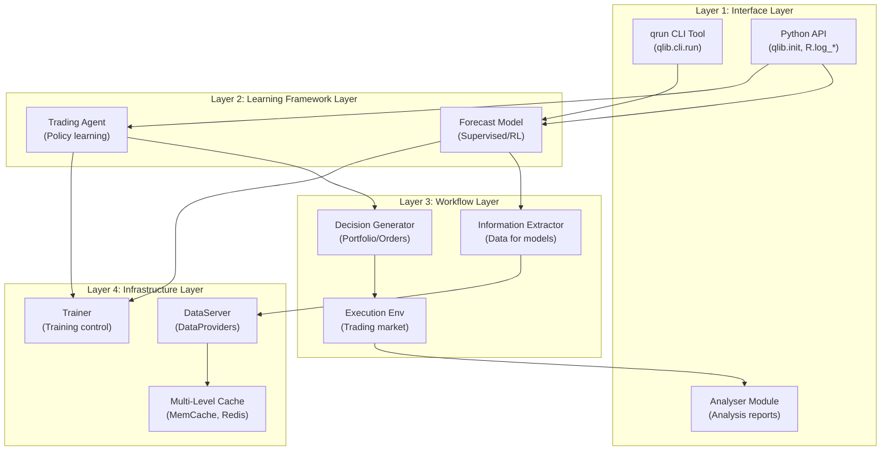
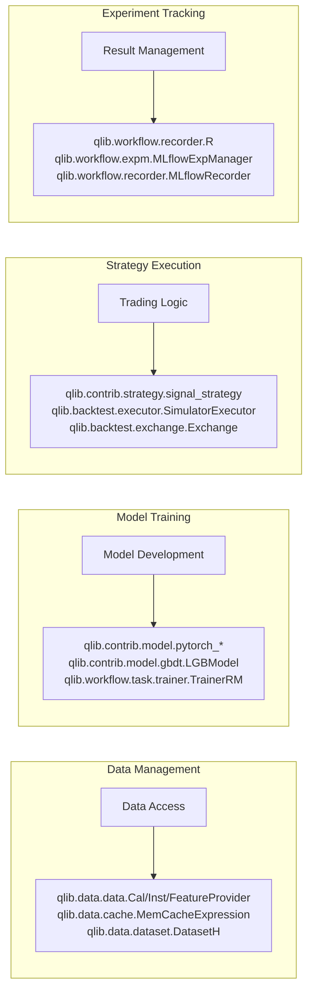
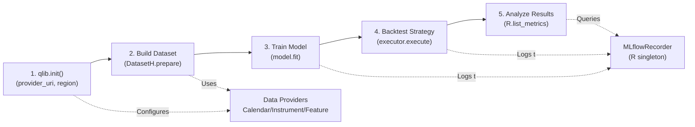
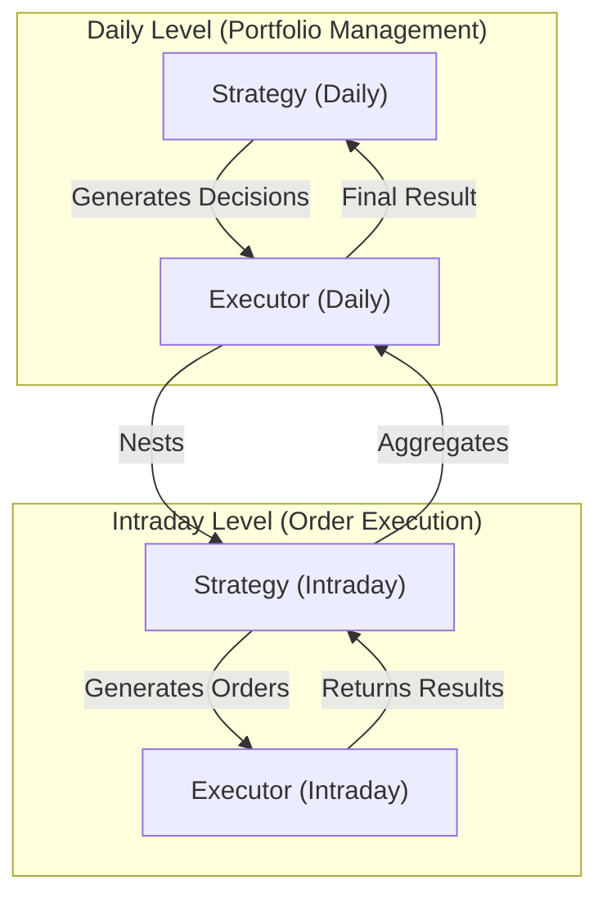

<!-- source: DeepWiki mcp.deepwiki.com · repo microsoft/qlib · page 1 Introduction to Qlib · fetched 2026-10-26 -->

# Introduction to Qlib

<details>
<summary>Relevant source files</summary>

The following files were used as context for generating this wiki page:

- [README.md](README.md)
- [docs/_static/img/framework.png](docs/_static/img/framework.png)
- [docs/component/highfreq.rst](docs/component/highfreq.rst)
- [docs/introduction/introduction.rst](docs/introduction/introduction.rst)
- [docs/start/initialization.rst](docs/start/initialization.rst)
- [docs/start/installation.rst](docs/start/installation.rst)
- [examples/benchmarks/README.md](examples/benchmarks/README.md)
- [examples/benchmarks/TFT/README.md](examples/benchmarks/TFT/README.md)
- [examples/benchmarks/TFT/requirements.txt](examples/benchmarks/TFT/requirements.txt)
- [examples/run_all_model.py](examples/run_all_model.py)

</details>


## Purpose and Scope

Qlib is an AI-oriented quantitative investment platform designed to realize the potential of machine learning technologies in quantitative trading. This page provides a high-level overview of Qlib's architecture, key concepts, and design philosophy.

**What Qlib Provides:**
- A complete machine learning pipeline for quantitative investment: data collection → feature engineering → model training → backtesting → production deployment [docs/introduction/introduction.rst:46-60]().
- Support for diverse ML paradigms: supervised learning, reinforcement learning, and market dynamics modeling [docs/introduction/introduction.rst:39-44]().
- Modular, loosely-coupled components that can be used independently or as a complete system [docs/introduction/introduction.rst:23-27]().
- High-performance data infrastructure with multi-level caching [docs/start/initialization.rst:53-65]().
- Production-ready experiment tracking and distributed training capabilities [docs/start/initialization.rst:66-91]().

Sources: [README.md:82-87](), [docs/introduction/introduction.rst:1-65]()

---

## Core Concepts

Qlib organizes quantitative investment research around four fundamental workflows:

| Workflow Stage | Description | Key Components |
|----------------|-------------|----------------|
| **Data Management** | Collection, storage, and efficient access to financial data | `DataProvider`, `ExpressionProvider`, `Cache` [docs/introduction/introduction.rst:33-37]() |
| **Alpha Seeking** | Building forecasting models to predict future returns | `Model`, `Dataset`, `Trainer` [examples/benchmarks/README.md:1-11]() |
| **Portfolio Construction** | Converting predictions into trading decisions | `BaseStrategy`, `BaseExecutor` [docs/component/highfreq.rst:24-29]() |
| **Evaluation & Production** | Backtesting, analysis, and online deployment | `Exchange`, `Recorder`, `OnlineManager` [docs/introduction/introduction.rst:62-65]() |

### Key Terminology

- **Alpha**: A signal or pattern that predicts future stock returns. In Qlib, models output alpha scores for each stock each day [examples/benchmarks/README.md:1-6]().
- **Expression**: A domain-specific language for defining features (e.g., price operators). Calculated via the expression engine using multiple `kernels` for speed [docs/start/initialization.rst:96-98]().
- **Recorder**: Experiment tracking mechanism that logs parameters, metrics, and artifacts (backed by `MLflowExpManager`) [docs/start/initialization.rst:66-79]().
- **Task**: A unit of work in distributed training, managed by `mongo` settings for high performance and clustered processing [docs/start/initialization.rst:80-91]().

Sources: [README.md:82-87](), [docs/introduction/introduction.rst:49-60](), [examples/benchmarks/README.md:1-11](), [docs/start/initialization.rst:40-98]()

---

## System Architecture Overview

### High-Level Layer Architecture

Qlib is organized into four conceptual layers as defined in the framework documentation [docs/introduction/introduction.rst:15-65]():



**Layer Responsibilities:**

1. **Interface Layer**: Present user-friendly interfaces and detailed analysis reports of forecasting signals and execution results [docs/introduction/introduction.rst:62-65]().
2. **Learning Framework Layer**: Trainable models (Forecast Model) and Trading Agents based on reinforcement or supervised learning [docs/introduction/introduction.rst:39-44]().
3. **Workflow Layer**: Covers the whole workflow from extraction to decision generation and execution in a nested environment [docs/introduction/introduction.rst:46-60]().
4. **Infrastructure Layer**: Provides underlying support for Quant research, including high-performance data management (`DataServer`) and flexible training interfaces (`Trainer`) [docs/introduction/introduction.rst:33-37]().

Sources: [docs/introduction/introduction.rst:1-71](), [docs/component/highfreq.rst:24-29]()

---

## Component-to-Code Mapping

This diagram maps conceptual components to actual Python classes and modules:



### Key Class Hierarchy

| Abstract Base | Concrete Implementations | Purpose |
|--------------|--------------------------|---------|
| `Model` | `LGBModel`, `GRU`, `LSTM`, `ALSTM`, `TabNet`, `TCN` | Forecasting stock returns [examples/benchmarks/README.md:27-46]() |
| `BaseStrategy` | `TopkDropoutStrategy`, `TWAPStrategy` | Converting predictions to trades [docs/introduction/introduction.rst:51-53]() |
| `BaseExecutor` | `SimulatorExecutor`, `NestedExecutor` | Simulating order execution [docs/component/highfreq.rst:24-29]() |
| `DataHandler` | `DataHandlerLP`, `Alpha158`, `Alpha360` | Feature engineering pipelines [examples/benchmarks/README.md:25-48]() |
| `Trainer` | `TrainerR`, `TrainerRM`, `DelayTrainerRM` | Model training orchestration [docs/introduction/introduction.rst:35-37]() |

Sources: [docs/introduction/introduction.rst:33-65](), [examples/benchmarks/README.md:23-73]()

---

## Typical Research Workflow

### End-to-End Pipeline



### Code Example Flow

```python
# 1. Initialize system [docs/start/initialization.rst:24-33]
import qlib
from qlib.constant import REG_CN
qlib.init(provider_uri="~/.qlib/qlib_data/cn_data", region=REG_CN)

# 2. Prepare dataset [examples/benchmarks/README.md:25]
from qlib.contrib.data.handler import Alpha158
# dataset = DatasetH(handler=Alpha158(instruments="csi300"))

# 3. Train model [examples/benchmarks/README.md:45]
from qlib.contrib.model.gbdt import LGBModel
model = LGBModel()
# model.fit(dataset)

# 4. Backtest [docs/component/highfreq.rst:24-29]
# strategy = TopkDropoutStrategy(model=model, topk=50)
# executor = SimulatorExecutor()
# portfolio = executor.execute(strategy=strategy)

# 5. Analyze [examples/run_all_model.py:151-165]
from qlib.workflow import R
# recorder = R.get_recorder(recorder_id=id, experiment_name=name)
# metrics = recorder.list_metrics()
```

**Automated Alternative**: Use the `qrun` tool with a YAML configuration to automate the entire pipeline [docs/introduction/introduction.rst:62-65]().

Sources: [docs/start/initialization.rst:24-33](), [docs/introduction/introduction.rst:46-65](), [examples/run_all_model.py:151-165]()

---

## Design Philosophy

### Modularity and Loose Coupling

Qlib components are designed as loose-coupled modules where each component can be used stand-alone [docs/introduction/introduction.rst:23-27]().

- **Data layer**: High-performance infrastructure for raw data management [docs/introduction/introduction.rst:33-35]().
- **Model layer**: Flexible interfaces for supervised and reinforcement learning [docs/introduction/introduction.rst:39-44]().
- **Execution layer**: Nested decision framework supporting multiple levels of strategy and executor [docs/component/highfreq.rst:20-29]().

### Performance-First Data Architecture

The data layer achieves significant speedup over traditional databases through a multi-level caching system and binary storage format.

1. **Binary format**: Optimized storage for fast retrieval (converted from CSV via `get_data.py`) [docs/start/initialization.rst:15-19]().
2. **Expression caching**: Domain-specific language for feature definition with multi-process kernel support [docs/start/initialization.rst:96-98]().
3. **Redis integration**: The lock and cache mechanism relies on Redis for high performance [docs/start/initialization.rst:53-65]().

Sources: [docs/start/initialization.rst:15-98](), [docs/introduction/introduction.rst:33-37]()

---

## Nested Decision Execution Framework

Qlib supports joint backtesting of daily trading (e.g., portfolio management) and intraday trading (e.g., order execution) [docs/component/highfreq.rst:11-20]().



This framework allows users to explore the effects of combining different levels of trading strategies and breaks down optimization barriers between levels [docs/component/highfreq.rst:24-29]().

Sources: [docs/component/highfreq.rst:1-30]()

---

## Model Zoo and Benchmarks

Qlib includes 20+ pre-implemented models across multiple paradigms, evaluated on standard datasets like `Alpha158` and `Alpha360` [examples/benchmarks/README.md:1-11]().

### Key Model Paradigms
- **GBDT Variants**: LightGBM, XGBoost, CatBoost [examples/benchmarks/README.md:41-45]().
- **Deep Learning**: GRU, LSTM, ALSTM, TCN, Transformer, Localformer, TFT [examples/benchmarks/README.md:29-43]().
- **Specialized Architectures**: TabNet, SFM, GATs, TRA, DoubleEnsemble [examples/benchmarks/README.md:35-46]().

**Performance Metrics**: Evaluated using IC (Information Coefficient), ICIR, Rank IC, Annualized Return, and Information Ratio [examples/benchmarks/README.md:27-28](). Systematic evaluation is supported via `run_all_model.py` [examples/run_all_model.py:134-165]().

Sources: [examples/benchmarks/README.md:1-73](), [examples/run_all_model.py:134-165]()

---

## Next Steps

1. **Installation**: Follow the guide in [Installation and Setup](#2) using `pip install pyqlib` or from source [docs/start/installation.rst:16-33]().
2. **Initialization**: Initialize Qlib with your data provider URI and region [docs/start/initialization.rst:24-33]().
3. **Run Benchmarks**: Try existing models using the `examples/benchmarks` directory [examples/benchmarks/README.md:1-11]().
4. **Custom Development**: Extend `Model`, `BaseStrategy`, or `DataHandler` for custom research [docs/introduction/introduction.rst:67-68]().

Sources: [docs/start/installation.rst:1-47](), [docs/start/initialization.rst:1-98]()

---

