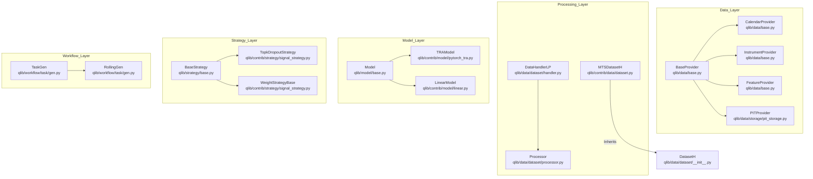
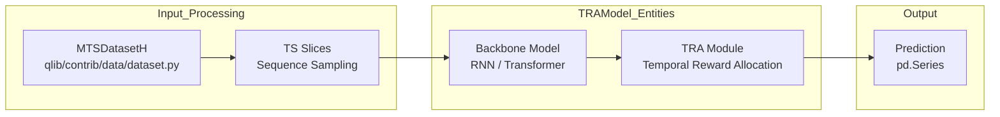

<!-- source: DeepWiki mcp.deepwiki.com · repo microsoft/qlib · page 10 Advanced Topics · fetched 2026-10-26 -->

# Advanced Topics

<details>
<summary>Relevant source files</summary>

The following files were used as context for generating this wiki page:

- [CHANGES.rst](CHANGES.rst)
- [README.md](README.md)
- [docs/_static/img/online_serving.png](docs/_static/img/online_serving.png)
- [docs/advanced/alpha.rst](docs/advanced/alpha.rst)
- [docs/advanced/task_management.rst](docs/advanced/task_management.rst)
- [docs/component/data.rst](docs/component/data.rst)
- [docs/component/model.rst](docs/component/model.rst)
- [docs/component/online.rst](docs/component/online.rst)
- [docs/component/report.rst](docs/component/report.rst)
- [docs/component/strategy.rst](docs/component/strategy.rst)
- [docs/conf.py](docs/conf.py)
- [docs/index.rst](docs/index.rst)
- [docs/introduction/quick.rst](docs/introduction/quick.rst)
- [docs/reference/api.rst](docs/reference/api.rst)
- [docs/start/getdata.rst](docs/start/getdata.rst)
- [docs/start/initialization.rst](docs/start/initialization.rst)
- [docs/start/installation.rst](docs/start/installation.rst)
- [docs/start/integration.rst](docs/start/integration.rst)
- [examples/benchmarks/README.md](examples/benchmarks/README.md)
- [examples/benchmarks/TFT/README.md](examples/benchmarks/TFT/README.md)
- [examples/benchmarks/TFT/requirements.txt](examples/benchmarks/TFT/requirements.txt)
- [examples/run_all_model.py](examples/run_all_model.py)

</details>


This page covers specialized features and advanced usage patterns that extend beyond the core Qlib workflow. These topics enable users to handle non-stationary financial environments, implement memory-augmented models, and leverage reinforcement learning for execution.

For core system architecture, see [Core System Architecture](#3). For standard model development, see [Model Development](#5). For workflow execution, see [Workflow and Experiment Management](#8).

## Overview of Advanced Features

Advanced Topics encompasses seven major areas:

1.  **Point-in-Time (PIT) Data** ([Point-in-Time (PIT) Data](#10.1)) - Handling financial statement data with temporal constraints to avoid look-ahead bias.
2.  **Custom Model Integration** ([Custom Model Integration](#10.2)) - Implementing custom forecasting models by subclassing `qlib.model.base.Model`.
3.  **Custom Strategy Development** ([Custom Strategy Development](#10.3)) - Creating custom trading strategies by implementing `qlib.strategy.base.BaseStrategy`.
4.  **Market Dynamics Modeling and DDG-DA** ([Market Dynamics Modeling and DDG-DA](#10.4)) - Handling non-stationary environments using Data Distribution Generation for Data Augmentation.
5.  **Portfolio Optimization** ([Portfolio Optimization](#10.5)) - Advanced risk modeling and mean-variance optimization frameworks.
6.  **Reinforcement Learning for Order Execution** ([Reinforcement Learning for Order Execution](#10.6)) - RL-based policies for minimizing execution cost and market impact.
7.  **High-Frequency Trading Support** ([High-Frequency Trading Support](#10.7)) - Specialized handlers and operators for intraday and minute-level data.

## Extension Points in Qlib

Qlib provides well-defined extension points for customization. The diagram below maps extensible components to their base classes and file locations:

**Diagram: Qlib Extension Points and Base Classes**



Sources: [qlib/model/base.py:18-18](), [docs/component/strategy.rst:22-22](), [docs/component/strategy.rst:34-34](), [docs/advanced/task_management.rst:32-32](), [docs/advanced/task_management.rst:36-36]()

## Customization and Specialized Modeling

Qlib's advanced capabilities often involve bridging the gap between standard forecasting and complex financial constraints.

### Temporal Reward Allocation (TRA) and MTSDatasetH

One of Qlib's advanced modeling patterns involves **Temporal Reward Allocation (TRA)**, which addresses the noise and non-stationarity in financial time series by learning to weight historical information. The `MTSDatasetH` (Memory Augmented Time Series Dataset) class extends `DatasetH` to support models that require historical state tracking.

**Diagram: TRA Model Data Flow**



Sources: [examples/benchmarks/README.md:38-40](), [docs/start/integration.rst:8-14]()

### Market Dynamics and DDG-DA (Overview)

Financial markets are highly non-stationary. Qlib provides the **DDG-DA (Data Distribution Generation for Data Augmentation)** framework to model these dynamics. This involves meta-learning for data selection and handling distribution shifts in rolling environments.

**For details on handling market dynamics, see [Market Dynamics Modeling and DDG-DA](#10.4).**

## Point-in-Time (PIT) Data (Overview)

Point-in-Time data ensures that backtests only use information available at decision time, preventing look-ahead bias in fundamental data (e.g., financial statements).

### PIT Operators
Qlib's expression engine includes specialized operators for PIT data:
- `P()`: Fetches the value of a fundamental field at a specific point in time.
- `PRef()`: References a PIT value from $N$ periods ago.

**Example Usage in Feature Engineering:**
```python
# Formulaic Alpha with PIT (Conceptual)
MACD_EXP = '2 * ((EMA($close, 12) - EMA($close, 26))/$close - EMA((EMA($close, 12) - EMA($close, 26))/$close, 9))'
```
Sources: [docs/advanced/alpha.rst:54-54](), [README.md:56-56]()

**For detailed PIT workflows, see [Point-in-Time (PIT) Data](#10.1).**

## Advanced Strategy and Optimization (Overview)

Qlib moves beyond simple rule-based strategies to include portfolio optimization and reinforcement learning.

### Portfolio Optimization
The framework supports complex risk models and optimizers like `EnhancedIndexingOptimizer`. These integrate with signal-based strategies to control tracking error relative to a benchmark.

### Reinforcement Learning for Execution
For high-frequency or large-order scenarios, Qlib provides RL environments (SAOE simulators) and policies (PPO/OPDS) to optimize execution trajectories by minimizing market impact.

**For details, see [Portfolio Optimization](#10.5) and [Reinforcement Learning for Order Execution](#10.6).**

## Summary of Advanced Components

| Component | Code Entity | Purpose |
| :--- | :--- | :--- |
| **Memory Dataset** | `MTSDatasetH` | Handles time-series slices and historical state for models like TRA. |
| **Dynamic Modeling** | `DDG-DA` | Implements data augmentation for non-stationary markets. |
| **Strategy Base** | `BaseStrategy` | Core interface for custom trade decision logic. |
| **Weight Strategy** | `WeightStrategyBase` | Focuses on target weight positions rather than raw orders. |
| **Optimizer** | `EnhancedIndexingOptimizer` | Balances alpha seeking with risk exposure/tracking error. |

Sources: [docs/component/strategy.rst:22-30](), [docs/component/strategy.rst:37-55](), [docs/component/strategy.rst:91-98](), [README.md:52-58]()

---

