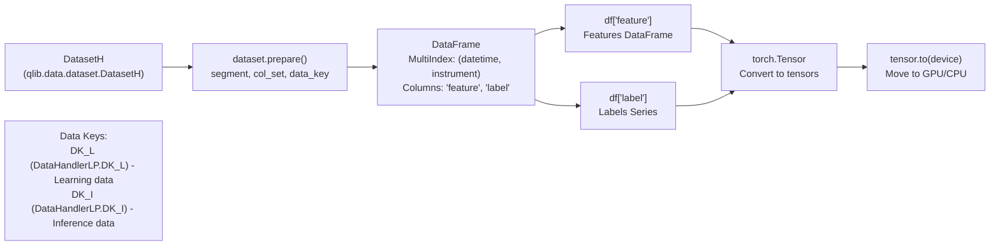
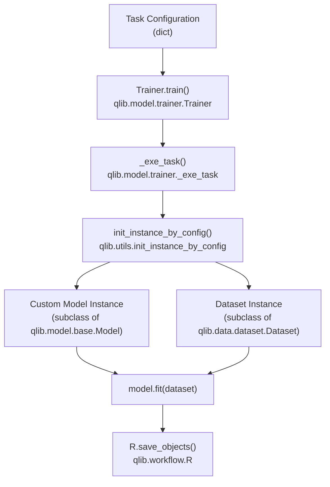

<!-- source: DeepWiki mcp.deepwiki.com · repo microsoft/qlib · page 10.2 Custom Model Integration · fetched 2026-10-26 -->

# Custom Model Integration

<details>
<summary>Relevant source files</summary>

The following files were used as context for generating this wiki page:

- [examples/model_rolling/task_manager_rolling.py](examples/model_rolling/task_manager_rolling.py)
- [examples/online_srv/update_online_pred.py](examples/online_srv/update_online_pred.py)
- [qlib/contrib/model/catboost_model.py](qlib/contrib/model/catboost_model.py)
- [qlib/contrib/model/gbdt.py](qlib/contrib/model/gbdt.py)
- [qlib/contrib/model/pytorch_alstm.py](qlib/contrib/model/pytorch_alstm.py)
- [qlib/contrib/model/pytorch_alstm_ts.py](qlib/contrib/model/pytorch_alstm_ts.py)
- [qlib/contrib/model/pytorch_gats.py](qlib/contrib/model/pytorch_gats.py)
- [qlib/contrib/model/pytorch_gats_ts.py](qlib/contrib/model/pytorch_gats_ts.py)
- [qlib/contrib/model/pytorch_gru.py](qlib/contrib/model/pytorch_gru.py)
- [qlib/contrib/model/pytorch_gru_ts.py](qlib/contrib/model/pytorch_gru_ts.py)
- [qlib/contrib/model/pytorch_lstm.py](qlib/contrib/model/pytorch_lstm.py)
- [qlib/contrib/model/pytorch_lstm_ts.py](qlib/contrib/model/pytorch_lstm_ts.py)
- [qlib/contrib/model/pytorch_nn.py](qlib/contrib/model/pytorch_nn.py)
- [qlib/contrib/model/pytorch_sfm.py](qlib/contrib/model/pytorch_sfm.py)
- [qlib/contrib/model/pytorch_tabnet.py](qlib/contrib/model/pytorch_tabnet.py)
- [qlib/contrib/model/xgboost.py](qlib/contrib/model/xgboost.py)
- [qlib/model/base.py](qlib/model/base.py)
- [qlib/model/trainer.py](qlib/model/trainer.py)
- [qlib/workflow/task/collect.py](qlib/workflow/task/collect.py)
- [qlib/workflow/task/gen.py](qlib/workflow/task/gen.py)
- [qlib/workflow/task/manage.py](qlib/workflow/task/manage.py)
- [qlib/workflow/task/utils.py](qlib/workflow/task/utils.py)

</details>


This page explains how to integrate custom prediction models into Qlib by implementing the `Model` interface. This allows you to use your own machine learning models within Qlib's training, evaluation, and backtesting workflows.

**Scope**: This guide covers creating custom models compatible with Qlib's `DatasetH`, `Trainer`, and experiment tracking systems. For information about using existing models, see [Model Zoo: PyTorch Deep Learning Models](). For custom strategies that use model predictions, see [Custom Strategy Development]().

---

## Model Interface Contract

All Qlib models must inherit from the `Model` base class and implement required methods. For tree-based models supporting fine-tuning, the `ModelFT` class is used.

| Method | Purpose | Required |
|--------|---------|----------|
| `fit(dataset, evals_result, save_path)` | Train the model on a `DatasetH` | Yes |
| `predict(dataset, segment)` | Generate predictions for a dataset segment | Yes |
| `finetune(dataset, ...)` | Further train an existing model on new data | Optional (in `ModelFT`) |
| `save(filename, **kwargs)` | Persist model to disk | Optional (for workflow integration) |
| `load(buffer, **kwargs)` | Restore model from disk | Optional (for workflow integration) |

**Sources:** [qlib/model/base.py:1-50](), [qlib/contrib/model/gbdt.py:8-112]()

---

## Model Class Hierarchy

The following diagram maps the logical model types to their specific implementation classes in the codebase.

### Model Architecture Overview

```mermaid
graph TB
    Model["Model<br/>(Base Interface)<br/>qlib.model.base.Model"]
    
    DNNModelPytorch["DNNModelPytorch<br/>qlib.contrib.model.pytorch_nn.DNNModelPytorch<br/>Generic DNN wrapper"]
    
    GRU["GRU<br/>qlib.contrib.model.pytorch_gru.GRU"]
    LSTM["LSTM<br/>qlib.contrib.model.pytorch_lstm.LSTM"]
    ALSTM["ALSTM<br/>qlib.contrib.model.pytorch_alstm.ALSTM"]
    GATs["GATs<br/>qlib.contrib.model.pytorch_gats.GATs"]
    SFM["SFM<br/>qlib.contrib.model.pytorch_sfm.SFM"]
    TabNet["TabnetModel<br/>qlib.contrib.model.pytorch_tabnet.TabnetModel"]
    
    GRU_TS["GRU (TS variant)<br/>qlib.contrib.model.pytorch_gru_ts.GRU"]
    LSTM_TS["LSTM (TS variant)<br/>qlib.contrib.model.pytorch_lstm_ts.LSTM"]
    ALSTM_TS["ALSTM (TS variant)<br/>qlib.contrib.model.pytorch_alstm_ts.ALSTM"]
    GATs_TS["GATs (TS variant)<br/>qlib.contrib.model.pytorch_gats_ts.GATs"]
    
    Model --> DNNModelPytorch
    Model --> GRU
    Model --> LSTM
    Model --> ALSTM
    Model --> GATs
    Model --> SFM
    Model --> TabNet
    Model --> GRU_TS
    Model --> LSTM_TS
    Model --> ALSTM_TS
    Model --> GATs_TS
    
    Note1["Note: All models implement<br/>fit(), predict(), save(), load()"]
```


**Key Differences**:
- **Standard variants** (e.g., `GRU`): Work with flattened feature vectors, typically using numpy-based batching [qlib/contrib/model/pytorch_gru.py:165-179]().
- **TS variants** (e.g., `GRU_TS`): Work with time-series sequences, utilizing `torch.utils.data.DataLoader` with custom samplers for efficient sequential indexing [qlib/contrib/model/pytorch_gru_ts.py:164-178]().
- **DNNModelPytorch**: Highly configurable via `pt_model_uri` and `pt_model_kwargs` for flexible architecture specification [qlib/contrib/model/pytorch_nn.py:73-80]().

**Sources:** [qlib/contrib/model/pytorch_nn.py:39-56](), [qlib/contrib/model/pytorch_gru.py:25-38](), [qlib/contrib/model/pytorch_gru_ts.py:26-39]()

---

## Standard Implementation Pattern

### Constructor: Initialize Hyperparameters and Model

When implementing `__init__`, parameters should include model architecture settings, optimization settings, and hardware configuration.

```python
# Example initialization from ALSTM
def __init__(self, d_feat=6, hidden_size=64, num_layers=2, dropout=0.0, 
             n_epochs=200, lr=0.001, metric="", batch_size=2000, 
             early_stop=20, loss="mse", optimizer="adam", GPU=0, seed=None, **kwargs):
    self.logger = get_module_logger("ALSTM")
    # ... parameter assignment ...
    self.device = torch.device("cuda:%d" % (GPU) if torch.cuda.is_available() and GPU >= 0 else "cpu")
    if self.seed is not None:
        np.random.seed(self.seed)
        torch.manual_seed(self.seed)
    # Instantiate the internal nn.Module
    self.ALSTM_model = ALSTMModel(d_feat=self.d_feat, ...)
    self.ALSTM_model.to(self.device)
```

**Key Components**:
- **Logger**: Use `get_module_logger()` for consistent Qlib logging [qlib/contrib/model/pytorch_alstm.py:58]().
- **Device**: Handle `torch.device` selection based on `GPU` ID [qlib/contrib/model/pytorch_alstm.py:73]().
- **Seed**: Ensure reproducibility across numpy and PyTorch [qlib/contrib/model/pytorch_alstm.py:109-111]().
- **Optimizer**: Support standard strings like "adam" or "gd" [qlib/contrib/model/pytorch_alstm.py:122-127]().

**Sources:** [qlib/contrib/model/pytorch_alstm.py:40-130](), [qlib/contrib/model/pytorch_lstm.py:39-126]()

---

## Data Integration with DatasetH

### Dataset Preparation Flow

The interaction between the Model and the Data layer is governed by the `DatasetH.prepare()` method.

### Data Flow Diagram


### Data Preparation Code Pattern

```python
# From LGBModel._prepare_data
def _prepare_data(self, dataset: DatasetH, reweighter=None):
    ds_l = []
    for key in ["train", "valid"]:
        if key in dataset.segments:
            df = dataset.prepare(key, col_set=["feature", "label"], data_key=DataHandlerLP.DK_L)
            x, y = df["feature"], df["label"]
            # ... process weights and convert to provider-specific format ...
```

**Data Keys**:
- `DataHandlerLP.DK_L` (learning): Data with processors applied in learning mode (e.g., fit normalizers) [qlib/data/dataset/handler.py:50-60]().
- `DataHandlerLP.DK_I` (inference): Data with processors applied in inference mode (e.g., use fitted normalizers) [qlib/contrib/model/gbdt.py:95]().
- Use `DK_L` for training/validation, `DK_I` for testing/prediction.

**Sources:** [qlib/contrib/model/gbdt.py:28-55](), [qlib/contrib/model/pytorch_gru.py:209-239]()

---

## Training Loop Implementation

### Complete fit() Method Structure

The `fit` method typically follows a standardized lifecycle:

1.  **Data Retrieval**: Fetch segments (train/valid) from the dataset [qlib/contrib/model/pytorch_gru.py:216-225]().
2.  **State Initialization**: Setup tracking for `best_score`, `stop_steps`, and `evals_result` [qlib/contrib/model/pytorch_gru.py:240-246]().
3.  **Epoch Loop**:
    *   `train_epoch()`: Shuffle and iterate over mini-batches [qlib/contrib/model/pytorch_gru.py:162-179]().
    *   `test_epoch()`: Evaluate performance on validation data [qlib/contrib/model/pytorch_gru.py:180-207]().
4.  **Early Stopping**: Check if the validation metric has improved; if not, increment `stop_steps`. Stop if `stop_steps >= early_stop` [qlib/contrib/model/pytorch_gru.py:270-273]().
5.  **Checkpointing**: Save the `best_param` when a new best score is reached [qlib/contrib/model/pytorch_gru.py:263-268]().

### Loss and Metric Functions

Models must handle missing values in labels, as financial data often contains NaNs (e.g., due to stock suspension).

```python
# From GRU implementation
def loss_fn(self, pred, label):
    mask = ~torch.isnan(label) # Ignore NaNs in loss
    if self.loss == "mse":
        return self.mse(pred[mask], label[mask])
    raise ValueError("unknown loss `%s`" % self.loss)

def metric_fn(self, pred, label):
    mask = torch.isfinite(label)
    if self.metric in ("", "loss"):
        return -self.loss_fn(pred[mask], label[mask])
```

**Sources:** [qlib/contrib/model/pytorch_gru.py:136-154](), [qlib/contrib/model/pytorch_lstm.py:132-150]()

---

## Prediction Implementation

The `predict` method generates signals for a specific segment (usually "test").

```python
def predict(self, dataset: DatasetH, segment: Union[Text, slice] = "test"):
    if not self.fitted:
        raise ValueError("model is not fitted yet!")
    
    # Use DK_I for inference
    x_test = dataset.prepare(segment, col_set="feature", data_key=DataHandlerLP.DK_I)
    index = x_test.index
    self.gru_model.eval()
    x_values = x_test.values
    # ... batch inference loop ...
    return pd.Series(np.concatenate(preds), index=index)
```

**Key Requirements**:
- Must return a `pd.Series` or `pd.DataFrame` [qlib/contrib/model/pytorch_gru.py:316]().
- Must preserve the input `index` (MultiIndex of datetime and instrument) [qlib/contrib/model/pytorch_gru.py:298-316]().
- Should use `torch.no_grad()` to save memory during inference [qlib/contrib/model/pytorch_gru.py:311]().

**Sources:** [qlib/contrib/model/pytorch_gru.py:292-316](), [qlib/contrib/model/gbdt.py:92-96]()

---

## Model Persistence

### Save and Load
Qlib uses specialized utilities to handle model serialization, allowing models to be saved as part of the experiment recorder.

*   **Save**: Custom implementations often use `torch.save` or `save_multiple_parts_file` to handle state dicts [qlib/contrib/model/pytorch_nn.py:389-393]().
*   **Load**: Custom implementations use `torch.load` or `unpack_archive_with_buffer` to restore state [qlib/contrib/model/pytorch_nn.py:395-404]().

**Sources:** [qlib/contrib/model/pytorch_nn.py:389-404](), [qlib/utils/__init__.py:29-31]()

---

## Integration with Trainer and Task Management

Custom models are integrated into the workflow via task configurations. The `Trainer` class (and its variants like `TrainerR` or `TrainerRM`) handles the instantiation and execution of the model's lifecycle.

### Training Workflow Diagram


**Task Lifecycle**:
- **Initialization**: `_exe_task` uses `init_instance_by_config` to create the model and dataset from the provided dictionary [qlib/model/trainer.py:42-46]().
- **Execution**: The model's `fit` method is called with the dataset and an optional `reweighter` [qlib/model/trainer.py:49]().
- **Recording**: After training, the model instance is saved as `params.pkl` using the current recorder `R` [qlib/model/trainer.py:50]().

**Sources:** [qlib/model/trainer.py:42-53](), [qlib/workflow/task/manage.py:79-82]()

---

## Advanced Features

### Time-Series (TS) Variants
TS variants use `qlib.model.utils.ConcatDataset` and `torch.utils.data.DataLoader` for high-performance sequential data access. Some models implement a `DailyBatchSampler` to ensure that data for the same day is processed together in GNN-based architectures.

**Sources:** [qlib/contrib/model/pytorch_gats_ts.py:26-42](), [qlib/contrib/model/pytorch_gru_ts.py:164-178]()

### Sample Reweighting
Models can integrate with the `Reweighter` class to adjust the importance of training samples based on market conditions or data quality.

```python
# From LGBModel.fit
if reweighter is None:
    w = None
elif isinstance(reweighter, Reweighter):
    w = reweighter.reweight(df)
```

**Sources:** [qlib/contrib/model/gbdt.py:48-54](), [qlib/data/dataset/weight.py:12](), [qlib/model/trainer.py:49]()

### Multi-GPU Support
`DNNModelPytorch` supports `torch.nn.DataParallel` for distributing training across multiple GPUs when `data_parall` is enabled in the configuration.

**Sources:** [qlib/contrib/model/pytorch_nn.py:69-136]()

---

