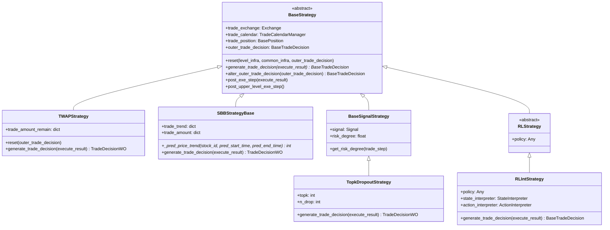
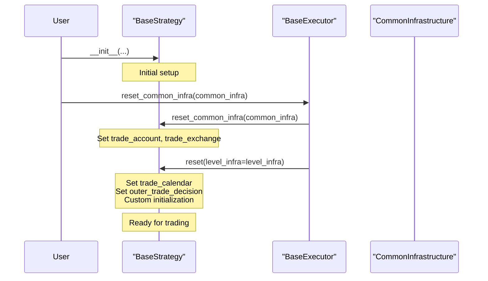
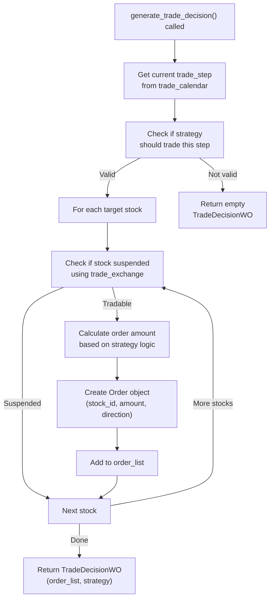
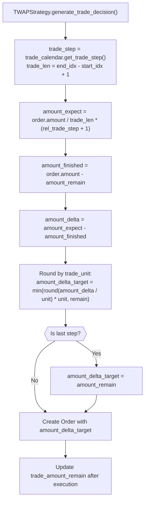
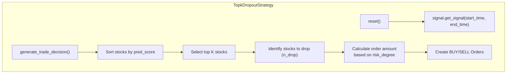

<!-- source: DeepWiki mcp.deepwiki.com · repo microsoft/qlib · page 10.3 Custom Strategy Development · fetched 2026-10-26 -->

# Custom Strategy Development

<details>
<summary>Relevant source files</summary>

The following files were used as context for generating this wiki page:

- [examples/benchmarks/TRA/src/model.py](examples/benchmarks/TRA/src/model.py)
- [examples/orderbook_data/README.md](examples/orderbook_data/README.md)
- [qlib/backtest/__init__.py](qlib/backtest/__init__.py)
- [qlib/backtest/account.py](qlib/backtest/account.py)
- [qlib/backtest/backtest.py](qlib/backtest/backtest.py)
- [qlib/backtest/executor.py](qlib/backtest/executor.py)
- [qlib/backtest/position.py](qlib/backtest/position.py)
- [qlib/backtest/signal.py](qlib/backtest/signal.py)
- [qlib/backtest/utils.py](qlib/backtest/utils.py)
- [qlib/contrib/data/processor.py](qlib/contrib/data/processor.py)
- [qlib/contrib/model/pytorch_adarnn.py](qlib/contrib/model/pytorch_adarnn.py)
- [qlib/contrib/strategy/rule_strategy.py](qlib/contrib/strategy/rule_strategy.py)
- [qlib/contrib/strategy/signal_strategy.py](qlib/contrib/strategy/signal_strategy.py)
- [qlib/model/riskmodel/base.py](qlib/model/riskmodel/base.py)
- [qlib/model/riskmodel/poet.py](qlib/model/riskmodel/poet.py)
- [qlib/model/riskmodel/shrink.py](qlib/model/riskmodel/shrink.py)
- [qlib/model/riskmodel/structured.py](qlib/model/riskmodel/structured.py)
- [qlib/strategy/base.py](qlib/strategy/base.py)
- [tests/test_structured_cov_estimator.py](tests/test_structured_cov_estimator.py)

</details>


## Purpose and Scope

This document explains how to develop custom trading strategies in Qlib by subclassing `BaseStrategy` and implementing the `generate_trade_decision` method. Custom strategies define trading logic that generates orders based on market data, portfolio state, and model predictions.

**Related pages:**
- For information about executing strategies with different frequencies, see [7.2 Executors and Nested Execution]()
- For pre-built strategy implementations, see [7.1 Trading Strategies]()
- For information about the backtesting workflow, see [7 Backtesting and Strategy Execution]()

---

## BaseStrategy Interface

All custom strategies must subclass `BaseStrategy` and implement the abstract `generate_trade_decision` method. The base class provides infrastructure access and lifecycle management.

### Core Abstract Method

[qlib/strategy/base.py:132-146]()

```python
@abstractmethod
def generate_trade_decision(
    self,
    execute_result: list = None,
) -> Union[BaseTradeDecision, Generator[Any, Any, BaseTradeDecision]]:
    """Generate trade decision in each trading bar"""
```

This method is called once per trading step and must return a `BaseTradeDecision` containing a list of `Order` objects.

### Key Properties

The `BaseStrategy` class provides convenient access to infrastructure components:

| Property | Type | Description |
|----------|------|-------------|
| `trade_exchange` | `Exchange` | Market data provider and order execution simulator |
| `trade_calendar` | `TradeCalendarManager` | Trading calendar for time management |
| `trade_position` | `BasePosition` | Current portfolio position |
| `executor` | `BaseExecutor` | The executor managing this strategy |
| `common_infra` | `CommonInfrastructure` | Shared infrastructure (account, exchange) |
| `level_infra` | `LevelInfrastructure` | Level-specific infrastructure (calendar) |
| `outer_trade_decision` | `BaseTradeDecision` | Decision from outer strategy (for nested execution) |

Sources: [qlib/strategy/base.py:62-78]()

---

## Strategy Architecture

### Class Hierarchy



**Diagram: Strategy Class Hierarchy**

Sources: [qlib/strategy/base.py:23-296](), [qlib/contrib/strategy/rule_strategy.py:22-157](), [qlib/contrib/strategy/signal_strategy.py:25-138]()

---

## Strategy Lifecycle

### Initialization and Reset

Strategies follow a two-phase lifecycle: initialization and reset. The `reset` method is called when the strategy is bound to an executor.



**Diagram: Strategy Lifecycle Initialization**

The `reset` method pattern allows strategies to be reused across multiple backtests with different parameters:

[qlib/strategy/base.py:91-131]()

```python
def reset(
    self,
    level_infra: LevelInfrastructure = None,
    common_infra: CommonInfrastructure = None,
    outer_trade_decision: BaseTradeDecision = None,
    **kwargs,
) -> None:
    """Reset infrastructure and outer trade decision"""
```

Sources: [qlib/strategy/base.py:26-131](), [qlib/backtest/executor.py:119-150]()

---

## Implementing generate_trade_decision

The core of any strategy is the `generate_trade_decision` method, which is called once per trading step to produce orders.

### Method Signature and Return Type

[qlib/strategy/base.py:132-146]()

```python
def generate_trade_decision(
    self,
    execute_result: list = None,
) -> Union[BaseTradeDecision, Generator[Any, Any, BaseTradeDecision]]:
```

**Parameters:**
- `execute_result`: List of tuples `(order, trade_val, trade_cost, trade_price)` from the previous step's execution. Used to track what was actually executed. [qlib/backtest/backtest.py:86-90]()

**Return:**
- `BaseTradeDecision` (typically `TradeDecisionWO`) containing a list of `Order` objects. [qlib/contrib/strategy/rule_strategy.py:51-122]()

### Typical Implementation Pattern



**Diagram: Typical generate_trade_decision Flow**

Sources: [qlib/contrib/strategy/rule_strategy.py:43-122]()

---

## Working with Infrastructure Components

### Accessing Market Data via Exchange

The `trade_exchange` property provides access to market data and trading constraints:

**Key Exchange Methods:**

| Method | Purpose | Example Usage |
|--------|---------|---------------|
| `check_stock_suspended(stock_id, start_time, end_time)` | Check if stock is suspended | Skip orders for suspended stocks |
| `is_stock_tradable(stock_id, start_time, end_time)` | Check if stock can be traded | Validate before creating orders |
| `get_amount_of_trade_unit(stock_id, start_time, end_time)` | Get minimum trading unit | Round order amounts |

Example from TWAPStrategy:

[qlib/contrib/strategy/rule_strategy.py:77-80]()

```python
if self.trade_exchange.check_stock_suspended(
    stock_id=order.stock_id, start_time=trade_start_time, end_time=trade_end_time
):
    continue  # Skip suspended stocks
```

Sources: [qlib/contrib/strategy/rule_strategy.py:77-122](), [qlib/backtest/exchange.py:33-110]()

### Managing Time with TradeCalendarManager

The `trade_calendar` property manages trading time:

**Key Calendar Methods:**

| Method | Returns | Purpose |
|--------|---------|---------|
| `get_trade_step()` | `int` | Current step index (0-based) |
| `get_trade_len()` | `int` | Total number of trading steps |
| `get_step_time(trade_step=None, shift=0)` | `Tuple[Timestamp, Timestamp]` | Time range for a step |
| `finished()` | `bool` | Whether trading is complete |

Example from TWAPStrategy:

[qlib/contrib/strategy/rule_strategy.py:54-63]()

```python
trade_step = self.trade_calendar.get_trade_step()
start_idx, end_idx = get_start_end_idx(self.trade_calendar, self.outer_trade_decision)
trade_len = end_idx - start_idx + 1

if trade_step < start_idx or trade_step > end_idx:
    return TradeDecisionWO(order_list=[], strategy=self)
```

Sources: [qlib/contrib/strategy/rule_strategy.py:43-122](), [qlib/backtest/utils.py:23-202]()

### Accessing Portfolio State

The `trade_position` property provides access to current holdings:

**Key Position Methods:**

| Method | Returns | Purpose |
|--------|---------|---------|
| `get_cash()` | `float` | Available cash |
| `get_stock_list()` | `List[str]` | Stocks currently held |
| `get_stock_amount(code)` | `float` | Shares of a stock |
| `calculate_value()` | `float` | Total portfolio value |

Sources: [qlib/backtest/position.py:16-222](), [qlib/strategy/base.py:70-73]()

---

## Example: TWAPStrategy Implementation

TWAP (Time-Weighted Average Price) splits an order evenly across multiple time steps.

### Strategy State Management

[qlib/contrib/strategy/rule_strategy.py:30-42]()

```python
def reset(self, outer_trade_decision: BaseTradeDecision = None, **kwargs):
    super(TWAPStrategy, self).reset(outer_trade_decision=outer_trade_decision, **kwargs)
    if outer_trade_decision is not None:
        self.trade_amount_remain = {}
        for order in outer_trade_decision.get_decision():
            self.trade_amount_remain[order.stock_id] = order.amount
```

### Core Trading Logic



**Diagram: TWAPStrategy Order Splitting Logic**

[qlib/contrib/strategy/rule_strategy.py:82-122]()

Key aspects:
1. **Linear splitting**: Divides total amount by number of steps. [qlib/contrib/strategy/rule_strategy.py:83]()
2. **Rounding to trade units**: Ensures valid order sizes using `trade_exchange.get_amount_of_trade_unit`. [qlib/contrib/strategy/rule_strategy.py:94-106]()
3. **Last step cleanup**: Sells/buys all remaining amount on final step. [qlib/contrib/strategy/rule_strategy.py:110-111]()
4. **State tracking**: Updates `trade_amount_remain` after each execution using `execute_result`. [qlib/contrib/strategy/rule_strategy.py:66-68]()

Sources: [qlib/contrib/strategy/rule_strategy.py:22-123]()

---

## Example: Signal-Based Strategy (TopkDropoutStrategy)

Signal-based strategies use model predictions (signals) to rank and select stocks.

### Signal Processing Architecture



**Diagram: Signal-Based Strategy Architecture**

[qlib/contrib/strategy/signal_strategy.py:138-150]()

```python
def generate_trade_decision(self, execute_result=None):
    trade_step = self.trade_calendar.get_trade_step()
    pred_start_time, pred_end_time = self.trade_calendar.get_step_time(trade_step, shift=1)
    pred_score = self.signal.get_signal(start_time=pred_start_time, end_time=pred_end_time)
```

**Key patterns:**
1. **Signal retrieval**: Signals are typically fetched for the previous bar (`shift=1`) to avoid look-ahead bias. [qlib/contrib/strategy/signal_strategy.py:142-143]()
2. **Risk Degree**: Determines total capital exposure (e.g., 95% of total value). [qlib/contrib/strategy/signal_strategy.py:66-72]()
3. **Tradability Filter**: Optionally checks `is_stock_tradable` before making decisions. [qlib/contrib/strategy/signal_strategy.py:157-164]()

Sources: [qlib/contrib/strategy/signal_strategy.py:25-176]()

---

## Creating Orders

### Order Object Construction

[qlib/backtest/decision.py:23]() (Referenced in [qlib/contrib/strategy/rule_strategy.py:114-120]())

```python
Order(
    stock_id: str,           # Instrument identifier
    amount: float,           # Shares to trade (positive)
    direction: int,          # Order.BUY (1) or Order.SELL (0)
    start_time: Timestamp,   # Order valid from
    end_time: Timestamp,     # Order valid until
    factor: float = 1.0,     # Adjustment factor
)
```

### TradeDecisionWO Construction

[qlib/backtest/decision.py:18]() (Referenced in [qlib/contrib/strategy/rule_strategy.py:122]())

```python
TradeDecisionWO(
    order_list: List[Order],      # List of orders to execute
    strategy: BaseStrategy,        # Reference to strategy
)
```

Example from TWAPStrategy:

[qlib/contrib/strategy/rule_strategy.py:114-122]()

```python
if amount_delta_target > 1e-5:
    _order = Order(
        stock_id=order.stock_id,
        amount=amount_delta_target,
        start_time=trade_start_time,
        end_time=trade_end_time,
        direction=order.direction,
    )
    order_list.append(_order)
return TradeDecisionWO(order_list=order_list, strategy=self)
```

Sources: [qlib/contrib/strategy/rule_strategy.py:114-122](), [qlib/backtest/decision.py:12-23]()

---

## Integration with Backtest Loop

### Strategy-Executor Interaction

```mermaid
sequenceDiagram
    participant Loop as "backtest_loop"
    participant Strategy as "BaseStrategy"
    participant Executor as "BaseExecutor"
    participant Exchange as "Exchange"
    participant Account as "Account"
    
    Loop->>Executor: reset(start_time, end_time)
    Loop->>Strategy: reset(level_infra)
    Note over Strategy: Initialize with calendar
    
    loop Until finished
        Loop->>Strategy: generate_trade_decision(execute_result)
        Strategy->>Strategy: Access trade_exchange, trade_calendar, trade_position
        Strategy-->>Loop: BaseTradeDecision (orders)
        
        Loop->>Executor: collect_data(trade_decision)
        Executor->>Exchange: deal_order() for each order
        Executor->>Account: update_order()
        Executor-->>Loop: execute_result
        
        Loop->>Strategy: post_exe_step(execute_result)
    end
```

**Diagram: Complete Strategy-Executor Interaction**

Sources: [qlib/backtest/backtest.py:53-111](), [qlib/backtest/executor.py:22-126]()

---

## Common Patterns and Best Practices

### 1. State Management

Always track execution state to handle multi-step strategies. TWAP uses `trade_amount_remain` to track progress. [qlib/contrib/strategy/rule_strategy.py:39-41]()

### 2. Defensive Trading Checks

Always validate trading conditions before generating orders.

```python
# Check suspension
if self.trade_exchange.check_stock_suspended(stock_id, start_time, end_time):
    continue
```

Sources: [qlib/contrib/strategy/rule_strategy.py:77-80]()

### 3. Trade Unit Rounding

Always round to valid trade units to ensure orders can be executed by the exchange. [qlib/contrib/strategy/rule_strategy.py:104-106]()

### 4. Handle Last Step Cleanup

Ensure complete execution on final step by assigning all remaining amount to the final order. [qlib/contrib/strategy/rule_strategy.py:110-111]()

### 5. Empty Decision Handling

Return empty decisions when no trades are necessary or possible. [qlib/contrib/strategy/rule_strategy.py:51]()

Sources: [qlib/contrib/strategy/rule_strategy.py:22-123]()

---

