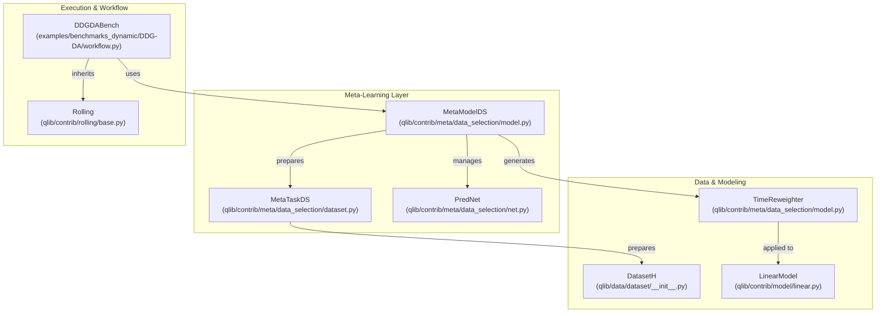
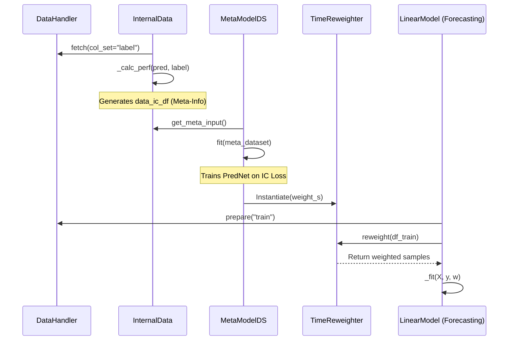

<!-- source: DeepWiki mcp.deepwiki.com · repo microsoft/qlib · page 10.4 Market Dynamics Modeling and DDG-DA · fetched 2026-10-26 -->

# Market Dynamics Modeling and DDG-DA

<details>
<summary>Relevant source files</summary>

The following files were used as context for generating this wiki page:

- [examples/benchmarks_dynamic/DDG-DA/Makefile](examples/benchmarks_dynamic/DDG-DA/Makefile)
- [examples/benchmarks_dynamic/DDG-DA/README.md](examples/benchmarks_dynamic/DDG-DA/README.md)
- [examples/benchmarks_dynamic/DDG-DA/workflow.py](examples/benchmarks_dynamic/DDG-DA/workflow.py)
- [examples/benchmarks_dynamic/README.md](examples/benchmarks_dynamic/README.md)
- [examples/benchmarks_dynamic/baseline/rolling_benchmark.py](examples/benchmarks_dynamic/baseline/rolling_benchmark.py)
- [examples/benchmarks_dynamic/baseline/workflow_config_lightgbm_Alpha158.yaml](examples/benchmarks_dynamic/baseline/workflow_config_lightgbm_Alpha158.yaml)
- [examples/benchmarks_dynamic/baseline/workflow_config_linear_Alpha158.yaml](examples/benchmarks_dynamic/baseline/workflow_config_linear_Alpha158.yaml)
- [qlib/contrib/meta/data_selection/dataset.py](qlib/contrib/meta/data_selection/dataset.py)
- [qlib/contrib/meta/data_selection/model.py](qlib/contrib/meta/data_selection/model.py)
- [qlib/contrib/meta/data_selection/utils.py](qlib/contrib/meta/data_selection/utils.py)
- [qlib/contrib/model/linear.py](qlib/contrib/model/linear.py)
- [qlib/model/meta/task.py](qlib/model/meta/task.py)
- [scripts/README.md](scripts/README.md)
- [scripts/data_collector/crowd_source/README.md](scripts/data_collector/crowd_source/README.md)

</details>


## Purpose and Scope

This page introduces **DDG-DA** (Data Distribution Generation for Data Augmentation), a specialized framework within Qlib designed to handle the non-stationary nature of financial markets. Financial data distribution often shifts over time (concept drift), causing model performance to decay. DDG-DA addresses this by forecasting future data distributions and generating augmented training samples to adapt models to upcoming market dynamics.

Key components covered include:
- The **DDG-DA** meta-learning pipeline.
- **Data Distribution Forecasting** for predictable concept drift.
- **Meta-learning** for data selection and reweighting.
- Integration with Qlib's rolling window training and benchmark strategies.

Sources: [examples/benchmarks_dynamic/DDG-DA/README.md:1-10](), [examples/benchmarks_dynamic/README.md:1-4]()

## Background: Concept Drift in Finance

In streaming financial data, the underlying environment evolution often exhibits predictable trends. Traditional methods detect drift after it happens; DDG-DA aims to forecast the evolution of data distribution. It trains a predictor to estimate future distribution, leverages it to generate training samples (or weights), and finally trains the forecasting models on this augmented data.

Sources: [examples/benchmarks_dynamic/DDG-DA/README.md:7-10]()

## System Architecture and Code Entities

DDG-DA is implemented using Qlib's **Meta Controller** components. It bridges the gap between raw data handling and model training by inserting a meta-learning layer that decides how to weight or select historical data for the current market state.

### Code Entity Map

The following diagram maps the conceptual DDG-DA components to specific classes and files in the codebase.


Sources: [examples/benchmarks_dynamic/DDG-DA/workflow.py:17-29](), [qlib/contrib/meta/data_selection/model.py:40-45](), [qlib/contrib/meta/data_selection/dataset.py:121-124]()

## Implementation Details

### Data Selection and Reweighting

The core of DDG-DA is the ability to select or reweight data based on its relevance to the forecasted distribution. 

1.  **InternalData**: This class prepares proxy model predictions and extracts a similarity matrix (IC matrix) to identify how different historical periods relate to each other.
    - `InternalData.setup()`: Initializes proxy models and calculates performance (IC) across time segments. [qlib/contrib/meta/data_selection/dataset.py:29-48]()
    - `_calc_perf()`: Uses Spearman correlation between predictions and labels to build the meta-info. [qlib/contrib/meta/data_selection/dataset.py:107-111]()

2.  **MetaTaskDS**: Represents a meta-task for data selection. It processes `time_perf` (historical performance) and `time_belong` (sample membership) to prepare inputs for the meta-model. [qlib/contrib/meta/data_selection/dataset.py:121-149]()

3.  **TimeReweighter**: A subclass of `Reweighter` that applies weights to specific time slices during the `fit` process of a forecasting model. [qlib/contrib/meta/data_selection/model.py:27-38]()

### Meta-Model Training (MetaModelDS)

`MetaModelDS` coordinates the meta-learning process. It uses `PredNet` to output weights for historical data segments.

- **Criterion**: Supports `mse` or `ic_loss`. `ICLoss` is specifically designed to maximize the Information Coefficient of the resulting predictions. [qlib/contrib/meta/data_selection/model.py:93-104]()
- **Weight Clipping**: Uses `preds_to_weight_with_clamp` with methods like `tanh`, `clamp`, or `sigmoid` to ensure weights remain within a stable range. [qlib/contrib/meta/data_selection/utils.py:67-96]()
- **Inference**: During inference, the meta-model produces a `TimeReweighter` which is injected into the forecasting task. [qlib/contrib/meta/data_selection/model.py:183-196]()

Sources: [qlib/contrib/meta/data_selection/model.py:40-72](), [qlib/contrib/meta/data_selection/utils.py:12-64]()

## Data Flow: From Meta-Input to Forecasting

The following diagram illustrates how DDG-DA generates weights that influence the final model training.


Sources: [qlib/contrib/meta/data_selection/dataset.py:88-102](), [qlib/contrib/meta/data_selection/model.py:183-191](), [qlib/contrib/model/linear.py:58-82]()

## Running DDG-DA Benchmarks

Qlib provides a benchmark suite for DDG-DA located in `examples/benchmarks_dynamic/DDG-DA/`.

### Configuration
Benchmarks typically use `Alpha158` features and compare standard Rolling Regression (RR) against DDG-DA. 

| Model Name | Dataset | IC | ICIR | Rank IC | Rank ICIR | Annualized Return | Information Ratio | Max Drawdown |
|---|---|---|---|---|---|---|---|---|
| RR[Linear] | Alpha158 | 0.0945 | 0.5989 | 0.1069 | 0.6495 | 0.0857 | 1.3682 | -0.0986 |
| **DDG-DA[Linear]** | Alpha158 | **0.0983** | **0.6157** | **0.1108** | **0.6646** | 0.0764 | 1.1904 | **-0.0769** |
| RR[LightGBM] | Alpha158 | 0.0816 | 0.5887 | 0.0912 | 0.6263 | 0.0771 | 1.3196 | -0.0909 |
| **DDG-DA[LightGBM]** | Alpha158 | **0.0878** | **0.6185** | **0.0975** | **0.6524** | **0.1261** | **2.0096** | **-0.0744** |

Sources: [examples/benchmarks_dynamic/README.md:16-21]()

### Execution
To run the DDG-DA workflow:
1.  **Initialize Data**: Ensure Qlib binary data is available. [examples/benchmarks_dynamic/README.md:9-14]()
2.  **Run Workflow**:
    ```bash
    python workflow.py run
    ```
    This executes `DDGDABench`, which inherits from `DDGDA` (and ultimately `Rolling`). It uses a configuration file (e.g., `workflow_config_linear_Alpha158.yaml`) to define the base forecasting model and the meta-learning parameters. [examples/benchmarks_dynamic/DDG-DA/workflow.py:17-45]()

## Key Classes Reference

| Class | File | Role |
|---|---|---|
| `DDGDA` | `qlib/contrib/rolling/ddgda.py` | High-level controller for the DDG-DA rolling process. |
| `MetaModelDS` | `qlib/contrib/meta/data_selection/model.py` | Meta-model that learns to output data weights. |
| `MetaTaskDS` | `qlib/contrib/meta/data_selection/dataset.py` | Container for meta-training data (features of distributions). |
| `TimeReweighter` | `qlib/contrib/meta/data_selection/model.py` | Applies calculated weights to training samples based on timestamp. |
| `ICLoss` | `qlib/contrib/meta/data_selection/utils.py` | Loss function to optimize for Spearman correlation (IC). |
| `LinearModel` | `qlib/contrib/model/linear.py` | Standard forecasting model used in benchmarks, supporting `fit` with weights. |

Sources: [qlib/contrib/meta/data_selection/model.py:40](), [qlib/contrib/meta/data_selection/dataset.py:121](), [qlib/contrib/meta/data_selection/utils.py:12](), [qlib/contrib/model/linear.py:17]()

---

