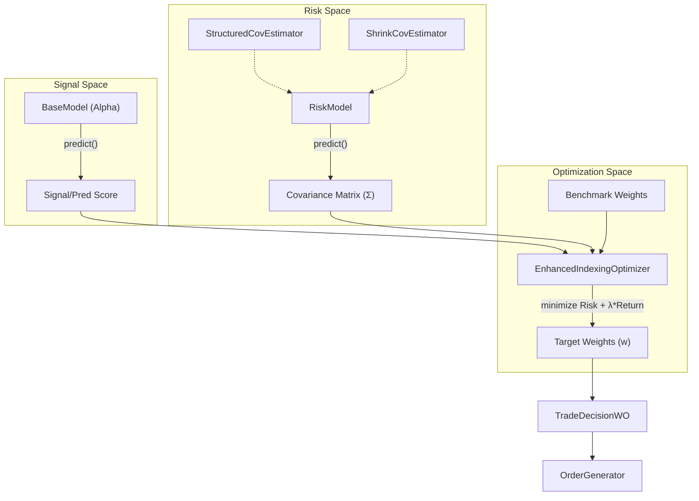
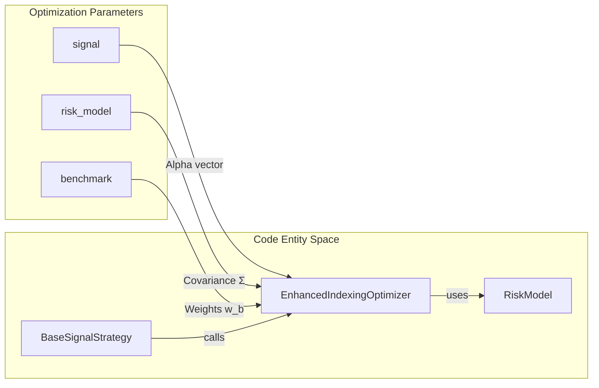

<!-- source: DeepWiki mcp.deepwiki.com · repo microsoft/qlib · page 10.5 Portfolio Optimization · fetched 2026-10-26 -->

# Portfolio Optimization

Relevant source files

The following files were used as context for generating this wiki page:

- [examples/benchmarks/TRA/src/model.py](examples/benchmarks/TRA/src/model.py)
- [examples/orderbook_data/README.md](examples/orderbook_data/README.md)
- [examples/portfolio/README.md](examples/portfolio/README.md)
- [examples/portfolio/config_enhanced_indexing.yaml](examples/portfolio/config_enhanced_indexing.yaml)
- [examples/portfolio/prepare_riskdata.py](examples/portfolio/prepare_riskdata.py)
- [qlib/contrib/data/processor.py](qlib/contrib/data/processor.py)
- [qlib/contrib/model/pytorch_adarnn.py](qlib/contrib/model/pytorch_adarnn.py)
- [qlib/contrib/strategy/optimizer/base.py](qlib/contrib/strategy/optimizer/base.py)
- [qlib/contrib/strategy/optimizer/optimizer.py](qlib/contrib/strategy/optimizer/optimizer.py)
- [qlib/contrib/strategy/signal_strategy.py](qlib/contrib/strategy/signal_strategy.py)
- [qlib/model/riskmodel/__init__.py](qlib/model/riskmodel/__init__.py)
- [qlib/model/riskmodel/base.py](qlib/model/riskmodel/base.py)
- [qlib/model/riskmodel/poet.py](qlib/model/riskmodel/poet.py)
- [qlib/model/riskmodel/shrink.py](qlib/model/riskmodel/shrink.py)
- [qlib/model/riskmodel/structured.py](qlib/model/riskmodel/structured.py)
- [tests/test_structured_cov_estimator.py](tests/test_structured_cov_estimator.py)

The Portfolio Optimization framework in Qlib provides a systematic approach to balancing expected returns (alpha) against risk (volatility and correlation). While simple strategies like `TopkDropoutStrategy` focus on signal ranking and heuristic replacement `[qlib/contrib/strategy/signal_strategy.py:75-136]()`, the optimization framework enables sophisticated constraints such as tracking error minimization relative to a benchmark and structured risk management `[examples/portfolio/README.md:5-13]()`.

## Framework Architecture

The portfolio optimization process in Qlib typically involves three main components: a **Signal** (alpha model), a **Risk Model** (covariance estimation), and an **Optimizer** (mathematical solver).

### Component Interaction
The following diagram illustrates how these entities interact within the strategy execution flow, bridging the natural language concepts to the specific code entities used in the Qlib environment.

**Portfolio Optimization Data Flow**

Sources: `[qlib/contrib/strategy/signal_strategy.py:25-64]()`, `[qlib/model/riskmodel/base.py:12-46]()`, `[qlib/contrib/strategy/signal_strategy.py:21-22]()`

## Risk Models

Qlib implements a hierarchy of risk models under the `RiskModel` base class to estimate the covariance matrix of stock returns `[qlib/model/riskmodel/__init__.py:4-14]()`.

### Base Interface
The `RiskModel` class defines the standard interface for covariance estimation:
- `predict(X, ...)`: Takes a matrix of observations (prices or returns) and returns a covariance or correlation matrix `[qlib/model/riskmodel/base.py:40-57]()`. It handles the transformation of `pd.DataFrame` or `pd.Series` inputs into internal 2D arrays `[qlib/model/riskmodel/base.py:62-75]()`.
- `_preprocess(X)`: Handles NaN values via options like `mask`, `fill`, or `ignore` and centers the data if `assume_centered` is False `[qlib/model/riskmodel/base.py:133-147]()`.

### Statistical Risk Models (SRM)
The `StructuredCovEstimator` implements latent factor models where observations $X$ are predicted by multiple factors `[qlib/model/riskmodel/structured.py:11-20]()`:
$$cov(X^T) = F \cdot cov(B^T) \cdot F^T + diag(var(U))$$

It supports two primary solvers via the `factor_model` parameter:
- **PCA**: Principal Component Analysis `[qlib/model/riskmodel/structured.py:41-41]()`.
- **FA**: Factor Analysis `[qlib/model/riskmodel/structured.py:42-42]()`.

Sources: `[qlib/model/riskmodel/structured.py:11-39]()`, `[qlib/model/riskmodel/structured.py:81-94]()`

### Shrinkage and POET
For high-dimensional data where the sample covariance matrix might be singular or noisy, Qlib provides:

1.  **ShrinkCovEstimator**: Shrinks the sample covariance $S$ toward a target $F$ using a parameter $\alpha$: $\hat{S} = (1 - \alpha)S + \alpha F$ `[qlib/model/riskmodel/shrink.py:7-13]()`.
    - Supports **Ledoit-Wolf (lw)** and **Oracle Approximating Shrinkage (oas)** shrinkage parameters `[qlib/model/riskmodel/shrink.py:47-48]()`.
    - Targets include `const_var` (constant variance), `const_corr` (equal correlation), or `single_factor` models `[qlib/model/riskmodel/shrink.py:50-52]()`.
2.  **POETCovEstimator**: Principal Orthogonal Complement Thresholding Estimator. It uses a factor model and applies thresholding (soft, hard, or SCAD) to the residual covariance matrix to ensure sparsity `[qlib/model/riskmodel/poet.py:6-27]()`.

## Enhanced Indexing Optimizer

The `EnhancedIndexingOptimizer` is a specialized tool used to maximize alpha while minimizing the tracking error relative to a benchmark index (e.g., CSI300) `[examples/portfolio/README.md:10-13]()`.

### Implementation Logic
The optimizer solves for weights $w$ that balance return and risk relative to benchmark weights $w_b$. The objective function typically maximizes the risk-adjusted active return.

**Entity Mapping: Optimizer Implementation**

Sources: `[qlib/contrib/strategy/signal_strategy.py:22-22]()`, `[examples/portfolio/prepare_riskdata.py:18-19]()`, `[examples/portfolio/README.md:10-13]()`

## Integration with Signal Strategies

Portfolio optimization is typically integrated into the backtesting workflow through signal-based strategies that inherit from `BaseSignalStrategy` `[qlib/contrib/strategy/signal_strategy.py:25-37]()`.

### Workflow Example
In a typical configuration (e.g., `config_enhanced_indexing.yaml`), the strategy uses the output of a model (like LightGBM) as the alpha signal and a pre-calculated risk model for optimization `[examples/portfolio/README.md:41-48]()`.

| Step | Component | Action |
| :--- | :--- | :--- |
| 1 | **Data** | Load stock returns and benchmark weights (e.g., CSI300) `[examples/portfolio/prepare_riskdata.py:12-15]()` |
| 2 | **Risk Model** | Estimate $F$ (exposures), $cov\_b$ (factor cov), and $var\_u$ (specific risk) using `StructuredCovEstimator` `[qlib/model/riskmodel/structured.py:81-94]()` |
| 3 | **Strategy** | `BaseSignalStrategy` receives the model prediction via `self.signal.get_signal()` `[qlib/contrib/strategy/signal_strategy.py:143-147]()` |
| 4 | **Optimizer** | `EnhancedIndexingOptimizer` calculates target weights based on the signal and risk data `[qlib/contrib/strategy/signal_strategy.py:22-22]()` |

### Key Classes

- **`RiskModel`**: Base class for all covariance estimators `[qlib/model/riskmodel/base.py:12]()`.
- **`StructuredCovEstimator`**: Implements PCA/FA based risk decomposition `[qlib/model/riskmodel/structured.py:11]()`.
- **`ShrinkCovEstimator`**: Implements shrinkage methods like Ledoit-Wolf `[qlib/model/riskmodel/shrink.py:7]()`.
- **`POETCovEstimator`**: Implements the POET algorithm for large covariance matrices `[qlib/model/riskmodel/poet.py:6]()`.
- **`BaseSignalStrategy`**: The strategy bridge that consumes signals and interacts with the optimizer `[qlib/contrib/strategy/signal_strategy.py:25]()`.

Sources: `[qlib/contrib/strategy/signal_strategy.py:1-150]()`, `[qlib/model/riskmodel/base.py:1-148]()`, `[qlib/model/riskmodel/structured.py:1-94]()`, `[qlib/model/riskmodel/shrink.py:1-103]()`, `[qlib/model/riskmodel/poet.py:1-83]()`, `[examples/portfolio/README.md:1-48]()`

---

