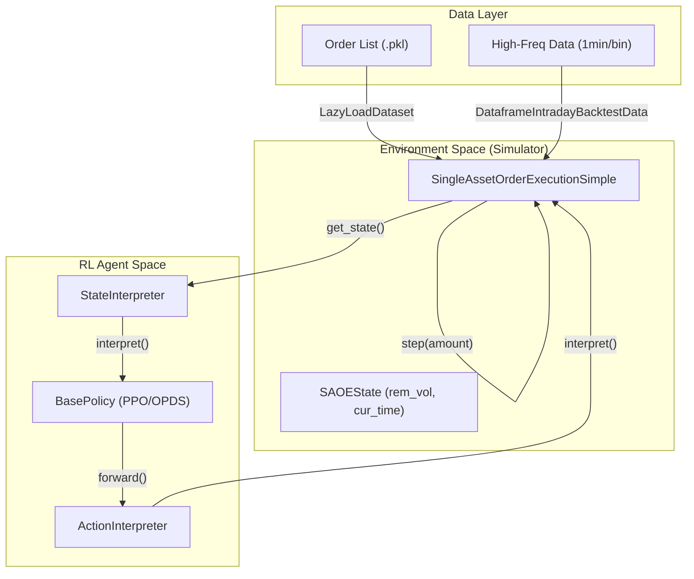
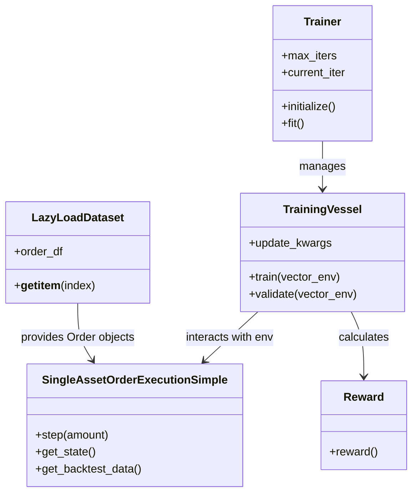

<!-- source: DeepWiki mcp.deepwiki.com · repo microsoft/qlib · page 10.6 Reinforcement Learning for Order Execution · fetched 2026-10-26 -->

# Reinforcement Learning for Order Execution

Relevant source files

The following files were used as context for generating this wiki page:

- [docs/_static/img/QlibRL_framework.png](docs/_static/img/QlibRL_framework.png)
- [docs/_static/img/RL_framework.png](docs/_static/img/RL_framework.png)
- [docs/_static/img/framework-abstract.jpg](docs/_static/img/framework-abstract.jpg)
- [docs/_static/img/framework.svg](docs/_static/img/framework.svg)
- [docs/component/rl/guidance.rst](docs/component/rl/guidance.rst)
- [docs/component/rl/overall.rst](docs/component/rl/overall.rst)
- [docs/component/rl/quickstart.rst](docs/component/rl/quickstart.rst)
- [docs/component/rl/toctree.rst](docs/component/rl/toctree.rst)
- [examples/rl_order_execution/README.md](examples/rl_order_execution/README.md)
- [examples/rl_order_execution/exp_configs/backtest_opds.yml](examples/rl_order_execution/exp_configs/backtest_opds.yml)
- [examples/rl_order_execution/exp_configs/backtest_ppo.yml](examples/rl_order_execution/exp_configs/backtest_ppo.yml)
- [examples/rl_order_execution/exp_configs/backtest_twap.yml](examples/rl_order_execution/exp_configs/backtest_twap.yml)
- [examples/rl_order_execution/exp_configs/train_opds.yml](examples/rl_order_execution/exp_configs/train_opds.yml)
- [examples/rl_order_execution/exp_configs/train_ppo.yml](examples/rl_order_execution/exp_configs/train_ppo.yml)
- [examples/rl_order_execution/scripts/gen_training_orders.py](examples/rl_order_execution/scripts/gen_training_orders.py)
- [qlib/contrib/data/highfreq_handler.py](qlib/contrib/data/highfreq_handler.py)
- [qlib/contrib/data/highfreq_processor.py](qlib/contrib/data/highfreq_processor.py)
- [qlib/contrib/data/highfreq_provider.py](qlib/contrib/data/highfreq_provider.py)
- [qlib/rl/contrib/backtest.py](qlib/rl/contrib/backtest.py)
- [qlib/rl/contrib/naive_config_parser.py](qlib/rl/contrib/naive_config_parser.py)
- [qlib/rl/contrib/train_onpolicy.py](qlib/rl/contrib/train_onpolicy.py)
- [qlib/rl/data/integration.py](qlib/rl/data/integration.py)
- [qlib/rl/data/native.py](qlib/rl/data/native.py)
- [qlib/rl/data/pickle_styled.py](qlib/rl/data/pickle_styled.py)
- [qlib/rl/interpreter.py](qlib/rl/interpreter.py)
- [qlib/rl/order_execution/__init__.py](qlib/rl/order_execution/__init__.py)
- [qlib/rl/order_execution/interpreter.py](qlib/rl/order_execution/interpreter.py)
- [qlib/rl/order_execution/policy.py](qlib/rl/order_execution/policy.py)
- [qlib/rl/order_execution/reward.py](qlib/rl/order_execution/reward.py)
- [qlib/rl/order_execution/simulator_qlib.py](qlib/rl/order_execution/simulator_qlib.py)
- [qlib/rl/order_execution/simulator_simple.py](qlib/rl/order_execution/simulator_simple.py)
- [qlib/rl/order_execution/state.py](qlib/rl/order_execution/state.py)
- [qlib/rl/order_execution/strategy.py](qlib/rl/order_execution/strategy.py)
- [qlib/rl/order_execution/utils.py](qlib/rl/order_execution/utils.py)
- [qlib/rl/trainer/__init__.py](qlib/rl/trainer/__init__.py)
- [qlib/rl/trainer/api.py](qlib/rl/trainer/api.py)
- [qlib/rl/trainer/callbacks.py](qlib/rl/trainer/callbacks.py)
- [qlib/rl/trainer/trainer.py](qlib/rl/trainer/trainer.py)
- [qlib/rl/trainer/vessel.py](qlib/rl/trainer/vessel.py)
- [qlib/rl/utils/data_queue.py](qlib/rl/utils/data_queue.py)
- [qlib/rl/utils/env_wrapper.py](qlib/rl/utils/env_wrapper.py)
- [qlib/rl/utils/finite_env.py](qlib/rl/utils/finite_env.py)
- [qlib/rl/utils/log.py](qlib/rl/utils/log.py)
- [tests/rl/test_logger.py](tests/rl/test_logger.py)
- [tests/rl/test_qlib_simulator.py](tests/rl/test_qlib_simulator.py)
- [tests/rl/test_saoe_simple.py](tests/rl/test_saoe_simple.py)
- [tests/rl/test_trainer.py](tests/rl/test_trainer.py)

Qlib provides a comprehensive Reinforcement Learning (RL) framework specifically designed for the Order Execution (OE) task. This framework allows users to train and evaluate agents that can dynamically adjust trading schedules to minimize market impact and execution cost. It integrates with Qlib's backtesting infrastructure while providing specialized simulators, policies, and reward functions for intraday trading.

## System Architecture

The RL framework for order execution is built on a modular design that separates the environment simulation, the agent's policy, and the data processing logic.

### Core Components
*   **Simulators**: Specialized environments that model the state of an order (e.g., remaining volume, current time) and the market.
*   **Interpreters**: The `StateInterpreter` [qlib/rl/interpreter.py:21-21]() converts raw simulator states into neural network inputs, while the `ActionInterpreter` [qlib/rl/interpreter.py:21-21]() maps policy outputs to execution volumes.
*   **Policies**: Implementations of RL algorithms like PPO (Proximal Policy Optimization) or OPDS (Order Price Distribution Smoothing).
*   **Vessel**: A `TrainingVessel` [qlib/rl/trainer/vessel.py:98-113]() manages the interaction between the policy and the vectorized environments during training.

### Data Flow Diagram
The following diagram illustrates how an order is processed through the RL training pipeline.

Title: RL Order Execution Data Flow

**Sources:** [qlib/rl/order_execution/simulator_simple.py:24-154](), [qlib/rl/contrib/train_onpolicy.py:116-125](), [qlib/rl/interpreter.py:21-21]()

## SAOE Simulators

The Single-Asset Order Execution (SAOE) simulator is the core environment. Qlib provides two primary implementations:

### 1. SingleAssetOrderExecution (Qlib-based)
This simulator is built directly on top of Qlib's backtesting tools (`NestedExecutor`, `Exchange`). It is highly accurate and used for final backtesting [qlib/rl/order_execution/simulator_qlib.py:19-43]().
*   **Implementation**: Uses `collect_data_loop` to drive the simulation and yield control to the RL strategy [qlib/rl/order_execution/simulator_qlib.py:87-93]().
*   **Strategy Integration**: Uses a specialized `SAOEStrategy` to bridge the RL action to Qlib's `BaseTradeDecision` [qlib/rl/order_execution/simulator_qlib.py:107-117]().

### 2. SingleAssetOrderExecutionSimple
A lightweight simulator optimized for training speed. It bypasses the full Qlib backtest stack and interacts directly with high-frequency dataframes [qlib/rl/order_execution/simulator_simple.py:24-53]().
*   **Execution Logic**: In each step, it splits the requested volume across the ticks in that step and applies volume constraints (`vol_threshold`) [qlib/rl/order_execution/simulator_simple.py:159-170]().
*   **Metrics**: Tracks `PA` (Price Advantage) and `FFR` (Filled Fraction) via the `SAOEMetrics` structure [qlib/rl/order_execution/state.py:19-19]().

**Sources:** [qlib/rl/order_execution/simulator_qlib.py:19-142](), [qlib/rl/order_execution/simulator_simple.py:24-118]()

## Training Workflow

Training is typically performed using on-policy algorithms like PPO. The `train_and_test` function in `qlib.rl.contrib.train_onpolicy` orchestrates the process.

### Code Entity Mapping
The following diagram maps the logical RL training concepts to specific classes and functions in the Qlib codebase.

Title: RL Code Entity Mapping

**Sources:** [qlib/rl/trainer/trainer.py:30-121](), [qlib/rl/contrib/train_onpolicy.py:51-181](), [qlib/rl/order_execution/simulator_simple.py:24-53]()

### Key Training Functions
*   **`LazyLoadDataset`**: Loads orders from pickle files and converts them into `Order` objects for the simulator, utilizing `load_handler_intraday_processed_data` to determine time indices [qlib/rl/contrib/train_onpolicy.py:51-97]().
*   **`train()`**: The main entry point that initializes the `TrainingVessel` and runs the collection-update loop [qlib/rl/rl/trainer/api.py:24-24]() (referenced via [qlib/rl/contrib/train_onpolicy.py:159-181]()).
*   **`Checkpoint` & `EarlyStopping`**: Callbacks used to manage model persistence and training termination based on metrics like `val/pa` [qlib/rl/trainer/callbacks.py:25-25](), [qlib/rl/contrib/train_onpolicy.py:142-157]().

**Sources:** [qlib/rl/contrib/train_onpolicy.py:51-181](), [qlib/rl/trainer/trainer.py:30-186]()

## Reward Functions and Interpreters

The behavior of the RL agent is heavily influenced by the reward design and how it perceives the state.

### Reward Design
Common reward functions for order execution include:
*   **Price Advantage (PA)**: Comparing the execution price to a benchmark (e.g., TWAP) [qlib/rl/order_execution/simulator_simple.py:68-70]().
*   **Reward Interface**: The `Reward` base class defines the interface for calculating feedback [qlib/rl/reward.py:23-23]().

### State Interpretation
The `StateInterpreter` typically includes:
*   **Market Features**: High-frequency data like Open, High, Low, Close, VWAP, and Volume, often processed via `HighFreqHandler` [qlib/contrib/data/highfreq_handler.py:41-100]().
*   **Order Features**: Remaining volume (`rem_vol`) and remaining time steps, encapsulated in `SAOEState` [qlib/rl/order_execution/state.py:15-15]().

| Component | Code Reference | Description |
| :--- | :--- | :--- |
| **State** | `SAOEState` | Contains `cur_time`, `rem_vol`, and `market_data`. |
| **Metrics** | `SAOEMetrics` | Tracks `ex_price`, `ex_vol`, `market_vol`, and `pa`. |
| **Data Provider** | `HandlerProcessedDataProvider` | Loads intraday features from binary/pickle formats [qlib/rl/data/native.py:204-216](). |

**Sources:** [qlib/rl/order_execution/state.py:15-19](), [qlib/rl/data/native.py:204-216](), [qlib/contrib/data/highfreq_handler.py:41-100]()

## Backtesting RL Policies

Once trained, RL policies are evaluated using functions that run a full backtest across a set of orders.

1.  **Config Loading**: Uses `get_backtest_config_fromfile` to parse YAML configurations and merge with default exchange settings [qlib/rl/contrib/naive_config_parser.py:82-106]().
2.  **Executor Setup**: A `NestedExecutor` is configured to handle the frequency of the RL policy (e.g., 1-minute or 30-minute steps) [qlib/rl/contrib/backtest.py:29-61]().
3.  **Report Generation**: The system collects indicators like `ffr` and `pa` across all executed orders and aggregates them into a final report using `_generate_report` [qlib/rl/contrib/backtest.py:88-124]().

**Sources:** [qlib/rl/contrib/backtest.py:29-158](), [qlib/rl/contrib/naive_config_parser.py:82-106]()

---

