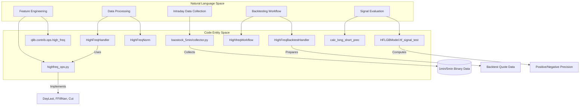
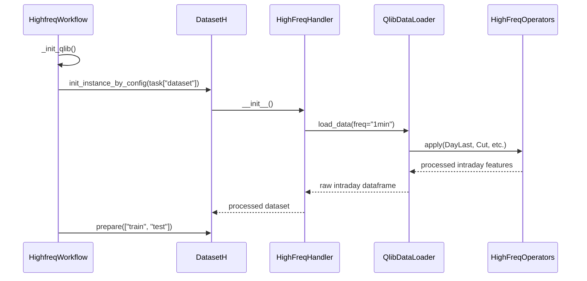

<!-- source: DeepWiki mcp.deepwiki.com · repo microsoft/qlib · page 10.7 High-Frequency Trading Support · fetched 2026-10-26 -->

# High-Frequency Trading Support

Relevant source files

The following files were used as context for generating this wiki page:

- [docs/FAQ/FAQ.rst](docs/FAQ/FAQ.rst)
- [docs/advanced/serial.rst](docs/advanced/serial.rst)
- [docs/changelog/changelog.rst](docs/changelog/changelog.rst)
- [docs/component/highfreq.rst](docs/component/highfreq.rst)
- [docs/component/meta.rst](docs/component/meta.rst)
- [docs/introduction/introduction.rst](docs/introduction/introduction.rst)
- [examples/highfreq/README.md](examples/highfreq/README.md)
- [examples/highfreq/highfreq_handler.py](examples/highfreq/highfreq_handler.py)
- [examples/highfreq/highfreq_ops.py](examples/highfreq/highfreq_ops.py)
- [examples/highfreq/highfreq_processor.py](examples/highfreq/highfreq_processor.py)
- [examples/highfreq/workflow.py](examples/highfreq/workflow.py)
- [examples/highfreq/workflow_config_High_Freq_Tree_Alpha158.yaml](examples/highfreq/workflow_config_High_Freq_Tree_Alpha158.yaml)
- [examples/model_interpreter/feature.py](examples/model_interpreter/feature.py)
- [examples/rolling_process_data/README.md](examples/rolling_process_data/README.md)
- [examples/rolling_process_data/rolling_handler.py](examples/rolling_process_data/rolling_handler.py)
- [examples/rolling_process_data/workflow.py](examples/rolling_process_data/workflow.py)
- [qlib/contrib/data/highfreq_handler.py](qlib/contrib/data/highfreq_handler.py)
- [qlib/contrib/data/highfreq_processor.py](qlib/contrib/data/highfreq_processor.py)
- [qlib/contrib/data/highfreq_provider.py](qlib/contrib/data/highfreq_provider.py)
- [qlib/contrib/eva/alpha.py](qlib/contrib/eva/alpha.py)
- [qlib/contrib/model/highfreq_gdbt_model.py](qlib/contrib/model/highfreq_gdbt_model.py)
- [qlib/rl/order_execution/__init__.py](qlib/rl/order_execution/__init__.py)
- [qlib/rl/order_execution/reward.py](qlib/rl/order_execution/reward.py)
- [qlib/rl/trainer/__init__.py](qlib/rl/trainer/__init__.py)
- [qlib/rl/trainer/callbacks.py](qlib/rl/trainer/callbacks.py)
- [qlib/rl/trainer/trainer.py](qlib/rl/trainer/trainer.py)
- [tests/rl/test_trainer.py](tests/rl/test_trainer.py)

Qlib provides a specialized infrastructure for High-Frequency Trading (HFT), focusing on sub-daily data handling (e.g., 1-minute and 5-minute intervals), optimized feature engineering operators, and specialized backtesting workflows. This support is designed to handle the increased data volume and specific normalization requirements of intraday trading.

## High-Frequency Data Architecture

The high-frequency workflow extends Qlib's standard data processing pipeline by introducing specialized handlers and operators that can manage the relationship between daily and intraday timeframes.

### Data Flow and Entity Mapping

The following diagram illustrates how high-frequency components map from high-level concepts to specific code entities within the Qlib ecosystem.

**HFT System Mapping**

**Sources:** [examples/highfreq/workflow.py:20-81](), [examples/highfreq/highfreq_handler.py:5-36](), [qlib/contrib/model/highfreq_gdbt_model.py:57-80](), [qlib/contrib/eva/alpha.py:14-68]()

## High-Frequency Data Handlers

High-frequency data requires different handling than daily data, particularly for normalization and feature alignment. Qlib provides `HighFreqHandler` and `HighFreqBacktestHandler` to manage these tasks.

### HighFreqHandler
This class is a subclass of `DataHandlerLP` [examples/highfreq/highfreq_handler.py:5-5](). It is typically used for model training and inference.
- **Data Loading**: Uses `QlibDataLoader` with a frequency set to `1min` [examples/highfreq/highfreq_handler.py:20-26]().
- **Feature Configuration**: Implements `get_feature_config` to define complex intraday operators such as `DayLast`, `FFillNan`, and `Cut` [examples/highfreq/highfreq_handler.py:38-101]().
- **Normalization**: Often utilizes `HighFreqNorm` (a specialized processor) to handle intraday scaling [examples/highfreq/workflow.py:36-36]().
- **General Variant**: `HighFreqGeneralHandler` allows for flexible `day_length` (e.g., 240 minutes for CN market) and custom column sets [qlib/contrib/data/highfreq_handler.py:103-118]().

### HighFreqBacktestHandler
A simplified handler focused on providing the raw data necessary for backtesting (e.g., actual close prices and VWAP) without the heavy learnable processing used in training [examples/highfreq/highfreq_handler.py:104-124](). It typically loads raw fields like `$close0`, `$vwap0`, and `$volume0` [examples/highfreq/highfreq_handler.py:135-156]().

**Sources:** [examples/highfreq/highfreq_handler.py:5-158](), [examples/highfreq/workflow.py:44-81](), [qlib/contrib/data/highfreq_handler.py:103-196]()

## High-Frequency Operators (highfreq_ops)

To facilitate efficient intraday feature engineering, Qlib implements specialized operators. These operators are designed to be "day-aware," meaning they can perform calculations on intraday bars relative to their parent trading day.

| Operator | Description | Implementation |
| :--- | :--- | :--- |
| `DayLast` | Returns the last value of the current day for every bar in that day. | [examples/highfreq/highfreq_ops.py:11-29]() |
| `FFillNan` | Forward fills missing values in intraday series. | [examples/highfreq/highfreq_ops.py:31-47]() |
| `BFillNan` | Backward fills missing values in intraday series. | [examples/highfreq/highfreq_ops.py:50-66]() |
| `Cut` | Deletes the first $l$ or last $r$ elements from the sequence relative to the raw data. | [examples/highfreq/highfreq_ops.py:131-168]() |
| `Select` | Filters values based on a boolean condition across intraday bars. | [examples/highfreq/highfreq_ops.py:89-110]() |

### Calendar Management
High-frequency operations rely on `get_calendar_day` [examples/highfreq/highfreq_ops.py:8-8](), which provides the mapping of intraday timestamps to their respective dates. In workflows, it is recommended to preload this cache using `Cal.calendar(freq="1min")` to leverage copy-on-write optimizations in multiprocessing environments [examples/highfreq/workflow.py:91-97]().

**Sources:** [examples/highfreq/highfreq_ops.py:11-168](), [examples/highfreq/workflow.py:91-98]()

## Minute-Level Backtesting Workflow

The backtesting workflow for high-frequency data involves distinct datasets for signal generation and execution simulation.

### Workflow Execution Flow
The `HighfreqWorkflow` class in `examples/highfreq/workflow.py` demonstrates the standard pipeline:

1.  **Initialization**: `qlib.init` is called with `HIGH_FREQ_CONFIG` and custom operators registered in `SPEC_CONF` [examples/highfreq/workflow.py:83-89]().
2.  **Data Preparation**: The `get_data` method initializes two `DatasetH` instances: one for model training/inference (`dataset`) and one for backtesting (`dataset_backtest`) [examples/highfreq/workflow.py:99-112]().
3.  **State Management**: Datasets are `Serializable`, allowing them to be dumped to disk via `to_pickle` and reloaded for subsequent rolling updates [examples/highfreq/workflow.py:114-131]().
4.  **Reinitialization**: The `setup_data` method is used to update the `start_time` and `end_time` of an existing dataset without re-creating the entire object, often using `init_type=DataHandlerLP.IT_LS` to load state [examples/highfreq/workflow.py:147-151]().

**Component Interaction Diagram**

**Sources:** [examples/highfreq/workflow.py:20-171](), [examples/highfreq/README.md:1-35]()

## High-Frequency Model Training (HFLGBModel)

Qlib includes `HFLGBModel`, a LightGBM variant specifically optimized for high-frequency prediction tasks [qlib/contrib/model/highfreq_gdbt_model.py:15-16]().

- **Label Transformation**: During training and evaluation, labels are often converted into "alpha" by subtracting the cross-sectional mean at each time step [qlib/contrib/model/highfreq_gdbt_model.py:67-67](), [qlib/contrib/model/highfreq_gdbt_model.py:93-96]().
- **Signal Testing**: The `hf_signal_test` method evaluates model performance on high-frequency test sets by calculating positive/negative precision and average alpha for top/bottom quantiles [qlib/contrib/model/highfreq_gdbt_model.py:57-80]().
- **Finetuning**: Supports incremental training on new high-frequency data using the `finetune` method, which initializes the LightGBM booster with an existing model [qlib/contrib/model/highfreq_gdbt_model.py:147-171]().

**Sources:** [qlib/contrib/model/highfreq_gdbt_model.py:15-171]()

## Evaluation Metrics

High-frequency signals are evaluated using specialized functions in `qlib.contrib.eva.alpha`.

- **calc_long_short_prec**: Calculates precision for long and short operations by identifying top/bottom quantiles of predictions and checking if the corresponding labels are positive/negative [qlib/contrib/eva/alpha.py:14-68]().
- **calc_long_short_return**: Computes the mean return of long and short portfolios [qlib/contrib/eva/alpha.py:71-113]().
- **pred_autocorr**: Measures the stability of predictions over time by calculating the autocorrelation of prediction series [qlib/contrib/eva/alpha.py:116-140]().

**Sources:** [qlib/contrib/eva/alpha.py:1-215]()

---

