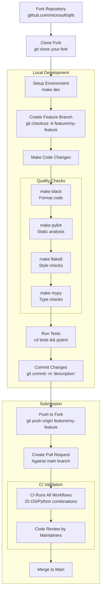
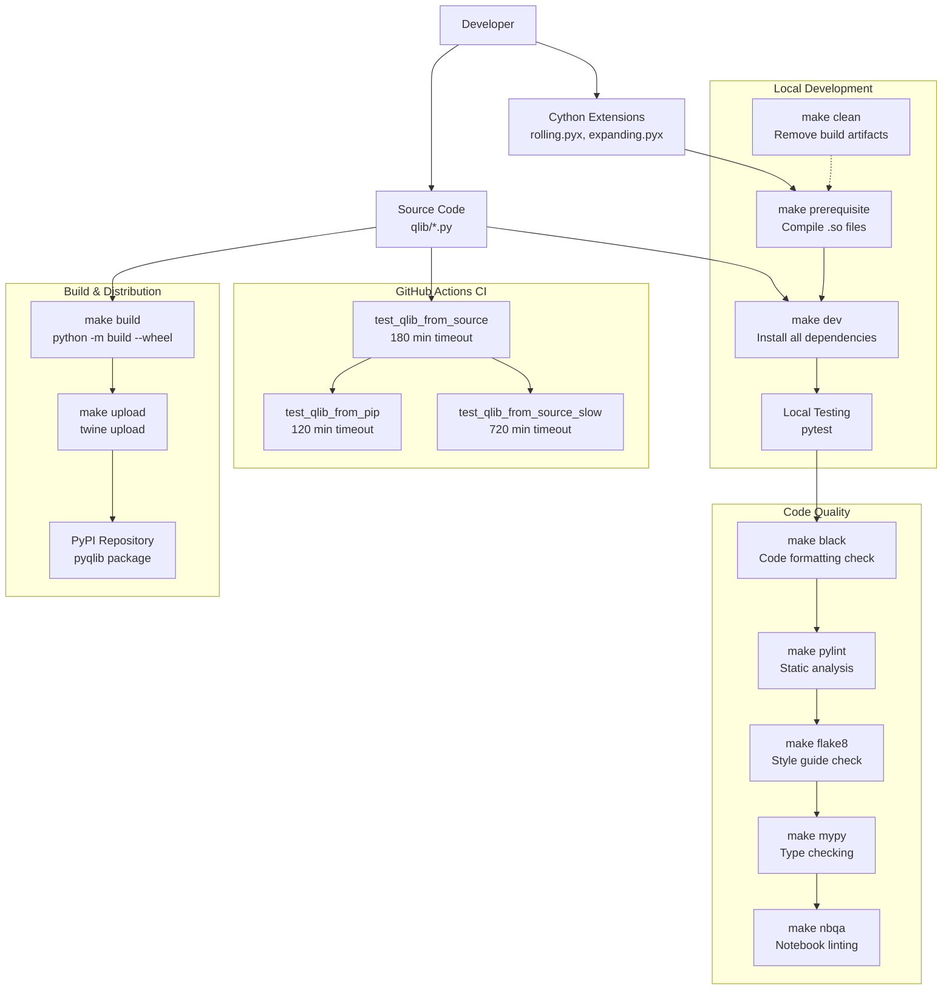
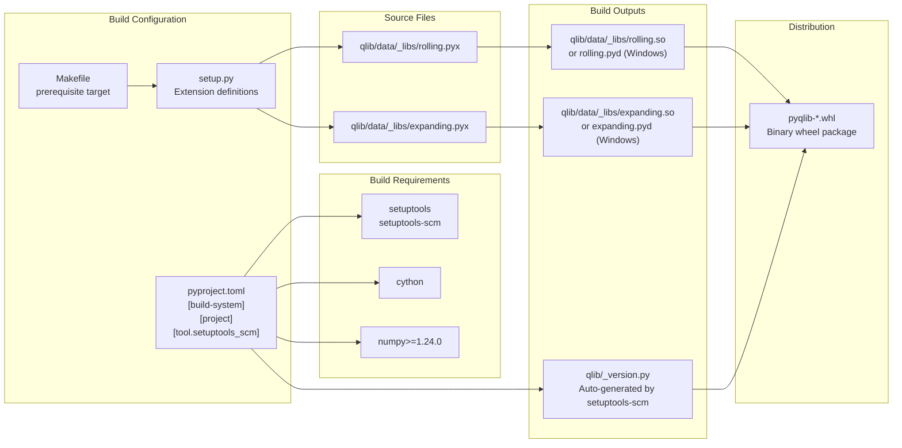
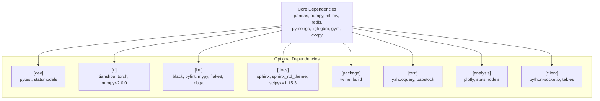
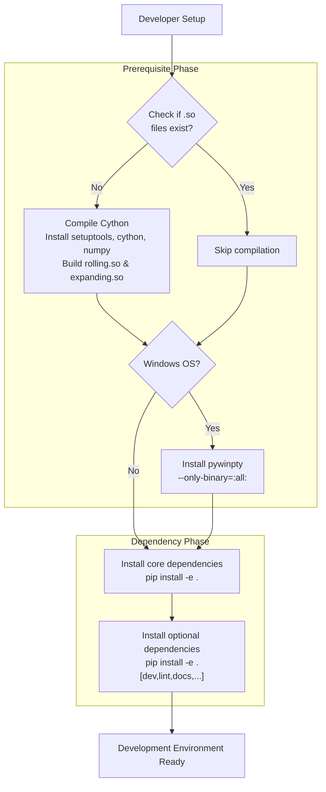

<!-- source: DeepWiki mcp.deepwiki.com · repo microsoft/qlib · page 11 Development and Contributing · fetched 2026-10-26 -->

# Development and Contributing

<details>
<summary>Relevant source files</summary>

The following files were used as context for generating this wiki page:

- [.commitlintrc.js](.commitlintrc.js)
- [.github/PULL_REQUEST_TEMPLATE.md](.github/PULL_REQUEST_TEMPLATE.md)
- [.github/workflows/lint_title.yml](.github/workflows/lint_title.yml)
- [.github/workflows/release.yml](.github/workflows/release.yml)
- [.github/workflows/test_qlib_from_pip.yml](.github/workflows/test_qlib_from_pip.yml)
- [.github/workflows/test_qlib_from_source.yml](.github/workflows/test_qlib_from_source.yml)
- [.github/workflows/test_qlib_from_source_slow.yml](.github/workflows/test_qlib_from_source_slow.yml)
- [Makefile](Makefile)
- [pyproject.toml](pyproject.toml)
- [qlib/data/client.py](qlib/data/client.py)
- [setup.py](setup.py)
- [tests/test_pit.py](tests/test_pit.py)

</details>


## Purpose and Scope

This document provides a comprehensive guide for developers who want to contribute to Qlib or understand its build system. It covers the contribution workflow, development environment setup, code quality requirements, testing infrastructure, and the underlying build and CI/CD systems.

**Target Audience:** Contributors, maintainers, and developers who want to extend or modify Qlib's core functionality.

For information about package installation from a user perspective, see page 2.1. For details on system initialization and runtime configuration, see page 2.2.

---

## Contribution Workflow Overview

Contributing to Qlib follows the standard GitHub fork-and-pull-request workflow. The process involves setting up your development environment, making changes, ensuring code quality, and submitting a pull request.

### Standard Contribution Process



**Sources:** [.github/workflows/test_qlib_from_source.yml:1-136](), [Makefile:1-152]()

### Contribution Types and Requirements

The pull request template [.github/PULL_REQUEST_TEMPLATE.md:1-39]() outlines the categories for contributions, following conventional commit prefixes.

| Contribution Type | Required Checks | Additional Notes |
|-------------------|-----------------|------------------|
| **Bug Fix** (`fix:`) | All quality checks, relevant tests | Include test case demonstrating fix |
| **New Feature** (`feat:`) | All quality checks, new tests, documentation | Update docs/ if user-facing |
| **Model Implementation** | All quality checks, model tests, benchmark results | See page 5 for model interface |
| **Performance Optimization** | All quality checks, benchmark comparison | Document performance improvements |
| **Documentation** (`docs:`) | `make docs-gen`, `make nbconvert` (if notebooks) | Ensure builds without warnings |
| **Test Addition** (`test:`) | All quality checks | Mark slow tests with `@pytest.mark.slow` |

**Sources:** [Makefile:118-193](), [.github/workflows/test_qlib_from_source.yml:61-89](), [.github/PULL_REQUEST_TEMPLATE.md:4-12]()

---

## Overview of Development Infrastructure

The Qlib development infrastructure consists of four main components: the build system for compiling Cython extensions, the Makefile for development automation, GitHub Actions workflows for continuous integration, and quality assurance tools for maintaining code standards.

### Development Workflow Diagram



**Sources:** [Makefile:1-152](), [.github/workflows/test_qlib_from_source.yml:1-136](), [.github/workflows/test_qlib_from_pip.yml:1-61](), [.github/workflows/test_qlib_from_source_slow.yml:1-61]()

---

## Build System Architecture

The Qlib build system uses modern Python packaging standards (PEP 517/518) defined in `pyproject.toml` along with a custom `setup.py` for Cython extension compilation.

### Build Configuration Components



**Sources:** [pyproject.toml:1-126](), [setup.py:1-24](), [Makefile:61-69]()

### Cython Extension Compilation

The build system compiles two performance-critical Cython modules for data operations:

1. **`qlib.data._libs.rolling`** - Implements rolling window operations for time-series data.
2. **`qlib.data._libs.expanding`** - Implements expanding window operations.

These extensions are defined in [setup.py:10-23]():

```python
Extension(
    "qlib.data._libs.rolling",
    ["qlib/data/_libs/rolling.pyx"],
    language="c++",
    include_dirs=[NUMPY_INCLUDE],
),
Extension(
    "qlib.data._libs.expanding",
    ["qlib/data/_libs/expanding.pyx"],
    language="c++",
    include_dirs=[NUMPY_INCLUDE],
),
```

The compilation is triggered by the `prerequisite` Makefile target [Makefile:61-69](), which checks if shared library files already exist before building to avoid unnecessary overhead.

**Sources:** [setup.py:10-23](), [Makefile:61-69]()

---

## Package Configuration

### pyproject.toml Structure

The `pyproject.toml` file defines the package metadata, dependencies, and build configuration:

| Section | Purpose | Key Content |
|---------|---------|-------------|
| `[build-system]` | Defines build requirements | `setuptools`, `setuptools-scm`, `cython`, `numpy>=1.24.0` |
| `[project]` | Package metadata | `name = "pyqlib"`, `requires-python = ">=3.8.0"` |
| `[project.dependencies]` | Core runtime dependencies | `pandas>=1.1`, `numpy`, `mlflow`, `redis`, `pymongo`, `lightgbm`, etc. |
| `[project.optional-dependencies]` | Optional feature groups | `dev`, `rl`, `lint`, `docs`, `package`, `test`, `analysis`, `client` |
| `[project.scripts]` | Command-line entry points | `qrun = "qlib.cli.run:run"` |
| `[tool.setuptools_scm]` | Version management | Auto-generate version from git tags into `qlib/_version.py` |

**Sources:** [pyproject.toml:1-126]()

### Dependency Groups

The project defines multiple optional dependency groups [pyproject.toml:59-108]():



**Sources:** [pyproject.toml:27-108]()

---

## Development Environment Setup

### Makefile Targets

The `Makefile` provides convenient targets for setting up and managing the development environment:

| Target | Command | Purpose |
|--------|---------|---------|
| `prerequisite` | `make prerequisite` | Compile Cython extensions (`rolling`, `expanding`) |
| `dependencies` | `make dependencies` | Install core package in editable mode (`-e .`) |
| `install` | `make install` | Run `prerequisite` then `dependencies` |
| `dev` | `make dev` | Run `prerequisite` then install all optional dependencies (`[dev,lint,docs,rl...]`) |
| `clean` | `make clean` | Remove build artifacts, `.so` files, and cache directories |
| `deepclean` | `make deepclean` | Run `clean` plus uninstall pre-commit hooks and remove pipenv env |

**Sources:** [Makefile:1-112]()

### Installation Flow



**Sources:** [Makefile:61-112]()

---

## Continuous Integration Workflows

The project uses GitHub Actions with three main CI workflows that test across multiple operating systems and Python versions.

### CI Workflow Matrix

The test matrix covers multiple OS and Python versions [.github/workflows/test_qlib_from_source.yml:18-25]():

| Workflow | Timeout | Operating Systems | Python Versions | Purpose |
|----------|---------|-------------------|-----------------|---------|
| `test_qlib_from_source` | 180 min | Windows, Ubuntu, macOS 14/15 | 3.8 - 3.12 | Full source testing with quality gates |
| `test_qlib_from_pip` | 120 min | Windows, Ubuntu, macOS 14/15 | 3.8 - 3.12 | Installation and workflow tests using `pyqlib` |
| `test_qlib_from_source_slow` | 720 min | Windows, Ubuntu, macOS 14/15 | 3.8 - 3.12 | Long-running tests marked with `@pytest.mark.slow` |

**Sources:** [.github/workflows/test_qlib_from_source.yml:14-25](), [.github/workflows/test_qlib_from_pip.yml:14-24](), [.github/workflows/test_qlib_from_source_slow.yml:14-25]()

### Platform-Specific Handling

Each CI workflow includes platform-specific installation steps:

**PyTorch Installation** [.github/workflows/test_qlib_from_source.yml:42-55]():
- macOS: Standard pip install.
- Ubuntu: Uses CPU index URL `https://download.pytorch.org/whl/cpu`.
- Windows: Standard pip install.

**LightGBM Installation** [.github/workflows/test_qlib_from_source.yml:95-100]():
- macOS requires `libomp` via Homebrew and building LightGBM from source with `--no-binary=:all:`.

**macOS Thread Limiting** [.github/workflows/test_qlib_from_source.yml:118-123]():
- To prevent segmentation faults from OpenMP conflicts, thread counts are limited: `OMP_NUM_THREADS=1`, `MKL_NUM_THREADS=1`, etc.

**Sources:** [.github/workflows/test_qlib_from_source.yml:42-123]()

---

## Code Quality Tools

The project enforces code quality through multiple automated tools, all accessible via Makefile targets.

### Quality Tool Configuration

| Tool | Makefile Target | Purpose | Configuration Highlights |
|------|-----------------|---------|--------------------------|
| **Black** | `make black` | Formatting | Line length: 120, excludes `_version.py` |
| **Pylint** | `make pylint` | Static Analysis | Max inferred: 500, Recursion limit: 2000 |
| **Flake8** | `make flake8` | Style Checking | Ignores `E501`, `F541`, `E266` (documented in Makefile) |
| **Mypy** | `make mypy` | Type Checking | Defined in `make mypy` |
| **nbqa** | `make nbqa` | Notebook Lint | Applies Black to `.ipynb` files |
| **nbconvert**| `make nbconvert`| Execution | Executes notebooks to verify validity |

**Sources:** [Makefile:118-152]()

---

## Testing Infrastructure

### Test Execution Strategy

The test suite uses pytest with markers to categorize tests. Fast tests are run in the primary CI, while tests marked with `slow` are segregated [.github/workflows/test_qlib_from_source_slow.yml:60]().

**Sources:** [.github/workflows/test_qlib_from_source.yml:125-135](), [.github/workflows/test_qlib_from_source_slow.yml:60]()

### Retry Strategy

CI workflows use the `nick-fields/retry@v2` action to handle flakiness [.github/workflows/test_qlib_from_source.yml:113-136]():
- Maximum attempts: 3.
- Timeout per attempt: 60 minutes (fast) or 240 minutes (slow).

**Sources:** [.github/workflows/test_qlib_from_source.yml:113-136](), [.github/workflows/test_qlib_from_source_slow.yml:54-61]()

### Test Data Management

Tests require sample data which is downloaded before execution [.github/workflows/test_qlib_from_source.yml:90-93]():

```bash
python scripts/get_data.py qlib_data --name qlib_data_simple --target_dir ~/.qlib/qlib_data/cn_data --interval 1d --region cn
python scripts/get_data.py download_data --file_name rl_data.zip --target_dir tests/.data/rl
```

**Sources:** [.github/workflows/test_qlib_from_source.yml:90-93](), [tests/test_pit.py:42-45]()

---

## Package Building and Distribution

### Version Management with setuptools-scm

The project uses `setuptools-scm` for automated version management [pyproject.toml:122-126](). It writes the version to `qlib/_version.py`.

**Sources:** [pyproject.toml:122-126]()

### Documentation Building

Documentation is built using Sphinx. The `make docs-gen` target is used in CI to verify that documentation can be generated correctly on Ubuntu 22.04 [.github/workflows/test_qlib_from_source.yml:65-69]().

**Sources:** [Makefile:10-11](), [.github/workflows/test_qlib_from_source.yml:65-69](), [pyproject.toml:82-91]()

---

## Summary of Development Commands

| Purpose | Command | Description |
|---------|---------|-------------|
| **Setup** | `make dev` | Full development setup |
| **Build** | `make prerequisite` | Compile Cython extensions |
| **Quality** | `make lint` | Install linting tools |
| **Quality** | `make black` | Run Black formatter check |
| **Quality** | `make pylint` | Run Pylint analysis |
| **Quality** | `make mypy` | Run Mypy type check |
| **Docs** | `make docs-gen` | Build Sphinx documentation |
| **Clean** | `make clean` | Remove build artifacts and caches |

**Sources:** [Makefile:1-152]()

---

