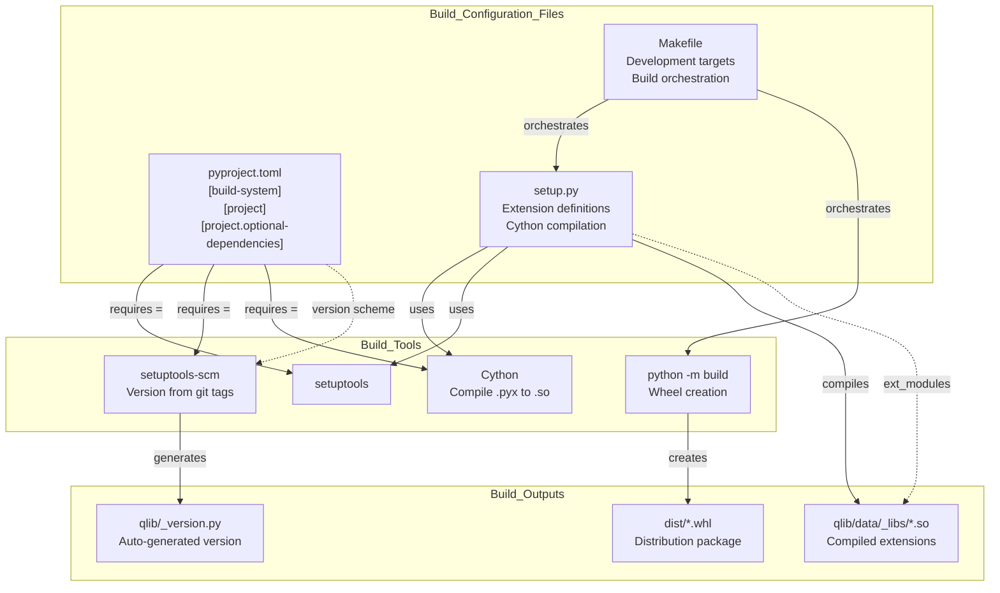
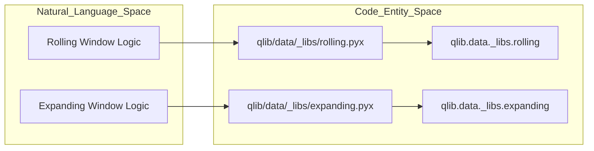
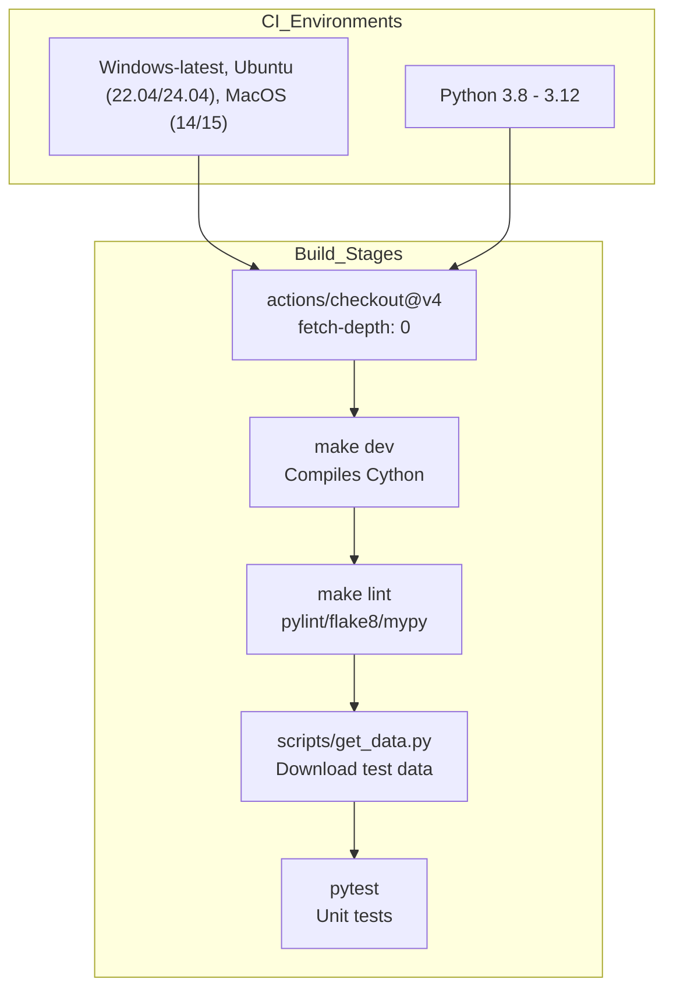

<!-- source: DeepWiki mcp.deepwiki.com · repo microsoft/qlib · page 11.1 Package Build System · fetched 2026-10-26 -->

# Package Build System

Relevant source files

The following files were used as context for generating this wiki page:

- [.dockerignore](.dockerignore)
- [.github/workflows/test_qlib_from_pip.yml](.github/workflows/test_qlib_from_pip.yml)
- [.github/workflows/test_qlib_from_source.yml](.github/workflows/test_qlib_from_source.yml)
- [.github/workflows/test_qlib_from_source_slow.yml](.github/workflows/test_qlib_from_source_slow.yml)
- [.readthedocs.yaml](.readthedocs.yaml)
- [Dockerfile](Dockerfile)
- [Makefile](Makefile)
- [build_docker_image.sh](build_docker_image.sh)
- [docs/developer/how_to_build_image.rst](docs/developer/how_to_build_image.rst)
- [pyproject.toml](pyproject.toml)
- [qlib/data/client.py](qlib/data/client.py)
- [setup.py](setup.py)
- [tests/test_pit.py](tests/test_pit.py)

## Purpose and Scope

This document describes Qlib's package build system, including build configuration files, Cython extension compilation, dependency management, and the build process workflow. This covers how Qlib is packaged and prepared for distribution, but not the runtime installation process (see [Package Installation](#2.1)) or the testing infrastructure (see [Testing Infrastructure and CI/CD](#11.2)).

The build system enables:
- Compilation of performance-critical Cython extensions for rolling and expanding windows.
- Management of multi-platform dependencies (Linux, Windows, MacOS).
- Automated development workflows via `Makefile`.
- Package creation for PyPI distribution.

## Build Configuration Overview

Qlib uses a modern Python packaging setup combining `pyproject.toml` for metadata and dependencies with `setup.py` for Cython extension compilation.

Title: Build System Architecture

Sources: [pyproject.toml:1-127](), [setup.py:1-24](), [Makefile:1-213]()

## pyproject.toml Configuration

The [pyproject.toml:1-127]() file defines package metadata, dependencies, and build requirements using the PEP 517/518 standard.

### Build System Requirements
The `build-system` section [pyproject.toml:1-3]() specifies the tools required to build the package from source:
- **setuptools**: Core build backend.
- **setuptools-scm**: Automatic versioning from git tags.
- **cython**: Required to compile `.pyx` files to C++ extensions.
- **numpy>=1.24.0**: Required for Cython compilation as it provides necessary C headers [setup.py:6]().

### Project Metadata
[pyproject.toml:5-25]() defines package metadata, including the package name `pyqlib` [pyproject.toml:20]() and supported Python versions `3.8` through `3.12` [pyproject.toml:14-18, 25]().

### Core Dependencies
[pyproject.toml:27-57]() lists required dependencies. Notable constraints include:
- `pandas>=1.1`: Required for `ffill` and `bfill` method support [pyproject.toml:30-33]().
- `ruamel.yaml>=0.17.38`: Used for configuration parsing [pyproject.toml:42]().
- `mlflow`: Integrated for experiment tracking [pyproject.toml:37]().
- `filelock>=3.16.0`: Used for process-safe file access [pyproject.toml:38]().

### Optional Dependency Groups
Qlib defines several optional groups [pyproject.toml:59-109]() for different use cases:

| Group | Key Dependencies | Purpose |
|-------|------------------|---------|
| `dev` | `pytest`, `statsmodels` | Development and testing [pyproject.toml:60-63]() |
| `rl` | `tianshou<=0.4.10`, `torch`, `numpy<2.0.0` | Reinforcement Learning support [pyproject.toml:67-71]() |
| `lint` | `black`, `pylint`, `mypy<1.5.0`, `flake8`, `nbqa` | Code quality tools [pyproject.toml:73-79]() |
| `docs` | `sphinx`, `scipy<=1.15.3`, `snowballstemmer<3.0` | Documentation generation [pyproject.toml:82-91]() |
| `test` | `yahooquery`, `baostock` | Data collector integration tests [pyproject.toml:97-100]() |
| `analysis`| `plotly`, `statsmodels` | Portfolio analysis and visualization [pyproject.toml:101-104]() |

Sources: [pyproject.toml:1-109]()

## setup.py and Cython Extensions

The [setup.py:1-24]() file handles the definition of C++ extensions that provide high-performance window operations.

Title: Cython Extension Mapping

### Extension Configuration
Qlib defines two primary extensions [setup.py:11-23]():
1. **`qlib.data._libs.rolling`**: Compiled from `qlib/data/_libs/rolling.pyx`.
2. **`qlib.data._libs.expanding`**: Compiled from `qlib/data/_libs/expanding.pyx`.

Both extensions are configured with `language="c++"` and include NumPy headers via `numpy.get_include()` [setup.py:6, 15, 21]().

Sources: [setup.py:1-24]()

## Makefile Development Workflow

The [Makefile:1-213]() provides targets for common development tasks, abstracting complex `pip` and `python` commands.

### Environment Setup
- **`make prerequisite`**: Compiles Cython modules if shared library files (`.so`) are missing [Makefile:61-69](). It uses an inline Python script to call `cythonize` and `setup` with `build_ext --inplace` [Makefile:68]().
- **`make dev`**: A meta-target that runs `prerequisite` and installs all optional dependency groups [Makefile:111]().
- **`make install`**: Runs `prerequisite` followed by `dependencies` (editable install) [Makefile:109]().

### Code Quality and Linting
The Makefile defines specific targets for linting:
- **`make pylint`**: Runs `pylint` with a custom `--init-hook` to increase recursion limits and inference context depth [Makefile:150-152]().
- **`make black`**: Checks code formatting with a line length of 120 [Makefile:118-119]().
- **`make mypy`**: Runs static type checking [Makefile:1-213]().

### Build and Distribution
- **`make build`**: Uses the `build` module to create distribution packages [Makefile:200-201]().
- **`make upload`**: Uses `twine` to upload built artifacts to PyPI [Makefile:204-205]().

Sources: [Makefile:61-205]()

## CI/CD Build Integration

Qlib's build system is validated across multiple platforms and Python versions using GitHub Actions.

Title: CI Build Matrix and Workflow

### Versioning and Environment in CI
- **Versioning**: The CI workflow uses `fetch-depth: 0` [.github/workflows/test_qlib_from_source.yml:31]() to ensure `setuptools-scm` can access the full git history to determine the correct version, which is then written to `qlib/_version.py` [pyproject.toml:125]().
- **Data Dependencies**: Tests require pre-downloaded data, managed via `scripts/get_data.py` [.github/workflows/test_qlib_from_source.yml:92-93]().

### Platform Specifics
- **MacOS**: Requires manual installation of `libomp` for LightGBM support [.github/workflows/test_qlib_from_source.yml:99-100]() and setting `OMP_NUM_THREADS=1` (along with MKL and OpenBLAS thread limits) during tests to prevent segmentation faults [.github/workflows/test_qlib_from_source.yml:119-123]().
- **Windows**: The `prerequisite` target specifically installs `pywinpty` as a binary to avoid local compilation issues [.github/workflows/test_qlib_from_source.yml:52-56, Makefile:71-73]().

Sources: [.github/workflows/test_qlib_from_source.yml:14-136](), [pyproject.toml:122-126](), [Makefile:71-73]()

---

