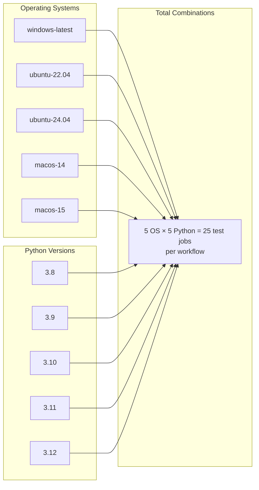
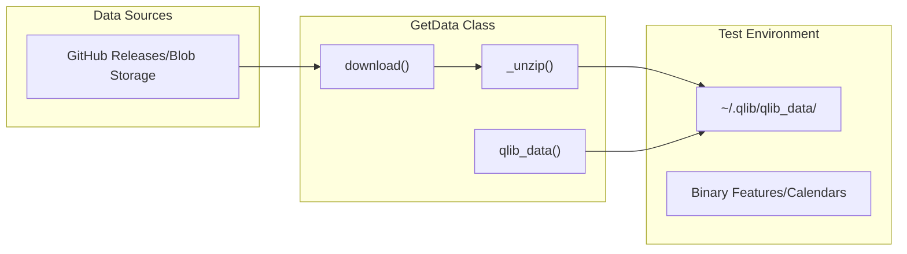
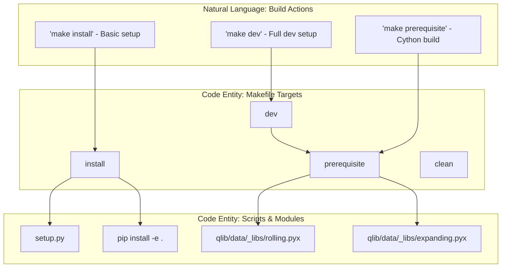
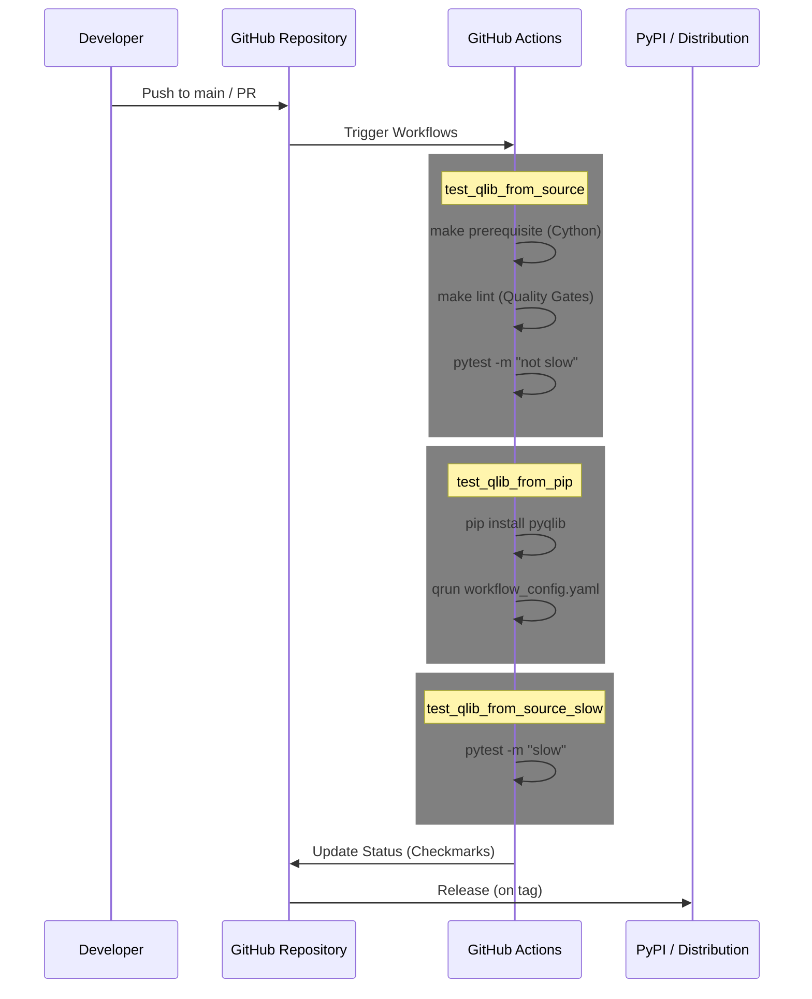

<!-- source: DeepWiki mcp.deepwiki.com · repo microsoft/qlib · page 11.2 Testing Infrastructure and CI/CD · fetched 2026-10-26 -->

# Testing Infrastructure and CI/CD

Relevant source files

The following files were used as context for generating this wiki page:

- [.commitlintrc.js](.commitlintrc.js)
- [.github/PULL_REQUEST_TEMPLATE.md](.github/PULL_REQUEST_TEMPLATE.md)
- [.github/workflows/lint_title.yml](.github/workflows/lint_title.yml)
- [.github/workflows/release.yml](.github/workflows/release.yml)
- [.github/workflows/test_qlib_from_pip.yml](.github/workflows/test_qlib_from_pip.yml)
- [.github/workflows/test_qlib_from_source.yml](.github/workflows/test_qlib_from_source.yml)
- [.github/workflows/test_qlib_from_source_slow.yml](.github/workflows/test_qlib_from_source_slow.yml)
- [.pre-commit-config.yaml](.pre-commit-config.yaml)
- [Makefile](Makefile)
- [pyproject.toml](pyproject.toml)
- [qlib/data/client.py](qlib/data/client.py)
- [qlib/tests/__init__.py](qlib/tests/__init__.py)
- [qlib/tests/data.py](qlib/tests/data.py)
- [setup.py](setup.py)
- [tests/ops/test_elem_operator.py](tests/ops/test_elem_operator.py)
- [tests/ops/test_special_ops.py](tests/ops/test_special_ops.py)
- [tests/test_dump_data.py](tests/test_dump_data.py)
- [tests/test_get_data.py](tests/test_get_data.py)
- [tests/test_pit.py](tests/test_pit.py)
- [tests/test_register_ops.py](tests/test_register_ops.py)

## Purpose and Scope

This page documents Qlib's comprehensive testing infrastructure and continuous integration/continuous deployment (CI/CD) system. It covers the GitHub Actions workflows, test matrix across operating systems and Python versions, quality gates including linting and type checking, test organization, and development automation through the `Makefile`.

The testing infrastructure ensures code quality, cross-platform compatibility, and regression prevention through automated testing on every push and pull request to the `main` branch.

---

## GitHub Actions Workflow Architecture

Qlib employs three primary GitHub Actions workflows to validate code changes. Each workflow serves a specific purpose in the validation pipeline, ranging from fast linting to long-running integration tests.

### Workflow Overview

```mermaid
graph TB
    PushPR["on: push/pull_request<br/>branches: [main]"]
    
    subgraph "Parallel CI Workflows"
        SourceFast["test_qlib_from_source.yml<br/>timeout-minutes: 180"]
        PipTest["test_qlib_from_pip.yml<br/>timeout-minutes: 120"]
        SourceSlow["test_qlib_from_source_slow.yml<br/>timeout-minutes: 720"]
    end
    
    subgraph "test_qlib_from_source.yml Steps"
        Checkout1["actions/checkout@v4<br/>fetch-depth: 0"]
        SetupPython1["actions/setup-python@v4<br/>matrix.python-version"]
        UpdatePip1["python -m pip install --upgrade pip"]
        InstallPyTorch1["pip install torch<br/>(--extra-index-url for ubuntu)"]
        MakeDev["make dev<br/>(prerequisite + all extras)"]
        LintBlack["black . -l 120 --check --diff"]
        DocsGen["make docs-gen<br/>(ubuntu-22.04 only)"]
        LintPylint["make pylint"]
        LintFlake8["make flake8"]
        LintMypy["make mypy"]
        LintNbqa["make nbqa"]
        DataDownload["scripts/get_data.py qlib_data"]
        InstallLightGBM["brew install libomp<br/>pip install --no-binary lightgbm<br/>(macos only)"]
        NbConvert["make nbconvert"]
        WorkflowTest["python qlib/cli/run.py<br/>workflow_config_lightgbm_Alpha158.yaml"]
        UnitTests["pytest . -m 'not slow'<br/>timeout_minutes: 60, max_attempts: 3"]
    end
    
    subgraph "test_qlib_from_pip.yml Steps"
        Checkout2["actions/checkout@v4"]
        SetupPython2["actions/setup-python@v4"]
        PipInstall["pip install pyqlib"]
        DataDownload2["python -m qlib.cli.data qlib_data"]
        WorkflowTest2["qrun examples/benchmarks/..."]
    end
    
    subgraph "test_qlib_from_source_slow.yml Steps"
        Checkout3["actions/checkout@v4"]
        SetupPython3["actions/setup-python@v4"]
        MakeDev3["make dev"]
        DataDownload3["scripts/get_data.py qlib_data"]
        SlowTests["pytest . -m 'slow'<br/>timeout_minutes: 240, max_attempts: 3"]
    end
    
    PushPR --> SourceFast
    PushPR --> PipTest
    PushPR --> SourceSlow
    
    SourceFast --> Checkout1
    PipTest --> Checkout2
    SourceSlow --> Checkout3
```

**Sources:** [.github/workflows/test_qlib_from_source.yml:1-136](), [.github/workflows/test_qlib_from_pip.yml:1-61](), [.github/workflows/test_qlib_from_source_slow.yml:1-61]()

### Workflow Details

| Workflow | Timeout | Purpose | Key Validations |
|----------|---------|---------|-----------------|
| `test_qlib_from_source` | 180 min | Primary CI gate | Linting, Docs, Fast Unit Tests, CLI Workflows |
| `test_qlib_from_pip` | 120 min | PyPI validation | `pip install pyqlib` and `qrun` functionality |
| `test_qlib_from_source_slow` | 720 min | Deep validation | Long-running tests marked with `@pytest.mark.slow` |

**Sources:** [.github/workflows/test_qlib_from_source.yml:15](), [.github/workflows/test_qlib_from_pip.yml:15](), [.github/workflows/test_qlib_from_source_slow.yml:15]()

---

## Test Matrix Configuration

Qlib tests across a comprehensive matrix of operating systems and Python versions to ensure cross-platform compatibility.

### Matrix Dimensions

**Sources:** [.github/workflows/test_qlib_from_source.yml:21-25](), [.github/workflows/test_qlib_from_pip.yml:20-24](), [pyproject.toml:14-18]()

### Platform-Specific Handling

The CI system includes logic for platform-specific dependencies and execution constraints:

*   **PyTorch Installation**: Ubuntu uses `--extra-index-url https://download.pytorch.org/whl/cpu` for CPU-optimized builds [.github/workflows/test_qlib_from_source.yml:48-50]().
*   **LightGBM on macOS**: Requires `libomp` via Homebrew and must be installed with `--no-binary=:all:` to ensure proper linking [.github/workflows/test_qlib_from_source.yml:95-100]().
*   **macOS Multithreading**: To prevent Segmentation Faults caused by OpenMP conflicts, macOS tests set `OMP_NUM_THREADS`, `MKL_NUM_THREADS`, and `NUMEXPR_NUM_THREADS` to `1` [.github/workflows/test_qlib_from_source.yml:118-123]().
*   **Windows Cython**: The `Makefile` installs `pywinpty` as a binary for Jupyter support on Windows [Makefile:71-73]().

---

## Quality Gates and Linting

Qlib enforces strict code quality through multiple automated tools. These are configured as targets in the `Makefile` and executed in the `test_qlib_from_source` workflow.

### Linting Pipeline

| Tool | Makefile Target | Purpose | Configuration |
|------|-----------------|---------|---------------|
| **Black** | `make black` | Formatting | Line length 120, excludes `qlib/_version.py` [Makefile:118-119]() |
| **Pylint** | `make pylint` | Static Analysis | Disables specific warnings, recursion limit 2000 [Makefile:150-152]() |
| **Flake8** | `make flake8` | Style Guide | Ignores E501 (line length), E266 (block comments) [Makefile:154-175]() |
| **Mypy** | `make mypy` | Type Checking | Version constrained to `<1.5.0` [pyproject.toml:76]() |
| **Nbqa** | `make nbqa` | Notebook Linting | Runs Black on `.ipynb` files [Makefile:184-186]() |

**Sources:** [Makefile:117-193](), [.github/workflows/test_qlib_from_source.yml:61-89]()

---

## Test Organization and Execution

Qlib uses `pytest` with custom markers to organize tests by execution speed.

### Test Execution Commands

| Suite | Command | Context |
|-------|---------|---------|
| **Fast Tests** | `python -m pytest . -m "not slow" --durations=0` | Every PR push [.github/workflows/test_qlib_from_source.yml:125]() |
| **Slow Tests** | `python -m pytest . -m "slow" --durations=0` | Scheduled/Deep validation [.github/workflows/test_qlib_from_source_slow.yml:60]() |
| **Workflow** | `python qlib/cli/run.py examples/benchmarks/...` | CLI integration test [.github/workflows/test_qlib_from_source.yml:109]() |

### Data Dependency Management

Tests rely on `GetData` in `qlib/tests/data.py` to fetch sample datasets (e.g., `qlib_data_simple`) from remote repositories [qlib/tests/data.py:18-162]().

**Sources:** [qlib/tests/data.py:18-182](), [qlib/tests/__init__.py:35-52]()

---

## Makefile Development Automation

The `Makefile` serves as the primary entry point for developers to set up environments and run quality checks.

### Core Targets and Entity Mapping

**Sources:** [Makefile:61-112](), [setup.py:9-24]()

### Dependency Groups (Extras)

Qlib defines several optional dependency groups in `pyproject.toml` [pyproject.toml:59-108](), which are mapped to Makefile targets:

*   **`make develop`**: Installs `pytest` and `statsmodels` [Makefile:85-86]().
*   **`make lint`**: Installs `black`, `pylint`, `mypy`, `flake8`, `nbqa` [Makefile:88-89]().
*   **`make rl`**: Installs `tianshou` and `torch` [Makefile:82-83]().
*   **`make docs`**: Installs `sphinx` and `sphinx_rtd_theme` [Makefile:91-92]().

---

## CI/CD Pipeline Summary

The Qlib CI/CD pipeline ensures that every code change is validated across 25 environment combinations.

### Workflow Integration Diagram

**Sources:** [.github/workflows/test_qlib_from_source.yml:1-136](), [.github/workflows/test_qlib_from_pip.yml:1-61](), [.github/workflows/test_qlib_from_source_slow.yml:1-61]()

---

