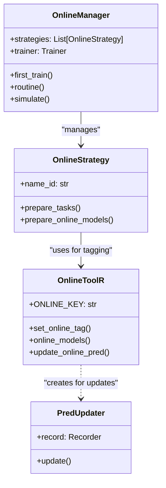
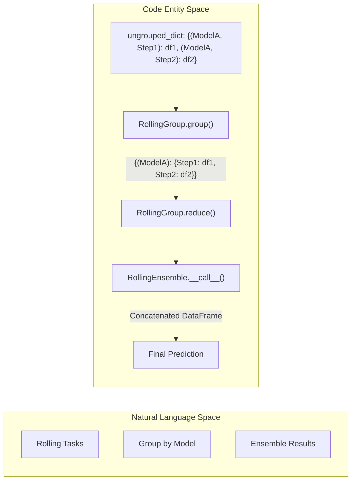

<!-- source: DeepWiki mcp.deepwiki.com · repo microsoft/qlib · page 11.3 Code Standards and Developer Guide · fetched 2026-10-26 -->

# Code Standards and Developer Guide

<details>
<summary>Relevant source files</summary>

The following files were used as context for generating this wiki page:

- [docs/developer/code_standard_and_dev_guide.rst](docs/developer/code_standard_and_dev_guide.rst)
- [docs/hidden/client.rst](docs/hidden/client.rst)
- [examples/online_srv/online_management_simulate.py](examples/online_srv/online_management_simulate.py)
- [examples/online_srv/rolling_online_management.py](examples/online_srv/rolling_online_management.py)
- [qlib/model/ens/ensemble.py](qlib/model/ens/ensemble.py)
- [qlib/model/ens/group.py](qlib/model/ens/group.py)
- [qlib/utils/exceptions.py](qlib/utils/exceptions.py)
- [qlib/utils/serial.py](qlib/utils/serial.py)
- [qlib/workflow/online/manager.py](qlib/workflow/online/manager.py)
- [qlib/workflow/online/strategy.py](qlib/workflow/online/strategy.py)
- [qlib/workflow/online/update.py](qlib/workflow/online/update.py)
- [qlib/workflow/online/utils.py](qlib/workflow/online/utils.py)

</details>


This guide documents the coding conventions, serialization patterns, and development workflows for contributing to the Qlib codebase. It provides technical details on how to implement new components while maintaining compatibility with Qlib's automated experiment tracking and online serving infrastructure.

## 1. Coding Standards and CI/CD

Qlib enforces strict code quality standards through automated Continuous Integration (CI) tools. Developers are expected to align their contributions with these standards before submitting Pull Requests.

### 1.1. Code Formatting and Linting
Qlib uses several tools to ensure code readability and consistency:

| Tool | Purpose | Command |
| :--- | :--- | :--- |
| **Black** | Code formatting (line length 120) | `python -m black . -l 120` |
| **Flake8** | Style guide enforcement | `flake8 --ignore <codes> qlib` |
| **Pylint** | Static code analysis | `pylint qlib` |
| **Numpydoc** | Docstring standard | Use Numpydoc Style for all public APIs |

### 1.2. Pre-commit Hooks
To simplify compliance, Qlib includes a `pre-commit` configuration that runs formatting and linting automatically during the `git commit` process.

Sources: [docs/developer/code_standard_and_dev_guide.rst:7-51]()

## 2. Serialization Framework (`Serializable`)

The `Serializable` class is a core utility in Qlib designed to manage how objects are persisted to disk. It extends standard Python pickling by providing fine-grained control over which attributes are kept or dropped [qlib/utils/serial.py:11-25]().

### 2.1. Serialization Logic
The logic for keeping an attribute during serialization follows this priority [qlib/utils/serial.py:38-45]():
1. **Config Attributes**: Attributes in `_include` or `_exclude` (set via `config()`) have the highest priority [qlib/utils/serial.py:39-44]().
2. **Class Defaults**: Attributes in `include_attr` or `exclude_attr` defined at the class level [qlib/utils/serial.py:73-76]().
3. **Naming Convention**: Public attributes (not starting with `_`) are kept by default. Private attributes (starting with `_`) are dropped unless `dump_all` is set to `True` [qlib/utils/serial.py:45-45]().

### 2.2. Key Methods
- `config(recursive=False, **kwargs)`: Configures serialization behavior (e.g., `exclude=['data']`) [qlib/utils/serial.py:81-113]().
- `to_pickle(path, **kwargs)`: Dumps the object to a file using the configured backend (pickle or dill) [qlib/utils/serial.py:115-134]().
- `load(filepath)`: Class method to restore an object from disk with type validation [qlib/utils/serial.py:136-154]().

**Serialization Data Flow**
```mermaid
graph TD
    "Instance" -- "config(exclude=['_cache'])" --> "Internal_State"
    "Internal_State" -- "__getstate__()" --> "Filtered_Dict"
    "Filtered_Dict" -- "get_backend().dump()" --> "Disk_File(.pkl)"
    "Disk_File(.pkl)" -- "Serializable.load()" --> "New_Instance"
    "New_Instance" -- "__setstate__()" --> "Restored_State"
```
Sources: [qlib/utils/serial.py:11-190]()

## 3. Online Serving and Management

The `OnlineManager` manages the lifecycle of `OnlineStrategy` instances, handling model updates, signal preparation, and routine execution [qlib/workflow/online/manager.py:101-105]().

### 3.1. OnlineManager Workflow
The manager supports four primary operating modes based on the combination of Environment (Online/Simulation) and Trainer type (Trainer/DelayTrainer) [qlib/workflow/online/manager.py:18-36]().

| Situation | Description |
| :--- | :--- |
| **Online + Trainer** | Real-time routine. Models are trained task-by-task as they are prepared [qlib/workflow/online/manager.py:44-58](). |
| **Online + DelayTrainer** | Parallelizes training at the end of a routine to prevent bottlenecks [qlib/workflow/online/manager.py:24-27](). |
| **Simulation + DelayTrainer** | Used for historical backtesting of online strategies where models have no temporal dependency [qlib/workflow/online/manager.py:63-78](). |

### 3.2. Online Tooling and Tags
The `OnlineToolR` (Recorder-based implementation) manages which models are currently "active" for prediction using tags in the `Recorder` [qlib/workflow/online/utils.py:87-90]().

- `ONLINE_TAG`: Marks a model as active for serving [qlib/workflow/online/utils.py:25-25]().
- `OFFLINE_TAG`: Marks a model as inactive [qlib/workflow/online/utils.py:26-26]().
- `update_online_pred()`: Automatically iterates through all models tagged as `online` and updates their `pred.pkl` using a `PredUpdater` [qlib/workflow/online/utils.py:159-178]().

**Online Management Entity Relationship**

Sources: [qlib/workflow/online/manager.py:101-144](), [qlib/workflow/online/utils.py:87-188](), [qlib/workflow/online/strategy.py:19-91]()

## 4. Model Ensemble and Grouping

Qlib provides a framework for merging results from multiple models (e.g., in rolling window scenarios) into a single ensemble artifact [qlib/model/ens/ensemble.py:4-6]().

### 4.1. Ensemble Classes
- `RollingEnsemble`: Merges a dictionary of DataFrames (e.g., rolling predictions) by concatenating them and handling overlaps by keeping the latest data [qlib/model/ens/ensemble.py:65-88]().
- `AverageEnsemble`: Flattens a nested dictionary of predictions, standardizes them (Z-score) per timestamp, and calculates the mean [qlib/model/ens/ensemble.py:91-132]().

### 4.2. Grouping Logic
The `Group` and `RollingGroup` classes facilitate the transition from individual tasks to ensemble results [qlib/model/ens/group.py:4-12]().
- `RollingGroup`: Assumes the rolling key is the last element of a key tuple and groups values for the `RollingEnsemble` to process [qlib/model/ens/group.py:92-115]().

**Grouping and Reducing Data Flow**

Sources: [qlib/model/ens/ensemble.py:14-132](), [qlib/model/ens/group.py:20-115]()

## 5. Development Utilities

### 5.1. Update Infrastructure
The `RMDLoader` (Recorder Model Dataset Loader) is used to reconstruct a `DatasetH` from a `Recorder` for inference during updates [qlib/workflow/online/update.py:21-60](). The `DSBasedUpdater` provides a foundation for updating multi-level index DataFrames like labels or predictions [qlib/workflow/online/update.py:82-102]().

### 5.2. Custom Exceptions
Qlib uses a hierarchy of custom exceptions for error handling [qlib/utils/exceptions.py:5-20]():
- `QlibException`: Base class for all Qlib-specific errors [qlib/utils/exceptions.py:6-7]().
- `LoadObjectError`: Raised when a `Recorder` fails to load an object (e.g., missing `pred.pkl`) [qlib/utils/exceptions.py:14-15]().
- `ExpAlreadyExistError`: Raised during experiment creation if the name is already taken [qlib/utils/exceptions.py:18-19]().

Sources: [qlib/workflow/online/update.py:21-112](), [qlib/utils/exceptions.py:1-20]()

---

